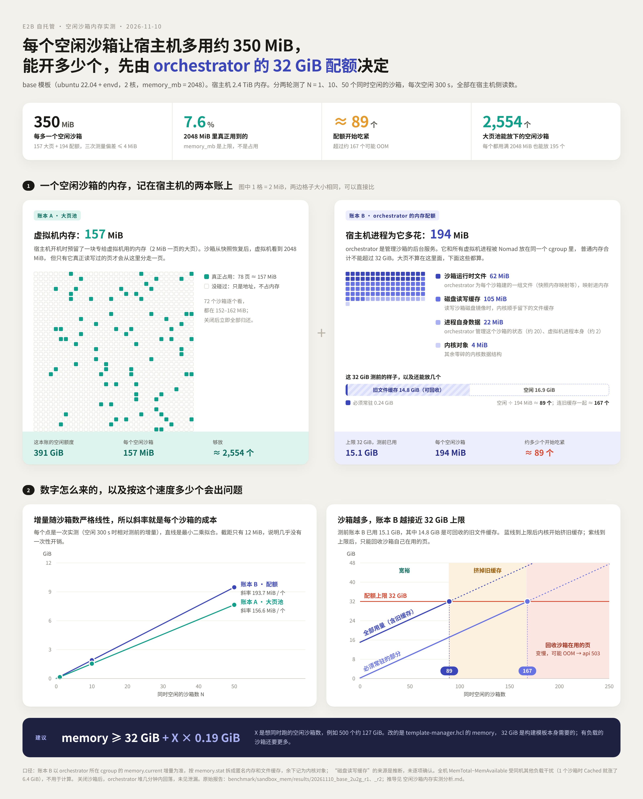

# 空闲沙箱内存占用测量

测一个空闲沙箱让宿主机多用多少内存、这些内存记在哪里，以及据此估算能同时开多少个。

**结论**（2026-11-10，base 模板，2 核，memory_mb = 2048）：每个空闲沙箱让宿主机多用约 350 MiB，分两部分：

- 大页池里的客户机内存：157 MiB
- orchestrator 所在 cgroup 里的普通内存：194 MiB

并发上限由 orchestrator 的 32 GiB cgroup 配额决定，不是大页池：约 89 个沙箱时配额开始吃紧。详见下表中的分析文档。



## 文件

| 文件 | 作用 |
|---|---|
| [`沙箱内存占用测量.md`](沙箱内存占用测量.md) | 原理：沙箱内存由哪几部分组成，各从哪里读数；测量步骤；怎么读报告 |
| [`空闲沙箱内存实测分析.md`](空闲沙箱内存实测分析.md) | 两轮实测的完整分析和结论 |
| `measure_idle_mem.sh` | 一键测量：基线 → 起 N 个空闲沙箱 → T1、T2 各采一次 → 关闭沙箱 → T3 再采一次 → 生成报告 |
| `mem_snap.sh` | 采一次宿主机内存快照：大页、firecracker smaps、orchestrator cgroup、meminfo |
| `idle_sandbox.py` | 用 E2B SDK 起 N 个沙箱并保持空闲，由 `measure_idle_mem.sh` 调用 |
| `results/20261110_base_2u2g_r1/`、`_r2/` | 两轮实测的原始报告 |
| `results/draw_idle_mem.py` | 从原始报告解析、拟合并生成展示图（`idle_sandbox_mem.png`，排版源文件 `.html`） |
| `mem_runs/` | 在服务器上运行时生成的测量结果，不入库 |

## 运行

在服务器上用 root 运行，从哪个目录执行都可以，脚本会先切到自己所在的目录：

```bash
cd /path/to/e2b-infra/benchmark/sandbox_mem
```

```bash
bash measure_idle_mem.sh 1
```

```bash
bash measure_idle_mem.sh 10
```

```bash
bash measure_idle_mem.sh 50
```

参数和读报告的方法见 [`沙箱内存占用测量.md`](沙箱内存占用测量.md) §4。

**凭据（`.env`）**：`idle_sandbox.py` 读取上一级的 `benchmark/.env`，和 `sandbox.py`、`run_benchmark.py` 共用同一份，不用另外复制。
如果这个目录里也放了 `.env`，以它为准；命令行上设置的环境变量优先级最高。

## 重新生成展示图

```bash
python3 results/draw_idle_mem.py
```

脚本只用 Python 标准库。PNG 由 node 的 playwright 调用 Chromium 截图生成；没有 node 的话只生成 HTML。
