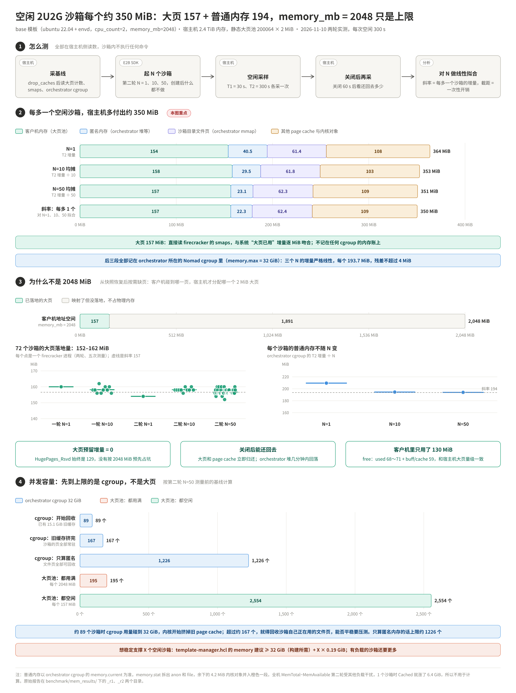

# 空闲沙箱内存实测分析（2026-11-10，base 模板 2U2G）

> 问题：基于 `build_template.py` 构建的 2U2G 模板（`cpu_count=2, memory_mb=2048`）起一个沙箱、
> 什么也不干，宿主机实际要付出多少内存？和模板规格是什么关系？
>
> 原理和测法见 [`沙箱内存占用测量.md`](沙箱内存占用测量.md)。本篇只分析实测数据。
> 原始报告：[`mem_results/20261110_base_2u2g_r1/`](mem_results/20261110_base_2u2g_r1/)（第一轮，N=1、10）、
> [`mem_results/20261110_base_2u2g_r2/`](mem_results/20261110_base_2u2g_r2/)（第二轮，N=1、10、50，加了 cgroup 读数）。
> 图和文中的拟合值由 [`mem_results/draw_idle_mem.py`](mem_results/draw_idle_mem.py) 从报告文件直接解析计算。



---

## 0. 结论速查

| # | 结论 | 依据 |
|---|---|---|
| 1 | 每多一个空闲沙箱，宿主机多付出约 **350 MiB**：**大页 157 MiB + 普通内存 194 MiB** | 对 N=1、10、50 线性拟合，§2 |
| 2 | **大页**：72 个沙箱个个在 152～162 MiB；按需落地、不预留（`Rsvd` 增量 0）；关闭后全部归还 | 两轮五次测量，§3 |
| 3 | `memory_mb = 2048` 是**上限，不是占用**：空闲时客户机只碰了其中 7.7% | §4 |
| 4 | **普通内存** 194 MiB 全部记在 orchestrator 的 Nomad cgroup 里：page cache 167（其中 62 是 orchestrator mmap 的沙箱目录文件）、匿名内存 22、其他 4 | 第二轮 cgroup 读数，§5 |
| 5 | 关闭后：大页和 page cache 立即归还；orchestrator 的堆要几分钟才回落，**没有发现泄漏** | §5.3 |
| 6 | **并发容量先受 cgroup 限制，而不是大页**：约 89 个沙箱时 cgroup 用量碰到 32 GiB 上限，开始回收旧缓存；超过约 167 个就要回收沙箱自己的页 | §6 |
| 7 | 第一轮遗留的"未归因 97 MiB"已经查清，是 orchestrator 没有 mmap 的那部分 page cache（第二轮测得 105 MiB） | §5.2 |

---

## 1. 实验条件

| 项 | 值 |
|---|---|
| 模板 | `base`（`build_template.py`：ubuntu 22.04 定制镜像 + envd），`cpu_count=2`，`memory_mb=2048` |
| 宿主机 | `MemTotal` 2553129 MiB（约 2.4 TiB），和其他业务同机 |
| 大页池 | 静态池 `nr_hugepages=200064` × 2 MiB；测量前空闲 200026 个（400052 MiB）；`surplus=0` |
| orchestrator cgroup | `nomad.slice/share.slice/<alloc>.start.scope`，`memory.max = 32768 MiB`；测量前用量约 15.4 GiB，其中 15.2 GiB 是 page cache |
| 第一轮 | 15:52～16:04，`measure_idle_mem.sh 1`、`10`（T1 = 30 s，T2 = 300 s） |
| 第二轮 | 16:56～17:22，`measure_idle_mem.sh 1`、`10`、`50`（另加 T3 = 关闭后 60 s），脚本新增 cgroup、RssAnon/RssFile 等读数 |

基线里有 38 个已用大页、129 个 `Rsvd` 大页，当时 firecracker 进程数为 0，属于本实验以外的使用者。下文全部用增量，不受影响。

**两轮之间宿主机的其他负载变化很大**：全机 `MemTotal-MemAvailable` 从约 465 GiB（476108 MiB）涨到约 572 GiB（585925 MiB）。
第二轮 N=1 时，全机 `Cached` 在 5 分钟里涨了 6.4 GiB，而这个沙箱所在 cgroup 的 page cache 只涨了 168 MiB。
所以**全机口径（`MemTotal-MemAvailable`、`/proc/meminfo` 各项）在第二轮不能用**，普通内存一律以 cgroup 读数为准。

## 2. 数据与计算

### 2.1 第二轮 T2 增量（T2 − 基线，MiB）

| 项 | N=1 | N=10 | N=50 | 拟合斜率 | 截距 |
|---|---:|---:|---:|---:|---:|
| ① 客户机大页（firecracker smaps） | 154.0 | 1582.0 | 7834.0 | **156.6** | 5.7 |
| 　大页已用（系统计数） | 154.0 | 1582.0 | 7834.0 | 同上 | |
| 　大页 `Rsvd` | 0 | 0 | 0 | 0 | |
| orch cgroup `memory.current` | 209.5 | 1945.6 | 9699.7 | **193.7** | 12.4 |
| 　其中 anon | 40.5 | 294.9 | 1152.6 | 22.3 | |
| 　其中 file（page cache） | 168.5 | 1648.2 | 8353.6 | 167.2 | |
| 　其中其他（current − anon − file） | 0.5 | 2.5 | 193.5 | 4.2 | |
| orchestrator RssFile | 61.4 | 618.3 | 3117.1 | 62.4 | |
| `/orchestrator/sandbox` 目录大小 | 62.0 | 619.9 | 3099.3 | 62.0 | |
| orchestrator RssAnon | 38.0 | 274.6 | 1037.3 | 20.0 | |
| firecracker PSS | 4.2 | 22.3 | 117.9 | 2.3 | |

斜率是对 N = 1、10、50 三点做最小二乘的结果，就是"每多一个沙箱"的边际增量；截距是一次性开销。
cgroup 用量三点的拟合残差不超过 4.1 MiB，**严格线性**。分两段算斜率也一致：N=1→10 为 192.9，N=10→50 为 193.9。

### 2.2 每个沙箱的构成（斜率，MiB）

```
大页池   156.6   客户机内存，不记在任何 cgroup 的内存账上
cgroup   193.7 = 匿名 22.3（orchestrator 堆约 20.0 + firecracker 约 2.3）
               + 文件页 167.2（沙箱目录 mmap 62.4 + 其他 page cache 104.8）
               + 其他 4.2（内核对象等）
合计     350.3
```

几处交叉核对：

- **大页的两种读法完全一致**：按进程读（smaps）和按系统读（`nr + surplus − free`）三次都相同，一个 MiB 不差。
- **沙箱目录 ≈ orchestrator 文件页**：`/orchestrator/sandbox` 每个沙箱正好 62.0 MiB，orchestrator 的 RssFile 每个沙箱 62.4 MiB。
  说明 orchestrator 把每个沙箱在这个目录下的运行态文件 mmap 进来了，这些页都在内存里。
- **匿名内存的两种读法一致**：cgroup anon 斜率 22.3 ≈ orchestrator RssAnon 20.0 + firecracker 2.3。
- **和第一轮对得上**：第一轮用全机口径估的普通内存边际值是 180 MiB，第二轮 cgroup 测得 194 MiB，相差 7%，在全机口径的噪声范围内。

## 3. 大页：每个沙箱 157 MiB，是硬数据

1. **个体一致**：两轮五次测量共 72 个 firecracker，每个落地 152～162 MiB，最多相差 5 个大页。
   第一轮 N=1、10 的均值是 160、158.2，第二轮 N=1、10、50 是 154、158.2、156.7。
2. **不预留**：`HugePages_Rsvd` 五次都没变。如果映射时按 `memory_mb` 预留，N=50 时应增加约 50 × (2048 − 157) ≈ 94550 MiB。
3. **可归还**：五次测量结束后 `HugePages_Free` 都回到 200026。
4. **空闲时缓慢增长**：T1（30 s）→ T2（300 s）每个沙箱多 4～8 MiB（2～4 个大页）。第一轮 4 MiB，第二轮 7～8 MiB。
   客户机没有 balloon，碰过的页不会还回来，所以这个值只增不减。

**客户机视角**：客户机内 `MemTotal − MemFree` 约 130 MiB（`used 68～71 + buff/cache 59`），
另有约 57 MiB 被客户机内核在启动时保留（`2048 − MemTotal 1990.7`），不计入 `MemTotal`。
宿主机落地的 152～162 MiB 落在 130 到 187 之间，量级一致。这不是严格等式：客户机里"用了"的页不一定在恢复后被碰过，
"空闲"的页也可能恢复后被碰过又释放，再加上 2 MiB 取整。

## 4. memory_mb 是上限，不是占用

沙箱是**从模板快照恢复**的，不是冷启动：

1. 构建模板时，VM 按 `memory_mb=2048` 启动，跑完 provision 后打快照，内存内容存成 `memfile`。
2. 创建沙箱时，firecracker 按 2048 MiB **映射**一段大页地址空间，但不立刻分配物理页，也不预留（§3 第 2 条）。
3. 客户机访问到哪一页就触发缺页，orchestrator 通过 UFFD 把 memfile 里对应的内容拷进去，宿主机这时才真正分配一个 2 MiB 大页。

所以宿主机付出的是**恢复之后客户机实际碰过的页**：157 MiB 落地，另外 1891 MiB 只是映射，不占物理内存。

| 规格 | 对空闲占用的影响 |
|---|---|
| `memory_mb` | 只是上限：空闲时占 7.7%。长期运行或跑过重任务后会往 2048 MiB 靠 |
| `cpu_count` | 只测了 2 vCPU，没有数值。机制上每个 vCPU 只多一个线程和少量内核 per-CPU 数据 |
| 镜像内容 | 决定快照时刻的常驻工作集，是 157 MiB 的主要来源 |

> 要定量说明大页占用和 `memory_mb` 的关系，需要用同一镜像构建 `memory_mb=1024 / 4096` 的模板对比，本次没做。

## 5. 普通内存：每个沙箱 194 MiB，记在 orchestrator 的 cgroup 上

### 5.1 为什么全部记在这个 cgroup

orchestrator 和每个沙箱的 firecracker 进程都在同一个 Nomad task cgroup 里（`deploy-docs/12` §1）。
客户机大页走 hugetlb，不进 memory 控制器；除此之外，这两个进程产生的匿名内存、它们读写文件产生的 page cache、
内核对象，都记在这个 cgroup 的 `memory.current` 上，受 `memory.max = 32 GiB` 约束。

### 5.2 构成

| 部分 | 每个沙箱 | 是什么 | 能否回收 |
|---|---:|---|---|
| 沙箱目录文件页 | 62.4 MiB | orchestrator mmap 的 `/orchestrator/sandbox/<沙箱>` 下的运行态文件，大小和目录完全吻合 | 原理上可以，但沙箱运行时一直在用 |
| 其他 page cache | 104.8 MiB | 没被 orchestrator mmap 的文件页。合理推测是 rootfs 经 NBD 的读写，以及读模板文件产生的缓存，**本次没逐项确认** | 干净页可以直接丢；脏页要先写回 |
| 匿名内存 | 22.3 MiB | orchestrator 的 Go 堆约 20.0，firecracker 自身约 2.3 | 不能 |
| 其他 | 4.2 MiB | `memory.current − anon − file`，主要是内核对象 | 大部分不能 |

第一轮的"未归因 97 MiB"就是这里的"其他 page cache"（105 MiB）。第一轮的"orchestrator RSS 81 MiB"
则是"沙箱目录文件页 62 + Go 堆约 20"。两轮的数据自洽。

第一轮的估计略低（97 对 105），原因在 `MemAvailable` 的算法：它会把一部分 page cache 算作"可用"，所以全机口径低估了文件页。

**空闲时也在慢慢涨**：T1 → T2 每个沙箱的 cgroup 用量又多了约 17～18 MiB，几乎都是 page cache（N=50 时 file +19.4、anon −4.8）。
来源没有确认，可能是客户机的后台磁盘活动经 NBD 产生的缓存。

### 5.3 关闭后

| | 大页残留 | cgroup file 残留 | orchestrator 匿名内存残留 |
|---|---:|---:|---:|
| N=1 | 0 | 5.5 | 58.6 |
| N=10 | 0 | 15.7 | 274.6 |
| N=50 | 0 | 95.2 | 801.6 |

- 大页和 page cache 在关闭后 60 s 内基本全部归还：沙箱目录被删掉，对应的缓存也就没了。
- orchestrator 的匿名内存 60 s 内没回落，但**到下一轮开始时已经回落**：
  N=1 结束时是 183.1，几分钟后 N=10 的基线是 131.9；N=10 结束时是 406.5，N=50 的基线是 141.4。
  这符合 Go 运行时把空闲堆延迟还给系统的行为，不是泄漏。
  三次基线从 124.5 缓慢升到 141.4，样本太少，判断不了有没有微小泄漏。

## 6. 并发容量：先到上限的是 cgroup，不是大页

以第二轮 N=50 测量前的状态为基线：cgroup 用量 15431 MiB，其中 page cache 15186、匿名 141、其他 104。

| 约束 | 算法 | 能撑的空闲沙箱数 |
|---|---|---:|
| cgroup 开始回收 | (32768 − 15431) ÷ 193.7 | **89** |
| cgroup 旧缓存挤完 | (32768 − 245) ÷ 193.7：旧 page cache 全部回收，沙箱自己的页全部常驻 | **167** |
| cgroup 只算匿名 | (32768 − 245) ÷ (22.3 + 4.2)：文件页全部可回收 | 1226 |
| 大页池，都用满 | 400052 ÷ 2048 | 195 |
| 大页池，都空闲 | 400052 ÷ 156.6 | 2554 |

怎么读：

1. **0～89 个**：cgroup 用量低于上限，没有任何压力。
2. **89～167 个**：cgroup 用量碰到 32 GiB，内核开始在这个 cgroup 里回收那 15 GiB 旧 page cache（构建等留下的缓存）。
   它们大概率是干净页，可以直接丢，问题不大。
3. **超过约 167 个**：旧缓存挤完了，只能回收沙箱自己正在用的文件页。被回收的页下次访问要重新读盘，沙箱会变慢；
   如果有大量脏页来不及写回，还可能触发 memcg OOM，杀掉 orchestrator，api 随之恒 503（`deploy-docs/12`）。
   具体在多少个时出问题，要压测才知道。理论上限是只算匿名内存的约 1226 个。
4. 大页池在空闲时能撑 2554 个，远在 cgroup 之后。但大页**不预留**，如果大量沙箱同时把内存用起来，池子耗尽后缺页就分配不到大页，沙箱会出错。
   `deploy-docs/11` §3.2 按 `memory_mb` 算出的 195 个，就是有保证的下限。

**建议**：想稳定支撑 X 个空闲沙箱，`template-manager.hcl` 的 `memory` 至少要 32 GiB（构建所需，`deploy-docs/12`）+ X × 0.19 GiB。
例如 500 个约 127 GiB，在这台 2.4 TiB 的机器上没问题。改法和三处路径见 `deploy-docs/12` §3。
有负载的沙箱，page cache 和堆都会更大，这个公式只是下限。

> 本次没有验证 orchestrator / api 是否会按 `memory_mb` 做准入控制。如果有，上限由它决定。

## 7. 局限

- 只测了空闲：沙箱里没有跑任何进程。有负载时大页和 page cache 都会上升。
- 只有 300 s：更长时间的漂移没测；T1 → T2 显示大页和 page cache 都在缓慢增长。
- 只测了一种规格，`memory_mb`、`cpu_count` 的影响只能从机制推断。
- "其他 page cache 105 MiB"的具体来源没有逐项确认。
- 89 个以上的行为是推算，没有实测。如果要验证，可以在维护窗口里把 N 加到 150～200，同时盯 cgroup 的 `memory.events`（`max`、`oom_kill` 计数）和创建耗时。
  这台机器和其他业务同机，压测可能触发 orchestrator OOM，所以先调大 `memory` 或选空闲时段再测。
- 客户机视角的 `free -m` 在宿主机采完 T2 之后才执行，只用来核对量级。

## 8. 文件

| 文件 | 内容 |
|---|---|
| `mem_results/20261110_base_2u2g_r1/` | 第一轮：`report_n1.txt`、`report_n10.txt`、`host_context.txt`（测量前后的大页项和 `free -m`） |
| `mem_results/20261110_base_2u2g_r2/` | 第二轮：`report_n1.txt`、`report_n10.txt`、`report_n50.txt`、`host_context.txt`（测量前的 `mem_snap.sh`） |
| `mem_results/idle_sandbox_mem.png` / `.svg` | 本文的展示图 |
| `mem_results/draw_idle_mem.py` | 解析报告、拟合、画图（依赖 explainer-chart skill 的 kit，见文件头） |
