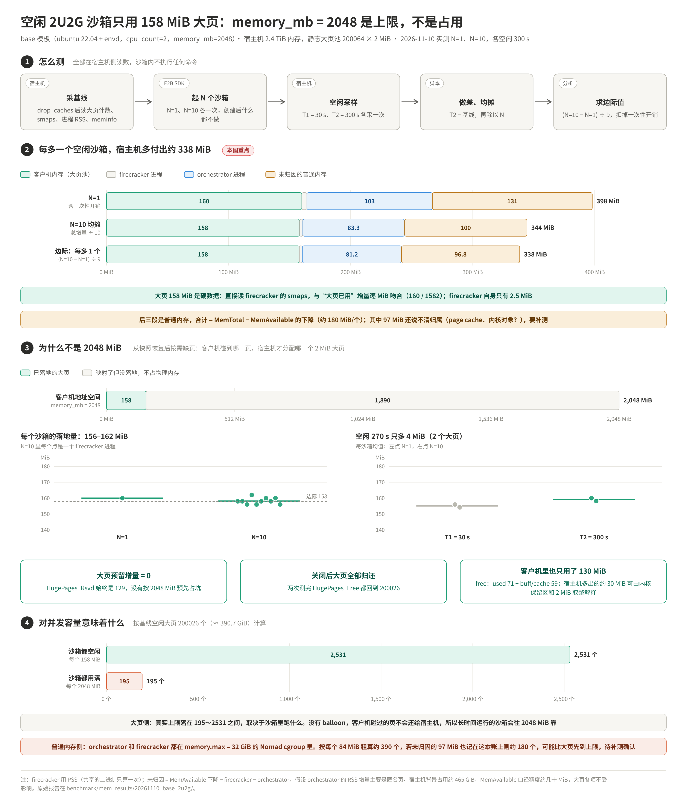

# 空闲沙箱内存实测分析（2026-11-10，base 模板 2U2G）

> 问题：基于 `build_template.py` 构建的 2U2G 模板（`cpu_count=2, memory_mb=2048`）起一个沙箱、
> 什么也不干，宿主机实际要付出多少内存？和模板规格是什么关系？
>
> 原理和测法见 [`沙箱内存占用测量.md`](沙箱内存占用测量.md)。本篇只分析这一次的实测数据。
> 原始报告：[`mem_results/20261110_base_2u2g/`](mem_results/20261110_base_2u2g/)。



---

## 0. 结论速查

| # | 结论 | 可信度 |
|---|---|---|
| 1 | 每多一个空闲沙箱，**大页池多用 158 MiB**，约为 `memory_mb` 的 7.7%。10 个沙箱个个都在 156～162 MiB | 硬数据 |
| 2 | 大页**按需落地、不预留**：`HugePages_Rsvd` 增量为 0；沙箱关闭后大页全部归还 | 硬数据 |
| 3 | 空闲 270 s 大页只多 4 MiB（2 个大页），短时间内基本稳定 | 硬数据 |
| 4 | 普通内存（大页池以外）每个沙箱约多用 **180 MiB**：firecracker 2.5 MiB，orchestrator 81 MiB，**其余约 97 MiB 还没归因** | 总量可信，构成待补测 |
| 5 | 合计每个空闲沙箱宿主机约付出 **338 MiB**（大页 158 + 普通内存 180） | 同上 |
| 6 | `memory_mb = 2048` 是**上限，不是占用**：它决定客户机最多能碰多少页，空闲时实际只碰了 158 MiB | 硬数据 + 机制 |
| 7 | 并发容量：大页侧在 195（全部用满）～2531（全部空闲）之间；普通内存侧可能先被 orchestrator 所在 cgroup 的 32 GiB 上限卡住（粗算 180～390 个） | 推论，待补测 |

**能直接下结论的是大页（1～3、6）；普通内存（4、5、7）的总量可信，但构成和是否计入 cgroup 要补测一次**（§7）。

---

## 1. 实验条件

| 项 | 值 |
|---|---|
| 模板 | `base`（`build_template.py`：ubuntu 22.04 定制镜像 + envd），`cpu_count=2`，`memory_mb=2048` |
| 宿主机 | `MemTotal` 2553129 MiB（约 2.4 TiB）；背景已用 476108 MiB（约 465 GiB，`MemTotal-MemAvailable`） |
| 大页池 | 静态池 `nr_hugepages=200064` × 2 MiB ≈ 390.8 GiB；基线空闲 200026 个；`surplus=0` |
| 页大小 | `PAGESIZE=4096`，`Hugepagesize=2048 kB` |
| 测量 | `measure_idle_mem.sh 1` 与 `measure_idle_mem.sh 10`，T1 = 30 s，T2 = 300 s（从全部创建完成算起） |
| 前置 | 测量前跑过一次 `sandbox.py`，模板缓存已热；测量期间宿主机上没有其他 firecracker |

基线里有 38 个已用大页、129 个 `Rsvd` 大页，当时 firecracker 进程数为 0，说明它们属于本实验以外的使用者。
本文所有结论都用**增量**，不受这部分影响。

## 2. 数据与计算

### 2.1 原始增量（T2 − 基线，MiB）

| 项 | N=1 | N=10 | 来源 |
|---|---:|---:|---|
| ① 客户机大页（firecracker smaps 的 `*_Hugetlb`） | 160.0 | 1582.0 | 报告第 1 行 |
| 　大页已用（`/sys/kernel/mm/hugepages`） | 160.0 | 1582.0 | 核对行 |
| 　大页 `Rsvd` | 0.0 | 0.0 | 核对行 |
| ② firecracker PSS（RSS） | 4.2（4.2） | 26.3（42.5） | |
| ③ orchestrator RSS | 102.8 | 833.5 | |
| ④ `MemTotal-MemAvailable`（普通内存） | 238.0 | 1862.3 | |
| `snapshot-cache` | 0.0 | 0.0 | 不是模板缓存，见 §5.3 |

### 2.2 每个沙箱的构成

大页池在开机时就从普通内存里划走了，分配大页不影响 `MemAvailable`。所以 ① 和 ④ 是**两本不重叠的账**：

```
宿主机总付出 = ① 大页 + ④ 普通内存
④ 普通内存   = ② firecracker + ③ orchestrator + 未归因
未归因       = ④ − ② − ③         （② 用 PSS：10 个 firecracker 共享的二进制只算一次）
```

| 每个沙箱（MiB） | ① 大页 | ② fc | ③ orch | 未归因 | 合计 |
|---|---:|---:|---:|---:|---:|
| N=1（含一次性开销） | 160.0 | 4.2 | 102.8 | 131.0 | 398.0 |
| N=10 均摊（÷10） | 158.2 | 2.6 | 83.4 | 100.3 | 344.4 |
| **边际：(N=10 − N=1) ÷ 9** | **158.0** | **2.5** | **81.2** | **96.8** | **338.5** |

边际值扣掉了"第一个沙箱才有"的开销（例如 orchestrator 内部结构初始化），最适合用来估容量。
N=1 与边际的差（约 60 MiB）就是这部分一次性开销，主要落在 ③ 和未归因里，大页几乎没有一次性开销（160 vs 158）。

## 3. 结论一：大页每个沙箱 158 MiB，是硬数据

四条互相独立的证据指向同一个数：

1. **两种读法完全吻合**。按进程读（firecracker `smaps` 的 hugetlb 页）和按系统读（`nr + surplus − free`）
   的增量都是 160 / 1582 MiB，一个 MiB 都不差。说明大页增量**全部**来自这些 firecracker，没有别的使用者混进来。
2. **个体一致**。N=10 时每个 firecracker 落地 156～162 MiB（均值 158.2），N=1 是 160。
   差异只有 ±3 个大页，说明这是模板决定的稳定值，不是偶然。
3. **短时间稳定**。T1（30 s）→ T2（300 s）每个沙箱只多 4 MiB（2 个大页），N=1 和 N=10 一样。
4. **可归还**。两次测量结束后 `HugePages_Free` 都回到基线的 200026，没有残留。

**客户机视角也对得上**：客户机内 `MemTotal − MemFree` = 130 MiB（`used 71 + buff/cache 59`）；
另有约 57 MiB 被客户机内核在启动时保留（`2048 − MemTotal 1990.7`，内核镜像、`struct page` 数组等），不计入 `MemTotal`。
宿主机落地的 158～160 MiB 落在"130"与"130 + 57"之间，多出的部分可以由内核保留区里被碰过的页、以及 2 MiB 取整来解释。
这里只说量级一致，不是严格等式：客户机里"用了"的页不一定在恢复后被碰过，"空闲"的页也可能恢复后被碰过又释放。

## 4. 结论二：memory_mb 是上限，不是占用

### 4.1 机制

沙箱是**从模板快照恢复**的，不是冷启动：

1. 构建模板时，VM 按 `memory_mb=2048` 启动、跑完 provision 后打快照，内存内容存成 `memfile`。
2. 创建沙箱时，firecracker 按 2048 MiB **映射**一段大页地址空间，但不立刻分配物理页。
3. 客户机访问到哪一页就触发缺页，orchestrator 通过 UFFD 把 memfile 里对应的内容拷进去，宿主机这时才真正分配一个 2 MiB 大页。

所以宿主机付出的是**恢复之后客户机实际碰过的页**（按 2 MiB 取整）。本次实测：碰了 158 MiB，另外 1890 MiB 只是映射，不占物理内存。

`Rsvd` 增量为 0 说明映射时**也没有预留**。如果有预留，N=1 时 `Rsvd` 应该增加约 2048 − 160 = 1888 MiB，N=10 时约 18898 MiB；实测都是 0。

### 4.2 和规格各项的关系

| 规格 | 对空闲占用的影响（本次数据能说明的部分） |
|---|---|
| `memory_mb` | 只是上限。空闲时占 158 MiB，约 7.7%。客户机没有 balloon，碰过的页不归还，长期运行或跑过重任务后会往 2048 MiB 靠 |
| `cpu_count` | 本次只测了 2 vCPU，无法给出数值；机制上每个 vCPU 只多一个线程和少量内核 per-CPU 数据，影响应很小 |
| 镜像内容 | 决定快照时刻的常驻工作集，是 158 MiB 的主要来源 |

> 要定量说"158 MiB 和 memory_mb 无关"，需要用同一镜像构建 `memory_mb=1024 / 4096` 的模板对比，本次没做。
> 机制上，`memory_mb` 越大，客户机 `struct page` 数组越大（约占 1.5%），空闲占用会略增。

## 5. 普通内存每个沙箱约 180 MiB：已知与未知

### 5.1 总量可信

N=1 增加 238 MiB，N=10 增加 1862 MiB，大致随 N 线性增长，边际约 180 MiB/个。
宿主机背景占用约 465 GiB，这个口径会有几十 MiB 的波动（两次基线就差了 51 MiB），
但 N=10 的 1862 MiB 远大于波动，**每个沙箱约 180 MiB 的量级可信**。

### 5.2 构成只拆清了一半

- **② firecracker：2.5 MiB/个**，可以忽略。
- **③ orchestrator：81 MiB/个**。它是 Go 进程，RSS 里既有堆，也可能有 mmap 的文件页。
  N=10 时 T1 → T2 反而降了 63.5 MiB，符合 Go 运行时把空闲内存慢慢还给系统的行为，
  说明里面有一部分是创建时的临时分配，不全是每个沙箱常驻的状态。
- **未归因：97 MiB/个**。候选来源有：读模板 memfile/rootfs 产生的 page cache、
  KVM/tap/NBD 等内核对象（slab、页表）、orchestrator RSS 之外的匿名内存。
  这次的脚本没采这些分项，**不能下结论**。

`MemAvailable` 是内核的估算值，不是精确计数。它把 page cache 和可回收 slab 只算一部分为"可用"，
所以 page cache 增长也会让 `MemTotal-MemAvailable` 上涨。测量前那次 `drop_caches` 让这个值一次降了
约 5.8 GiB（482061 → 476109 MiB），就是证据。所以"未归因"里可能有相当一部分是可回收缓存，不是真正的消耗。

### 5.3 关闭后没有立刻还回去

| | 基线 | 关闭沙箱后几秒（`free -m`） | 残留 |
|---|---:|---:|---:|
| N=1 | 476108.7 | 476285 | +176 MiB |
| N=10 | 476159.5 | 478062 | +1902 MiB |

大页已经全部归还，但普通内存在关闭后几秒内基本没有回落。原因可能是 orchestrator 的 Go 堆还没还给系统，
也可能是 page cache 留在内存里，或者真的有泄漏。本次数据**区分不了**。
N=10 开始前的基线比 N=1 结束时低了约 125 MiB（期间做过 `drop_caches`），说明至少有一部分是可回收的。

另外，`/mnt/snapshot-cache` 两次都是 0，是因为它是暂停/快照用的 tmpfs，不是模板缓存。
模板 memfile/rootfs 的本地缓存在 `/orchestrator/build`（`deploy-docs/10` §1）。原理文档初版写错了，已更正。

## 6. 对并发容量的含义

### 6.1 大页侧

按基线空闲大页 200026 个（400052 MiB）算：

| 假设 | 每个沙箱 | 可容纳 |
|---|---:|---:|
| 全部空闲 | 158 MiB | 2531 |
| 全部用满 `memory_mb` | 2048 MiB | 195 |

`deploy-docs/11` §3.2 的公式（`free_hugepages ÷ (memory_mb ÷ 2)`）对应的是"全部用满"这一行，
是**有保证的下限**。实测表明系统不会按这个数预留，所以实际能创建的沙箱远多于 195 个。代价是**存在超卖风险**：
如果大量沙箱同时把内存用起来、大页池被耗尽，后续缺页就分配不到大页，沙箱会出错（无预留的 hugetlb 映射在池耗尽时缺页会失败）。
`nr_overcommit_hugepages` 能临时补一些，但需要连续物理内存，不可靠（同上文档）。

> 本次没有验证 orchestrator / api 是否会按 `memory_mb` 做准入控制。如果有，上限会由它决定，而不是由大页决定。

### 6.2 普通内存侧：可能比大页先到上限

宿主机还有约 2 TiB 可用的普通内存，整机层面不是瓶颈。值得注意的是 **cgroup**：
orchestrator 和全部 firecracker 进程都在同一个 Nomad task cgroup 里，`memory.max = 32 GiB`
（`template-manager.hcl`、`deploy-docs/12`）。客户机大页不记在这本账上，但 orchestrator 堆、firecracker 进程、
它们产生的 page cache 和内核对象都可能记在上面，超限会 memcg OOM，进而导致 api 恒 503。

粗算（忽略 orchestrator 自身的几百 MiB 基线）：

| 计入这本账的 | 每个沙箱 | 32 GiB 能撑 |
|---|---:|---:|
| 只有 ② + ③ | 84 MiB | 约 390 |
| ② + ③ + 未归因 | 181 MiB | 约 180 |

两种情况都**低于大页侧空闲时的 2531**。page cache 可以回收，不一定真触发 OOM；匿名内存和不可回收的内核对象则会。
这是本次分析里最需要确认的一点，见 §7。

## 7. 补测（建议做一次）

目的：(1) 把未归因的 97 MiB 拆开；(2) 确认每个沙箱给 orchestrator cgroup 增加多少用量、其中多少不可回收；
(3) 看沙箱关闭后普通内存是否回落。

脚本已经补强（同一分支）：

- `mem_snap.sh` 增加了这些读数：orchestrator 的 `RssAnon/RssFile`；orchestrator 所在 cgroup 的
  `memory.current/max` 及 `anon/file/kernel` 拆分；`/proc/meminfo` 的 `AnonPages`、`Cached`、Slab、`PageTables`、`KernelStack`；
  `/orchestrator/build`、`/orchestrator/sandbox` 的目录大小。
- `measure_idle_mem.sh` 增加了 T3：关闭沙箱后等 60 s 再采一次，报告多一列"关闭后残留"。

先在服务器的 `benchmark/` 目录下更新脚本（或者手动复制 `mem_snap.sh`、`measure_idle_mem.sh` 两个文件）：

```bash
git fetch origin claude/gallant-hopper-3nfl0h
```

```bash
git checkout origin/claude/gallant-hopper-3nfl0h -- benchmark/mem_snap.sh benchmark/measure_idle_mem.sh
```

确认新字段能读到（`orch cgroup` 一行应有非 0 的用量和 32768 的上限）：

```bash
bash mem_snap.sh
```

再跑三次（N=50 让斜率更准，约占 8 GiB 大页、9 GiB 普通内存，在当前机器上很安全）：

```bash
bash measure_idle_mem.sh 1
```

```bash
bash measure_idle_mem.sh 10
```

```bash
bash measure_idle_mem.sh 50
```

把三份 `mem_runs/<时间戳>_n<N>/report.txt` 发回来即可。如果 `orch cgroup` 一行显示"未找到"，
再附上这条命令的输出：

```bash
cat /proc/$(pgrep -f /usr/bin/template-manager | head -1)/cgroup
```

## 8. 本次测量的局限

- 只测了空闲：沙箱里没有跑任何进程。有负载时占用会上升，最坏到 `memory_mb`。
- 只有 300 s：更长时间的漂移（内核定时任务、日志、envd）没测。
- 只测了一种规格：`memory_mb`、`cpu_count` 对空闲占用的影响只能从机制推断（§4.2）。
- 客户机视角的 `free -m` 在宿主机采完 T2 之后才执行，而且执行命令本身会碰少量页。它只用来核对量级，不参与计算。
- `MemAvailable` 是估算值，受 page cache 和宿主机背景负载影响（§5.2）。大页各项不受这个影响。

## 9. 文件

| 文件 | 内容 |
|---|---|
| `mem_results/20261110_base_2u2g/report_n1.txt`、`report_n10.txt` | 两次测量的原始报告 |
| `mem_results/20261110_base_2u2g/host_context.txt` | 测量前后的 `mem_snap.sh`、`/proc/meminfo` 大页项、`free -m` |
| `mem_results/20261110_base_2u2g/idle_sandbox_mem.png` / `.svg` | 本文的展示图 |
| `mem_results/20261110_base_2u2g/draw_chart.py` | 画图脚本（依赖 explainer-chart skill 的 kit，见文件头） |
