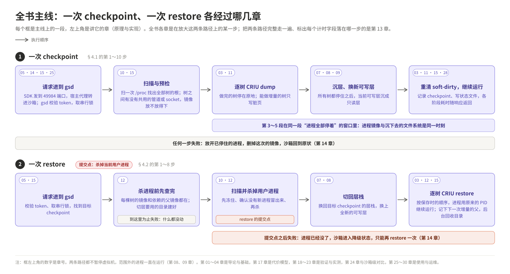

# 01 · 全书概览

## 本章目标

读完本章，你应当能够：

- 说出全书的结论：这套方案能做到什么、验证到了什么程度、还差什么；
- 查到功能、压测、性能三方面成果的总览数字，并知道每个数字的条件和详细结果在哪一章；
- 用两三句话说清进程级快照回滚的 checkpoint / restore 是什么、回滚哪些东西、不回滚哪些东西；
- 拿着"一次 checkpoint、一次 restore"这条主线，知道每一步的原理和实现分别在哪一章；
- 知道本书的代码基准和记法，以及使用上最容易踩到的几条边界。

---

## 1. 全书结论

1. **能做到什么。** 进程级快照回滚在沙箱不停机的前提下，把 uid 1000 的用户进程树和 overlay 根文件系统退回过去某一时刻：
   进程用 CRIU 加 soft-dirty 增量，文件用 overlayfs 热切层。Firecracker 不需要改动。
2. **功能和稳定性在新 920B 上验证通过。** 2026-10-08 的确认验证与 2026-11-06 的全流程复测都没有发现功能问题；
   切换与范围外进程的并发、被换下对象的回收、删除竞争这些内核问题，都有压测或探针证据（§2.1、§2.2）。
3. **性能由两个量决定。** checkpoint 的耗时随本次改动量增长；restore 要杀掉并重建进程，耗时随被恢复进程的大小增长，
   多棵树时随树数近似线性增长（§2.3，代价模型见 [17](17-cost-model.md)）。
4. **边界是清楚的。** 只回滚用户进程和 overlay 根文件系统，范围外的进程可能看到旧时间线或得到 `ESTALE`，
   已知限制集中在 [16](16-known-limits.md)，使用语义在 [26](26-semantics-and-limits.md)。
5. **还有缺口。** 950 只跑了首轮验收和四组压测（全部 PASS，[22](22-950-results.md)），只支持 arm64 的 guest，更大规格、三棵以上的树和小时级连续运行都没有数据（§2.4）。

---

## 2. 成果总览

本节只做汇总，数字和条件从第 [19](19-920b-functional.md)～[21](21-920b-stress.md) 章摘出，详细结果和口径以那三章为准。
三种性能口径的负载和统计方式不同，同名指标不能跨表比较，也不能相减。

### 2.1 功能

条件：新 920B，2 vCPU / 2048 MB 的 guest，透明大页 `never`。2026-10-08 的代码是 `259f1a25c`；
2026-11-06 的 orchestrator 在它之上只改了 `slot.go` 的 `VethName()`，gsd、guest 内核和镜像不变，SDK 为 `dcca61266`。

| 项 | 2026-10-08 确认验证 | 2026-11-06 全流程复测 |
|---|---|---|
| `verify_fixes.py` | PASS 26 / FAIL 0 / SKIP 2 | PASS 26 / FAIL 0 / SKIP 2 |
| `verify_multitree.py` | V0～V12 共 13 项全部 PASS | 12 项通过，V12 跳过 |
| `verify_clear_refs_race.py` | 30 轮，有漏页的轮数 0 | 30 轮通过 |
| `probe_whiteout_bug.py` | 五种用例（`trap` 连跑三次）都不崩 | 探针七例通过 |
| 恢复内容校验 | `verify_gsd.py` 连续 8 次 restore 根盘占用恒定 | 三轮 18 次恢复校验全部通过 |

修改前后的对照也有记录：`verify_clear_refs_race.py` 针对的漏页窗口，修改前的二进制 50 轮里有 31 轮漏页，修改后 30 轮 0 漏页（2026-09-23，新 920B，详见 [19](19-920b-functional.md)）。

### 2.2 压测与专项

| 项 | 规模 | 结果 |
|---|---|---|
| 并发文件操作，全部操作组（2026-10-08） | 300 轮，6 个 worker，操作 3355517 次 | 通过，dmesg 与串口关键词零命中，worker 错误只有 `ENOENT` 和 `ESTALE` |
| 无 worker 对照（2026-10-08） | 300 轮 | 通过 |
| 多棵树（2026-10-08） | 三棵树，200 轮 | 通过，校验 192 次 0 失败 |
| 删文件密集（2026-10-08） | 200 轮，4 个 worker | 通过，清单校验 192 次 0 失败 |
| 八组压测、20 组多种子对照、调试内核（KASAN、lockdep） | 各 200～300 轮 | 通过；这些在前一个提交号 `c0630349c` 上跑过，Go 代码与内核相同（详见 [21](21-920b-stress.md)） |
| 2026-11-06 复测 | 全部操作、无 worker 各 300 轮，多棵树、删文件密集各 200 轮 | 通过 |
| 被删层的回收（`probe_leak.py`，2026-10-08） | 300 轮，每轮写 1 MiB | 被占着的磁盘从每轮 +1040 KB 降到 0 KB，`mnt_cache` 从每轮 +6.0 降到 −0.003 |

### 2.3 性能

**分档结果。** 下表每档一个新沙箱，只分配本档内存，改写后恢复本档全量基点；三轮的服务端 `total_ms` 中位数，单位 ms。
两次都是三轮 18 次恢复，内容校验全部通过。每档只有三个样本，进程大小与改动量同时变化，不能用这张表隔离固定进程大小下的改动量效应。

| 总改动量 MiB | 内存 / 文件 MiB | 增量 checkpoint（2026-10-16） | restore（2026-10-16） | 增量 checkpoint（2026-11-06） | restore（2026-11-06） |
|---|---|---:|---:|---:|---:|
| 0 | 0 / 0 | 10.6 | 9.1 | 9.5 | 8.6 |
| 16 | 12 / 4 | 18.1 | 14.8 | 25.2 | 15.5 |
| 32 | 24 / 8 | 25.9 | 19.8 | 24.9 | 19.4 |
| 64 | 48 / 16 | 37.6 | 31.1 | 40.0 | 30.3 |
| 128 | 96 / 32 | 59.8 | 52.6 | 64.6 | 51.5 |
| 256 | 192 / 64 | 106.2 | 93.9 | 117.8 | 94.3 |

**restore 的构成。** 单棵 192 MiB 全脏的进程树连续 restore 8 次，`total_ms` p50 为 83.3 ms，
其中 CRIU 恢复 71.0 ms、杀进程 11.1 ms、进程扫描 0.7 ms、overlay 切层 0.4 ms（2026-10-08，`verify_gsd.py`）。

**多棵树。** 每棵 64 MiB，一、二、三棵树的 restore `total_ms` p50 为 32.9、60.4、93.3 ms，
内存没有改动的增量 checkpoint 为 11.2、21.8、33.5 ms（2026-10-08，`verify_multitree.py` 的 V12）。

### 2.4 没有覆盖的

| 项 | 现状 |
|---|---|
| 950 | 2026-11-17 首次部署，`950.sh all` 13 步全部 PASS（验收、四组压测、回切沙箱级冒烟）；读数见 [22](22-950-results.md) |
| guest 架构 | 只支持 arm64（原因见 [04](04-goals-and-tradeoffs.md)） |
| 规格与规模 | 只测了 2 vCPU / 2048 MB；性能与功能都只到三棵树 |
| 运行时长 | 最长的单次压测 300 轮，没有小时级连续运行的数据 |
| `HOST_GSD_PATH=off`、若干多树失败分支、pause / resume 之后的 restore | 只有单测或代码论证，没有上机结果 |

完整的缺口表在 [23](23-gaps-and-boundaries.md)，已知限制表在 [16](16-known-limits.md)。

---

## 3. 这套方案是什么

### 3.1 一句话

**在沙箱不停机的前提下，把沙箱里的用户进程和根文件系统退回过去某一时刻。**

做这件事的是一个叫 gsd（Guest Sandbox Daemon）的守护进程。它以 root 身份运行在每个沙箱（Firecracker 虚拟机）**内部**，
监听 49984 端口，对外提供四个接口，挂在 Python SDK 的 `sandbox.checkpoint` 下：

- **checkpoint**（`create`）：把此刻的用户进程和根文件系统记下来，得到一个 checkpoint ID；
- **restore**：把用户进程和根文件系统放回某个 checkpoint 那一刻；
- **list / delete**：列出、删除本沙箱的 checkpoint。

全书把 restore 也叫"回滚"，两个词是同一个意思。

实现上它把一次快照拆成两半，各用一种机制：

- **进程那一半用 CRIU**。CRIU 是一个用户态工具，能把一组运行中的进程连同内存、打开的文件、寄存器保存成镜像文件，
  之后再按镜像把它们原样建回来。gsd 对沙箱里的每一棵用户进程树各调一次 CRIU，并利用内核的 soft-dirty 机制做增量：
  第二次起只保存上一次以来改过的内存页（原理见 [03](03-criu-and-incremental-memory.md)）。
- **文件那一半用 overlayfs 热切层**。沙箱的根文件系统是一个 overlay：只读的基础镜像在下，一个可写层在上。
  checkpoint 时把当前可写层原地变成只读层、换上一个新的空可写层；restore 时把整个层栈切回 checkpoint 时的样子。
  切换通过一个自定义的内核 ioctl 完成，根文件系统不卸载，也不搬数据（机制见 [07](07-overlay-hot-switch.md)）。

所以这套方案由四块组成，同在一个代码仓库里：guest 内的 **gsd 守护进程**、打了两个补丁的 **guest 内核**、
建模板时把 gsd 装进沙箱的 **orchestrator 注入逻辑**，以及 **Python SDK**。Firecracker 本身没有改动。

### 3.2 它解决什么问题

一个 AI Agent 在沙箱里执行多步任务：装依赖、改配置、跑构建、跑测试。某一步把环境搞坏了，它想回到上一步结束时的状态，
换个做法重试。对很多这样的任务来说，值得保存的状态只有两样：**用户自己起的进程**，和**文件**。
内核里的状态、系统服务的状态、没写完的页缓存，任务并不关心。

gsd 正是按这个范围做的：只保存 uid 1000 的用户进程和 overlay 根文件系统，别的一概不碰。
范围小带来两个直接后果，贯穿全书：

- **拍得少**：一次 checkpoint 写下的只是用户进程改过的内存页；文件那一半只是一次层切换，数据早就在可写层里，不需要再搬一遍
  （唯一的例外是 checkpoint 那一刻正以可写方式打开着的文件，要拷贝一份，见 [08](08-overlay-switch-consistency.md)）；
- **回滚要重建进程**：restore 不能把内存"写回"一个活着的进程，只能把当前的用户进程全部杀掉，再由 CRIU 按镜像重新建出来。
  所以 restore 的耗时主要取决于被恢复的进程有多大，而不是这一步改了多少。

问题的完整定义和定位见 [02](02-problem-and-scope.md)。

### 3.3 适用与不适用

**适用**：

- Agent 或自动化任务在沙箱里逐步执行，需要"走坏了就退回上一步"，而要退回的状态就是用户进程加文件；
- 在同一个起点上尝试多种做法：restore 之后再 checkpoint 会形成分支，历史是一棵树（[15](15-state-concurrency-capacity.md)）；
- 沙箱里除了被回滚的用户进程之外，还有一些不希望跟着回滚的东西：envd、系统服务和内核都不在回滚范围里，restore 前后一直在运行。

**不适用**：

- **需要连内核状态一起回滚**：内核态、页缓存、root 起的系统服务都不在回滚范围里（[02](02-problem-and-scope.md)）；
- **进程用了 CRIU 保存不了的东西**：这样的进程 checkpoint 会失败，错误信息里带 CRIU 日志的尾部（[26](26-semantics-and-limits.md)）；
- **跨沙箱、跨宿主、长期保存**：镜像放在沙箱内部的内存文件系统里，层放在沙箱自己的根盘上，都随沙箱消失（[04](04-goals-and-tradeoffs.md)）；
- **x86 的沙箱**：目前只支持 arm64 的 guest（[04](04-goals-and-tradeoffs.md)）；
- **撤销对外部世界的影响**：已经发出去的请求、写进外部数据库的数据，任何快照都退不回来。

---

## 4. 主线：一次 checkpoint、一次 restore 各经过哪几章

全书可以看成是在反复放大这两条路径上的某一步。先把路径列出来，读每一章时知道自己在哪一步。

### 4.1 一次 checkpoint

| # | 这一步做什么 | 原理 / 实现在哪 |
|---|---|---|
| 1 | SDK 把请求发到沙箱地址的 49984 端口，带上沙箱的 access token | 用法 [25](25-quickstart.md)；请求路径 [05](05-architecture.md) |
| 2 | 宿主的代理把请求转进沙箱；gsd 校验 token | [05](05-architecture.md) |
| 3 | gsd 取串行锁，检查自己是否处于可服务状态 | [15](15-state-concurrency-capacity.md)、[14](14-failure-semantics.md) |
| 4 | 扫描一次 `/proc`，找出全部用户进程树的根，记下每个进程此刻是否停着 | [10](10-process-trees.md) |
| 5 | 预检：树与树之间有没有共用的管道或 socket；镜像放不放得下 | [10](10-process-trees.md)、[15](15-state-concurrency-capacity.md) |
| 6 | 对每棵树各做一次 CRIU dump，做完的树停在原地；能做增量的树只写脏页 | 原理 [03](03-criu-and-incremental-memory.md)；实现 [11](11-checkpoint.md) |
| 7 | 所有树都停住之后，把当前可写层沉成只读层，换上新的空可写层 | 机制 [07](07-overlay-hot-switch.md)；并发与内核侧保证 [08](08-overlay-switch-consistency.md)、[09](09-overlay-cache-and-reclaim.md) |
| 8 | 给刚才保存过的进程重新清一次 soft-dirty，再让它们继续运行 | 为什么要重清 [03](03-criu-and-incremental-memory.md)；实现 [11](11-checkpoint.md) |
| 9 | 记录这个 checkpoint，把状态写进状态文件，把各阶段耗时随响应返回 | [15](15-state-concurrency-capacity.md)、[28](28-configuration-and-observability.md) |
| 10 | 任何一步失败：放开已停住的进程，删掉这次的镜像，沙箱回到原状 | [14](14-failure-semantics.md) |

### 4.2 一次 restore

| # | 这一步做什么 | 原理 / 实现在哪 |
|---|---|---|
| 1 | 请求进到 gsd、校验 token、取串行锁，找到目标 checkpoint | [05](05-architecture.md)、[15](15-state-concurrency-capacity.md) |
| 2 | 杀进程之前把能查的都查完：每棵树的镜像和它依赖的父镜像都在；切层要用的目录建好 | [12](12-restore.md) |
| 3 | 扫描当前的用户进程 | [10](10-process-trees.md) |
| 4 | **把当前的用户进程全部杀掉**（先冻住、确认没有新进程冒出来、再杀）。这是 restore 的提交点 | [10](10-process-trees.md)、[12](12-restore.md) |
| 5 | 把 overlay 的层栈切回目标 checkpoint 的样子，换上全新的可写层 | [07](07-overlay-hot-switch.md)、[08](08-overlay-switch-consistency.md) |
| 6 | 按保存时的顺序，对每棵树各做一次 CRIU restore；恢复出来的进程用原来的 PID 继续运行 | [03](03-criu-and-incremental-memory.md)、[12](12-restore.md) |
| 7 | 记下"下一次增量以这个 checkpoint 为父"，写状态文件，后台回收不再需要的目录 | [12](12-restore.md)、[15](15-state-concurrency-capacity.md) |
| 8 | 失败时分两种：第 4 步之前失败，什么都没动；第 4 步之后失败，进程已经没了，沙箱进入降级状态，只能再 restore 一次 | [14](14-failure-semantics.md) |

把这两条路径完整走一遍、并标出每个计时字段落在哪一步的是 [13](13-end-to-end.md)。

有一点值得先记住：文件系统和进程是在同一段"进程全部停着"的窗口里拍下的（checkpoint 的第 6～8 步），
所以镜像里的进程状态和沉下去的文件系统是同一时刻的；但两次都没有暂停虚拟机，沙箱里的其他进程一直在运行。
这既是"不停机"的含义，也是 [08](08-overlay-switch-consistency.md)、[09](09-overlay-cache-and-reclaim.md) 两章存在的原因：
层在切换的时候，那些不归 gsd 管的进程可能正在读写文件。

---

## 5. 代码基准与记法

这套代码分两个阶段形成。初始实现能跑通主路径；之后审读代码整理出一份 36 条的问题清单，逐批修复，并在新 920B 的验证中又发现和修掉了一批清单之外的内核问题。
结果是初始实现之上的 28 个提交，加上一个合并了全部内核侧修复的补丁（`0003-overlayfs-hot-switch-fixes.patch`，原始的热切层补丁
`0002-overlayfs-hot-switch-checkpoint.patch` 保持原样）。

全书写现状，只有四处保留过程：

- [附录 C](C-issue-resolution.md)：问题清单每一组的处理结果，以及几项方向性决定的理由；
- [附录 D](D-restore-slowness-case.md)、[附录 E](E-regression-case.md)：两个性能案例，保留了"先怀疑什么、后来推翻什么"的过程；
- [08](08-overlay-switch-consistency.md)、[09](09-overlay-cache-and-reclaim.md)：每个修复主题的"根因"小节。

书里说"初始实现""修改前""修复后"时，指的就是这两个阶段。

书中的代码引用以 `criu-rollback-dev` 分支的提交 `bc3cce913` 为准，写成"函数名（文件:行号）"的形式。
它在 `259f1a25c` 之上多两个提交：`dcca61266`（SDK 向 gsd 发送流量令牌，[05](05-architecture.md)）和 `bc3cce913`（`slot.go` 的 `VethName()`）；gsd 和内核补丁没有变化。
作为测试条件出现的 `259f1a25c` 指当时被测的版本。
gsd 守护进程的核心包路径较长，统一简写为 `ckpt/`，即 `packages/gsd/internal/services/checkpoint/`；
内核补丁只引用补丁文件名和函数名。完整的代码索引在 [附录 A](A-glossary-and-code-map.md)。

---

## 6. 使用上最容易踩到的边界

细节都在 [26](26-semantics-and-limits.md) 和 [16](16-known-limits.md)：

- **被回滚的只有用户进程和 overlay 根文件系统。** `/run`、`/dev/shm`、`/var/log` 不回滚；`/tmp` 回滚。
- **每个后台命令是一棵独立的进程树。** 树和树之间如果用管道或 socket 相连，checkpoint 会被拒绝；
  需要严格一致的一组进程应当由同一个命令启动，成为一棵树。
- **镜像占的是沙箱自己的内存。** gsd 在保存之前先估算，放不下时直接拒绝并给出数字，而不是写到一半把沙箱的内存耗尽。
- **restore 一旦开始杀进程就没有回头路。** 之后再失败，沙箱里的用户进程已经没有了，要再成功 restore 一次才能恢复到一个完整的状态。
- **模板里固化了建模板时的内核和 gsd。** 换了内核或 gsd 之后必须重建模板，已有模板不会跟着变（[06](06-guest-boot-and-injection.md)、[27](27-deployment.md)）。

下一章（[02](02-problem-and-scope.md)）从问题本身讲起：进程级回滚到底回滚什么、不回滚什么，它的定位是什么。

---

## 本章要点

1. gsd 是运行在沙箱内部的守护进程，在**不停机**的前提下把**用户进程和根文件系统**退回过去某一时刻：
   进程用 CRIU 加 soft-dirty 增量，文件用 overlayfs 热切层。
2. 新 920B 上功能、压测全部通过：`verify_fixes.py` PASS 26 / FAIL 0 / SKIP 2，四组压测 dmesg 与串口关键词零命中；2026-11-06 全流程复测通过。
3. checkpoint 的耗时随改动量增长，restore 的耗时随进程大小增长、随树数近似线性增长；分档结果里 256 MiB 档的 restore 约 94 ms。
4. 回滚范围小是它全部特点的来源：checkpoint 拍得少、文件那一半几乎不花时间；restore 必须杀掉并重建进程。
5. 一次 checkpoint 与一次 restore 的每一步都能在 §4 的两张表里找到对应章节，[13](13-end-to-end.md) 把它们完整走一遍。
6. 代码以 `criu-rollback-dev@bc3cce913` 为准；950 只跑了首轮验收和四组压测；只支持 arm64 的 guest；缺口表在 [23](23-gaps-and-boundaries.md)。
