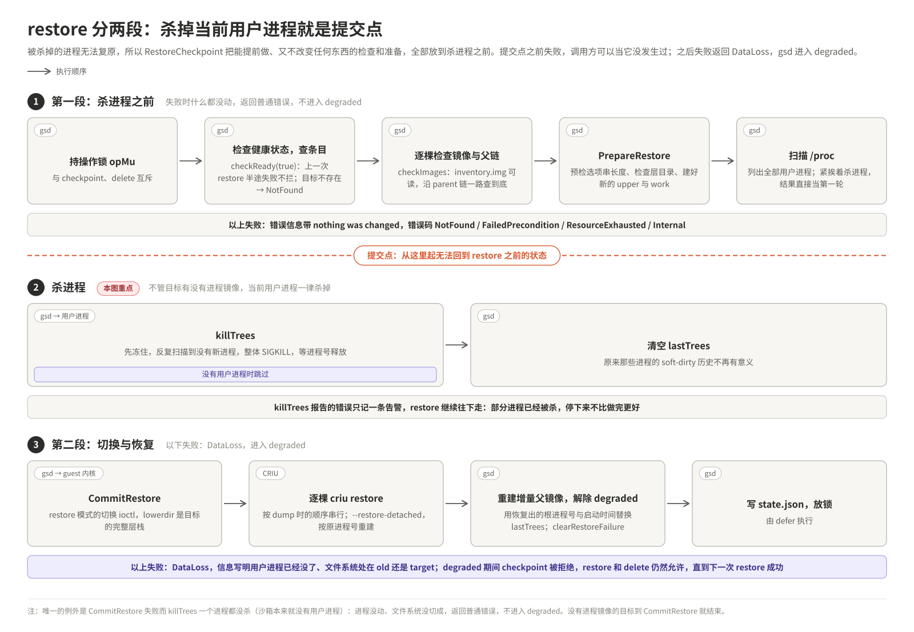

# 12 · restore 的实现

## 本章目标

读完本章，你应当能够：

- 说出 `RestoreCheckpoint` 为什么分成"杀进程之前"和"杀进程之后"两段，各段里有哪些步骤，失败分别意味着什么；
- 解释为什么不管目标 checkpoint 有没有进程镜像，当前的用户进程都要全部杀掉，以及为什么必须杀干净；
- 说清多棵树怎样并行恢复、某一棵失败时沙箱处于什么状态；
- 说明 restore 成功之后增量链怎么接续，历史为什么是一棵树而不是一条线；
- 知道 gsd 启动时为什么要打开加急的 RCU。

上一章（[11](11-checkpoint.md)）是 checkpoint：它没有不可逆的步骤。restore 不同——它的第一件实事就是杀掉用户进程，而被杀掉的进程无法复原。
所以本章的主线是"**提交点**在哪、提交点之前把什么做完"。下一章（[13](13-end-to-end.md)）把 checkpoint 和 restore 放在一条时间线上走一遍。

主要代码：`ckpt/service.go` 的 `RestoreCheckpoint`（:463）、`checkImages`（:703）、`restoreFailed`（:635）；`ckpt/overlay.go` 的 `PrepareRestore` / `CommitRestore` / `AbortRestore`；
`ckpt/criu.go` 的 `buildCriuRestoreCmd`、`killTrees`。

---

## 1. restore 的语义

"restore 到 checkpoint C"的意思是：让沙箱里的用户进程和根文件系统回到做 checkpoint C 的那一刻。拆开是三件事：

1. **当前的用户进程全部消失**——它们属于被丢弃的那段时间线；
2. **根文件系统切回 C 记录的层栈**，配一个全新的空 upper；
3. **C 里保存的每棵用户进程树被恢复出来**，在切回去的文件系统上继续运行。

不在回滚范围内的东西（PID 1、envd、gsd、root 起的服务、内核状态、`/run` 等不在 overlay 上的目录）原样不动，沙箱不停机。

这三件事的顺序是定死的。文件系统必须在进程恢复之前切好，因为 CRIU 恢复进程时要按路径重新打开它们当时打开的文件，文件的内容和大小必须是 checkpoint 那一刻的。
而当前进程必须在文件系统切换之前杀掉，否则它们会带着 checkpoint 之后的状态继续往切回去的文件系统上写。

---

## 2. 两段式

杀进程是不可逆的。一旦杀了，沙箱就离开了"当前状态"，只有把 restore 做完才能到达一个完整的状态；中途失败的沙箱处在"进程没了、文件系统在旧状态或目标状态"的中间态。
所以 `RestoreCheckpoint` 把所有**能提前做、又不改变任何东西**的检查和准备，全部放到杀进程之前（`ckpt/service.go:451-462` 的头注释）：



第一段里失败的请求，调用方可以当它没发生过。第二段里失败的请求返回 `DataLoss`，错误信息里写明用户进程已经没了、文件系统处在 `old` 还是 `target` 状态，
gsd 同时进入"restore 半途失败"的 degraded：checkpoint 被拒绝，restore 和 delete 仍然允许，直到下一次 restore 成功（[14](14-failure-semantics.md)）。

---

## 3. 逐步

### 3.1 第一段：杀进程之前

| # | 步骤 | 代码 | 失败时 |
|---|---|---|---|
| 1 | 取操作锁 `opMu` | `ckpt/service.go:464` | |
| 2 | `checkReady(true)` | :469，函数在 :677 | fatal 或状态文件写不进去 → `FailedPrecondition`。与 checkpoint 的区别：上一次 restore 半途失败**不**拒绝 restore——restore 正是用来走出那个状态的 |
| 3 | 登记 `defer s.persist()` | :472 | |
| 4 | 在条目池里查目标 | :475 | 不存在，或者已被删除而只是隐藏着 → `NotFound` |
| 5 | 对目标的每棵树 `checkImages` | :484-491 | `FailedPrecondition`，信息里写明哪棵树、`nothing was changed` |
| 6 | `PrepareRestore` | :496 | 层栈太深 → `ResourceExhausted`；层目录不见了、建目录失败 → `Internal`；都带 `nothing was changed` |
| 7 | `scanUsers`：扫描 `/proc`，列出全部用户进程 | :506 | 先 `AbortRestore` 删掉第 6 步建的目录，再返回 `Internal`，带 `nothing was changed` |

第 5～6 步的耗时记为 `precheck_ms`，第 7 步记为 `find_pids_ms`。

**第 5 步**检查的是镜像"能不能用"（`checkImages`，`ckpt/service.go:703`）：这棵树的 `inventory.img` 存在且能读出至少一个字节；然后沿镜像目录里的 `parent` 符号链接一路往上，
每一个父镜像目录的 `inventory.img` 也同样可读，直到没有 `parent` 为止；走的过程中发现链成环也算失败。增量镜像里标记为"在父镜像里"的页，restore 时要从父目录以及更上面的祖先里读，
所以链上任何一环缺失都会让 restore 在半途失败。正常的删除流程不会删掉被依赖的父目录（[15](15-state-concurrency-capacity.md)）；这一步兜的是目录被外部删掉、tmpfs 被清之类的意外。
它只检查入口文件，不校验镜像的全部内容——镜像内部损坏仍然要到第二段才暴露（§5.2）。

**第 6 步**的内容在 [07](07-overlay-hot-switch.md) 讲过：取新的 restore 序号、预检选项串长度、确认目标层栈里每个由 gsd 管理的层目录还在、建好一对全新的 upper 与 work 并登记为"待用"。

**第 7 步**的位置是刻意的：扫描放在准备好层之后、紧挨着杀进程（`service.go:504` 的注释）。这次扫描的结果直接被当作杀进程的第一轮，中间隔得越短，漏掉的新进程越少。

### 3.2 提交点：杀进程

| # | 步骤 | 代码 | 说明 |
|---|---|---|---|
| 8 | `killTrees`：先冻住、反复扫描到没有新进程、整体 `SIGKILL`、等进程号释放 | :524 | 算法见 [10](10-process-trees.md)。耗时记为 `kill_ms`。没有用户进程时跳过 |
| 9 | 清空 `lastTrees` | :535 | 原来那些进程的 soft-dirty 历史不再有意义 |

`killTrees` 报告的错误（某个信号发不出去、冻结轮数到了上限）只记一条告警，restore **继续往下走**。理由是此刻已经没有退路：部分进程已经被杀，停下来不比继续做更好。
如果真有进程没杀掉并占着某个进程号，后面的 `criu restore` 会失败，那时按第二段的失败处理。

### 3.3 第二段：切换与恢复

| # | 步骤 | 代码 | 失败时 |
|---|---|---|---|
| 10 | `CommitRestore`：restore 模式的 ioctl，`lowerdir` 是目标的完整层栈 | :539 | 见下 |
| 11 | 对目标的每棵树，按 dump 时的顺序（根进程号升序）启动 criu restore，同时最多 `-criu-restore-parallel` 个（默认 guest 的 CPU 数）；全部结束后再按树的顺序逐棵收尾 | `RestoreCheckpoint` | §4.4 |
| 11a | 　在单棵时限内运行 criu restore | :583-585 | `DataLoss`，文件系统状态 `target`（§5） |
| 11b | 　读出恢复出来的根进程号，读它的启动时间，记一条新的增量父镜像 | :611-613 | 读不到启动时间（进程已经退出）就不记 |
| 12 | 用第 11b 步攒下的各项替换 `lastTrees` | :617 | |
| 13 | `clearRestoreFailure`：解除"restore 半途失败"的 degraded | :622 | |
| 14 | 返回；`defer` 写 `state.json`、放锁 | :627 | |

第 10 步的耗时记为 `overlay_restore_ms`，第 11 步各棵之和记为 `criu_restore_ms`。`CommitRestore` 成功后会自己启动一次后台回收：被切走的旧 upper 连同里面被丢弃的写入此刻成了垃圾（[15](15-state-concurrency-capacity.md)）。

**第 10 步失败**分两种情况（`service.go:541-545`）：

- 第 8 步一个进程都没杀（沙箱本来就没有用户进程）：进程没动，文件系统也没切成，沙箱还是原样。返回普通错误，带 `nothing was changed`，不进入 degraded。
- 第 8 步杀过进程：`DataLoss`，文件系统状态 `old`。

没有进程镜像的目标（只有文件系统的 checkpoint）到第 10 步就结束了：当前进程已杀，文件系统已切，没有进程要恢复，`lastTrees` 保持为空。

---

## 4. 几个"为什么"

### 4.1 为什么不管目标有没有进程镜像，都要杀掉当前进程

目标是一个只有文件系统的 checkpoint 时，没有进程要恢复，似乎可以让当前进程留着。但 restore 的语义是"回到那一刻"，而那一刻这些进程并不存在。
让它们留下，就是让 checkpoint 之后才启动的进程，带着之后的内存状态，在回滚过的文件系统上继续运行——它们打开着的文件可能已经不存在或内容已变，
它们接下来的写入会落在一个它们自以为了解、实际已经换掉的文件系统上（`ckpt/service.go:461-462` 的注释）。所以无论目标是什么，当前用户进程一律杀掉。

### 4.2 为什么要杀整棵树，而且先冻住

CRIU 恢复一棵树时要让每个进程拿回它**原来的进程号**，进程之间靠进程号互相引用（父子关系、进程组、会话）。只要有一个旧进程还占着其中一个号，CRIU 就报 `Can't fork … File exists` 并失败。

初始实现只对上一次记下的那一个进程号发 `SIGKILL`。它的子进程被 PID 1 收养后继续活着，占着进程号，于是第二次 restore 偶发失败；
这些子进程还会继续往文件系统上写。现在的做法是对当前**全部**用户进程连同子孙，先冻住、清点到不再增长、再整体杀掉（[10](10-process-trees.md)），并等到它们的进程号真正被释放。

### 4.3 为什么 `--restore-detached`

每棵树的恢复命令由 `buildCriuRestoreCmd`（`ckpt/criu.go:100`）拼出：

```
/usr/sbin/criu restore -D <镜像目录>/t<i> --restore-detached --shell-job --pidfile <镜像目录>/t<i>/restored.pid
```

| 参数 | 作用 |
|---|---|
| `-D` | 从哪个目录读镜像。不需要给父镜像目录：CRIU 沿目录里的 `parent` 符号链接自己找 |
| `--restore-detached` | 进程树恢复完成后 criu 自己退出，不留下来当它们的父进程 |
| `--shell-job` | 与 dump 时对应 |
| `--pidfile` | 把恢复出来的根进程号写到文件里。gsd 每次运行前先删掉旧的，运行后读它（`execCriuRestore`，`criu.go:114`） |

恢复出来的根进程是 criu 的子进程；criu 一退出，它就被 PID 1 收养。所以 **restore 之后每棵树的根的父进程都是 PID 1**，而不是 envd，也不是 gsd。
这带来一个使用上的后果：恢复出来的进程与当初启动它的那次 SDK 调用之间的连接（通向 envd 的标准输出管道）不会被接回去，SDK 那一端原来的命令句柄不再收到它的输出（[26](26-semantics-and-limits.md)）。

CRIU 另有一个选项可以让恢复出来的进程成为调用者的兄弟进程，这里没有用；代码里对应的注释只是把现状说清楚（`criu.go:101-102`）。

criu restore 的输出写两处：gsd 的标准错误（进入 journal），以及这棵树镜像目录里的 `criu-restore.log`——后者每次 restore 覆盖。restore 命令没有加 `-v4`，日志简短，所以没有像 dump 那样改成由 CRIU 直接写文件（[11](11-checkpoint.md) §2.3）。

### 4.4 多棵树并行恢复

各棵树的进程号互不相同（它们来自同一时刻的同一个进程号命名空间），当前用户进程又已经杀干净，所以各棵树要的进程号不会被别的树占着；各棵树互不依赖，树间共享的管道和 socket 在 checkpoint 时就已经被拒绝了。所以几个 criu restore 可以同时跑。

`daae6968f` 及以前是逐棵串行，总耗时随树的数量线性增加。`9728cef73` 起并行，做法与 dump 相同（[11](11-checkpoint.md) §2.3）：

- 按根进程号升序启动，同时最多 `-criu-restore-parallel` 个（默认 guest 的 CPU 数）；名额在启动循环里取，并发数为 1 时就是原来的逐棵串行；
- 有一棵失败后，还没启动的不再启动，已启动的等它结束；
- 列出恢复出来的进程、记下停着的进程、记录下一次增量的父镜像，这些收尾在全部结束之后按树的顺序逐棵做，与串行时相同；放行仍在全部树恢复完、写完 `clear_refs` 之后（§6）。

串行时担心的内核争用（每个 criu restore 都要把任务迁回原来的控制组、按进程号建进程）在 920B 上量过：16 棵树、guest 2 个 vCPU，restore 从 137 ms 降到 96 ms，过程中没有出现失败。只有一棵树时没有变化。

`criu_restore_ms` 仍记各棵之和；实际经过的时间只在 gsd 日志 `all process trees restored` 那一行的 `criu_restore_wall_ms` 里。

### 4.5 可选：延迟页恢复

单棵树的 restore 几乎全部花在把进程的全部页从镜像复制回内存（920B，384 MiB 进程，restore 约 175 ms，其中 CRIU 的 `Preadv` 约 142 ms），与这次 checkpoint 改了多少无关。并行只能让多棵树叠在一起，不能让一棵树变快。

gsd 带一个默认关闭的开关 `-criu-lazy-restore`（环境变量 `GSD_CRIU_LAZY_RESTORE=1`）。打开后每棵树的恢复变成两步：

1. 在镜像目录上起 `criu lazy-pages` 守护进程（日志 `criu-lazy-pages.log`），等它建好 `lazy-pages.socket`，最多 2 秒；起不来就这棵树照常恢复，日志里有 `lazy pages unavailable`；
2. `criu restore` 加 `--lazy-pages`：只重建进程结构，不复制页。进程访问到哪一页，守护进程经 userfaultfd 先补哪一页，其余页在后台补完，补完守护进程自己退出。

920B 实测：384 MiB 进程的 restore 从 166 ms 降到 32 ms。

**硬约束：页没补完不能 dump 这个进程。** 920B 上试过：补页途中 criu dump 照样返回成功，但镜像缺页，用它恢复出来的进程一读内存就崩溃。所以 gsd 在下一次 checkpoint、restore、删除 checkpoint 的开头，先等上一次 restore 起的守护进程全部退出（`finishLazyFill`，最多 30 秒），日志一行 `lazy page fill finished`，带等待时长 `lazy_wait_ms`。有守护进程失败或超时，恢复出来的进程内存不完整，gsd 进入 degraded（[14](14-failure-semantics.md)），直到下一次成功的 restore。

**代价：restore 之后的第一次 checkpoint 变成全量。** gsd 在 restore 一结束就写 `clear_refs`（§6），这时页还没补完；守护进程之后用 `UFFDIO_COPY` 补进来的页都带 soft-dirty，下一次 dump 就把整个进程当成改过的页写出。920B 上 384 MiB 进程，restore 之后的第一次 checkpoint 从 22 ms 升到 142 ms，镜像从几 MiB 变成 388 MiB。
改成补完再写 `clear_refs` 不行：补页期间用户进程真正写过的页也会被清掉，下一次增量就漏掉它们。要分清"补进来的页"和"用户写的页"，需要 userfaultfd 的写保护，guest 的 arm64 内核没有。

所以这个开关只适合 restore 远多于 checkpoint 的用法，例如反复回到同一个 checkpoint 重试。打开的方法与其他 gsd 参数相同（[28](28-configuration-and-observability.md) §2.1）；部署包不打开它。

### 4.6 加急的 RCU

gsd 启动时向 `/sys/kernel/rcu_expedited` 写 1（`enableExpeditedRCU`，`packages/gsd/main.go:178`）。这一行与 restore 的耗时直接相关。

CRIU 恢复进程时要把它迁回原来所在的控制组。在 cgroup v2 上，迁移一个任务要取一把全局的读写锁的写端，它的慢路径要等一个 RCU 宽限期。
在只有 2 个虚拟 CPU 的沙箱里，系统空闲一会儿之后，每次这样的等待要 20～50 ms，而且完全随机——这是初始实现里 `criu_restore_ms` 大幅抖动的主因之一。
打开加急之后，同样的迁移降到约 0.1 ms（这几个数出自 `main.go:171-177` 的注释，是定位这个问题时测到的，测量条件与归因过程见 [附录 D](D-restore-slowness-case.md)）。

这个设置只影响本 guest；写失败只记一条告警，gsd 照常启动，只是 restore 会带着那段抖动。

---

## 5. 第二段的失败

### 5.1 多棵树时某一棵失败

假设目标有三棵树，并发数为 1（逐棵），`t0` 恢复成功，`t1` 失败。此刻：

- `t0` **留着不动**：它已经在目标文件系统上按 checkpoint 时的状态继续运行了；
- `t1` 不存在；
- `t2` 没有尝试，也不存在。

并发数大于 1 时，同一批启动的几棵可能有的成功、有的失败；失败之后还没启动的才算"没有尝试"。归类方法不变：成功的留着，失败的和没启动的不存在。几棵同时失败时报根进程号最小的那棵，其余各有一行 `criu restore failed` 日志。

gsd 不去杀已恢复的树，也不再启动没尝试的树。沙箱不是任何一个 checkpoint 的完整状态，所以返回 `DataLoss` 并进入 degraded。错误信息把三类树分开写明——
哪几棵已经恢复并留着运行、哪一棵失败（附 `criu-restore.log` 的最后 2048 字节）、哪几棵没有尝试——调用方据此知道沙箱里现在有什么。

走出这个状态的办法是**再做一次 restore**（到同一个或另一个 checkpoint）。新的 restore 第一件事就是杀掉当前全部用户进程，包括留着的 `t0`，然后从头来过。

只有一棵树时没有这些分类，错误信息就是 `criu restore failed` 加日志尾部。

### 5.2 失败之后沙箱里有什么

| 失败点 | 用户进程 | 文件系统 | 错误码 | degraded |
|---|---|---|---|---|
| 第一段任何一步 | 没被碰过 | 没变 | `NotFound` / `FailedPrecondition` / `ResourceExhausted` / `Internal` | 否 |
| 切换失败，且之前没有进程可杀 | 本来就没有 | 没变 | `ResourceExhausted` / `Internal` | 否 |
| 切换失败，之前杀过进程 | 没有 | `old`：还是 restore 之前的 | `DataLoss` | 是 |
| 某棵 criu restore 失败或超时 | 已恢复的几棵在跑，其余没有 | `target`：已经是目标 checkpoint 的 | `DataLoss` | 是 |
| 延迟页恢复后补页失败或超时（在下一次请求开头才发现，§4.5） | 恢复出来的进程在跑，内存可能不完整 | `target` | 那次请求照常处理 | 是 |

注意 criu restore 超时在这里也是 `DataLoss`，不是 `DeadlineExceeded`：`restoreFailed`（`service.go:635`）不区分原因，因为对调用方来说重要的是"沙箱处在中间态"，而不是 criu 为什么没做完。
每棵树的 restore 时限默认 60 秒，全部树合计上限是它的 3 倍，到时限的处理与 dump 相同（[11](11-checkpoint.md)）。

degraded 的原因随 `state.json` 持久化（字段 `restore_failure`）：gsd 在这种状态下重启并不会让沙箱变回完整状态，所以原因要带过重启，直到一次 restore 成功才清掉。

---

## 6. restore 之后：增量链的接续

restore 成功之后，沙箱里的用户进程是从目标 checkpoint 的镜像恢复出来的，它们的内存内容就等于那份镜像。所以**下一次 checkpoint 可以直接以目标 checkpoint 为父做增量**——
只写恢复之后改过的页。

要让这件事成立，`lastTrees` 必须在 restore 成功时改成"目标 checkpoint 的各棵树"。这里有一个细节（`ckpt/service.go:609-613`）：
恢复出来的根进程号与 dump 时相同，但它是一个**新进程**，启动时间变了。而"同一棵树"是按进程号加启动时间认的（[10](10-process-trees.md)），
所以 gsd 用 `--pidfile` 里的进程号重新读一次启动时间，再记进 `lastTrees`；读不到（那个进程刚恢复出来就退出了）就不记，那棵树之后不存在，也无所谓增量。

由此，checkpoint 的历史是一棵**树**而不是一条线：

```
C1 ── C2 ── C3
        └── C4 ── C5        （在 C3 之后 restore 到 C2，再做 checkpoint 得到 C4、C5）
```

C4 的父是 C2，不是 C3。C3 所在的那一支是"被丢弃的时间线"，但 C3 这个条目本身仍然在、仍然可以 restore。
这棵树上的父子依赖决定了删除时哪些镜像必须保留，见 [15](15-state-concurrency-capacity.md)。

目标没有进程镜像时，restore 之后 `lastTrees` 为空；之后新启动的进程在下一次 checkpoint 时做全量。

要让"只写恢复之后改过的页"真的成立，还有两道关：

1. **恢复出来的进程要从干净的 soft-dirty 开始。** CRIU 把内存写回时每一页都被置上 soft-dirty，新建的内存区域带区域级标志（[03](03-criu-and-incremental-memory.md) §3）。所以 restore 也用 `--leave-stopped`：全部树恢复完、都停着的时候，gsd 给恢复出来的每个进程写 `clear_refs`，然后才放行。dump 前就停着的进程（用户 Ctrl-Z）在 checkpoint 时记进条目（状态文件里的 `stopped_pids`），放行时跳过，恢复出来仍是停着的。
2. **CRIU 要肯用这份父镜像。** CRIU 4.2.1 在增量 dump 前做 PID 复用检测（`criu/mem.c` 的 `detect_pid_reuse`）：进程的启动时间（时钟节拍）不早于父镜像 `inventory.img` 里的 dump 时刻（`dump_uptime`，微秒），就认为这个 PID 可能已经换了进程，不用父镜像、整个进程重新写出。restore 出来的进程 PID 不变、启动时间是新的，必然命中。对 gsd 刚恢复出来的进程这是误判，所以 gsd 在目标镜像目录旁边建一个**替身父目录**（`t0.rp` 等）：镜像文件都是指向原镜像的符号链接，只有 `inventory.img` 是一份拷贝，`dump_uptime` 改成全部树恢复完之后再加一个时钟节拍。下一次 dump 以它为父；子镜像的 `parent` 链接指向替身目录，restore 时经符号链接读到原镜像。restore 之后新起的进程、真的复用了 PID 的进程，启动时间都晚于这个时刻，CRIU 的保护对它们照样生效。读不到 uptime 或 inventory 不认识时，退回原镜像目录（下一次全量）。

这两步是 2026-11-18 补上的（`daae6968f`，[16](16-known-limits.md) 的 L-18）。之前 restore 之后的第一次 checkpoint 一律全量：新 920B 上 256 MiB 的进程一页不改，restore 之前的增量写出 0.1 MiB、约 16 ms，restore 之后写出 260.8 MiB、约 115～125 ms；修复后两者都是 0.1 MiB。验证：`verify_restore_incremental.py`（[30](30-acceptance-runbook.md) 的验收里）每轮只改一部分内存、restore 到这份增量核对整块内存的 SHA256，并让替身目录一代接一代；漏页测试 `verify_clear_refs_race.py` 30 轮 0 漏页。

---

## 7. 耗时的构成

一次 restore 的耗时几乎全部在两项上：`criu_restore_ms` 和 `kill_ms`。下面两组数只用来建立量级感，**判定值见 [20](20-920b-performance.md)，不能与那里的数相减**。

单棵树、192 MiB 内存负载，连续 8 次 restore 的中位数（新 920B、2026-10-08、`259f1a25c`，单位 ms）：

| `total` | `criu_restore` | `kill` | `find_pids` | `overlay_restore` | `precheck` |
|---|---|---|---|---|---|
| 83.3 | 71.0 | 11.1 | 0.7 | 0.4 | 0.1 |

1、2、3 棵树、每棵 64 MiB，各 8 轮的中位数（新 920B、2026-10-08，早于最终提交的一轮，单位 ms）：

| 树数 | `criu_restore` | `kill` | `total` |
|---|---|---|---|
| 1 | 27.20 | 5.21 | 33.63 |
| 2 | 56.07 | 6.18 | 63.77 |
| 3 | 83.53 | 10.02 | 94.79 |

读法：`criu_restore` 随树数线性增加，这是当时串行恢复的直接结果；它也随每棵树的内存量增长（对比两张表里的单树）。`9728cef73` 起多棵树并行恢复（§4.4），`criu_restore_ms` 仍是各棵之和，所以它照样随树数增长；`total_ms` 不再线性增长：920B 上 16 棵树的 restore 从 137 ms 降到 96 ms（每个测点 20 次的服务端中位数，`daae6968f` 对 `9728cef73`）。切换文件系统的那一下不到 1 ms，第一段的检查与准备加起来不到 1 ms。
`criu_restore` 里面具体是什么、为什么是这个量级，见 [附录 D](D-restore-slowness-case.md) 和 [17](17-cost-model.md)。

---

## 代码位置

| 关注点 | 位置 |
|---|---|
| 编排 | `ckpt/service.go` — `RestoreCheckpoint` |
| 镜像与父链检查 | `ckpt/service.go` — `checkImages`、`readable` |
| 半途失败与 degraded | `ckpt/service.go` — `restoreFailed`、`clearRestoreFailure`、`checkReady` |
| 文件系统切换的两半 | `ckpt/overlay.go` — `PrepareRestore`、`CommitRestore`、`AbortRestore` |
| 杀进程 | `ckpt/criu.go` — `killTrees`、`waitForProcessExit` |
| criu 的命令与执行 | `ckpt/criu.go` — `buildCriuRestoreCmd`、`execCriuRestore`、`runCriuCmd`、`readPidFile`、`logTail` |
| 重建增量父镜像 | `ckpt/pid.go` — `procStart` |
| 加急的 RCU | `packages/gsd/main.go` — `enableExpeditedRCU` |
| 并行与延迟页 | `ckpt/service.go` — `RestoreCheckpoint` 里的 `restoreJob`、`finishLazyFill`；`ckpt/criu.go` — `startCriuLazyPages` |
| 单测 | `ckpt/restore_test.go`、`ckpt/service_failure_test.go`、`ckpt/multitree_test.go`、`ckpt/lazy_restore_test.go` |

---

## 本章要点

1. restore 的提交点是杀进程。杀之前做完镜像检查、层目录准备和进程扫描，这一段失败"什么都没动"；杀之后的任何失败都是 `DataLoss`，并让 gsd 进入只拒绝 checkpoint 的 degraded。
2. 不管目标有没有进程镜像，当前用户进程一律杀掉：restore 的语义是回到那一刻，那一刻之后启动的进程不能留在回滚过的文件系统上。
3. 必须杀整棵树并等进程号释放，否则 CRIU 按原进程号重建时报 `Can't fork … File exists`；杀进程的告警不中断 restore，因为已经没有退路。
4. 顺序是杀进程 → 切文件系统 → 逐棵 `criu restore --restore-detached`；恢复出的根被 PID 1 收养，与原来的 SDK 命令句柄不再相连。
5. 多棵树并行恢复（同时最多 guest 的 CPU 数棵）；某棵失败时已恢复的留着、失败和没启动的不存在，错误信息分三类写明，下一次 restore 先把它们全部杀掉。
6. 延迟页恢复默认关：restore 快了，但 restore 之后的第一次 checkpoint 变成全量，下一次请求还要先等补页结束。
7. restore 成功后以目标 checkpoint 为下一次增量的父，用恢复出的进程的启动时间重建记录，历史因此是一棵树。
7. 耗时几乎全在 `criu_restore` 和 `kill`；gsd 启动时打开加急的 RCU，是为了消掉控制组迁移里随机的 20～50 ms 等待。
