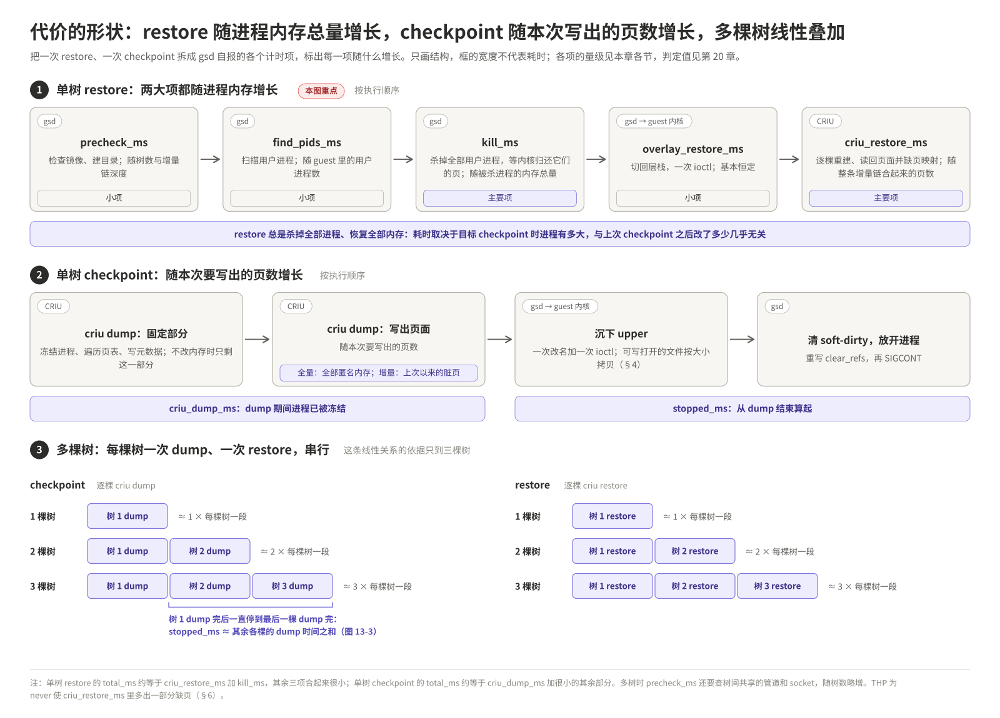

# 17 · 性能原理：代价模型

## 本章目标

读完本章，你应该能：

1. 把一次 restore、一次 checkpoint 的耗时拆成几段，说出每一段的工作内容和它随什么增长；
2. 解释 restore 的耗时为什么由进程的内存总量决定，而不是由这一代改了多少决定；
3. 说出 restore 里哪些时间是这套机制的下限，再往下压要付什么代价；
4. 估算多棵进程树时的耗时和冻结窗口，并知道这个估算的依据只到三棵树；
5. 找出按量增长的几项额外开销：可写打开的文件、每个请求的鉴权、首个请求的延迟；
6. 读性能数字时避开几个常见的误读。

本章只讲成本的来源和增长方式。文中的数字都标了平台、日期和口径，用来建立量级感；判定性数字在 [20](20-920b-performance.md)，不能与本章的数相减。
修复过程中性能怎么变化、回退怎么归因，分别在 [附录 D](D-restore-slowness-case.md) 和 [附录 E](E-regression-case.md)。

---

## 1. 单树 restore

### 1.1 分段

单树 restore 的 `total_ms` 约等于 `criu_restore_ms` 加 `kill_ms`，再加不到 1 ms 的其余各项。实测分段见 [20](20-920b-performance.md) §2。

| 项 | 随什么增长 | 说明 |
|---|---|---|
| `criu_restore_ms` | 被恢复进程的内存总量（整条增量链合起来的页数，而不是最后一次增量的大小） | 主体是把页面读回并缺页映射。THP 为 never 使这一项比开大页时高，原因与不能更改的理由见 §6 |
| `kill_ms` | 被杀进程的内存总量 | 几乎全是等进程退出、内核归还它的页。64 MiB 的进程约 5 ms，192 MiB 的约 11～12 ms |
| `find_pids_ms` | guest 里的用户进程数 | 不到 1 ms |
| `precheck_ms` | 目标 checkpoint 的树数与增量链的深度 | 检查镜像可读、建好目录，约 0.1 ms |
| `overlay_restore_ms` | 基本恒定 | 一次 ioctl，约 0.3～0.4 ms；其中回收逻辑占 0.04～0.06 ms |

restore 的耗时与"回滚掉了多少改动"几乎无关：它总是杀掉全部进程、恢复全部内存。一次 restore 的工作量取决于目标 checkpoint 时进程有多大，不取决于上次 checkpoint 之后改了多少。这条性质与沙箱级回滚的差别在 [24](24-vs-sandbox-level.md)。

### 1.2 剩下的时间是什么

[附录 D](D-restore-slowness-case.md) 修完五项原因之后，留下的时间是这样分布的。口径：旧 920B，2026-09，guest 内直连 gsd 的微基准，约 195 MB 匿名内存的单进程，THP 为 never。
当时 `total_ms` 约 85～89 ms，由 `criu_restore_ms` 74～76 和 `kill_ms` 11～12 组成，层切换不到 1 ms。这些数只用来说明各段的性质，不能与新 920B 的判定值相减。

能确定的结论有三条：

- **页面拷贝约 43 ms 是下限。** 它与镜像大小成正比（195 MB，约 4.5 MB/ms），在各种调用方式下都相同。
- **`kill_ms` 约 11 ms 是真实工作量。** 被杀的进程退出时要释放整个地址空间，一个 195 MB、全部由 4 KiB 页组成的堆有约 4.9 万个页要逐个归还。它与被杀进程的内存大小成正比。
- **`criu_restore_ms` 里下限之上余下的部分，按当时的结论是 THP 关闭的固有代价。** 关掉大页后，往全新的地址空间填 195 MB 要多出几万次缺页。当时没有单独量出它在 74～76 ms 里占多少。

当时的记录还给过一个"页面拷贝约 43 ms、释放页表约 11 ms、重新映射与收尾约 8 ms"的拆分。这三项加起来约 62 ms，既不等于 74，也不等于 85～89，余下部分没有逐项列出；其中约 11 ms 就是 `kill_ms`，本来不属于 `criu_restore_ms`。所以它只是量级上的说明，不是一张闭合的账。

再往下压只有两条路：打开 THP（这套机制不允许，见 §6），或者改变设计，例如不恢复全部内存、按需取页。这两条都不属于修缺陷的范畴。

---

## 2. 单树 checkpoint

checkpoint 的 `total_ms` 约等于 `criu_dump_ms` 加 1～2 ms。`criu_dump_ms` 随**本次要写出的页数**增长：全量时是进程的全部匿名内存，增量时只是上次以来的脏页。

同一口径下的三种情形（新 920B，2026-10-08，一棵 64 MiB 的树，8 轮的 p50）：不改内存的增量 dump 约 10 ms，全部改写后的增量 dump 约 43 ms，全量 dump 约 50 ms。
第一种情形是 dump 的固定开销（冻结进程、遍历页表、写元数据）。后两种差别不大，说明页面写出的速度是主要因素。

`stopped_ms`（进程被停住的时长）在单树时只有 0.7～2.4 ms：它从 dump 结束算起，只包含沉下 upper 和清 soft-dirty。dump 本身期间进程也是冻结的，那段时间计在 `criu_dump_ms` 里。

---

## 3. 多棵树：线性增长

每棵树各做一次 dump 和一次 restore，串行执行，所以各项随树的数量线性增长。一、二、三棵树的完整分段见 [20](20-920b-performance.md) §3。

每多一棵 64 MiB 的树的边际代价（新 920B，2026-10-08，`gsd-final-20261008` 那一轮，8 轮的 p50，与第 20 章的确认验证不是同一轮）：restore 约 +28 ms，增量 dump 约 +11 ms，全量 dump 约 +45 ms。

多树时要特别留意 `stopped_ms`。它从**第一棵**树 dump 完算起，而先 dump 完的树要一直停到最后一棵 dump 完，所以它约等于"其余各棵的 dump 时间之和"：
同一口径下，三棵树全量时最先 dump 的那棵要多停约 92 ms，而单树时只有 2.4 ms。对停顿敏感的负载，应当尽量让需要一起保存的进程成为一棵树（[27](27-semantics-and-limits.md)）。

多树独有的预检（查树间共享的管道和 socket）开销很小：`precheck_ms` 从单树的 0.04 涨到三棵树的 0.13。

串行是有意的选择，理由和并行化时要注意的问题在 [12](12-restore.md)。这条线性关系的依据只到三棵树（[23](23-gaps-and-boundaries.md)）。

---

## 4. 可写打开的文件：沉下 upper 时的拷贝

一般情况下沉下 upper 很快（约 0.5 ms，一次改名加一次 ioctl）。例外是 checkpoint 时有文件正以写方式打开着，或被共享可写映射着：
内核要把这种文件留在新的 upper 里，并在沉下去的层里放一份拷贝，拷贝在切换的写锁内完成（[08](08-overlay-switch-consistency.md) 的"打开的文件跨切换的语义"一节）。

这项开销与文件大小成正比，折合每 MiB 约 0.8 ms（新 920B，口径是 `overlay_sink_ms`，分档数字和测量所用的内核版本见 [20](20-920b-performance.md) §5.2）。这段时间里用户进程是停着的，而且所有访问 overlay 的操作都被写锁挡住。

guest 里常驻的、以写方式打开的大文件只有系统日志，它不在 overlay 的层里，不产生这项开销；需要留意的是用户自己长期开着的大文件，例如数据库文件。
这一行为可以用内核模块参数 `overlay.ckpt_move_open` 调整（[29](29-configuration-and-observability.md)），限制见 [16](16-known-limits.md)。

---

## 5. 每个请求的固定开销

- **鉴权**：每个 RPC 读一次 MMDS，约 0.6 ms（判定值见 [20](20-920b-performance.md) §5.4）。不缓存的理由在 [05](05-architecture.md)。它不计在 gsd 自报的 `total_ms` 里。
- **经代理的往返**：SDK 测到的端到端时间比 gsd 自报的 `total_ms` 多出的部分，量级是 2 ms 上下。
- **新沙箱的第一个请求**偶尔会有约 5 秒的延迟，发生在宿主一侧，与 gsd 无关，原因未查，见 [16](16-known-limits.md)。这段时间不计入 gsd 自报的 `total_ms`，看客户端墙钟时要去掉每个沙箱的第一次请求。

---

## 6. THP 为 never 的代价

`criu_restore_ms` 这一项里，有一部分是 THP 关闭带来的：恢复时往全新的地址空间填入全部内存，用 4 KiB 页比用 2 MiB 大页多出许多次缺页。
旧 920B 上直接量过这个差别（[附录 D](D-restore-slowness-case.md) 的"把 THP 打开"一节）。新 920B 上没有重做这组对照，这里不给数字。

这是性能上最大的一项"明知可以更快而不去做"的代价，理由不是性能上的权衡，而是正确性上的前提：增量 dump 靠 soft-dirty 位，而一个大页只有一个位，
THP 开着时零散的写入会让每次增量都退化成全量。原理和实测在 [03](03-criu-and-incremental-memory.md)。
所以 THP 为 never 不在可调项之列：开机脚本在切换根文件系统之前设置它，gsd 启动时再检查一次并兜底（`ensureTHPNever`，`main.go:196`）。
如果在部署里看到增量 checkpoint 忽然变得和全量一样大，首先要查的就是 THP 是不是被改回去了（[30](30-troubleshooting.md)）。

---

## 7. 读数时的注意事项

- 两次测量之间差 3 ms 以内不要解释（[附录 E](E-regression-case.md) §3.3）。
- 性能脚本三轮之间可能整体漂移一二十毫秒，尤其是同一台机器上还有别的沙箱在跑的时候。它适合看各档之间的相对形状，不适合比较两个版本；比较版本用逐轮交错的对照。
- 压测脚本记录的是脚本一侧的墙钟时间，受并发 worker 数量的影响，不是 gsd 的耗时，不作为性能依据。
- 调试内核（开了内存与锁的检查）上的耗时是发布版的数倍，只用于查正确性，不能读性能。

---

## 数据出处

| 内容 | 结果目录 |
|---|---|
| §1.1 各分段的量级 | `gsd-release-20261008` |
| §1.2 剩余耗时的拆分 | 见 [附录 D](D-restore-slowness-case.md) 的数据出处 |
| §2、§3 的一、二、三棵树各项耗时 | `gsd-final-20261008` |
| §4 可写打开文件的拷贝代价 | `gsd-fix4-20260930`，复测在 `gsd-fix5-20261008` |
| §1.1 切换 ioctl 的回收开销 | `gsd-fix5-20261008` |
| §5 鉴权开销 | `gsd-fixes-20260930`、`gsd-release-20261008` |

---

## 代码位置

| 关注点 | 位置 |
|---|---|
| 各分段计时的填写 | `ckpt/service.go` — `CreateCheckpoint`、`RestoreCheckpoint` 里对 `timings` 的赋值 |
| restore 里扫描结果直接用于杀进程 | `ckpt/service.go:506`、`:524`；`ckpt/criu.go` — `killTrees`（`:215`）及其 `killStats`（`:197`） |
| THP 兜底 | `packages/gsd/main.go` — `ensureTHPNever`（`:196`） |
| 可写打开文件的代价探针 | 随手册附带的 `scripts/probes/probe_move_cost.py` |

---

## 本章要点

1. 单树 restore 约等于 `criu_restore` 加 `kill` 加不到 1 ms。两大项都随进程内存总量增长，与这一代改了多少几乎无关。
2. 单树 checkpoint 约等于 `criu_dump` 加 1～2 ms，`criu_dump` 随本次要写出的页数增长；不改内存时只剩固定开销。
3. restore 的下限由页面拷贝和杀进程两项真实工作量构成，再加 THP 关闭带来的缺页。再往下压要么打开 THP，要么改变设计，都不是修缺陷的范畴。
4. 多棵树串行处理，每多一棵 64 MiB 的树，restore 约 +28 ms、增量 dump 约 +11 ms、全量 dump 约 +45 ms；先 dump 的树要多停"其余各棵的 dump 时间之和"。依据只到三棵树。
5. 另有三项按量或按次的代价：可写打开的文件在 checkpoint 时每 MiB 约 0.8 ms；鉴权每个请求约 0.6 ms；回收逻辑让 restore 的 ioctl 多 0.04～0.06 ms。
6. THP 为 never 的代价不可免除，因为打开它会让增量 checkpoint 退化成全量。
7. 差 3 ms 以内的读数不解释；压测墙钟和调试内核上的耗时都不能当性能依据。
