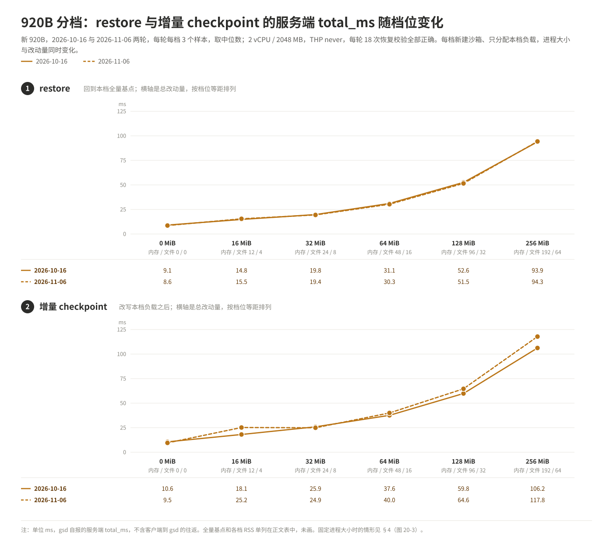
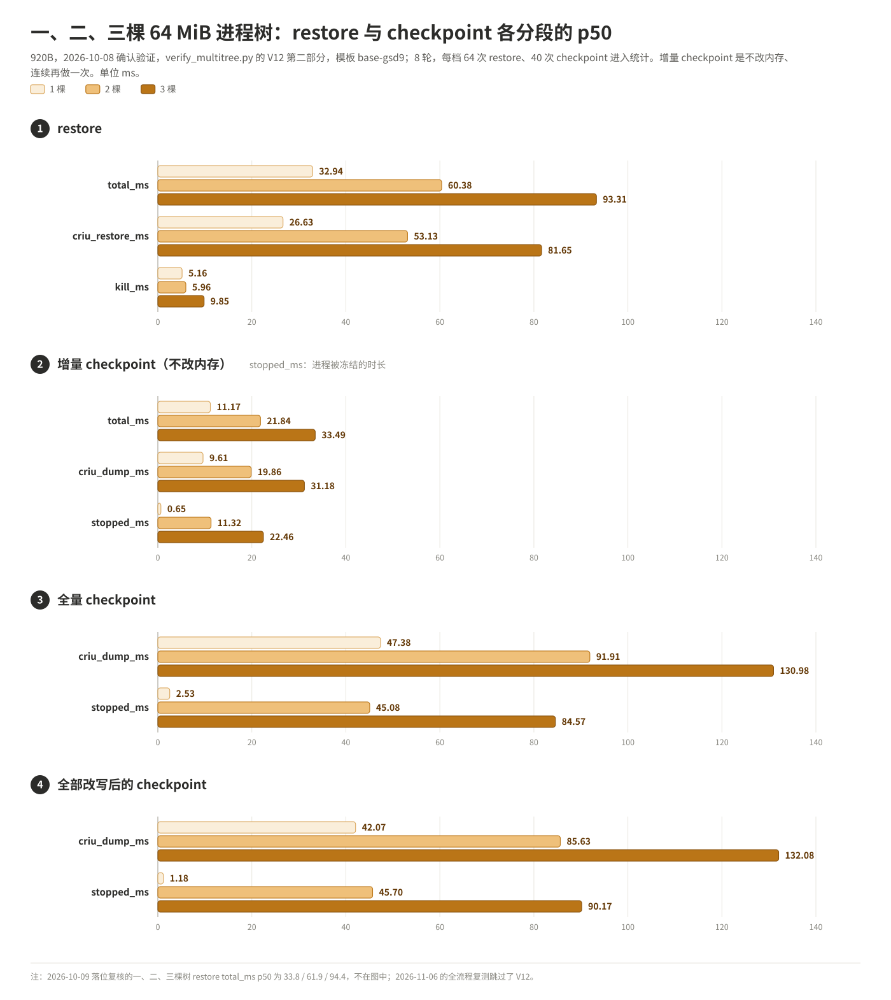
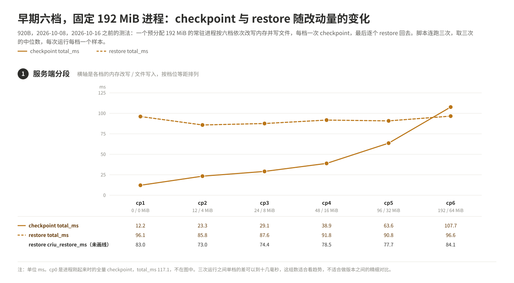

# 20 · 920B 性能结果

## 本章目标

读完本章，你应该能：

1. 查到新 920B 上六档负载的全量基点、增量 checkpoint 和 restore 耗时，以及两轮之间的差别；
2. 查到单棵 192 MiB 进程树连续 restore 的分段，以及一、二、三棵树的分段；
3. 说清楚本章几种口径的负载和统计方式，知道为什么同名指标不能跨口径比较；
4. 解释早期六档结果为什么各档 restore 都接近 90 ms，而分档结果随负载增长；
5. 查到回收、可写打开文件、层栈上限、容量预检、鉴权和进程扫描的专项数字。

各段成本的来源在 [17](17-cost-model.md)，脚本和判据在 [18](18-testing-and-debug-kernel.md)，测试条件在 [19](19-920b-functional.md) §1。950 的结果在 [22](22-950-results.md)。

本章所有耗时都是 gsd 自报的服务端分段（[29](29-configuration-and-observability.md) 的计时键），不含客户端到 gsd 的网络往返，单位 ms。负载的形状、统计的方式、进程树的棵数在各节之间都不一样，**同名指标不能跨节比较，更不能相减**。

---

## 结论先行

- **分档。** 2 vCPU / 2048 MB、THP 为 never，额外负载从 0 到 192 MiB 内存加 64 MiB 文件，restore 的 `total_ms` 中位数从约 9 ms 增长到约 94 ms，增量 checkpoint 从约 10 ms 增长到 106～118 ms（§1）。
- **restore 随进程大小增长。** 分档结果里进程大小与改动量同时变化。固定 192 MiB 进程的早期六档里，restore 基本不随改动量变化（§4）。
- **单棵 192 MiB 全脏。** 连续 8 次 restore 的 `total_ms` p50 为 83.3 ms（2026-10-08）和 85.3 ms（2026-11-06），时间几乎全在 CRIU 恢复与杀进程上，overlay 切层不到 1 ms（§2）。
- **多棵树。** 耗时随树数近似线性增长，两棵以上时先 dump 完的树要停着等后面的树（§3）。
- **边界。** 这些数字来自一台机器、一种 guest 规格和人造负载。分档每档只有三个样本。

---

## 1. 分档性能

### 1.1 测法

`demo_checkpoint_perf.py` 的分档口径是 `schema_version=2`、`measurement_mode=per-tier-size`：每档新建沙箱，只分配本档内存，建立全量基点，改写本档负载，测增量 checkpoint，再恢复本档全量基点并校验完整内存 SHA256、标记和文件内容。三轮共 18 次恢复。

| 项 | 2026-10-16 | 2026-11-06 |
|---|---|---|
| 平台 | 新 920B | 新 920B |
| gsd、guest 内核 | 与 [19](19-920b-functional.md) §1.1 相同，哈希不变 | 与 [19](19-920b-functional.md) §1.1 相同，哈希不变 |
| orchestrator | sha256 `818fa667…`，与 [19](19-920b-functional.md) §1.1 相同 | 为适配新部署重编，只改网卡命名，sha256 `151308ba…` |
| SDK | `dcca61266` | `dcca61266` |
| 模板 | `base-gsd`，ID `rdhpl4g7gl0ouexktqe9` | `base-gsd`，ID `9x7mcy64fvfm1xjw6114` |
| guest | 2 vCPU / 2048 MB，CRIU 4.2.1，THP=never，rcu_expedited=1 | 同左 |
| 恢复校验 | 18 次全部正确，SDK 与 journal 分段最大差 0.0 ms | 18 次全部正确，SDK 与 journal 分段最大差 0.0 ms |
| 范围 | 部署自检、性能三轮、脚本 11 项离线回归；没有重跑功能验收和压测 | 完整的 acceptance、stress 和回切（[19](19-920b-functional.md) §2.5、[21](21-920b-stress.md) §2） |

### 1.2 主表

服务端 `total_ms` 三轮中位数，单位 ms。增量 checkpoint 和 restore 是本节的主要指标，全量基点单列。

| 总改动量 MiB | 内存 / 文件 MiB | 全量基点 10-16 | 全量基点 11-06 | 增量 checkpoint 10-16 | 增量 checkpoint 11-06 | restore 10-16 | restore 11-06 |
|---|---|---:|---:|---:|---:|---:|---:|
| 0 | 0 / 0 | 23.2 | 21.4 | 10.6 | 9.5 | 9.1 | 8.6 |
| 16 | 12 / 4 | 30.0 | 32.8 | 18.1 | 25.2 | 14.8 | 15.5 |
| 32 | 24 / 8 | 35.6 | 36.2 | 25.9 | 24.9 | 19.8 | 19.4 |
| 64 | 48 / 16 | 46.4 | 48.8 | 37.6 | 40.0 | 31.1 | 30.3 |
| 128 | 96 / 32 | 69.4 | 71.8 | 59.8 | 64.6 | 52.6 | 51.5 |
| 256 | 192 / 64 | 110.8 | 120.4 | 106.2 | 117.8 | 93.9 | 94.3 |

各档实测 RSS 中位数：

| 总改动量 MiB | 0 | 16 | 32 | 64 | 128 | 256 |
|---|---:|---:|---:|---:|---:|---:|
| RSS MiB，10-16 | 11.63 | 24.76 | 36.75 | 60.76 | 108.74 | 204.76 |
| RSS MiB，11-06 | 11.63 | 24.76 | 36.76 | 60.76 | 108.76 | 204.76 |

### 1.3 怎么读

- RSS 包含 Python 运行时，确认负载不再全部等于最大档。0 档只是额外负载为零，进程和系统活动仍需恢复。
- 每档都是新沙箱的第一次 restore。进程大小与改动量同时变化，不能用这组数隔离固定进程大小下的改动量效应；固定进程大小时的情形见 §4。
- 两轮 restore 基本不变。增量 checkpoint 的差别主要在 16、128、256 MiB 三档：16 MiB 档两轮的样本有重叠（10-16 为 18.1 / 16.2 / 32.9，11-06 为 20.7 / 28.2 / 25.2）；128、256 MiB 两档三个样本互不重叠（128 MiB：57.0 / 59.8 / 60.6 对 67.8 / 64.6 / 64.2；256 MiB：108.1 / 106.2 / 104.6 对 114.0 / 117.8 / 118.7）。两轮的 gsd 和内核相同，这个差别的来源没有查。每档只有三个样本，也不是逐轮交错，不能判断趋势，更不能归到网卡命名的改动上。
- 2026-10-16 的全量基点客户端墙钟中位数在 267～348 ms，2026-11-06 同项在 25～124 ms，服务端 `total_ms` 没有这个差别。本节只用服务端数字，墙钟的差别原因没有查。

### 1.4 为什么早期各档都接近 90 ms

分档结果里 restore 从 9 ms 增长到 94 ms，而 §4 的早期六档都在 85.8～96.6 ms 之间。差别来自两件事：

1. **实现中的性能缺陷。** 错误 copy-up、cgroup 迁移等待 RCU、杀进程后轮询以及重复进程查询，引入了额外复制和等待，已经修复或优化（[附录 D](D-restore-slowness-case.md)、[附录 E](E-regression-case.md)）。旧 920B 的同口径微基准里，restore 从修复前 196～206 ms，先降至 121 ms，再降至 85～89 ms，降低约 55%～59%。这组数来自另一台机器的另一项微基准，不与本章相减。
2. **测试分档不符合预期。** 早期脚本所有档位都预分配最大档的 192 MiB，每次回滚都重建这一规模的进程，小档耗时也就接近最大档。现在各档独立分配对应大小的负载，统一恢复到本档基点。

---

## 2. `verify_gsd.py`：单棵 192 MiB、全脏，连续 restore 8 次

负载：一棵 192 MiB 的进程树，全量 checkpoint 之后把 192 MiB 全部改写，再做一次 checkpoint，然后对它连续 restore 8 次。统计这 8 次（包含第一次）。p50 取第 5 小的值。

| 分段 | p50 | 最小 | 最大 |
|---|---|---|---|
| `total_ms` | 83.3 | 80.5 | 93.3 |
| `criu_restore_ms` | 71.0 | 68.7 | 80.3 |
| `kill_ms` | 11.1 | 10.2 | 11.7 |
| `find_pids_ms` | 0.7 | 0.7 | 1.1 |
| `overlay_restore_ms` | 0.4 | 0.3 | 0.4 |
| `precheck_ms` | 0.1 | 0.1 | 0.1 |

8 次里最大的那一次（93.3 ms）是第一次 restore。根盘已用量起点 272 MB（`df -m` 的输出），8 次 restore 之后每次都是 +0，判定"根盘恒定"。

表是 2026-10-08 确认验证的结果。这一节的负载和统计在另外两轮里完全相同，分别在不同模板上各测一次：

| 分段（p50） | 2026-10-08 | 2026-10-09 落位复核 | 2026-11-06 |
|---|---:|---:|---:|
| `total_ms` | 83.3 | 86.8 | 85.3 |
| `total_ms` 最小 / 最大 | 80.5 / 93.3 | 83.5 / 96.1 | 83.6 / 97.0 |
| `criu_restore_ms` | 71.0 | 74.1 | 72.5 |
| `kill_ms` | 11.1 | 11.2 | 11.1 |
| `find_pids_ms` | 0.7 | 0.7 | 0.7 |
| `precheck_ms` | 0.1 | 0.1 | 0.1 |
| 根盘 | 272 MB，每次 +0 | 272 MB 恒定 | 272 MB，每次 +0 |

前一个提交号（同一个内核、另一个模板）同一脚本的 `total_ms` p50 是 84.8 ms。这些都是不同模板上各测一次，几毫秒的差不说明任何事情；能说明"两个版本没有差别"的是 §3 的逐轮交错对照。2026-10-09 的同一轮里，新模板与前一天模板的逐轮交错对照只差 0.15 ms：restore `total_ms` p50 为 83.12 对 83.27，`criu_restore_ms` 70.25 对 70.27，checkpoint `total_ms` 15.83 对 16.00。没有再加样本去区分 86.8 与 83.3 之间的差是不是单次测量的波动。

---

## 3. `verify_multitree.py` 的 V12：逐轮交错，以及一、二、三棵树

以下是 2026-10-08 确认验证的结果。2026-10-09 落位复核的一、二、三棵树 restore `total_ms` p50 为 33.8 / 61.9 / 94.4。2026-11-06 的全流程复测跳过了 V12。

**第一部分：与对照模板逐轮交错。** 负载是一棵 192 MiB 的树：全量 checkpoint → 全部改写 → 再做一次 checkpoint → 对它 restore 9 次并去掉第 1 次 → 连续 checkpoint 5 次（不改内存）。
两个模板各跑 8 轮、每轮一个新沙箱、奇偶轮交换先后，所以每个模板各有 64 次 restore、40 次 checkpoint 进入统计。这里的对照是"同一个内核、同一份 Go 代码，只差提交号"（两个提交之间只有一个补丁文件的组织方式不同，`packages/` 与 `py-sdk/` 没有差异）。

| 分段（p50） | `base-gsd9` | 对照模板 `base-gsd8` | 差 |
|---|---|---|---|
| restore `total_ms` | 81.28 | 82.55 | −1.27 |
| restore `criu_restore_ms` | 68.61 | 69.83 | −1.22 |
| restore `kill_ms` | 11.51 | 11.62 | −0.11 |
| restore `find_pids_ms` | 0.65 | 0.65 | 0.00 |
| restore `precheck_ms` | 0.12 | 0.12 | 0.00 |
| checkpoint `total_ms` | 15.55 | 16.10 | −0.55 |
| checkpoint `criu_dump_ms` | 13.60 | 14.18 | −0.58 |
| checkpoint `find_pids_ms` | 0.63 | 0.63 | 0.00 |
| checkpoint `precheck_ms` | 0.04 | 0.04 | 0.00 |

脚本判定的八条对照（上表除 `kill_ms` 一行外）全部在 ±3 ms 内。这张表同时给出了一个有用的参照：**两份本应相同的东西，在这套方法下测出来会差 1 ms 上下。** 小于这个量级的差别不要解读。
同一负载下，全量 checkpoint 的 `criu_dump_ms` p50 是 108.01 ms（`total_ms` 111.98），192 MiB 全部改写之后的那一次是 102.83 ms。

这张表里的 checkpoint 是"不改内存、连续再做一次"，所以只有十几毫秒；它量的是增量 checkpoint 的固定开销，不是有改动量时的耗时。有改动量的 checkpoint 见 §1。

**第二部分：一、二、三棵树。** 每棵树是一个 64 MiB 的进程，流程同上，只用 `base-gsd9`，同样 8 轮（每档 64 次 restore、40 次 checkpoint）。

| 分段（p50） | 1 棵 | 2 棵 | 3 棵 |
|---|---|---|---|
| restore `total_ms` | 32.94 | 60.38 | 93.31 |
| restore `criu_restore_ms` | 26.63 | 53.13 | 81.65 |
| restore `kill_ms` | 5.16 | 5.96 | 9.85 |
| 增量 checkpoint（不改内存）`total_ms` | 11.17 | 21.84 | 33.49 |
| 增量 checkpoint `criu_dump_ms` | 9.61 | 19.86 | 31.18 |
| 增量 checkpoint `stopped_ms` | 0.65 | 11.32 | 22.46 |
| 全量 checkpoint `criu_dump_ms` | 47.38 | 91.91 | 130.98 |
| 全量 checkpoint `stopped_ms` | 2.53 | 45.08 | 84.57 |
| 全部改写后的 checkpoint `criu_dump_ms` | 42.07 | 85.63 | 132.08 |
| 全部改写后的 checkpoint `stopped_ms` | 1.18 | 45.70 | 90.17 |

从这张表读得出多树的代价（机制在 [11](11-checkpoint.md)、[12](12-restore.md)，代价模型在 [17](17-cost-model.md)）：

- 每多一棵 64 MiB 的树，restore `total_ms` 多 27.44 ms（1→2 棵）与 32.93 ms（2→3 棵），不改内存的增量 checkpoint 的 `total_ms` 多 10.67 与 11.65 ms，全量 dump 的 `criu_dump_ms` 多 44.53 与 39.07 ms——各棵树是串行处理的，耗时随树数近似线性增长；
- `stopped_ms` 在单棵树时不到 3 ms，两棵以上时与"其余各棵的 dump 时间"同量级：先 dump 完的树要停着等后面的树。这就是多棵树时进程实际被冻结的时长。

---

## 4. 早期六档：固定 192 MiB 进程（2026-10-08）

这是 2026-10-16 之前的测法，结果保留，用来看固定进程大小时 restore 与改动量的关系。负载：一个预分配 192 MiB 的常驻进程，按六档依次改写内存并写文件，每档做一次 checkpoint，最后逐个 restore 回去。脚本连跑三次，下表是三次的中位数；每次运行每档只有一个样本。

| 档 | 内存改写 / 文件写入 | checkpoint `total_ms` | restore `criu_restore_ms` | restore `total_ms` |
|---|---|---|---|---|
| cp0 | 全量（进程刚起来） | 117.1 | — | — |
| cp1 | 0 / 0 | 12.2 | 83.0 | 96.1 |
| cp2 | 12 MiB / 4 MiB | 23.3 | 73.0 | 85.8 |
| cp3 | 24 MiB / 8 MiB | 29.1 | 74.4 | 87.6 |
| cp4 | 48 MiB / 16 MiB | 38.9 | 78.5 | 91.8 |
| cp5 | 96 MiB / 32 MiB | 63.6 | 77.7 | 90.8 |
| cp6 | 192 MiB / 64 MiB | 107.7 | 84.1 | 96.6 |

- 三次运行共 18 次 restore，文件内容与内存标记的校验全部通过；
- SDK 返回的各分段与 gsd 日志里同一个 checkpoint 的分段逐项相同，最大差 0.000 ms；
- `overlay_sink_ms` 的中位数是 0.56 ms：checkpoint 时切层本身的开销与写了多少文件无关；
- checkpoint 的耗时随改动量增长（12.2 → 107.7 ms），因为增量 dump 要写出本代的脏页；
- **restore 的耗时基本不随改动量变化**（六档都在 85.8～96.6 ms 之间）。CRIU 恢复要把整个进程的内存重新建起来，工作量取决于进程有多大，不取决于某一代改了多少；
- cp1 的 restore 比 cp2 还慢。它在每次运行里是第一个被 restore 的；§2 里 8 次中最慢的同样是第一次。沙箱里的第一次 restore 偏慢这一点两个脚本都看得到，原因没有单独查过。

三次运行之间单档的差可以到十几毫秒（例如 cp6 的 checkpoint `total_ms` 三次分别是 104.2、107.7、122.6），所以这张表适合看趋势，不适合做版本之间的精细对比。

---

## 5. 专项数字

这一节回答"某个修复起没起作用"或"某条边界在哪里"，与 §1～§4 的性能口径无关。§5.1、§5.2 来自较早的几轮，代码版本与内核都早于最终版本，每张表上方写明。

### 5.1 被删层的回收（泄漏）

`probe_leak.py`：基点之上每轮"写 1 MiB → checkpoint → 按路径读回 → restore 基点 → delete"，每 10 轮采样；"被占着的磁盘"指同一个根盘上已删除但仍被内核引用着、因而不释放的部分。
2026-10-08，结果目录 `gsd-fix5-20261008`；对比的是加入回收逻辑之前与之后的两版内核，gsd 相同。

| 内核 | 轮数 | 被占着的磁盘（每轮） | 全程增量 | `mnt_cache`（每轮） | `mnt_cache` 起 → 止 |
|---|---|---|---|---|---|
| 加入回收之前 | 300 | +1040.0 KB | +312012 KB | +5.996 | 317 → 2100 |
| 加入回收之后 | 300 | 0.0 KB | +28 KB | −0.003 | 290 → 327 |

有进程拿着旧层里的文件不放时，残留与持有量相等、放手后回落：20 轮里一个范围外的 root 进程每轮打开当轮写的 4 MiB 文件并一直拿着，持有期间多占 82312 KB（即 20 个 4 MiB 文件），
放手后剩 160 KB，再过 3 轮为 0；加入回收之前的内核上是 164240 KB，放手后也不回落。

在最终内核上（前一个提交号 `c0630349c` 那一轮，结果目录 `gsd-fix6-20261008`）复测：`probe_leak.py` 100 轮，被占着的磁盘恒定在 248880 KB，斜率 0.0 KB/轮，层目录数 3 → 3；
`probe_umount.py` 20 轮通过，没有残留，dmesg 为空。

`verify_fixes.py` 的 G-11（[19](19-920b-functional.md) §2.1 和 §2.5，40 轮扣除 journal 后净增 32 KB）是这条性质在 2026-10-08 和 2026-11-06 两轮的确认。

### 5.2 可写打开文件的 checkpoint 代价

`probe_move_cost.py`：一个范围外的 root 进程以读写方式打开一个 N MiB 的文件并一直拿着，然后做一次 checkpoint，看 `overlay_sink_ms`。
2026-09-30，结果目录 `gsd-fix4-20260930`，当时的内核是引入这一行为的那一版。2026-10-08 较早的一轮在加入回收之后的内核上复测过同一个探针，16、64、128 MiB 三档是 12.67、47.52、98.71 ms，与下表同档；最终内核上没有再测。

| 被持有的文件 | `overlay_sink_ms` |
|---|---|
| 没有 | 1.70 |
| 1 MiB | 1.65 |
| 16 MiB | 12.90 |
| 64 MiB | 48.01 |
| 128 MiB | 101.54 |

由后三行得出约 0.8 ms/MiB：checkpoint 时内核在切换的写锁内把这个文件整份拷进沉下去的层（[08](08-overlay-switch-consistency.md) 的"打开的文件跨切换的语义"一节），期间别的 overlay 操作被挡住。
没有这类文件时，切层不到 2 ms；§4 里 `overlay_sink_ms` 的中位数 0.56 ms 是同一件事在 2026-10-08 确认验证里的读数。

### 5.3 层栈上限与容量预检

两者都由 `verify_fixes.py` 直接测到，机制在 [15](15-state-concurrency-capacity.md)。

| 项 | 2026-10-08 确认验证 | 2026-11-06 全流程复测 |
|---|---|---|
| G-08 层栈上限 | 连续成功 checkpoint 190 次，第 191 次被拒：`resource_exhausted`，`layer stack too deep: 192 lower layers, ioctl options 4105 bytes > kernel limit 4096`；最后一次成功的 ioctl 有 190 层、`lowerdir` 串长 3871 字节。之后 restore 最深与最浅的 checkpoint 都正确，回到浅层栈后再 checkpoint 成功 | 相同：190 次成功，第 191 次被拒，选项串 4105 字节，最后一次成功的 ioctl 有 190 层、`lowerdir` 串长 3871 字节 |
| G-21 容量预检 | 480 MiB 进程：前两次 checkpoint 成功（镜像 483 MiB、481 MiB），第三次被拒：估算 580.4 MiB（1.2 × 483.6 MiB），快照存储剩余 1082.5 MiB，`MemAvailable` 456.8 MiB。存储放得下，内存不够。进程照常运行，dmesg 无 OOM | 镜像 483 MiB、481 MiB，第三次被拒：估算 580.4 MiB，快照存储剩余 1082.5 MiB，`MemAvailable` 456.1 MiB。进程照常运行，dmesg 无 OOM |

容量预检按"待 dump 进程的匿名内存与共享内存之和 × 1.2"估算，快照存储剩余与 `MemAvailable` 任何一个不够就拒绝。

### 5.4 鉴权与进程扫描

| 项 | 2026-10-08 确认验证 | 2026-11-06 全流程复测 |
|---|---|---|
| G-20 鉴权，secure 沙箱（guest 内各 40 次请求的中位数）：`/health` / 带鉴权的 `ListCheckpoints` / 差 | 0.21 / 0.83 / 0.62 ms | 0.23 / 0.82 / 0.59 ms |
| G-20 鉴权，非 secure 沙箱：同上 | 0.19 / 0.76 / 0.57 ms | 0.22 / 0.87 / 0.65 ms |
| PERF `find_pids_ms` 中位数：checkpoint / restore | 0.65 / 0.61 ms | 0.62 / 0.60 ms |
| PERF 对照：guest 里调一次 `systemctl show` 查 MainPID 的中位数 | 3.94 ms | 3.96 ms |

---

## 本章要点

- 分档主表是 2026-10-16 和 2026-11-06 两轮：restore 随实际负载从约 9 ms 增长到约 94 ms，增量 checkpoint 从约 10 ms 增长到 106～118 ms。全量基点单列。
- 分档里进程大小与改动量同时变化，不能隔离改动量效应。固定 192 MiB 进程的早期六档说明 restore 基本不随改动量变化。
- 两轮的 restore 基本不变；增量 checkpoint 在 128、256 MiB 两档的样本互不重叠，来源没有查，每档只有三个样本，不判断趋势。
- 单棵 192 MiB 全脏时 restore 的 `total_ms` p50 为 83.3 ms（2026-10-08），其中 CRIU 恢复 71.0、杀进程 11.1，overlay 切层不到 1 ms。
- 多棵树的耗时随树数近似线性增长；两棵以上时，先 dump 完的树要停着等后面的树，冻结时长与其余各棵的 dump 时间同量级。
- 各节口径独立，同名指标不能跨节比较。两份本应相同的东西逐轮交错测出来会差 1 ms 上下，小于这个量级的差别不要解读。
- 回收之后被占着的磁盘斜率为 0；可写打开的文件约 0.8 ms/MiB，这个系数在最终内核上没有直接读数；层栈上限是 190 层；鉴权每个请求约 0.6 ms。
