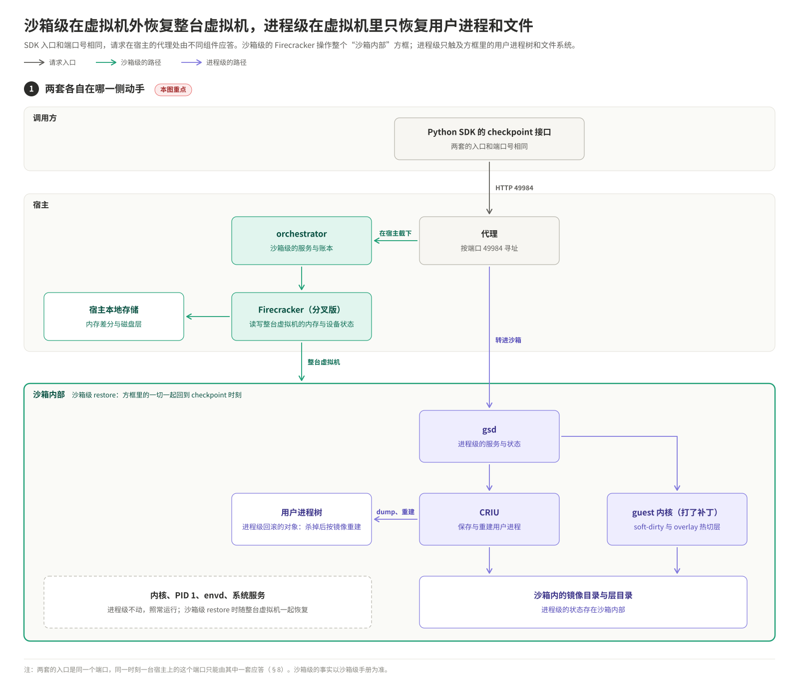
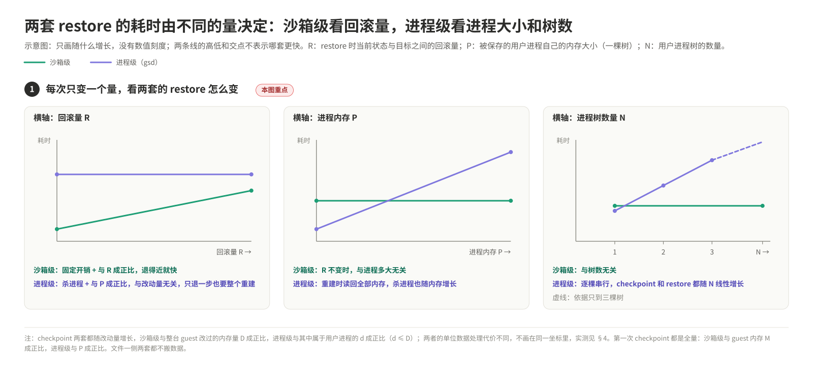
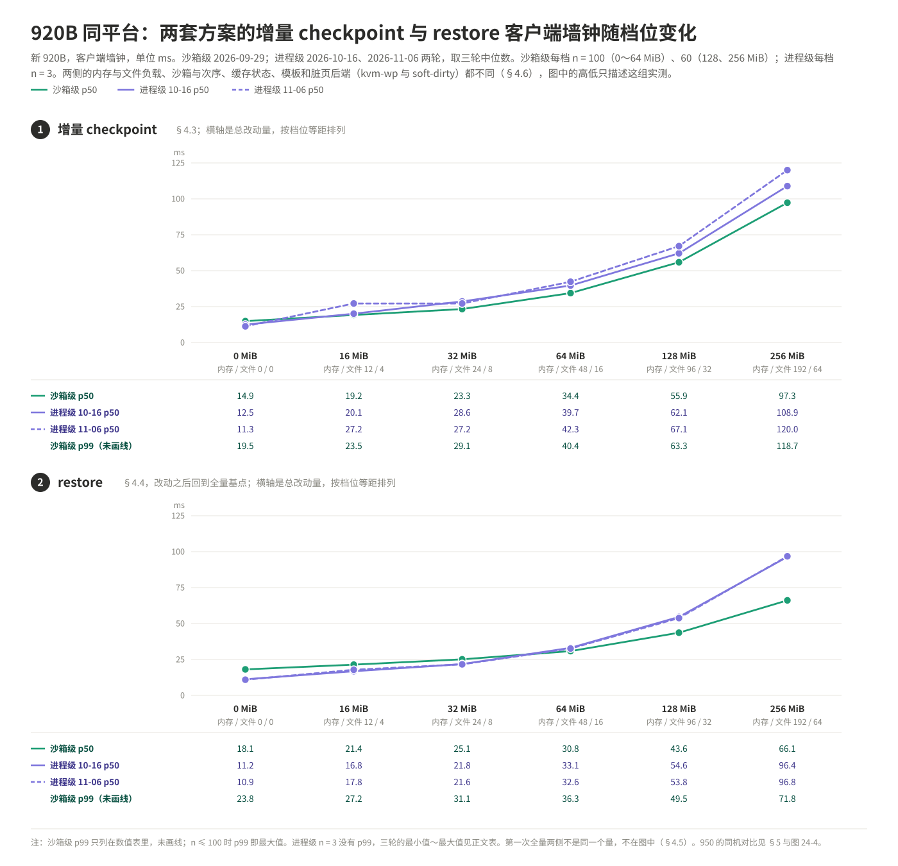
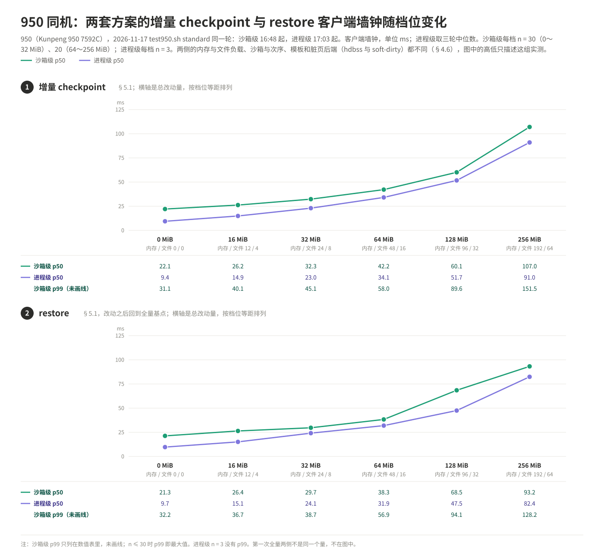

# 24 · 与沙箱级对比：设计差异与性能

## 本章目标

读完本章，你应当能够：

- 用一句话说出进程级和沙箱级两套 checkpoint / restore 的根本差别，并由它推出其余差别；
- 逐项对比两套的回滚对象、实现位置、脏页跟踪、存储、失败语义、依赖和适用平台；
- 说清两套的协议哪里相同、哪里不同，以及为什么两份 SDK 不能混用；
- 说清两套的成本模型为什么形状不同；
- 按负载的构成（内存改动、进程大小、文件写入、第一次全量）说出两套在 920B 和 950 上谁更快、每一项的代价是多少，以及旧的混合分档为什么不能用来比较；
- 用服务端分段和 CRIU 统计说清两套在 950 上各自快在哪里、慢在哪里；
- 读懂对外分档表：两套快照回滚与 E2B 原生 pause / resume 在同一负载上的数字，每一档谁快、为什么快；
- 说清 restore 之后两套各自"会发生什么、不会发生什么"，尤其是对回滚范围之外的东西的影响；
- 针对一个具体需求判断该用哪一套，并知道两套目前能不能在同一个沙箱上一起用。

本章是全书唯一的对比章。沙箱级的事实一律以沙箱级手册为准，本章只引用、不展开，章末给出对应章节的位置。
不读沙箱级手册也能读懂本书其余各章。

---

## 1. 一句话的差别

> **沙箱级在虚拟机外面恢复整台虚拟机的状态；进程级在虚拟机里面只恢复用户进程和文件。**

[02](02-problem-and-scope.md) 已经从问题的角度讲过这两条路线。这里换一个角度：两套的几乎所有差别，都能从"在哪一侧动手、回滚多大范围"这一个选择推出来。

| 由这个选择推出 | 沙箱级 | 进程级 |
|---|---|---|
| 谁来做 | 宿主上的 orchestrator 加分叉的 Firecracker；沙箱里什么都不装 | 沙箱里的 gsd 加 CRIU 加打了补丁的 guest 内核；宿主只在建模板时参与，Firecracker 不改 |
| 怎么知道哪些内存变了 | 宿主侧跟踪整个 guest 内存的脏页 | guest 内核跟踪用户进程的脏页（soft-dirty） |
| 恢复时进程怎么办 | 没有任何进程被杀或重建，内核和全部进程一起恢复到 checkpoint 时刻 | 当前的用户进程被杀掉，再由 CRIU 按镜像重建 |
| 范围之外还剩什么 | 沙箱内没有"范围之外"；沙箱外的连接和引用要处理 | 内核、PID 1、envd、系统服务都在范围之外，照常运行 |
| 状态存在哪 | 宿主本地 | 沙箱内部 |

下面这张图把两套各自工作的位置画在一起。SDK 入口和端口号相同，请求在宿主的代理处由不同组件应答：

图里有两点值得注意。第一，沙箱级的 Firecracker 操作的是整个"沙箱内部"这个方框，所以方框里的一切一起回滚；
进程级只触及方框里的"用户进程树"和文件系统，"内核与 PID 1 与 envd 与系统服务"那一格不动。
第二，两套的入口是同一个端口，同一时刻一台宿主上的这个端口只能由其中一套应答（[§8](#8-能不能在同一个沙箱上一起用)）。

### 1.1 两条路线各自怎么工作

**沙箱级：** 保存和恢复都在虚拟机外面做，由 Firecracker 和宿主上的编排程序完成，guest 里什么都不需要装。

- **保存什么**：全部 guest 内存、vCPU 寄存器、设备状态和磁盘。用户进程、内核、页缓存、系统服务都在里面。
- **怎么恢复**：把内存和设备状态写回。guest 里的每一个进程，包括内核自己，都恢复到 checkpoint 时刻，没有任何进程被杀掉或重建。
- **代价落在哪**：增量保存时要知道整个 guest 内存里哪些页被改过，这需要宿主侧的脏页跟踪；保存的量包含内核和页缓存的改动，不只是用户进程的。恢复时写回的量与回滚量成正比。
- **边界**：内核也一起恢复，所以跨越回滚的网络连接会失效，guest 的单调时钟会倒退。

**进程级：** 保存和恢复都在虚拟机里面做，由 guest 内的 gsd 调用 CRIU 完成。

- **保存什么**：选定用户进程的内存、寄存器、打开的文件等；文件系统由 overlay 的层单独处理。内核状态和别的进程不保存。
- **怎么恢复**：进程不能原地恢复，只能把现在的进程杀掉，再按镜像重新创建：重新 fork 出同样 PID 的进程、重新映射内存、把页面内容读回来、重新打开文件。
- **代价落在哪**：保存的量只是这组进程改过的页，比沙箱级少；但恢复是重建，要把进程的**全部**内存读回来，代价取决于进程有多大，与这一步改了多少基本无关。此外杀进程本身也要时间。
- **边界**：范围外的东西不回滚（[02](02-problem-and-scope.md) §2.2）；被保存的进程必须是 CRIU 能处理的；恢复期间有一段时间用户进程是不存在的。

### 1.2 两条路线保存的东西不一样：一组产物大小

两条路线保存的内容不同，从产物大小上能直接看到。下面这组数来自一次早期对照：同一个负载（一个常驻的用户进程改写 192 MB 内存，同时往磁盘写 64 MB 文件），两套各做一次增量 checkpoint。

> 平台：旧 920B（已退役）。日期：2026-09-08。代码：初始实现。样本：两套各跑一次。单位照原记录写作 MB。
> 这组数只用来说明范围不同，不是当前代码的性能数据，也不与 §4、§5 的数字并列。

| | 内存那一半的产物 | 包含了什么 |
|---|---|---|
| 进程级 | 约 194 MB | 那个用户进程改过的页。写文件的 64 MB **不在里面**，文件由 overlay 的层单独承担 |
| 沙箱级 | 约 276.5 MB | 用户进程改过的页，加上那次写文件留在 guest 页缓存里的页，再加内核自己的少量改动 |

这张表说明三件事。第一，进程级的产物小，是因为它不保存内核状态和页缓存。第二，在进程级这里，内存和文件由两种不同的机制负责；在沙箱级那里，文件写入的一部分也表现为内存的改动。第三，比较两套的耗时必须连同范围一起读，§4、§5 就是按这个要求写的。

### 1.3 为什么两条路线都存在

进程级不是沙箱级的"轻量版"，沙箱级也不是进程级的"完整版"。它们在一个问题上取了相反的答案：**要不要让范围之外的东西保持不动。**

- 沙箱级的答案是"不要"：沙箱内的一切都恢复，语义最简单，代价是范围外的连接和时钟也一起恢复；
- 进程级的答案是"要"：只恢复用户进程和文件，envd、系统服务、内核照常运行，代价是出现了一条"范围内 / 范围外"的分界线，分界线两侧的东西在 restore 之后不再属于同一时刻（[02](02-problem-and-scope.md) §5）。

哪一种合适取决于任务，选型见 §7。

---

## 2. 逐项对比

| 维度 | 沙箱级 | 进程级 |
|---|---|---|
| **回滚对象** | 整台虚拟机：全部 guest 内存（含内核、页缓存、所有进程、内存文件系统）、vCPU、中断控制器、virtio 设备状态、整个磁盘 | uid 1000 的用户进程树，加 overlay 根文件系统（含 `/tmp`）。内核状态、root 的进程、`/run`、`/dev/shm`、`/var/log` 等不回滚（[02](02-problem-and-scope.md)） |
| **实现层次** | 宿主：orchestrator（接口、编排、账本）加分叉的 Firecracker（原地回滚、脏页位图） | guest：gsd 守护进程加 CRIU 加 guest 内核补丁；orchestrator 只在建模板时参与 |
| **沙箱里要装什么** | 什么都不装 | gsd、CRIU 4.x、开机脚本 `overlay-init`，由模板构建注入（[06](06-guest-boot-and-injection.md)） |
| **内存脏页跟踪** | 宿主侧，按 4 KiB 记账。有硬件脏页跟踪（HDBSS）的平台自动启用；没有时用 KVM 的软件写保护，需显式打开；都不用时每次都是全量 | guest 内核的 soft-dirty，按页表项记账，要求透明大页为 `never`（[03](03-criu-and-incremental-memory.md)） |
| **对大页的影响** | 开着跟踪时 KVM 把 Stage-2 强制按 4 KiB 映射，失去 Stage-2 的大页收益；宿主侧仍是 hugetlbfs 2 MiB（[沙箱级手册第 5 章 §6.4](../../rollback/docs/05-dirty-tracking-and-hdbss.md#64-开跟踪后-stage-2-不再用大页)） | 宿主不开脏页跟踪，Stage-2 可以用 2 MiB 块；guest 内部要求透明大页为 `never` |
| **内存产物** | 每代一份稀疏的差分文件加一份脏页位图，组织成一棵差分树 | 每棵进程树每个 checkpoint 一个 CRIU 镜像目录，增量镜像用 `parent` 链接指向父镜像 |
| **文件产物** | 块级：磁盘写层原地封存成只读层，换上新的空写层 | 文件级：overlay 的可写层原地沉成只读层，换上新的空可写层（[07](07-overlay-hot-switch.md)） |
| **存储位置** | 宿主本地盘 | 镜像在 guest 内 2 GiB 的内存文件系统里（占沙箱内存），层在 guest 的根盘上（[04](04-goals-and-tradeoffs.md)） |
| **是否停机** | 沙箱不重建；checkpoint 和 restore 各有一次短暂的**虚拟机暂停**（冻结窗口） | 虚拟机从不暂停；checkpoint 时**被保存的用户进程**停一小段，restore 时用户进程被杀掉再重建 |
| **冻结窗口里停的是谁** | 整台虚拟机的 vCPU | 只有用户进程；内核、envd、系统服务照常运行 |
| **内存与文件的一致性** | 同一次暂停里保存、同一次暂停里换回，严格同一瞬间 | 全部用户进程停住之后才切层，所以进程镜像与文件系统是同一时刻的；多棵树之间有很短的先后差（[11](11-checkpoint.md)） |
| **恢复方式** | 原地写回：把变了的页和设备状态写回活着的 Firecracker 进程 | 重建：杀掉当前用户进程、切回层栈、CRIU 按原 PID 重新建进程并读回全部内存（[12](12-restore.md)） |
| **历史结构** | 树；restore 之后较新的 checkpoint 仍在，可前滚、可跨分支 | 树；restore 之后较新的 checkpoint 仍在，再 checkpoint 形成分支（[15](15-state-concurrency-capacity.md)） |
| **失败语义** | 提交点之前失败，沙箱原样可用；提交点之后失败称为"撕裂"，这一代沙箱的 checkpoint 与 restore 一律被拒，只能销毁重建 | 提交点（杀进程）之前失败，什么都没动；之后失败返回 `DataLoss`，虚拟机和 envd 仍然活着，再成功 restore 一次即可回到完整状态（[14](14-failure-semantics.md)） |
| **状态与账本** | 在 orchestrator 进程的内存里；orchestrator 重启即失效 | 在 gsd 的内存里，并持久化到沙箱内的状态文件；gsd 重启后能加载，guest 重启则全部丢失 |
| **什么时候失效** | 沙箱删除或回收、orchestrator 重启、宿主重启、迁移、原生 pause / resume 之后 | 沙箱删除或回收、guest 重启。沙箱被暂停再恢复之后按设计仍可用，但未验证（[04](04-goals-and-tradeoffs.md)） |
| **依赖** | 成对交付的 orchestrator 与分叉 Firecracker；宿主侧的脏页跟踪能力；对 guest 内核没有要求 | guest 内核必须打补丁并打开相应配置；基础镜像必须带 CRIU 4.x；对 Firecracker 和宿主内核没有额外要求 |
| **平台** | 宿主为 aarch64（鲲鹏 920B / 950）；有无硬件脏页跟踪只影响代价，不影响正确性 | 只支持 arm64 的 guest；已在新 920B 与 950 上验证 |
| **SDK** | `sandbox.checkpoint` 的四个方法；响应里回报这次是全量还是增量 | `sandbox.checkpoint` 的同名四个方法；响应里回报各阶段耗时、进程树数量、镜像大小等。两份 SDK 不是同一份（[25](25-quickstart.md)） |
| **鉴权** | 请求在宿主的代理处被截下，由宿主侧校验 token | 请求进到沙箱，gsd 对照元数据服务里的 token 摘要校验，与 envd 用同一个 token（[05](05-architecture.md)） |
| **成本模型** | 固定开销加上与**改动量**（checkpoint）或**回滚量**（restore）成正比的一项，与虚拟机规格基本无关；每个沙箱的第一次是全量 | checkpoint：与**用户进程的改动量**成正比，每棵树的第一次是全量；restore：与**被恢复进程的内存大小**成正比，再加杀进程的开销；两者都随树的数量线性增长（§3） |
| **对范围外进程的影响** | 沙箱内没有范围外的进程。跨越 restore 的 TCP 连接作废、在途的 SDK 调用被打断、单调时钟倒退 | envd 和系统服务不受打扰，时钟不变；但它们手里的旧目录和旧文件可能属于被丢弃的时间线，从陈旧目录出发的写返回 `ESTALE`（[26](26-semantics-and-limits.md)） |
| **对被保存对象的要求** | 没有要求，不看进程内部 | 进程必须是 CRIU 能保存的；树与树之间不能共用管道或 socket（[10](10-process-trees.md)） |

### 2.1 协议字段对照

下表按进程级 `criu-rollback-dev@bc3cce913` 的 `spec/gsd/checkpoint/checkpoint.proto` 和沙箱级 `deltabox-dev@57a30632c` 的 `spec/checkpointd/checkpoint/checkpoint.proto` 逐字段核对。结论是**服务路径与请求相同，响应已经各自演进、互不兼容**。

| 项目 | 进程级 | 沙箱级 |
|---|---|---|
| 包名、服务名、四个方法名 | `checkpoint.Checkpoint`，`CreateCheckpoint`、`RestoreCheckpoint`、`ListCheckpoints`、`DeleteCheckpoint` | 相同 |
| 四个请求消息 | `name` / `checkpoint_id` | 相同 |
| `CreateCheckpointResponse` 字段 1 | `checkpoint_id` | 相同 |
| `CreateCheckpointResponse` 字段 2 | `timings`（消息 `Timings`） | `mem_mode`（字符串） |
| `CreateCheckpointResponse` 字段 3～8 | `created_at`、`has_process_image`、`parent_checkpoint_id`、`image_bytes`、`clear_refs_failed`、`process_trees` | 没有 |
| `CheckpointInfo` 字段 1～3 | `checkpoint_id`、`name`、`created_at` | 相同 |
| `CheckpointInfo` 字段 4 | `image_bytes`（整数） | `mem_mode`（字符串） |
| `CheckpointInfo` 字段 5～7 | `has_process_image`、`parent_checkpoint_id`、`process_trees` | 没有 |
| `RestoreCheckpointResponse` | `success`、`timings` | 只有 `success` |

同一个字段编号在两边是不同类型，所以两套 SDK 不能混用：进程级必须用本仓库的 `py-sdk`（[25](25-quickstart.md)），沙箱级用它自己那一份。
两边用同一个端口号 49984 和同一个路径前缀，是因为沙箱级的协议文件由进程级 SDK 那份协议改名而来（`5c42b3968`）。区别在请求最终由谁应答：沙箱级由宿主截下，进程级走进 guest。同一个沙箱同时启用两套没有实施（[§8](#8-能不能在同一个沙箱上一起用)）。

---

## 3. 成本模型的形状

把两套各自的一次 checkpoint 和一次 restore 拆开看，工作量由不同的量决定。设：

- M：guest 内存的大小；
- P：被保存的用户进程自己的内存大小（一棵树）；
- D：自上一个 checkpoint 以来，整台 guest 改过的内存量；
- d：其中属于用户进程的那部分（d ≤ D，差的是内核和页缓存的改动）；
- R：restore 时当前状态与目标之间的回滚量；
- N：用户进程树的数量。

| 操作 | 沙箱级 | 进程级 |
|---|---|---|
| 第一次 checkpoint | 与 M 成正比（全量根，每个沙箱每一代一次） | 与 P 成正比（每棵树第一次保存时全量） |
| 之后的 checkpoint · 内存 | 固定开销 + 与 D 成正比 | 每棵树一次 CRIU 的固定开销 + 与 d 成正比 |
| 之后的 checkpoint · 文件 | 封存写层；guest 写过、宿主还没写回的磁盘数据要在暂停窗口里经 NBD 推进写层（§5.5），每 MiB 约 1.1～1.5 ms | 一次层切换，不搬数据；checkpoint 那一刻以可写方式打开着的文件要拷贝一份（[08](08-overlay-switch-consistency.md) §5.4） |
| restore · 内存 | 固定开销 + 与 R 成正比 | 杀进程 + 与 P 成正比（重建时读回全部内存），**与改动量无关** |
| restore · 文件 | 切换磁盘视图；写文件时进了 guest 页缓存的页按内存回滚 | 一次层切换，不搬数据 |
| 多棵进程树 | 无关 | checkpoint 和 restore 都随 N 线性增长（串行，[04](04-goals-and-tradeoffs.md)） |

由此得到三条判断。

**checkpoint：进程级处理的数据范围更小，但这不等于耗时更低。** d 不大于 D。文件写得多的负载下差得更明显：在沙箱级那里，文件写入会经过 guest 的页缓存，
一部分表现为内存的改动；在进程级这里，文件完全由 overlay 的层承担，不进内存镜像（§1.2 的产物大小例子）。
耗时还取决于单位数据的处理代价：CRIU 按进程逐段读取并写出镜像，Firecracker 按位图导出差分，两者不是同一条代码路径。§4 的同负载实测里，每 MiB 内存改动的 checkpoint 代价沙箱级约为进程级的 2～4 成。

**restore：两条曲线的自变量不同。** 沙箱级的 restore 随"退多远"增长，退得近就快，代价与进程多大无关。
进程级的 restore 随"进程多大"增长，哪怕只退回一步、只改了几个字节，也要把整个进程重建一遍。
所以拿"这一步的改动量"去预测进程级 restore 的耗时，是比错了量。[20](20-920b-performance.md) §4 的固定 192 MiB 进程测试里，六个改动量的 restore 耗时基本持平，这是进程大小决定耗时的直接表现。

**哪一套更快取决于负载的形状，没有统一的答案。** 进程小时，进程级的 restore 重建量小；进程大而每步改动小时，沙箱级的 restore 只写回改动，进程级仍要重建整个进程。
checkpoint 一侧，脏页后端不同也会改变沙箱级的代价，所以这里的判断不能跨平台使用。

---

## 4. 分档性能：结论

两套的 checkpoint、restore 由不同的量决定（§3），所以“哪一套更快”不能用一个改动量回答，要按负载的构成分开答。下面的结论都来自同一负载的对比（§5.1 的测法）：同一台机器、同一时段、同一个脚本，两侧跑完全相同的进程、内存改写和文件写入，只换快照回滚的实现。数据在 §5.2（新 920B）、§5.3（950，2026-11-27 那一轮，5 轮交替、每个测点 n = 100），机理在 §5.4、§5.5。

### 4.1 按负载的构成看谁更快

| 负载的哪一部分 | 更快的一侧 | 950 实测（2026-11-27，客户端墙钟 p50，ms，n = 100） | 920B 实测（2026-11-18） | 原因 |
|---|---|---|---|---|
| 内存改动的 checkpoint | 沙箱级 | 256 MiB 进程改 0 / 256 MiB：沙箱级 6.8 / 32.8，进程级 15.1 / 97.3 | 6.6 / 28.8 对 22.3 / 107.4 | 进程级要冻结进程、收集进程状态、扫描整个进程的页表，并在 guest 的 2 个 vCPU 上写页；沙箱级由宿主上的 Firecracker 直接写差分 |
| 进程较大时的 restore | 沙箱级 | 384 MiB 进程改 16 MiB：26.1 对 143.9 | 23.3 对 165.6 | 进程级每次重建整个进程，沙箱级只写回改过的页 |
| 很小的进程的 restore | 接近 | 32 MiB 进程改 16 MiB：24.1 对 23.8 | 20.9 对 24.9 | 进程级要重建的量小 |
| 文件改动的 checkpoint | 进程级 | 写 64 MiB 文件：74.1 对 11.2 | 82.7 对 10.9 | 进程级一次层切换，不搬数据；沙箱级要把宿主还没写回的磁盘数据推进写层，大部分在暂停 vCPU 之前做，仍计入墙钟（§5.5） |
| 文件改动的 restore | 进程级 | 写 64 MiB 文件：48.5 对 19.1 | 35.9 对 20.4 | 沙箱级要回滚写文件时进了 guest 页缓存的那些页 |
| 第一次全量 checkpoint | 进程级 | 255～285 对 37～186（进程 32～384 MiB） | —— | 沙箱级保存整台 guest 的内存，进程级只保存用户进程 |
| 16 个沙箱同时做 | 服务端两侧都基本不变 | checkpoint 服务端 13.2 对 15.2，restore 26.2 对 36.3（第 3 轮） | 14.1 / 20.5，23.5 / 38.7 | 墙钟变长来自客户端（同一个 Python 进程里 16 个线程） |

### 4.2 每一项的代价

把 §5.2、§5.3 的测点按各自的自变量取斜率，得到下表。它们是测点之间的差除以自变量之差，用来说明量级和两侧的比例，不是拟合出来的代价模型；“——”表示这一项与该自变量基本无关。

| 项（ms） | 950 沙箱级 | 950 进程级 | 920B 沙箱级 | 920B 进程级 | 怎么取的 |
|---|---:|---:|---:|---:|---|
| checkpoint 固定开销（一页不改） | 6.8 | 15.1 | 6.6 | 22.3 | 256 MiB 进程、d = 0 的连续 checkpoint |
| checkpoint 每 MiB 内存改动 | 0.08 | 0.32 | 0.07 | 0.33 | d = 16 → 256 MiB |
| checkpoint 每 MiB 文件写入 | 0.93 | —— | 1.1 | —— | f = 16 → 64 MiB；进程级 10.9 → 11.2 ms |
| restore 每 MiB 回滚量 | 0.25 | —— | 0.18 | —— | 256 MiB 进程，d = 16 → 256 MiB；进程级 97.2～105.6 ms 不随 d 变 |
| restore 每 MiB 进程大小 | —— | 0.34 | —— | 0.40 | d = 16 MiB，P = 32 → 384 MiB；沙箱级 23.7～26.1 ms 不随 P 变 |
| restore 每 MiB 文件写入 | 0.39 | 0.02 | 0.21 | 0.04 | f = 16 → 64 MiB |
| 第一次全量 | 255～285，与进程无关 | 37～186，随进程大小 | —— | —— | size 组每个测点新沙箱上的第一次 |

950 两列是 2026-11-27 那一轮（宿主透明大页 never、`kernel.numa_balancing=0`，n = 100），920B 两列是 2026-11-18 那一轮（n = 20）。两台机器、两种宿主条件，只用来对照量级，不互相相减。

沙箱级手册[第 18 章 §5.3](../../rollback/docs/18-950-performance.md#53-文件改动是-checkpoint-的大头)在 950 上用另一种负载（tmpfs 文件当内存、根盘大文件覆写后 `sync`）测得：纯内存 checkpoint 冻结窗口每 MiB 0.087 ms，纯文件每 MiB 1.29 ms，restore 冻结窗口分别为每 MiB 0.25 与 0.36 ms。量级与上表一致。

由此可以粗算两侧的分界（950，只看 p50）：

- **restore**：进程级约 10 + 0.34 × 进程 MiB，沙箱级约 20 + 0.25 × 回滚 MiB。改 16 MiB 时，进程小于约 35 MiB 进程级才不慢（size 组 32 MiB 时 23.8 对 24.1，64 MiB 时 38.8 对 24.6）；整个进程都被改写时，按这两式分界约在 110 MiB（mix 组 70 MiB 档进程级 35.6 对 42.2，dirty 组 256 MiB 进程全改写时 97.2 对 83.3）。
- **checkpoint**：内存改动两侧都随改动量增长，沙箱级每一项都更低；文件写入只在沙箱级计费。改动以文件为主时进程级更快：内存改 64 MiB 的同时写的文件超过约 20 MiB，进程级的 checkpoint 就更低。沙箱级的文件代价还与“写完多久才 checkpoint”有关（§5.5），这里用的是写完立刻 checkpoint 的数。

### 4.3 对外分档表（950，2026-11-27）

这张表用于对外展示：两套快照回滚和 E2B 原生 pause / resume 放在同一张表里，都在同一台 950、同一轮、同一个脚本、同一种负载上测。表里只给每一档的数字；每一档谁快、为什么快，写在表后面（§4.3.1）。

**负载。** 每一档新建一个沙箱。沙箱里一个常驻进程预先分配并写满 P MiB 匿名内存，P 等于这一档的内存改动，也就是每一步把整个进程改写一遍；改写之后再向根盘文件写“文件 MiB”那么多，然后 `fsync`。前六档的内存和文件按 3 : 1 拆分；最后一档只改内存 70 MiB，文件只写 0.001 MiB（1 KiB 左右）。

**为什么进程大小随档位变。** 这是刻意构造的。进程级 restore 每次重建整个进程，代价随进程大小增长，与改动量无关（§3）。2026-11-19 那一轮固定用 256 MiB 进程，进程级 restore 每档都约 100 ms，表里这一列不随档位变化，读者容易误解。让 P 等于内存改动之后，沙箱级 restore 随改动量、进程级 restore 随进程大小，两者在本表中取值相同，两列都随档位增长。实际使用中进程往往比每一步的改动大，这时进程级 restore 按进程大小计，见表后的 size 小表与 §4.2。

**各列测的是什么。**

- checkpoint 是连续 checkpoint：上一次 checkpoint 之后改写，再做一次；restore 回到改写之前的那个 checkpoint。
- 首次全量是每个新沙箱上的第一次 checkpoint：沙箱级保存整台 guest 的内存，进程级只保存这个进程。每档每轮 2 个样本，5 轮共 10 个。
- E2B 的 pause / resume 用同一种负载，另起沙箱测：改写 → `sb.pause()` → `Sandbox.connect()` → 执行第一条命令。只在进程级那套代码上测（orchestrator `fbe72d14…`，KASandbox `f66dbe2c1`），代表 ARM 上的 E2B 原生实现；这一版把停 Firecracker 前查进程状态由执行 `ps` 改为读 `/proc`，见表后“E2B pause”。pause 只计第一步（拍快照并放进本节点缓存），与上游返回的时机一致，见表后“pause 的口径”。resume 一列是 `connect` 返回耗时加上第一条命令的耗时。每个沙箱上的第一次 pause 不计入表格（单列在 report 里）。
- resume 后首读：resume 返回时进程的内存还没有读回，之后第一次把整个进程的内存读一遍，比 pause 之前多花的时间。restore 返回时内存已经就位，没有这一项。

**条件。** 950（Kunpeng 950，宿主内核 `6.6.0-159.4.3.154.oe2403sp4.aarch64`），e2b-infra `e4041b5`，`bash test950.sh compare --rounds 5`，结果目录 `test950/results/20261127-194830-compare/`。两套各跑 5 轮，按 ABBA 交替（沙箱级、进程级、进程级、沙箱级……），所有列（含 E2B pause / resume / 首读）都在这一轮里测。沙箱级：orchestrator `3a140cc5…`（RPM `2026.09-3`，e2b-infra `6d29da4` 构建，含 O-1/O-3 与 checkpoint 后在后台丢根盘缓存），脏页后端 `hdbss`，模板 `base`。进程级：orchestrator `fbe72d14…`（KASandbox `f66dbe2c1`），gsd `8bc5dc49…`，guest 内核 `6fdcd2d6…`（补丁 0004 DBM、0005 KSM），脏页后端 `off`，模板 `base-criu`。两侧都是 2 vCPU / 2048 MB，同一份 Firecracker。每格 n = 100（首次全量 n = 10），客户端墙钟，单位 ms。12 步全部 PASS，两侧内存与文件校验全部一致。原始终端输出存于工作区 `rollback-reports/950-test950-20261127/`。

**宿主条件。** 透明大页 `never`（`defrag=never`）、`kernel.numa_balancing=0`、`compaction_proactiveness=0`，与 2026-11-24 及以前各轮（透明大页 `always`、`numa_balancing=1`）不同。宿主在测试前重启过，停了 `ubturbo`，没有 smap 模块；test950 在每一步前后检查 smap，25 次全部正常（smap 引起宿主重启的经过见工作区 `rollback-reports/950-reboot-20261126/`）。开跑时宿主上没有别人的 Firecracker。本节只比较同一轮内的两套快照回滚和原生 pause / resume，不与以前的轮次相减；11-20 那一轮的表移到 §5.6。

**测前清理。** 每个测量步骤开测前，脚本先回收宿主上积累的 e2b 网络命名空间，回收后 155～233 个，测量时挂载点约 410～560 个。每起一个 Firecracker 都要新建 mount 命名空间、复制宿主的整张挂载表，网络命名空间积累多了 E2B resume 会变慢（沙箱级手册[第 19 章 §6](../../rollback/docs/19-native-pause-resume.md#6-固定开销从哪里来)）。

**p50：**

| 总改动 MiB | 内存 MiB | 文件 MiB | 进程 MiB | 沙箱级 checkpoint | 进程级 checkpoint | 沙箱级 restore | 进程级 restore | 沙箱级首次全量 | 进程级首次全量 | E2B pause | E2B resume | resume 后首读 |
|---:|---:|---:|---:|---:|---:|---:|---:|---:|---:|---:|---:|---:|
| 0 | 0 | 0 | 0 | **6.9** | 8.3 | 19.0 | **10.2** | 276.1 | 23.6 | 124.3 | 77.8 | 0.0 |
| 16 | 12 | 4 | 12 | 18.2 | **14.1** | 27.2 | **14.7** | 268.7 | 26.1 | 140.7 | 75.7 | 1.4 |
| 32 | 24 | 8 | 24 | 22.5 | **18.3** | 32.6 | **18.9** | 290.0 | 31.6 | 146.8 | 72.7 | 2.9 |
| 64 | 48 | 16 | 48 | 32.0 | **27.2** | 44.3 | **27.3** | 293.4 | 43.7 | 177.3 | 75.2 | 6.4 |
| 128 | 96 | 32 | 96 | 54.0 | **42.8** | 65.4 | **43.0** | 288.7 | 64.7 | 213.6 | 79.8 | 13.7 |
| 256 | 192 | 64 | 192 | 97.2 | **75.3** | 105.8 | **75.8** | 312.5 | 105.6 | 337.0 | 83.6 | 31.2 |
| 70.001 | 70 | 0.001 | 70 | **22.1** | 35.8 | 42.2 | **35.6** | 262.8 | 54.9 | 135.0 | 77.1 | 9.2 |

加粗的是两套快照回滚的 checkpoint、restore 中 p50 更低的一侧。

**p99：**（n = 100，按最近秩取，即第 99 个；首次全量 n = 10，接近最大值；resume 后首读只列 p50）

| 总改动 MiB | 内存 MiB | 文件 MiB | 进程 MiB | 沙箱级 checkpoint | 进程级 checkpoint | 沙箱级 restore | 进程级 restore | 沙箱级首次全量 | 进程级首次全量 | E2B pause | E2B resume |
|---:|---:|---:|---:|---:|---:|---:|---:|---:|---:|---:|---:|
| 0 | 0 | 0 | 0 | 8.2 | 9.4 | 88.3 | 11.8 | 297.0 | 28.4 | 173.8 | 149.4 |
| 16 | 12 | 4 | 12 | 22.4 | 17.0 | 80.8 | 18.9 | 286.1 | 31.3 | 213.5 | 131.4 |
| 32 | 24 | 8 | 24 | 30.3 | 20.3 | 108.6 | 51.3 | 350.7 | 34.9 | 220.8 | 83.3 |
| 64 | 48 | 16 | 48 | 42.1 | 33.1 | 106.6 | 35.4 | 371.5 | 51.5 | 234.8 | 86.7 |
| 128 | 96 | 32 | 96 | 65.0 | 59.8 | 78.5 | 53.3 | 423.7 | 68.1 | 315.4 | 93.4 |
| 256 | 192 | 64 | 192 | 113.3 | 83.4 | 123.4 | 94.7 | 437.9 | 136.0 | 692.5 | 96.1 |
| 70.001 | 70 | 0.001 | 70 | 25.6 | 44.1 | 52.7 | 46.4 | 367.0 | 61.0 | 276.8 | 88.3 |

沙箱级 restore 在 0～64 MiB 四档的 p99 是 80.8～108.6 ms，远高于各自的 p50（19.0～44.3 ms）。n = 100 时 p99 取第 99 个样本，所以每档至少有 2 个这样的慢样本。11-20、11-24 两轮 0～32 MiB 三档的 p99 也是 73～103 ms，这一轮宿主没有别人的 Firecracker、透明大页关掉之后仍然在，与这两项无关；compare 只打印各段的 p50，慢样本慢在哪一段还没有拆。E2B pause 256 档的 p99 692.5 ms 也是个别慢样本（p50 337.0 ms）。

**restore 随进程大小**（同一轮的 size 组：每次改 16 MiB 内存，进程大小变化，p50）：

| 进程 MiB | 沙箱级 restore | 进程级 restore |
|---:|---:|---:|
| 32 | 24.1 | **23.8** |
| 64 | **24.6** | 38.8 |
| 128 | **24.7** | 58.9 |
| 256 | **23.7** | 103.5 |
| 384 | **26.1** | 143.9 |

#### 4.3.1 每一档谁快、为什么

数字都来自同一轮（2026-11-27）的 p50：mix 组取自上表，解释用的其他测点组（只改内存的 dirty 组、只改进程大小的 size 组、只写文件的 file 组）在同一轮里与 mix 组交替跑。分段取第 3 轮（每档 n = 20）的服务端分段。

先给出两套各自的代价从哪里来，下面逐档的解释都由这几项组成：

| 项 | 沙箱级 | 进程级 | 出处 |
|---|---|---|---|
| checkpoint 固定开销 | 约 7 ms：暂停 vCPU、写快照文件 | 随进程大小：冻结进程、收集进程状态、扫描整个进程的页表 | mix 0 档 6.9 对 8.3（进程几乎为空）；dirty 组 d = 0（256 MiB 进程，约 7 万个页）6.8 对 15.1 |
| checkpoint 每 MiB 内存改动 | 约 0.10 ms：宿主上的 Firecracker 按 HDBSS 标脏的位图直接写出 | 约 0.32 ms：CRIU 在 guest 的 2 个 vCPU 上把页经管道写进镜像文件 | dirty 组 d = 0 → 256：6.8 → 32.8 对 15.1 → 97.3 |
| checkpoint 每 MiB 文件写入 | 约 0.9 ms：要把宿主还没写回的根盘数据经 NBD 推进写层（§5.5）；O-1/O-3 起大部分在暂停 vCPU 之前做（`preflush`），不在冻结窗口里，但计入墙钟 | 基本为 0：换一层 overlay 写层，不搬数据 | file 组 f = 16 → 64：29.4 → 74.1 对 10.9 → 11.2；f = 64 时沙箱级 `preflush` 52.4 ms、冻结 15.6 ms |
| restore | 随改动量：约 17～24 ms 起，内存每 MiB 约 0.25 ms；与进程大小无关 | 随进程大小：约 10 ms 起，每 MiB 进程约 0.34 ms；与改动量无关 | dirty 组 d = 0 → 256：17.2 → 83.3，进程级 97.2～105.6；size 组 P = 32 → 384：沙箱级 23.7～26.1，进程级 23.8 → 143.9；mix 组进程级 0 档 10.2、256 档 75.8；进程级 256 MiB 进程每次恢复 67433 个页 |

沙箱级 restore 只把改过的页写回仍在运行的 Firecracker 进程；进程级 restore 要结束旧进程，再由 CRIU 把整个进程从镜像重建出来，所以它的代价跟“进程多大”走，不跟“改了多少”走。本表里进程大小等于内存改动，两项碰在一起。

**0 / 0 / 0（进程 0 MiB）。** 只剩固定开销。checkpoint 沙箱级 6.9、进程级 8.3，接近：进程几乎为空，进程级要扫的页表很少。restore 进程级 10.2、沙箱级 19.0，进程级快 1.9 倍：进程级要重建的进程几乎为空；沙箱级 restore 有约 17 ms 的固定开销（暂停 vCPU、原地写回、复位设备；conntrack 清理约 6 ms 在后台并行，不计入）。

**16、32、64 三档（进程 12～48 MiB）。** 进程级 checkpoint 低 4.1～4.8 ms（14.1～27.2 对 18.2～32.0），快 1.2～1.3 倍；restore 低 12.5～17.0 ms（14.7～27.3 对 27.2～44.3），快 1.6～1.9 倍。checkpoint：这几档有 1/4 的改动是文件，沙箱级每 MiB 文件约 0.9 ms，进程级基本不花；进程小，进程级的固定开销也小。第 3 轮 64 MiB 档沙箱级 checkpoint 32.9 ms 里，暂停前写回根盘 13.5 ms，导出内存和剩下的文件数据 15.7 ms，其余约 3.7 ms。restore：进程级重建 12～48 MiB 的进程，约 10 + 0.34 × 进程 MiB；沙箱级回滚 16～64 MiB 改动，还要回滚写文件时进了 guest 页缓存的页。

**128、256 两档（进程 96、192 MiB）。** 仍是进程级更低。checkpoint 42.8 对 54.0、75.3 对 97.2，快 1.3 倍；256 档沙箱级 97.2 ms，与只改 192 MiB 内存（dirty 组插值约 28 ms）加只写 64 MiB 文件（74.1 ms）两项之和相当，第 3 轮这一档暂停前写回根盘 59.3 ms、导出内存与剩下的文件数据 39.5 ms。restore 43.0 对 65.4、75.8 对 105.8：进程级按 0 档与 256 档两点算每 MiB 进程约 0.34 ms，与 size 组一致。

**70 / 70 / 0.001（进程 70 MiB）。** 没有文件写入，沙箱级的文件代价不出现。checkpoint 沙箱级快 1.6 倍（22.1 对 35.8）：只剩内存代价，沙箱级每 MiB 约 0.10 ms，进程级约 0.32 ms。第 3 轮拆开看，写内存页沙箱级 17.1 ms、进程级 28.2 ms，进程级另有约 5.7 ms 的 CRIU 固定开销（起 CRIU、冻结进程、扫描页表）。restore 进程级低 6.6 ms（35.6 对 42.2）：沙箱级回滚 70 MiB 改动、进程级重建 70 MiB 进程，在这个大小上代价相近。11-20、11-24 两轮这一档两侧只差 0.1～0.2 ms，这一轮宿主条件不同，不归因。

**与 2026-11-19 那一轮的区别。** 那一轮进程固定 256 MiB：restore 每档都是沙箱级更低，128、256 两档的 checkpoint 也是沙箱级更低（原始输出在工作区 `rollback-reports/950-compare-20261119/compare.txt`）。差别来自进程大小：进程级的 checkpoint 固定开销和 restore 都随进程大小增长，进程从 256 MiB 降到 12～192 MiB，这两项都变小。两轮说的是同一件事：进程比改动大得多时沙箱级 restore 更快（本轮 size 组 P = 256 MiB 时 23.7 对 103.5）；进程小、改动里有文件时进程级更快。

**E2B pause。** 124.3～337.0 ms，一页不改也要 124.3 ms。按第 3 轮 orchestrator 的分段日志，0 档的 117 ms 里：停 Firecracker 并等它退出 68 ms（主要是内核销毁 KVM 虚机），断开根盘的 NBD 19 ms，暂停 vCPU、写快照、导出内存一共约 28 ms（沙箱级手册[第 13 章 §6.1](../../rollback/docs/13-native-snapshot.md#61-pause改动量为-0-也要约-120-ms)）。随改动增长的部分来自写快照时刷根盘、导出内存和导出根盘差分；导出内存的判据是所有驻留在内存里的页，不只是改过的页（0 档也要导出 168 MiB）。两套 checkpoint 比 pause 快 3.5～18 倍：沙箱级 3.5～18 倍，进程级 3.8～15 倍。

上游在发 SIGTERM 之前先执行一次 `ps` 查 Firecracker 的进程状态，只为在日志里提示 D 状态，950 上约 106 ms；进程级部署包从 `f66dbe2c1` 起改为读 `/proc/PID/stat`（0.8 ms）。2026-11-20 那两轮在同一负载上做过改前改后的对比：改前 E2B pause 230.5～457.2 ms，改后每档少 89～129 ms；resume 基本不变（沙箱级手册[第 13 章 §6.1](../../rollback/docs/13-native-snapshot.md#61-pause改动量为-0-也要约-120-ms)）。

**E2B resume。** 72.7～83.6 ms，基本不随档位变化：resume 不搬运内存，返回时内存还在快照文件里，之后按缺页从文件读回。第 3 轮 0 档的 69 ms 服务端时间里，起一个新的 Firecracker 到它的 API 可用 34 ms（其中建沙箱 cgroup 约 11 ms），等 guest 里的 envd 就绪 16 ms，加载快照 12 ms。读回整个进程的内存比 pause 之前多花 0.0～31.2 ms，随进程大小增长。

- 总改动 128 MiB 以内的档，两套 restore 都快于 resume：沙箱级快 1.2～4.1 倍，进程级快 1.9～7.6 倍。70 档沙箱级快 1.8 倍，进程级快 2.2 倍。
- 256 档沙箱级 restore 105.8 ms，慢于 resume 22.2 ms；进程级 75.8 ms，仍快 7.8 ms。把 resume 之后读回 192 MiB 内存的 31.2 ms 算上，resume 一侧共 114.8 ms，两套 restore 都更快。

**这张表不能直接说明的三件事。**

- 语义不同。restore 回到任意一个之前的 checkpoint，沙箱一直在运行，之前的 checkpoint 仍然有效；resume 只能回到最近一次 pause，Firecracker 换了一代进程，之前的 checkpoint 全部失效（沙箱级手册[第 24 章 §3.1](../../rollback/docs/24-api-semantics.md#31-原生-pause--resume-与-checkpoint-的代际边界)）。数字接近不代表能互相替代。
- 进程级只保存这个进程。表里的进程大小指的是测试进程，沙箱里其他进程、页缓存、tmpfs 不在进程级的保存范围里；沙箱级保存整台 guest。
- 进程大小等于内存改动是构造出来的。进程比每一步的改动大时，进程级 restore 按进程大小计，会慢于沙箱级（size 小表，P ≥ 64 MiB）。

**pause 的口径。** 上游的 `Pause` 分两步：第一步拍快照并放进本节点的缓存目录（默认 `/orchestrator/build`），第二步把这些文件上传到模板存储；上游第一步完成就返回，第二步在后台做。两套代码都改成第二步完成才返回（openEuler 基线提交 `01665a0c9`），理由写在代码注释里：快照数据真正写进存储之前，不能把快照标成就绪。本表的 pause 只计第一步，与上游一致：

- 进程级那套的 orchestrator 从 `7e0a6a462` 起每次 pause 打一行 `Pause timing` 日志（`pause.snapshot_ms`、`pause.upload_ms`；`6a60dec6f` 起加 `pause.phases` 分段），只加日志、不改行为。脚本从日志读出等上传的时间，pause = `sb.pause()` 墙钟减去它。
- 第一步已经包含停虚机、等 Firecracker 退出、断开 NBD、导出根盘差分这些步骤，固定开销基本都在第一步。
- 第 3 轮 950 上 pause 墙钟 182.7～517.3 ms，其中等上传 56.5～178.7 ms，随导出量增长。存储是 `STORAGE_PROVIDER=Local`，上传只是把缓存目录里的几个文件复制到 `LOCAL_TEMPLATE_STORAGE_BASE_PATH`（默认 `/tmp/templates`），不做 `fsync`。换成对象存储后上传会更长，只计第一步的口径不受影响。
- 第一步结束时，内存差分写在缓存目录里一个 `mmap` 的文件中，没有刷盘；根盘差分写完会 `fsync`。所以上游返回时，内存差分很可能还在页缓存里。

---

## 5. 分档性能：测法与数据

### 5.1 同一负载怎么测

脚本 `benchmark/ckpt_same_workload.py`，由 `test950.sh compare` 在两套上各跑一遍，中间只切栈：

- **内存负载**：guest 里一个常驻进程预分配 P MiB 并写满，每次原地改写其中 d MiB。内存必须是这个进程自己的匿名内存：进程级只保存进程地址空间，tmpfs、页缓存不在它的保存范围里，用 tmpfs 当内存负载对进程级无效。
- **文件负载**：根盘上一个 f MiB 的文件，覆写后 `sync`。
- **三组测点**：进程固定 256 MiB、改动 d = 0～256 MiB；改动固定 16 MiB、进程 P = 32～384 MiB；进程 16 MiB 不改内存、只写 f = 16 / 64 MiB 文件。另有 N = 1～16 个沙箱同时做的一组。
- **每次测量**：改写 → checkpoint A → 再改写 → checkpoint B → restore 回基点 → 校验整块内存 SHA256 与文件。A 紧跟在上一次 restore 之后，B 紧跟在 A 之后，所以“restore 后 checkpoint”和“连续 checkpoint”分两列记。
- **样本**：每轮每个测点新建 2 个沙箱、各 10 次（另有 1 次预热不计），n = 20；客户端墙钟 p50。每个新沙箱上的第一次 checkpoint 是全量，单列。`test950.sh compare --rounds 5` 两套各跑 5 轮，按 ABBA 交替，最后由 `--compare-siblings` 把各轮合并，每个测点 n = 100。

这样做把三个自变量分开了：改动量、进程大小、文件写入各自变化时，另两个固定。§5.6 的旧分档把它们绑在一起，所以不用来判断快慢。

### 5.2 新 920B 的结果（2026-11-18）

> 平台：新 920B。沙箱级：RPM `2026.09-3`（2026-11-17 修复版；`/usr/bin/template-manager` sha256 `b125e518…`），`kvm-wp`，模板 `base`。进程级：gsd `daae6968f`，orchestrator `063e580e…`，模板 `base-criu`。两侧都是 2 vCPU / 2048 MB、客户端墙钟 p50，单位 ms；每侧 460 次测量，校验全部一致。

**改动量变化，进程固定 256 MiB：**

| 改动 d MiB | 沙箱级 连续 checkpoint | 进程级 连续 checkpoint | 沙箱级 restore 后 checkpoint | 进程级 restore 后 checkpoint | 沙箱级 restore | 进程级 restore |
|---:|---:|---:|---:|---:|---:|---:|
| 0 | 6.6 | 22.3 | 12.9 | 19.9 | 18.9 | 110.8 |
| 16 | 12.5 | 27.4 | 14.2 | 23.6 | 22.0 | 116.6 |
| 32 | 13.6 | 30.7 | 15.4 | 31.0 | 25.3 | 113.9 |
| 64 | 15.8 | 42.6 | 17.8 | 43.9 | 31.5 | 116.9 |
| 128 | 21.6 | 66.9 | 24.0 | 67.0 | 43.0 | 116.6 |
| 256 | 28.8 | 107.4 | 31.0 | 108.1 | 64.1 | 113.1 |

**进程大小变化，改动固定 16 MiB：**

| 进程 P MiB | 沙箱级 连续 checkpoint | 进程级 连续 checkpoint | 沙箱级 restore | 进程级 restore |
|---:|---:|---:|---:|---:|
| 32 | 12.2 | 21.6 | 20.9 | 24.9 |
| 64 | 12.0 | 22.3 | 20.2 | 37.8 |
| 128 | 12.5 | 23.2 | 22.3 | 63.6 |
| 256 | 12.7 | 26.0 | 27.5 | 117.1 |
| 384 | 12.8 | 31.6 | 23.3 | 165.6 |

**只写文件（进程 16 MiB，内存不改）：**

| 文件 f MiB | 沙箱级 checkpoint | 进程级 checkpoint | 沙箱级 restore | 进程级 restore |
|---:|---:|---:|---:|---:|
| 16 | 31.8 | 12.3 | 25.7 | 18.6 |
| 64 | 82.7 | 10.9 | 35.9 | 20.4 |

**N 个沙箱同时做（进程 64 MiB、改动 16 MiB），墙钟 / 服务端：**

| N | 沙箱级 checkpoint | 进程级 checkpoint | 沙箱级 restore | 进程级 restore |
|---:|---:|---:|---:|---:|
| 1 | 12.9 / 11.3 | 29.1 / 26.4 | 22.0 / 20.3 | 37.3 / 34.9 |
| 4 | 16.9 / 13.6 | 30.3 / 26.6 | 26.9 / 23.3 | 39.3 / 35.6 |
| 8 | 22.0 / 12.8 | 31.3 / 21.3 | 32.1 / 23.5 | 46.0 / 36.8 |
| 16 | 58.9 / 14.1 | 70.5 / 20.5 | 69.5 / 23.5 | 89.2 / 38.7 |

并发到 16 个沙箱，两侧的服务端耗时基本不变；16 个线程共用一个 Python 进程和一个连接池，墙钟与服务端 `total` 的差从 2～3 ms 涨到约 45～50 ms。

**restore 之后的第一次 checkpoint。** 修复之前（`7cdadccf2`），进程级这一列与进程大小成正比：256 MiB 进程约 115～125 ms、写出 260.8 MiB（[16](16-known-limits.md) 的 L-18）。上表是修复后的 `daae6968f`：两侧“restore 后”与“连续”两列都基本相同。

### 5.3 950 的结果（2026-11-27）

与 §4.3 同一轮：两套各 5 轮，按 ABBA 交替，19:48～21:09。宿主透明大页 `never`、`kernel.numa_balancing=0`，停了 `ubturbo`、没有 smap，开跑时宿主上没有别人的 Firecracker。

> 平台：950（Kunpeng 950，384 CPU，4 个 NUMA 节点），宿主内核 `6.6.0-159.4.3.154.oe2403sp4.aarch64`。结果目录 `test950/results/20261127-194830-compare/`，统计值取自 `bash test950.sh report` 的终端回传（工作区 `rollback-reports/950-test950-20261127/`）。
> 沙箱级：orchestrator `/usr/bin/template-manager` sha256 `3a140cc5…`（RPM `2026.09-3`，由 e2b-infra `6d29da4` 构建），FC 自报 `hdbss`，模板 `base`。
> 进程级：orchestrator `/fc-criu/orchestrator` sha256 `fbe72d14…`，gsd `8bc5dc49…`，guest 内核 `6fdcd2d6…`，FC 自报 `off`，模板 `base-criu`。
> 两侧都是 2 vCPU / 2048 MB。单沙箱测点每轮 n = 20、5 轮合并 n = 100，并发测点 n = 25～400；客户端墙钟 p50，单位 ms。每侧每轮测量 746～900 次，校验全部一致。

**改动量变化，进程固定 256 MiB：**

| 改动 d MiB | 沙箱级 连续 checkpoint | 进程级 连续 checkpoint | 沙箱级 restore 后 checkpoint | 进程级 restore 后 checkpoint | 沙箱级 restore | 进程级 restore |
|---:|---:|---:|---:|---:|---:|---:|
| 0 | 6.8 | 15.1 | 11.9 | 15.5 | 17.2 | 105.6 |
| 16 | 12.9 | 21.3 | 14.4 | 21.5 | 24.3 | 100.5 |
| 32 | 14.5 | 27.0 | 16.0 | 27.4 | 27.9 | 101.1 |
| 64 | 19.3 | 37.4 | 20.8 | 38.0 | 39.4 | 103.4 |
| 128 | 23.2 | 57.0 | 24.9 | 57.5 | 54.3 | 97.2 |
| 256 | 32.8 | 97.3 | 34.2 | 84.8 | 83.3 | 97.2 |

**进程大小变化，改动固定 16 MiB：**

| 进程 P MiB | 沙箱级 连续 checkpoint | 进程级 连续 checkpoint | 沙箱级 restore | 进程级 restore |
|---:|---:|---:|---:|---:|
| 32 | 13.1 | 17.8 | 24.1 | 23.8 |
| 64 | 13.3 | 18.9 | 24.6 | 38.8 |
| 128 | 13.7 | 19.6 | 24.7 | 58.9 |
| 256 | 13.6 | 22.5 | 23.7 | 103.5 |
| 384 | 14.0 | 24.3 | 26.1 | 143.9 |

**只写文件（进程 16 MiB，内存不改）：**

| 文件 f MiB | 沙箱级 checkpoint | 进程级 checkpoint | 沙箱级 restore | 进程级 restore |
|---:|---:|---:|---:|---:|
| 16 | 29.4 | 10.9 | 29.7 | 18.2 |
| 64 | 74.1 | 11.2 | 48.5 | 19.1 |

**第一次全量 checkpoint（每个测点新沙箱上的第一次）：** size 组沙箱级 254.9～284.5 ms，与测点基本无关，因为它保存的是整台 guest 的内存；进程级在 P = 32～384 MiB 时为 37.4～186.3 ms，随进程大小增长。每个测点都是进程级更低。

**N 个沙箱同时做（进程 64 MiB、改动 16 MiB）。** 墙钟取 5 轮合并的 p50；服务端只有每轮的 p50，下表取第 3 轮：

| N | 沙箱级 checkpoint 墙钟 / 服务端 | 进程级 checkpoint 墙钟 / 服务端 | 沙箱级 restore 墙钟 / 服务端 | 进程级 restore 墙钟 / 服务端 |
|---:|---:|---:|---:|---:|
| 1 | 14.2 / 11.3 | 18.1 / 14.7 | 26.8 / 21.1 | 37.8 / 35.4 |
| 4 | 15.9 / 11.7 | 20.3 / 16.4 | 26.3 / 22.1 | 39.8 / 36.8 |
| 8 | 22.7 / 13.0 | 28.3 / 13.6 | 36.5 / 31.1 | 48.7 / 33.8 |
| 16 | 56.1 / 13.2 | 99.8 / 15.2 | 78.5 / 26.2 | 119.0 / 36.3 |

- 两侧服务端耗时在 N = 16 时与 N = 1 接近，墙钟变长来自客户端（同一个 Python 进程里 16 个线程）。
- 沙箱级 N = 8 的 p99 偏高：checkpoint 167.5 ms、restore 554.4 ms（N = 16 时 128.8、197.1 ms），11-24 那一轮也是这样（268.8、278.4 ms），没有查原因。
- 沙箱级 N = 16 的首次全量 p50 是 3694.7 ms（N = 1 时 259.3 ms）：16 台 guest 同时各写约 2 GiB 内存。进程级只写进程本身，135.5 ms。
- 2026-11-26 那一轮在进程级 N = 16 报过一次 `incomplete chunked read`，当时宿主处在 smap 崩溃期；这一轮 5 轮共 400 次没有复现。

**与 920B 对照。** 两台机器上的分界相同。数值上两台机器的 CPU、内存、宿主条件和沙箱级的脏页后端（`hdbss` 与 `kvm-wp`）都不同，本书不把差值归因到某一项。

### 5.4 差距从哪里来：服务端分段与 CRIU 统计

2026-11-18 那一轮（数据见 §5.6）同时记下了两侧的服务端分段；进程级还在每次测量之后读了 CRIU 自己写的统计文件（`stats-dump`、`stats-restore`，读取不计入耗时）。下面的数都是 p50，单位 ms。分段之间有包含关系，不能相加。

**checkpoint：**

| | 沙箱级 d = 0 | 沙箱级 d = 256 | 进程级 d = 0 | 进程级 d = 256 |
|---|---:|---:|---:|---:|
| 服务端 `total` | 6.0 | 39.8 | 16.5 | 90.4 |
| 保存期间停住的时长 | `frozen` 5.3（vCPU 暂停） | 39.2 | CRIU `frozen` 12.0（进程冻结） | 84.5 |
| 其中写出页 | `snapshot` 4.7 | 37.2 | `memwrite` 1.8 | 69.2 |
| 产物 MiB | 0.5 | 265.7 | 0.1 | 257.6 |
| 进程级：扫描 / 跳过 / 写出的页数 | | | 70082 / 66724 / 2 | 70082 / 832 / 65894 |

（进程固定 256 MiB。）

- **固定开销。** 一页不改时，沙箱级是暂停 vCPU、由 Firecracker 按 HDBSS 的脏页记录写出差分，共 6.0 ms。进程级要冻结进程、经寄生代码收集进程的各项状态，CRIU `frozen` 减去 `memdump` 在四个改动量上都是 7.2～7.9 ms；还要逐页查一遍整个进程的页表（每次扫描 70082 页，约 274 MiB，`memdump` 里除写出之外的部分在 d = 0 时为 2.3 ms），再加上 gsd 的 `stopped` 1.5 ms 和 `find_pids` 0.5 ms。
- **每 MiB 的代价。** 沙箱级的 `snapshot` 从 d = 16 到 256 MiB 增长 26.1 ms，约 0.11 ms/MiB；进程级的 `memwrite` 增长 62.9 ms，约 0.26 ms/MiB。两侧写出的字节数几乎相同，差别在写的方式：沙箱级由宿主上的 Firecracker 从 guest 内存的映射直接写差分文件；进程级由 guest 里的 CRIU 把页经管道搬出、写进 guest 内的 tmpfs，只用这台虚拟机的 2 个 vCPU。

**restore：**

| | 沙箱级 d = 0 | 沙箱级 d = 256 | 进程级 d = 0 | 进程级 d = 256 | 进程级 P = 32 | 进程级 P = 384 |
|---|---:|---:|---:|---:|---:|---:|
| 服务端 `total` | 19.1 | 86.5 | 92.3 | 96.5 | 20.7 | 161.6 |
| 写回或重建 | `revert_mem_write` 6.3、`fc_memory` 2.6 | 43.3、31.5 | `criu_restore` 75.8 | 79.7 | 15.1 | 130.0 |
| 杀掉旧进程 | —— | —— | `kill` 13.8 | 13.6 | 3.4 | 27.8 |
| 进程级：CRIU 恢复的页数 | | | 66726 | 66726 | 9381 | 99493 |

（d 列是 P = 256 MiB；P 列是 d = 16 MiB。）

- **沙箱级原地写回改过的页。** `revert_mem_write` 是 orchestrator 沿祖先链解析回滚集里每一页的内容并写进回滚文件，`fc_memory` 是 Firecracker 把这些页写回 guest 内存（沙箱级手册[第 27 章](../../rollback/docs/27-observability.md)）。两段都随回滚量增长：d 从 16 到 256 MiB，前者约 0.14 ms/MiB，后者约 0.11 ms/MiB。一页不改时剩下的约 19 ms 是暂停、取位图和网络连接跟踪清理（`conntrack_bg` 6.5 ms，与其他步骤并行）。
- **进程级杀掉进程再整个重建。** CRIU 每次恢复的页数等于整个进程的页数：256 MiB 的进程不管改了 0 还是 256 MiB，都恢复 66726 页（260.6 MiB）；统计里 `pages_compared`、`pages_skipped_cow` 都是 0，没有复用任何已经在内存里的页。`criu_restore` 随进程大小约 0.33 ms/MiB，`kill` 约 0.07 ms/MiB（释放旧进程的内存）。这是 [12](12-restore.md) 的设计：restore 要保证进程回到 checkpoint 那一刻，CRIU 4.2.1 的 restore 不做增量。

**文件，进程级。** 文件改动在 checkpoint 时由一次层切换承担，`overlay_sink` 0.5 ms，文件数据不复制，镜像只有 0.1 MiB。

### 5.5 沙箱级写文件为什么贵

compare 那一轮，沙箱级写 64 MiB 文件的 checkpoint 里 `snapshot` 段是 90.0 ms，同量内存改动只有 16.5 ms；封存写层（`seal`）11.2 ms。沙箱级手册[第 18 章 §5](../../rollback/docs/18-950-performance.md#5-分段产物与文件改动的代价)的 perf-full 分段给出同样的形状：纯文件 64 MiB 的 `snapshot` 84.4 ms、内存差分 89.1 MB；纯内存 128 MiB 的 `snapshot` 只有 22.8 ms、内存差分 152.4 MB。差分更小，`snapshot` 反而慢了 3.7 倍，所以多出来的时间不在写内存差分上。

按代码，多出来的时间在把磁盘数据推进写层（下面 1～4 是 O-1/O-3 之前的流程，之后的变化见本节末）：

1. 沙箱的根盘在宿主上是 orchestrator 用 NBD 提供的块设备（`/dev/nbdX`），写入落在 orchestrator 的写层（cache）里。
2. Firecracker 打开这个块设备时没有用 `O_DIRECT`（`firecracker/src/vmm/src/devices/virtio/block/virtio/device.rs` 的 `DiskProperties::open_file`），orchestrator 也没有给根盘设 `cache_type`（`packages/orchestrator/internal/sandbox/fc/client.go` 的 `setRootfsDrive`），默认不向 guest 提供 FLUSH。guest 里 `sync` 之后，数据由 Firecracker 写进宿主内核里这个块设备的页缓存，就算写完了，还没有经 NBD 送到 orchestrator。
3. checkpoint 调 Firecracker 的快照接口，Firecracker 在保存设备状态前对块设备做 `drain_and_flush`，同步引擎就是 `sync_all`（`io/sync_io.rs` 的 `flush`）。这一步把块设备页缓存里的脏页经 NBD 全部推给 orchestrator，发生在 vCPU 暂停期间，计入 `snapshot` 段。
4. 随后 `seal` 再做一次 `BLKFLSBUF` 和刷盘屏障，换上新的写层（`rootfs/nbd.go` 的 `SealLayer`），这时要推的已经很少。

64 MiB 多出约 70 ms，相当于每秒约 0.9 GiB 经 NBD 推进写层。按代码路径和分段做的这个推断，已由 920B 上的实验证实：checkpoint 期间 NBD 设备正好写出本次落盘的数据量，先在宿主上 `sync` 再 checkpoint，这段时间就移出了暂停窗口（下段）。

**这对测量意味着什么。** 宿主内核会按 `dirty_expire_centisecs`（默认 30 s）和 `dirty_writeback_centisecs`（默认 5 s）自行把这些脏页写回。分档测试是写完、`sync` 之后立刻 checkpoint，测到的是最贵的情况。2026-11-18 在新 920B 上用同一个 64 MiB 文件实测（沙箱级手册[第 18 章 §5.4](../../rollback/docs/18-950-performance.md#54-写文件的代价由什么决定)）：只 `write` 不 `sync`、立刻 checkpoint，墙钟 15.4 ms，数据还在 guest 页缓存里，按内存计价；`fsync` + `sync` 后立刻 checkpoint，72.8 ms，期间经 NBD 推送 64.2 MiB；`sync` 后等 40 s，推送为 0。这里的代价与平台是否用 `O_DIRECT` 打开磁盘无关：Firecracker 的块设备没有这个选项，测试与生产用的是同一种打开方式；决定代价落在不落在暂停窗口里的，是写完是否 `fsync`、写完多久 checkpoint。

**O-1/O-3 之后：推送挪到暂停之前。** 2026-11-24 起的沙箱级部署包（e2b-infra `6461e1c`，`CHECKPOINT_PREFLUSH` 默认开）在暂停 vCPU 之前先把根盘写回一遍（服务端分段 `preflush`），暂停窗口里的 `drain_and_flush` 要推的就只剩这之后新写的少量数据。代价没有消失，只是移出了冻结窗口，仍计入 checkpoint 的墙钟。2026-11-27 那一轮第 3 轮 file 组 f = 64：连续 checkpoint 服务端 68.7 ms，其中 `preflush` 52.4 ms、冻结 15.6 ms（`snapshot` 14.4 ms）；mix 组的 `preflush` 随文件量增长，f = 4 / 8 / 16 / 32 / 64 时约 5.3 / 7.5 / 13.5 / 27.6 / 59.3 ms（这一轮的 compare 耗时分解表还没有单列这一段，记在“其他”里；之后的 compare 单列为“暂停前写回根盘”）。文件代价约为每 MiB 0.9 ms，与之前的量级相同。

**沙箱级 restore 也为文件付费，但少得多。** 写文件时 guest 页缓存里那些页算作内存改动，要按内存回滚；磁盘视图只是换层（perf-full 纯文件 64 MiB 的 `reset_view` 3.2 ms）。所以文件写入的 restore 代价（约 0.36～0.43 ms/MiB）与内存改动接近，远小于 checkpoint 那一侧。

### 5.6 以前的轮次与旧的混合分档

本节末尾存着同负载对比的上两版（2026-11-20 的对外分档表、2026-11-18 的同负载对比）。它们的宿主条件和代码版本都与 §4.3、§5.3 不同，只供核对历史结论，不与本轮相减。

下面先是旧的混合分档，负载构造不同，不用来判断快慢。在同负载对比之前，两侧各自用自己的分档脚本出过数，把“总改动 = 内存 3 : 文件 1”的同名档位并列。这些表保留在这里，供核对历史结论；判断快慢以 §5.2～§5.5 为准。不能拿它们比较，原因有三：

1. **内存负载不是同一种东西。** 沙箱级用 `/dev/shm/sweep`（tmpfs，预热 512 MiB，`dd conv=notrunc` 覆写前 N MB）；进程级用常驻 Python 进程里恰好本档大小的 `bytearray`。tmpfs 不属于任何进程，CRIU 不保存它，所以两侧无法共用这种负载。
2. **进程大小随档位变化。** 进程级那一侧 256 MiB 档的进程 RSS 约 205 MiB、0 档约 12 MiB，restore 只重建这么大的进程；沙箱级与进程大小无关。改动量和进程大小绑在一起，进程级 restore“随进程大小增长”这一点被掩盖。
3. **每档 1/4 是文件。** 文件正好是沙箱级最贵、进程级几乎不花钱的部分（§5.5），比例取多少直接决定谁更低。3 : 1 是凭经验定的，没有依据。

此外两侧的样本量（20～100 对 3）、沙箱复用方式（同一沙箱反复迭代对每档新沙箱）、模板与 guest 内核补丁也不同。

**新 920B（沙箱级 2026-09-29 `deltabox-dev@8ea5322bf`、`kvm-wp`，`bench_tiers.py` 三遍；进程级 2026-10-16 与 11-06，`demo_checkpoint_perf.py` 三轮），客户端墙钟 p50，ms：**

| 总改动 MiB | 内存 / 文件 MiB | 沙箱级 checkpoint | 进程级 checkpoint 10-16 / 11-06 | 沙箱级 restore | 进程级 restore 10-16 / 11-06 | 进程级进程 RSS MiB |
|---:|---|---:|---|---:|---|---:|
| 0 | 0 / 0 | 14.9 | 12.5 / 11.3 | 18.1 | 11.2 / 10.9 | 11.63 |
| 16 | 12 / 4 | 19.2 | 20.1 / 27.2 | 21.4 | 16.8 / 17.8 | 24.76 |
| 32 | 24 / 8 | 23.3 | 28.6 / 27.2 | 25.1 | 21.8 / 21.6 | 36.75 |
| 64 | 48 / 16 | 34.4 | 39.7 / 42.3 | 30.8 | 33.1 / 32.6 | 60.76 |
| 128 | 96 / 32 | 55.9 | 62.1 / 67.1 | 43.6 | 54.6 / 53.8 | 108.74 |
| 256 | 192 / 64 | 97.3 | 108.9 / 120.0 | 66.1 | 96.4 / 96.8 | 204.76 |

沙箱级来源：[沙箱级手册第 20 章 §2.2](../../rollback/docs/20-920b-performance.md#22-混合档内存文件--31)；进程级来源：[`920b-20261016/summary.json`](../validation/920b-20261016/summary.json)、[`920b-20261106/summary.json`](../validation/920b-20261106/summary.json)。这一组里 restore 在 0～32 MiB 档进程级更低、64 MiB 起沙箱级更低，checkpoint 从 32 MiB 起沙箱级更低；分界正好落在进程 RSS 36.75 与 60.76 MiB 之间，是进程大小决定进程级 restore 的表现。

**950（2026-11-17，沙箱级 `a5d03902…`、`hdbss`，`bench_tiers.py` 两遍；进程级 gsd `421597e5…`，`demo_checkpoint_perf.py` 三轮），客户端墙钟 p50，ms：**

| 总改动 MiB | 内存 / 文件 MiB | 沙箱级 checkpoint | 进程级 checkpoint | 沙箱级 restore | 进程级 restore |
|---:|---|---:|---:|---:|---:|
| 0 | 0 / 0 | 22.1 | 9.4 | 21.3 | 9.7 |
| 16 | 12 / 4 | 26.2 | 14.9 | 26.4 | 15.1 |
| 32 | 24 / 8 | 32.3 | 23.0 | 29.7 | 24.1 |
| 64 | 48 / 16 | 42.2 | 34.1 | 38.3 | 31.9 |
| 128 | 96 / 32 | 60.1 | 51.7 | 68.5 | 47.5 |
| 256 | 192 / 64 | 107.0 | 91.0 | 93.2 | 82.4 |

沙箱级来源：[沙箱级手册第 18 章 §10.2](../../rollback/docs/18-950-performance.md#102-十二档性能与判定)；进程级来源：[22](22-950-results.md) §9.3。这一组六档全部是进程级更低，与 §4.1 相反，原因就是上面三条：每档 1/4 的文件对沙箱级最贵，进程级一侧 256 MiB 档的进程只有约 205 MiB。这一轮跑的时候宿主配置了 UB（灵衢远端内存），当时没有记录进程内存落在哪些 NUMA 节点上；2026-11-18 的同负载对比是在没有配置 UB 时跑的。

**950 对外分档表（2026-11-20，§4.3 的上一版）。** 与 §4.3 同一种负载，但只跑一轮、每格 n = 20；宿主透明大页 `always`、`numa_balancing=1`。沙箱级 orchestrator `3a1b4c51…`（O-1/O-3 之前），进程级 `e77c0e29…`；结果目录 `test950/results/20261120-122146-compare/`，E2B pause / resume / 首读三列取自同日 16:50 那一轮（`20261120-165024-compare`，orchestrator `fbe72d14…`）。原始输出在工作区 `rollback-reports/950-test950-20261120/`。

**p50（2026-11-20）：**

| 总改动 MiB | 内存 MiB | 文件 MiB | 进程 MiB | 沙箱级 checkpoint | 进程级 checkpoint | 沙箱级 restore | 进程级 restore | 沙箱级首次全量 | 进程级首次全量 | E2B pause | E2B resume | resume 后首读 |
|---:|---:|---:|---:|---:|---:|---:|---:|---:|---:|---:|---:|---:|
| 0 | 0 | 0 | 0 | **6.7** | 8.2 | 17.2 | **10.2** | 284.0 | 22.7 | 112.9 | 69.1 | 0.4 |
| 16 | 12 | 4 | 12 | 18.3 | **15.7** | 30.5 | **17.3** | 283.4 | 30.5 | 133.4 | 68.2 | 2.7 |
| 32 | 24 | 8 | 24 | 24.5 | **21.5** | 31.7 | **23.3** | 266.8 | 35.2 | 153.6 | 69.0 | 4.0 |
| 64 | 48 | 16 | 48 | 35.0 | **30.5** | 47.3 | **29.3** | 303.0 | 46.3 | 188.4 | 73.6 | 7.9 |
| 128 | 96 | 32 | 96 | 65.4 | **47.1** | 68.2 | **47.4** | 290.6 | 65.8 | 213.1 | 76.6 | 16.0 |
| 256 | 192 | 64 | 192 | 114.1 | **93.9** | 108.7 | **92.4** | 379.0 | 120.5 | 336.3 | 82.0 | 33.1 |
| 70.001 | 70 | 0.001 | 70 | **22.3** | 35.3 | **38.8** | 39.0 | 302.9 | 55.0 | 130.8 | 74.9 | 8.3 |

加粗的是两套快照回滚的 checkpoint、restore 中 p50 更低的一侧。

**950 同负载对比（2026-11-18，§5.3 的上一版）。** 沙箱级 14:45 起，切到进程级后 14:48 起，各跑一轮、每测点 n = 20；那一轮宿主没有配置 UB。沙箱级 orchestrator `e54489e4…`（RPM 由 e2b-infra `1dd8525` 构建），进程级 orchestrator `063e580e…`、gsd `1a0a3b67…`；结果目录 `test950/results/20261118-144513-compare/`。§5.4 的服务端分段与 CRIU 统计就是这一轮的。

**改动量变化，进程固定 256 MiB：**

| 改动 d MiB | 沙箱级 连续 checkpoint | 进程级 连续 checkpoint | 沙箱级 restore 后 checkpoint | 进程级 restore 后 checkpoint | 沙箱级 restore | 进程级 restore |
|---:|---:|---:|---:|---:|---:|---:|
| 0 | 7.0 | 19.6 | 14.1 | 19.1 | 20.4 | 94.5 |
| 16 | 14.9 | 24.4 | 16.0 | 25.0 | 24.2 | 97.8 |
| 32 | 17.3 | 30.5 | 19.0 | 30.7 | 32.5 | 98.7 |
| 64 | 20.2 | 41.2 | 22.1 | 44.2 | 41.3 | 102.5 |
| 128 | 27.9 | 57.1 | 28.3 | 59.1 | 59.7 | 95.9 |
| 256 | 41.0 | 93.2 | 41.7 | 92.8 | 89.1 | 98.9 |

**进程大小变化，改动固定 16 MiB：**

| 进程 P MiB | 沙箱级 连续 checkpoint | 进程级 连续 checkpoint | 沙箱级 restore | 进程级 restore |
|---:|---:|---:|---:|---:|
| 32 | 13.4 | 16.6 | 23.4 | 22.8 |
| 64 | 15.0 | 19.4 | 27.3 | 36.9 |
| 128 | 14.6 | 19.1 | 25.4 | 60.0 |
| 256 | 15.5 | 24.3 | 26.7 | 123.3 |
| 384 | 15.3 | 26.8 | 27.5 | 164.0 |

**只写文件（进程 16 MiB，内存不改）：**

| 文件 f MiB | 沙箱级 checkpoint | 进程级 checkpoint | 沙箱级 restore | 进程级 restore |
|---:|---:|---:|---:|---:|
| 16 | 34.2 | 11.2 | 31.1 | 19.2 |
| 64 | 106.2 | 12.2 | 51.9 | 22.5 |

**第一次全量 checkpoint（每个测点新沙箱上的第一次）：** 沙箱级 254.1～433.3 ms，与测点基本无关，因为它保存的是整台 guest 的内存；进程级在 P = 32～384 MiB 时为 35.9～205.9 ms，随进程大小增长。每个测点都是进程级更低。

**N 个沙箱同时做（进程 64 MiB、改动 16 MiB），墙钟 / 服务端：**

| N | 沙箱级 checkpoint | 进程级 checkpoint | 沙箱级 restore | 进程级 restore |
|---:|---:|---:|---:|---:|
| 1 | 16.1 / 14.4 | 19.9 / 16.6 | 25.1 / 23.3 | 38.6 / 35.7 |
| 4 | 18.0 / 14.2 | 21.3 / 17.2 | 28.6 / 25.3 | 43.9 / 39.6 |
| 8 | 21.8 / 14.4 | 26.4 / 17.7 | 114.4 / 105.8 | 44.8 / 36.2 |
| 16 | 77.9 / 14.6 | 86.0 / 17.2 | 91.6 / 27.5 | 105.4 / 36.8 |

沙箱级 N = 8 的 restore 服务端 p50 是 105.8 ms，高于 N = 4 的 25.3 ms 和 N = 16 的 27.5 ms，新 920B 同一测点是 23.5 ms。这一轮的分段只打印了 N = 16，这个测点只跑过一次，原因没有查。

### 5.7 测试设计的局限与下一步

同负载对比把三个自变量分开了，但还有几处没有覆盖：

| 局限 | 影响 | 下一步 |
|---|---|---|
| 文件写完立刻 checkpoint | 沙箱级的文件代价是最坏情况（§5.5，920B 已实测证实） | 加“写完等待”与“不 `sync`”两个开关 |
| 内存改写只有连续页 | 沙箱级随机散页的代价高得多（沙箱级手册[第 18 章 §8.3](../../rollback/docs/18-950-performance.md#83-正式基准连续页与随机散页)：256 MiB 散页 checkpoint 164.4 ms，连续 35.5 ms）；进程级按页表区间写镜像，也会受影响 | 已补 layout 组（2026-11-27，256 MiB 进程，p50）：散页改 16 / 64 / 256 MiB，checkpoint 沙箱级 29.4 / 58.8 / 41.2、进程级 49.0 / 112.4 / 102.0，restore 52.4 / 113.7 / 94.4 对 108.6 / 122.6 / 101.5；两侧都比连续改写贵，沙箱级仍更低 |
| 只有一棵进程树、一个进程 | 进程级随进程树数线性增长（[20](20-920b-performance.md) §3），多进程、多线程的状态收集也更贵 | 已补 trees 组（2026-11-27，合计 64 MiB、改 16 MiB，p50）：1 / 4 / 16 棵树，checkpoint 沙箱级 18.6 / 20.1 / 25.2、进程级 22.0 / 25.7 / 62.4，restore 29.7 / 30.9 / 41.8 对 39.3 / 44.5 / 96.1；线程数还没有单独测 |
| 每个测点只有 n = 20、跑一次 | p99 没有意义，N = 8 那个异常无法判断 | 已改为 5 轮 ABBA 交替、每个测点 n = 100（2026-11-27，§4.3、§5.3）；沙箱级 N = 8 的 p99 偏高仍在，原因未查 |
| 改动比例靠经验 | 混合负载的结果取决于比例 | 不再测固定比例的混合档；用 §4.2 的各项代价加上真实负载的画像去估（见下） |

**真实负载的画像。** 要回答“客户的沙箱上哪一套更快”，需要知道一次 checkpoint 之间真实的 agent 改了多少内存、写了多少文件、进程有多大。这个可以直接量：两套的 checkpoint 都会记录产物大小（沙箱级的内存差分与盘层、进程级的镜像与上层），在几类典型任务（安装依赖、跑测试、编译、数据处理）上各跑一段、每步 checkpoint，就得到每类任务的 (内存改动, 文件写入, 进程大小) 分布。把它代入 §4.2 估两侧耗时，再挑几条真实轨迹整段回放实测核对。这比凭经验定一个比例更能说明真实情况。

---

## 6. restore 之后：各自会发生什么

对写业务代码的人来说，比耗时更要紧的是语义上的差别。下表列出 restore 返回之后，沙箱里各样东西的状态。"回到 checkpoint"指内容恢复成 checkpoint 时刻的样子。

| | 沙箱级 | 进程级 |
|---|---|---|
| checkpoint 时在运行的用户进程 | 以同一个 PID 继续运行，从未中断过 | 以同一个 PID 继续运行，但它是被杀掉后重建出来的新进程 |
| checkpoint 之后启动的用户进程 | 消失 | 被杀掉 |
| 以 root 身份直接启动的进程 | 和别的进程一样回到 checkpoint | 不保存、不杀，继续运行 |
| envd、系统服务 | 回到 checkpoint | 不变，一直在运行 |
| 根文件系统上的文件 | 回到 checkpoint | 回到 checkpoint |
| `/tmp` | 回到 checkpoint | 回到 checkpoint |
| `/dev/shm`、`/run` | 回到 checkpoint（它们在内存里） | 不回滚，保持 restore 那一刻的内容 |
| 系统日志（`/var/log`） | 回到 checkpoint | 不回滚，日志保留 |
| 页缓存、内核缓存 | 回到 checkpoint | 不变 |
| 跨越 restore 的 TCP 连接 | 一律作废，要重连；在途的 SDK 调用被打断 | 经 envd 的 SDK 调用不受影响；被重建的用户进程自己持有的连接能否保存取决于 CRIU |
| 单调时钟 | 倒退到 checkpoint 时刻 | 不变 |
| 墙钟 | restore 返回前被校回当前时间 | 不变 |
| 用户进程里缓存的随机状态 | 回到 checkpoint | 回到 checkpoint（在进程内存里） |
| 范围外进程手里的旧目录、旧文件 | 不存在这个问题 | 可能属于被丢弃的时间线：读到旧内容，或写时返回 `ESTALE` |
| 外部世界（已发出的请求等） | 不回滚 | 不回滚 |

这张表可以概括成一句话：**沙箱级让沙箱内的一切回到同一时刻；进程级只恢复用户进程和文件，其余的保持 restore 那一刻的状态。**
前者不需要使用者理解范围，代价是所有跨越回滚的连接和时间感都要重新建立；后者保住了范围外的一切，
代价是使用者需要知道分界线在哪里（[26](26-semantics-and-limits.md)）。

表里"用户进程自己持有的连接"一行需要说明：gsd 没有给 CRIU 加任何放宽的选项，进程如果用了 CRIU 默认不保存的东西，
checkpoint 会失败并带回 CRIU 的日志。本书没有整理这份清单（[23](23-gaps-and-boundaries.md) 的缺口表）。

---

## 7. 什么时候用哪个

| 需求 | 建议 | 理由 |
|---|---|---|
| 要回滚的就是用户进程和文件；同时希望 SDK 的连接、日志、系统服务不受影响 | 进程级 | 范围外的东西不动 |
| 每一步的改动里文件占大头，进程本身不大 | 进程级 | 文件那一半不进内存镜像；进程小则 restore 也快 |
| 进程很大而每步改动很小，restore 频繁 | 沙箱级 | 沙箱级的 restore 随回滚量走；进程级每次都要重建整个进程 |
| 每步改动以内存为主，对 checkpoint 的耗时敏感 | 沙箱级 | 同一负载下内存改动的 checkpoint 两台机器上都是沙箱级更低（§4.1、§5.2、§5.3）：固定开销小，页在宿主上写出 |
| 沙箱新建之后很快就要做第一次 checkpoint，而且经常这样做 | 进程级 | 第一次全量只保存用户进程；沙箱级要保存整台 guest 的内存（950 上 254～433 ms，§5.3） |
| 需要连内核状态、页缓存、root 的服务一起严格回到同一瞬间 | 沙箱级 | 进程级不回滚这些 |
| 沙箱里的进程用了 CRIU 保存不了的东西，或者进程之间用管道、socket 连成了多棵树 | 沙箱级 | 沙箱级不看进程内部 |
| 用户进程很多，各自成树 | 倾向沙箱级 | 进程级的耗时随树的数量线性增长，且树之间不是原子的 |
| 不能改 Firecracker、不能在宿主上加组件 | 进程级 | 它只动 guest |
| 不能改 guest 内核、不能在沙箱里放任何东西 | 沙箱级 | 它对 guest 没有要求 |
| x86 的 guest | 不在本书范围 | 进程级只支持 arm64 的 guest；沙箱级的平台以它的手册为准 |
| 沙箱要离场之后再回来、跨会话长期保存、跨节点 | 两套都不行，用 e2b 原生的沙箱快照（pause / resume） | 两套的 checkpoint 都绑定在活着的这台沙箱上；原生快照与沙箱级怎么配合，见[沙箱级手册第 15 章](../../rollback/docs/15-native-cooperation-and-cost.md) |

有两点提醒。第一，这张表给的是倾向而不是规则，真正的依据是 §3 的成本模型和 §6 的语义表，应当拿自己的负载去对照。
第二，"进程级更轻"这个印象只对了一半：它处理的数据范围更小，但恢复时要重建进程，checkpoint 也要在 guest 里写页；同一负载下，内存改动为主时 920B 和 950 上都是沙箱级更低（§4.1）。

---

## 8. 能不能在同一个沙箱上一起用

**目前不能。** 原因在入口上，而不在原理上。

- 两套的 SDK 都把请求发往沙箱地址的 49984 端口。沙箱级的 orchestrator 在宿主的代理处把这个端口的 checkpoint 请求截下、自己应答，
  请求进不了沙箱；进程级所用的 orchestrator 不截这个端口，请求被转进沙箱由 gsd 应答。
- 这两种行为分别在两个代码分支的 orchestrator 里。一台宿主的同一个服务端口上同一时刻只能运行其中一个，
  所以实际形态是"按宿主切换"：运行哪一套的 orchestrator，这台宿主上的沙箱就走哪一套（切换的操作见 [27](27-deployment.md)）。
- 进程级还要求模板是在它的 orchestrator 下构建的（里面有 gsd 和 `overlay-init`）。一套之下构建的模板拿到另一套之下去派生新模板，
  这种跨模式的情形没有处理（[16](16-known-limits.md)）。

把两套合进同一个构建、用一个开关选择由谁应答 49984，有过一份方案草案，**没有实施**；待办项列在 [附录 B](B-extending.md)。

即使将来入口的问题解决了，两套叠加使用的语义也需要专门验证，下面两条目前只是**推论，未实测**：

- 沙箱级的 restore 会把 gsd 的内存、沙箱内的状态文件、镜像目录和层目录一起恢复到沙箱级 checkpoint 的时刻。它们是作为一个整体恢复的，按道理仍然自洽，
  但 gsd 的 checkpoint 列表会随之变回那一刻的样子；
- 进程级的 restore 不影响宿主上的任何东西，沙箱级的账本不会察觉；但它在 guest 里杀进程、重建进程、改写文件，
  对沙箱级来说这些都只是普通的内存和磁盘改动，会计入下一次沙箱级 checkpoint 的增量。

同样未验证的还有原生的沙箱暂停与恢复对 gsd 的影响（[04](04-goals-and-tradeoffs.md)、[23](23-gaps-and-boundaries.md)）。

---

## 9. 关于 950 与硬件脏页跟踪

沙箱级的增量依赖宿主侧的脏页跟踪。它分两层：orchestrator 决定要不要记脏页，写进 Firecracker 的 `track_dirty_pages`；Firecracker 在已经武装跟踪的前提下探测用什么方式记，能开 HDBSS 就开，否则退回写保护（[沙箱级手册第 5 章 §4.1](../../rollback/docs/05-dirty-tracking-and-hdbss.md#41-先分清两层)）。

进程级**不走这条路**。查到的事实如下：

- 进程级的脏页信息来自 guest 内核的 soft-dirty，它记在 guest 自己的页表项里（[03](03-criu-and-incremental-memory.md)）。HDBSS 工作在 Stage-2 这一层，由宿主的 KVM 管理。两者是不同层次的机制。
- `criu-rollback-dev@bc3cce913` 的 `packages/` 和 `firecracker/` 里没有 HDBSS 代码，orchestrator 也不读 `FC_TRACK_DIRTY_PAGES`。
- 这个分支的 orchestrator 配置虚拟机时不设 `track_dirty_pages`，从模板快照加载时固定传 `EnableDiffSnapshots: false`（代码位置见章末）。按上面第一层的定义，它拉起的虚拟机不会被要求武装宿主侧脏页跟踪。这是读代码得到的结论，没有在运行中的沙箱上取过后端自报。

所以可以确定的是：进程级的增量不依赖 HDBSS，也不依赖 950 独有的特性，代码路径里不使用这项能力。

**HDBSS 和进程级能否在同一台虚拟机上同时启用，本书不下结论。** 目前的情况是：

- 没有哪个 orchestrator 同时做这两件事。武装 HDBSS 的是沙箱级的 orchestrator，进程级的 orchestrator 不做，§8 说明两者一台宿主上只运行一个；
- 沙箱级手册没有讨论进程级，本书也没有这方面的测试；
- 层次不同只说明两者不是同一机制，不能证明叠加之后行为正确，也不能说明叠加的代价。

"不依赖"也不等于"已验证"。本书的代码在 950 上跑过两轮验收和四组压测（[22](22-950-results.md)、[23](23-gaps-and-boundaries.md)），新 920B 上的数字不能当作 950 的数字。
早期有过一份来自 950 的两套对照数据，它出自初始实现，本书不引用它作任何结论。

---

## 10. 几个常见误解

- **"进程级是沙箱级的轻量版。"** 不是。两者的回滚范围不同，是两件不同的事。进程级没有回滚内核状态的能力，
  沙箱级也给不了"envd 和日志不受影响"的效果。
- **"进程级拍得少，所以一定更快。"** 不成立。同一负载下，内存改动的 checkpoint 在 920B 和 950 上都是沙箱级更低，进程较大时的 restore 也是沙箱级更低（§4.1）。进程级的 restore 要重建进程，代价随进程大小走（§3）。
- **"沙箱级在所有情况下都更快。"** 也不成立。文件改动和第一次全量 checkpoint 是进程级更低，进程很小时两侧的 restore 接近（§4.1）。
- **"把两侧同名分档的数字相除，就是方案的净加速比。"** 不是。旧的混合分档两侧负载构造不同（§5.6）；同负载对比里，比值也随内存、文件、进程大小的构成变化，没有单一的加速比（§4.2）。
- **"进程级不停机，所以用户进程不受影响。"** 虚拟机不暂停，但用户进程在 checkpoint 时要停一小段，在 restore 时是被杀掉重建的。
  "不停机"说的是虚拟机和范围外的进程。
- **"restore 失败之后沙箱就废了。"** 这是沙箱级"撕裂"的结局。进程级在杀进程之后失败时，虚拟机、envd 和 gsd 都还在，
  用户进程没有了；再成功 restore 一次就回到一个完整的状态（[14](14-failure-semantics.md)）。
- **"两套 SDK 接口同名，所以可以混着用。"** 接口同名，但是两份不同的 SDK，同一字段编号在响应里类型不同（§2.1）；一台宿主上实际由谁应答取决于运行的是哪一套 orchestrator（§8）。
- **"进程级在 950 上总是更快。"** 不成立。§5.6 的旧分档里 950 六档都是进程级更低，但那是负载构造造成的。同一负载下（§5.3），内存改动为主时 950 上每个测点都是沙箱级更低，进程越大差得越多（384 MiB 进程改 16 MiB，restore 27.5 对 164.0 ms）；进程级只在文件改动、第一次全量和很小的进程上占优。它的代码路径也不使用 950 的硬件脏页跟踪（§9）。

---

## 沙箱级手册的对应章节

沙箱级的事实以它自己的手册为准。下面是本章各节引用到的内容在那本手册里的位置（路径相对本章文件）。

| 本章内容 | 沙箱级手册 |
|---|---|
| 它是什么、总体结构、能力边界 | [01 交付与阅读](../../rollback/docs/01-delivery-and-reading.md) |
| 设计目标、硬约束、非目标 | [03 目标与边界](../../rollback/docs/03-goals-and-boundaries.md) |
| 49984 端口的截取（§8 的出处） | [04 架构与流程](../../rollback/docs/04-architecture-and-flow.md) |
| 脏页跟踪的两层与 HDBSS 启用（§9 的出处） | [05 脏页跟踪与 HDBSS](../../rollback/docs/05-dirty-tracking-and-hdbss.md) |
| 时钟、设备与网络 | [10 设备、网络与时间](../../rollback/docs/10-device-network-time.md) |
| 失败分级与"撕裂" | [11 失败与不变量](../../rollback/docs/11-failures-and-invariants.md) |
| 沙箱级与 e2b 原生快照的分工与配合 | [15 原生快照协作与成本](../../rollback/docs/15-native-cooperation-and-cost.md) |
| 负载构造与测量口径（§5.6 的出处） | [16 测试方法](../../rollback/docs/16-test-methodology.md) |
| 950 分档（§5.6 的出处） | [18 950 性能](../../rollback/docs/18-950-performance.md) |
| 920B 分档（§5.6 的出处） | [20 920B 性能](../../rollback/docs/20-920b-performance.md) |
| restore 回滚什么、连接与时钟、失效条件（§6 的出处） | [24 API 语义](../../rollback/docs/24-api-semantics.md) |
| 新 920B 的条件标签 | [附录 B 920B 结果](../../rollback/docs/B-920b-results.md) |

---

## 代码位置

本章是对比章，进程级一侧的代码位置见各自的章节，这里只列与对比直接有关的几处。

| 内容 | 位置 |
|---|---|
| 进程级的回滚范围 | `userUID`（`ckpt/pid.go:17`）；`overlay-init.sh.tpl` 的文件头注释 |
| 进程级 restore 的"杀进程再重建" | `RestoreCheckpoint`（`ckpt/service.go:463`）、`killTrees`（`ckpt/criu.go:215`）、`buildCriuRestoreCmd`（`ckpt/criu.go:100`） |
| 进程级 SDK 的端口与请求头 | `py-sdk/e2b/connection_config.py`（`checkpointd_port`，`:58`；`get_checkpointd_url`，`:168`） |
| 两套的协议文件 | 进程级 `spec/gsd/checkpoint/checkpoint.proto`、`packages/gsd/spec/checkpoint/checkpoint.proto`；沙箱级 `spec/checkpointd/checkpoint/checkpoint.proto`（`deltabox-dev` 分支） |
| 进程级 SDK 的返回类型 | `py-sdk/e2b/sandbox/checkpoint/types.py` 的 `CheckpointInfo` |
| 模板注入的开关（决定模板里有没有 gsd） | `GSDEnabled`（`packages/orchestrator/internal/cfg/model.go:39`） |
| 进程级 orchestrator 不武装宿主侧脏页跟踪 | `packages/orchestrator/internal/sandbox/fc/client.go`：`EnableDiffSnapshots: false`（`:62`）、`setMachineConfig`（`:238`） |
| 分档性能脚本 | `criu-rollback/scripts/acceptance/demo_checkpoint_perf.py`、`criu-rollback/scripts/acceptance/summarize_checkpoint_perf.py` |
| 沙箱级一侧 | 见沙箱级手册附录 A |

---

## 本章要点

1. 根本差别只有一个：沙箱级在虚拟机**外面**恢复**整台虚拟机**，进程级在虚拟机**里面**只恢复**用户进程和文件**。其余差别都由它推出。
2. 沙箱级的 restore 是原地写回，没有进程被重建，代价随回滚量走；进程级的 restore 是杀掉再重建，代价随进程大小走，并随进程树的数量线性增长。
3. 两套的服务路径和请求相同，响应字段互不兼容，同一字段编号类型不同，所以 SDK 不能混用。
4. 哪一套更快要按负载的构成回答（§4.1）。同一负载下，920B 和 950 的分界相同：内存改动的 checkpoint 和进程较大时的 restore 是沙箱级更低；文件改动、第一次全量是进程级更低；进程很小时两侧的 restore 接近。
5. 每一项的代价（950，2026-11-27，ms）：checkpoint 固定开销 6.8 对 15.1，每 MiB 内存 0.08 对 0.32，每 MiB 文件 0.93 对约 0；restore 沙箱级每 MiB 回滚量 0.25、与进程大小无关，进程级每 MiB 进程大小 0.34、与改动量无关（§4.2）。
6. 旧的混合分档（内存 : 文件 = 3 : 1）不能用来比较（§5.6）：两侧的内存负载不是同一种东西，进程级的进程大小随档位变化，1/4 的文件又正好是沙箱级最贵、进程级几乎不花钱的部分。950 上那一组六档都是进程级更低，就是这样来的。
7. 差距的来源（§5.4、§5.5）：沙箱级写文件贵，是因为 checkpoint 要把宿主页缓存里的根盘脏页经 NBD 推进写层（O-1/O-3 起大部分挪到暂停 vCPU 之前，仍计入墙钟），写完立刻 checkpoint 是最坏情况；进程级 checkpoint 有约 8 ms 收集进程状态的固定开销，并在 guest 的 2 个 vCPU 上写页，每 MiB 约 0.26 ms，沙箱级在宿主上写，约 0.11 ms/MiB；进程级 restore 每次重建整个进程（CRIU 不复用已有的页），沙箱级只写回改过的页。
8. 语义上，沙箱级让沙箱内的一切回到同一时刻（连接作废、单调时钟倒退）；进程级保住范围外的一切（envd、日志、时钟），代价是范围外的进程可能拿着被丢弃时间线里的旧对象。
9. 失败的结局不同：沙箱级在提交点之后失败是"撕裂"，沙箱要销毁重建；进程级在杀进程之后失败，再 restore 一次即可恢复。
10. 两套目前**不能在同一个沙箱上一起用**：入口是同一个端口，一台宿主上只能运行其中一套的 orchestrator；合并的方案未实施。
11. 对外分档表（§4.3，950，2026-11-27，5 轮交替、每格 n = 100，宿主透明大页 never、`numa_balancing=0`，进程大小 = 内存改动，内存 : 文件 = 3 : 1）：0 MiB 档与只改内存的 70 MiB 档 checkpoint 沙箱级更低；有文件写入的 16～256 MiB 档 checkpoint、restore 都是进程级更低（1.2～1.9 倍），因为沙箱级每 MiB 文件约 0.9 ms、进程级的固定开销与 restore 随进程大小增长而本表进程小；70 MiB 档 restore 进程级低 6.6 ms；进程比改动大时（size 组 P ≥ 64 MiB）沙箱级 restore 更低。两套 checkpoint 比 E2B pause（只计第一步）快 3.5～18 倍；128 MiB 以内的档两套 restore 都快于 resume，256 档沙箱级 restore 慢于 resume 22.2 ms、进程级快 7.8 ms，算上 resume 后读回内存的 31.2 ms 都更快。沙箱级 restore 在 0～64 MiB 档的 p99 是 81～109 ms，原因未查。
12. 进程级的增量不依赖 HDBSS，代码路径里不使用它；HDBSS 能否与进程级同时启用没有测试，本书不下结论。950 上首轮进程级运行时，沙箱级的能力文件显示 HDBSS 已启用（KVM capability 502），两套栈不同时运行，这一轮不回答这个问题。
