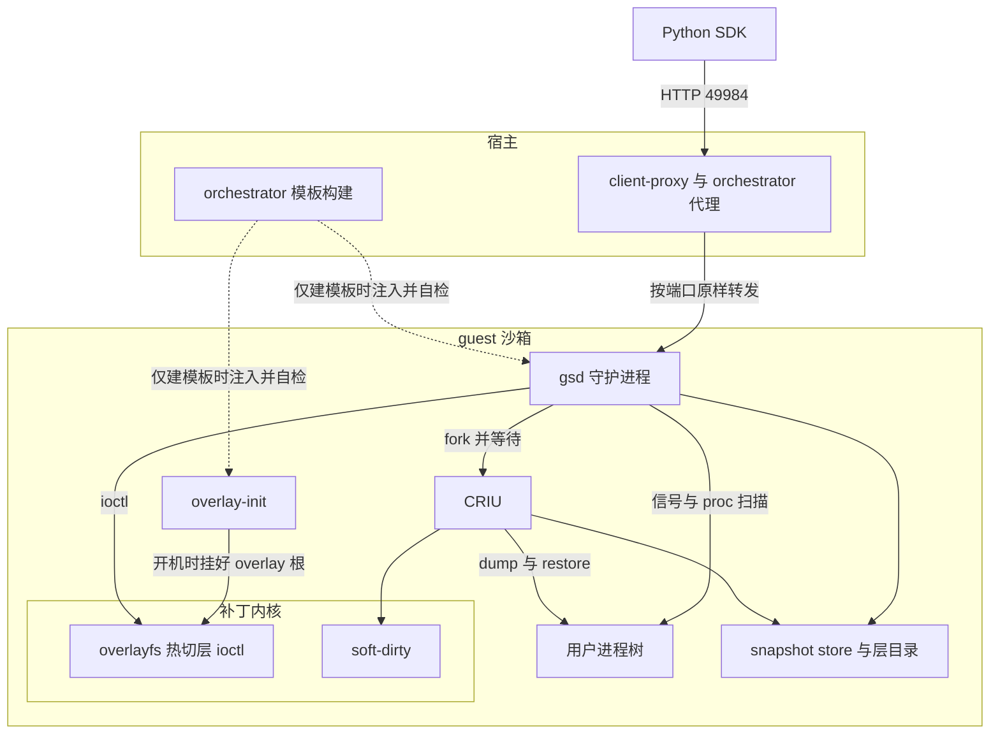

# 04 · 总体架构、请求路径与鉴权

## 本章目标

本章是第二部分的地图，后面每一章都在展开这里的某一个方块。读完本章，你应当能够：

- 说出一次 checkpoint 请求从 SDK 发出后经过哪些进程，哪一层负责什么、**不**负责什么；
- 解释为什么 orchestrator 只在"建模板"时出现，沙箱运行期间的请求路径上没有它的任何专用代码；
- 说清 gsd 怎么鉴权、为什么每个请求都要重新读一次 MMDS；
- 说出线协议的四个 RPC 与响应里各个字段的含义，以及它和整机级手册那套协议的关系；
- 对着目录布局总表说出每个目录由谁建、谁读、什么时候消失（**全书的目录布局只在本章定义**）。

上一章（[03](03-goals-and-tradeoffs.md)）给出了目标、硬约束与四条取舍，第一部分到此结束。
本章开始进入实现：先看整体分工，下一章（[05](05-guest-boot-and-injection.md)）讲这些组件是怎么在建模板时被装进 guest 的。

主要代码：`packages/gsd/main.go`、`packages/gsd/internal/permissions/`、`ckpt/service.go`
（`ckpt/` 是 `packages/gsd/internal/services/checkpoint/` 的简写，全书通用；行号以 `deltabox-gsd@259f1a25c` 为准）。

---

## 1. 组件与分工



| 组件 | 在哪 | 负责 | **不**负责 |
|---|---|---|---|
| Python SDK | 调用方 | 把四个 RPC 和 `/health` 发到沙箱的 49984 端口，带上沙箱的 access token；把 Connect 错误码映射成异常 | 不重试；不知道 gsd 内部分几步 |
| client-proxy、orchestrator 的沙箱代理 | 宿主 | 按"端口 + 沙箱 id"把请求转进 guest | 不理解 checkpoint 语义；对 49984 没有任何专门处理（§2.2） |
| orchestrator 的模板构建 | 宿主 | 建模板时把 gsd 二进制、`gsd.service`、`overlay-init` 放进根文件系统，把内核的 `init=` 指向 `overlay-init`，每建一层后重新注入并自检（[05](05-guest-boot-and-injection.md)） | 沙箱运行期间不参与任何一次 checkpoint 或 restore |
| `overlay-init` | guest，PID 1 的前身 | 开机时把 ext4 根盘挂成 overlay 的唯一 lower、建好初始 upper、关掉透明大页、挂好 snapshot store，然后 `chroot` 进去执行 systemd | 沙箱从快照恢复时不再运行（[05](05-guest-boot-and-injection.md)） |
| gsd | guest，root，systemd 服务 | 鉴权、串行化、找用户进程树、编排 CRIU 与热切层的先后、失败分级、状态持久化、回收 | 不自己读写进程内存；不解析 CRIU 镜像 |
| CRIU 4.x | guest，gsd 的子进程 | 一次 dump 或 restore 一棵进程树 | 不知道"checkpoint 条目""层"是什么 |
| 补丁内核 | guest | arm64 的 soft-dirty；overlayfs 的热切层 ioctl 及其并发安全（[06](06-overlay-hot-switch.md)、[07](07-overlay-concurrency-and-fixes.md)） | 不记录有哪些 checkpoint；不决定切到哪个层栈 |

这张表的一条纪律是**编排只在 gsd 一处**。CRIU 每次只收到"dump 这棵树到这个目录"或"从这个目录 restore"，内核每次只收到"把层栈换成这一串目录"；
"哪几棵树算用户进程""这次增量的父镜像是谁""一个 checkpoint 对应哪个层栈"只有 gsd 知道。所以读实现时，先读 `ckpt/service.go` 的两个函数
`CreateCheckpoint`（`ckpt/service.go:163`）和 `RestoreCheckpoint`（`ckpt/service.go:463`），其余文件都是被它们调用的零件。

与整机级手册的架构相比，最大的差别在"谁来执行"：整机级回滚要暂停虚机，执行者必须在宿主侧，请求在宿主被截下；
进程级回滚不停机，执行者就是 guest 里的 gsd，请求要真的走进沙箱。两套方案的完整对照在 [18](18-process-vs-machine-level.md)。

---

## 2. 请求路径

### 2.1 SDK 一侧：地址与请求头

SDK 的 `Sandbox` 对象在构造时建一个 `Checkpoint` 模块（`py-sdk/e2b/sandbox_sync/checkpoint.py:20`），它的四个方法 `create` / `restore` / `list` / `delete`
各对应一个 Connect RPC，`is_running` 对应 `GET /health`。

地址由 `get_checkpointd_url`（`py-sdk/e2b/connection_config.py:168`）决定，按以下优先级取：

1. 显式传入的 `checkpointd_url`，或环境变量 `E2B_CHECKPOINTD_URL`；
2. 设置了 `sandbox_url`（或 `E2B_SANDBOX_URL`）时原样使用它——这种覆盖通常指向一个按请求头路由的代理，换端口号反而是错的；
3. 都没有时拼出 `http://49984-<沙箱 id>.<域名>`（`get_host`，`connection_config.py:184`；调试模式下是 `localhost:49984`）。

端口号 49984 是 `ConnectionConfig.checkpointd_port`（`connection_config.py:58`），与 gsd 的 `defaultPort`（`main.go:28`）是同一个常量的两处定义。

请求头由 `checkpointd_headers`（`py-sdk/e2b/gsd/api.py:26`）组装，在连接配置已有的头之上加两样：

| 请求头 | 值 | 给谁看 |
|---|---|---|
| `E2b-Sandbox-Port` | `49984`（`connection_config.py:250`） | 按请求头路由的代理 |
| `X-Access-Token` | 沙箱的 envd access token（secure 沙箱才有） | guest 里的 gsd（§3） |

`E2b-Sandbox-Id` 由连接配置在连接沙箱时放进公共请求头，gsd 的请求直接沿用。

### 2.2 宿主一侧：代理对 49984 没有专门处理

提纲在这里留了一条待核实的结论，这里按代码给出依据。

宿主上有两级代理：入口的 client-proxy，和每个节点上 orchestrator 自带的沙箱代理。两者解析目标用的是同一个函数
`GetTargetFromRequest`（`packages/shared/pkg/proxy/host.go:12`），它只做一件事——得到"沙箱 id + 端口"：

- 默认从 `Host` 头解析：取第一个 `.` 之前的部分，按 `-` 切成"端口-沙箱 id"（`parseHost`，`host.go:41`）；
- 仅当进程运行在本地开发环境（`env.IsLocal()` 为真）时，才优先看 `E2b-Sandbox-Id` 与 `E2b-Sandbox-Port` 两个请求头（`parseHeaders`，`host.go:81`）。

拿到端口之后，orchestrator 的代理把请求转到"沙箱的宿主侧 IP : 端口"（`packages/orchestrator/internal/proxy/proxy.go:43` 起的那个回调）。
整段代码里端口号只和 envd 的 49983 比较过一次（`proxy.go:80` 的 `isNonEnvdTraffic`），用来决定下面两件事；**49984 在整个 `packages/` 下除了 gsd 自己、
SDK 的常量和模板自检脚本之外没有任何出现**，也就是说它被当成一个普通的用户端口：

1. **入口流量令牌**。如果沙箱创建时配置了入口流量令牌（网络配置里的 `TrafficAccessToken`），代理对所有非 envd 端口要求请求头
   `e2b-traffic-access-token` 与之相等（`proxy.go:85-90`），49984 也在其列。所以 SDK 发给 gsd 的请求必须带上它：
   沙箱有入口流量令牌时（用 `allow_public_traffic=False` 创建），`checkpointd_headers`（`py-sdk/e2b/gsd/api.py`）会加上这个头。
   这一处是在 `259f1a25c` 之后单独补的一个只改 SDK 的提交（`dcca61266`）。补之前，这类沙箱上的每个 checkpoint 调用都在代理层被 403 拒绝、到不了 gsd；
   2026-10-09 在新 920B 上先复现了 403，补上之后在同样的沙箱上 `is_running`、`create`、`restore`、`list` 全部成功。自己拼请求访问 gsd 的客户端同样要带这个头。
2. **Host 改写**。配置了 `MaskRequestHost` 时非 envd 端口的 Host 会被改写；gsd 不看 Host，不受影响。

这条路径不经过 envd。envd 监听 49983、gsd 监听 49984，两者是 guest 里互相独立的两个 systemd 服务，代理按端口分别转发。

"没有专门处理"带来一个需要记住的后果：代理层对 gsd 的请求没有任何语义上的保护——没有按沙箱串行，没有超时策略，也不会在沙箱正在 restore 时拦住别的请求。
这些都由 gsd 自己负责（串行化见 [13](13-state-concurrency-capacity.md)，对范围外进程的影响见 [07](07-overlay-concurrency-and-fixes.md)）。

### 2.3 guest 一侧：监听与路由

gsd 监听 `0.0.0.0:49984`（`main.go:155`）。HTTP 处理链自外向内是（`main.go:154`）：

```go
Handler: withCORS(withOpenHealth(m, middleware.Wrap(m))),
```

- `withCORS`（`main.go:86`）：允许任意来源，与 envd 的做法相同。
- `withOpenHealth`（`main.go:103`）：`GET` 或 `HEAD` 的 `/health` 直接交给路由器 `m`，不经过鉴权；其余请求走鉴权中间件再到 `m`。
- 路由器 `m` 上挂了两样：`/health`（`main.go:148`，实现是 `GetHealth`，`packages/gsd/internal/api/store.go:23`）和 Connect 生成的
  `/checkpoint.Checkpoint/` 前缀下的四个 RPC（`Handle`，`ckpt/service.go:115`）。

读超时和写超时都设为 0（不限），因为一次 create 或 restore 的耗时由 CRIU 决定，gsd 用自己的时限管它（[09](09-checkpoint.md)），不让 HTTP 层先掐断。

---

## 3. 鉴权

### 3.1 规则

除 `GET` / `HEAD /health` 外，每个请求都要过 `TokenAuthenticator.Authenticate`（`packages/gsd/internal/permissions/authenticate.go:53`）：

1. 从 MMDS 读出 orchestrator 写入的 `accessTokenHash`。读不到——返回 `Unavailable`，**不放行**。
2. 读到的 hash 为空，或者等于空字符串的 hash（`emptyTokenHash`，`authenticate.go:27`）——这是非 secure 沙箱，放行，不要求任何请求头。
3. 否则取请求头 `X-Access-Token`：缺失或其 SHA-512 十六进制值（`HashAccessToken`，`authenticate.go:20`）与 MMDS 里的不等，返回未鉴权错误；比较用常数时间比较。

这套规则与 envd 完全一致，用的也是同一个令牌：对调用方来说，能调用沙箱的文件和命令接口，就能调用 checkpoint 接口，不需要另外的凭据。
`HashAccessToken` 是从 `packages/shared` 里复刻过来的（gsd 是独立的 Go 模块，不引用 shared），两边必须保持同一种算法。

旧版 SDK 发的 `Authorization: Basic` 头不再被检查，也不再需要：gsd 的全部操作都以 root 执行，请求里的用户名从来没有被用到过。

### 3.2 为什么每个请求都重新读 MMDS

直觉上 hash 在沙箱的一生里不会变，读一次缓存起来就够了。这在 gsd 身上是错的，原因在沙箱的启动方式：
**沙箱不是开机启动的，而是从模板的内存快照恢复出来的**，gsd 进程连同它的堆一起在快照里。同一份快照会恢复出许多个沙箱，每个沙箱的 MMDS 内容不同。
如果 gsd 在建模板时或者第一次请求时把 hash 缓存在内存里，这份缓存就会被带进之后每一个沙箱。

"校验失败时刷新一次"也救不了：拿着上一个沙箱令牌的请求恰好命中旧缓存，校验通过，根本不会触发刷新（`authenticate.go:31-34` 的注释）。
所以唯一正确的做法是不缓存。

读 MMDS 的实现在 `AccessTokenHash`（`packages/gsd/internal/permissions/mmds.go:49`）：先 `PUT /latest/api/token` 取会话令牌，再带着它 `GET /` 取元数据，
与 envd 读 MMDS 的方式相同。三个细节都和"从快照恢复"有关：

- 不复用连接（`DisableKeepAlives`，`mmds.go:36` 的注释）：快照里留下的空闲连接到了新的虚机监控进程上是失效的，第一次请求会撞上死连接。
- 单次尝试时限 2 秒，最多 3 次，间隔 50 ms（`mmds.go:17-24`）。
- 两次请求都由虚机监控进程在进程内应答，不出宿主。代价是每个 RPC 多出零点几毫秒：新 920B、2026-09-30 的修复验证里测到约 0.63 ms/RPC
  （出自该轮逐项验证表的鉴权一行，表里只给了这一个数，没有更细的口径说明；判定值见 [20](20-results-and-gaps.md)）。相对一次 restore 的几十毫秒，这个代价可以接受。

### 3.3 `/health` 为什么免鉴权

两个原因（`main.go:98-102` 的注释）。其一，建模板时 orchestrator 在 guest 里用 `curl` 访问 `/health` 来确认 gsd 起来了（[05](05-guest-boot-and-injection.md)），
那时的构建沙箱没有 access token。其二，探活本来就不该需要凭据。`/health` 只返回 `{"status":"ok"}` 或 `{"reason":"...","status":"degraded"}`（键按字母序输出，不要依赖键序），
两种情况都是 HTTP 200，不执行任何操作；degraded 的含义见 [12](12-failure-semantics.md)。

---

## 4. 线协议

### 4.1 四个 RPC

协议定义在 `packages/gsd/spec/checkpoint/checkpoint.proto`，包名 `checkpoint`，服务名 `Checkpoint`（`checkpoint.proto:105`），
所以 HTTP 路径是 `/checkpoint.Checkpoint/<方法名>`。SDK 用 Connect 协议的 JSON 编码发请求。

| RPC | 请求 | 响应 | 持操作锁 |
|---|---|---|---|
| `CreateCheckpoint` | 可选的 `name` | `checkpoint_id`、`timings`、`created_at`、`has_process_image`、`parent_checkpoint_id`、`image_bytes`、`clear_refs_failed`、`process_trees` | 是 |
| `RestoreCheckpoint` | `checkpoint_id` | `success`、`timings` | 是 |
| `ListCheckpoints` | 无 | 一组 `CheckpointInfo` | 否 |
| `DeleteCheckpoint` | `checkpoint_id` | `success` | 是 |

响应字段的含义（`checkpoint.proto:45` 起的注释是权威定义）：

| 字段 | 含义 |
|---|---|
| `checkpoint_id` | 形如 `ckpt_<纳秒时间戳>`（`generateCheckpointID`，`ckpt/service.go:895`） |
| `timings` | 各阶段耗时，毫秒，gsd 在 guest 内自己量的；没执行的阶段为 0。每个键落在哪一步见 [11](11-end-to-end.md)，定义见 [24](24-configuration-and-observability.md) |
| `created_at` | Unix 纳秒 |
| `has_process_image` | 这次是否 dump 了用户进程。为假表示这是一个只有文件系统的 checkpoint：restore 它会杀掉当前用户进程，但不恢复出任何进程 |
| `parent_checkpoint_id` | 本次 CRIU 镜像是哪个 checkpoint 的增量；全部树都是全量或没有进程时为空。父 checkpoint 可能已经被删除而只是隐藏着（[13](13-state-concurrency-capacity.md)） |
| `image_bytes` | 本 checkpoint 自己的镜像目录占用，不含父镜像 |
| `clear_refs_failed` | overlay 下沉后重写 `clear_refs` 失败的进程数；非 0 表示这些进程下一次增量会偏大（[09](09-checkpoint.md)） |
| `process_trees` | 本 checkpoint 里的用户进程树棵数（[08](08-process-trees.md)） |

`CheckpointInfo`（`checkpoint.proto:93`）是 List 的条目，带 `checkpoint_id`、`name`、`created_at`、`image_bytes`、`has_process_image`、`parent_checkpoint_id`、`process_trees`。
每棵树各自的耗时、大小、是否增量不在响应里，只在 gsd 的日志和 `state.json` 里。

### 4.2 两份 proto 必须一起改

仓库里有两份内容相同的 `checkpoint.proto`：

- `packages/gsd/spec/checkpoint/checkpoint.proto`——生成 gsd 用的 Go 代码（`packages/gsd/internal/services/spec/checkpoint/`）；
- 仓库根的 `spec/gsd/checkpoint/checkpoint.proto`——生成 Python SDK 用的代码（`py-sdk/e2b/gsd/checkpoint/`）。

在 `259f1a25c` 上两份文件逐字节相同。改协议时两份要一起改，并且**只增字段、不改已有编号**：模板里固化的是建模板那一刻的 gsd（[05](05-guest-boot-and-injection.md)），
新 SDK 会长期遇到旧模板里的旧 gsd，反过来也一样。SDK 一侧对缺失字段都做了兜底（例如没有 `timings` 时 `last_timings` 为 `None`）。

### 4.3 与整机级协议的关系

整机级那套（宿主侧的 checkpoint 服务）的协议文件在该分支的 `spec/checkpointd/checkpoint/checkpoint.proto`。把它和 gsd 的这份对照，结论是
**服务路径与请求相同，响应已经各自演进、互不兼容**：

| 项目 | 进程级（本书） | 整机级 |
|---|---|---|
| 包名、服务名、四个方法名 | `checkpoint.Checkpoint`，四个方法同名 | 相同 |
| 四个请求消息 | `name` / `checkpoint_id` | 相同 |
| `CreateCheckpointResponse` 字段 2 | `timings`（消息） | `mem_mode`（字符串） |
| `CreateCheckpointResponse` 字段 3 及以后 | `created_at`、`has_process_image` 等六个 | 没有 |
| `CheckpointInfo` 字段 4 | `image_bytes`（整数） | `mem_mode`（字符串） |
| `CheckpointInfo` 字段 5 及以后 | 三个 | 没有 |
| `RestoreCheckpointResponse` | `success`、`timings` | 只有 `success` |

同一个字段编号在两边是不同类型，所以两套 SDK 不能混用：进程级必须用本仓库的 `py-sdk`，整机级用它自己那一份（[21](21-quickstart.md)）。
两边都用同一个端口号 49984 和同一个路径前缀，是历史上从同一份协议分出来的结果；区别在请求最终由谁应答——整机级由宿主截下，进程级走进 guest。
同一个沙箱同时启用两套是融合方案里的内容，尚未实施（[18](18-process-vs-machine-level.md)）。

---

## 5. gsd 进程内部

### 5.1 启动顺序

`main`（`main.go:113`）依次做五件事：

1. 解析参数。模板里的 `gsd.service` 给出的值是 `--overlay-mount=/`、`--base-layer=/mnt/lower`、`--layers-root=/overlay/layers`、
   `--work-root=/overlay/workspace`、`--snapshot-store=/var/lib/gsd/snapshots`（[05](05-guest-boot-and-injection.md)）。注意 `main.go:30-31` 里
   `overlay-mount` 与 `base-layer` 的编译期默认值仍是早期方案的路径，实际运行值以服务文件为准；全部参数见 [24](24-configuration-and-observability.md)。
2. `enableExpeditedRCU`（`main.go:178`）：向 `/sys/kernel/rcu_expedited` 写 1，原因见 [10](10-restore.md) 与 [16](16-restore-slowness-case.md)。
3. `ensureTHPNever`（`main.go:196`）：确认透明大页是 `never`，不是就改掉并告警；这是对 `overlay-init` 的兜底（[02](02-criu-and-incremental-memory.md)、[05](05-guest-boot-and-injection.md)）。
4. `checkpointRpc.Handle`（`ckpt/service.go:115`）：建 `OverlayManager`、建 `Service`、加载 `state.json`、后台预热 envd 的主进程号缓存、注册四个 RPC。
5. 挂上 `/health` 与鉴权中间件，开始监听。

第 2、3 步失败都只记日志，不影响启动。第 4 步里 `OverlayManager` 建不起来或状态文件加载失败时，gsd 也**不退出**，而是进入 fatal degraded：
进程照常监听，`/health` 给出原因，Create 与 Restore 一律拒绝。退出只会被 systemd 反复拉起，结果相同而原因更难看到（`ckpt/service.go:130-133` 的注释）。

### 5.2 状态在哪

gsd 的全部状态都在 guest 内，宿主看不见（[03](03-goals-and-tradeoffs.md) 的取舍一）。按所在位置分三处：

| 状态 | 所在结构 | 内容 |
|---|---|---|
| checkpoint 条目 | `pool`（`ckpt/pool.go`），条目类型 `checkpointEntry`（`pool.go:26`） | 每个 checkpoint 的 id、名字、镜像目录、**层栈**、创建时间、每棵树的镜像（`treeImage`，`pool.go:11`）、父子依赖与"已隐藏"标记 |
| 增量父镜像 | `Service.lastTrees`（`ckpt/service.go:66`） | 当前活着的每棵用户进程树下一次增量 dump 该以哪个镜像目录为父 |
| 文件系统当前形态 | `OverlayManager`（`ckpt/overlay.go:41`） | 当前 upper、当前 work、当前层栈、层序号 `layerSeq`、restore 序号 `restoreSeq` |
| 健康状态 | `Service` 的三个原因字符串（`ckpt/service.go:82-90`） | fatal、restore 半途失败、状态文件写失败 |

这四样在每次 Create / Restore / Delete 结束时（包括失败路径）一起写进 snapshot store 下的 `state.json`（`persist`，`ckpt/state.go:256`），
gsd 被 systemd 重启后从这里加载。snapshot store 是 tmpfs，与内核里的层栈同生共死，所以"文件不存在"就等于"这次开机后第一次启动"。
格式、原子写与加载校验在 [13](13-state-concurrency-capacity.md)。

### 5.3 对外部世界的依赖集中在一处

`Service` 不直接调用 `/proc`、信号、`criu` 或 `statfs`，而是经由 `sysOps`（`ckpt/sysops.go:16`）里的函数指针。生产环境用 `defaultSysOps`（`sysops.go:37`），
单测注入假的 `/proc` 目录、只记录不发送的 `kill`、假的 criu。这样 `service.go` 的编排逻辑——先后顺序、失败时放开谁、删掉什么——
不需要真实进程也不需要 criu 就能测（[19](19-testing-and-debug-kernel.md)）。`OverlayManager` 同理，真正发 ioctl 的函数可以被 `switchFn` 替换（`ckpt/overlay.go:63`）。

### 5.4 并发模型一句话

`Service.opMu`（`ckpt/service.go:50`）把 Create、Restore、Delete 串成一队，每个 RPC 全程持锁，后来的请求排队等待而不是被拒绝；List 只读 `pool`，不持这把锁。
`/health` 读的原因字符串由另一把小锁 `healthMu` 保护，所以正在做 restore 时探活不会被挂住。完整论证在 [13](13-state-concurrency-capacity.md)。

---

## 6. 目录布局总表

全书提到的路径都以这张表为准。

### 6.1 宿主

| 路径 | 是什么 | 谁读 |
|---|---|---|
| `/fc-gsd/gsd` | gsd 二进制（arm64，静态编译） | orchestrator 建模板时读，路径来自 `HOST_GSD_PATH`，这就是它的默认值 |
| `/fc-gsd/orchestrator` | 带 gsd 注入逻辑的 orchestrator | 宿主的服务管理 |
| `/fc-gsd/kernels/vmlinux-6.1.158/vmlinux.bin` | 打了热切层与 soft-dirty 补丁的 guest 内核 | orchestrator，经 `HOST_KERNELS_DIR=/fc-gsd/kernels` 指过去；只跑 gsd 的机器也可以直接放在默认的 `/fc-kernels` 下 |

宿主上**没有**任何 checkpoint 产物：镜像、层、状态文件全在 guest 里。部署细节见 [23](23-deployment.md)。

### 6.2 guest：程序与配置（建模板时写入，之后只读）

| 路径 | 是什么 | 来源 |
|---|---|---|
| `/usr/bin/overlay-init` | 内核 `init=` 指向的开机脚本 | orchestrator 从模板文件生成 |
| `/usr/bin/gsd` | gsd 二进制 | orchestrator 从宿主的 `HOST_GSD_PATH` 拷入，每建一层后再覆盖一次 |
| `/etc/systemd/system/gsd.service` 及 `multi-user.target.wants/` 下的链接 | gsd 的服务文件 | orchestrator 从模板文件生成 |
| `/usr/sbin/criu` | CRIU 4.2.1，源码编译 | 基础镜像自带；gsd 把这个路径写死（`criuBin`，`ckpt/criu.go:20`） |
| `/etc/systemd/system/tmp.mount` → `/dev/null` | 屏蔽 systemd 在 `/tmp` 上再挂 tmpfs | `overlay-init` 每次开机检查 |

### 6.3 guest：文件系统的层（都在 ext4 根盘上）

`overlay-init` 把 ext4 根盘经 bind 挂到 `/mnt/lower` 作为 overlay 的最底层，再把 ext4 上的 `/overlay` 经 bind 挂进新根。
所以下表的目录**物理上都在同一个 ext4 文件系统里**——这是硬约束：层下沉靠 `rename`，内核的 ioctl 也拒绝与当前 upper 不在同一文件系统的新 upper（[06](06-overlay-hot-switch.md)）。

| 路径 | 是什么 | 谁建 | 什么时候消失 |
|---|---|---|---|
| `/mnt/lower` | 基础层：ext4 根盘本身，层栈的最底层 | `overlay-init` | 不消失；gsd 不管理它 |
| `/overlay/workspace/upper` | 开机时的初始 upper | `overlay-init` | 第一次有内容的 checkpoint 把它改名成 `/overlay/layers/L<n>`，之后这个路径不再存在 |
| `/overlay/workspace/work` | 开机时的初始 work | `overlay-init` | 第一次切换后不再使用；它不在 gsd 的回收范围内，留在原地 |
| `/overlay/layers/L<n>` | 一次 checkpoint 下沉的只读层，`n` 是 gsd 生命周期内单调递增的层序号（`layerName`，`ckpt/overlay.go:464`） | `SinkUpper` 把当时的 upper 改名而来 | 不在当前层栈里、也没有任何 checkpoint 条目（含已隐藏的）引用它时，被回收 |
| `/overlay/layers/upper_<ckpt>_next`、`work_<ckpt>_next` | 一次 checkpoint 之后换上的新 upper 与新 work | `SinkUpper` | upper 在下一次有内容的 checkpoint 时被改名成层；被 restore 切走的 upper 连同其中的写入一起成为垃圾；work 切走即垃圾 |
| `/overlay/layers/restore_<ckpt>_<seq>_upper`、`_work` | 一次 restore 之后换上的全新 upper 与 work，`seq` 是全局递增的 restore 序号（`restoreDirs`，`overlay.go:323`） | `PrepareRestore` | 同上一行 |
| `/overlay/layers/.trash/` | 层目录的回收站 | 回收逻辑 | 内容在后台被删空，目录本身保留 |
| `/overlay/layers/layer_*` | 旧命名的层目录，只可能出现在很早的模板里 | 历史遗留 | 与 `L<n>` 同样按引用回收（`isLayerDir`，`overlay.go:487`） |

哪些名字算"临时目录"由 `isTransientLayerDir`（`overlay.go:451`）判定：`restore_` 开头且以 `_upper` 或 `_work` 结尾，或者 `upper_` / `work_` 开头且以 `_next` 结尾。
临时目录里除了当前正在用的那一对和 restore 已经准备好但尚未提交的那一对，其余全是垃圾。回收的两段式做法见 [13](13-state-concurrency-capacity.md)。

### 6.4 guest：snapshot store（2 GiB tmpfs，占 guest 内存）

| 路径 | 是什么 | 谁写 | 什么时候消失 |
|---|---|---|---|
| `/var/lib/gsd/snapshots/` | snapshot store，`overlay-init` 挂的 tmpfs | | guest 重启即清空 |
| `…/<ckpt>_mem/` | 一个 checkpoint 的镜像目录（`snapshotMemDir`，`ckpt/criu.go:331`）；没有用户进程时是空目录 | gsd | checkpoint 被物理删除时；create 失败时立刻删 |
| `…/<ckpt>_mem/t<i>/` | 第 `i` 棵用户进程树的 CRIU 镜像，按根进程号升序编号（`treeSubdir`，`ckpt/service.go:384`） | CRIU | 随上一行 |
| `…/t<i>/parent` | 增量镜像指向父镜像目录的符号链接 | CRIU | 随上一行 |
| `…/t<i>/criu-dump.log` | 这棵树 dump 的完整输出 | gsd 转存 | 随上一行；dump 失败时目录被删，尾部已带进错误信息 |
| `…/t<i>/criu-restore.log`、`restored.pid` | 最近一次 restore 这棵树的输出与恢复出的根进程号 | gsd 转存、CRIU | 每次 restore 覆盖 |
| `…/state.json` | gsd 的持久化状态 | gsd | 随 tmpfs |
| `…/.trash/` | 镜像目录的回收站 | 回收逻辑 | 内容在后台被删空 |

### 6.5 不在 overlay 上的目录

下面这些挂载点在 overlay 根里可见，但内容不属于任何层，因此**不随 restore 回滚**：`/run`、`/dev/shm`（tmpfs）、`/var/lib/gsd/snapshots`（tmpfs）、
`/var/log`、`/var/lib/systemd`、`/var/lib/chrony`（从 ext4 经 bind 进来）、`/overlay` 与 `/mnt/lower`（同上）、`/dev`、`/proc`、`/sys`。
`/tmp` 在 overlay 上，随 restore 回滚。各自的原因见 [05](05-guest-boot-and-injection.md)，对使用者的含义见 [22](22-semantics-and-limits.md)。

---

## 7. 这张图里没有的东西

| 没有 | 因为 |
|---|---|
| 宿主侧的任何 checkpoint 状态或产物 | 状态与层栈同生共死，全在 guest（[03](03-goals-and-tradeoffs.md)） |
| 代理层的串行化或拦截 | 49984 是普通端口（§2.2）；串行化在 gsd 的操作锁里 |
| 对 Firecracker 的任何改动 | 进程级回滚不暂停虚机，不需要虚机监控进程配合 |
| gsd 与 envd 之间的调用 | 两者互不调用；gsd 只是在找用户进程时把 envd 的进程号排除掉（[08](08-process-trees.md)） |
| 重试 | gsd 不重试，SDK 也不重试；失败语义见 [12](12-failure-semantics.md) |
| 跨沙箱共享 | checkpoint id 只在所属沙箱这一次开机期间有意义 |

---

## 代码位置

| 关注点 | 位置 |
|---|---|
| 入口、监听、`/health` 免鉴权 | `packages/gsd/main.go` — `main`、`withOpenHealth`、`enableExpeditedRCU`、`ensureTHPNever` |
| 鉴权 | `packages/gsd/internal/permissions/authenticate.go` — `TokenAuthenticator.Authenticate`、`HashAccessToken` |
| 读 MMDS | `packages/gsd/internal/permissions/mmds.go` — `MMDSClient.AccessTokenHash`、`fetch` |
| 健康检查 | `packages/gsd/internal/api/store.go` — `GetHealth` |
| 线协议 | `packages/gsd/spec/checkpoint/checkpoint.proto`、仓库根 `spec/gsd/checkpoint/checkpoint.proto` |
| RPC 注册与服务结构 | `ckpt/service.go` — `Handle`、`Service`、`Config` |
| 系统依赖的注入点 | `ckpt/sysops.go` — `sysOps`、`defaultSysOps` |
| 目录命名 | `ckpt/overlay.go` — `layerName`、`restoreDirs`、`isTransientLayerDir`、`isLayerDir`；`ckpt/criu.go` — `snapshotMemDir`；`ckpt/service.go` — `treeSubdir` |
| SDK 的地址与请求头 | `py-sdk/e2b/connection_config.py` — `get_checkpointd_url`、`checkpointd_headers`；`py-sdk/e2b/gsd/api.py` — `checkpointd_headers` |
| 代理的目标解析 | `packages/shared/pkg/proxy/host.go` — `GetTargetFromRequest`；`packages/orchestrator/internal/proxy/proxy.go` |

---

## 本章要点

1. 编排只在 gsd 一处：CRIU 只知道"一棵树、一个目录"，内核只知道"换成这一串层"，哪些进程算用户进程、增量以谁为父、一个 checkpoint 对应哪个层栈都由 gsd 决定。
2. orchestrator 只在建模板时出现；沙箱运行期间，代理把 49984 当普通端口按"端口 + 沙箱 id"转发，没有任何 gsd 专用代码，也因此不提供串行化或拦截。
3. 鉴权与 envd 同规则、同令牌；因为 gsd 进程在模板快照里、一份快照恢复出许多沙箱，hash 不能缓存，每个请求都重新读 MMDS；读不到就拒绝。
4. 配置了入口流量令牌的沙箱上，代理对 49984 要求 `e2b-traffic-access-token`；SDK 从提交 `dcca61266` 起自动带上，更早的 SDK 在这类沙箱上会被 403 拒绝。
5. 线协议四个 RPC；两份 proto 必须一起改且只增字段。它与整机级协议路径相同、请求相同，响应字段已经互不兼容，SDK 不能混用。
6. 状态全在 guest：`pool`、`lastTrees`、`OverlayManager` 与三类 degraded 原因，每次操作结束写进 tmpfs 上的 `state.json`。
7. 层目录全在同一个 ext4 上，镜像全在 2 GiB 的 tmpfs 上；目录布局以本章 §6 为准。
