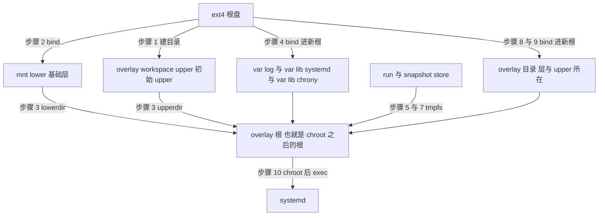

# 05 · guest 启动、根文件系统与模板注入

## 本章目标

读完本章，你应当能够：

- 说出一个带 gsd 的模板在开机时，根文件系统是怎样一步步变成"overlay 根 + 若干不回滚的挂载点"的，以及每一步为什么存在；
- 解释 `/tmp` 为什么留在 overlay 上、根目录为什么不再是 0777；
- 读懂 `gsd.service` 里几个不起眼但有后果的设置；
- 说清 orchestrator 的 `HOST_GSD_PATH` 开关管哪五处、开和关各走哪条分支；
- 记住本章最重要的一条运维事实：**模板固化了建模板那一刻的内核、gsd 与 overlay-init**，换其中任何一样都必须重建模板，并且重建时不能用缓存。

上一章（[04](04-architecture.md)）给出了组件与目录布局。本章回答"这些东西是怎么进到 guest 里、又是怎么在开机时就位的"。
下一章（[06](06-overlay-hot-switch.md)）讲 gsd 在这个根文件系统上做的核心动作：热切层。

主要代码（下文未注明前缀的路径都在 `packages/orchestrator/internal/` 下）：`template/build/core/rootfs/gsdfiles/overlay-init.sh.tpl`、
`template/build/core/rootfs/gsdfiles/gsd.service.tpl`、`template/build/core/rootfs/gsd.go`、`template/build/layer/gsd.go`、`cfg/model.go`。

---

## 1. 问题：要一个能"换层"的根

进程级回滚要回滚文件，而用户进程写的是根文件系统。上游的沙箱直接把一块 ext4 盘当根：ext4 没有"退回到某一刻"的能力。
所以带 gsd 的模板把根换成 overlayfs——ext4 盘降为只读的最底层，所有写入落在最上面的 upper 目录里；checkpoint 时把 upper 变成只读层再换一个新的，
restore 时把层栈换回去（[06](06-overlay-hot-switch.md)）。

这带来一个先有鸡还是先有蛋的问题：根文件系统必须在 systemd 起来之前就已经是 overlay，否则 PID 1 和所有服务的根都还指着 ext4。
解决办法是让内核启动的第一个程序不是 systemd，而是一个脚本 `overlay-init`：它在 ext4 根上把 overlay 搭好，`chroot` 进去，再 `exec` systemd。

内核的 `init=` 参数由 orchestrator 在启动虚机时给出（`sandbox/fc/process.go:288`）。建模板启动每一层的构建沙箱时，带 gsd 的构建把它设成
`/usr/bin/overlay-init`，否则是上游的 `/sbin/init`（`template/build/layer/create_sandbox.go:101-104`）。

---

## 2. `overlay-init` 逐步

脚本全文在 `overlay-init.sh.tpl`，下文行号是该模板文件的行号。它的全部输出重定向到 `/dev/kmsg`（:18），所以开机日志在内核日志里，前缀是 `[overlay-init]`。
脚本里的三个路径变量来自模板模型（`template/build/core/rootfs/templates.go:57-61`）：`WORK_ROOT=/overlay/workspace`、`LAYER_ROOT=/overlay/layers`、
`SNAPSHOT_STORE=/var/lib/gsd/snapshots`，与 `gsd.service` 里传给 gsd 的参数出自同一处，不会不一致。

| 步骤 | 行 | 做什么 | 为什么 |
|---|---|---|---|
| 1 | 29-31 | 在 ext4 上建 `/mnt/lower`、`/mnt/newroot`、`/overlay/workspace/{upper,work}`、`/overlay/layers`、snapshot store 的挂载点 | 后面各步的挂载点与 overlay 的三个目录 |
| 2 | 34 | `mount --bind / /mnt/lower` | 给 ext4 根一个可以当 `lowerdir` 的路径 |
| 3 | 44-51 | 把初始 upper 根目录的属主与权限设成与 `/mnt/lower` 相同，然后以 `/mnt/lower` 为唯一 lower 挂 overlay 到 `/mnt/newroot` | 见 §2.1 |
| 4 | 56-59 | 把 ext4 上的 `var/log`、`var/lib/systemd`、`var/lib/chrony` 经 bind 挂进新根 | 见 §2.2 |
| 5 | 63-66 | 在新根里挂 `/dev`、`/proc`、`/sys`，在 `/run` 上挂 tmpfs | 内核不会替 `init=` 指定的程序挂这些 |
| 6 | 75-80 | 向新根里的 sysfs 写透明大页 `never` 并回读确认 | 见 §2.3 |
| 7 | 98-112 | 整理 `/tmp`（留在 overlay 上），屏蔽 `tmp.mount`；在 snapshot store 上挂 2 GiB tmpfs | 见 §2.4 |
| 8 | 116 | 把 ext4 上的 `/overlay` 经 bind 挂进新根 | gsd 要在 chroot 之后看见并管理层目录 |
| 9 | 125 | 把 `/mnt/lower` 经 bind 挂进新根的 `/mnt/lower` | 见 §2.5 |
| 10 | 129-132 | `cd /mnt/newroot`，`exec chroot . /sbin/init` | 从此 `/` 是 overlay，systemd 成为 PID 1 |

脚本对大多数挂载失败是"尽力而为"的（`|| true`），不会中途退出：一个停在 `init=` 脚本里的虚机什么都做不了，而带着缺陷启动至少能让后面的自检（§5）把问题报出来。

### 2.1 步骤 3：根目录的权限从哪来

overlay 根目录（也就是 chroot 之后 guest 的 `/`）的属主与权限**取自 upper 的根目录**，而不是 lower 的。所以初始 upper 建成什么样，`/` 就是什么样。
脚本在每次开机挂 overlay 之前，用 `chown --reference` 和 `chmod --reference` 把初始 upper 的根目录设成与基础镜像的 `/` 相同（一般是 0755、root:root）；
引用失败时退回显式的 `0:0` 与 `0755`（:46-49）。

之所以**每次开机**都设而不是只在建目录时设：步骤 1 的 `mkdir -p` 只对全新的根盘起作用，而更早版本建出的模板带着一个被设成 0777 的 upper，
不重设就会把 0777 一直带下去。

这是相对交接前实现的两处变化之一。交接前的脚本在挂好 overlay 之后对新根执行 `chmod 0777`（从更早的"overlay 挂在用户目录上"的方案沿袭而来），
结果 guest 的 `/` 对所有用户可写。现在 `/` 从开机起就是 755；之后每次切换，gsd 让新 upper 的根目录沿用切换后层栈最上层的属主与权限
（`makeUpperWork`，`ckpt/overlay.go:285`，见 [06](06-overlay-hot-switch.md)），所以 `/` 的属性不因 checkpoint 或 restore 而改变。

### 2.2 步骤 4：三个不回滚的系统目录

`/var/log`、`/var/lib/systemd`、`/var/lib/chrony` 直接来自 ext4，不经过 overlay，因此**不随 restore 回滚**。

脚本注释（:53-55）记录的原始理由是：系统服务在这些目录里持续写入，如果它们在 overlay 上，热切层之后这些写入会触发 copy-up，
而在交接前的内核补丁上这会导致内核崩溃。这类崩溃的根因后来在内核里修掉了（[07](07-overlay-concurrency-and-fixes.md) 的"切换与所有 overlay 入口的互斥"一节），
现在即使有 root 服务在 overlay 上读写，切换也是安全的。但这三处 bind 保留了下来，它们同时起到另一个作用：日志、systemd 的持久状态和时钟漂移数据本来就不该被回滚到过去。

对使用者的含义是：restore 之后这三个目录里是 restore 那一刻的内容，不是 checkpoint 时的内容（[22](22-semantics-and-limits.md)）。
另外，gsd 把 CRIU 的详细日志打进 journal，而 journal 就在根盘的 `/var/log` 里，会一直涨到 journald 自己的上限（[15](15-known-limits.md)）。

### 2.3 步骤 6：透明大页必须在任何用户进程出现之前关掉

arm64 guest 的内核配置默认把透明大页设为 `always`。大页存在时 soft-dirty 按 2 MiB 的页中间目录项记录，零散的 4 KiB 写入会让每次增量 dump 膨胀成接近全量
（原理与现场数字见 [02](02-criu-and-incremental-memory.md)）。所以 `never` 是设计约束，不是调优选项。

设置的时机很讲究：必须在 systemd 之前。一个进程只要拿到过大页，之后再改成 `never` 也不会立刻把它已有的大页拆开。
内核不会为 `init=` 指定的程序挂 sysfs，所以脚本通过步骤 5 刚挂到新根里的那个 sysfs 来写（:75）。写完回读，不是 `[never]` 就在内核日志里打一行 `WARNING`。

gsd 启动时会再检查一次（`ensureTHPNever`，`packages/gsd/main.go:196`），不是 `never` 就改掉并告警。那只是兜底：在那个时刻才改，之前已经拿到大页的进程要等内核拆分或者重启才会变小。

### 2.4 步骤 7：`/tmp` 留在 overlay 上，snapshot store 是 tmpfs

这是相对交接前实现的另一处变化。交接前 `/tmp` 是一个单独的 tmpfs，后果有两个：

- `/tmp` 里的文件**不随 restore 回滚**，与"回到 checkpoint 那一刻"的语义不符；
- 更严重的是，被恢复的进程如果在 checkpoint 时打开着 `/tmp` 里的文件，而这个文件之后被删除或改了大小，CRIU 在 restore 时重新打开它会失败——
  那时用户进程已经被杀掉，结果是一次 `DataLoss`（[12](12-failure-semantics.md)）。

把 `/tmp` 放回 overlay，它就和打开着它的进程一起回滚，这两个问题同时消失；附带的好处是 `/tmp` 占的是根盘而不是 guest 内存。
但 tmpfs 原来顺带提供的三样东西要由脚本补上（:82-97 的注释）：

1. **每次开机是空的**（:102）。模板构建依赖这一点：构建步骤往 `/tmp` 里放的临时文件，应当在最后一层的沙箱重启之后消失。
   沙箱是从快照恢复的，不会运行这个脚本，所以这一步永远不会碰到一个运行中的沙箱的 `/tmp`。
2. **权限 1777、root:root**（:103-106），不管基础镜像里是什么。只在不一致时才改，避免每次开机都把一个本来正确的 `/tmp` copy-up 一次。
   `/tmp` 是符号链接或不是目录时先删掉重建（:98-101）。
3. **不能再有别的东西在上面挂 tmpfs**（:107-110）。有些发行版默认启用 systemd 的 `tmp.mount`，或者从 `/etc/fstab` 生成它；
   它会盖住 overlay 上的 `/tmp`，把它重新排除在回滚之外。脚本把 `/etc/systemd/system/tmp.mount` 链到 `/dev/null`——`/etc` 下的屏蔽同时压过软件包自带的单元和 fstab 生成器。

同一步里挂 snapshot store：`mount -t tmpfs -o size=2G`（:112）。CRIU 镜像放在 tmpfs 上占的是 guest 内存，这是容量预检存在的原因（[13](13-state-concurrency-capacity.md)）；
它是 tmpfs 而不在 overlay 上，则是因为镜像绝不能被回滚——restore 要读的正是它们。

### 2.5 步骤 9：为什么 `/mnt/lower` 要 bind 两次

步骤 2 已经把 ext4 根 bind 到了 `/mnt/lower`，但那是在**旧根**里。chroot 之后，新根里的 `/mnt/lower` 只是 overlay 透出来的一个空目录——
它是 ext4 上的那个挂载点目录本身，而不是挂在它上面的 ext4 根。

热切层的 ioctl 在内核里用 `kern_path` 解析 gsd 传来的每个层路径，而 `kern_path` 是从**调用进程的根**开始解析的。gsd 在 chroot 之后的世界里运行，
它传的 `lowerdir` 末尾是 `/mnt/lower`；如果新根里的 `/mnt/lower` 是空目录，第一次 checkpoint 就会把基础层换成一个空目录，`/bin`、`/usr`、`/lib` 全部消失（:119-124 的注释）。
所以必须在新根里把它再 bind 一次。步骤 8 对 `/overlay` 的 bind 是同样的道理：层目录和 upper 都在 ext4 的 `/overlay` 下，gsd 要用新根里的路径去建目录、改名、传给 ioctl。

### 2.6 模板构建期间的写入落在哪

弄清开机过程之后，可以回答一个容易困惑的问题：建模板时各个步骤安装的软件、写的文件去了哪里？
它们都写在 overlay 根上，也就是落在 ext4 的 `/overlay/workspace/upper` 里；这个目录随根盘一起进入模板。
沙箱从模板恢复之后，在第一次有内容的 checkpoint 时，这个初始 upper（连同构建期间的全部写入）被改名成第一个只读层。

---

## 3. `gsd.service`

服务文件由 `gsd.service.tpl` 生成，并通过 `multi-user.target.wants/` 下的符号链接启用（`template/build/core/rootfs/gsd.go:28`）。值得注意的设置：

| 设置 | 值 | 含义与后果 |
|---|---|---|
| `ExecStart` | `/usr/bin/gsd --overlay-mount=/ --base-layer=/mnt/lower --layers-root=/overlay/layers --work-root=/overlay/workspace --snapshot-store=/var/lib/gsd/snapshots` | 五个路径与 `overlay-init` 用的是同一组模板变量 |
| `User` / `Group` | `root` | CRIU、热切层 ioctl（要求 `CAP_SYS_ADMIN`）、给任意用户进程发信号都需要 root |
| `Restart` | `always` | gsd 崩溃后被拉起，从 `state.json` 恢复状态（[13](13-state-concurrency-capacity.md)） |
| `StartLimitIntervalSec` | `0` | 关掉 systemd 的启动频率限制。建模板时每建一层都要重启一次 gsd（§4.3），默认的"10 秒内 5 次"会让步骤多的模板以 `start-limit-hit` 失败 |
| `OOMScoreAdjust` | `-1000` | gsd 不会被内存不足杀手选中。**这个值会被它 fork 出的 criu 继承**，所以内存不足时被杀的是用户进程——这正是 dump 之前要做容量预检的原因（[13](13-state-concurrency-capacity.md)） |
| `OOMPolicy` | `continue` | 服务的控制组里有进程被内存不足杀手杀掉时，不连带停掉整个服务 |
| `Delegate` | `yes` | 把控制组子树交给服务自己管理 |

服务文件里没有声明与 `envd.service` 的先后关系，gsd 启动时 envd 可能还没起来。gsd 对此的处理是：找用户进程时查不到 envd 不算错误，
另有一个后台协程每 500 ms 试一次、最多试 60 秒，把 envd 的主进程号预先查好（`warmEnvdPID`，`ckpt/pid.go:232`，详见 [08](08-process-trees.md)）。

交接前的实现里还有一个单独的"搭建 overlay"的服务单元。现在 overlay 根在 systemd 起来之前就由 `overlay-init` 搭好了，那个单元已经删除（`gsd.go:26-27` 的注释）。

---

## 4. orchestrator 的注入

### 4.1 一个开关管五处

是否构建带 gsd 的模板由 `BuilderConfig.GSDEnabled`（`cfg/model.go:39`）决定，它只看一件事：`HostGSDPath` 是否非空。这个字段来自环境变量
`HOST_GSD_PATH`，默认值 `/fc-gsd/gsd`（`cfg/model.go:22`）。所以**默认是开的**。

`GSDEnabled` 为真时，建模板路径上有五处与上游不同；为假时这五处都走与上游相同的分支：

| # | 位置 | 开启时做什么 |
|---|---|---|
| 1 | `template/build/core/rootfs/rootfs.go:233` → `addGSDFiles`（`rootfs/gsd.go:33`） | 往根文件系统的附加层里加三样：gsd 二进制（`/usr/bin/gsd`）、由 `gsdfiles/` 下两个模板生成的 `overlay-init` 与 `gsd.service`、启用服务的符号链接 |
| 2 | `template/build/core/rootfs/gsd.go:40` | 读宿主上 `HOST_GSD_PATH` 指向的文件；读不到则构建失败，报 `error reading gsd file (HOST_GSD_PATH)` |
| 3 | `template/build/layer/create_sandbox.go:101-104` | 构建沙箱的 `init=` 用 `/usr/bin/overlay-init`（`GSDInitPath`，`rootfs/gsd.go:24`） |
| 4 | `template/build/layer/layer_executor.go:121-134` → `injectGsdInSandbox`（`layer/gsd.go:50`） | 每一层的构建沙箱起来之后，重新注入 gsd、重启并自检（§4.3） |
| 5 | `template/build/phases/base/hash.go:52-63` | base 层的缓存键里多加一个字符串 `"gsd"`（§6） |

gsd 相关的模板文件单独放在 `gsdfiles/` 目录而不是上游的 `files/` 目录里，为的是让 `files/` 保持与上游一致，将来跟进上游时少冲突。

### 4.2 怎么关，以及一个容易踩的坑

把 `HOST_GSD_PATH` 设成 `off` 即关闭（`hostGSDPathOff`，`cfg/model.go:45`；`makePathsAbsolute` 在把相对路径转成绝对路径之前先把 `off` 换成空串，`model.go:47-50`）。
不能用空串来关，因为环境变量解析库把空串当作"没设"，会退回默认值。2026-10-08 的确认验证在真实的进程环境变量下逐个取值跑过配置解析，结果如下：

| `HOST_GSD_PATH` | 解析出的路径 | gsd |
|---|---|---|
| 不设 | `/fc-gsd/gsd` | 开 |
| 空串 | `/fc-gsd/gsd` | 开 |
| `off` | 空 | 关 |
| `/x/y/gsd` | `/x/y/gsd` | 开 |
| `OFF` | `<当前目录>/OFF` | 开 |
| `rel/gsd` | `<当前目录>/rel/gsd` | 开 |

要点是**只有小写的 `off` 才是关**。写成 `OFF` 或 `Off` 会被当成一个相对路径，gsd 仍然是开的，之后建模板时因为读不到这个文件而失败（[15](15-known-limits.md)）。

这张表来自配置解析的测试。表里第一行"不设该变量、按默认路径注入"已于 2026-10-09 在新 920B 上真实建模板确认：orchestrator 的进程环境里没有 `HOST_GSD_PATH` 这个键，
建出的模板里 guest 的 `/usr/bin/gsd` 与宿主 `/fc-gsd/gsd` 的 sha256 相同（[20](20-results-and-gaps.md) 的"落位后的复核"一节、[23](23-deployment.md)）。
"关掉开关（`off`）后真实建出的模板与上游一致"这一条仍然只有单测与代码依据，没有现场结果，列在 [20](20-results-and-gaps.md) 的缺口表里。

### 4.3 每建一层后的注入与自检

模板是一层一层建的。每一层的构建沙箱起来之后、执行该层的构建动作之前，`injectGsdInSandbox`（`template/build/layer/gsd.go:50`）做三件事：

1. **覆盖二进制**：把宿主的 gsd 拷到沙箱的 `/tmp/gsd_injected`，`chmod +x` 后 `mv -f` 到 `/usr/bin/gsd`。
   这样即使这一层是从一个更早的缓存层继续建的，里面的 gsd 也会被换成宿主当前的版本。
2. **重启**：`systemctl restart gsd`。与重启 envd 不同，重启 gsd 不会切断执行这条命令所用的连接（:92 的注释）——命令是经 envd 执行的。
3. **自检**：在沙箱里运行 `gsdCheckScript`（`layer/gsd.go:22`）。

自检脚本的判据有三条，任何一条不满足都让**整个模板构建失败**：

- `systemctl is-active gsd` 输出 `active`；
- `curl http://127.0.0.1:49984/health` 的响应里有 `"status":"ok"`——注意 `degraded` 不算通过。`/health` 免鉴权正是为了这一步（构建沙箱没有 access token，见 [04](04-architecture.md)）；
- `/usr/sbin/criu --version` 的输出以 `Version: 4.` 开头。

前两条每 0.2 秒查一次，最多 50 次，也就是等大约 10 秒，因为 gsd 重启后需要一点时间才开始监听。失败时脚本把 `systemctl status gsd` 的末尾 20 行一并输出，进入构建日志。

为什么要让构建失败而不是只告警：一个 gsd 起不来、或者 CRIU 版本不对的模板，在建模板时不报错的话，问题要等到用户第一次调用 checkpoint 才暴露，
而那时离出问题的环节已经很远（`layer/gsd.go:47-49` 的注释）。把检查前移到构建时，出错的地方就是该修的地方。

第三条判据与另一个变化配套：模板的 provision 过程不再安装发行版自带的 criu 软件包。gsd 把 CRIU 的路径写死为 `/usr/sbin/criu`（`criuBin`，`ckpt/criu.go:20`），
期望的是基础镜像里源码编译的 4.2.1；如果 provision 再装一个发行版的包，就可能把它覆盖成一个旧版本。现在由基础镜像负责提供、由自检负责把关。

---

## 5. 最重要的一条：模板固化了内核、gsd 与 `overlay-init`

沙箱不是"开机"出来的。模板构建的最后一步是给运行中的构建沙箱拍一个内存快照；之后每个沙箱都是从这个快照恢复出来的。由此得到三个推论：

- **内核**：快照里是建模板那一刻正在运行的 guest 内核。把宿主上的内核文件换掉、或者把 `HOST_KERNELS_DIR` 指到另一个目录，**不改变任何已有模板**里的内核。
- **gsd**：快照里是一个已经在运行的 gsd 进程，连同它的堆。宿主上换 `/fc-gsd/gsd` 同样不影响已有模板。
- **`overlay-init`**：它只在建模板时的开机过程中运行过，沙箱恢复时不再运行。改它的效果只体现在此后新建的模板上。

所以换这三者中的任何一样，都要重建模板。反过来看这也是一个保障：已有模板不会因为宿主上换了文件而悄悄变样。

这条事实不是理论推演，它曾经让一次性能对照作废：对照实验切换了宿主的内核目录，以为在比较两个内核，实际上两组用的是同一个已有模板、同一个内核，
"内核对耗时的影响很小"的结论因此不成立（经过与教训见 [17](17-performance-after-fixes.md)）。此后凡是比较内核或 gsd 版本，一律为每个版本各建一个模板。

验证一个模板里到底是什么，可以在沙箱里看三样：`/proc/version` 里的内核构建时间、`gsd -commit` 输出的提交号、`/usr/bin/gsd` 的校验和（做法见 [26](26-acceptance-runbook.md)）。

这条事实也解释了 [04](04-architecture.md) 里"鉴权不能缓存"的原因：gsd 的内存是从快照来的，凡是和具体沙箱有关的东西都不能留在它的内存里跨越快照。

---

## 6. base 层缓存键，以及重建模板时不要用缓存

模板构建会缓存每一层。base 层的缓存键由索引版本、provision 版本、磁盘大小、基础镜像来源算出；带 gsd 的构建在末尾多加一个字符串 `"gsd"`
（`template/build/phases/base/hash.go:52-63`）。原因是带 gsd 的 base 层根文件系统里多了文件、`init=` 也不同，绝不能被一次不带 gsd 的构建复用，反之亦然。
不带 gsd 时键与上游完全相同。

但要注意这个键**不包含 gsd 二进制的版本，也不包含内核的版本**。也就是说，换了 gsd 或内核之后用同一个基础镜像重建模板，base 层的缓存键没有变，
缓存里那个旧的 base 层会被命中。对 gsd 二进制来说问题不大——每层之后的注入（§4.3）会把它覆盖成新的；但 `overlay-init`、`gsd.service` 是在 base 层的根文件系统里的，
内核则是整个快照的一部分。所以结论是：**换了 gsd、内核或 `overlay-init` 之后重建模板，要让构建不使用缓存**。

提纲在这里留了一条待核实的说法：验证时使用的建模板脚本不带 `--use-cache` 参数是否就等于不用缓存。按代码核对如下，结论是"是"：

1. 验证使用的建模板脚本定义了一个开关 `--use-cache`，调用 SDK 时传的是 `skip_cache=not args.use_cache`——不带该参数时 `skip_cache` 为真。
2. SDK 的 `Template.build` 在 `skip_cache` 为真时把模板的强制标志置位（`py-sdk/e2b/template_sync/main.py:57`）。
3. orchestrator 一侧，强制标志为真时 base 层直接返回"未命中缓存"，不去查索引（`template/build/phases/base/builder.go:364`）；
   后续各层同样因为强制标志而重建（`template/build/builder.go:384`）。

所以本书里所有"重建模板"的步骤，都默认采用不带缓存的方式（命令见 [23](23-deployment.md)）。跨"带 gsd"与"不带 gsd"两种模式的模板派生（以一种模式的模板为基础、用另一种模式的构建器继续建）没有做处理，
也没有测过（[15](15-known-limits.md)）。

---

## 代码位置

| 关注点 | 位置 |
|---|---|
| 开机脚本 | `template/build/core/rootfs/gsdfiles/overlay-init.sh.tpl` |
| 服务文件 | `template/build/core/rootfs/gsdfiles/gsd.service.tpl` |
| 往根文件系统加文件、读宿主二进制 | `template/build/core/rootfs/gsd.go` — `addGSDFiles`、`GSDInitPath`、`gsdSymlinks`；`rootfs.go:233` |
| 模板变量（五个路径） | `template/build/core/rootfs/templates.go:57-61` |
| `init=` 的选择 | `template/build/layer/create_sandbox.go:101-104`；`sandbox/fc/process.go:288` |
| 每层之后的注入与自检 | `template/build/layer/gsd.go` — `injectGsdInSandbox`、`gsdCheckScript`；`layer_executor.go:121-134` |
| base 层缓存键 | `template/build/phases/base/hash.go:52-63` |
| 强制重建 | `template/build/phases/base/builder.go:364`；`template/build/builder.go:384` |
| 开关 | `cfg/model.go` — `HostGSDPath`、`GSDEnabled`、`hostGSDPathOff`、`makePathsAbsolute` |
| gsd 启动时的兜底 | `packages/gsd/main.go` — `ensureTHPNever` |

---

## 本章要点

1. 带 gsd 的模板用 `overlay-init` 作内核的 `init=`：它在 ext4 根上搭好 overlay、`chroot` 进去再执行 systemd，所以 PID 1 的根从一开始就是 overlay。
2. `/` 的属主与权限取自 upper 的根目录；开机时按基础镜像设成 755，之后每次切换沿用，不再有 0777 的根。
3. `/tmp` 在 overlay 上、随 restore 回滚；`/run`、`/dev/shm`、snapshot store 是 tmpfs，`/var/log` 等三个目录来自 ext4，都不回滚。
4. 透明大页在 systemd 之前关掉，gsd 启动时兜底；`/mnt/lower` 与 `/overlay` 必须在新根里再 bind 一次，因为内核从调用进程的根解析层路径。
5. `gsd.service` 的 `OOMScoreAdjust=-1000` 会被 criu 继承，这是容量预检的由来；`StartLimitIntervalSec=0` 是为了让每层重启一次 gsd 不撞上启动频率限制。
6. `HOST_GSD_PATH` 默认开、只认小写的 `off`，一个开关管建模板路径上的五处；每层之后重新注入并自检，自检不过则构建失败。
7. 模板固化了建模板时的内核、gsd 与 `overlay-init`；换任何一样都要重建模板，且 base 层缓存键不含它们的版本，重建时必须不使用缓存。
