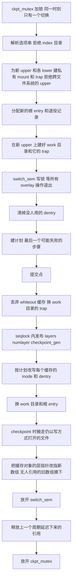

# 07 · overlayfs 热切层：并发、生命周期与修复

## 本章目标

读完本章，你应当能回答：

1. 一次热切层 ioctl 在内核里分成哪几段，"提交点"在哪里，为什么提交点之后不允许再有会失败的步骤？
2. 切换的同时有别的进程在这个文件系统上读写，内核靠什么保证它们看到的要么是完整的旧状态、要么是完整的新状态？
3. checkpoint 之前就打开的文件、被映射的文件，在 checkpoint 之后继续写，这些写为什么曾经回滚不掉，现在落在哪里？
4. restore 之后，范围外的进程（root 服务、envd）手里的旧目录、旧文件会看到什么，哪些操作会得到 `ESTALE`？
5. 被换下来的层、mount、缓存对象什么时候释放，为什么"延迟一个切换周期"就不会释放后使用？
6. 每一项修复是被哪个现象逼出来的、用什么脚本复现和验证？

---

上一章（[06](06-overlay-hot-switch.md)）讲了热切层的**机制**：`OVL_IOCTL_CHECKPOINT` 的两种模式、选项串、gsd 侧怎么调用。
那一章默认"切换的时候没人碰这个文件系统"。本章把这个假设拿掉。guest 的根文件系统就是这个 overlay，
PID 1、envd、gsd 自己、各种 root 服务都活在它上面，而 gsd 在切换前只冻结或杀掉 uid 1000 的用户进程树
（[08](08-process-trees.md)）；其余进程在切换的那一刻照常做着 lookup、read、write、rename。
交接时的内核补丁在这种并发下会崩，另外还有一批只有在切换多次、或者切换之后做特定操作才暴露的生命周期问题。

本章按主题讲内核侧的全部修复，每个主题一节，统一四段：**现象**（怎么被发现）、**根因**、**改法**、**验证**。
主题的划分与补丁 `0003-overlayfs-hot-switch-fixes.patch` 文件头的提交说明一致。
本章提到的内核函数，除特别说明外都在这个补丁里；交接时的原始补丁是 `0002-overlayfs-hot-switch-checkpoint.patch`，本章称它"原始补丁"。
本章举的数字都是修复过程中各轮现场验证的数，只用来说明"修之前是什么样、修之后是什么样"，各轮的模板和内核构建不同，
**不能互相相减，也不能与 [20](20-results-and-gaps.md) 的判定值相减；判定值见 20 章**。

下一章（[08](08-process-trees.md)）回到 gsd 用户态，讲用户进程树怎么找、怎么冻、怎么杀。

---

## 1. 背景：读这一章需要的 overlayfs 知识

### 1.1 upper、lower、copy-up 与 whiteout

overlayfs 把几个目录叠成一个文件系统。最上面一个可写的目录叫 **upper**，下面一个或多个只读的目录叫 **lower**（本书也叫"层"）。
规则有四条，后面每一节都要用到：

- **查找（lookup）**：按从上到下的顺序在各层里找同名项，第一个找到的生效。目录是例外：各层的同名目录会**合并**成一个目录显示。
- **copy-up**：要修改一个只存在于 lower 的文件时，先把它整个拷到 upper，再改 upper 里的那份。lower 永远不被写。
  拷贝是在一个临时目录里做完再 rename 进 upper 的，这个临时目录叫 **work 目录**（与 upper 在同一个文件系统上，挂载时指定）。
- **whiteout**：删除一个 lower 里有的文件，不能真去删 lower，而是在 upper 的同名位置放一个特殊的字符设备（0/0），表示"这个名字被删了"。
  这个东西叫 whiteout。内核为了省 inode，会在 work 目录里建一个 whiteout 并缓存起来，以后每次需要时给它做一个硬链接（"共享 whiteout"）。
- **opaque 目录**：在被 whiteout 的名字上重新建一个目录时，这个新目录带一个"不透明"标记，表示不要把下面各层的同名目录合并进来。

热切层要做的事（[06](06-overlay-hot-switch.md)）用这套词说就是：checkpoint 时把当前 upper 变成最上面的一个 lower、换上一个空的新 upper；
restore 时把整个层栈换成目标 checkpoint 记录的那一组 lower，再换上一个全新的空 upper。两种情况 work 目录都跟着换。

### 1.2 overlay 自己的 inode 和 dentry 记着什么

overlay 文件系统里的每个文件，在内核里有一个 **overlay inode**（`struct ovl_inode`）；每个名字有一个 **dentry**，dentry 上挂着一个
`struct ovl_entry`（代码里叫 `oe`）。它们本身不存数据，只记着"我背后是哪几个真实文件"：

| 对象 | 字段 | 含义 |
|---|---|---|
| overlay inode | `__upperdentry` | 这个文件在 upper 里的真实 dentry；没有 copy-up 过就是空 |
| overlay inode | `lowerpath`（dentry + layer） | 这个文件在 lower 里的真实 dentry，以及它属于哪一层 |
| overlay inode | `checkpoint_gen` | 这个 inode 的后端状态最后一次被确认是在第几代层栈上（原始补丁加的） |
| dentry 的 `ovl_entry` | `lowerstack[]`（dentry + layer） | 这个名字在各个 lower 里对应的真实 dentry；目录可以有多项 |
| 打开的文件 | `realfile` | 真正被读写的那个底层文件（upper 或 lower 里的） |

本章把这些字段统称为**后端状态**。overlay 的每个操作（读、写、stat、readdir、copy-up……）第一步都是读后端状态，找到真实文件，再把操作转给它。
热切层的全部难点可以归结成一句话：**切换改掉了层栈，于是所有已经缓存着的 overlay inode 和 dentry 的后端状态都可能不再成立**，
必须有人把它们改对，而且改的时候不能有人正读到一半。

### 1.3 层数组、私有 mount、trap inode 与 inode 哈希

再往下一层是文件系统级的状态（`struct ovl_fs`）：

- **层数组** `layers[]` 和层数 `numlayer`。每一层是一个 `struct ovl_layer`，里面最重要的是一个**私有 mount**
  （内核对该层目录 `clone_private_mount` 出来的、不在任何 mount namespace 里的挂载）。
  inode 的 `lowerpath.layer` 和 dentry 的 `lowerstack[].layer` 是指向这个数组元素的**裸指针**，不带引用计数。
- **trap inode**（陷阱 inode）。overlay 不允许层与层之间互相嵌套（否则会递归）。它的做法是：给每一层的根目录、work 目录等在 overlay 自己的 inode 缓存里
  各放一个占位 inode（trap），之后任何 lookup 如果找到的真实目录正好是某个 trap 对应的目录，就返回 `ELOOP`。
- **inode 哈希**。overlay inode 缓存在一张哈希表里，**键是它背后某个真实 inode 的内存地址**（有 lower 的用 lower 的真实 inode，纯 upper 的用 upper 的）。
  lookup 找到真实文件之后，用这个地址去哈希表里找有没有现成的 overlay inode，有就复用，并用 `ovl_verify_inode()` 校验它记录的 upper/lower
  与这次 lookup 找到的是否一致，不一致返回 `ESTALE`。trap 也是按同一种键放进这张表的。

"键是一个内存地址"这件事在不换层的上游内核里没有问题，因为层的 mount 钉着这些真实 inode。
换层之后，被换下的层可能被删除，真实 inode 被回收，同一个地址可能分给另一个真实 inode——§6、§9 的两类问题都出在这里。

### 1.4 交接时的做法与它留下的问题

原始补丁处理"后端状态不再成立"的办法是**懒更新**：ioctl 只换全局的层数组并把 `checkpoint_gen` 加一，
各个 inode 和 dentry 等到下一次被访问时，发现自己的代数落后，再由访问者现场把后端状态改过来。被换下来的对象因为说不清还有谁在用，一律不释放。

这个设计在"切换时没有并发访问"的前提下能工作，前提不成立时有三类问题：

1. **没有任何东西把"正在读后端状态的操作"与"正在改后端状态的切换"隔开**。读的人可能读到改了一半的状态，或者读到别人刚刚释放的指针（§4）。
2. **ioctl 自己的失败路径不干净**，后段失败会释放已经挂上去的层（§3）。
3. **"一律不释放"是泄漏**，磁盘和内核内存只增不减（§8）；而少数被释放了的东西（work 目录）又有缓存还指着它们（§9）。

此外还有语义上的问题：切换之前打开的文件写到了哪里（§5），restore 之后旧目录还能不能用（§6、§7）。
修复的总体思路是把懒更新换成**"切换时一次改完"**：ioctl 拿一把排它锁，在锁内按事先建好的计划把所有缓存对象改到位，放锁时整个文件系统处于一致的新状态。

---

## 2. 总览：一次 ioctl 的阶段、提交点与锁

修复后的 ioctl 主体是 `ovl_do_ioctl_checkpoint`，外面包一层 `ovl_ioctl_checkpoint` 负责权限检查和串行化。
它分成三段，中间以**提交点**为界：提交点之前的每一步都可能失败，失败时文件系统的状态一个字节都没变；提交点之后的每一步都不会失败。
各阶段逐步做了什么，在 [06](06-overlay-hot-switch.md) 的"一次切换在内核里的过程"一节按顺序讲过，这里不再复述，只给阶段图和锁表。

涉及三把锁和一张延迟释放表，它们各管一件事：

| 名字 | 类型 | 谁持有 | 保护什么 |
|---|---|---|---|
| `ckpt_mutex` | 互斥锁 | ioctl 全程 | 两个切换不交错；旧层数组的链表 |
| `switch_sem` | 读写信号量 | overlay 的每个操作持读锁；ioctl 从"建计划"到"改完"持写锁 | 所有后端状态：`__upperdentry`、`lowerpath`、dentry 的 `ovl_entry`、`layers`、`workdir`、打开文件的 `realfile` |
| `layers_seq` | seqlock | ioctl 在发布新层栈的那几行持写侧 | `layers`、`numlayer`、`checkpoint_gen` 三个值作为一组被读到 |
| `deferred` 链表 | 自旋锁保护的链表 | 任何替换了引用的人往里放；下一次 ioctl 拿到写锁后取走释放 | 被换下、但别的读者可能还"借着"没有自己引用的对象 |

后面各节是这张图上每一块的来历。

---

## 3. 失败处理与发布

### 3.1 现象

这一项不是现场撞出来的，是交接时审读代码发现的（问题清单 G-05，见 [14](14-issue-resolution.md)）：
原始补丁的 ioctl 先把 `ofs->layers` 换成新数组、把一批 inode 的 `lowerpath` 指进新数组、把 `ofs->workbasedir` 换成新值，
**然后**才去新 upper 上建 work 目录。建目录失败时（根盘快满时的 `ENOSPC`、内存不足、upper 所在文件系统变只读）走清理路径，
把新数组里的 mount 全部卸载、数组本身释放、新 work 目录的引用放掉——而这些东西此刻正被文件系统用着。
之后这个 overlay（也就是 guest 的根）上的任何操作都在访问已释放的内存。

触发条件并不离奇：根盘确实被写满过（[16](16-restore-slowness-case.md) 讲的 restore 变慢，根因就是每次 restore 往 upper 里误拷文件）。

### 3.2 根因

可能失败的步骤排在了不可逆的步骤后面。另有两个相邻的问题在同一处：

- `layers` 和 `numlayer` 是分两次写的。一个并发的读者可能拿到新数组配旧长度（或反过来），按旧长度去下标新数组就越界。
- 两个 ioctl 可以同时进来，各自读一遍"当前层栈"再各自替换。

### 3.3 改法

**可能失败的全部挪到提交点之前。** 新层的 mount 和 trap、新的根 entry、退役记录（`struct ovl_layer_set`，§8 用）、新 work 目录及其 trap、
计划（§4.3），都在提交点之前分配好。其中最别扭的是 work 目录：内核建 work 目录的函数 `ovl_workdir_create` 是从 `ofs` 里取 upper mount 和父目录的，
而提交点之前 `ofs` 还描述着旧层栈。`ovl_ckpt_create_workdir` 的做法是在栈上造一个临时的 `ovl_fs`，只填上新 upper 的 mount 和新的 work 父目录，
拿它去调 `ovl_workdir_create`。真正的 `ofs` 没有被碰过，所以失败时没有任何东西需要回滚，清理路径只释放这次 ioctl 自己分配的对象。

提交点之后确实还需要内存的两处小分配（`ovl_defer_put` 的链表节点、`ovl_inode_keep_real` 的节点）用 `__GFP_NOFAIL`，保证不失败。

**三个值成组发布。** 提交点上在 `layers_seq` 的写侧里依次写 `numlayer`、`layers`、`checkpoint_gen`。
运行时代码凡是要用 `numlayer` 去约束 `layers[]` 下标的，都改用 `ovl_layers_snapshot()` 读——它在 seqlock 的读侧循环里取这三个值，保证拿到的是同一组。
只有 `layers[0]`（upper 的 mount）可以不经快照直接读，因为任何一个层数组都至少有一项。

**ioctl 之间串行。** `ovl_ioctl_checkpoint` 先检查 `CAP_SYS_ADMIN`，再以可被信号打断的方式拿 `ckpt_mutex`，然后才进主体。

**readdir 一次遍历只用一个 entry。** 合并目录的 readdir 要沿着 `lowerstack` 一层层走。原来每走一步都重新读一次 dentry 上的 `ovl_entry`，
切换如果正好在中间把它换成了另一个深度的 entry，下标就对不上。现在遍历开头读一次、之后一直用它（`ovl_path_next_oe`）；
被换下的 entry 走延迟释放（§4.4），遍历期间不会被释放。

ioctl 现在还会主动拒绝两种它不支持的配置（都在提交点之前）：

- 挂载带 index 目录（`index=on` 或 `nfs_export=on`）时返回 `-EOPNOTSUPP`。index 目录描述的是挂载时的 upper，切换不会带着它走。guest 没有开这两个选项。
- 新 upper 与当前 upper 不在同一个文件系统上时返回 `-EXDEV`。挂载时内核在 upper 的文件系统上探测过一批能力
  （是否支持 `O_TMPFILE`、xattr、`RENAME_WHITEOUT`，文件名长度，whiteout 能否共享 inode），切换后沿用这些结论，所以 upper 不能换文件系统。
  gsd 的所有层都在同一个 ext4 上（[04](04-architecture.md)），不会触发。

### 3.4 验证

用 `stress_overlay_ckpt.py` 的 enospc 模式：把 `/overlay` 所在的文件系统写满，再逐档放出 0 到 6 个块，每一档做一次 create 和 restore，共七档。
gsd 侧建目录就失败的档位返回 `overlay sink failed ... no space left on device` 或 `prepare overlay restore, nothing was changed`；
有的档位 gsd 的目录建成了、内核建 work 目录时才失败，正好走到本节的晚失败路径，ioctl 返回 `ENOMEM`
（`ovl_workdir_create` 对多数错误只返回空指针，`ovl_ckpt_create_workdir` 统一报成 `-ENOMEM`），gsd 报 `overlay ioctl failed: errno=12 (ENOMEM)` 且什么都没改。
每一档之后沙箱可用、`/health` 正常、调试内核没有 KASAN 或 BUG 报告；删掉填充后 create、restore 与文件内容都正确。
这一组在 2026-09-30 的第一轮现场验证里首次通过（放出 5 个块的那一档走到晚失败），此后每一轮内核改动都重跑（见 §12 的出处表）。

---

## 4. 切换与所有 overlay 入口的互斥

### 4.1 现象

2026-09-30 第一轮现场验证的压测里，只要切换的同时有不归 gsd 管的进程在 overlay 上活动，guest 几秒到几十轮内必崩。
压测脚本（`stress_overlay_ckpt.py`，[19](19-testing-and-debug-kernel.md)）起 6 个 root 身份的 worker 不停做文件操作，宿主侧随机发 create / restore / delete。
当时看到的（新 920B，第一轮验证，交接时的补丁加上当时已做的失败路径修复）：

| worker 做什么 | 结果 |
|---|---|
| 全部操作（调试内核） | 7.9 秒时 KASAN 报 `ovl_copyattr` ← `ovl_write_iter` 空指针解引用，随后软锁死 |
| 全部操作（发布版内核） | 第 45 轮 `kernel BUG at fs/inode.c:1850`（`iput` ← `ovl_refresh_reused_inode` ← `ovl_lookup`） |
| 只 rename | `ovl_rename` 空指针解引用 |
| 只追加写 | 第 42 轮软锁死 |
| 只读（调试内核） | KASAN 报 `iput` 处 slab 越界，之后 `BUG`；发布版内核上没有崩，但只读操作本身同样在读后端状态 |
| 没有 worker | 300 轮干净 |

同样的负载放到**并发相关代码与交接时完全相同**的内核上（只多了 §10 的 mmap 修复和去打印），第 3 轮就软锁死加 RCU stall，所以这不是修复引入的，是原始补丁就有的。

为什么 gsd 管不住：gsd 在切换前只处理 uid 1000 的用户进程树——checkpoint 时让它们停着，restore 时把它们杀掉。
PID 1、envd、gsd 自己和所有 root 起的服务都不在范围内，而它们全都活在这个根文件系统上。
最容易撞上的是 envd 的文件 API：SDK 在调 checkpoint 的同时调一次 `files.write`，两者就并发了。

### 4.2 根因

§1.4 的第一类问题。懒更新意味着后端状态的修改散落在各个访问路径上（lookup 里刷新 inode、读路径里刷新、写路径里换 `realfile`），
而切换自己又在另一个线程里清 `__upperdentry`、换层数组。这些修改之间没有共同的锁；替换下来的旧指针当场 `dput`/`iput`，
而别的线程可能刚读到这个指针、还没用完。表里的几种崩法只是同一个问题撞在不同字段上：
读到被清空的 `__upperdentry` 是空指针解引用，读到别人刚放掉的 dentry 是 KASAN 越界或 `iput` 里的 `BUG`，copy-up 等一把永远等不到的锁是软锁死。

### 4.3 改法：读写锁加计划

**`switch_sem`**。`struct ovl_fs` 里加一把读写信号量。规则是：凡是读后端状态的 overlay 操作，从读第一个字段到用完真实文件为止，持读锁；
ioctl 从建计划到全部改完，持写锁。于是每个操作看到的要么是完整的旧状态，要么是完整的新状态。

落实方式是把 overlay 的每个入口拆成两层：原来的函数体改名成 `__ovl_xxx`（或保持原名但注明"调用方持读锁"），外面包一个只负责加锁解锁的同名函数。
补丁里能看到的有 `ovl_lookup` / `__ovl_lookup`、`ovl_rename` / `__ovl_rename`、`ovl_link` / `__ovl_link`、`ovl_setattr` / `__ovl_setattr`、
`ovl_getattr` / `__ovl_getattr`、`ovl_listxattr`、`ovl_get_acl`、`ovl_fileattr_set`、`ovl_do_remove_locked`（unlink 和 rmdir）、
`ovl_create_object`（create、mkdir、mknod、symlink）、`ovl_dentry_revalidate_locked`、`ovl_statfs`、`ovl_remount`、各个 xattr handler、
导出文件句柄的 `ovl_encode_fh`，以及 `file.c` 里的读、写、fsync、fallocate、splice 等文件操作和 `readdir.c` 里的目录读取。

读锁有五条使用规则（写在 `overlayfs.h` 里 `ovl_switch_lock_read` 上方的注释里），每一条都对应一种会死锁的情形：

1. **不递归**。读写信号量在有写者等待时会挡住新的读者，一个已经持读锁的线程再拿一次读锁，就会和等写锁的 ioctl 互相等。
   overlay 有不少地方会经 VFS 绕回自己（`lookup_one()`、`vfs_getattr()`、`file_remove_privs()`、`touch_atime()`、
   `generic_permission()` 进而 `ovl_get_acl()`、`posix_acl_create()`），这些调用一律在放开读锁之后做。
   所以有些函数的形状是"拿锁读一小段状态、放锁、调回 VFS、再拿锁"，例如创建文件时 ACL 在拿锁之前先算好，存进 `struct ovl_cattr` 带下去。
2. **锁序**：在 VFS 对 overlay 对象的锁（`i_rwsem`、`sb_writers`、管道锁）之内，在 overlay 对各层拿的锁（`OVL_I()->lock`、真实 inode 的 `i_rwsem`、upper 的 `sb_writers`）之外。
3. **不在 `mmap_lock` 下等它**。读、写、readdir 持读锁期间会拷贝用户内存，可能缺页，缺页要 `mmap_lock`；
   反过来 `ovl_mmap` 是在 `mmap_lock` 下被调用的，所以它不能等这把锁，也不做 copy-up（§10）。
4. **不跨无界等待持有**（比如从一个空管道 splice）。
5. **RCU 路径遍历不拿锁**。路径查找的快速模式（RCU-walk）不能睡眠，它读到空指针就退回慢速模式重来；
   作为交换，任何被替换下来的对象都要等一个 RCU 宽限期或等下一次 ioctl 拿到写锁之后才释放。

ioctl 拿写锁用的是可被致命信号打断的版本（`down_write_killable`）：如果某个读者长时间不放锁（例如一次读进 userfaultfd 管着的缓冲区），调用方不会被永久卡死。

**计划**。拿到写锁后，ioctl 不再只动全局状态，而是把每一个缓存着的 inode 和它的每一个 dentry 改到新层栈下"一次全新 lookup 会得到的样子"。
改写不能失败（已经过了提交点），所以分两步：

- **建计划**（`ovl_ckpt_build_plan`，提交点之前）：先用 `shrink_dcache_sb` 清掉没人用的 dentry，剩下的都是被钉住的
  （某个进程的 cwd、打开的文件、挂载点以及它们的祖先）。然后遍历超级块上的全部 inode，对每个受影响的 inode 由 `ovl_ckpt_plan_inode`
  建一个计划项：拿住 inode 和它每个 dentry 的引用，并把需要的新 `ovl_entry` 预先分配好（`ovl_ckpt_move_entry`）。这是最后一个可能失败的步骤，失败则放锁、释放计划、原样返回。
- **应用计划**（`ovl_ckpt_apply_item`，提交点之后）：只做指针赋值和标志位操作。

两种模式下一个 inode 被改成什么：

| 模式 | 对象 | 改成 |
|---|---|---|
| checkpoint | 有 upper 的 inode（文件或目录） | **promote**（提升）：原来的 upper dentry 变成它的 lower（属于新数组里"旧 upper"那一层），`__upperdentry` 清空；它的每个 dentry 换上新 entry——第一项是旧 upper，目录还要接上原来的 lower 栈。这正是在新层栈里重新 lookup 会得到的结果 |
| checkpoint | 没有 upper 的 inode | 不变（它的 lower 都还在新层栈里） |
| restore | 所有 dentry | 标记为陈旧（`OVL_E_STALE`）并从目录树上摘下（`d_drop`） |
| restore | 有 upper 的非目录 | **detach**：保留数据，变成"只有 lower、lower 就是被丢弃的那个 upper"的 inode，打上 `OVL_DETACHED`，并从 inode 哈希里摘出，新的 lookup 永远找不到它 |
| restore | 有 upper 的目录 | 只丢掉 upper，留在哈希里，等新的 lookup 按同一个 lower 把它"复活"（§6）；纯 upper 的目录例外，摘出哈希（§9.3） |

原始补丁在 dentry 重新校验（`->d_revalidate`）里按代数判陈旧的那段逻辑随之删掉了：切换已经把所有缓存对象改到位，不需要事后再判；
而且把正在被使用的 dentry 判成无效，会让它的使用者（cwd、打开的目录）之后 copy-up 失败。

### 4.4 改法：被换下的引用延迟一个切换周期

持读锁的操作读后端状态时拿到的是**借来的指针**：它们不给 `__upperdentry`、`lowerpath.dentry`、`ovl_entry` 另加引用，只靠"持着读锁期间没人会释放"。
写锁保证了 ioctl 改写时没有读者，但还有两种情况：

- 读者之间互相替换。例如一次 lookup 刷新了某个缓存 inode 的 lower（`ovl_refresh_reused_inode`），或一次写把打开文件的 `realfile` 换到了新 upper（§5），
  此时另一个持读锁的线程可能正借着旧指针。
- 不拿锁的 RCU 路径遍历、异步 I/O 的完成回调。

所以**任何人替换下来的引用都不当场释放**，而是交给 `ovl_defer_put()` 挂到 `ofs->deferred` 链表上，
链表项的类型有 dentry、inode、file、整个 `ovl_entry`（`OVL_DEFER_OE`）、整组旧层（`OVL_DEFER_LAYERS`，§8）。
下一次 ioctl 拿到写锁后把整张表摘下来（此刻所有可能借着它们的读者都已离开），放锁后由 `ovl_release_deferred()` 逐个释放；
`ovl_entry` 再经 `kfree_rcu` 多等一个宽限期。本次 ioctl 自己换下的东西挂到新表上，留给再下一次。

代价是：最后一次切换换下的那些对象会一直留到下一次切换或卸载，量级是"一次切换的量"，有界。

### 4.5 验证

2026-09-30 当天的第二轮现场验证（并发互斥与下一节的写入切换两项修复后）：调试内核（KASAN、lockdep，[19](19-testing-and-debug-kernel.md)）与发布版内核各跑 8 组压测
（全部操作、只读、追加加 rename 加相对路径写、只 rename、只追加、只相对路径写、无 worker、ENOSPC），每组 300 轮、6 个 root worker，全部跑完；
dmesg 与串口输出里 KASAN、`BUG:`、Oops、`WARNING:`、链表损坏、锁依赖环、原子上下文睡眠、hung task、soft lockup、RCU stall 这些关键词零命中；
调试内核每组跑完 `debug_locks` 仍为 1（lockdep 全程有效）；worker 没有 `EIO`、没有卡死。此后每一轮内核改动都重跑这 8 组。

worker 仍然会看到两种错误，这是语义而不是缺陷：`ENOENT`（它操作的文件被 restore 回滚掉了）和 `ESTALE`（§6、§11）。

---

## 5. 打开的文件跨切换的语义

### 5.1 现象

两个探针发现了同一类问题的两个层次。

`probe_fd_rollback.py`（第一轮验证）：一个进程在 checkpoint **之前**打开文件，checkpoint 之后经这个 fd 继续写；restore 到这个 checkpoint，后写的内容还在。
按路径重新打开再写的内容能正常回滚。uid 1000 的进程和 root 进程都如此。

`probe_mmap_rollback.py`（第二轮验证，上面那个问题修掉之后）：只要文件**被映射着**——共享可写映射、共享只读映射、私有映射都算——
checkpoint 之后不管经映射写还是经 fd 写，写入都不回滚；而且第 2 行内容直接出现在已经沉下去的那一层的真实文件里，
也就是说这个 checkpoint 的内容被改写了，以后每次 restore 到它都带着这些写入。

### 5.2 根因

checkpoint 把整个 upper 原地变成一个只读层（[06](06-overlay-hot-switch.md)）。"只读"是 overlay 的约定，不是底层文件系统的属性：
以写方式打开的文件，它的 `realfile` 是 checkpoint 之前在当时的 upper 里打开的，切换之后这个底层文件对象照样能写，写的就是那个已经属于 checkpoint 的 inode。
映射更直接：一个映射建立之后，页的读写完全不经过 overlay，直接落到底层文件的 page cache 上。

### 5.3 改法之一：第一次写时切到新 upper

`ovl_write_switch()` 在每个写入口（write、fallocate、splice 写等）拿到读锁和 inode 锁之后调用。
它检查这个打开文件的 `realfile` 是不是当前 upper 里的那个 inode；不是，就把文件连同数据 copy-up 到当前 upper，在那里重新打开一个 `realfile`，
用 `cmpxchg` 换进去。为了能换，打开文件的私有数据从"一个 `realfile` 指针"改成了 `struct ovl_file`：当前的 `realfile` 加一条旧 `realfile` 的链；
旧的可能还被同一个打开文件的其他使用者借着，所以随这个文件关闭时才一起释放。

三种情况下不切、继续写旧的底层文件：

- 旧的底层文件已经不属于任何一层的可见内容（被 unlink 了，或者它是 restore 丢弃的 upper 里被 detach 出来的），写它不会改变任何层显示的东西（`ovl_inode_lower_is_private`）；
- 旧的底层文件正被映射着。映射用的是旧 page cache，如果把 `write()` 切到一份拷贝上，同一个文件的映射读者和 `write()` 写者就看到两份不同的内容。这种写不会被 restore 回滚，由下一小节的办法解决；
- 文件在切换之后被 unlink 了：copy-up 会把它按原名（盖在 whiteout 上）放回去，所以返回 `ESTALE`。

### 5.4 改法之二：checkpoint 时把还开着写的文件留在 upper

对"以写方式打开"或"被共享可写映射"的文件，等到第一次写再切换是来不及的（映射的写根本不经过 overlay）。
所以在 checkpoint 的那一刻就处理：**这个文件不跟着 upper 沉下去，而是搬到新 upper；沉下去的层里放一份它此刻内容的拷贝。**

`ovl_ckpt_want_move()` 在建计划时挑出这些文件，条件是：upper 里的普通文件、数据在 upper、底层 inode 的 `i_writecount > 0`
（有 fd 以写方式打开着；共享可写映射会让它背后的文件一直保持打开，所以也算）。
`ovl_ckpt_move_upper()` 在提交点之后、新层栈已经发布、仍持写锁时执行：

1. 把父目录按常规 copy-up 到新 upper。
2. 在新 work 目录里做一份拷贝（`ovl_ckpt_copy_file`）：数据经 page cache 读，所以内存里的脏页、经映射写入但还没落盘的内容都包括在内；
   全部 xattr（包括 overlay 自己的）、文件属性标志、大小、权限、属主、时间戳一并复制；不 fsync（沉下去的层里其他内容也没有被同步过）。
3. 把拷贝 rename 到新 upper 里的同名位置。
4. 用 `RENAME_EXCHANGE` 把"沉下去的层里的原文件"与"新 upper 里的拷贝"互换。

因为所有层都在同一个 ext4 上，互换只是两个目录项交换指向，**原来的 inode 没有动，只是换了目录**：进程手里的 fd、已有的映射都跟着 inode 走，
从此写进新 upper；沉下去的层里留下的是拷贝。用互换而不是"先移走再放回"，是为了让沉下去的层在任何时刻都不缺这个名字。

有三个细节决定了它的边界：

- **按名字找文件，不信 inode 记录的 upper dentry**。经 `O_TMPFILE` copy-up 出来的文件，overlay inode 记录的 upper dentry 是它在 work 目录里出生时的名字 `#<inode 号>`，
  不是它在层里的路径。所以要在沉下去的父目录里按 overlay 的名字查一次，并核对是同一个 inode。（第一次上机就撞上了这个情况，当时回退成了不搬，随即修正。）
- **硬链接数大于 1 的不搬**：它的另一个名字仍然会把 inode 留在沉下去的层里。此时退回 promote，写仍然会进 checkpoint，内核打一行限速告警
  `checkpoint: could not move open file ... to the new upper layer (...); writes to it change the checkpoint`。已经 unlink 的文件不需要搬。
- **任何一步失败都退回 promote**：删掉拷贝，按普通文件处理，打同一行告警。除父目录的 copy-up 外没有别的副作用。

模块参数 `overlay.ckpt_move_open`（`/sys/module/overlay/parameters/ckpt_move_open`，0644）控制这个行为：
`0` 不搬（只靠 §5.3）；`1` 只搬 checkpoint 时正被映射着的；`2`（默认）搬所有以写方式打开的。
默认选 2 而不是 1，是为了覆盖"checkpoint 前打开、checkpoint 后才映射"的情形——选 1 时这种映射会写进 checkpoint。

代价是：**每次 checkpoint 要对每个以写方式打开的 upper 文件做一次整文件拷贝，拷贝在写锁内进行，期间整个 overlay 上的操作都被挡住。**
`probe_move_cost.py` 的实测（新 920B，2026-09-30 该修复当轮的内核，由一个 root 进程以 `O_RDWR` 持有文件，读 gsd 自报的 `overlay_sink_ms`）：
没有持有者 1.7 ms，1 MiB 1.65 ms，16 MiB 12.9 ms，64 MiB 48.0 ms，128 MiB 101.5 ms，约每 MiB 0.8 ms。判定值见 20 章。
与"第一次写时再拷"相比总拷贝量相当，但对"开着不写"的文件是额外开销。guest 里常驻的以写方式打开的文件只有 journald 的日志，
它在从 ext4 bind 进来的 `/var/log` 上，不在 overlay 层里，不产生这项开销。

还有一个要知道的边界：gsd 在 dump 之后、sink 之前让被 dump 的用户进程树停着（[09](09-checkpoint.md)），所以它们的写与拷贝之间是一致的；
**不在被 dump 的树里、checkpoint 时仍在跑的进程**如果同时经映射写，拷贝取到的是拷贝那一刻 page cache 的内容。

### 5.5 验证

- `probe_fd_rollback.py`：三个文件各在 checkpoint 之前写第 1 行、之后写第 2 行——一个由 uid 1000 的进程（会被 CRIU dump 和 restore）经原 fd 写，
  一个由 root 进程（gsd 不碰它）经原 fd 写，一个作为对照按路径重新打开再写。写完后各有两行，沉下去的层里只有第 1 行；restore 之后三个文件都只剩第 1 行。
- `probe_mmap_rollback.py`：六种情形（只有 fd；共享读写映射经映射写；共享只读映射加 fd 写；私有映射加 fd 写；共享读写映射加 fd 写；uid 1000 进程的共享映射）
  restore 之后都只剩第 1 行，沉下去的层保持干净。第二阶段再做一次 checkpoint、写、restore 到第二个、再 restore 到第一个，四项检查全部为真；
  带着被搬走的共享映射的用户进程又被 CRIU dump 和 restore 一次，照常存活、内容正确；dmesg 里没有 `could not move`。
- `probe_move_cost.py`：除上面的耗时外，核对沉下去的层里是新 inode（md5 相同），新 upper 里是原 inode（进程手里还是同一个 fd）。

三个探针在之后的每一轮内核改动后都重跑，结果逐项相同。

---

## 6. 目录与 inode 缓存跨 restore

### 6.1 现象

`probe_estale.py`（第二轮验证时发现，交接时的补丁就有）：restore 的时候，如果有一个不被杀的进程把 cwd 或目录 fd 放在某个目录里，
restore 之后**所有新进程**按绝对路径访问这个目录的整条祖先链都返回 `ESTALE`——例如持有者停在 `/srv/p/a/b`，
则 `/srv`、`/srv/p`、`/srv/p/a/b` 全部不可访问，dmesg 里有 `failed to get inode (-116)`——直到持有者退出才恢复。
基础镜像里自带的目录不受影响。压测里 worker 的 `ESTALE` 占比很高（列目录、深层列目录、chdir 的错误里约 94% 是它），就是这个问题，而不只是 §11 说的"陈旧 cwd 出发的写"。

非目录有同类问题（`probe_estale_file.py`）：一个进程只读地开着某个文件，这个文件在目标 checkpoint 之后被改过；restore 之后新进程访问这个文件的路径同样 `ESTALE`。

### 6.2 根因

最初的描述是"目录是 checkpoint 之后才建的、restore 时带着 upper"，这个触发条件**不准确**——探针里的 `/srv/p/a/b` 是在第一个 checkpoint 之前就建好的。
对着代码查清的真实原因在 inode 缓存，不在 dentry：

1. `/srv` 在第一个 checkpoint（记作 c1）之后被 copy-up 过（它下面有东西被改了）。
2. 第二个 checkpoint（c2）把 `/srv` 这个 overlay inode promote 了：它的 `lowerpath` 被改到刚沉下去的那一层里的 `/srv`。
   但这个 inode **仍然按它最初建立时的键留在哈希里**，那个键是 c1 那一层里 `/srv` 的真实 inode。
3. restore 到 c1。只要有进程钉着 `/srv` 或它下面的任何目录，这个 overlay inode 就不会被回收，一直留在哈希里。
4. 新进程查 `/srv`：在当前层栈（c1 的）里找到的是 c1 那一层的 `/srv`，按它的地址去哈希，**命中了那个旧 inode**。
   `ovl_verify_inode()` 一比：inode 记录的 lower 是 c2 那一层的 `/srv`，这次找到的是 c1 那一层的 `/srv`，不一致，返回 `ESTALE`。

于是 `/srv` 以下整条路径都走不通。`/srv/p`、`/srv/p/a` 本身并没有坏，只是必须经过 `/srv`。持有者退出后 inode 被回收，问题消失。
触发条件准确地说是：**祖先目录在目标 checkpoint 之后被 copy-up 过、又经历过一次 checkpoint，并且 restore 时它或它的后代被某个不被杀的进程钉着。**

### 6.3 改法

改在 `ovl_get_inode()` 缓存命中的那一段。命中的 inode 如果是"更早一代确认过的"（它的 `checkpoint_gen` 落后于这次 lookup 的代数）并且当前没有 upper，分三种情况：

- **这次 lookup 找到了 upper**：采用它（inode 在 restore 时被清掉了 upper，或者本来就没有，现在在新层栈里有了）。
- **是目录，这次找到的 lower 与记录的不同**：**不再校验 lower，直接采用这次找到的**。理由是：这个目录在当前层栈里确实以这个名字存在，
  而且是按它哈希所用的那个真实 inode 找到的，所以它就是"同一个目录在当前时间线上的样子"。`ovl_refresh_reused_inode()` 把 `lowerpath` 改过去
  （旧引用走延迟释放），用 `ovl_copyattr()` 刷新属性，必要时补上"需要合并 whiteout"的标志。
  随后 `ovl_splice_alias()` 发现这个目录 inode 已经有一个被 restore 标成陈旧的 dentry，就把这次 lookup 为当前层栈建的 `ovl_entry` 换给它，
  让它重新回到目录树上——连同挂在它上面的 mount 一起**复活**；它名下在陈旧期间查出来的子 dentry 全部摘掉，之后重新查。
- **是非目录，校验不过**：把旧 inode 从哈希里摘出（效果等同 detach，持有者继续用它、继续看到旧时间线的内容），然后重新建一个 inode。

有两条边界保持严格：从**陈旧的父目录**出发的 lookup（经一个旧 cwd 往下走）看到的是被丢弃的时间线，它不允许刷新当前时间线的缓存 inode
（`__ovl_lookup` 里 `refresh = !stale_parent`），它查出来的子 dentry 也直接标为陈旧；本代已经确认过的 inode 仍按上游规则严格校验。
另外，trap inode 也是"没有 upper、没有 lower、代数为 0"，长得像一个更早时间线的 inode，但它绝不能被采用成任何东西（§9.3）。

"复活带着 mount"这一点对 guest 很要紧：`/var/lib` 上面挂着 `/var/lib/gsd/snapshots`（放 CRIU 镜像的 tmpfs）。
如果 restore 之后 `/var/lib` 的旧 dentry 不能复活，那个挂载点就从路径上够不着了。

### 6.4 随之而来的语义

这个改法是一个取舍，它决定了范围外进程在 restore 之后看到什么：

- **被复活目录的持有者看到目标时间线**。一个 cwd 停在 `/srv/p/a/b` 的进程，restore 之后 `ls .` 看到的是目标 checkpoint 里这个目录的内容，
  `/proc/<pid>/cwd` 显示正常路径，不再带 `(deleted)`。
- **持有文件（非目录）的进程继续看旧时间线**。它手里的 fd 读到的仍是 restore 之前的内容；新进程按路径打开看到的是目标 checkpoint 的内容。两者互不影响。
- **目录在目标 checkpoint 里不存在时**，新进程按路径访问得到 `ENOENT`（本来就该如此）；持有者手里的是一个陈旧目录，见 §11。

### 6.5 验证

`probe_estale.py` 的全部场景里（持有者停在目标目录、停在祖先目录、只拿目录 fd、停在目标 checkpoint 里不存在的目录、停在镜像自带目录等），除了期望就是 `ENOENT` 的那一条，其余所有操作（列目录、stat、读、创建文件、建目录）全部成功，
持有者的 cwd 显示为正常路径；dmesg 不再有 `failed to get inode (-116)`。`probe_estale_file.py`：restore 后按路径读到目标 checkpoint 的内容、追加写正常，
持有者自己的 fd 读到旧时间线的两行。压测里 worker 的 `ESTALE`（新 920B，2026-09-30，发布版内核、全部操作组、300 轮）
从修复前一轮的 31.5 万次（111 万次操作中）降到 8.3 万次（203 万次操作中），剩下的几乎全是陈旧 cwd 出发的写。判定值见 20 章。

---

## 7. restore 与 rename、unlink、rmdir 的竞争

### 7.1 现象

压测里 rename 偶尔返回 `ENOTEMPTY`。worker 的 rename 是在两个名字之间来回倒一个目录，同一条时间线里这两个名字不会同时存在，按理不可能"目标非空"。
第一次出现是单发的一次（约 97 万次操作中），当时推测是测试脚本自己的问题。
后来专门写了定向复现（`probe_rename_race.py`：1500 次 restore 夹 10.5 万次 rename），一次都没有复现出来，于是一度下了结论：**这不是内核缺陷**，
只是 restore 恰好夹在一次 rename 的两次名字查找之间，错误返回、不改数据。

这个结论后来被推翻。2026-10-08 做回收修复（§8）的那一轮，调试内核上只跑 rename 的一组里，一个 worker **连续 240 次** `ENOTEMPTY`；
回头在更早的内核上并行跑多组放大窗口，也找到一次连续 349 次的。单发可以解释成瞬时竞争，连续几百次不行——说明有东西被留在了错误的状态里。
现场抓到的状态是：restore 到某个 checkpoint 之后，overlay 里同时看得见两个名字，其中一个的 inode 在一个不属于当前层栈的层里。

另一个现象来自删文件密集的压测（`stress_delete_dense.py`，2026-10-08 为验证 §9 新写的）：第 9 轮 restore 时 guest 直接
`kernel BUG at fs/overlayfs/namei.c:809`。

### 7.2 根因

两个现象是同一类问题：**VFS 在调用文件系统的操作之前就把名字查好了，查名字和执行操作之间不持 `switch_sem`**，restore 可以夹在中间。

**rename 被劈开。** 这里有两个窗口：

- 后一个窗口（造成"连续几百次"）：VFS 默认在 `->rename` 返回**之后**自己调用 `d_move` 把 dentry 挪到新名字下。
  这时 overlay 的读锁已经放开了。restore 夹在中间，把刚被改名的 dentry 标成陈旧并摘下；VFS 随后的 `d_move` 又把它按新名字**挂回**目录树
  （父目录可能已经被复活）。于是新名字下挂着一个属于被丢弃时间线的目录：能列、不能改、往它上面 rename 得到 `ENOTEMPTY`，
  而且每次查这个名字都命中它，直到下一次切换把它清掉。
- 前一个窗口（造成单发）：VFS 先后查 old、new 两个名字。old 从 dentry 缓存命中（当前时间线），接着 restore 发生，new 在新时间线里查到一个存在且非空的目录。
  overlay 的 rename 先检查"目标非空"，于是返回 `ENOTEMPTY`——这个错误在哪条时间线里都不成立。

**rmdir 撞 BUG。** 一个纯 upper 的目录被 restore 丢弃之后，既没有 upper 也没有 lower。如果它当初是在一个 whiteout 上重建的（opaque），
overlay 的删除路径会认为"下面还有东西，要先检查目录是否为空"，于是去读这个目录的各层内容，
对一个一层都没有的目录取层，撞上 `ovl_path_next_oe` 里的 `BUG_ON(idx > oe->numlower)`。这个问题在交接时的补丁上就存在，以前的压测从不 rmdir，所以没见过。

### 7.3 改法

- 文件系统类型加上 `FS_RENAME_DOES_D_MOVE` 标志，告诉 VFS "dentry 由我自己挪"。`ovl_rename()` 在 `__ovl_rename` 成功后、**放读锁之前**
  调用 `d_move`（交换式 rename 调 `d_exchange`）。restore 要么在整个 rename 之前，要么在之后，不会再把它劈开。
- `__ovl_rename()` 开头先用 `ovl_dentry_is_stale()` 检查 old 和 new：有一个（或其祖先）已被 restore 丢弃，就返回 `-ESTALE`。
  VFS 对 `ESTALE` 的处理是把两个名字重新查一遍再试一次，重查之后两个名字就在同一条时间线上了。
  从一个陈旧 cwd 出发的 rename 也走这条路，重试仍是 `ESTALE`，与那里的其他修改操作一致。
- `ovl_do_remove()`（unlink 和 rmdir 的公共入口）开头做同样的检查，同样返回 `-ESTALE` 让 VFS 重查。
- `ovl_dir_read_merged()` 遇到"既没有 upper 也没有 lower 的目录"直接返回 `-ESTALE`，不再走到 `BUG_ON`。这是第二道保险。

`ovl_dentry_is_stale()` 的判定是沿父链向上走，自己或任何一个祖先带 `OVL_E_STALE` 标志即为陈旧。

### 7.4 验证

rename 的修复前后对比（新 920B，2026-10-08，调试内核，每组 300 轮，多组并行以放大窗口；判定值见 20 章）：

| 内核 | 负载 | 组数 | 出现 `ENOTEMPTY` 的组数 | 说明 |
|---|---|---|---|---|
| 修复前（上一轮的内核） | 只 rename | 11 | 5 | 其中 1 组连续 349 次，其余单发 |
| 修复前（本轮前三个回收提交） | 只 rename | 12 | 3 | 连续 240 次、3 次、1 次 |
| 修复前（上一轮的内核） | 全部操作 | 40 | 4 | 均为单发 |
| 修复后 | 只 rename | 9 | 0 | |
| 修复后 | 全部操作 | 41 | 1 | 单发 1 次 |

修复后仍有零星单发：约 95 组、每组 300 轮里共 2 次（一次记在 rename 上，一次记在追加写上）。后一次在 rename 路径上没有任何诊断输出，
推断来自目录 copy-up（真实的 upper 里已经有这个目录，而 overlay inode 认为还没有 upper）。操作返回错误、不改数据，50 ms 后视图一致。
没有继续追，列在 [15](15-known-limits.md)。

rmdir 的修复由 `stress_delete_dense.py` 验证：200 轮随机 create / restore / delete，同时三类负载——宿主驱动、可逐条校验的"删文件、`rm -rf` 目录、在被删的名字上重建"，
4 个 root worker 在切换中间不停删和重建，一个被 CRIU dump/restore 的用户进程循环删建。发布版和调试内核各一次，清单校验 192 次 0 失败，
worker 的错误只有 `ENOENT`、`ENOTEMPTY`、`ESTALE`、`EEXIST`（worker 自己在并发删建同一棵子树，这四种都是允许的），dmesg 关键词 0 行。

---

## 8. 回收：被换下的层、mount 与缓存引用

### 8.1 现象

问题清单里有两条相关的（G-11、G-17），现场验证把它们量了出来。`verify_fixes.py` 的层回收一项长期不过：
create → restore 到基点 → delete 循环 40 轮，gsd 侧的层目录数量是稳定的（层目录确实被删了），但 `df /` 持续上涨，`drop_caches` 之后也不回落。
压测里另一个数字是 `mnt_cache`（内核里 mount 结构的 slab）每 300 轮净增 1300 到 1500 个。

为这件事写的专项探针 `probe_leak.py` 把磁盘占用拆开算：`df /` 的已用量减去 `/overlay` 的 `du` 再减去 `/var/log` 的 `du`，
剩下的就是"目录项已经删掉、但数据块还被内核钉着"的部分。修复前（新 920B，2026-10-08，上一轮的内核，300 轮，每轮写 1 MiB）：
这部分每轮涨 1040 KB，300 轮共 312 MB；`mnt_cache` 每轮 +6.0，`ext4_inode_cache` 每轮 +5.0。
（顺带查清：早先"40 轮涨 20 MB"里约 19.3 MB 其实是 journald 的日志增长，与层无关，见 [15](15-known-limits.md)；真正的层泄漏要按上面的口径扣除后才看得出来。）

### 8.2 根因

原始补丁对被换下的对象**有意不释放**，因为懒更新的设计下说不清谁还指着它们（§1.4）。具体有三处，按"钉住了什么"排序：

| 对象 | 交接时的做法 | 后果 |
|---|---|---|
| dentry 的 `ovl_entry` 里各层真实 dentry 的引用 | dentry 释放时只释放 entry 本身，不放掉里面的引用（注释写明是为了避免释放后使用） | **磁盘不回落的主因**。凡是经 lower 查到过、后来被淘汰的 dentry，都永久钉住一个真实 dentry 和它的 inode；层目录被删后，这些 inode 的数据块无法回收。而每次 ioctl 都会清一遍 dentry 缓存 |
| 被换下的层数组（每层一个私有 mount、一个 trap） | 记在 `prev_layers` 里，下一次 ioctl 直接覆盖，从不释放；卸载时只放最后一组 | 每次 ioctl 泄漏一整组 mount，这就是 `mnt_cache` 的增长 |
| 被换下的根目录 entry | 每次 ioctl 留一个到卸载 | 各持一组层根目录的引用 |

"不释放"确实在防释放后使用：隔了两代以上没被访问过的 inode，它的 `lowerpath.layer` 还指着更早的层数组，之所以不出事，正是因为那些数组从来不释放。
所以不能简单地"到点就放"。

### 8.3 改法

有了 §4 的写锁和延迟表之后，"谁还指着它"变成了一个可以回答的问题：**ioctl 持写锁时没有任何 overlay 操作在途，
此刻指向层数组的长期指针只有两种——缓存 inode 的 `lowerpath.layer`，和它们的 dentry 的 `lowerstack[].layer`**（负 dentry 没有 lower 栈）。扫一遍超级块上的 inode 就能全部看到。

回收方案是"写锁内扫描、改指、无人引用则释放"，分四块：

**（一）dentry 释放时放掉 lower 栈的引用。** `ovl_dentry_release` 恢复成上游的做法，调用 `ovl_entry_stack_free`。
前提是现在每个 entry 都明确拥有自己 lower 栈里的引用：lookup 建的、`ovl_ckpt_move_entry` 建的各自 `dget`，被换下的 entry 走 `OVL_DEFER_OE` 延迟释放，没有人不拿 dentry 就借用 entry 里的指针。

**（二）旧层数组进链表，层指针改指新数组。** 提交点上，旧数组被包成一个 `struct ovl_layer_set` 挂到 `ofs->old_layer_sets`。
随后 `ovl_ckpt_retarget_layers()` 做三件事：

1. 对链表上每个旧数组的每一层，在新数组里找"根目录相同"的层（同一个目录经另一个私有 mount 再次挂载），记进这个旧数组的对照表 `slot[]`。
2. 遍历超级块上所有 inode 及其 dentry，对每个层指针调用 `ovl_ckpt_retarget()`：指向当前数组的不动；指向某个旧数组且对照表里有对应新层的，**改指新层**；
   没有对应的，留在原处并给那个旧数组的使用者计数加一。
3. 使用者计数为零的旧数组从链表摘下，交给 `ovl_defer_put(..., OVL_DEFER_LAYERS, ...)`。

改指的效果：checkpoint 之后新层栈包含旧层栈的全部层，所以**所有**指针都能改到新数组，旧数组一个使用者都不剩；
restore 之后，目标 checkpoint 以下的层在新旧栈里都有，能改过去，留在旧数组上的只有"被丢弃时间线里还被谁拿着的对象"（陈旧 dentry、detach 出来的 inode）。

**（三）释放放在下一次 ioctl，mount 的卸载再交给工作队列。** 被摘下的旧数组和 §4.4 的其他延迟对象一样，等下一次 ioctl 拿到写锁后才由
`ovl_layer_set_release()` 处理：trap 当场 `iput`；mount 不在 ioctl 里卸载（卸载要等一个 RCU 宽限期，RCU 路径遍历可能还在看这个 mount），
而是挂到 `dead_layer_sets`，由工作项 `ovl_layer_sets_reap()` 调 `kern_unmount_array`，之后才释放数组内存。卸载文件系统时会 `flush_work` 等它做完。

**（四）同一个 mount 出现在两个数组里。** checkpoint 时旧 upper 的 mount 既是旧数组的第 0 项，又是新数组里"自动加入的最上层 lower"那一项
（它不在 mount namespace 里，不能再克隆一次）。两个槽位通过 `ovl_layer::mnt_peer` 互相记着对方：哪个数组先释放，只减一次引用并清掉对方的记录；后释放的那个才真正卸载。

另外补了一处潜在的释放后使用（§8.2 的反面）：一个有 upper 的普通文件被 promote 或 detach 时，它**原来的 lower**（copy-up 的来源）被换下。
在 copy-up 之前打开的 `realfile`、以及由它建立且比它活得长的映射，可能还开在这个旧 lower 上，而它们并不持有真实 inode 的引用
（overlay 用带伪路径的方式打开底层文件，钉住真实 inode 的是 overlay inode）。所以这个旧 lower 不能在下一次切换时释放，
`ovl_inode_keep_real()` 把它挂在 overlay inode 上，一直保留到 overlay inode 销毁。

### 8.4 为什么不会重新引入释放后使用

四条依据：

1. 一个数组被判定"无人引用"之后**不当场释放**，而是等下一次 ioctl 拿到写锁。那时，在上一次切换之前借走任何东西的读者一定都已离开。
2. mount 和数组内存在 RCU 宽限期之后才释放，不拿锁的 RCU 路径遍历不会踩到。
3. 被摘下的数组不会再获得新的使用者：层指针只会从当前数组或从一个已缓存的对象拷贝而来。扫描时如果遇到"既不指向当前数组、也不在链表上任何数组里"的层指针，
   `ovl_ckpt_retarget` 会 `WARN_ONCE`（`layer ... of an unknown layer array`，压测的关键词检查会抓到）。全部验证中出现 0 次。
4. `mnt_peer` 保证共享的那个 mount 只被卸载一次。

选"扫描加改指"而不是给每个层指针加引用计数，是因为 lookup 是热路径，不想在上面加原子操作；
扫描只是 ioctl 里多走一趟 inode 链表，而 ioctl 开头已经清过 dentry 缓存，链表上剩下的都是被钉住的少量对象。

### 8.5 有界的残留

修复后仍然会留着、但有上界的东西：

- 被 restore 丢弃的时间线里**还被谁拿着**的对象（陈旧 cwd、打开的文件）会让它所在的那一代层数组整组留着。持有者放手后要再过一到两次 ioctl 才释放
  （restore 之后的那一代要多等一次：扫描时计划还拿着那些被丢弃的 dentry）。
- 最后一次切换换下的对象留到下一次切换或卸载（§4.4）。
- 被多次"copy-up 加切换"且一直被拿着的普通文件，每次多留一个旧 lower 的引用，直到 overlay inode 销毁。

### 8.6 验证

`probe_leak.py`（新 920B，2026-10-08，回收修复当轮的内核；判定值见 20 章）：

| 场景 | 修复前 | 修复后 |
|---|---|---|
| 循环 300 轮，被钉住的磁盘 | 每轮 +1040 KB，共 +312 MB | 每轮 0 KB，全程 +28 KB |
| 循环 300 轮，`mnt_cache` | 每轮 +6.0（317 → 2100） | 每轮 −0.003（290 → 327） |
| 持有场景：root 进程每轮拿着一个 4 MiB 文件的 fd 和一个 cwd，共 20 轮 | 持有中 +164 MB，放手后不回落 | 持有中 +82 MB（正好 20 个被 fd 钉住的 4 MiB 文件），放手后 +160 KB，再跑 3 轮为 0 |

另有两个形状专门给 KASAN 看：一个只读 fd 加一个"映射后关掉 fd"的映射拿着某一层里的文件，之后经历 copy-up、两次 checkpoint、restore、删掉全部 checkpoint、
层目录被回收、空转加 `drop_caches`，fd 和映射读到的内容都正确，放手后 dmesg 干净。
`probe_umount.py` 测卸载路径：guest 的根卸不掉，所以另挂一个小 overlay 直接发 ioctl，五种释放顺序轮流，调试内核 20 轮、发布版 100 轮，
内容和持有者视图都符合预期；发布版 100 轮新建约 1300 个私有 mount，`mnt_cache` 净增 +57，不随轮数增长。

8 组压测里 300 轮的 `mnt_cache` 净增从上一轮的 +1444 到 +1544 变成 −20 到 +82。回收逻辑让 restore 的 ioctl 多花 0.04 到 0.06 ms
（gsd 自报的 `overlay_restore_ms` 中位数 0.34 → 0.38 到 0.40），checkpoint 的 ioctl 不变。gsd 侧不需要配合：不需要新的 ioctl，也不要求改变删目录的时机。

---

## 9. 属于 work 目录的缓存

### 9.1 现象

2026-10-08 用最终版 gsd 和重建的模板做整体验证时出现一个阻塞问题：**restore 之后删除一个"checkpoint 里就有"的文件，guest 内核直接 BUG**，3 秒内确定性复现。
手工步骤是：建两个文件 → create → 删第一个 → restore → 删第二个。dmesg 先打一行
`overlayfs: Failed to link whiteout - disabling whiteout inode sharing(nlink=0, err=-2)`，紧接 `kernel BUG at fs/namei.c:2963!`，
栈是 `may_delete` ← `vfs_rename` ← `ovl_cleanup_and_whiteout` ← `ovl_unlink`。出事的任务带着目录锁死掉，之后访问那个目录的操作全部卡住。

并发压测下同一批沙箱还表现出另外三种错误：某个目录及其下所有路径 `ELOOP`（一次几百到上千条）、打开文件 `ENXIO`、
以及有一次 envd 起命令报 `fork/exec /bin/bash: not a directory`（`ENOTDIR`）。全部操作组 10 个随机种子里只有 1 个干净。

奇怪的是**旧模板完全没事**：同一个内核、同一个 orchestrator，旧模板 20 组全干净。差别查到一个偶然：旧模板开机之后，初始 work 目录里碰巧留着一个缓存的 whiteout；
新模板（overlay-init 改过之后，[05](05-guest-boot-and-injection.md)）开机后 whiteout 数为 0。在新模板上人为先删一个基础镜像里的文件、把这个"碰巧"补回去，20 组也全干净。

### 9.2 根因：两个互相独立的缺陷

当时根据"补回一个条件、四种错误一起消失"推断四种错误出自**同一个原因**。对着源码查下去之后，这个归因被推翻：
**是两个独立的缺陷，被同一个偶然条件同时掩盖。**

**缺陷一：whiteout 缓存没有随切换丢掉（造成 BUG）。** §1.1 说过，内核把一个 whiteout 建在 work 目录里并缓存在 `ofs->whiteout`，之后每次给它做硬链接。
原始补丁和当时的修复都没有任何代码处理这个字段。于是：create 之后删一个下层文件，缓存落在当时的 work 目录里；restore 把这对 upper 和 work 换掉，
gsd 把它们移进回收站删除，缓存的那个 inode 链接数变成 0，dentry 被摘出哈希，但仍被 `ofs->whiteout` 拿着。
下一次需要 whiteout 时，对链接数为 0 的 inode 做硬链接返回 `ENOENT`（就是日志里的 `nlink=0, err=-2`）；
内核的失败路径认为"共享不了就把缓存的这个直接交出去用"，于是拿**当前** work 目录当源目录去 rename 这个 dentry——
而它的父目录是早已删除的旧 work 目录。从一个不是它父目录的目录里 rename 一个 dentry，正是 `may_delete()` 里的 `BUG_ON`。

**缺陷二：work 目录的 trap inode 没有换（造成 ELOOP、ENXIO、ENOTDIR）。** 挂载时内核给 work 目录建了一个 trap，放在 `ofs->workdir_trap`，
键是那个真实目录 inode 的**地址**（§1.3）。切换时换了 work 父目录的 trap，却没有动这一个，它一直留到卸载；
而钉住那个真实 inode 的 dentry（旧的 `ofs->workdir`）在下一次切换时被放掉了。此后这个目录的 inode 一旦被内存回收，trap 的键就悬空：
**下一个被分配到同一地址的真实 inode 会被当成 trap**。

- 撞上的是目录：lookup 命中 trap，返回 `ELOOP`，这个目录及其下所有路径都 `ELOOP`。
- 撞上的是普通文件：`ovl_get_inode()` 按键在哈希里找到 trap，§6.3 那段"旧时间线 inode 复用"的逻辑看到它没有 upper、代数为 0，
  就把这个真实文件"采用"进了 trap。trap 没有任何文件操作，`open` 得到内核默认的 `ENXIO`。
- 撞上的是目录、又被采用进去：trap 没有 lookup 操作，把它当路径分量走得到 `ENOTDIR`，chdir 和 exec 都失败。

三种错误是缺陷二的三种表现，与 whiteout 缓存本身无关。

**为什么同一个条件掩盖了两者。** 旧模板初始 work 目录里那个缓存的 whiteout 同时做了两件事：一是那个目录永不删除，硬链接永远成功（盖住缺陷一）；
二是这个 dentry 作为子项一直钉着 work 目录的 dentry 和 inode，trap 的键不会悬空（盖住缺陷二）。把分开它们的是一个判别实验：
在修复前的内核上，不建任何 whiteout，只加一个不归 gsd 管的进程把 cwd 放在开机时的 work 目录里钉住它的 inode，全部操作组 10 个种子 10 个干净（不钉是 1 个）。
这个区分是有后果的：如果只修缺陷一，不但治不了后三种错误，还会把原来偶然的掩盖彻底拿掉。

### 9.3 改法

- **提交点上丢弃 whiteout 缓存**：`ofs->whiteout` 置空后 `dput`。换下来的那个只是放掉引用，不去旧 work 目录里删那个条目
  （旧 work 目录由 gsd 整个删除；开机时的 work 目录里会留一个 `#N` 字符设备，下次挂载时内核会清掉），这样提交点上不做任何可能失败的文件系统写。
- **`ovl_whiteout()` 入口校验**（`ovl_whiteout_cache_ok`）：缓存的 dentry 必须仍是**当前** work 目录的子项、没有被摘出哈希、链接数不为 0，否则丢弃重建。
  这是第二道保险：管理层目录的一方（gsd）可能在内核不知情时删掉 work 目录或其中的条目，宁可检查也不相信缓存。
- **work 目录的 trap 随 work 目录一起换**：提交点之前给新 work 目录建好 trap（与挂载时的做法一致，而不是简单置空），提交点上换进 `ofs->workdir_trap`，
  旧的在旧 work 目录的引用被放掉之前 `iput`。
- **`ovl_get_inode()` 绝不把任何东西采用进 trap**：命中的 inode 如果是"已标记删除的目录、没有 upper、没有 lower"，按上游的做法让它在校验处失败。
- **同一类悬空键**：restore 时失去 upper 的目录，如果它是按这个 upper 的真实 inode 哈希的（纯 upper 目录），在 `ovl_ckpt_apply_item` 里一并摘出 inode 哈希。
  否则被丢弃的层删除后，它的键同样会悬空，新分配到该地址的真实 inode 会被当成这个目录——如果它已被 rmdir 过，还会被当成 trap。按 lower 哈希的目录照旧保留（§6 的复活靠它）。

这一轮顺带把 `struct ovl_fs` 里所有与 work 目录或 upper 绑定的字段逐个审查了一遍，结论如下：

| 字段 | 切换时的处理 | 结论 |
|---|---|---|
| `whiteout` | 提交点置空并释放；使用处另有校验 | 本节修复 |
| `workdir_trap` | 提交点之前给新 work 目录建 trap，提交点上一起换 | 本节修复 |
| `workdir` | 提交点换新，旧的延迟到下一次切换释放 | 无问题 |
| `workbasedir`、`workbasedir_trap` | 提交点一起换，旧的当场释放（旧 `workdir` 的延迟引用钉着它的父目录） | 无问题 |
| `workdir_locked`、`upperdir_locked` | 提交点先解旧的占用锁，再记新的 | 无问题 |
| upper 的 trap（在 `layers[0]` 里） | 随层数组一起建、一起释放，键由该层的 mount 钉着 | 无问题 |
| `indexdir`、`indexdir_trap` | 不切换。guest 没开 index，这两个字段为空 | ioctl 遇到有 index 目录的挂载返回 `-EOPNOTSUPP`（§3.3） |
| 挂载时探测的能力（`tmpfile`、`noxattr`、`namelen`、`xino_mode`、`RENAME_WHITEOUT` 与 `d_type` 检查） | 沿用，不重新探测 | upper 不换文件系统就成立；ioctl 拒绝跨文件系统的 upper（`-EXDEV`） |
| `share_whiteout` | 不重置 | 关掉后每次在当前 work 目录新建 whiteout，本身没问题；缓存随切换丢弃后，切换不会再把它关掉 |
| 硬链接计数相关的逻辑 | 只在有 index 目录时起作用 | 无问题（index 已被拒绝） |
| 清理与 copy-up 用的 work 目录 | 都在持读锁时现取 `ofs->workdir` | 无问题 |
| `config.lowerdir` / `upperdir` / `workdir` | 不更新 | `/proc/mounts` 一直显示开机时的三个目录，只影响显示。没有改（CRIU 要读 mountinfo，不动它的输入），见 [15](15-known-limits.md) |
| `fs[]`、各层的 `fs` 与 `fsid` | 新层一律按"与 upper 同一个文件系统"登记，不检查 lower 实际在哪 | lower 在别的文件系统时设备号与 inode 号映射不对；gsd 不触发。没有改，见 [15](15-known-limits.md) |
| `creator_cred`、`last_ino`、`errseq` | 与层栈无关 | 无问题 |

### 9.4 验证

`probe_whiteout_bug.py` 有五类用例：`bug`（§9.1 的手工步骤）、三个对照（先 create 再 restore、restore 前没删过下层文件、先删一个基础镜像里的文件）、
以及 `trap`（缺陷二的直接复现：两次 create → `drop_caches` → 新建并重新查找 6000 个目录和文件，全程不删任何文件）。
修复前：`bug` 3 秒必现；`trap` 3 次里 2 次命中（一次 6000 条全部 `ELOOP`，一次 `open` 得 `ENXIO`）。修复后全部用例不崩，`trap` 三次的错误计数都是空。

`trap` 的直接复现是概率性的，所以"修复后 trap 用例干净"本身分量有限，缺陷二修好的主要证据是下面的命中率对照
（新 920B，2026-10-08，全部操作组与无 worker 组各 10 个种子，种子与修复前相同；格子里是"干净的组数 / 总组数"，判定值见 20 章）：

| 内核与模板 | 无 worker | 全部操作 |
|---|---|---|
| 修复前的内核，不带掩盖的新模板 | 9/10 | 1/10 |
| 同上，另加一个进程钉住开机时的 work 目录（判别实验） | — | 10/10 |
| 修复后的内核，不带掩盖的新模板 | 10/10 | 10/10 |

另有 8 组压测各 300 轮、三棵树的多树压测 200 轮、删文件密集压测 200 轮，在发布版和调试内核上全部通过。
（§7 的 rmdir 竞争就是这一轮里，只含本节两项修复的候选内核在删文件密集压测第 9 轮撞出来的，所以两项修复在补丁的提交说明里归在同一组。）

---

## 10. mmap 与调试输出

这一组不涉及并发，简述以求完整。

**mmap 不再 copy-up。** 原始补丁的 `ovl_mmap` 对所有带写权限的映射都走写路径，先把文件 copy-up。
执行任何程序都会对它的数据段建一个私有可写映射，于是每次 restore 把被执行的二进制整份拷进 upper：这既是 restore 变慢的真根因，
也是连续 restore 后根盘写满的原因，[16](16-restore-slowness-case.md) 有完整的归因过程。现在 `ovl_mmap` 与上游一致：只映射当前的 `realfile`，不 copy-up。
共享可写映射要求文件以读写方式打开，打开时已经 copy-up 过；私有可写映射的写不会落到文件上。
`ovl_mmap` 也**不拿** `switch_sem`（§4.3 规则 3）：它在 `mmap_lock` 下被调用，而且 copy-up 要拿真实目录的锁，那些锁在 readdir 路径上排在 `mmap_lock` 外面。
"被映射文件写进 checkpoint"的问题由 §5.4 在 checkpoint 时解决，不在映射时解决。

**调试输出全部去掉。** 原始补丁在热路径上留有 `pr_warn`（每次 lookup、每次 ioctl 的开始和结束、每个被判陈旧的 dentry、`clear_refs` 和 `pagemap_read` 的每次调用）。
guest 的内核参数让这些只进环形缓冲区、不上串口，性能影响不大，但会把 dmesg 里真正有用的信息冲掉。现在一律删除或降为 `pr_debug`；
`fs/proc/task_mmu.c` 里只为这些打印服务的计数器一并删除，减少与上游的差异。
修复后 0003 自己会产生的内核输出只有：两条限速告警（§5.4 的 `could not move open file`、§3.3 的 index 目录不支持）和少数一次性的 `WARN_ONCE`（§8.4）。

---

## 11. 修复之后，范围外的进程会看到什么

把前面各节的语义收成一张表。这里的"范围外进程"指不被 gsd 杀掉的进程：root 服务、envd 及它代为执行的文件操作。
用户进程（uid 1000）在 restore 时全部被杀并由 CRIU 重建，不存在"手里拿着旧对象"的问题。面向使用者的说法见 [22](22-semantics-and-limits.md)。

| 进程手里有什么 | checkpoint 之后 | restore 之后 |
|---|---|---|
| 以写方式打开的文件（fd） | 写落到新 upper，不进 checkpoint。硬链接数大于 1 的文件例外（写进 checkpoint，有告警） | 文件属于被丢弃的 upper：fd 继续可读可写，写的是一个已被 detach 的私有 inode，对任何路径不可见 |
| 共享可写映射 | 同上 | 同上 |
| 只读打开的文件 | 读到的内容不变 | 继续读到旧时间线的内容；按路径重新打开读到目标 checkpoint 的内容 |
| cwd 或目录 fd，该目录在目标 checkpoint 里存在 | 不受影响 | 目录被复活：持有者看到目标时间线的内容，读写正常 |
| cwd 或目录 fd，该目录在目标 checkpoint 里不存在（陈旧目录） | — | 只读地看到旧时间线；从它出发的任何修改（创建、写、rename、删除）返回 `ESTALE`；纯 upper 的陈旧目录连列目录也返回 `ESTALE` |
| 正在进行中的 rename、unlink、rmdir | 不受影响 | 若名字查找与操作之间夹了一次 restore：返回 `ESTALE`，VFS 自动重查重试一次，重试在新时间线上执行 |
| 按绝对路径的新访问 | 正常 | 正常，看到目标 checkpoint 的内容 |

陈旧 cwd 出发的写为什么是 `ESTALE` 而不是"写到新时间线里"：一个被 restore 丢弃的 dentry（以及经它往下查出来的一切）描述的是已被丢弃的时间线，
如果允许对它 copy-up，就会在当前 upper 里把它和它上面的每一级目录重新造出来，相当于把被回滚掉的东西又写回去。所以 copy-up 遇到陈旧 dentry 一律拒绝。
唯一的例外是这个 dentry 的 inode 还与一个活着的 dentry 共享（一个在新旧层栈里都有的 lower 文件），那就经活着的那个 copy-up。

对使用方的建议只有一条：**长期运行的 root 服务不要把 cwd 留在会被回滚的目录里**；遇到 `ESTALE` 时重新 `chdir` 到绝对路径即可恢复。

---

## 12. 验证汇总与出处

每一轮内核改动之后都重跑同一套东西，判据也相同（脚本与判据的定义见 [19](19-testing-and-debug-kernel.md)）：

- 8 组并发压测（全部操作、只读、三种写的组合、只 rename、只追加、只相对路径写、无 worker、ENOSPC），每组 300 轮、6 个 root worker；
  判据是正常跑完、dmesg 与串口关键词零命中、worker 没有 `ENOENT` 与 `ESTALE` 以外的错误、心跳不过期，调试内核另要求 `debug_locks=1`。
- 探针：`probe_fd_rollback`、`probe_mmap_rollback`、`probe_move_cost`、`probe_estale`、`probe_estale_file`、`probe_leak`、`probe_umount`、`probe_whiteout_bug`，逐项与上一轮比对。
- 功能回归：`verify_fixes`、`verify_gsd`、`verify_multitree`。

最终提交 `259f1a25c` 的确认性验证只重跑了其中一部分（全部操作与无 worker 两组压测、多树与删文件密集压测、`probe_whiteout_bug` 和全部功能回归），
其余压测组、探针和调试内核上的结果来自它的前一轮（内核相同、gsd 的 Go 代码相同，只有提交号不同）。哪些是本轮跑的、哪些是前一轮的，以 [20](20-results-and-gaps.md) 的表为准。

本章数字的出处（结果目录在 `deltabox/e2b/results/` 下）：

| 内容 | 结果目录 | 位置 |
|---|---|---|
| §3.4 ENOSPC 七档首次通过；§4.1 崩溃表；§5.1 fd 不回滚 | `gsd-fixes-20260930` | `SUMMARY.md` "阶段 2"与"发现的问题 1、2" |
| §4.5 两种内核各 8 组；§5.1 映射例外；§6.1 祖先链 ESTALE 的发现 | `gsd-fix3-20260930` | `summary.txt` 一、三、四、七 |
| §5.4 搬文件的代价；§5.5、§6.5 的探针结果与 ESTALE 计数；§7.1 "不是内核缺陷"的旧结论 | `gsd-fix4-20260930` | `summary.txt` 一、二 A/B/D、四 |
| §7.4 rename 对比表；§8 全部（对象与引用方表、泄漏数据、卸载路径、ioctl 开销） | `gsd-fix5-20261008` | `summary.txt` 一、二、三 D、四、六 |
| §9.1 现象与"同一个条件"的旧归因 | `gsd-final-20261008` | `summary.txt` 一、六、七 |
| §9.2～§9.4 根因、字段审查表、命中率对照；§7 的 rmdir 竞争与删文件密集压测 | `gsd-fix6-20261008` | `summary.txt` 一～四、七、八 |
| 最终提交的确认性验证 | `gsd-release-20261008` | `summary.txt` 三 |

---

## 代码位置

内核函数都在 `fc-kernels/patches/6.1.158/0003-overlayfs-hot-switch-fixes.patch` 里（按补丁里的文件分组）；gsd 侧行号以 `deltabox-gsd@259f1a25c` 为准。

| 关注点 | 位置 |
|---|---|
| ioctl 主体、串行化、提交点 | `fs/overlayfs/super.c` — `ovl_ioctl_checkpoint`、`ovl_do_ioctl_checkpoint`、`ovl_ckpt_create_workdir` |
| 成组发布层栈 | `fs/overlayfs/ovl_entry.h` — `layers_seq`、`ovl_layers_snapshot` |
| 读写锁与使用规则 | `fs/overlayfs/overlayfs.h` — `ovl_switch_lock_read`、`ovl_switch_trylock_read`、`ovl_switch_unlock_read`；`ovl_entry.h` — `switch_sem` |
| 计划的建立与应用 | `super.c` — `ovl_ckpt_build_plan`、`ovl_ckpt_plan_inode`、`ovl_ckpt_move_entry`、`ovl_ckpt_apply_item`、`ovl_ckpt_free_plan` |
| 延迟释放 | `fs/overlayfs/util.c` — `ovl_defer_put`、`ovl_release_deferred` |
| 陈旧判定、私有 lower 判定 | `util.c` — `ovl_dentry_is_stale`、`ovl_inode_lower_is_private` |
| 写入切到新 upper | `fs/overlayfs/file.c` — `ovl_write_switch`、`struct ovl_file`、`ovl_get_realfile`、`ovl_mmap` |
| checkpoint 时搬走打开的文件 | `super.c` — `ovl_ckpt_want_move`、`ovl_ckpt_move_upper`、模块参数 `ckpt_move_open`；`fs/overlayfs/copy_up.c` — `ovl_ckpt_copy_file` |
| inode 缓存命中的处理、目录复活 | `fs/overlayfs/inode.c` — `ovl_get_inode`、`ovl_refresh_reused_inode`；`fs/overlayfs/namei.c` — `__ovl_lookup`、`ovl_splice_alias` |
| rename 与删除的竞争 | `fs/overlayfs/dir.c` — `ovl_rename`、`__ovl_rename`、`ovl_do_remove`、`ovl_do_remove_locked`；`fs/overlayfs/readdir.c` — `ovl_dir_read_merged`；`namei.c` — `ovl_path_next_oe` |
| 层数组回收 | `super.c` — `struct ovl_layer_set`、`ovl_ckpt_retarget`、`ovl_ckpt_retarget_layers`、`ovl_layer_set_release`、`ovl_layer_sets_reap`、`ovl_inode_keep_real`、`ovl_dentry_release` |
| whiteout 缓存与 work 目录 trap | `dir.c` — `ovl_whiteout`、`ovl_whiteout_cache_ok`；`super.c` — `ovl_do_ioctl_checkpoint` 提交点一段 |
| gsd 侧调用 ioctl 的地方 | `SinkUpper`（`ckpt/overlay.go:125`）、`CommitRestore`（`ckpt/overlay.go:240`）、`applyOverlaySwitch`（`ckpt/overlay.go:549`） |
| gsd 只处理哪些进程 | `userRootsIn`（`ckpt/pid.go:259`）、`killTrees`（`ckpt/criu.go:215`） |
| 复现与验证脚本 | 随手册附带的 `scripts/stress/` 与 `scripts/probes/`：`stress_overlay_ckpt.py`、`stress_delete_dense.py`、`probe_fd_rollback.py`、`probe_mmap_rollback.py`、`probe_move_cost.py`、`probe_estale.py`、`probe_estale_file.py`、`probe_rename_race.py`、`probe_leak.py`、`probe_umount.py`、`probe_whiteout_bug.py` |

---

## 本章要点

1. **一次切换分三段，以提交点为界**：之前的每一步都可能失败且失败时什么都没变（新层、trap、work 目录、计划全部提前备好），之后的每一步都不会失败。
   `layers`、`numlayer`、`checkpoint_gen` 在 seqlock 里成组发布，ioctl 之间由 `ckpt_mutex` 串行。
2. **并发安全靠一把读写锁加一份计划**：所有读后端状态的 overlay 操作持 `switch_sem` 读锁，ioctl 持写锁按计划把每个缓存的 inode 和 dentry 一次改到位
   （checkpoint 时 promote；restore 时摘下、标陈旧、detach）。原来的懒更新和按代数判陈旧都不再使用。
3. **被换下的东西延迟一个切换周期释放**：读者借用指针不加引用，所以任何替换下来的引用都挂到延迟表上，由下一次 ioctl 拿到写锁后释放；涉及 RCU 路径的再等一个宽限期。
4. **checkpoint 之前打开的文件，之后的写不进 checkpoint**：以写方式打开或被共享可写映射的文件在 checkpoint 时搬到新 upper、层里留一份拷贝（约每 MiB 0.8 ms，在写锁内）；
   其余的在第一次写时 copy-up。硬链接数大于 1 的文件是例外。可用 `overlay.ckpt_move_open` 调节。
5. **restore 之后旧目录按 lower 复活、旧文件留在旧时间线**：被钉住的目录不再让整条祖先链 `ESTALE`；陈旧目录出发的修改一律 `ESTALE`，不会把被回滚的内容写回去。
6. **夹在名字查找和操作之间的 restore 由 `ESTALE` 重试化解**：rename 自己在读锁内移动 dentry，rename、unlink、rmdir 发现名字已被丢弃就让 VFS 重查。
7. **回收靠"写锁内扫描、改指、无人引用则下次释放"**：被删层的磁盘块和内核里的 mount 不再只增不减；仍被旧时间线持有者钉着的那一代层数组是有界残留。
8. **属于 work 目录的缓存必须随 work 目录一起换**：whiteout 缓存和 work 目录的 trap 是两个独立的缺陷，曾被同一个偶然条件掩盖。
   由此得到的通用教训是：凡是以"真实 inode 的地址"为键、或指向某个会被删除的目录的缓存，切换时都要处理（附录 [B](B-extending.md) 的不变量清单）。
