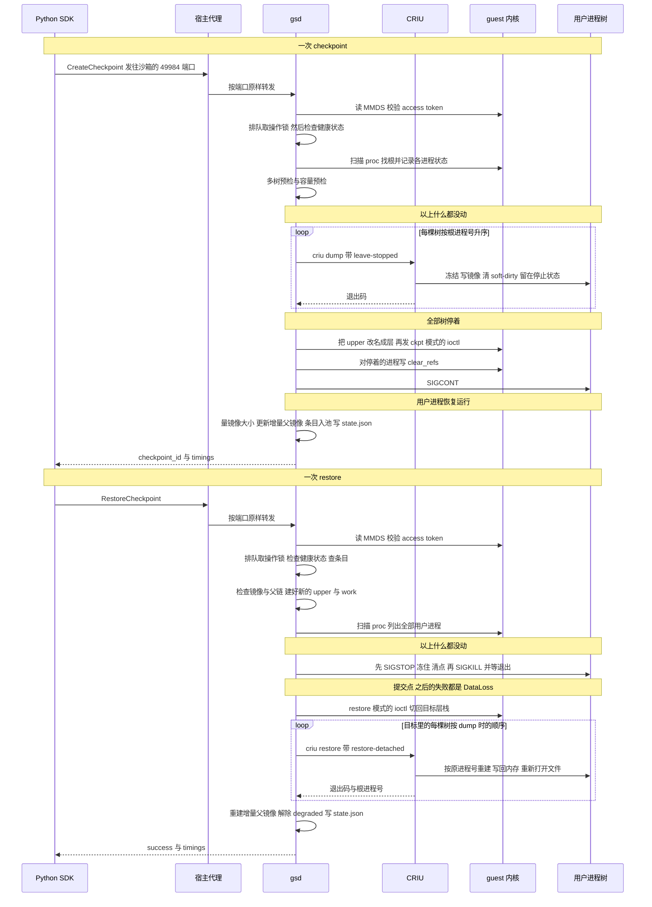

# 11 · 端到端走查

## 本章目标

读完本章，你应当能够：

1. 从 SDK 调用出发，按时间顺序说出一次 checkpoint、一次 restore 经过的每一步：在哪个进程、哪个函数、碰了哪些文件、记了哪个计时键；
2. 区分三种"停顿"——某棵树被 CRIU 冻住、全部树被留在停止状态、整个 overlay 被切换挡住——并指出每个计时键量的是哪一种；
3. 说清编排上的几条顺序约束，以及每一条被打破后的后果；
4. 拿本章当路线图，把一次慢的或失败的操作定位到具体步骤。

---

第 [04](04-architecture.md)–[10](10-restore.md) 章各讲一个部件：04 是组件与目录布局，05 是开机与注入，06、07 是文件系统的热切层，08 是用户进程树，09、10 分别是 create 与 restore 的实现。
本章按时间顺序把它们串起来，每一步都标注它在哪一章讲过，可以按需回查。**全书的时序图只在本章**。

本章是第二部分的收束，只描述正常路径和最直接的失败出口。失败的完整分级在 [12](12-failure-semantics.md)，状态、并发与容量在 [13](13-state-concurrency-capacity.md)。
计时键在这里只讲"落在哪一步"，定义见 [24](24-configuration-and-observability.md)，实测见 [20](20-results-and-gaps.md)。

主体代码：`ckpt/service.go`（编排）、`ckpt/overlay.go`（切换）、`ckpt/criu.go`（criu 与杀进程）。

---

## 1. 时序全图



图里宿主代理只出现在最外圈：它转发请求和响应，对中间的每一步一无所知（[04](04-architecture.md)）。Firecracker 根本不在图上——整个过程中虚机没有被暂停过。

---

## 2. 一次 checkpoint，逐步

### 2.1 到达 gsd 之前

| # | 步骤 | 在哪 | 说明 |
|---|---|---|---|
| 1 | `sandbox.checkpoint.create(name)` | SDK，`py-sdk/e2b/sandbox_sync/checkpoint.py:85` | 组一个 `CreateCheckpointRequest`，用 Connect 的 JSON 编码发出 |
| 2 | 请求发往 `http://49984-<沙箱 id>.<域名>/checkpoint.Checkpoint/CreateCheckpoint`，带 `X-Access-Token` | SDK | 地址与请求头的来历见 [04](04-architecture.md) |
| 3 | 代理按"端口 + 沙箱 id"转发进 guest | 宿主 | 对 49984 没有专门处理 |
| 4 | 鉴权：读 MMDS，比对令牌的哈希 | gsd，`packages/gsd/internal/permissions/authenticate.go:53` | 读不到 MMDS → `Unavailable`；令牌缺失或不对 → 未鉴权 |
| 5 | 进入 `CreateCheckpoint`，等操作锁 | gsd，`ckpt/service.go:164` | 前面有别的 create、restore 或 delete 在做，就在这里排队 |

第 1～5 步的时间**不在任何计时键里**。`total_ms` 是拿到锁之后才开始计的（`service.go:166`）。所以 SDK 一侧量到的墙钟时间 = 网络与代理 + 鉴权 + 排队 + `total_ms`。

### 2.2 gsd 内部

| # | 步骤 | 代码 | 计时键 | 讲在 |
|---|---|---|---|---|
| 6 | 检查健康状态 | `service.go:170` | | [12](12-failure-semantics.md) |
| 7 | 扫描 `/proc`，找根，记录每个进程的状态 | :180-192 | `find_pids_ms` | [08](08-process-trees.md) |
| 8 | 多树预检 | :200 | `precheck_ms` | [08](08-process-trees.md) |
| 9 | 容量预检 | :209 | `precheck_ms` | [13](13-state-concurrency-capacity.md) |
| 10 | 建 `<id>_mem/` | :224 | | [04](04-architecture.md) |
| 11 | 逐棵：选父镜像，建 `t<i>/`，`criu dump` | :242-290 | `criu_dump_ms`（各棵之和）、`process_trees` | [09](09-checkpoint.md) |
| 12 | 列出被停住的全部进程，算出要放开的名单 | :297-302 | | [08](08-process-trees.md) |
| 13 | 下沉：改名 + ioctl | :322 | `overlay_sink_ms` | [06](06-overlay-hot-switch.md) |
| 14 | 重写 `clear_refs` | :334 | | [09](09-checkpoint.md) |
| 15 | `SIGCONT` | :336 | `stopped_ms`（从第一棵 dump 完到这里） | [09](09-checkpoint.md) |
| 16 | 量镜像大小，更新 `lastTrees`，条目入池 | :344-366 | | [09](09-checkpoint.md) |
| 17 | 组响应 | :371 | `total_ms`（从第 5 步拿到锁到这里） | |
| 18 | 写 `state.json`，放锁 | `defer` | | [13](13-state-concurrency-capacity.md) |

注意第 18 步在 `total_ms` 定格之后：写状态文件的时间不在 `total_ms` 里，但在调用方等待的时间里。

### 2.3 这一次碰了哪些文件

| 位置 | 变化 |
|---|---|
| `/var/lib/gsd/snapshots/<id>_mem/t<i>/` | 新建；CRIU 写入镜像文件、`criu-dump.log`；增量时多一个 `parent` 符号链接 |
| `/overlay/layers/L<n>` | 由当时的 upper 目录改名而来（upper 为空时没有这一步） |
| `/overlay/layers/upper_<id>_next`、`work_<id>_next` | 新建，成为当前 upper 与 work |
| 上一对临时 upper/work 里已经没用的 | 被后台回收移进 `.trash` 后删除 |
| `/var/lib/gsd/snapshots/state.json` | 原子地重写 |
| `/proc/<pid>/clear_refs` | 对每个被 dump 的进程写一次 |

---

## 3. 一次 restore，逐步

### 3.1 到达 gsd 之前

与 create 相同：SDK 的 `restore(checkpoint_id)`（`py-sdk/e2b/sandbox_sync/checkpoint.py:126`）→ 代理 → 鉴权 → 等操作锁（`ckpt/service.go:464`）。

### 3.2 gsd 内部

| # | 步骤 | 代码 | 计时键 | 讲在 |
|---|---|---|---|---|
| 1 | 检查健康状态（上一次 restore 半途失败不拦） | `service.go:469` | | [12](12-failure-semantics.md) |
| 2 | 在条目池里查目标 | :475 | | |
| 3 | 逐棵检查 `inventory.img` 与父链 | :484-491 | `precheck_ms` | [10](10-restore.md) |
| 4 | `PrepareRestore`：预检长度，查层目录，建新的 upper 与 work | :496 | `precheck_ms` | [06](06-overlay-hot-switch.md) |
| 5 | 扫描 `/proc`，列出全部用户进程 | :506 | `find_pids_ms` | [08](08-process-trees.md) |
| — | **以上失败：什么都没动** | | | |
| 6 | `killTrees`：冻住、清点、杀、等退出 | :524 | `kill_ms` | [08](08-process-trees.md) |
| 7 | 清空 `lastTrees` | :535 | | [10](10-restore.md) |
| — | **以下失败：`DataLoss`** | | | |
| 8 | `CommitRestore`：restore 模式的 ioctl | :539 | `overlay_restore_ms` | [06](06-overlay-hot-switch.md) |
| 9 | 逐棵 `criu restore`，读根进程号与启动时间 | :571-614 | `criu_restore_ms`（各棵之和）、`process_trees` | [10](10-restore.md) |
| 10 | 重建 `lastTrees`，解除 degraded | :617-622 | | [10](10-restore.md) |
| 11 | 组响应 | :627 | `total_ms` | |
| 12 | 写 `state.json`，放锁 | `defer` | | [13](13-state-concurrency-capacity.md) |

### 3.3 这一次碰了哪些文件

| 位置 | 变化 |
|---|---|
| `/overlay/layers/restore_<id>_<seq>_upper`、`_work` | 新建，成为当前 upper 与 work |
| 被切走的旧 upper（连同其中被丢弃的全部写入）、旧 work | 被后台回收移进 `.trash` 后删除 |
| 不再被当前层栈和任何条目引用的 `L<n>` | 同上 |
| `/var/lib/gsd/snapshots/<id>_mem/t<i>/criu-restore.log`、`restored.pid` | 覆盖 |
| `/var/lib/gsd/snapshots/state.json` | 原子地重写 |

目标 checkpoint 的镜像和层**只被读，不被改**。同一个 checkpoint 可以被 restore 任意多次，每次都得到同样的起点。

---

## 4. 三种停顿

"checkpoint 期间沙箱停了多久"没有单一的答案，因为有三种范围不同的停顿，它们一层套一层。

### 4.1 checkpoint

| 停顿 | 谁受影响 | 从哪到哪 | 记在哪个键里 |
|---|---|---|---|
| 被 CRIU 冻住 | 正在 dump 的**那一棵**树 | 这棵树的 `criu dump` 开始冻结它，到 dump 结束 | 包含在 `criu_dump_ms` 里（该键还含 criu 自身的启动与收尾） |
| 被留在停止状态 | **所有已经 dump 完的**树 | 第一棵 dump 完，到 `SIGCONT` | `stopped_ms` |
| 被切换挡住 | guest 里**所有**访问这个 overlay 的进程，包括 root 服务和 envd | 内核取到切换的写锁，到放开 | 包含在 `overlay_sink_ms` 里（该键还含建目录与改名） |

三者的关系：第三种嵌在第二种里面，第二种接在各棵树的第一种之后。对一棵具体的树，它不在运行的总时长 = 它自己被冻住的时间 + 它 dump 完之后到 `SIGCONT` 的时间。
排在最前面的树后一项最长，排在最后的树后一项最短——只有一次下沉加一轮 `clear_refs`。

没有任何时刻整个虚机是停的。root 服务、envd、gsd 自己全程在跑，只是在第三种停顿那不到 1 ms 里访问根文件系统会等一下（可写打开着大文件时会更长，见 [06](06-overlay-hot-switch.md)）。

### 4.2 restore

restore 没有冻结窗口，更贴切的说法是**不可用窗口**：

| 停顿 | 谁受影响 | 从哪到哪 | 记在哪个键里 |
|---|---|---|---|
| 用户进程不存在 | 用户进程 | 被杀，到各自所在的树被 `criu restore` 恢复出来 | `kill_ms` + `overlay_restore_ms` + `criu_restore_ms` 的相应部分 |
| 被切换挡住 | guest 里所有访问这个 overlay 的进程 | 内核取到切换的写锁，到放开 | 包含在 `overlay_restore_ms` 里 |

从调用方的角度，一次 restore 期间用户进程不可用的时间约等于 `total_ms`。多棵树时各棵先后恢复，排在后面的树回来得更晚。
对范围外的进程，restore 的影响除了那一下切换，还有切换之后它们手里旧的目录和文件可能变成陈旧的（[06](06-overlay-hot-switch.md)、[22](22-semantics-and-limits.md)）。

---

## 5. 计时键落在哪

响应里的 `Timings`（`packages/gsd/spec/checkpoint/checkpoint.proto:17`）由 gsd 在 guest 内自己量，单位毫秒，带小数；没执行的阶段是 0。
SDK 把它转成字典，放在 `create()` 返回值的 `timings` 属性和 `Checkpoint` 对象的 `last_timings` 属性里。同样的数字 gsd 也打在自己的日志里（`precheck_ms` 除外，它只在响应里）；2026-10-08 的确认验证逐项比对过，两处相同。

| 键 | create | restore | 赋值位置 |
|---|---|---|---|
| `total_ms` | 拿到操作锁到组响应 | 同左 | `ckpt/service.go:368`、:624 |
| `find_pids_ms` | 扫描、找根、记状态 | 扫描、列出用户进程 | :194、:515 |
| `precheck_ms` | 多树预检 + 容量预检；没有用户进程时为 0 | 镜像检查 + `PrepareRestore` | :201 或 :210、:502 |
| `criu_dump_ms` | 各棵 dump 之和 | — | :291 |
| `overlay_sink_ms` | `SinkUpper` 整个调用 | — | :329 |
| `stopped_ms` | 第一棵 dump 完到 `SIGCONT` | — | :309 |
| `kill_ms` | — | `killTrees` 整个调用；没有用户进程时为 0 | :529 |
| `overlay_restore_ms` | — | `CommitRestore` 整个调用 | :548 |
| `criu_restore_ms` | — | 各棵 restore 之和 | :615 |
| `process_trees` | dump 的棵数 | 恢复的棵数 | :292、:616 |

各项之和小于 `total_ms`：建目录、量镜像大小、入池、日志等零碎步骤没有单独的键。`stopped_ms` 与 `overlay_sink_ms`、`criu_dump_ms` 有重叠（§4.1），不能相加。
两个注意点：`find_pids_ms` 和 `precheck_ms` 在 create 与 restore 里**顺序相反、内容不同**，比较时不要跨操作；
`criu_dump_ms`、`criu_restore_ms` 量的是整个 criu 子进程的运行时间，包括它的启动、解析镜像和退出，不只是拷页。

---

## 6. 量级感

下面的数字只为说明"哪一步是大头"，条件各自标明，**判定值见 [20](20-results-and-gaps.md)，不能与那里的数相减**。

**restore，单棵树、192 MiB 内存负载**（新 920B、2026-10-08、`259f1a25c`，连续 8 次的中位数，单位 ms）：

| `total` | `criu_restore` | `kill` | `find_pids` | `overlay_restore` | `precheck` |
|---|---|---|---|---|---|
| 83.3 | 71.0 | 11.1 | 0.7 | 0.4 | 0.1 |

大头是 `criu_restore`，其次是 `kill`，其余每项都不到 1 ms。也就是说，一次 restore 的时间基本上就是"把旧进程杀干净"加"CRIU 把进程建回来"。

**create，单棵树、192 MiB 内存负载**（同一次验证里逐轮交错对照的那一组，中位数，单位 ms）：`total` 15.55，其中 `criu_dump` 13.60，`find_pids` 0.63，`precheck` 0.04。
这是内存改动不多时的增量 create；首次全量或内存被大面积改写之后的 create 要写出全部或大部分页，`criu_dump` 相应变大（各档见 [20](20-results-and-gaps.md)）。

一句话的直觉：**create 的耗时跟着"这次要写多少页"走，restore 的耗时跟着"这棵树有多少内存、有几棵树"走**；文件系统的切换在两边都几乎不占时间。

---

## 7. 两条非主线

### 7.1 只有文件系统的 checkpoint

空闲的沙箱里调用 create：

1. 扫描 `/proc`，没有用户进程，根的列表为空。`find_pids_ms` 有值。
2. 跳过预检。`precheck_ms` 为 0。
3. 建一个空的 `<id>_mem/`。
4. 没有树要 dump。`criu_dump_ms`、`stopped_ms`、`process_trees` 都为 0。gsd 的日志里有一行 `no user processes, overlay-only checkpoint`。
5. `SinkUpper`：upper 里有内容就下沉，`overlay_sink_ms` 有值；upper 为空则连切换也没有。
6. 条目入池，没有树。响应里 `has_process_image=false`、`image_bytes=0`、`parent_checkpoint_id` 为空。

之后 restore 到它：照常检查（没有镜像要查）、准备目录、扫描；**当前的用户进程照样全部杀掉**；切换文件系统；没有树要恢复，日志里是 `no CRIU images, overlay-only restore`。
结果是一个文件系统回到那一刻、没有任何用户进程的沙箱。`criu_restore_ms` 为 0，`lastTrees` 为空，之后新启动的进程下一次做全量。

### 7.2 三棵树的 create

设三棵树的根进程号从小到大是 A、B、C，各自的 dump 耗时是 dA、dB、dC。时间线：

```
        |<-- dA -->|<-- dB -->|<-- dC -->|<- 下沉 + clear_refs ->|
A       冻结........停着.......................................... 放开
B       运行........冻结........停着.............................. 放开
C       运行........运行........冻结........停着.................. 放开
                   ^                                             ^
                   tFirstStopped                                 SIGCONT
```

- `criu_dump_ms` = dA + dB + dC。
- `stopped_ms` = 从 A dump 完算起 = dB + dC + 下沉 + `clear_refs`。也就是"其余各棵的 dump 时间之和"再加一点零头。
- A 不在运行的总时长 = dA + `stopped_ms`，约等于整个 `criu_dump_ms`；C 不在运行的总时长 ≈ dC + 零头。

实测的形状与此吻合。2026-10-08 一轮多树测量（新 920B，每棵 64 MiB，首次全量，8 轮中位数，早于最终提交的一轮）里，三棵树时 `criu_dump_ms` 是 138.87、`stopped_ms` 是 91.82，
两者之差约 47 ms，与同一轮里单棵树全量 dump 的 49.66 ms 相近——差的那一份正是排在最前面的 A 自己的 dump 时间。

这条时间线还说明了"树之间不是原子的"具体指什么：镜像里 A 的状态是时刻 0 的，C 的状态是时刻 dA + dB 的。B 和 C 在 A 冻住之后还各自多跑了一段。
文件系统的内容则是所有树都停住之后的——它与 C 的内存同步，对 A 来说则包含了"A 冻住之后 B、C 写的文件"。互不相干的后台命令不在意这一点；相互协作的进程应当做成一棵树（[09](09-checkpoint.md)、[22](22-semantics-and-limits.md)）。

---

## 8. 顺序约束汇总

改编排代码时最容易破坏的几条。每一条都对应前面某一章的一段论证：

| # | 约束 | 破坏后果 | 讲在 |
|---|---|---|---|
| 1 | 进程状态在**第一棵树 dump 之前**一次记全 | 分不清"用户自己停的"和"被 dump 停的"，要么把用户停住的进程唤醒，要么把该放开的留在停止状态 | [08](08-process-trees.md) |
| 2 | gsd 不在 dump 之前自己发 `SIGSTOP` | restore 恢复出来的进程全是停着的 | [09](09-checkpoint.md) |
| 3 | dump 之后进程一直停到 `clear_refs` 写完 | 窗口里的写入被清掉脏标记，下一次增量静默漏页 | [09](09-checkpoint.md) |
| 4 | 下沉在**所有**树都停住之后 | 层里的文件比某些树的内存镜像"新"，文件与内存对不上 | [09](09-checkpoint.md) |
| 5 | `clear_refs` 在下沉**之后** | 切换让内存区域整体带脏，下一次增量退化成接近全量（只是变大，不出错） | [09](09-checkpoint.md) |
| 6 | 任何一步失败后清空增量父镜像 | 下一次以过时的镜像为父，restore 出错误的内存 | [09](09-checkpoint.md) |
| 7 | checkpoint 模式的 `lowerdir` 不含刚下沉的层；条目记录的层栈含它 | 前者违反：同一层在层栈里出现两次；后者违反：restore 少一层，丢文件 | [06](06-overlay-hot-switch.md) |
| 8 | restore 的检查与准备全部在杀进程之前 | 本可以"什么都没动"的失败变成 `DataLoss` | [10](10-restore.md) |
| 9 | 杀进程在切换之前，切换在 `criu restore` 之前 | 前者违反：旧进程往切回去的文件系统上写；后者违反：CRIU 重新打开文件时看到的不是 checkpoint 那一刻的内容 | [10](10-restore.md) |
| 10 | 用户进程必须杀干净并等进程号释放 | `criu restore` 报 `Can't fork … File exists` | [08](08-process-trees.md) |
| 11 | restore 成功后用**恢复出的进程**的启动时间重建增量父镜像 | 认不出同一棵树，每次 restore 之后的第一次 create 都退化成全量（只是变大，不出错） | [10](10-restore.md) |
| 12 | 状态文件先落盘，再删镜像目录 | 两步之间崩溃时，状态文件里留着指向已删目录的条目，要到之后 restore 它时才发现镜像不在 | [13](13-state-concurrency-capacity.md) |

这十二条里，破坏之后会以**明确的错误**暴露的只有第 10 条（第 12 条要等到之后的某次 restore）；第 8 条改变的是失败的严重程度；第 5、11 条只影响大小和速度；
其余几条都是静默的——create 和 restore 都返回成功，要等到某个进程读到错误的内存或文件才显形。
这就是为什么 [12](12-failure-semantics.md) 把不变量单列成清单，以及为什么第 3 条有一个专门的逐页比对测试（[19](19-testing-and-debug-kernel.md)）。

---

## 代码位置

| 关注点 | 位置 |
|---|---|
| SDK 的四个方法与计时 | `py-sdk/e2b/sandbox_sync/checkpoint.py` — `create`、`restore`、`list`、`delete`、`last_timings` |
| 鉴权 | `packages/gsd/internal/permissions/authenticate.go` — `Authenticate` |
| create 的编排与计时 | `ckpt/service.go` — `CreateCheckpoint` |
| restore 的编排与计时 | `ckpt/service.go` — `RestoreCheckpoint` |
| 计时键的定义 | `packages/gsd/spec/checkpoint/checkpoint.proto` — `Timings`；换算在 `ckpt/service.go` 的 `durationMs` |
| 切换 | `ckpt/overlay.go` — `SinkUpper`、`PrepareRestore`、`CommitRestore` |
| criu 与杀进程 | `ckpt/criu.go` — `execCriuDump`、`execCriuRestore`、`killTrees` |
| 计时的单测 | `ckpt/timings_test.go` |

---

## 本章要点

1. 请求一路走进 guest，由 gsd 独自完成；虚机全程不暂停，宿主代理只转发。
2. `total_ms` 从拿到操作锁算起，不含网络、鉴权、排队，也不含末尾写状态文件的时间；SDK 侧的墙钟时间比它长。
3. checkpoint 有三种一层套一层的停顿：单棵树被 CRIU 冻住、已 dump 的树被留在停止状态（`stopped_ms`）、整个 overlay 被切换挡住；三者不能相加。
4. restore 没有冻结窗口，只有不可用窗口：用户进程从被杀到被恢复出来之间不存在，长度约等于 `total_ms`。
5. restore 的大头是 `criu_restore`，其次 `kill`，其余各项不到 1 ms；create 的大头是 `criu_dump`，跟着要写的页数走。
6. 多树时 `stopped_ms` 约等于其余各棵的 dump 时间之和，排在最前面的树停得最久；树之间的镜像不是同一时刻的。
7. 十二条顺序约束里多数被破坏后是静默的：两个操作都返回成功，错误要等到进程读到不对的内存或文件才出现。
