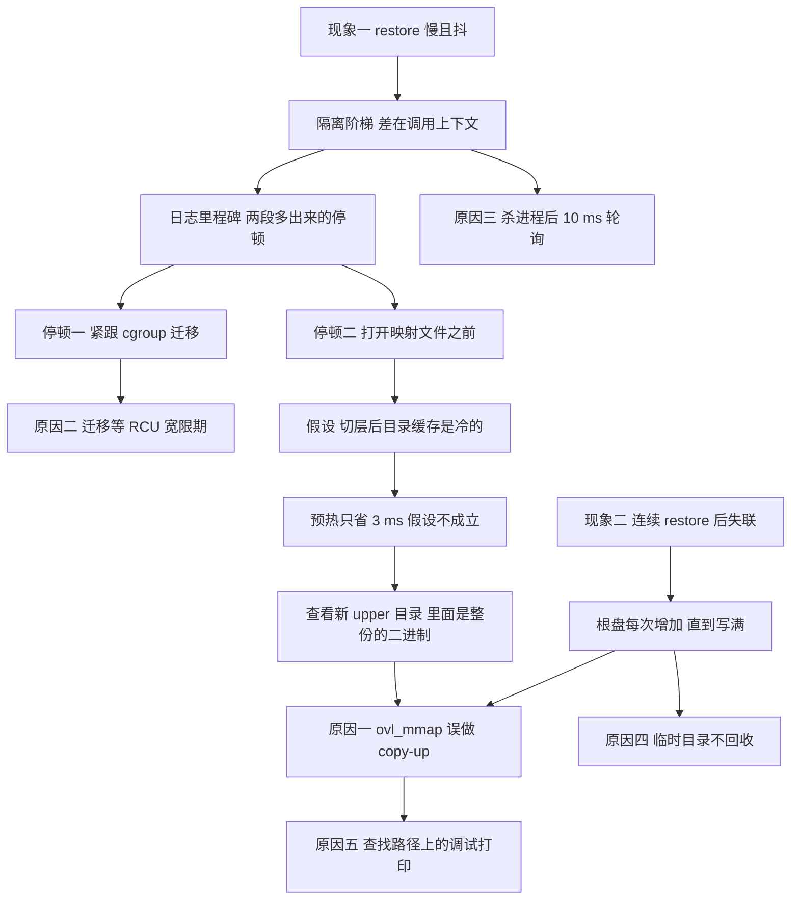

# 16 · restore 为什么慢：一次归因

## 本章目标

读完本章，你应当能回答：

1. 交接时 gsd 的 restore 为什么比"同一份镜像直接跑 CRIU"慢三到五倍，慢在哪五件事上，各占多少？
2. 这五件事分别是用什么办法找出来的；为什么其中最主要的一件最初被归到了错误的原因上？
3. 为什么连续 restore 十来次之后沙箱会失联，它和"restore 慢"为什么是同一个根因？
4. 调查过程中有哪些看起来合理、后来被推翻的假设，各自是被什么证据推翻的？
5. 修完之后剩下的耗时由什么构成，哪些已经是这套机制的地板？

---

第四部分讲性能，由三章组成。本章是一个案例：它记录交接时的 gsd 为什么慢、怎么一步步查到根因。
下一章（[17](17-performance-after-fixes.md)）是第二个案例，讲后来的大规模修复怎样带来新的回退、又怎样收回，并给出现在的代价模型。
[18](18-process-vs-machine-level.md) 把进程级与整机级两套回滚放在一起对照。

本章的写法与前面各章不同。前面只写现状，本章按时间顺序写过程，包括走错的路。保留这些过程有两个理由：
一是其中的排查方法（隔离阶梯、日志里程碑对齐、逐项开关对照）以后查性能问题还用得上；
二是那几个被推翻的假设都很像真的，不写下来，下一个人多半会重新走一遍。

**关于本章的数字。** 本章所有实测数字都来自**旧 920B（已退役）**，时间是 2026-09-09 至 09-14，对象是交接时的代码和当时的内核，
口径是"guest 内直连 gsd、一个持有约 195 MB 匿名内存的 python 进程、THP 为 never"的微基准（另有说明的除外）。容量单位沿用当时脚本输出的 MB。
这些数只在本章出现，用来说明各项原因的相对大小。它们与 [20](20-results-and-gaps.md) 里新 920B 上的判定值不是同一台机器、同一份代码、同一个口径，**不能互相比较，更不能相减**。

---

## 结论先行

- 慢不在 CRIU 的核心路径，也不在 RPC。同一份镜像在一个干净的环境里恢复只要 35～39 ms，而经 gsd 调用是 120～210 ms。差出来的部分全在 CRIU 周围的集成环境。
- 一共五件事，按贡献排序：guest 内核补丁里 `ovl_mmap` 对私有可写映射做了不该做的 copy-up；CRIU 把进程迁回 cgroup 时等一个 RCU 宽限期；
  杀进程之后以 10 ms 步长轮询；切层留下的临时目录不回收；内核补丁在查找路径上逐次打印调试信息。
- 第一件是真正的根因，它同时解释了另一个看似无关的故障：连续 restore 十来次之后根盘写满、沙箱失联。
- 全部修完后，同一口径下 restore 的 `total_ms` p50 从约 200 降到 85～89，连续 60 次 restore 根盘、内存、进程数都不涨。
- 有一件事不是缺陷而是约束：THP 必须关。它让 restore 多付几十毫秒，但打开它会让每一次增量 checkpoint 退化成全量（[02](02-criu-and-incremental-memory.md)）。

---

## 1. 起点：两个现象

**现象一：慢，而且抖。** 交接时带来的基准脚本显示，最高一档（192 MB 内存加 64 MB 文件）的 restore 端到端约 150～230 ms，同一轮里各档之间没有规律，
内存小的档反而可能更慢。按"恢复的唯一字节数除以耗时"算，吞吐只有约 1.1 MB/ms。而此前在同类环境里裸跑 CRIU 的经验值是它的两倍以上。

**现象二：连续 restore 之后沙箱失联。** 同一个沙箱连续做 5～7 次 restore，guest 里的 envd 就不再应答任何命令，四次独立复现。
交接时的基准脚本恰好只做 6 次 restore，刚好没有跨过这条线，所以原有的测试结果里看不到它。

最初这两个现象被当成两个问题分别立项：一个是性能，一个是可靠性。调查的结果是它们大半出自同一行内核代码。

---

## 2. 方法

整个调查用了三种手段，由粗到细。

### 2.1 隔离阶梯：先确定慢在"里面"还是"外面"

第一步不是读代码，而是固定住所有能固定的东西，只变一样。同一个沙箱、同一组 195 MB 镜像、同一个 CRIU、同一个内核，改变的只是"由谁、在什么上下文里调用 `criu restore`"：

| 调用方式 | `criu restore` 耗时 |
|---|---|
| 在一个干净的 `systemd-run` 临时单元里直接跑 | 35～39 ms |
| 从 envd 拉起的 shell 里直接跑 | 35～110 ms，双峰 |
| 由 gsd 调用 | 113～170 ms |

这一张表就排除了"CRIU 本身慢"和"镜像有问题"：同样的二进制读同样的镜像，35 ms 就能做完。差别在调用的上下文。

同一轮里顺手排除的还有一批候选（都在同一沙箱里逐项对照）：增量链深 1 层与 6 层没有差别；杀进程与开始恢复之间插入 0～1000 ms 的间隔没有规律；
gsd 的服务单元没有 seccomp、没有命名空间隔离；用户进程所在的 cgroup 只有内存上限和 CPU 权重，各流程里被限流的计数增量全是 0，把限额放开后耗时不变；
恢复出来的进程一律没有拿到大页，所以也不是"这次恰好拿到了大页"。

### 2.2 日志里程碑对齐：找出停顿落在哪一步

知道慢在上下文之后，第二步是让 CRIU 自己说时间花在哪。`criu restore -v4` 的日志每行带时间戳，把几种调用方式的日志按同一组里程碑对齐：

| 调用方式 | 从 fork 到恢复会话 | 从读入页面到重新映射 | 合计 |
|---|---|---|---|
| 干净环境 | 0 | 43 | 52～54 |
| 经 `setsid` 启动 | +33 | 42 | 84 |
| 由 gsd 调用 | **+57** | **72** | 139 |

单位 ms。gsd 的调用比干净环境多出两段：

- **第一段（+57 ms）** 紧跟在日志的 `cg: Move into` 之后，也就是 CRIU 把恢复出来的任务迁进它原来的 cgroup 的那一步。这段停顿在各种调用方式里随机出现，时有时无。
- **第二段（72 对 43）** 比干净环境长 29 ms。其中约 15 ms 是 gsd 独有的，落在 CRIU 逐个打开并校验目标进程映射的文件（python 解释器、共享库、locale 文件）那一步之前；其余的差值当时没有逐项归因。

而页面拷贝本身，195 MB 约 31～43 ms，各种方式下都一样。这是地板。

至此问题从"为什么慢"收窄成了两个具体的问题：迁移 cgroup 为什么会停几十毫秒，打开几个文件为什么要十几毫秒。

### 2.3 逐项开关对照：一次只动一样，在真实路径上量

每找到一个候选原因，都回到 gsd 的真实路径上，只打开这一项修复，每个配置用新的沙箱各跑若干次，看 p50 和离散程度的变化。
这一步的意义在于防止把"在隔离实验里成立"误当成"在真实路径上也成立"。第 4 节里有两个假设就是在这一步被推翻的。

---

## 3. 归因链



下面按贡献从大到小逐项说明。每一项都写五件事：现象、证据、贡献、修法、修后。

### 3.1 原因一：`ovl_mmap` 对私有可写映射做 copy-up（真根因）

**现象。** 第 2.2 节的第二段停顿：CRIU 打开被恢复进程映射的那些文件之前，多出 15～18 ms（日志对齐时量到 15，后来的分阶段对照里量到 16～18）。

**证据。** 这一项的证据不是计时，而是直接去看磁盘。每次 restore 之后，新换上的 upper 目录里都躺着 25～43 个只读二进制的**完整副本**：
`criu` 本身（6.2 MB）、python 解释器（5.7 MB）、`libcrypto`（4.1 MB）、`libc`（1.7 MB）等等。upper 里这些文件的 inode 号与下层的不同，是真的拷贝而不是链接。
第一个 checkpoint 沉下去的那一层更有 87 MB，里面是开机以来被执行过的所有程序：gsd 自己、envd、perl 以及各种库。
这些文件没有任何人修改过，按 overlayfs 的语义它们根本不该出现在 upper 里。

顺着"谁会让一个没被改过的文件被拷进 upper"去读内核补丁，复制点在交接时的热切层补丁（`0002-overlayfs-hot-switch-checkpoint.patch`）给 `ovl_mmap` 加的一段逻辑里：

```c
if (vma->vm_flags & VM_WRITE) {          /* 私有可写映射也算 */
    ret = ovl_ensure_upper_and_switch(file);   /* 写路径：必定 copy-up */
```

它的本意是"文件将要被通过映射写入，所以先保证它在 upper 里"。但判断条件只看了映射是否可写，没有看映射是否共享。
而执行任何一个程序，加载器都会以**私有、可写**的方式映射它的数据段。私有映射上的写入只改进程自己的内存副本，永远不会写回文件，
这种映射完全不需要 copy-up，却因为带着可写标志而让整个文件被拷进了当前的 upper。

**贡献。** 这一处代码同时解释了四件事：

- CRIU 恢复时那 15～18 ms：恢复一个 python 进程要重新映射它的解释器和所有库，每映射一个就拷一个，合计 20～30 MB；
- 每次 restore 根盘增长 20～30 MB，十来次之后写满；
- 开机之后根盘就多占约 60 MB（修复后开机占用从 349 MB 降到 289 MB）；
- 每个 checkpoint 的层里固定带着几十 MB 与用户写入毫无关系的内容。

**修法。** 只让**共享并且可写**的映射走写路径，这是唯一能经由映射改到文件的情形；而共享可写映射本来就要求文件以读写方式打开，打开时已经 copy-up 过了。
私有映射一律按读处理，与上游 overlayfs 的行为一致。改动很小，对内核是 13 行增、4 行删。

**修后。** 文件校验之前的停顿从 16～18 ms 降到 0.5～0.8 ms；`criu_restore_ms` p50 从 109 降到 74～76（这是在原因二、三、四已经修掉的基础上量的）；
连续 14 次 restore 根盘占用恒定在 289 MB，层目录恒定在 18 MB。

这个修复现在位于 `0003-overlayfs-hot-switch-fixes.patch`，是其提交说明里的第一组（"mmap and debug output"）。现在 `ovl_mmap` 的完整行为见 [06](06-overlay-hot-switch.md)。

### 3.2 原因二：cgroup 迁移等一个 RCU 宽限期

**现象。** 第 2.2 节的第一段停顿：0～57 ms，随机出现。restore 耗时的分布因此呈双峰，离群点几乎全来自这里。

**证据。** 绕开 CRIU，直接量"把一个进程写进另一个 cgroup 的 `cgroup.procs`"要多久。用一个什么都不做的进程在两个 cgroup 之间来回搬 20 次：

| 条件 | 每次写入的延迟 |
|---|---|
| 连续写 | 约 0 ms（只有第一次 47 ms） |
| 每次写之前空闲 200 ms | 20～50 ms，**每次都中**，p50 约 40 |
| 打开 `rcu_expedited` 后，空闲 200 ms 再写 | 0.1 ms |

机制是：cgroup v2 迁移任务时要拿一把 percpu 读写信号量（`cgroup_threadgroup_rwsem`）的写锁，拿写锁的慢路径要等一个 RCU 宽限期结束。
系统忙的时候宽限期很快就过；一个只有 2 个 vCPU、刚刚空闲了一会儿的沙箱里，等它自然结束就要几十毫秒。连续调用时走的是快路径，所以看不到。
restore 的场景恰好是最坏的情况：gsd 刚把用户进程全部杀掉，沙箱里几乎没有在跑的东西。

**贡献。** 在 THP 为 never 的真实条件下，只打开这一项，`criu_restore_ms` 的最小值、p50、最大值从 159.9 / 173.3 / 208.5 变为 124.2 / 126.3 / 144.7：
p50 降约 47 ms，更重要的是最大值与最小值的差距从约 49 ms 缩到约 20 ms，双峰消失。

**修法。** gsd 启动时向 `/sys/kernel/rcu_expedited` 写 `1`，让本 guest 的 RCU 宽限期走加急路径（`enableExpeditedRCU`，`main.go:178`）。写失败只记一条告警，不影响启动。
加急宽限期靠向所有 CPU 发核间中断来催促，对高频使用 RCU 的路径有微小的额外开销，在 2 vCPU 的沙箱里可以忽略；它只影响 guest 自己。

**修后。** 迁移等待从 p50 约 56 ms 降到 0.1 ms。

当时考虑过的其他放置位置（服务单元的启动前命令、内核命令行参数）都不如放在 gsd 里：前者要改模板里的单元文件，后者会影响同一宿主上不用 gsd 的沙箱。
放在 gsd 的启动代码里，谁用 gsd 谁生效。

### 3.3 原因三：杀进程之后以 10 ms 步长轮询

**现象。** `kill_ms` 的取值总是落在 10 或 20 附近（日志里实测 11.3、20.3～20.8），像是被量化过。

**证据。** 读代码即可确认：发出 SIGKILL 之后，每 10 ms 看一次 `/proc/<pid>` 还在不在。进程实际多久退出与测到的值无关，测到的永远是 10 ms 的整数倍再加一点。

**贡献。** 10～20 ms，计在 `total_ms` 里、`criu_restore_ms` 之外。

**修法。** 改成事件驱动：用 pidfd 等进程的退出事件，进程一退出就返回；然后尝试收尸，是自己的子进程就直接收掉，不是就等它的父进程收掉、`/proc` 里的条目消失（`waitForProcessExit`，`ckpt/criu.go:298`）。

**修后。** 第一次 restore 的 `kill_ms` 从 20 降到 2；之后稳定在 11～12 ms，并且不再是 10 的倍数。这剩下的 11 ms 是真实的工作量：
被杀的进程退出时要释放它的整个地址空间，一个 195 MB、全部由 4 KiB 页组成的堆有约 4.9 万个页要逐个归还。这部分只与被杀进程的内存大小有关，已经没有可省的了。

### 3.4 原因四：切层留下的临时目录不回收

**现象。** 现象二的一部分：每次 restore 之后 `/overlay/layers` 下多出两个目录。

**证据。** 每次 restore 都要换上一对全新的 upper 和 work 目录（目录名里带递增的序号，这是为了绕开内核对"目录正在被使用"的检查，见 [06](06-overlay-hot-switch.md)），
而换下来的那一对从来没有人删。被换下的 upper 里装的是这次 restore 丢弃的全部写入，再加上原因一拷进去的那二三十 MB 二进制。

**贡献。** 它不影响单次 restore 的耗时，影响的是能连续做多少次。与原因一叠加，每次 restore 根盘净增约 31 MB，第 12 次时写满。

**修法。** 切层之后回收不再被引用的临时目录。这就是 [13](13-state-concurrency-capacity.md) "回收"一节所讲机制的最初版本。

**修后。** 连续 14 次 restore 通过。但这一步单独做并不够：目录删掉之后 `du` 已经不涨，`df` 却仍然每次涨 17 MB。
这 17 MB 不被任何打开的文件持有，杀掉恢复出来的进程、重启日志服务、丢弃页缓存都放不掉，是内核里对旧文件的引用没有释放。
这个"删了目录、空间却不回来"的现象同样指向内核补丁，当时的判断就是这一层只能在内核里修。原因一修掉之后，根本就没有那些拷贝了，这 17 MB 随之消失。
（内核不释放被换下的层这件事本身是另一个独立的问题，在后来的修复里才解决，见 [07](07-overlay-concurrency-and-fixes.md) 的"回收：被换下的层、mount 与缓存引用"一节。）

### 3.5 原因五：查找路径上的调试打印

**现象。** guest 的内核日志被同一类消息刷屏；沙箱失联前 dmesg 的最后一行就是其中一条。

**证据。** 交接时的补丁在 overlayfs 的路径查找函数里对每个名字打印一行，在 inode 缓存命中时也打印一行。这两处都在每次文件访问必经的路径上。

**贡献。** 没有单独量化。它带来的是持续的额外开销和日志噪声，并且会淹没真正有用的内核消息。

**修法与修后。** 删除逐名的打印，把缓存命中的那条降为调试级别；后来的修复把交接时补丁残留的调试输出全部去掉了。

---

## 4. 被推翻的假设

调查中有五个判断曾经被写进结论，后来被证据推翻。它们都不是随意的猜测，每一个在当时都有支持它的数据。

### 4.1 "切层之后目录缓存是冷的"

第 2.2 节的第二段停顿出现在"打开文件"这一步，而 gsd 刚刚做完一次层切换，内核会清掉文件系统的目录项缓存。于是最自然的解释是：缓存冷了，每个文件都要从磁盘重新查找。
这个解释当时被写成了一条独立的原因（10～15 ms），并且设计了修法：dump 时记下进程映射的文件列表，restore 时在切层之后、调用 CRIU 之前把这些路径预先访问一遍。

推翻它的是在真实路径上的实测：预热之后只省了 3 ms，远不是预期的 10～15 ms。随后把整读文件、丢弃页缓存、换 cgroup 放置、换 CRIU 的文件校验模式、调内核打印级别逐一试过，都不能解释剩下的时间。
最后是放弃了"从计时推原因"的思路，直接去看 upper 目录里有什么，才发现了那些二进制的副本（第 3.1 节）。

教训：一个假设能解释现象出现的**位置**，不等于它能解释现象的**大小**。在真实路径上按预期收益验证过之前，它只是候选。

### 4.2 "内核补丁在只读打开文件时做了 copy-up"

发现 upper 里有二进制副本之后，第一次读补丁文件时，在一个处理只读打开的函数附近看到了设置"需要 copy-up"标志的代码，于是结论写成了"只读打开时 copy-up"。

这个定位是错的。在实际的内核源码树里，那个函数并不做 copy-up；补丁文件里看到的那几行属于写路径上的另一个函数，只是在补丁的上下文里挨得很近。
真正的复制点是 `ovl_mmap`。两种说法都能解释"被打开过的二进制出现在 upper 里"，但只有后一种能解释为什么只有**被执行或被映射**过的文件被拷，而仅仅被读过的文件没有。

教训：读补丁文件容易被上下文误导，定位到具体函数之前要在打过补丁的源码树里确认。

### 4.3 "把 THP 打开"

逐项对照的数据里，THP 设为 always 时 restore 明显更快：同一份镜像、同一个沙箱，gsd 路径的 `criu_restore_ms` p50 是 145（always）对 173（never）。
而交接时的基准脚本第一行就把 THP 关掉了。于是早期的结论里有一条"基准脚本不要关 THP"，并且把它和 `rcu_expedited` 一起算作修复，得到一个很好看的数字。

推翻它的是对"为什么要关"的追问。CRIU 的增量 dump 靠页表项上的 soft-dirty 位判断哪些页被改过，而一个 2 MB 的大页只对应一个页表项：改其中一个字节，整个 2 MB 都算脏。
当时在一个 192 MB 的堆上做了直接的对照：

| 写法 | 真实脏量 | THP 为 always 时的增量镜像 | THP 为 never 时的增量镜像 |
|---|---|---|---|
| 每 2 MB 碰一个 4 KiB 页，共 96 页 | 0.375 MB | 190.5 MB | 0.8 MB |
| 每 64 KiB 碰一个 4 KiB 页，共 3072 页 | 12 MB | 190.5 MB | 12.4 MB |
| 连续写满 192 MB | 192 MB | 195.3 MB | 195.3 MB |

只要写得零散（真实程序都是零散的），THP 开着时每一次增量 checkpoint 都退化成全量。所以关 THP 不是基准脚本的失误，而是这套机制成立的前提。
restore 因此多付的几十毫秒是这个前提的代价，不是可以修掉的缺陷。原理与现在的落实方式（开机脚本设置、gsd 启动时兜底）在 [02](02-criu-and-incremental-memory.md) 和 [05](05-guest-boot-and-injection.md)。

教训：比较两个配置的快慢之前，先确认两个配置下做的是同一件事。

### 4.4 "让 CRIU 不管 cgroup"

既然停顿来自 CRIU 把进程迁回 cgroup，最直接的办法是让它别迁：CRIU 有 `--manage-cgroups=ignore` 这个选项。裸跑时它确实有效，restore 稳定在 51 ms。

但把它加进 gsd 的调用路径之后，两次试验都让 guest 失联。即使不失联，这个选项的语义也不可接受：恢复出来的进程不再回到用户进程原来的 cgroup，
于是脱离了那个 cgroup 上的内存上限保护。最终没有采用。

### 4.5 "沙箱失联是内核崩溃"

现象二最初的判断是内核 oops，建议的排查方向是取串口日志、查层数上限和代际计数是否溢出。实际原因平淡得多：根盘写满了。
根盘满了之后 guest 里几乎所有要写文件的操作都失败，envd 不再能正常应答，从外面看就是失联。标准基准脚本在未修复的环境上重跑时，第 5 次 restore 之前就直接报出了 `no space left on device`。

---

## 5. 修复前后

### 5.1 逐步修复的效果

口径：旧 920B，2026-09-11，195 MB 单进程、guest 内直连 gsd 的微基准，THP 为 never，单位 ms。

| 阶段 | cgroup 迁移等待 | 文件校验前停顿 | `kill_ms` | `criu_restore_ms` p50 | `total_ms` p50 | 连续 14 次 restore |
|---|---|---|---|---|---|---|
| 交接时的状态 | 38 | 18 | 20.5 | 181 | **196 / 206** | 第 12 次根盘写满 |
| 修掉原因二、三、四（gsd 侧） | 0.1 | 16 | 11 | 109 | **121** | 通过，根盘每次仍 +17 MB |
| 再修掉原因一、五（内核侧） | 0.1 | 0.5～0.8 | 11～12 | 74～76 | **85～89** | 通过，根盘恒定 289 MB |

原始记录中，修复前两个沙箱各恢复 4 次，`total_ms` p50 分别为 196、206 ms；后续汇总用约 200 ms 概括，未保留更细小数。原文摘录和来源哈希见 [历史依据](../validation/920b-20261016/historical-fix-evidence.json)。从 196～206 ms 降至 85～89 ms，按端点估算降低约 55%～59%；这是旧 920B 同口径微基准，不能与新版分档结果直接相减。

三行之间的差值可以粗略对应到各项原因：第一行到第二行的约 80 ms 主要是 RCU 等待和轮询；第二行到第三行的约 35 ms 是 `ovl_mmap` 的 copy-up。
注意这两段的先后只是修复的顺序，不代表重要性的顺序。

### 5.2 标准基准的最高一档

口径：旧 920B，交接时带来的基准脚本，192 MB 内存加 64 MB 文件那一档，同一沙箱里的第 6 次 restore，单位 ms。
这个口径的目标进程比微基准复杂（带信号处理、两个打开的文件、连着 envd 的管道），CRIU 要多恢复这些状态，所以同等条件下比微基准高 15～25 ms。

| 阶段 | restore 端到端 | `total_ms` | `criu_restore_ms` | `kill_ms` |
|---|---|---|---|---|
| 修复前，09-08 | 158.1 | 155.2 | 143.2 | 11.3 |
| 修复前，09-11 同脚本重跑 | 失败：第 5 次 restore 之前根盘写满 | | | |
| 修复后，09-11 第 1 轮 | 129.2 | 127.0 | 113.2 | 12.9 |
| 修复后，09-11 第 2 轮 | 115.2 | 113.7 | 100.7 | 12.4 |

修复前 09-08 那一行的 158.1 恰好是一次偏快的样本：同一轮里其余各档的 restore 端到端在 150～231 ms 之间随机；修复后全部各档收敛到 100～129 ms。
端到端比 `total_ms` 只多约 2 ms，这就是 SDK 经宿主代理到 guest 的往返开销，可见 RPC 这一层不是问题。

### 5.3 稳定性

口径：旧 920B，2026-09-14，修复后，192 MB 的堆，反复 restore 到同一个 checkpoint。

| 测试 | 次数 | 结果 | `total_ms` p50（最小 / 最大） | 根盘 | 可用内存 | 进程数 |
|---|---|---|---|---|---|---|
| 修复前 | 5～12 | 失联或根盘写满 | | 每次 +20～31 MB | | |
| 修复后，长跑 | 60 | 全部成功 | 94.7（92.7 / 99.0） | 289 → 290 MB | 1307～1315 MB | 恒为 78 |
| 修复后，验证 | 8 | 全部成功 | 88.3 | 不变 | | |

"连续若干次 restore、根盘占用不变"从此成了部署自检的固定一项（`verify_gsd`，见 [19](19-testing-and-debug-kernel.md)）。

---

## 6. 剩下的时间是什么

修复后微基准的 `total_ms` 约 85～89 ms。按上表它由两部分组成：`criu_restore_ms` 74～76，加上 `kill_ms` 11～12；层切换本身不到 1 ms。

当时的记录对这段时间给过一个粗略的拆分：约 43 ms 是拷贝页面的地板，约 11 ms 是被杀进程释放页表，约 8 ms 是重新映射与收尾。对这个拆分要说明两点：

- 这三项加起来约 62 ms，并不等于 74，也不等于 85～89，原记录没有把余下的部分逐项列出。它是一个量级上的说明，不是一张闭合的账。
- 其中"被杀进程释放页表约 11 ms"就是 `kill_ms`（第 3.3 节），它计在 `total_ms` 里而不在 `criu_restore_ms` 里。原记录把它和另外两项并列写在"剩下的 74 ms"之下，口径上是混在一起的。

可以确定的结论只有这些：

- **页面拷贝约 43 ms 是地板**，它与镜像大小成正比（195 MB，约 4.5 MB/ms），在第 2.2 节的各种调用方式下都相同。
- **`kill_ms` 约 11 ms 是真实工作量**，与被杀进程的内存大小成正比。
- 按当时的结论，`criu_restore_ms` 里地板之上余下的部分是 THP 关闭的固有代价：关掉大页后，往全新的地址空间填 195 MB 要多出几万次缺页。这是第 4.3 节所说约束的代价，当时没有单独量出它在这 74～76 ms 里占多少。

再往下压，要么打开 THP（这套机制不允许），要么改变设计（例如不恢复全部内存、按需取页），都已经不是修缺陷的范畴。

---

## 7. 没有实测的替代方案

`rcu_expedited` 是一个全局开关，它让 guest 里所有的 RCU 宽限期都走加急路径。cgroup v2 有一个更有针对性的挂载选项 `favordynmods`，
专门让任务迁移不必等宽限期；按内核文档的说明，它的代价是把开销转移到 fork 和 exit 的路径上。理论上它的影响范围更小。

当时只把它记作候选，**没有实测**；后来的各轮验证也都没有测过。它列在 [20](20-results-and-gaps.md) 的缺口表里。在没有数据之前，不能断言它比现在的做法好：
restore 之后紧接着就是用户进程的正常运行，如果用户负载频繁 fork，这个选项的代价可能反而更显眼。

---

## 8. 这些修复现在在哪

本章讲的五项修复都已经在当前代码里，后来的大规模修复是在它们之上进行的：

| 原因 | 现在的位置 | 展开的章 |
|---|---|---|
| 一、`ovl_mmap` 误做 copy-up | `0003-overlayfs-hot-switch-fixes.patch`，提交说明第一组"mmap and debug output" | [06](06-overlay-hot-switch.md) |
| 二、cgroup 迁移等 RCU | `enableExpeditedRCU`（`main.go:178`） | [10](10-restore.md) |
| 三、杀进程后轮询 | `waitForProcessExit`（`ckpt/criu.go:298`）；杀进程的整体做法后来又重写过，见 `killTrees`（`ckpt/criu.go:215`） | [08](08-process-trees.md) |
| 四、临时目录不回收 | `reclaimOrphans`（`ckpt/overlay.go:372`），后来扩展为按引用回收层目录，并改成锁内改名、锁外删除 | [13](13-state-concurrency-capacity.md) |
| 五、调试打印 | 同原因一的补丁；交接时补丁残留的其余调试输出也已全部去掉 | [07](07-overlay-concurrency-and-fixes.md) |

`enableExpeditedRCU` 的注释里保留了这次调查的结论（空闲的 2 vCPU 沙箱上每次迁移要等 20～50 ms，打开之后降到 0.1 ms），读代码时可以对照。

新 920B 上的后续数字见 [17](17-performance-after-fixes.md) 与 [20](20-results-and-gaps.md)。再次提醒：新旧两台机器的数字不能相减。
新 920B 上大规模修复开始之前，`verify_gsd` 的 restore `total_ms` p50 就在 73～76 ms 这一档（2026-09-23 与 09-30 两次测得，它是在本章的五项修复已经存在的基础上测的），而不是从 200 ms 开始。

---

## 数据出处

本章的数字全部出自三份历史文档和一个结果目录，它们不在本仓库里，这里只列名字备查。三份文档都带有 2026-09-16 的更正批注，本章一律以更正之后的说法为准。

| 内容 | 出处 |
|---|---|
| 隔离阶梯、日志里程碑、`cgroup.procs` 实验、逐项开关对照的六种配置 | `checkpoint-bench-comparison.md` 第十节 |
| 连续 restore 后失联的最初记录与后续更新 | 同上，第十一节 |
| THP 对照表、五项原因的时间账、修法与候选方案、upper 目录里的副本清单、`ovl_mmap` 的定位过程、逐步修复的三列对照、剩余耗时的拆分、标准基准两轮结果 | `gsd-restore-fix-plan.md` |
| 根因与修复的汇总表、最高一档的四行对照、稳定性三行 | `gsd-restore-report.md` |
| 标准基准与长跑的原始日志 | 结果目录 `gsd-920b-20260911` |

---

## 代码位置

| 关注点 | 位置 |
|---|---|
| 加急 RCU | `packages/gsd/main.go` — `enableExpeditedRCU`（`:178`） |
| THP 兜底 | `packages/gsd/main.go` — `ensureTHPNever`（`:196`） |
| 等进程退出 | `ckpt/criu.go` — `waitForProcessExit`（`:298`）、`killTrees`（`:215`） |
| 临时目录回收 | `ckpt/overlay.go` — `reclaimOrphans`（`:372`） |
| 映射不再 copy-up、去掉调试输出 | `fc-kernels/patches/6.1.158/0003-overlayfs-hot-switch-fixes.patch` — `ovl_mmap`，以及 `fs/proc/task_mmu.c` 的改动 |
| 引入问题的原始逻辑 | `fc-kernels/patches/6.1.158/0002-overlayfs-hot-switch-checkpoint.patch` — `ovl_mmap` |

---

## 本章要点

1. 交接时 restore 慢，慢在 CRIU 周围的集成环境：同一份镜像在干净环境里 35～39 ms，经 gsd 是 120～210 ms（旧 920B，2026-09）。
2. 真根因是内核补丁里 `ovl_mmap` 只看映射是否可写、不看是否共享，导致每个被执行的二进制都被整份拷进 upper。它同时造成了 restore 里十几毫秒的停顿和连续 restore 后根盘写满。
3. 抖动的来源是 CRIU 迁移 cgroup 时等 RCU 宽限期，在空闲的 2 vCPU 沙箱里每次 20～50 ms；gsd 启动时打开 `rcu_expedited` 后降到 0.1 ms。
4. 另外三项是 10 ms 步长的轮询、不回收的临时目录、热路径上的调试打印。修完之后同一口径下 `total_ms` p50 约 200 → 85～89，连续 60 次 restore 资源占用不涨。
5. 五个被推翻的假设里，"目录缓存冷"和"只读打开时 copy-up"是定位错了位置，"打开 THP"和"让 CRIU 不管 cgroup"是修法本身不可取，"内核崩溃"其实是根盘写满。
6. THP 必须为 never 是约束而不是缺陷：它让 restore 多付缺页的开销，但打开它会让 0.375 MB 的真实脏量变成 190 MB 的增量镜像。
7. 剩余耗时里，页面拷贝约 43 ms 和杀进程约 11 ms 是与内存大小成正比的真实工作量；历史记录里的三项拆分并不闭合，只能当量级参考。
8. 本章的数字只属于旧 920B 上的那个口径，不能与 [20](20-results-and-gaps.md) 的判定值比较或相减。
