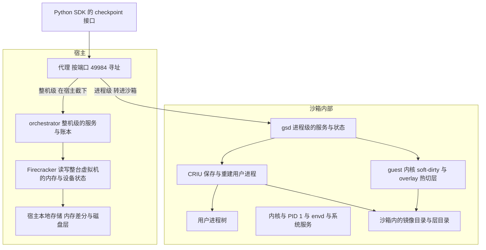

# 18 · 进程级与整机级：分工与对照

## 本章目标

读完本章，你应当能够：

- 用一句话说出进程级（gsd）和整机级两套 checkpoint / restore 的根本差别，并由它推出其余差别；
- 逐项对比两套的回滚对象、实现位置、脏页跟踪、存储、失败语义、依赖和适用平台；
- 说清两套的成本模型为什么形状不同，并能正确阅读并列的性能数字——知道它们为什么不能相减；
- 说清 restore 之后两套各自"会发生什么、不会发生什么"，尤其是对回滚范围之外的东西的影响；
- 针对一个具体需求判断该用哪一套，并知道两套目前能不能在同一个沙箱上一起用。

前两章（[16](16-restore-slowness-case.md)、[17](17-performance-after-fixes.md)）讲的是进程级自己的性能：交接时为什么慢、修复之后时间花在哪。
本章把视角拉开，把它和同一个仓库里的另一套方案放在一起。整机级的事实一律以它自己的手册（`e2b-infra/rollback/docs/`）为准，
本章只引用、不展开，章末给出对应章节的位置。**两套方案的对比表全书只在本章出现。**
下一章（[19](19-testing-and-debug-kernel.md)）进入第五部分，讲测试体系。

---

## 1. 一句话的差别

> **整机级在虚拟机外面，把整台机器放回去；进程级在虚拟机里面，只把用户进程和文件放回去。**

[01](01-problem-and-scope.md) 已经从问题的角度讲过这两条路线。这里换一个角度：两套的几乎所有差别，都能从"在哪一侧动手、回滚多大范围"这一个选择推出来。

| 由这个选择推出 | 整机级 | 进程级 |
|---|---|---|
| 谁来做 | 宿主上的 orchestrator 加分叉的 Firecracker；沙箱里什么都不装 | 沙箱里的 gsd 加 CRIU 加打了补丁的 guest 内核；宿主只在建模板时参与，Firecracker 不改 |
| 怎么知道哪些内存变了 | 宿主侧跟踪整个 guest 内存的脏页 | guest 内核跟踪用户进程的脏页（soft-dirty） |
| 恢复时进程怎么办 | 没有任何进程被杀或重建，连内核一起"回到过去" | 当前的用户进程被杀掉，再由 CRIU 按镜像重建 |
| 范围之外还剩什么 | 沙箱内没有"范围之外"；沙箱外的连接和引用要处理 | 内核、PID 1、envd、系统服务都在范围之外，照常运行 |
| 状态存在哪 | 宿主本地 | 沙箱内部 |

下面这张图把两套各自工作的位置画在一起。同一个 SDK 入口、同一个端口号，请求在宿主的代理处分了岔：

图里有两点值得注意。第一，整机级的 Firecracker 操作的是整个"沙箱内部"这个方框，所以方框里的一切一起回滚；
进程级只触及方框里的"用户进程树"和文件系统，"内核与 PID 1 与 envd 与系统服务"那一格不动。
第二，两套的入口是同一个端口，同一时刻一台宿主上的这个端口只能由其中一套应答（§7）。

---

## 2. 逐项对比

| 维度 | 整机级 | 进程级（gsd） |
|---|---|---|
| **回滚对象** | 整台虚拟机：全部 guest 内存（含内核、页缓存、所有进程、内存文件系统）、vCPU、中断控制器、virtio 设备状态、整个磁盘 | uid 1000 的用户进程树，加 overlay 根文件系统（含 `/tmp`）。内核状态、root 的进程、`/run`、`/dev/shm`、`/var/log` 等不回滚（[01](01-problem-and-scope.md)） |
| **实现层次** | 宿主：orchestrator（接口、编排、账本）加分叉的 Firecracker（原地回滚、脏页位图） | guest：gsd 守护进程加 CRIU 加两个内核补丁；orchestrator 只在建模板时参与 |
| **沙箱里要装什么** | 什么都不装 | gsd、CRIU 4.x、开机脚本 `overlay-init`，由模板构建注入（[05](05-guest-boot-and-injection.md)） |
| **内存脏页跟踪** | 宿主侧，按 4 KiB 记账。有硬件脏页跟踪（HDBSS）的平台自动启用；没有时用 KVM 的软件写保护，需显式打开；都不用时每次都是全量 | guest 内核的 soft-dirty，按页表项记账，要求透明大页为 `never`（[02](02-criu-and-incremental-memory.md)） |
| **内存产物** | 每代一份稀疏的差分文件加一份脏页位图，组织成一棵差分树 | 每棵进程树每个 checkpoint 一个 CRIU 镜像目录，增量镜像用 `parent` 链接指向父镜像 |
| **文件产物** | 块级：磁盘写层原地封存成只读层，换上新的空写层 | 文件级：overlay 的可写层原地沉成只读层，换上新的空可写层（[06](06-overlay-hot-switch.md)） |
| **存储位置** | 宿主本地盘 | 镜像在 guest 内 2 GiB 的内存文件系统里（占沙箱内存），层在 guest 的根盘上（[03](03-goals-and-tradeoffs.md)） |
| **是否停机** | 沙箱不重建；checkpoint 和 restore 各有一次短暂的**整机暂停**（冻结窗口） | 虚拟机从不暂停；checkpoint 时**被保存的用户进程**停一小段，restore 时用户进程被杀掉再重建 |
| **冻结窗口里停的是谁** | 整台虚拟机的 vCPU | 只有用户进程；内核、envd、系统服务照常运行 |
| **内存与文件的一致性** | 同一次暂停里拍下、同一次暂停里换回，严格同一瞬间 | 全部用户进程停住之后才切层，所以进程镜像与文件系统是同一时刻的；多棵树之间有很短的先后差（[09](09-checkpoint.md)） |
| **恢复方式** | 原地写回：把变了的页和设备状态写回活着的 Firecracker 进程 | 重建：杀掉当前用户进程、切回层栈、CRIU 按原 PID 重新建进程并读回全部内存（[10](10-restore.md)） |
| **历史结构** | 树；restore 之后较新的 checkpoint 仍在，可前滚、可跨分支 | 树；restore 之后较新的 checkpoint 仍在，再 checkpoint 形成分支（[13](13-state-concurrency-capacity.md)） |
| **失败语义** | 提交点之前失败，沙箱原样可用；提交点之后失败称为"撕裂"，沙箱只能销毁重建 | 提交点（杀进程）之前失败，什么都没动；之后失败返回 `DataLoss`，虚拟机和 envd 仍然活着，再成功 restore 一次即可回到完整状态（[12](12-failure-semantics.md)） |
| **状态与账本** | 在 orchestrator 进程的内存里；orchestrator 重启即失效 | 在 gsd 的内存里，并持久化到沙箱内的状态文件；gsd 重启后能加载，guest 重启则全部丢失 |
| **什么时候失效** | 沙箱删除或回收、orchestrator 重启、宿主重启、迁移、原生 pause / resume 之后 | 沙箱删除或回收、guest 重启。沙箱被暂停再恢复之后按设计仍可用，但未验证（[03](03-goals-and-tradeoffs.md)） |
| **依赖** | 成对交付的 orchestrator 与分叉 Firecracker；宿主侧的脏页跟踪能力；对 guest 内核没有要求 | guest 内核必须打补丁并打开相应配置；基础镜像必须带 CRIU 4.x；对 Firecracker 和宿主内核没有额外要求 |
| **平台** | 宿主为 aarch64（鲲鹏 920B / 950）；有无硬件脏页跟踪只影响代价，不影响正确性 | 只支持 arm64 的 guest；已在新 920B 上验证；950 未部署、未测 |
| **SDK** | `sandbox.checkpoint` 的四个方法；响应里回报这次是全量还是增量 | `sandbox.checkpoint` 的同名四个方法；响应里回报各阶段耗时、进程树数量、镜像大小等。两份 SDK 不是同一份（[21](21-quickstart.md)） |
| **鉴权** | 请求在宿主的代理处被截下，由宿主侧校验 token | 请求进到沙箱，gsd 对照元数据服务里的 token 摘要校验，与 envd 用同一个 token（[04](04-architecture.md)） |
| **成本模型** | 固定开销加上与**改动量**（checkpoint）或**回滚量**（restore）成正比的一项，与虚拟机规格基本无关；每个沙箱的第一次是全量 | checkpoint：与**用户进程的改动量**成正比，每棵树的第一次是全量；restore：与**被恢复进程的内存大小**成正比，再加杀进程的开销；两者都随树的数量线性增长（§3） |
| **对范围外进程的影响** | 沙箱内没有范围外的进程。跨越 restore 的 TCP 连接作废、在途的 SDK 调用被打断、单调时钟倒退 | envd 和系统服务不受打扰，时钟不变；但它们手里的旧目录和旧文件可能属于被丢弃的时间线，从陈旧目录出发的写返回 `ESTALE`（[22](22-semantics-and-limits.md)） |
| **对被保存对象的要求** | 没有要求，不看进程内部 | 进程必须是 CRIU 能保存的；树与树之间不能共用管道或 socket（[08](08-process-trees.md)） |

---

## 3. 成本模型为什么形状不同

把两套各自的一次 checkpoint 和一次 restore 拆开看，工作量由不同的量决定。设：

- M：guest 内存的大小；
- P：被保存的用户进程自己的内存大小（一棵树）；
- D：自上一个 checkpoint 以来，整台 guest 改过的内存量；
- d：其中属于用户进程的那部分（d ≤ D，差的是内核和页缓存的改动）；
- R：restore 时当前状态与目标之间的回滚量；
- N：用户进程树的数量。

| 操作 | 整机级 | 进程级 |
|---|---|---|
| 第一次 checkpoint | 与 M 成正比（全量根，每个沙箱每一代一次） | 与 P 成正比（每棵树第一次保存时全量） |
| 之后的 checkpoint · 内存 | 固定开销 + 与 D 成正比 | 每棵树一次 CRIU 的固定开销 + 与 d 成正比 |
| 之后的 checkpoint · 文件 | 封存写层，不搬数据 | 一次层切换，不搬数据；checkpoint 那一刻以可写方式打开着的文件要拷贝一份（[07](07-overlay-concurrency-and-fixes.md)） |
| restore · 内存 | 固定开销 + 与 R 成正比 | 杀进程 + 与 P 成正比（重建时读回全部内存），**与改动量无关** |
| restore · 文件 | 切换磁盘视图，不搬数据 | 一次层切换，不搬数据 |
| 多棵进程树 | 无关 | checkpoint 和 restore 都随 N 线性增长（串行，[03](03-goals-and-tradeoffs.md)） |

由此得到三条判断。它们是从成本模型推出来的，不是两套实测数字相减的结果。

**checkpoint：进程级拍得更少。** d 不大于 D。文件写得多的负载下差得更明显：在整机级那里，文件写入会经过 guest 的页缓存，
一部分表现为内存的改动；在进程级这里，文件完全由 overlay 的层承担，不进内存镜像（[01](01-problem-and-scope.md) 里那组产物大小的例子）。

**restore：两条曲线的自变量不同。** 整机级的 restore 随"退多远"增长，退得近就快，代价与进程多大无关。
进程级的 restore 随"进程多大"增长，哪怕只退回一步、只改了几个字节，也要把整个进程重建一遍。
所以拿"这一步的改动量"去预测进程级 restore 的耗时，是比错了量。

**哪一套更快取决于负载的形状，没有统一的答案。** 进程小而改动大时，进程级的 restore 可能更省；进程大而每步改动小时，整机级的 restore 明显更省。
checkpoint 一侧，进程级保存得少，但整机级在有硬件脏页跟踪的平台上省掉了软件跟踪的开销，两者的差距随平台变化。

---

## 4. 性能：并列口径与数量级

本节把两套各自的实测数字放在一起，**只为建立数量级的概念**。这两组数不能相减，也不能相除，原因列在表后。

### 4.1 进程级

> 条件：新 920B，2026-10-08，提交 `259f1a25c`，guest 2 vCPU / 2048 MB，透明大页 `never`，单沙箱。
> 负载是一个常驻的用户进程（192 MiB 内存，一棵树），每一档先改写一定量的内存并写一定量的文件，再 checkpoint，最后逐个 restore。
> 数字是 **gsd 自己计的时**（服务端），三轮的中位数，单位 ms。判定值、口径定义和全部数据在 [20](20-results-and-gaps.md)。

| 档位（改写内存 / 写文件，MiB） | 0 / 0 | 12 / 4 | 24 / 8 | 48 / 16 | 96 / 32 | 192 / 64 |
|---|---|---|---|---|---|---|
| 增量 checkpoint 的总耗时 | 12.2 | 23.3 | 29.1 | 38.9 | 63.6 | 107.7 |
| restore 到该档时 CRIU 那一段的耗时 | 83.0 | 73.0 | 74.4 | 78.5 | 77.7 | 84.1 |

同一次测试里，这个进程的第一次（全量）checkpoint 总耗时 117.1 ms，层切换的中位数是 0.56 ms。
restore 的总耗时还要在 CRIU 那一段之上加杀进程等步骤：另一项口径不同的测试（同样的 192 MiB 进程，连续 8 次 restore）里，
总耗时的中位数是 83.3 ms，其中 CRIU 71.0 ms、杀进程 11.1 ms。

### 4.2 整机级

> 条件（引自整机级手册 21 章）：920B，软件写保护跟踪脏页，`deltabox-dev@8ea5322bf`，2026-09-28～29，模板 2 vCPU / 2 GB，单沙箱串行、页缓存全热。
> 负载按"每步改动量"分档，内存与文件按 3 : 1 混合。数字是**客户端墙钟**的中位数，单位 ms。

| 档位（每步名义改动量，MB） | 0 | 16 | 64 | 128 | 256 |
|---|---|---|---|---|---|
| 增量 checkpoint | 14.9 | 19.2 | 34.4 | 55.9 | 97.3 |
| restore | 18.1 | 21.4 | 30.8 | 43.6 | 66.1 |

每个沙箱的第一次（全量）checkpoint 单列：2 GB 的模板服务端耗时 433 到 445 ms。

### 4.3 怎么读，以及为什么不能相减

**能读出来的是形状和数量级：**

- 两套的增量 checkpoint 都在十几到一百毫秒的量级，都随改动量增长；
- 整机级的 restore 从二十毫秒左右起步，随回滚量增长；
- 进程级的 restore 在这个负载下基本是平的：六档的 CRIU 段都在 73.0 到 84.1 ms 之间，与这一档改了多少无关，它反映的是那个进程有 192 MiB；
- 第一次全量的代价，整机级跟着 guest 内存走（2 GB，几百毫秒），进程级跟着进程内存走（192 MiB，一百多毫秒）。

这正是 §3 的成本模型预言的样子。

**不能相减的原因：**

| 差别 | 整机级的数 | 进程级的数 |
|---|---|---|
| 用的是谁的钟 | 客户端墙钟，包含网络往返和服务端全部工作 | gsd 在沙箱里自己计的时，不含 SDK 到 gsd 的往返 |
| 档位的含义 | 每步的名义改动量，内存和文件混在一起算 | 改写的内存量和写的文件量分别给出 |
| 负载的形状 | 按档位造的脏页 | 一个固定 192 MiB 的常驻进程；restore 的耗时由这个固定大小决定 |
| 测的范围 | 整台 guest 的改动，含内核与页缓存 | 只有那一个用户进程 |
| 前提条件 | guest 的透明大页不受约束 | 透明大页必须为 `never` |
| 代码与日期 | 另一个分支，另一批测试 | 本书的代码 |

任何"进程级比整机级快多少毫秒"或者反过来的结论，都需要在同一台机器、同一个负载、同一个钟下各跑一遍才能得到。
本书没有做这样的对照，所以不给出这种结论。早期有过一次两套并排的实测（交接时的代码，旧 920B），
它的价值在于确认了"两套拍下的东西不一样"（[01](01-problem-and-scope.md)），其中的耗时数字早已过时，本书不引用。

---

## 5. restore 之后：各自会发生什么

对写业务代码的人来说，比耗时更要紧的是语义上的差别。下表列出 restore 返回之后，沙箱里各样东西的状态。

| | 整机级 | 进程级 |
|---|---|---|
| checkpoint 时在运行的用户进程 | 以同一个 PID 继续运行，从未中断过 | 以同一个 PID 继续运行，但它是被杀掉后重建出来的新进程 |
| checkpoint 之后启动的用户进程 | 消失 | 被杀掉 |
| 以 root 身份直接启动的进程 | 和别的进程一样回到过去 | 不保存、不杀，继续运行 |
| envd、系统服务 | 回到过去 | 不变，一直在运行 |
| 根文件系统上的文件 | 回到过去 | 回到过去 |
| `/tmp` | 回到过去 | 回到过去 |
| `/dev/shm`、`/run` | 回到过去（它们在内存里） | 不回滚，保持 restore 那一刻的内容 |
| 系统日志（`/var/log`） | 回到过去 | 不回滚，日志保留 |
| 页缓存、内核缓存 | 回到过去 | 不变 |
| 跨越 restore 的 TCP 连接 | 一律作废，要重连；在途的 SDK 调用被打断 | 经 envd 的 SDK 调用不受影响；被重建的用户进程自己持有的连接能否保存取决于 CRIU |
| 单调时钟 | 倒退到 checkpoint 时刻 | 不变 |
| 墙钟 | restore 返回前被校回当前时间 | 不变 |
| 用户进程里缓存的随机状态 | 回到过去 | 回到过去（在进程内存里） |
| 范围外进程手里的旧目录、旧文件 | 不存在这个问题 | 可能属于被丢弃的时间线：读到旧内容，或写时返回 `ESTALE` |
| 外部世界（已发出的请求等） | 不回滚 | 不回滚 |

这张表可以概括成一句话：**整机级的语义简单而彻底，沙箱整体回到那一刻；进程级只动任务关心的那部分，其余的留在现在。**
前者不需要使用者理解范围，代价是所有跨越回滚的连接和时间感都要重新建立；后者保住了范围外的一切，
代价是使用者需要知道分界线在哪里（[22](22-semantics-and-limits.md)）。

表里"用户进程自己持有的连接"一行需要说明：gsd 没有给 CRIU 加任何放宽的选项，进程如果用了 CRIU 默认不保存的东西，
checkpoint 会失败并带回 CRIU 的日志。本书没有整理这份清单（[20](20-results-and-gaps.md) 的缺口表）。

---

## 6. 什么时候用哪个

| 需求 | 建议 | 理由 |
|---|---|---|
| 要回滚的就是用户进程和文件；同时希望 SDK 的连接、日志、系统服务不受影响 | 进程级 | 范围外的东西不动 |
| 每一步的改动里文件占大头，进程本身不大 | 进程级 | 文件那一半几乎不花时间，也不进内存镜像；进程小则 restore 也快 |
| 进程很大而每步改动很小，restore 频繁 | 整机级 | 整机级的 restore 随回滚量走；进程级每次都要重建整个进程 |
| 需要连内核状态、页缓存、root 的服务一起严格回到同一瞬间 | 整机级 | 进程级不回滚这些 |
| 沙箱里的进程用了 CRIU 保存不了的东西，或者进程之间用管道、socket 连成了多棵树 | 整机级 | 整机级不看进程内部 |
| 用户进程很多，各自成树 | 倾向整机级 | 进程级的耗时随树的数量线性增长，且树之间不是原子的 |
| 不能改 Firecracker、不能在宿主上加组件 | 进程级 | 它只动 guest |
| 不能改 guest 内核、不能在沙箱里放任何东西 | 整机级 | 它对 guest 没有要求 |
| x86 的 guest | 都不是本书的范围 | 进程级只支持 arm64 的 guest；整机级的平台以它的手册为准 |
| 沙箱要离场之后再回来、跨会话长期保存、跨节点 | 两套都不行，用 e2b 原生的沙箱快照（pause / resume） | 两套的 checkpoint 都绑定在活着的这台沙箱上；原生快照与整机级怎么配合，见整机级手册 18 章 |

有两点提醒。第一，这张表给的是倾向而不是规则，真正的依据是 §3 的成本模型和 §5 的语义表，应当拿自己的负载去对照。
第二，"进程级更轻"这个印象只对了一半：它拍得更少，但恢复时要重建进程；轻不轻取决于进程有多大。

---

## 7. 能不能在同一个沙箱上一起用

**目前不能。** 原因在入口上，而不在原理上。

- 两套的 SDK 都把请求发往沙箱地址的 49984 端口。整机级的 orchestrator 在宿主的代理处把这个端口的请求截下、自己应答，
  请求进不了沙箱；进程级所用的 orchestrator 不截这个端口，请求被转进沙箱由 gsd 应答。
- 这两种行为分别在两个代码分支的 orchestrator 里。一台宿主的同一个服务端口上同一时刻只能运行其中一个，
  所以实际形态是"按宿主切换"：运行哪一套的 orchestrator，这台宿主上的沙箱就走哪一套（切换的操作见 [23](23-deployment.md)）。
- 进程级还要求模板是在它的 orchestrator 下构建的（里面有 gsd 和 `overlay-init`）。一套之下构建的模板拿到另一套之下去派生新模板，
  这种跨模式的情形没有处理（[15](15-known-limits.md)）。

把两套合进同一个构建、用一个开关选择由谁应答 49984，有过一份方案草案，**没有实施**；待办项列在 [B](B-extending.md)。

即使将来入口的问题解决了，两套叠加使用的语义也需要专门验证，下面两条目前只是**推论，未实测**：

- 整机级的 restore 会把 gsd 的内存、沙箱内的状态文件、镜像目录和层目录一起带回过去。它们是作为一个整体回去的，按道理仍然自洽，
  但 gsd 的 checkpoint 列表会随之回到那一刻的样子；
- 进程级的 restore 不影响宿主上的任何东西，整机级的账本不会察觉；但它在 guest 里杀进程、重建进程、改写文件，
  对整机级来说这些都只是普通的内存和磁盘改动，会计入下一次整机级 checkpoint 的增量。

同样未验证的还有原生的沙箱暂停与恢复对 gsd 的影响（[03](03-goals-and-tradeoffs.md)、[20](20-results-and-gaps.md)）。

---

## 8. 关于 950 与硬件脏页跟踪

整机级的增量依赖宿主侧的脏页跟踪，有硬件脏页跟踪（HDBSS）的平台和没有的平台，checkpoint 的代价不同，这是它的手册里反复强调的条件。

进程级**不走这条路**。它的脏页信息来自 guest 内核的 soft-dirty，与宿主有没有 HDBSS 无关，因此不依赖 950 独有的特性；
反过来，950 的这项硬件能力对进程级也没有帮助。

但"不依赖"不等于"已验证"。本书的代码在 950 上**未部署、未测**，新 920B 上的数字不能当作 950 的数字。
历史上有过一份来自 950 的两套对照数据，它出自交接时的代码，本书不引用它作任何结论。

---

## 9. 几个常见误解

- **"进程级是整机级的轻量版。"** 不是。两者的回滚范围不同，是两件不同的事。进程级没有回滚内核状态的能力，
  整机级也给不了"envd 和日志不受影响"的效果。
- **"进程级拍得少，所以一定更快。"** checkpoint 一侧大体如此；restore 一侧不成立。进程级的 restore 要重建进程，代价随进程大小走，
  与改动量无关（§3）。
- **"把 4.1 和 4.2 两张表相减，就知道谁快多少。"** 不能。两张表用的钟、负载、档位定义、前提条件都不同（§4.3）。
- **"进程级不停机，所以用户进程不受影响。"** 虚拟机不暂停，但用户进程在 checkpoint 时要停一小段，在 restore 时是被杀掉重建的。
  "不停机"说的是虚拟机和范围外的进程。
- **"restore 失败之后沙箱就废了。"** 这是整机级"撕裂"的结局。进程级在杀进程之后失败时，虚拟机、envd 和 gsd 都还在，
  用户进程没有了；再成功 restore 一次就回到一个完整的状态（[12](12-failure-semantics.md)）。
- **"两套 SDK 接口同名，所以可以混着用。"** 接口同名，但是两份不同的 SDK，响应里的字段也不同；一台宿主上实际由谁应答取决于运行的是哪一套 orchestrator（§7）。
- **"进程级在 950 上会更快。"** 没有依据。它不使用 950 的硬件脏页跟踪，而且 950 上未部署、未测（§8）。

---

## 整机级手册的对应章节

整机级的事实以它自己的手册为准。下面是本章各节引用到的内容在那本手册里的位置（路径相对本书目录）。

| 本章内容 | 整机级手册 |
|---|---|
| 它是什么、总体结构、能力边界 | [01 交付与阅读](../../rollback/docs/01-delivery-and-reading.md) |
| 设计目标、硬约束、非目标 | [03 目标与边界](../../rollback/docs/03-goals-and-boundaries.md) |
| 整机级与 e2b 原生快照的分工与配合 | [15 原生快照协作与成本](../../rollback/docs/15-native-cooperation-and-cost.md) |
| 分档基准、成本模型的拟合、条件标签（§4.2 的出处） | [18 950 性能](../../rollback/docs/18-950-performance.md) |
| restore 回滚什么、连接与时钟、失效条件（§5 的出处） | [22 API 语义](../../rollback/docs/22-api-semantics.md) |
| 失败分级与"撕裂" | [11 失败与不变量](../../rollback/docs/11-failures-and-invariants.md) |

---

## 代码位置

本章是对照章，进程级一侧的代码位置见各自的章节，这里只列与对照直接有关的几处。

| 内容 | 位置 |
|---|---|
| 进程级的回滚范围 | `userUID`（`ckpt/pid.go:17`）；`overlay-init.sh.tpl` 的文件头注释 |
| 进程级 restore 的"杀进程再重建" | `RestoreCheckpoint`（`ckpt/service.go:463`）、`killTrees`（`ckpt/criu.go:215`）、`buildCriuRestoreCmd`（`ckpt/criu.go:100`） |
| 进程级 SDK 的端口与请求头 | `py-sdk/e2b/connection_config.py`（`checkpointd_port`，`:58`；`get_checkpointd_url`，`:168`） |
| 进程级 SDK 的返回类型 | `py-sdk/e2b/sandbox/checkpoint/types.py` 的 `CheckpointInfo` |
| 模板注入的开关（决定模板里有没有 gsd） | `GSDEnabled`（`packages/orchestrator/internal/cfg/model.go:39`） |
| 整机级一侧 | 见整机级手册附录 A |

---

## 本章要点

1. 根本差别只有一个：整机级在虚拟机**外面**把**整台机器**放回去，进程级在虚拟机**里面**只把**用户进程和文件**放回去。其余差别都由它推出。
2. 整机级的 restore 是原地写回，没有进程被重建，代价随回滚量走；进程级的 restore 是杀掉再重建，代价随进程大小走，与改动量无关，并随进程树的数量线性增长。
3. 进程级的 checkpoint 拍得更少（不含内核和页缓存的改动，文件不进内存镜像）；两套的增量 checkpoint 都在十几到一百毫秒的量级。
4. 并列的性能数字只用来看形状和数量级，**不能相减**：钟不同、负载不同、档位定义不同、前提条件不同。
5. 语义上，整机级让沙箱整体回到那一刻（连接作废、单调时钟倒退）；进程级保住范围外的一切（envd、日志、时钟），代价是范围外的进程可能拿着被丢弃时间线里的旧对象。
6. 失败的结局不同：整机级在提交点之后失败是"撕裂"，沙箱要销毁重建；进程级在杀进程之后失败，再 restore 一次即可恢复。
7. 两套目前**不能在同一个沙箱上一起用**：入口是同一个端口，一台宿主上只能运行其中一套的 orchestrator；合并的方案未实施。
8. 进程级不使用硬件脏页跟踪，不依赖 950 独有的特性；950 上未部署、未测。
