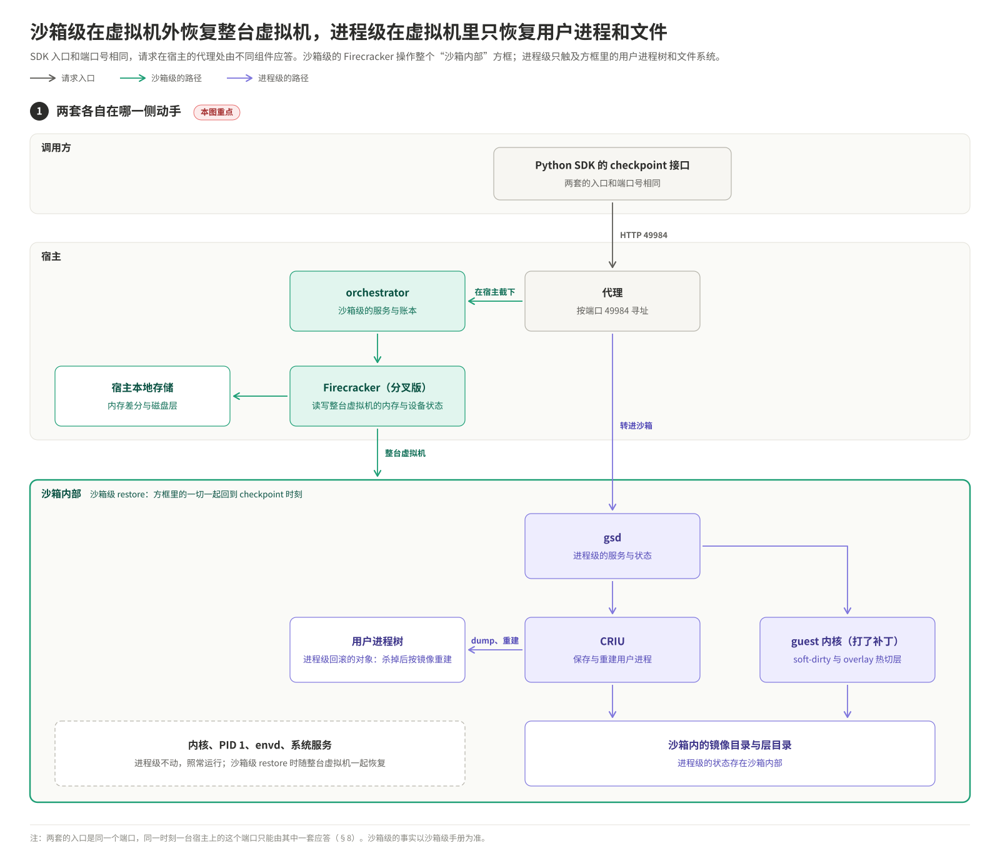
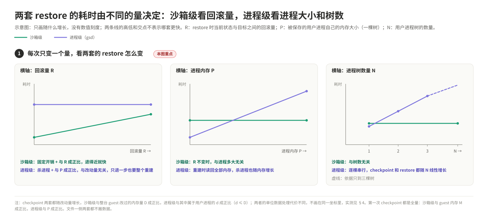
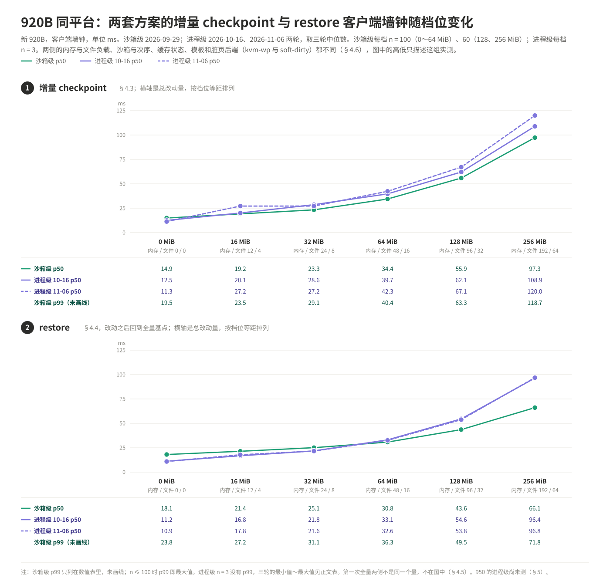

# 24 · 与沙箱级对比：设计差异与性能

## 本章目标

读完本章，你应当能够：

- 用一句话说出进程级（gsd）和沙箱级两套 checkpoint / restore 的根本差别，并由它推出其余差别；
- 逐项对比两套的回滚对象、实现位置、脏页跟踪、存储、失败语义、依赖和适用平台；
- 说清两套的协议哪里相同、哪里不同，以及为什么两份 SDK 不能混用；
- 说清两套的成本模型为什么形状不同；
- 读懂 920B 同平台的并列数字，知道谁在哪些档更低、还剩哪些条件不可比、结论适用到哪里；
- 说清 restore 之后两套各自"会发生什么、不会发生什么"，尤其是对回滚范围之外的东西的影响；
- 针对一个具体需求判断该用哪一套，并知道两套目前能不能在同一个沙箱上一起用。

本章是全书唯一的对比章。沙箱级的事实一律以沙箱级手册为准，本章只引用、不展开，章末给出对应章节的位置。
不读沙箱级手册也能读懂本书其余各章。

---

## 1. 一句话的差别

> **沙箱级在虚拟机外面恢复整台虚拟机的状态；进程级在虚拟机里面只恢复用户进程和文件。**

[02](02-problem-and-scope.md) 已经从问题的角度讲过这两条路线。这里换一个角度：两套的几乎所有差别，都能从"在哪一侧动手、回滚多大范围"这一个选择推出来。

| 由这个选择推出 | 沙箱级 | 进程级 |
|---|---|---|
| 谁来做 | 宿主上的 orchestrator 加分叉的 Firecracker；沙箱里什么都不装 | 沙箱里的 gsd 加 CRIU 加打了补丁的 guest 内核；宿主只在建模板时参与，Firecracker 不改 |
| 怎么知道哪些内存变了 | 宿主侧跟踪整个 guest 内存的脏页 | guest 内核跟踪用户进程的脏页（soft-dirty） |
| 恢复时进程怎么办 | 没有任何进程被杀或重建，内核和全部进程一起恢复到 checkpoint 时刻 | 当前的用户进程被杀掉，再由 CRIU 按镜像重建 |
| 范围之外还剩什么 | 沙箱内没有"范围之外"；沙箱外的连接和引用要处理 | 内核、PID 1、envd、系统服务都在范围之外，照常运行 |
| 状态存在哪 | 宿主本地 | 沙箱内部 |

下面这张图把两套各自工作的位置画在一起。SDK 入口和端口号相同，请求在宿主的代理处由不同组件应答：

图里有两点值得注意。第一，沙箱级的 Firecracker 操作的是整个"沙箱内部"这个方框，所以方框里的一切一起回滚；
进程级只触及方框里的"用户进程树"和文件系统，"内核与 PID 1 与 envd 与系统服务"那一格不动。
第二，两套的入口是同一个端口，同一时刻一台宿主上的这个端口只能由其中一套应答（[§8](#8-能不能在同一个沙箱上一起用)）。

### 1.1 两条路线各自怎么工作

**沙箱级：** 保存和恢复都在虚拟机外面做，由 Firecracker 和宿主上的编排程序完成，guest 里什么都不需要装。

- **保存什么**：全部 guest 内存、vCPU 寄存器、设备状态和磁盘。用户进程、内核、页缓存、系统服务都在里面。
- **怎么恢复**：把内存和设备状态写回。guest 里的每一个进程，包括内核自己，都恢复到 checkpoint 时刻，没有任何进程被杀掉或重建。
- **代价落在哪**：增量保存时要知道整个 guest 内存里哪些页被改过，这需要宿主侧的脏页跟踪；保存的量包含内核和页缓存的改动，不只是用户进程的。恢复时写回的量与回滚量成正比。
- **边界**：内核也一起恢复，所以跨越回滚的网络连接会失效，guest 的单调时钟会倒退。

**进程级：** 保存和恢复都在虚拟机里面做，由 guest 内的 gsd 调用 CRIU 完成。

- **保存什么**：选定用户进程的内存、寄存器、打开的文件等；文件系统由 overlay 的层单独处理。内核状态和别的进程不保存。
- **怎么恢复**：进程不能原地恢复，只能把现在的进程杀掉，再按镜像重新创建：重新 fork 出同样 PID 的进程、重新映射内存、把页面内容读回来、重新打开文件。
- **代价落在哪**：保存的量只是这组进程改过的页，比沙箱级少；但恢复是重建，要把进程的**全部**内存读回来，代价取决于进程有多大，与这一步改了多少基本无关。此外杀进程本身也要时间。
- **边界**：范围外的东西不回滚（[02](02-problem-and-scope.md) §2.2）；被保存的进程必须是 CRIU 能处理的；恢复期间有一段时间用户进程是不存在的。

### 1.2 两条路线保存的东西不一样：一组产物大小

两条路线保存的内容不同，从产物大小上能直接看到。下面这组数来自一次早期对照：同一个负载（一个常驻的用户进程改写 192 MB 内存，同时往磁盘写 64 MB 文件），两套各做一次增量 checkpoint。

> 平台：旧 920B（已退役）。日期：2026-09-08。代码：初始实现。样本：两套各跑一次。单位照原记录写作 MB。
> 这组数只用来说明范围不同，不是当前代码的性能数据，也不与 §4 的新 920B 数字并列。

| | 内存那一半的产物 | 包含了什么 |
|---|---|---|
| 进程级 | 约 194 MB | 那个用户进程改过的页。写文件的 64 MB **不在里面**，文件由 overlay 的层单独承担 |
| 沙箱级 | 约 276.5 MB | 用户进程改过的页，加上那次写文件留在 guest 页缓存里的页，再加内核自己的少量改动 |

这张表说明三件事。第一，进程级的产物小，是因为它不保存内核状态和页缓存。第二，在进程级这里，内存和文件由两种不同的机制负责；在沙箱级那里，文件写入的一部分也表现为内存的改动。第三，比较两套的耗时必须连同范围一起读，§4 就是按这个要求写的。

### 1.3 为什么两条路线都存在

进程级不是沙箱级的"轻量版"，沙箱级也不是进程级的"完整版"。它们在一个问题上取了相反的答案：**要不要让范围之外的东西保持不动。**

- 沙箱级的答案是"不要"：沙箱内的一切都恢复，语义最简单，代价是范围外的连接和时钟也一起恢复；
- 进程级的答案是"要"：只恢复用户进程和文件，envd、系统服务、内核照常运行，代价是出现了一条"范围内 / 范围外"的分界线，分界线两侧的东西在 restore 之后不再属于同一时刻（[02](02-problem-and-scope.md) §5）。

哪一种合适取决于任务，选型见 §7。

---

## 2. 逐项对比

| 维度 | 沙箱级 | 进程级（gsd） |
|---|---|---|
| **回滚对象** | 整台虚拟机：全部 guest 内存（含内核、页缓存、所有进程、内存文件系统）、vCPU、中断控制器、virtio 设备状态、整个磁盘 | uid 1000 的用户进程树，加 overlay 根文件系统（含 `/tmp`）。内核状态、root 的进程、`/run`、`/dev/shm`、`/var/log` 等不回滚（[02](02-problem-and-scope.md)） |
| **实现层次** | 宿主：orchestrator（接口、编排、账本）加分叉的 Firecracker（原地回滚、脏页位图） | guest：gsd 守护进程加 CRIU 加 guest 内核补丁；orchestrator 只在建模板时参与 |
| **沙箱里要装什么** | 什么都不装 | gsd、CRIU 4.x、开机脚本 `overlay-init`，由模板构建注入（[06](06-guest-boot-and-injection.md)） |
| **内存脏页跟踪** | 宿主侧，按 4 KiB 记账。有硬件脏页跟踪（HDBSS）的平台自动启用；没有时用 KVM 的软件写保护，需显式打开；都不用时每次都是全量 | guest 内核的 soft-dirty，按页表项记账，要求透明大页为 `never`（[03](03-criu-and-incremental-memory.md)） |
| **内存产物** | 每代一份稀疏的差分文件加一份脏页位图，组织成一棵差分树 | 每棵进程树每个 checkpoint 一个 CRIU 镜像目录，增量镜像用 `parent` 链接指向父镜像 |
| **文件产物** | 块级：磁盘写层原地封存成只读层，换上新的空写层 | 文件级：overlay 的可写层原地沉成只读层，换上新的空可写层（[07](07-overlay-hot-switch.md)） |
| **存储位置** | 宿主本地盘 | 镜像在 guest 内 2 GiB 的内存文件系统里（占沙箱内存），层在 guest 的根盘上（[04](04-goals-and-tradeoffs.md)） |
| **是否停机** | 沙箱不重建；checkpoint 和 restore 各有一次短暂的**虚拟机暂停**（冻结窗口） | 虚拟机从不暂停；checkpoint 时**被保存的用户进程**停一小段，restore 时用户进程被杀掉再重建 |
| **冻结窗口里停的是谁** | 整台虚拟机的 vCPU | 只有用户进程；内核、envd、系统服务照常运行 |
| **内存与文件的一致性** | 同一次暂停里保存、同一次暂停里换回，严格同一瞬间 | 全部用户进程停住之后才切层，所以进程镜像与文件系统是同一时刻的；多棵树之间有很短的先后差（[11](11-checkpoint.md)） |
| **恢复方式** | 原地写回：把变了的页和设备状态写回活着的 Firecracker 进程 | 重建：杀掉当前用户进程、切回层栈、CRIU 按原 PID 重新建进程并读回全部内存（[12](12-restore.md)） |
| **历史结构** | 树；restore 之后较新的 checkpoint 仍在，可前滚、可跨分支 | 树；restore 之后较新的 checkpoint 仍在，再 checkpoint 形成分支（[15](15-state-concurrency-capacity.md)） |
| **失败语义** | 提交点之前失败，沙箱原样可用；提交点之后失败称为"撕裂"，这一代沙箱的 checkpoint 与 restore 一律被拒，只能销毁重建 | 提交点（杀进程）之前失败，什么都没动；之后失败返回 `DataLoss`，虚拟机和 envd 仍然活着，再成功 restore 一次即可回到完整状态（[14](14-failure-semantics.md)） |
| **状态与账本** | 在 orchestrator 进程的内存里；orchestrator 重启即失效 | 在 gsd 的内存里，并持久化到沙箱内的状态文件；gsd 重启后能加载，guest 重启则全部丢失 |
| **什么时候失效** | 沙箱删除或回收、orchestrator 重启、宿主重启、迁移、原生 pause / resume 之后 | 沙箱删除或回收、guest 重启。沙箱被暂停再恢复之后按设计仍可用，但未验证（[04](04-goals-and-tradeoffs.md)） |
| **依赖** | 成对交付的 orchestrator 与分叉 Firecracker；宿主侧的脏页跟踪能力；对 guest 内核没有要求 | guest 内核必须打补丁并打开相应配置；基础镜像必须带 CRIU 4.x；对 Firecracker 和宿主内核没有额外要求 |
| **平台** | 宿主为 aarch64（鲲鹏 920B / 950）；有无硬件脏页跟踪只影响代价，不影响正确性 | 只支持 arm64 的 guest；已在新 920B 上验证；950 未部署、未测 |
| **SDK** | `sandbox.checkpoint` 的四个方法；响应里回报这次是全量还是增量 | `sandbox.checkpoint` 的同名四个方法；响应里回报各阶段耗时、进程树数量、镜像大小等。两份 SDK 不是同一份（[25](25-quickstart.md)） |
| **鉴权** | 请求在宿主的代理处被截下，由宿主侧校验 token | 请求进到沙箱，gsd 对照元数据服务里的 token 摘要校验，与 envd 用同一个 token（[05](05-architecture.md)） |
| **成本模型** | 固定开销加上与**改动量**（checkpoint）或**回滚量**（restore）成正比的一项，与虚拟机规格基本无关；每个沙箱的第一次是全量 | checkpoint：与**用户进程的改动量**成正比，每棵树的第一次是全量；restore：与**被恢复进程的内存大小**成正比，再加杀进程的开销；两者都随树的数量线性增长（§3） |
| **对范围外进程的影响** | 沙箱内没有范围外的进程。跨越 restore 的 TCP 连接作废、在途的 SDK 调用被打断、单调时钟倒退 | envd 和系统服务不受打扰，时钟不变；但它们手里的旧目录和旧文件可能属于被丢弃的时间线，从陈旧目录出发的写返回 `ESTALE`（[26](26-semantics-and-limits.md)） |
| **对被保存对象的要求** | 没有要求，不看进程内部 | 进程必须是 CRIU 能保存的；树与树之间不能共用管道或 socket（[10](10-process-trees.md)） |

### 2.1 协议字段对照

下表按进程级 `deltabox-gsd@bc3cce913` 的 `spec/gsd/checkpoint/checkpoint.proto` 和沙箱级 `deltabox-dev@57a30632c` 的 `spec/checkpointd/checkpoint/checkpoint.proto` 逐字段核对。结论是**服务路径与请求相同，响应已经各自演进、互不兼容**。

| 项目 | 进程级 | 沙箱级 |
|---|---|---|
| 包名、服务名、四个方法名 | `checkpoint.Checkpoint`，`CreateCheckpoint`、`RestoreCheckpoint`、`ListCheckpoints`、`DeleteCheckpoint` | 相同 |
| 四个请求消息 | `name` / `checkpoint_id` | 相同 |
| `CreateCheckpointResponse` 字段 1 | `checkpoint_id` | 相同 |
| `CreateCheckpointResponse` 字段 2 | `timings`（消息 `Timings`） | `mem_mode`（字符串） |
| `CreateCheckpointResponse` 字段 3～8 | `created_at`、`has_process_image`、`parent_checkpoint_id`、`image_bytes`、`clear_refs_failed`、`process_trees` | 没有 |
| `CheckpointInfo` 字段 1～3 | `checkpoint_id`、`name`、`created_at` | 相同 |
| `CheckpointInfo` 字段 4 | `image_bytes`（整数） | `mem_mode`（字符串） |
| `CheckpointInfo` 字段 5～7 | `has_process_image`、`parent_checkpoint_id`、`process_trees` | 没有 |
| `RestoreCheckpointResponse` | `success`、`timings` | 只有 `success` |

同一个字段编号在两边是不同类型，所以两套 SDK 不能混用：进程级必须用本仓库的 `py-sdk`（[25](25-quickstart.md)），沙箱级用它自己那一份。
两边用同一个端口号 49984 和同一个路径前缀，是因为沙箱级的协议文件由进程级 SDK 那份协议改名而来（`5c42b3968`）。区别在请求最终由谁应答：沙箱级由宿主截下，进程级走进 guest。同一个沙箱同时启用两套没有实施（[§8](#8-能不能在同一个沙箱上一起用)）。

---

## 3. 成本模型的形状

把两套各自的一次 checkpoint 和一次 restore 拆开看，工作量由不同的量决定。设：

- M：guest 内存的大小；
- P：被保存的用户进程自己的内存大小（一棵树）；
- D：自上一个 checkpoint 以来，整台 guest 改过的内存量；
- d：其中属于用户进程的那部分（d ≤ D，差的是内核和页缓存的改动）；
- R：restore 时当前状态与目标之间的回滚量；
- N：用户进程树的数量。

| 操作 | 沙箱级 | 进程级 |
|---|---|---|
| 第一次 checkpoint | 与 M 成正比（全量根，每个沙箱每一代一次） | 与 P 成正比（每棵树第一次保存时全量） |
| 之后的 checkpoint · 内存 | 固定开销 + 与 D 成正比 | 每棵树一次 CRIU 的固定开销 + 与 d 成正比 |
| 之后的 checkpoint · 文件 | 封存写层，不搬数据 | 一次层切换，不搬数据；checkpoint 那一刻以可写方式打开着的文件要拷贝一份（[08](08-overlay-switch-consistency.md) §5.4） |
| restore · 内存 | 固定开销 + 与 R 成正比 | 杀进程 + 与 P 成正比（重建时读回全部内存），**与改动量无关** |
| restore · 文件 | 切换磁盘视图，不搬数据 | 一次层切换，不搬数据 |
| 多棵进程树 | 无关 | checkpoint 和 restore 都随 N 线性增长（串行，[04](04-goals-and-tradeoffs.md)） |

由此得到三条判断。

**checkpoint：进程级处理的数据范围更小，但这不等于耗时更低。** d 不大于 D。文件写得多的负载下差得更明显：在沙箱级那里，文件写入会经过 guest 的页缓存，
一部分表现为内存的改动；在进程级这里，文件完全由 overlay 的层承担，不进内存镜像（§1.2 的产物大小例子）。
耗时还取决于单位数据的处理代价：CRIU 按进程逐段读取并写出镜像，Firecracker 按位图导出差分，两者不是同一条代码路径。§4 的实测里，改动量较大的档是沙箱级更低。

**restore：两条曲线的自变量不同。** 沙箱级的 restore 随"退多远"增长，退得近就快，代价与进程多大无关。
进程级的 restore 随"进程多大"增长，哪怕只退回一步、只改了几个字节，也要把整个进程重建一遍。
所以拿"这一步的改动量"去预测进程级 restore 的耗时，是比错了量。[20](20-920b-performance.md) §4 的固定 192 MiB 进程测试里，六个改动量的 restore 耗时基本持平，这是进程大小决定耗时的直接表现。

**哪一套更快取决于负载的形状，没有统一的答案。** 进程小时，进程级的 restore 重建量小；进程大而每步改动小时，沙箱级的 restore 只写回改动，进程级仍要重建整个进程。
checkpoint 一侧，脏页后端不同也会改变沙箱级的代价，所以这里的判断不能跨平台使用。

---

## 4. 920B 同平台对比

两套都在新 920B 上有分档数据，也都有客户端墙钟，所以本节用同一口径并列。

### 4.1 两侧的条件

两侧跑在同一台机器上：CPU 均为 Kunpeng 920 7280Z，2 路 160 物理核 / 320 线程，MemTotal 1055027476 kB，宿主内核均为 `6.6.0-159.4.3.154.oe2403sp4.aarch64`。这是沙箱级手册称作"新 920B"的机器。2026-11-06 一轮的宿主内核未单独留档，机器按部署记录确认为同一台。

| 项 | 沙箱级 | 进程级 2026-10-16 | 进程级 2026-11-06 |
|---|---|---|---|
| 日期 | 2026-09-29 | 2026-10-16 | 2026-11-06 |
| 代码 | `deltabox-dev@8ea5322bf` | gsd 与 orchestrator `259f1a25c`，SDK `dcca61266` | orchestrator 为 `259f1a25c` 加 `VethName()` 改动，SDK `dcca61266`；orchestrator 代码与 `deltabox-gsd@bc3cce913` 相同，gsd 与内核的哈希同 10-16 |
| 脚本 | `bench_tiers.py`，全表 3 遍，每遍一个新沙箱 | `demo_checkpoint_perf.py`，sha256 `e0096abe…`，3 轮，每档每轮一个新沙箱 | 同左 |
| 模板 | `base`，2 vCPU / 2048 MB，guest 内核 6.1.158 | `base-gsd`，2 vCPU / 2048 MB，guest 内核 6.1.158 加补丁，CRIU 4.2.1 | `base-gsd`，同左，重新构建 |
| 脏页后端 | 宿主 `kvm-wp` | guest soft-dirty，THP `never`，`rcu_expedited=1` | 同左 |
| 每档样本 | n = 100（0～64 MiB）、60（128、256 MiB） | n = 3 | n = 3 |
| 校验 | 全表 1040 次迭代，内存与文件校验不一致 0 | 18 次 restore 全部通过内存 SHA256 与文件内容校验 | 同左 |
| 统计 | p50 取中位数，p99 取最近秩法；n ≤ 100 时 p99 即最大值 | 三轮中位数和最小、最大值；n = 3 没有 p99 | 同左 |

数字来源：沙箱级取自[沙箱级手册第 20 章 §2.2](../../rollback/docs/20-920b-performance.md#22-混合档内存文件--31)。这张表是手册摘录，本章没有它的逐次样本，未重算。
进程级取自 [`920b-20261016/summary.json`](../validation/920b-20261016/summary.json) 和 [`920b-20261106/summary.json`](../validation/920b-20261106/summary.json)，表中数值已按三轮原始 JSON 重算，与摘要逐项一致，原始文件的 SHA256 也与摘要记录相同。

同一脚本在旧 920B、`4af2872c6` 上还有一轮沙箱级分档（2026-09-21），代码早于长跑修复，产物盘是循环设备，见[沙箱级手册第 20 章 §2.7](../../rollback/docs/20-920b-performance.md#27-修复前的分档不进判定)。它与进程级不是同一台机器，不进下面的表。

### 4.2 口径

| 口径 | 沙箱级 | 进程级 | 本节是否使用 |
|---|---|---|---|
| 客户端墙钟 | 有，SDK 调用前后计时，单位 ms | 有，`perf_counter` 包住 SDK 调用（`wall_ms_samples`） | **使用** |
| 服务端计时 | 分档表未给出分档 `total` | 有，gsd 的 `total_ms`，见 [20](20-920b-performance.md) | 不并列 |

造负载、校验、产物统计都在计时窗口之外。两侧的客户端都在宿主上运行，但请求路径不同：沙箱级的请求止于宿主上的 orchestrator，进程级的请求经代理进入沙箱再由 gsd 应答，这段往返包含在进程级的墙钟里。

### 4.3 增量 checkpoint，客户端墙钟

> 平台：新 920B。日期与代码见 §4.1。单位 ms。进程级括号内是三轮的最小值～最大值。

| 总改动 MiB | 内存 / 文件 MiB | 沙箱级 n | 沙箱级 p50 | 沙箱级 p99 | 进程级 10-16 p50 | 进程级 11-06 p50 |
|---:|---|---:|---:|---:|---:|---:|
| 0 | 0 / 0 | 100 | 14.9 | 19.5 | 12.5（11.8～21.6） | 11.3（10.4～12.0） |
| 16 | 12 / 4 | 100 | 19.2 | 23.5 | 20.1（18.3～35.1） | 27.2（22.7～30.1） |
| 32 | 24 / 8 | 100 | 23.3 | 29.1 | 28.6（28.0～30.1） | 27.2（26.8～27.4） |
| 64 | 48 / 16 | 100 | 34.4 | 40.4 | 39.7（39.2～41.4） | 42.3（39.6～42.6） |
| 128 | 96 / 32 | 60 | 55.9 | 63.3 | 62.1（59.3～62.6） | 67.1（66.6～70.1） |
| 256 | 192 / 64 | 60 | 97.3 | 118.7 | 108.9（107.0～110.9） | 120.0（116.5～121.2） |

### 4.4 restore，客户端墙钟

> 平台、日期、代码、样本量同 §4.3。两侧都是改动之后回到全量基点，撤销的正是刚才那一档改动。单位 ms。

| 总改动 MiB | 内存 / 文件 MiB | 沙箱级 n | 沙箱级 p50 | 沙箱级 p99 | 进程级 10-16 p50 | 进程级 11-06 p50 |
|---:|---|---:|---:|---:|---:|---:|
| 0 | 0 / 0 | 100 | 18.1 | 23.8 | 11.2（10.7～11.3） | 10.9（10.5～11.0） |
| 16 | 12 / 4 | 100 | 21.4 | 27.2 | 16.8（16.7～17.7） | 17.8（16.0～18.1） |
| 32 | 24 / 8 | 100 | 25.1 | 31.1 | 21.8（21.2～23.0） | 21.6（21.0～21.6） |
| 64 | 48 / 16 | 100 | 30.8 | 36.3 | 33.1（32.3～33.6） | 32.6（31.2～33.1） |
| 128 | 96 / 32 | 60 | 43.6 | 49.5 | 54.6（54.3～57.2） | 53.8（53.1～54.6） |
| 256 | 192 / 64 | 60 | 66.1 | 71.8 | 96.4（95.8～97.6） | 96.8（95.5～98.9） |

### 4.5 第一次全量单列

两侧的第一次全量不是同一个量，不放进上面的表。沙箱级写出整份 guest 内存，2048 MB 模板服务端 433～445 ms，客户端墙钟 630～670 ms。
进程级写出这个进程的内存，与档位内的进程大小一起变化：2026-11-06 一轮六档的墙钟中位数从 24.9 ms（RSS 11.63 MiB）到 124.3 ms（RSS 204.76 MiB）。

2026-10-16 一轮的全量基点墙钟明显偏高，三轮 18 个样本在 240.6～5108.5 ms 之间，而同一批的服务端 `total_ms` 中位数只有 23.2～110.8 ms；这一现象只出现在每个新沙箱的第一次 checkpoint 上，原因没有单独查过，所以全量基点不采用这一轮的墙钟。同一轮的增量 checkpoint 和 restore 不受影响，墙钟与服务端的差在 1.7～4.2 ms 之间。

### 4.6 还剩哪些不可比

客户端墙钟相同，只统一了计时的位置。下面这些条件两侧仍然不同。

**同一个档位名，两侧实际处理的量不同。** 表头的"总改动"在两侧都是内存:文件 = 3:1，但含义不同：

| 总改动 MiB | 进程级的进程 RSS MiB（10-16） | 沙箱级内存差分 MB | 沙箱级盘层 MB |
|---:|---:|---:|---:|
| 0 | 11.63 | 19.38 | 0.71 |
| 16 | 24.76 | 38.72 | 4.72 |
| 32 | 36.75 | 54.80 | 8.73 |
| 64 | 60.76 | 85.85 | 16.74 |
| 128 | 108.74 | 153.32 | 32.78 |
| 256 | 204.76 | 285.24 | 64.82 |

进程级这一列是每次 restore 要重建的进程大小，它随档位变化，所以进程大小与改动量在这张表里是绑在一起的，不能用它隔离"固定进程大小下改动量的影响"。
沙箱级这两列是一次 checkpoint 的产物，含页缓存和后台活动。两列的单位沿用各自的原始记录。

| 差别 | 沙箱级 | 进程级 |
|---|---|---|
| **内存负载** | `/dev/shm/sweep` 预热到 512 MiB，每次用 `dd conv=notrunc` 从随机源覆写前 N MB。tmpfs 不属于任何进程，大小不随档位变化 | 常驻 Python 进程持有恰好本档大小的 `bytearray`，改写内容由 MD5 重复构成。CRIU 只保存进程地址空间，tmpfs 负载对它无效，所以两侧无法用同一种内存负载 |
| **文件负载** | 根文件系统上的 `/bench-root/fsblob` 预热到 192 MiB，`dd conv=notrunc` 覆写前 N MB 后 `sync`，随机数据 | SDK 的 `files.write` 重写一个本档大小的文件，内容是单一字符，之后 `sync` |
| **沙箱与次序** | 3 个沙箱跑完全表，同一沙箱里反复迭代 | 每档每轮一个新沙箱，restore 是这个沙箱的第一次 restore。[20](20-920b-performance.md) §4 记录了首次 restore 偏慢的现象，原因没有单独查过 |
| **缓存状态** | 页缓存全热，1040 次 restore 读盘量都是 0 | 未记录缓存状态；镜像在 guest 内存文件系统里 |
| **样本量** | 每档 60～100 次，有 p99 | 每档 3 次，只有中位数和范围 |
| **模板** | `base`，guest 内核不要求补丁，不约束透明大页 | `base-gsd`，guest 内核带补丁，透明大页 `never`，`rcu_expedited=1` |
| **脏页跟踪** | `kvm-wp`，每个干净页的第一次写都陷出一次虚拟机，这笔开销落在 guest 写入时和重新写保护时 | guest 内 soft-dirty，宿主侧不跟踪 |
| **测试时间** | 2026-09-29 | 2026-10-16、2026-11-06，部署方式和同机状态与沙箱级那一轮不是同一次安排，宿主后台负载没有统一控制 |

### 4.7 这组实测说明了什么

本章不给净加速比。负载构造不同，这组数算出来的比值不描述方案本身。下面只说这组实测里谁更低、低在哪些档。

**restore。** 0、16、32 MiB 三档，进程级两轮的中位数都低于沙箱级 p50，全部 6 个样本也都低于沙箱级 p50。64、128、256 MiB 三档相反，沙箱级更低，进程级全部样本都高于沙箱级 p50。分界落在 32 与 64 MiB 之间，对应的进程 RSS 是 36.75 与 60.76 MiB。这与 §3 一致：进程小时重建量小，进程变大后重建全部内存的成本超过只写回改动的成本。

**checkpoint。** 0 MiB 档进程级两轮的中位数更低，但 10-16 一轮有一个 21.6 ms 的样本。16 MiB 档沙箱级两轮都低一些，其中 10-16 一轮差距落在样本波动之内。32 MiB 起到 256 MiB，沙箱级更低，进程级全部样本都高于沙箱级 p50。§3 说进程级处理的数据范围更小，这组实测说明，范围小并没有在 32 MiB 以上转化成更低的耗时。

**进程级两轮之间。** 同一套负载两轮的 restore 接近，checkpoint 在 16 MiB 档相差最大（20.1 与 27.2 ms）。每档只有 3 个样本，这种差异不能当作版本差别。

**适用范围。** 以上结论只覆盖：新 920B、宿主 `kvm-wp`、单沙箱串行、一棵用户进程树、进程大小与改动量同步变化、2 vCPU / 2048 MB。下面这些情况不能由这组数推出：

- **进程大而每步改动小。** 进程级 restore 的代价由进程大小决定，这组数里的小档同时也是小进程，不代表大进程上的小改动。
- **多棵进程树。** 进程级耗时随树数增长（[20](20-920b-performance.md) §3），这里只有一棵。
- **多沙箱并发。** 两侧都没有同条件的并发对比。
- **其他平台。** 950 的脏页后端、机型和盘都不同，见 §5。
- **语义不同的取舍。** 耗时相近不代表可以互换，见 [§6](#6-restore-之后各自会发生什么)。

---

## 5. 950 同平台对比（待填）

950 上的进程级未部署、未测，本节只放沙箱级已有的数字，进程级列留空。这是之后填写 950 对比的唯一位置。

### 5.1 现有数字

> 平台：950（主机名 `slot6`）。沙箱级数据日期 2026-10-13，脏页后端 `hdbss`（FC 自报），`bench_tiers.py --tier-set short --passes 2`。
> 客户端墙钟，单位 ms，p50 取 `analyze.log` 的中位数；n ≤ 30，p99 即最大值。来源：[沙箱级手册第 18 章 §4](../../rollback/docs/18-950-performance.md#4-十二档性能与判定)。
> 这一轮的 orchestrator 与 FC 身份和原始 JSON 尚未回传，统计值来自文本日志，未重算（同章 [§2](../../rollback/docs/18-950-performance.md#2-条件与来源)）。

| 总改动 MiB | 内存 / 文件 MiB | 沙箱级 n | 沙箱级 checkpoint p50 | p99 | 进程级 checkpoint p50 | 沙箱级 restore p50 | p99 | 进程级 restore p50 |
|---:|---|---:|---:|---:|---:|---:|---:|---:|
| 0 | 0 / 0 | 30 | 17.2 | 23.0 | 待填 | 22.4 | 30.9 | 待填 |
| 16 | 12 / 4 | 30 | 23.8 | 30.2 | 待填 | 30.4 | 33.9 | 待填 |
| 32 | 24 / 8 | 30 | 30.5 | 37.7 | 待填 | 36.4 | 44.0 | 待填 |
| 64 | 48 / 16 | 20 | 41.4 | 49.1 | 待填 | 46.0 | 56.0 | 待填 |
| 128 | 96 / 32 | 20 | 73.0 | 88.7 | 待填 | 67.8 | 74.1 | 待填 |
| 256 | 192 / 64 | 20 | 125.5 | 143.3 | 待填 | 105.6 | 123.9 | 待填 |

### 5.2 填数时要核对的条件

1. **同一台 950。** 记录主机名、CPU 型号、宿主内核。进程级不是在 `slot6` 上跑的，就不能写成同平台对比。
2. **同一口径。** 进程级列填客户端墙钟的三轮中位数（`summary.json` 的 `wall_p50_ms`），同时写明样本量，不填服务端 `total_ms`。
3. **同一脚本和分档。** `demo_checkpoint_perf.py` 的 sha256 与 §4.1 一致，分档与 [22](22-950-results.md) 相同，`schema_version=2`、`measurement_mode=per-tier-size`，18 次恢复校验全部通过。
4. **同一规格。** 模板 2 vCPU / 2048 MB，透明大页 `never`。沙箱级那一轮 guest 的内存配置未单独留档（全量产物 2048 MiB），填数时写明。
5. **后端自报。** 记录进程级运行时 Firecracker 自报的脏页后端和被测二进制的 sha256（§9）。
6. **时间差。** 写明两侧的日期和代码版本。沙箱级若已重跑，换用新数据时一并更新本节条件。
7. **§4.6 的负载差别在 950 上同样成立。** 填完之后结论的写法与 §4.7 相同：说谁更低、低在哪些档，不给净加速比。950 与 920B 的数字不相减、不并列。

---

## 6. restore 之后：各自会发生什么

对写业务代码的人来说，比耗时更要紧的是语义上的差别。下表列出 restore 返回之后，沙箱里各样东西的状态。"回到 checkpoint"指内容恢复成 checkpoint 时刻的样子。

| | 沙箱级 | 进程级 |
|---|---|---|
| checkpoint 时在运行的用户进程 | 以同一个 PID 继续运行，从未中断过 | 以同一个 PID 继续运行，但它是被杀掉后重建出来的新进程 |
| checkpoint 之后启动的用户进程 | 消失 | 被杀掉 |
| 以 root 身份直接启动的进程 | 和别的进程一样回到 checkpoint | 不保存、不杀，继续运行 |
| envd、系统服务 | 回到 checkpoint | 不变，一直在运行 |
| 根文件系统上的文件 | 回到 checkpoint | 回到 checkpoint |
| `/tmp` | 回到 checkpoint | 回到 checkpoint |
| `/dev/shm`、`/run` | 回到 checkpoint（它们在内存里） | 不回滚，保持 restore 那一刻的内容 |
| 系统日志（`/var/log`） | 回到 checkpoint | 不回滚，日志保留 |
| 页缓存、内核缓存 | 回到 checkpoint | 不变 |
| 跨越 restore 的 TCP 连接 | 一律作废，要重连；在途的 SDK 调用被打断 | 经 envd 的 SDK 调用不受影响；被重建的用户进程自己持有的连接能否保存取决于 CRIU |
| 单调时钟 | 倒退到 checkpoint 时刻 | 不变 |
| 墙钟 | restore 返回前被校回当前时间 | 不变 |
| 用户进程里缓存的随机状态 | 回到 checkpoint | 回到 checkpoint（在进程内存里） |
| 范围外进程手里的旧目录、旧文件 | 不存在这个问题 | 可能属于被丢弃的时间线：读到旧内容，或写时返回 `ESTALE` |
| 外部世界（已发出的请求等） | 不回滚 | 不回滚 |

这张表可以概括成一句话：**沙箱级让沙箱内的一切回到同一时刻；进程级只恢复用户进程和文件，其余的保持 restore 那一刻的状态。**
前者不需要使用者理解范围，代价是所有跨越回滚的连接和时间感都要重新建立；后者保住了范围外的一切，
代价是使用者需要知道分界线在哪里（[26](26-semantics-and-limits.md)）。

表里"用户进程自己持有的连接"一行需要说明：gsd 没有给 CRIU 加任何放宽的选项，进程如果用了 CRIU 默认不保存的东西，
checkpoint 会失败并带回 CRIU 的日志。本书没有整理这份清单（[23](23-gaps-and-boundaries.md) 的缺口表）。

---

## 7. 什么时候用哪个

| 需求 | 建议 | 理由 |
|---|---|---|
| 要回滚的就是用户进程和文件；同时希望 SDK 的连接、日志、系统服务不受影响 | 进程级 | 范围外的东西不动 |
| 每一步的改动里文件占大头，进程本身不大 | 进程级 | 文件那一半不进内存镜像；进程小则 restore 也快 |
| 进程很大而每步改动很小，restore 频繁 | 沙箱级 | 沙箱级的 restore 随回滚量走；进程级每次都要重建整个进程 |
| 需要连内核状态、页缓存、root 的服务一起严格回到同一瞬间 | 沙箱级 | 进程级不回滚这些 |
| 沙箱里的进程用了 CRIU 保存不了的东西，或者进程之间用管道、socket 连成了多棵树 | 沙箱级 | 沙箱级不看进程内部 |
| 用户进程很多，各自成树 | 倾向沙箱级 | 进程级的耗时随树的数量线性增长，且树之间不是原子的 |
| 不能改 Firecracker、不能在宿主上加组件 | 进程级 | 它只动 guest |
| 不能改 guest 内核、不能在沙箱里放任何东西 | 沙箱级 | 它对 guest 没有要求 |
| x86 的 guest | 不在本书范围 | 进程级只支持 arm64 的 guest；沙箱级的平台以它的手册为准 |
| 沙箱要离场之后再回来、跨会话长期保存、跨节点 | 两套都不行，用 e2b 原生的沙箱快照（pause / resume） | 两套的 checkpoint 都绑定在活着的这台沙箱上；原生快照与沙箱级怎么配合，见[沙箱级手册第 15 章](../../rollback/docs/15-native-cooperation-and-cost.md) |

有两点提醒。第一，这张表给的是倾向而不是规则，真正的依据是 §3 的成本模型和 §6 的语义表，应当拿自己的负载去对照。
第二，"进程级更轻"这个印象只对了一半：它处理的数据范围更小，但恢复时要重建进程，§4 里也有不少档是沙箱级更低。

---

## 8. 能不能在同一个沙箱上一起用

**目前不能。** 原因在入口上，而不在原理上。

- 两套的 SDK 都把请求发往沙箱地址的 49984 端口。沙箱级的 orchestrator 在宿主的代理处把这个端口的 checkpoint 请求截下、自己应答，
  请求进不了沙箱；进程级所用的 orchestrator 不截这个端口，请求被转进沙箱由 gsd 应答。
- 这两种行为分别在两个代码分支的 orchestrator 里。一台宿主的同一个服务端口上同一时刻只能运行其中一个，
  所以实际形态是"按宿主切换"：运行哪一套的 orchestrator，这台宿主上的沙箱就走哪一套（切换的操作见 [27](27-deployment.md)）。
- 进程级还要求模板是在它的 orchestrator 下构建的（里面有 gsd 和 `overlay-init`）。一套之下构建的模板拿到另一套之下去派生新模板，
  这种跨模式的情形没有处理（[16](16-known-limits.md)）。

把两套合进同一个构建、用一个开关选择由谁应答 49984，有过一份方案草案，**没有实施**；待办项列在 [附录 B](B-extending.md)。

即使将来入口的问题解决了，两套叠加使用的语义也需要专门验证，下面两条目前只是**推论，未实测**：

- 沙箱级的 restore 会把 gsd 的内存、沙箱内的状态文件、镜像目录和层目录一起恢复到沙箱级 checkpoint 的时刻。它们是作为一个整体恢复的，按道理仍然自洽，
  但 gsd 的 checkpoint 列表会随之变回那一刻的样子；
- 进程级的 restore 不影响宿主上的任何东西，沙箱级的账本不会察觉；但它在 guest 里杀进程、重建进程、改写文件，
  对沙箱级来说这些都只是普通的内存和磁盘改动，会计入下一次沙箱级 checkpoint 的增量。

同样未验证的还有原生的沙箱暂停与恢复对 gsd 的影响（[04](04-goals-and-tradeoffs.md)、[23](23-gaps-and-boundaries.md)）。

---

## 9. 关于 950 与硬件脏页跟踪

沙箱级的增量依赖宿主侧的脏页跟踪。它分两层：orchestrator 决定要不要记脏页，写进 Firecracker 的 `track_dirty_pages`；Firecracker 在已经武装跟踪的前提下探测用什么方式记，能开 HDBSS 就开，否则退回写保护（[沙箱级手册第 5 章 §4.1](../../rollback/docs/05-dirty-tracking-and-hdbss.md#41-先分清两层)）。

进程级**不走这条路**。查到的事实如下：

- 进程级的脏页信息来自 guest 内核的 soft-dirty，它记在 guest 自己的页表项里（[03](03-criu-and-incremental-memory.md)）。HDBSS 工作在 Stage-2 这一层，由宿主的 KVM 管理。两者是不同层次的机制。
- `deltabox-gsd@bc3cce913` 的 `packages/` 和 `firecracker/` 里没有 HDBSS 代码，orchestrator 也不读 `FC_TRACK_DIRTY_PAGES`。
- 这个分支的 orchestrator 配置虚拟机时不设 `track_dirty_pages`，从模板快照加载时固定传 `EnableDiffSnapshots: false`（代码位置见章末）。按上面第一层的定义，它拉起的虚拟机不会被要求武装宿主侧脏页跟踪。这是读代码得到的结论，没有在运行中的沙箱上取过后端自报。

所以可以确定的是：进程级的增量不依赖 HDBSS，也不依赖 950 独有的特性，代码路径里不使用这项能力。

**HDBSS 和进程级能否在同一台虚拟机上同时启用，本书不下结论。** 目前的情况是：

- 没有哪个 orchestrator 同时做这两件事。武装 HDBSS 的是沙箱级的 orchestrator，进程级的 orchestrator 不做，§8 说明两者一台宿主上只运行一个；
- 沙箱级手册没有讨论进程级，本书也没有这方面的测试；
- 层次不同只说明两者不是同一机制，不能证明叠加之后行为正确，也不能说明叠加的代价。

"不依赖"也不等于"已验证"。本书的代码在 950 上**未部署、未测**（[27](27-deployment.md)、[23](23-gaps-and-boundaries.md)），新 920B 上的数字不能当作 950 的数字。
早期有过一份来自 950 的两套对照数据，它出自初始实现，本书不引用它作任何结论。

---

## 10. 几个常见误解

- **"进程级是沙箱级的轻量版。"** 不是。两者的回滚范围不同，是两件不同的事。进程级没有回滚内核状态的能力，
  沙箱级也给不了"envd 和日志不受影响"的效果。
- **"进程级拍得少，所以一定更快。"** 不成立。§4 的 920B 实测里，checkpoint 从 32 MiB 档起是沙箱级更低，restore 从 64 MiB 档起是沙箱级更低。进程级的 restore 要重建进程，代价随进程大小走（§3）。
- **"沙箱级在所有档都更快。"** 也不成立。同一组实测里，0、16、32 MiB 三档的 restore 是进程级更低。这些档的进程也小，结论要连同条件一起读（§4.7）。
- **"§4 的两列相除，就是方案的净加速比。"** 不是。钟统一了，负载构造、档位含义、模板和样本量仍然不同（§4.6）。
- **"进程级不停机，所以用户进程不受影响。"** 虚拟机不暂停，但用户进程在 checkpoint 时要停一小段，在 restore 时是被杀掉重建的。
  "不停机"说的是虚拟机和范围外的进程。
- **"restore 失败之后沙箱就废了。"** 这是沙箱级"撕裂"的结局。进程级在杀进程之后失败时，虚拟机、envd 和 gsd 都还在，
  用户进程没有了；再成功 restore 一次就回到一个完整的状态（[14](14-failure-semantics.md)）。
- **"两套 SDK 接口同名，所以可以混着用。"** 接口同名，但是两份不同的 SDK，同一字段编号在响应里类型不同（§2.1）；一台宿主上实际由谁应答取决于运行的是哪一套 orchestrator（§8）。
- **"进程级在 950 上会更快。"** 没有数据。它的代码路径不使用 950 的硬件脏页跟踪，而且 950 上未部署、未测（§9）。

---

## 沙箱级手册的对应章节

沙箱级的事实以它自己的手册为准。下面是本章各节引用到的内容在那本手册里的位置（路径相对本章文件）。

| 本章内容 | 沙箱级手册 |
|---|---|
| 它是什么、总体结构、能力边界 | [01 交付与阅读](../../rollback/docs/01-delivery-and-reading.md) |
| 设计目标、硬约束、非目标 | [03 目标与边界](../../rollback/docs/03-goals-and-boundaries.md) |
| 49984 端口的截取（§8 的出处） | [04 架构与流程](../../rollback/docs/04-architecture-and-flow.md) |
| 脏页跟踪的两层与 HDBSS 启用（§9 的出处） | [05 脏页跟踪与 HDBSS](../../rollback/docs/05-dirty-tracking-and-hdbss.md) |
| 时钟、设备与网络 | [10 设备、网络与时间](../../rollback/docs/10-device-network-time.md) |
| 失败分级与"撕裂" | [11 失败与不变量](../../rollback/docs/11-failures-and-invariants.md) |
| 沙箱级与 e2b 原生快照的分工与配合 | [15 原生快照协作与成本](../../rollback/docs/15-native-cooperation-and-cost.md) |
| 负载构造与测量口径（§4.6 的出处） | [16 测试方法](../../rollback/docs/16-test-methodology.md) |
| 950 分档（§5 的出处） | [18 950 性能](../../rollback/docs/18-950-performance.md) |
| 920B 分档（§4 的出处） | [20 920B 性能](../../rollback/docs/20-920b-performance.md) |
| restore 回滚什么、连接与时钟、失效条件（§6 的出处） | [24 API 语义](../../rollback/docs/24-api-semantics.md) |
| 新 920B 的条件标签 | [附录 B 920B 结果](../../rollback/docs/B-920b-results.md) |

---

## 代码位置

本章是对比章，进程级一侧的代码位置见各自的章节，这里只列与对比直接有关的几处。

| 内容 | 位置 |
|---|---|
| 进程级的回滚范围 | `userUID`（`ckpt/pid.go:17`）；`overlay-init.sh.tpl` 的文件头注释 |
| 进程级 restore 的"杀进程再重建" | `RestoreCheckpoint`（`ckpt/service.go:463`）、`killTrees`（`ckpt/criu.go:215`）、`buildCriuRestoreCmd`（`ckpt/criu.go:100`） |
| 进程级 SDK 的端口与请求头 | `py-sdk/e2b/connection_config.py`（`checkpointd_port`，`:58`；`get_checkpointd_url`，`:168`） |
| 两套的协议文件 | 进程级 `spec/gsd/checkpoint/checkpoint.proto`、`packages/gsd/spec/checkpoint/checkpoint.proto`；沙箱级 `spec/checkpointd/checkpoint/checkpoint.proto`（`deltabox-dev` 分支） |
| 进程级 SDK 的返回类型 | `py-sdk/e2b/sandbox/checkpoint/types.py` 的 `CheckpointInfo` |
| 模板注入的开关（决定模板里有没有 gsd） | `GSDEnabled`（`packages/orchestrator/internal/cfg/model.go:39`） |
| 进程级 orchestrator 不武装宿主侧脏页跟踪 | `packages/orchestrator/internal/sandbox/fc/client.go`：`EnableDiffSnapshots: false`（`:62`）、`setMachineConfig`（`:238`） |
| 分档性能脚本 | `gsd/scripts/acceptance/demo_checkpoint_perf.py`、`gsd/scripts/acceptance/summarize_checkpoint_perf.py` |
| 沙箱级一侧 | 见沙箱级手册附录 A |

---

## 本章要点

1. 根本差别只有一个：沙箱级在虚拟机**外面**恢复**整台虚拟机**，进程级在虚拟机**里面**只恢复**用户进程和文件**。其余差别都由它推出。
2. 沙箱级的 restore 是原地写回，没有进程被重建，代价随回滚量走；进程级的 restore 是杀掉再重建，代价随进程大小走，并随进程树的数量线性增长。
3. 两套的服务路径和请求相同，响应字段互不兼容，同一字段编号类型不同，所以 SDK 不能混用。
4. 新 920B 上按客户端墙钟并列：restore 在 0、16、32 MiB 档进程级更低，在 64、128、256 MiB 档沙箱级更低；checkpoint 在 0 MiB 档进程级更低，16 MiB 档两边接近，32 MiB 起沙箱级更低。
5. 这组数不给净加速比：内存与文件负载的构造、档位含义、模板、样本量（60～100 对 3）和测试时间都不同，进程级的进程大小又随档位变化。结论只适用于单沙箱、单棵树、`kvm-wp` 的 920B 条件。
6. 950 的同平台对比位置在 §5，沙箱级数字已列，进程级待填；跨平台的数字不并列。
7. 语义上，沙箱级让沙箱内的一切回到同一时刻（连接作废、单调时钟倒退）；进程级保住范围外的一切（envd、日志、时钟），代价是范围外的进程可能拿着被丢弃时间线里的旧对象。
8. 失败的结局不同：沙箱级在提交点之后失败是"撕裂"，沙箱要销毁重建；进程级在杀进程之后失败，再 restore 一次即可恢复。
9. 两套目前**不能在同一个沙箱上一起用**：入口是同一个端口，一台宿主上只能运行其中一套的 orchestrator；合并的方案未实施。
10. 进程级的增量不依赖 HDBSS，代码路径里不使用它；HDBSS 能否与进程级同时启用没有测试，本书不下结论。950 上未部署、未测。
