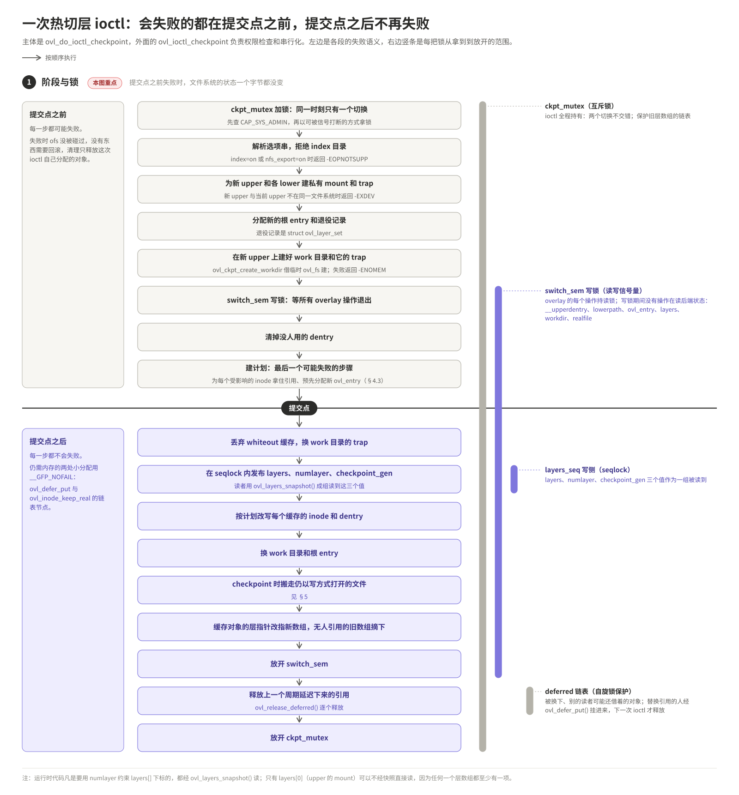

# 08 · overlayfs 热切层：切换一致性

## 本章目标

读完本章，你应当能回答：

1. 一次热切层 ioctl 在内核里分成哪几段，"提交点"在哪里，为什么提交点之后不允许再有会失败的步骤？
2. 切换的同时有别的进程在这个文件系统上读写，内核靠什么保证它们看到的要么是完整的旧状态、要么是完整的新状态？
3. 被换下来的引用为什么不能当场释放，"延迟一个切换周期"解决的是什么问题？
4. checkpoint 之前就打开的文件、被映射的文件，在 checkpoint 之后继续写，这些写为什么曾经回滚不掉，现在落在哪里？
5. 这几项修复各是被哪个现象发现的、用什么脚本复现和验证？

---

上一章（[07](07-overlay-hot-switch.md)）讲了热切层的**机制**：`OVL_IOCTL_CHECKPOINT` 的两种模式、选项串、gsd 侧怎么调用。
那一章默认"切换的时候没人碰这个文件系统"。本章把这个假设拿掉。guest 的根文件系统就是这个 overlay，
PID 1、envd、gsd 自己、各种 root 服务都在它上面运行，而 gsd 在切换前只冻结或杀掉 uid 1000 的用户进程树
（[10](10-process-trees.md)）；其余进程在切换的那一刻照常做着 lookup、read、write、rename。
初始实现的内核补丁在这种并发下会崩，另外还有一批只有在切换多次、或者切换之后做特定操作才暴露的生命周期问题。

内核侧的全部修复分在本章和下一章（[09](09-overlay-cache-and-reclaim.md)）按主题讲。本章讲切换本身的一致性：背景（§1）、一次 ioctl 的总览（§2）、
失败处理（§3）、切换与所有 overlay 入口的互斥（§4）、打开的文件跨切换（§5）。下一章讲切换之后留下的问题：目录与 inode 缓存、restore 与 rename 等操作的竞争、
被换下对象的回收、属于 work 目录的缓存，以及范围外进程最终看到的语义和验证汇总。
每个修复主题一节，统一四段：**现象**（怎么被发现）、**根因**、**改法**、**验证**。
主题的划分与补丁 `0003-overlayfs-hot-switch-fixes.patch` 文件头的提交说明一致。
本章提到的内核函数，除特别说明外都在这个补丁里；初始实现的补丁是 `0002-overlayfs-hot-switch-checkpoint.patch`，本章称它"原始补丁"。
本章举的数字都是修复过程中各轮验证的数，只用来说明"修之前是什么样、修之后是什么样"，各轮的模板和内核构建不同，
**不能互相相减，也不能与 [19](19-920b-functional.md)～[21](21-920b-stress.md) 的判定值相减**。

---

## 1. 背景：读这一章需要的 overlayfs 知识

### 1.1 upper、lower、copy-up 与 whiteout

overlayfs 把几个目录叠成一个文件系统。最上面一个可写的目录叫 **upper**，下面一个或多个只读的目录叫 **lower**（本书也叫"层"）。
规则有四条，后面每一节都要用到：

- **查找（lookup）**：按从上到下的顺序在各层里找同名项，第一个找到的生效。目录是例外：各层的同名目录会**合并**成一个目录显示。
- **copy-up**：要修改一个只存在于 lower 的文件时，先把它整个拷到 upper，再改 upper 里的那份。lower 永远不被写。
  拷贝是在一个临时目录里做完再 rename 进 upper 的，这个临时目录叫 **work 目录**（与 upper 在同一个文件系统上，挂载时指定）。
- **whiteout**：删除一个 lower 里有的文件，不能真去删 lower，而是在 upper 的同名位置放一个特殊的字符设备（0/0），表示"这个名字被删了"。
  这个东西叫 whiteout。内核为了省 inode，会在 work 目录里建一个 whiteout 并缓存起来，以后每次需要时给它做一个硬链接（"共享 whiteout"）。
- **opaque 目录**：在被 whiteout 的名字上重新建一个目录时，这个新目录带一个"不透明"标记，表示不要把下面各层的同名目录合并进来。

热切层要做的事（[07](07-overlay-hot-switch.md)）用这套词说就是：checkpoint 时把当前 upper 变成最上面的一个 lower、换上一个空的新 upper；
restore 时把整个层栈换成目标 checkpoint 记录的那一组 lower，再换上一个全新的空 upper。两种情况 work 目录都跟着换。

### 1.2 overlay 自己的 inode 和 dentry 记着什么

overlay 文件系统里的每个文件，在内核里有一个 **overlay inode**（`struct ovl_inode`）；每个名字有一个 **dentry**，dentry 上挂着一个
`struct ovl_entry`（代码里叫 `oe`）。它们本身不存数据，只记着"我背后是哪几个真实文件"：

| 对象 | 字段 | 含义 |
|---|---|---|
| overlay inode | `__upperdentry` | 这个文件在 upper 里的真实 dentry；没有 copy-up 过就是空 |
| overlay inode | `lowerpath`（dentry + layer） | 这个文件在 lower 里的真实 dentry，以及它属于哪一层 |
| overlay inode | `checkpoint_gen` | 这个 inode 的后端状态最后一次被确认是在第几代层栈上（原始补丁加的） |
| dentry 的 `ovl_entry` | `lowerstack[]`（dentry + layer） | 这个名字在各个 lower 里对应的真实 dentry；目录可以有多项 |
| 打开的文件 | `realfile` | 真正被读写的那个底层文件（upper 或 lower 里的） |

本章把这些字段统称为**后端状态**。overlay 的每个操作（读、写、stat、readdir、copy-up……）第一步都是读后端状态，找到真实文件，再把操作转给它。
热切层的全部难点可以归结成一句话：**切换改掉了层栈，于是所有已经缓存着的 overlay inode 和 dentry 的后端状态都可能不再成立**，
必须有人把它们改对，而且改的时候不能有人正读到一半。

### 1.3 层数组、私有 mount、trap inode 与 inode 哈希

再往下一层是文件系统级的状态（`struct ovl_fs`）：

- **层数组** `layers[]` 和层数 `numlayer`。每一层是一个 `struct ovl_layer`，里面最重要的是一个**私有 mount**
  （内核对该层目录 `clone_private_mount` 出来的、不在任何 mount namespace 里的挂载）。
  inode 的 `lowerpath.layer` 和 dentry 的 `lowerstack[].layer` 是指向这个数组元素的**裸指针**，不带引用计数。
- **trap inode**（陷阱 inode）。overlay 不允许层与层之间互相嵌套（否则会递归）。它的做法是：给每一层的根目录、work 目录等在 overlay 自己的 inode 缓存里
  各放一个占位 inode（trap），之后任何 lookup 如果找到的真实目录正好是某个 trap 对应的目录，就返回 `ELOOP`。
- **inode 哈希**。overlay inode 缓存在一张哈希表里，**键是它背后某个真实 inode 的内存地址**（有 lower 的用 lower 的真实 inode，纯 upper 的用 upper 的）。
  lookup 找到真实文件之后，用这个地址去哈希表里找有没有现成的 overlay inode，有就复用，并用 `ovl_verify_inode()` 校验它记录的 upper/lower
  与这次 lookup 找到的是否一致，不一致返回 `ESTALE`。trap 也是按同一种键放进这张表的。

"键是一个内存地址"这件事在不换层的上游内核里没有问题，因为层的 mount 钉着这些真实 inode。
换层之后，被换下的层可能被删除，真实 inode 被回收，同一个地址可能分给另一个真实 inode——[09](09-overlay-cache-and-reclaim.md) 的 §1、§4 两类问题都出在这里。

### 1.4 原始补丁的做法与它留下的问题

原始补丁处理"后端状态不再成立"的办法是**懒更新**：ioctl 只换全局的层数组并把 `checkpoint_gen` 加一，
各个 inode 和 dentry 等到下一次被访问时，发现自己的代数落后，再由访问者当场把后端状态改过来。被换下来的对象因为说不清还有谁在用，一律不释放。

这个设计在"切换时没有并发访问"的前提下能工作，前提不成立时有三类问题：

1. **没有任何东西把"正在读后端状态的操作"与"正在改后端状态的切换"隔开**。读的人可能读到改了一半的状态，或者读到别人刚刚释放的指针（§4）。
2. **ioctl 自己的失败路径不干净**，后段失败会释放已经挂上去的层（§3）。
3. **"一律不释放"是泄漏**，磁盘和内核内存只增不减（[09](09-overlay-cache-and-reclaim.md) 的 §3）；而少数被释放了的东西（work 目录）又有缓存还指着它们（[09](09-overlay-cache-and-reclaim.md) 的 §4）。

此外还有语义上的问题：切换之前打开的文件写到了哪里（§5），restore 之后旧目录还能不能用（[09](09-overlay-cache-and-reclaim.md) 的 §1、§2）。
修复的总体思路是把懒更新换成**"切换时一次改完"**：ioctl 拿一把排它锁，在锁内按事先建好的计划把所有缓存对象改到位，放锁时整个文件系统处于一致的新状态。

---

## 2. 总览：一次 ioctl 的阶段、提交点与锁

修复后的 ioctl 主体是 `ovl_do_ioctl_checkpoint`，外面包一层 `ovl_ioctl_checkpoint` 负责权限检查和串行化。
它分成三段，中间以**提交点**为界：提交点之前的每一步都可能失败，失败时文件系统的状态一个字节都没变；提交点之后的每一步都不会失败。
各阶段逐步做了什么，在 [07](07-overlay-hot-switch.md) 的"一次切换在内核里的过程"一节按顺序讲过，这里不再复述，只给阶段图和锁表。

涉及三把锁和一张延迟释放表，它们各管一件事：

| 名字 | 类型 | 谁持有 | 保护什么 |
|---|---|---|---|
| `ckpt_mutex` | 互斥锁 | ioctl 全程 | 两个切换不交错；旧层数组的链表 |
| `switch_sem` | 读写信号量 | overlay 的每个操作持读锁；ioctl 从"建计划"到"改完"持写锁 | 所有后端状态：`__upperdentry`、`lowerpath`、dentry 的 `ovl_entry`、`layers`、`workdir`、打开文件的 `realfile` |
| `layers_seq` | seqlock | ioctl 在发布新层栈的那几行持写侧 | `layers`、`numlayer`、`checkpoint_gen` 三个值作为一组被读到 |
| `deferred` 链表 | 自旋锁保护的链表 | 任何替换了引用的人往里放；下一次 ioctl 拿到写锁后取走释放 | 被换下、但别的读者可能还"借着"没有自己引用的对象 |

后面各节是这张图上每一块的来历。

---

## 3. 失败处理与发布

### 3.1 现象

这一项不是压测撞出来的，是审读初始实现的代码时发现的（问题清单 G-05，见 [附录 C](C-issue-resolution.md)）：
原始补丁的 ioctl 先把 `ofs->layers` 换成新数组、把一批 inode 的 `lowerpath` 指进新数组、把 `ofs->workbasedir` 换成新值，
**然后**才去新 upper 上建 work 目录。建目录失败时（根盘快满时的 `ENOSPC`、内存不足、upper 所在文件系统变只读）走清理路径，
把新数组里的 mount 全部卸载、数组本身释放、新 work 目录的引用放掉——而这些东西此刻正被文件系统用着。
之后这个 overlay（也就是 guest 的根）上的任何操作都在访问已释放的内存。

触发条件并不离奇：根盘确实被写满过（[附录 D](D-restore-slowness-case.md) 讲的 restore 变慢，根因就是每次 restore 往 upper 里误拷文件）。

### 3.2 根因

可能失败的步骤排在了不可逆的步骤后面。另有两个相邻的问题在同一处：

- `layers` 和 `numlayer` 是分两次写的。一个并发的读者可能拿到新数组配旧长度（或反过来），按旧长度去下标新数组就越界。
- 两个 ioctl 可以同时进来，各自读一遍"当前层栈"再各自替换。

### 3.3 改法

**可能失败的全部挪到提交点之前。** 新层的 mount 和 trap、新的根 entry、退役记录（`struct ovl_layer_set`，[09](09-overlay-cache-and-reclaim.md) 的 §3 用）、新 work 目录及其 trap、
计划（§4.3），都在提交点之前分配好。其中最别扭的是 work 目录：内核建 work 目录的函数 `ovl_workdir_create` 是从 `ofs` 里取 upper mount 和父目录的，
而提交点之前 `ofs` 还描述着旧层栈。`ovl_ckpt_create_workdir` 的做法是在栈上造一个临时的 `ovl_fs`，只填上新 upper 的 mount 和新的 work 父目录，
拿它去调 `ovl_workdir_create`。真正的 `ofs` 没有被碰过，所以失败时没有任何东西需要回滚，清理路径只释放这次 ioctl 自己分配的对象。

提交点之后确实还需要内存的两处小分配（`ovl_defer_put` 的链表节点、`ovl_inode_keep_real` 的节点）用 `__GFP_NOFAIL`，保证不失败。

**三个值成组发布。** 提交点上在 `layers_seq` 的写侧里依次写 `numlayer`、`layers`、`checkpoint_gen`。
运行时代码凡是要用 `numlayer` 去约束 `layers[]` 下标的，都改用 `ovl_layers_snapshot()` 读——它在 seqlock 的读侧循环里取这三个值，保证拿到的是同一组。
只有 `layers[0]`（upper 的 mount）可以不经快照直接读，因为任何一个层数组都至少有一项。

**ioctl 之间串行。** `ovl_ioctl_checkpoint` 先检查 `CAP_SYS_ADMIN`，再以可被信号打断的方式拿 `ckpt_mutex`，然后才进主体。

**readdir 一次遍历只用一个 entry。** 合并目录的 readdir 要沿着 `lowerstack` 一层层走。原来每走一步都重新读一次 dentry 上的 `ovl_entry`，
切换如果正好在中间把它换成了另一个深度的 entry，下标就对不上。现在遍历开头读一次、之后一直用它（`ovl_path_next_oe`）；
被换下的 entry 走延迟释放（§4.4），遍历期间不会被释放。

ioctl 现在还会主动拒绝两种它不支持的配置（都在提交点之前）：

- 挂载带 index 目录（`index=on` 或 `nfs_export=on`）时返回 `-EOPNOTSUPP`。index 目录描述的是挂载时的 upper，切换不会带着它走。guest 没有开这两个选项。
- 新 upper 与当前 upper 不在同一个文件系统上时返回 `-EXDEV`。挂载时内核在 upper 的文件系统上探测过一批能力
  （是否支持 `O_TMPFILE`、xattr、`RENAME_WHITEOUT`，文件名长度，whiteout 能否共享 inode），切换后沿用这些结论，所以 upper 不能换文件系统。
  gsd 的所有层都在同一个 ext4 上（[05](05-architecture.md)），不会触发。

### 3.4 验证

用 `stress_overlay_ckpt.py` 的 enospc 模式：把 `/overlay` 所在的文件系统写满，再逐档放出 0 到 6 个块，每一档做一次 checkpoint 和 restore，共七档。
gsd 侧建目录就失败的档位返回 `overlay sink failed ... no space left on device` 或 `prepare overlay restore, nothing was changed`；
有的档位 gsd 的目录建成了、内核建 work 目录时才失败，正好走到本节的晚失败路径，ioctl 返回 `ENOMEM`
（`ovl_workdir_create` 对多数错误只返回空指针，`ovl_ckpt_create_workdir` 统一报成 `-ENOMEM`），gsd 报 `overlay ioctl failed: errno=12 (ENOMEM)` 且什么都没改。
每一档之后沙箱可用、`/health` 正常、调试内核没有 KASAN 或 BUG 报告；删掉填充后 checkpoint、restore 与文件内容都正确。
这一组在 2026-09-30 新 920B 的第一轮验证里首次通过（放出 5 个块的那一档走到晚失败），此后每一轮内核改动都重跑（见 [09](09-overlay-cache-and-reclaim.md) 的 §7 的出处表）。

---

## 4. 切换与所有 overlay 入口的互斥

### 4.1 现象

2026-09-30 新 920B 第一轮验证的压测里，只要切换的同时有不归 gsd 管的进程在 overlay 上活动，guest 几秒到几十轮内必崩。
压测脚本（`stress_overlay_ckpt.py`，[18](18-testing-and-debug-kernel.md)）起 6 个 root 身份的 worker 不停做文件操作，宿主侧随机发 checkpoint / restore / delete。
当时看到的（新 920B，第一轮验证，原始补丁加上当时已做的失败路径修复）：

| worker 做什么 | 结果 |
|---|---|
| 全部操作（调试内核） | 7.9 秒时 KASAN 报 `ovl_copyattr` ← `ovl_write_iter` 空指针解引用，随后软锁死 |
| 全部操作（发布版内核） | 第 45 轮 `kernel BUG at fs/inode.c:1850`（`iput` ← `ovl_refresh_reused_inode` ← `ovl_lookup`） |
| 只 rename | `ovl_rename` 空指针解引用 |
| 只追加写 | 第 42 轮软锁死 |
| 只读（调试内核） | KASAN 报 `iput` 处 slab 越界，之后 `BUG`；发布版内核上没有崩，但只读操作本身同样在读后端状态 |
| 没有 worker | 300 轮干净 |

同样的负载放到**并发相关代码与原始补丁完全相同**的内核上（只多了 [09](09-overlay-cache-and-reclaim.md) 的 §5 的 mmap 修复和去打印），第 3 轮就软锁死加 RCU stall，所以这不是修复引入的，是原始补丁就有的。

为什么 gsd 管不住：gsd 在切换前只处理 uid 1000 的用户进程树——checkpoint 时让它们停着，restore 时把它们杀掉。
PID 1、envd、gsd 自己和所有 root 起的服务都不在范围内，而它们全都在这个根文件系统上运行。
最容易撞上的是 envd 的文件 API：SDK 在调 checkpoint 的同时调一次 `files.write`，两者就并发了。

### 4.2 根因

§1.4 的第一类问题。懒更新意味着后端状态的修改散落在各个访问路径上（lookup 里刷新 inode、读路径里刷新、写路径里换 `realfile`），
而切换自己又在另一个线程里清 `__upperdentry`、换层数组。这些修改之间没有共同的锁；替换下来的旧指针当场 `dput`/`iput`，
而别的线程可能刚读到这个指针、还没用完。表里的几种崩法只是同一个问题撞在不同字段上：
读到被清空的 `__upperdentry` 是空指针解引用，读到别人刚放掉的 dentry 是 KASAN 越界或 `iput` 里的 `BUG`，copy-up 等一把永远等不到的锁是软锁死。

### 4.3 改法：读写锁加计划

**`switch_sem`**。`struct ovl_fs` 里加一把读写信号量。规则是：凡是读后端状态的 overlay 操作，从读第一个字段到用完真实文件为止，持读锁；
ioctl 从建计划到全部改完，持写锁。于是每个操作看到的要么是完整的旧状态，要么是完整的新状态。

落实方式是把 overlay 的每个入口拆成两层：原来的函数体改名成 `__ovl_xxx`（或保持原名但注明"调用方持读锁"），外面包一个只负责加锁解锁的同名函数。
补丁里能看到的有 `ovl_lookup` / `__ovl_lookup`、`ovl_rename` / `__ovl_rename`、`ovl_link` / `__ovl_link`、`ovl_setattr` / `__ovl_setattr`、
`ovl_getattr` / `__ovl_getattr`、`ovl_listxattr`、`ovl_get_acl`、`ovl_fileattr_set`、`ovl_do_remove_locked`（unlink 和 rmdir）、
`ovl_create_object`（create、mkdir、mknod、symlink）、`ovl_dentry_revalidate_locked`、`ovl_statfs`、`ovl_remount`、各个 xattr handler、
导出文件句柄的 `ovl_encode_fh`，以及 `file.c` 里的读、写、fsync、fallocate、splice 等文件操作和 `readdir.c` 里的目录读取。

读锁有五条使用规则（写在 `overlayfs.h` 里 `ovl_switch_lock_read` 上方的注释里），每一条都对应一种会死锁的情形：

1. **不递归**。读写信号量在有写者等待时会挡住新的读者，一个已经持读锁的线程再拿一次读锁，就会和等写锁的 ioctl 互相等。
   overlay 有不少地方会经 VFS 绕回自己（`lookup_one()`、`vfs_getattr()`、`file_remove_privs()`、`touch_atime()`、
   `generic_permission()` 进而 `ovl_get_acl()`、`posix_acl_create()`），这些调用一律在放开读锁之后做。
   所以有些函数的形状是"拿锁读一小段状态、放锁、调回 VFS、再拿锁"，例如创建文件时 ACL 在拿锁之前先算好，存进 `struct ovl_cattr` 带下去。
2. **锁序**：在 VFS 对 overlay 对象的锁（`i_rwsem`、`sb_writers`、管道锁）之内，在 overlay 对各层拿的锁（`OVL_I()->lock`、真实 inode 的 `i_rwsem`、upper 的 `sb_writers`）之外。
3. **不在 `mmap_lock` 下等它**。读、写、readdir 持读锁期间会拷贝用户内存，可能缺页，缺页要 `mmap_lock`；
   反过来 `ovl_mmap` 是在 `mmap_lock` 下被调用的，所以它不能等这把锁，也不做 copy-up（[09](09-overlay-cache-and-reclaim.md) 的 §5）。
4. **不跨无界等待持有**（比如从一个空管道 splice）。
5. **RCU 路径遍历不拿锁**。路径查找的快速模式（RCU-walk）不能睡眠，它读到空指针就退回慢速模式重来；
   作为交换，任何被替换下来的对象都要等一个 RCU 宽限期或等下一次 ioctl 拿到写锁之后才释放。

ioctl 拿写锁用的是可被致命信号打断的版本（`down_write_killable`）：如果某个读者长时间不放锁（例如一次读进 userfaultfd 管着的缓冲区），调用方不会被永久卡死。

**计划**。拿到写锁后，ioctl 不再只动全局状态，而是把每一个缓存着的 inode 和它的每一个 dentry 改到新层栈下"一次全新 lookup 会得到的样子"。
改写不能失败（已经过了提交点），所以分两步：

- **建计划**（`ovl_ckpt_build_plan`，提交点之前）：先用 `shrink_dcache_sb` 清掉没人用的 dentry，剩下的都是被钉住的
  （某个进程的 cwd、打开的文件、挂载点以及它们的祖先）。然后遍历超级块上的全部 inode，对每个受影响的 inode 由 `ovl_ckpt_plan_inode`
  建一个计划项：拿住 inode 和它每个 dentry 的引用，并把需要的新 `ovl_entry` 预先分配好（`ovl_ckpt_move_entry`）。这是最后一个可能失败的步骤，失败则放锁、释放计划、原样返回。
- **应用计划**（`ovl_ckpt_apply_item`，提交点之后）：只做指针赋值和标志位操作。

两种模式下一个 inode 被改成什么：

| 模式 | 对象 | 改成 |
|---|---|---|
| checkpoint | 有 upper 的 inode（文件或目录） | **promote**（提升）：原来的 upper dentry 变成它的 lower（属于新数组里"旧 upper"那一层），`__upperdentry` 清空；它的每个 dentry 换上新 entry——第一项是旧 upper，目录还要接上原来的 lower 栈。这正是在新层栈里重新 lookup 会得到的结果 |
| checkpoint | 没有 upper 的 inode | 不变（它的 lower 都还在新层栈里） |
| restore | 所有 dentry | 标记为陈旧（`OVL_E_STALE`）并从目录树上摘下（`d_drop`） |
| restore | 有 upper 的非目录 | **detach**：保留数据，变成"只有 lower、lower 就是被丢弃的那个 upper"的 inode，打上 `OVL_DETACHED`，并从 inode 哈希里摘出，新的 lookup 永远找不到它 |
| restore | 有 upper 的目录 | 只丢掉 upper，留在哈希里，等新的 lookup 按同一个 lower 把它"复活"（[09](09-overlay-cache-and-reclaim.md) 的 §1）；纯 upper 的目录例外，摘出哈希（[09](09-overlay-cache-and-reclaim.md) 的 §4.3） |

原始补丁在 dentry 重新校验（`->d_revalidate`）里按代数判陈旧的那段逻辑随之删掉了：切换已经把所有缓存对象改到位，不需要事后再判；
而且把正在被使用的 dentry 判成无效，会让它的使用者（cwd、打开的目录）之后 copy-up 失败。

### 4.4 改法：被换下的引用延迟一个切换周期

持读锁的操作读后端状态时拿到的是**借来的指针**：它们不给 `__upperdentry`、`lowerpath.dentry`、`ovl_entry` 另加引用，只靠"持着读锁期间没人会释放"。
写锁保证了 ioctl 改写时没有读者，但还有两种情况：

- 读者之间互相替换。例如一次 lookup 刷新了某个缓存 inode 的 lower（`ovl_refresh_reused_inode`），或一次写把打开文件的 `realfile` 换到了新 upper（§5），
  此时另一个持读锁的线程可能正借着旧指针。
- 不拿锁的 RCU 路径遍历、异步 I/O 的完成回调。

所以**任何人替换下来的引用都不当场释放**，而是交给 `ovl_defer_put()` 挂到 `ofs->deferred` 链表上，
链表项的类型有 dentry、inode、file、整个 `ovl_entry`（`OVL_DEFER_OE`）、整组旧层（`OVL_DEFER_LAYERS`，[09](09-overlay-cache-and-reclaim.md) 的 §3）。
下一次 ioctl 拿到写锁后把整张表摘下来（此刻所有可能借着它们的读者都已离开），放锁后由 `ovl_release_deferred()` 逐个释放；
`ovl_entry` 再经 `kfree_rcu` 多等一个宽限期。本次 ioctl 自己换下的东西挂到新表上，留给再下一次。

代价是：最后一次切换换下的那些对象会一直留到下一次切换或卸载，量级是"一次切换的量"，有界。

### 4.5 验证

2026-09-30 当天新 920B 的第二轮验证（并发互斥与下一节的写入切换两项修复后）：调试内核（KASAN、lockdep，[18](18-testing-and-debug-kernel.md)）与发布版内核各跑 8 组压测
（全部操作、只读、追加加 rename 加相对路径写、只 rename、只追加、只相对路径写、无 worker、ENOSPC），每组 300 轮、6 个 root worker，全部跑完；
dmesg 与串口输出里 KASAN、`BUG:`、Oops、`WARNING:`、链表损坏、锁依赖环、原子上下文睡眠、hung task、soft lockup、RCU stall 这些关键词零命中；
调试内核每组跑完 `debug_locks` 仍为 1（lockdep 全程有效）；worker 没有 `EIO`、没有卡死。此后每一轮内核改动都重跑这 8 组。

worker 仍然会看到两种错误，这是语义而不是缺陷：`ENOENT`（它操作的文件被 restore 回滚掉了）和 `ESTALE`（[09](09-overlay-cache-and-reclaim.md) 的 §1、§6）。

---

## 5. 打开的文件跨切换的语义

### 5.1 现象

两个探针发现了同一类问题的两个层次。

`probe_fd_rollback.py`（第一轮验证）：一个进程在 checkpoint **之前**打开文件，checkpoint 之后经这个 fd 继续写；restore 到这个 checkpoint，后写的内容还在。
按路径重新打开再写的内容能正常回滚。uid 1000 的进程和 root 进程都如此。

`probe_mmap_rollback.py`（第二轮验证，上面那个问题修掉之后）：只要文件**被映射着**——共享可写映射、共享只读映射、私有映射都算——
checkpoint 之后不管经映射写还是经 fd 写，写入都不回滚；而且第 2 行内容直接出现在已经沉下去的那一层的真实文件里，
也就是说这个 checkpoint 的内容被改写了，以后每次 restore 到它都带着这些写入。

### 5.2 根因

checkpoint 把整个 upper 原地变成一个只读层（[07](07-overlay-hot-switch.md)）。"只读"是 overlay 的约定，不是底层文件系统的属性：
以写方式打开的文件，它的 `realfile` 是 checkpoint 之前在当时的 upper 里打开的，切换之后这个底层文件对象照样能写，写的就是那个已经属于 checkpoint 的 inode。
映射更直接：一个映射建立之后，页的读写完全不经过 overlay，直接落到底层文件的 page cache 上。

### 5.3 改法之一：第一次写时切到新 upper

`ovl_write_switch()` 在每个写入口（write、fallocate、splice 写等）拿到读锁和 inode 锁之后调用。
它检查这个打开文件的 `realfile` 是不是当前 upper 里的那个 inode；不是，就把文件连同数据 copy-up 到当前 upper，在那里重新打开一个 `realfile`，
用 `cmpxchg` 换进去。为了能换，打开文件的私有数据从"一个 `realfile` 指针"改成了 `struct ovl_file`：当前的 `realfile` 加一条旧 `realfile` 的链；
旧的可能还被同一个打开文件的其他使用者借着，所以随这个文件关闭时才一起释放。

三种情况下不切、继续写旧的底层文件：

- 旧的底层文件已经不属于任何一层的可见内容（被 unlink 了，或者它是 restore 丢弃的 upper 里被 detach 出来的），写它不会改变任何层显示的东西（`ovl_inode_lower_is_private`）；
- 旧的底层文件正被映射着。映射用的是旧 page cache，如果把 `write()` 切到一份拷贝上，同一个文件的映射读者和 `write()` 写者就看到两份不同的内容。这种写不会被 restore 回滚，由下一小节的办法解决；
- 文件在切换之后被 unlink 了：copy-up 会把它按原名（盖在 whiteout 上）放回去，所以返回 `ESTALE`。

### 5.4 改法之二：checkpoint 时把还开着写的文件留在 upper

对"以写方式打开"或"被共享可写映射"的文件，等到第一次写再切换是来不及的（映射的写根本不经过 overlay）。
所以在 checkpoint 的那一刻就处理：**这个文件不跟着 upper 沉下去，而是搬到新 upper；沉下去的层里放一份它此刻内容的拷贝。**

`ovl_ckpt_want_move()` 在建计划时挑出这些文件，条件是：upper 里的普通文件、数据在 upper、底层 inode 的 `i_writecount > 0`
（有 fd 以写方式打开着；共享可写映射会让它背后的文件一直保持打开，所以也算）。
`ovl_ckpt_move_upper()` 在提交点之后、新层栈已经发布、仍持写锁时执行：

1. 把父目录按常规 copy-up 到新 upper。
2. 在新 work 目录里做一份拷贝（`ovl_ckpt_copy_file`）：数据经 page cache 读，所以内存里的脏页、经映射写入但还没落盘的内容都包括在内；
   全部 xattr（包括 overlay 自己的）、文件属性标志、大小、权限、属主、时间戳一并复制；不 fsync（沉下去的层里其他内容也没有被同步过）。
3. 把拷贝 rename 到新 upper 里的同名位置。
4. 用 `RENAME_EXCHANGE` 把"沉下去的层里的原文件"与"新 upper 里的拷贝"互换。

因为所有层都在同一个 ext4 上，互换只是两个目录项交换指向，**原来的 inode 没有动，只是换了目录**：进程手里的 fd、已有的映射都跟着 inode 走，
从此写进新 upper；沉下去的层里留下的是拷贝。用互换而不是"先移走再放回"，是为了让沉下去的层在任何时刻都不缺这个名字。

有三个细节决定了它的边界：

- **按名字找文件，不信 inode 记录的 upper dentry**。经 `O_TMPFILE` copy-up 出来的文件，overlay inode 记录的 upper dentry 是它在 work 目录里出生时的名字 `#<inode 号>`，
  不是它在层里的路径。所以要在沉下去的父目录里按 overlay 的名字查一次，并核对是同一个 inode。（第一次上机就撞上了这个情况，当时回退成了不搬，随即修正。）
- **硬链接数大于 1 的不搬**：它的另一个名字仍然会把 inode 留在沉下去的层里。此时退回 promote，写仍然会进 checkpoint，内核打一行限速告警
  `checkpoint: could not move open file ... to the new upper layer (...); writes to it change the checkpoint`。已经 unlink 的文件不需要搬。
- **任何一步失败都退回 promote**：删掉拷贝，按普通文件处理，打同一行告警。除父目录的 copy-up 外没有别的副作用。

模块参数 `overlay.ckpt_move_open`（`/sys/module/overlay/parameters/ckpt_move_open`，0644）控制这个行为：
`0` 不搬（只靠 §5.3）；`1` 只搬 checkpoint 时正被映射着的；`2`（默认）搬所有以写方式打开的。
默认选 2 而不是 1，是为了覆盖"checkpoint 前打开、checkpoint 后才映射"的情形——选 1 时这种映射会写进 checkpoint。

代价是：**每次 checkpoint 要对每个以写方式打开的 upper 文件做一次整文件拷贝，拷贝在写锁内进行，期间整个 overlay 上的操作都被挡住。**
`probe_move_cost.py` 的实测（新 920B，2026-09-30 该修复当轮的内核，由一个 root 进程以 `O_RDWR` 持有文件，读 gsd 自报的 `overlay_sink_ms`）：
没有持有者 1.7 ms，1 MiB 1.65 ms，16 MiB 12.9 ms，64 MiB 48.0 ms，128 MiB 101.5 ms，约每 MiB 0.8 ms。判定值见 [20](20-920b-performance.md)。
与"第一次写时再拷"相比总拷贝量相当，但对"开着不写"的文件是额外开销。guest 里常驻的以写方式打开的文件只有 journald 的日志，
它在从 ext4 bind 进来的 `/var/log` 上，不在 overlay 层里，不产生这项开销。

还有一个要知道的边界：gsd 在 dump 之后、sink 之前让被 dump 的用户进程树停着（[11](11-checkpoint.md)），所以它们的写与拷贝之间是一致的；
**不在被 dump 的树里、checkpoint 时仍在跑的进程**如果同时经映射写，拷贝取到的是拷贝那一刻 page cache 的内容。

### 5.5 验证

- `probe_fd_rollback.py`：三个文件各在 checkpoint 之前写第 1 行、之后写第 2 行——一个由 uid 1000 的进程（会被 CRIU dump 和 restore）经原 fd 写，
  一个由 root 进程（gsd 不碰它）经原 fd 写，一个作为对照按路径重新打开再写。写完后各有两行，沉下去的层里只有第 1 行；restore 之后三个文件都只剩第 1 行。
- `probe_mmap_rollback.py`：六种情形（只有 fd；共享读写映射经映射写；共享只读映射加 fd 写；私有映射加 fd 写；共享读写映射加 fd 写；uid 1000 进程的共享映射）
  restore 之后都只剩第 1 行，沉下去的层保持干净。第二阶段再做一次 checkpoint、写、restore 到第二个、再 restore 到第一个，四项检查全部为真；
  带着被搬走的共享映射的用户进程又被 CRIU dump 和 restore 一次，照常存活、内容正确；dmesg 里没有 `could not move`。
- `probe_move_cost.py`：除上面的耗时外，核对沉下去的层里是新 inode（md5 相同），新 upper 里是原 inode（进程手里还是同一个 fd）。

三个探针在之后的每一轮内核改动后都重跑，结果逐项相同。

---

## 代码位置

内核函数都在 `fc-kernels/patches/6.1.158/0003-overlayfs-hot-switch-fixes.patch` 里（按补丁里的文件分组）；gsd 侧行号以 `process-rollback-dev@bc3cce913` 为准。

| 关注点 | 位置 |
|---|---|
| ioctl 主体、串行化、提交点 | `fs/overlayfs/super.c` — `ovl_ioctl_checkpoint`、`ovl_do_ioctl_checkpoint`、`ovl_ckpt_create_workdir` |
| 成组发布层栈 | `fs/overlayfs/ovl_entry.h` — `layers_seq`、`ovl_layers_snapshot` |
| 读写锁与使用规则 | `fs/overlayfs/overlayfs.h` — `ovl_switch_lock_read`、`ovl_switch_trylock_read`、`ovl_switch_unlock_read`；`ovl_entry.h` — `switch_sem` |
| 计划的建立与应用 | `super.c` — `ovl_ckpt_build_plan`、`ovl_ckpt_plan_inode`、`ovl_ckpt_move_entry`、`ovl_ckpt_apply_item`、`ovl_ckpt_free_plan` |
| 延迟释放 | `fs/overlayfs/util.c` — `ovl_defer_put`、`ovl_release_deferred` |
| readdir 一次遍历用一个 entry | `fs/overlayfs/namei.c` — `ovl_path_next_oe` |
| 写入切到新 upper | `fs/overlayfs/file.c` — `ovl_write_switch`、`struct ovl_file`、`ovl_get_realfile`、`ovl_mmap`；`util.c` — `ovl_inode_lower_is_private` |
| checkpoint 时搬走打开的文件 | `super.c` — `ovl_ckpt_want_move`、`ovl_ckpt_move_upper`、模块参数 `ckpt_move_open`；`fs/overlayfs/copy_up.c` — `ovl_ckpt_copy_file` |
| gsd 侧调用 ioctl 的地方 | `SinkUpper`（`ckpt/overlay.go:125`）、`CommitRestore`（`ckpt/overlay.go:240`）、`applyOverlaySwitch`（`ckpt/overlay.go:549`） |
| gsd 只处理哪些进程 | `userRootsIn`（`ckpt/pid.go:259`）、`killTrees`（`ckpt/criu.go:215`） |
| 复现与验证脚本 | 随手册附带的 `scripts/stress/` 与 `scripts/probes/`：`stress_overlay_ckpt.py`、`probe_fd_rollback.py`、`probe_mmap_rollback.py`、`probe_move_cost.py` |

---

## 本章要点

1. **一次切换分三段，以提交点为界**：之前的每一步都可能失败且失败时什么都没变（新层、trap、work 目录、计划全部提前备好），之后的每一步都不会失败。
   `layers`、`numlayer`、`checkpoint_gen` 在 seqlock 里成组发布，ioctl 之间由 `ckpt_mutex` 串行。
2. **并发安全靠一把读写锁加一份计划**：所有读后端状态的 overlay 操作持 `switch_sem` 读锁，ioctl 持写锁按计划把每个缓存的 inode 和 dentry 一次改到位
   （checkpoint 时 promote；restore 时摘下、标陈旧、detach）。原来的懒更新和按代数判陈旧都不再使用。
3. **被换下的东西延迟一个切换周期释放**：读者借用指针不加引用，所以任何替换下来的引用都挂到延迟表上，由下一次 ioctl 拿到写锁后释放；涉及 RCU 路径的再等一个宽限期。
4. **checkpoint 之前打开的文件，之后的写不进 checkpoint**：以写方式打开或被共享可写映射的文件在 checkpoint 时搬到新 upper、层里留一份拷贝（约每 MiB 0.8 ms，在写锁内）；
   其余的在第一次写时 copy-up。硬链接数大于 1 的文件是例外。可用 `overlay.ckpt_move_open` 调节。
5. **切换之后留下的问题在下一章**：旧目录和旧文件跨 restore 的语义、名字查找与操作之间的竞争、被换下对象的回收、属于 work 目录的缓存，都建立在本章的读写锁和延迟表之上（[09](09-overlay-cache-and-reclaim.md)）。
