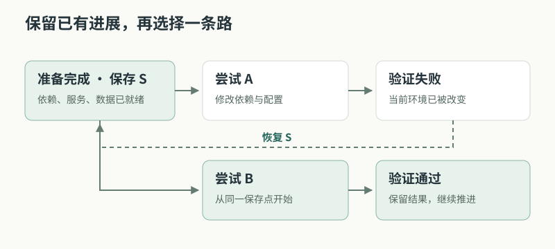
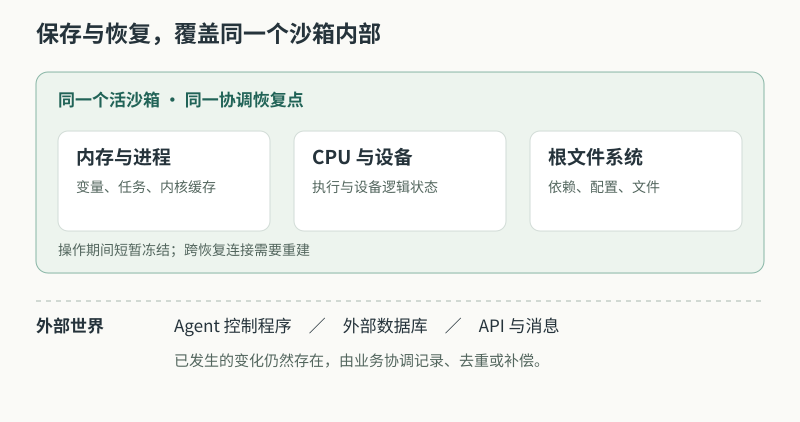
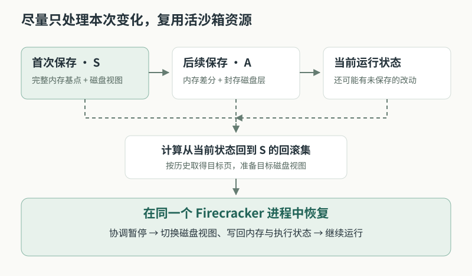
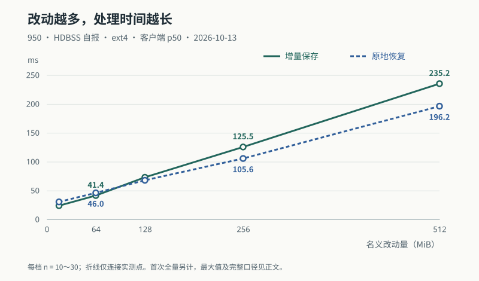

# 让 AI Agent 可以回到上一步

E2B 沙箱级快照回滚的设计与价值

> 江路路（j30059180） · 2026-10-17 · v0.1.0

一个 AI Agent 完成环境准备、启动服务、运行了前半段任务，却在下一步操作中把环境弄坏了。此前已经完成的工作，应该有机会保留下来。

我们在 E2B 与 Firecracker 上实现的沙箱级快照回滚扩展，可以在任务执行期间保存现场，再将同一个运行中的沙箱恢复到保存时的状态。恢复范围覆盖内存、进程、CPU 执行状态、受支持的设备逻辑状态和根文件系统。通过增量保存与原地恢复，任务能够在一次失败之后，从保存点继续尝试。

在已归档的 950 平台测试中，名义改动量为 64 MiB 的混合负载，增量保存与恢复的客户端耗时中位数分别为 **41.4 ms、46.0 ms**。这些结果说明，快速回退可以成为部分任务执行循环中的实用操作。其价值在于减少重复准备、保留执行进展，并让系统能够从同一现场尝试不同方案。具体收益取决于工作负载；外部数据库写入、已发出的请求等副作用，需要业务另外管理。

## 一次失败，为什么常常意味着大量重来

这里的 AI Agent，指能够根据目标调用工具、执行代码并推进多步骤任务的智能体。它的行动会真实地改变执行环境。

设想这样一个自动修复任务：Agent 拉取项目、安装依赖、准备测试数据，启动一个服务，并在进程内完成了数据加载。接下来，它尝试升级某个组件、修改配置并运行测试。

测试失败了。新版本改变了依赖关系，配置文件已经覆盖，后台进程也可能退出。Agent 还知道自己的目标，却已经失去了开始尝试之前的那个运行现场。

回退代码只能处理部分变化。重新运行初始化脚本，则要再次安装、加载和启动；如果任务中间有尚未写入文件的计算结果，还需要重新计算。逐项清理也很困难：一次操作到底改了哪些文件、启动了哪些子进程、留下了哪些内存状态，往往没有完整记录。

对于多步骤任务，这会放大失败的代价。失败发生在后面，前面的准备却可能跟着重做。任务越长，环境越复杂，恢复工作就越容易超过失败步骤本身。

快照回滚提供了一种直接的处理方式：在开始有风险的尝试之前保存现场；如果结果不满意，就恢复这个现场，再执行新的方案。示例中的依赖、配置、进程和已加载的数据可以一起回到保存点。



*图 1：示意工作流。一次失败后，任务可以复用保存点之前的准备工作。*

这里的“失败”有明确范围：可以是沙箱内的程序崩溃、文件被误改、依赖安装失败，或者一次尝试没有达到目标。原地回滚要求承载沙箱的虚拟机仍然存活。宿主宕机、沙箱被销毁之后的恢复，需要持久化快照等其他机制。

对于 Agent，能够回退并不直接提高一次决策的正确率，但它可以降低试错的代价。当返回一个已知起点足够方便时，工作流就能更从容地尝试、验证，再决定保留哪条路径。

## 我们需要保存怎样的执行现场

E2B 为任务提供独立的执行环境。在本文讨论的实现中，每个沙箱由一台轻量虚拟机承载，内部有自己的操作系统、进程、内存与文件系统；Firecracker 是在宿主上运行这台虚拟机的程序。下文把保存的检查点称为 checkpoint，把恢复操作称为 restore。

一个正在工作的沙箱，其状态远比项目目录丰富。解释器里有变量，后台进程有尚未完成的任务，内核里有文件缓存，磁盘上有配置与数据，CPU 记录着程序执行到了哪里。恢复一个运行现场，需要协调这些状态。

| 状态所在的位置 | 可能保存着什么 | 回滚后的行为 |
|---|---|---|
| 内存与进程 | 已加载的数据、变量、后台任务、内核缓存 | 回到保存时的内容与进程状态 |
| CPU 与受支持的虚拟设备 | 执行位置、寄存器、设备队列 | 恢复对应的执行与逻辑状态 |
| 整个根文件系统 | 代码、配置、依赖、文件及权限 | 恢复保存时的磁盘视图 |
| 沙箱之外的系统 | 外部数据库、API、消息队列、远端文件 | 保持外部系统已经发生的变化 |

这意味着，保存时正在运行的进程可以以原来的 PID 继续运行；保存之后启动的进程会消失；保存之后被杀掉的进程可以恢复。文件的新建、修改、删除和权限变化，也随根文件系统一起回退。[1]



*图 2：恢复范围由沙箱边界决定。外部任务记录和副作用需要工作流协调。*

这个范围带来一个重要收益：应用不必为沙箱内部的每一种状态分别编写保存与恢复代码。业务负责选择有意义的保存点，基础设施负责协调底层现场。

它也划出了正确使用的边界。假如沙箱已经向外部数据库写入一条记录，回滚不会删除这条记录。假如 Agent 的控制程序运行在沙箱之外，它保存的对话、计划和执行日志也不会自动回退。工作流需要记录“现在恢复到了哪个保存点”，并决定哪些操作可以重试、哪些需要去重或补偿。

## 保存一个现场，然后继续尝试

回到前面的修复任务。环境准备完成后，先建立保存点 S。Agent 尝试方案 A，修改代码与依赖，执行测试；如果失败，就恢复 S，再尝试方案 B。

恢复到 S 时，沙箱内会重新出现 S 对应的运行现场。同一个沙箱 ID、IP 和端口映射得以保留，底层 Firecracker 进程也保持不变。不过，操作期间存在短暂冻结，跨越恢复过程的 TCP 连接需要重建；正在执行的命令或文件请求可能被中断。

如果方案 A 的某个阶段值得保留，还可以在当时创建保存点 A。恢复 S 后再保存方案 B，就形成了不同的历史分支。只要保存点仍然有效，可以在这些已保存的状态之间切换。恢复旧状态本身不会删除更新的保存点。

这种能力适合依次比较多个尝试。每次只有一个当前运行现场；需要多个方案同时运行时，仍需另外创建和编排多个沙箱。SDK 提供保存点的创建、恢复、列出和删除，业务侧可以自行记录保存点与任务步骤、方案名称之间的关系。[2]

保存点也需要选择。一个自然的位置是“昂贵的准备刚完成，下一步即将改变环境”：例如服务已经就绪，测试数据已经加载，或者一个阶段的结果已经检查通过。工作流可以在这些节点保存，使用完毕后删除不再需要的历史。

保留历史也有资源成本：默认需要一份完整内存基点，加上后续内存差分、磁盘层和元数据。改动越多、保留的历史越多，占用通常越大。系统支持保存点数量与当前占用量检查，但只限制数量不能保证固定的空间上限；删除仍被其他保存点依赖的数据，也可能需要合并后才能释放。

## 为什么能够快速回到过去

要让回退进入高频执行循环，需要同时解决两件事：恢复出的状态要一致，每次操作的代价要足够低。我们的实现围绕三个问题展开。[3]

**首先，怎样让内存、磁盘和执行状态回到同一个时刻？**

只恢复文件，内存中的程序可能仍然认为文件处于修改后的状态；只恢复内存，磁盘又可能保留保存点之后写入的内容。这样的组合会造成现场不一致。

创建保存点时，宿主侧协调暂停虚拟机，在同一次冻结窗口里保存内存变化、CPU 与设备状态，并封存对应的磁盘写层，随后继续运行。恢复时，同样在协调暂停期间切回目标磁盘视图，恢复所需内存与执行状态，再让虚拟机继续工作。

尚未刷到磁盘的数据会随内存保存，已经进入根盘写层的数据由磁盘视图保存。二者共同构成那个时刻的运行现场。因此，应用无需为了这项能力额外部署一个专用的快照代理；主要控制动作由宿主侧完成。

完整恢复还涉及设备队列、网络连接与时间等细节。例如，虚拟机中的网络状态回到过去，外部通信方却仍在现在，旧连接就不能照常使用。实现会处理相关连接状态，调用方与应用需要重新建立连接。恢复成功返回前，也会按既有初始化机制校准墙钟。

**其次，怎样避免每次保存都复制整个沙箱？**

默认配置下，一个沙箱当前这一代的第一次 checkpoint 会保存完整的内存基点。启用脏页跟踪后，后续保存主要记录自上一保存点或恢复目标以来被写过的内存页。这里的“脏页”就是发生过写入的内存页。

内存差分按历史关系组织：一个保存点没有保存的页，可以从祖先提供的数据中取得。这样，后续每代无需复制一份完整内存。恢复时，系统综合当前尚未保存的改动，以及当前点到目标点之间的历史变化，计算需要写回的页，再取得目标状态下这些页的内容。

这也解释了为什么回滚耗时与“目标保存点自身有多大”不是一回事。即使目标保存点很小，当前状态已经偏离它很多，恢复时仍要处理这些变化。

磁盘采用分层方式。创建保存点时，将当前写层就地封存，后续写入落到新的写层；恢复时切换层组合得到目标视图。封存避免了把整份磁盘复制到另一处，但协调 I/O、准备视图和管理元数据仍然有成本。



*图 3：机制示意。恢复处理当前状态与目标之间的回滚集，实际代价还受磁盘视图、缓存及宿主负载影响。*

这一设计可以在 ext4 产物盘上工作，不依赖 reflink 文件克隆。对于客户而言，它减少了为使用这项能力而调整存储方案的要求。

在支持的 950 平台上，HDBSS 提供硬件脏页跟踪：由硬件记录相关写入信息，供增量处理使用。其他配置可以使用软件写保护跟踪，或在未启用跟踪时保存全量。是否启用增量、使用哪个后端都可以观测。HDBSS 专项已经有启用与数据面验证；目前没有同机软件后端对照，不能据此给出独立的加速倍数。

**第三，为什么恢复时能够省去大量重建工作？**

本方案直接对活着的虚拟机执行原地恢复。Firecracker 进程、宿主侧虚拟机对象、内存映射、网络与块设备资源继续复用。需要更新的是回滚涉及的状态，以及必须重新处理的连接等内容。

对高频、小跨度回退而言，这使系统能够避开反复建立这些宿主资源的工作。它也决定了能力的生命周期：快速 checkpoint 依赖原来那个活沙箱，不能拿到另一台机器独立恢复。

这是一项明确的架构取舍。任务执行中的快速回退，交给活体原地恢复；任务需要离场、长期保存或跨节点恢复时，使用原生持久化快照路径，并配置相应的存储。两者可以配合：先通过快速回滚选择满意的状态，再用原生快照固化该状态。[4]

因此，我们将操作代价尽量集中在本次变化上。首次全量、暂停与恢复、接口往返、位图处理和磁盘视图装配仍有开销，恢复也会受缓存、连接清理和共享资源竞争影响。“增量”意味着减少重复工作，并不意味着每次操作都有固定耗时。

让这条路径可用，还需要对错误保持明确的态度。恢复前检查数据与状态是否满足条件；发现恢复链缺失、设备拓扑不匹配等问题时拒绝操作。对于提交之后导致状态不完整的严重失败，系统会要求销毁重建，避免把一个已经不可信的现场继续交给业务。失败语义、删除回收和分阶段计时，都是完整能力的一部分。

## 实际效果：多快，恢复后能否继续工作

我们从三个方面判断效果：调用需要多久、现场是否正确，以及恢复完成后是否能够继续执行任务。下面使用手册中已经归档的测试结果，各组结果保留各自的负载与范围。

**代表性增量操作达到几十毫秒量级。**

本文的“950”指项目中的鲲鹏 950 目标平台。2026 年 10 月 13 日的分档测试使用 aarch64 平台、ext4 产物盘，Firecracker 自报 HDBSS 后端；两次首次全量内存产物均为 2048 MiB。每个增量样本从基点制造规定量的内存与根盘文件改动，创建保存点，再恢复基点并校验现场。[5]

下表计时从客户端发起调用到返回，包含网络往返与服务端处理。p50 为中位数，表中的最大值用于展示这一批样本的波动。MiB 是数据量单位，1 MiB = 1024 × 1024 字节；混合 64 MiB 档由内存写入 48 MiB 与文件写入 16 MiB 组成。

| 混合负载名义改动量 | 样本数 | 保存 p50 / 最大值 | 恢复 p50 / 最大值 |
|---|---:|---:|---:|
| 16 MiB | 30 | 23.8 / 30.2 ms | 30.4 / 33.9 ms |
| 64 MiB | 20 | 41.4 / 49.1 ms | 46.0 / 56.0 ms |
| 128 MiB | 20 | 73.0 / 88.7 ms | 67.8 / 74.1 ms |
| 256 MiB | 20 | 125.5 / 143.3 ms | 105.6 / 123.9 ms |
| 512 MiB | 10 | 235.2 / 259.0 ms | 196.2 / 218.7 ms |



*图 4：客户端耗时中位数，单位 ms；折线连接已测档位，用于观察趋势。名义改动量包含内存与文件写入，不等于最终快照大小。*

混合 16、64、128 MiB 三档给出了一个可用于产品设计的量级：这轮测试中，增量保存和恢复都在几十毫秒内完成。改动量进一步增加时，处理时间也增加。256 MiB 的恢复中位数已超过 100 ms，512 MiB 的保存与恢复分别达到约 235、196 ms。

以增量保存 200 ms、恢复 100 ms 的参考线判断，两项共同达标的最高已测混合档位为 128 MiB。首次完整基点需要单独计算，两次客户端测量分别约为 **0.47 秒、0.50 秒**，不能套用后续增量数字。

各档只有 10～30 个样本；按本轮统计方法，p99 恰好等于最大值，不能据此推断长期尾延迟。全部十二档共 270 次增量迭代，日志未记录操作失败或现场不一致。原始 JSON/JSONL 与部分部署身份材料尚未回传，这里引用的是归档文本中的统计值，尚未从原始样本独立重算。

**正确性需要同时检查数据和继续运行的能力。**

在 2026 年 10 月 15 日的 950 正确性验收中，测试建立了一个全量点、两个增量点，执行逐级回退、向较新状态恢复、反复切换，以及杀掉后台心跳进程后恢复等操作。10 次恢复的目标现场全部一致，59 项检查通过。[6]

这些检查既比较保存现场，也确认恢复后还能执行命令、读写文件、启动新进程，以及观察后台进程继续推进。这使“恢复成功”具有可检查的内容。

**恢复完成后，可以继续发起工作。**

另一轮 950 测试让 4 个沙箱各执行 50 轮恢复，每次恢复返回后立即发起一条流式命令和一条普通命令，等命令完成再进入下一轮。本轮 **200 次恢复、400 条后续命令全部成功**，验证了该场景下无需额外固定等待即可继续使用。[7]

这与“旧连接跨回滚保持有效”不同。工作流仍应在恢复前停止向该沙箱派发新任务，等待恢复成功后再提交后续工作。

在跨沙箱短时突发测试中，并发规模覆盖到 16 个沙箱：每代每沙箱改动内存 48 MiB、文件 16 MiB；16 并发档的两步增量保存中位数为 103、100 ms，三次恢复跳转的中位数为 75、71、60 ms。各并发档合计 93 次恢复，现场检查均一致。它说明了这组负载下的短时并发表现，持续吞吐和长期稳定性还需要对应测试。[7]

现有证据支持把这项能力用于评估高频回退场景。客户环境仍需测量自己的改动量、缓存状态、并发和保留策略；950 的小时级运行与长期资源收敛，也仍在待验证范围内。[8]

## 它会改变哪些工作方式

**对 Agent 工作流，它提供可返回的阶段性起点。**

自动修复、数据处理或多步骤工具调用，都可能产生失败的分支。在依赖准备、数据加载或阶段验证完成后保存，能够让后续尝试复用已经得到的现场。控制程序可以保留失败原因，恢复执行环境，再把新的方案交给同一个沙箱。

这让“尝试—验证—回退—再尝试”成为可以明确编排的流程。保存点适合放在阶段边界，也适合放在会大幅改变环境的操作之前。实际收益来自省掉了多少准备与重做工作，同时要扣除保存、恢复和历史管理的成本。

**对自动化测试，它提供运行现场的复位能力。**

有些测试的主要准备成本来自启动服务、加载数据或建立进程内状态。可以在完成准备后保存，每轮测试结束后恢复起点，再执行下一组用例。这样，各轮能够从同一个沙箱内部现场出发，也减少前一轮残留对后一轮的影响。

如果测试涉及外部数据库或服务，这些外部依赖仍需要独立复位。相同的沙箱内部起点也不保证完整确定性：线程调度、外部响应和时间都可能影响结果。

**对交互式开发与实验，它降低探索后返回的负担。**

开发者可以在修改复杂环境前留下一个保存点，尝试安装、配置或调试；找到有效状态后再保存，必要时回到较早现场继续探索。对已经运行起来、难以从脚本精确重建的环境，这种能力尤其有用。

从平台建设角度看，贡献是把这些场景需要的底层动作整合为一套可调用的能力：协调虚拟机状态、管理内存差分与磁盘历史、执行原地恢复，并提供生命周期、错误处理和观测接口。客户可以把精力放在“什么时候保存、何时回退、怎样处理外部操作”上。

评估投入价值时，可以从一个真实任务开始：测量准备阶段耗时、失败后重做的耗时、保存与回滚的新增开销，以及保留历史需要的资源。随着失败频率和可复用准备工作的增加，这项能力可能产生更明显的收益；具体改善幅度应来自任务级验证。

## 把回滚接入工作流

接入需要部署包含本扩展的服务端、配对的 Firecracker 与配套 SDK，普通 E2B 安装并不因此自动具备本文接口。当前实现面向手册记录的 aarch64 交付环境；恢复前会校验设备拓扑，对 balloon、vsock、vhost-user block 等不支持的设备组合明确拒绝。客户可沿用自己的部署方式，按手册完成版本配对与能力自检。

下面假设已有可用的 `sandbox` 对象，示例由沙箱外的控制程序执行：先把一个磁盘文件与一个内存文件写成 `v1`，保存后修改为 `v2`，再恢复并读取结果。[2]

```python
sandbox.commands.run(
    "echo v1 > /home/user/state.txt; echo v1 > /dev/shm/state.txt"
)
saved = sandbox.checkpoint.create(name="ready")
sandbox.commands.run(
    "echo v2 > /home/user/state.txt; echo v2 > /dev/shm/state.txt"
)
sandbox.checkpoint.restore(saved.checkpoint_id)
print(sandbox.commands.run(
    "cat /home/user/state.txt /dev/shm/state.txt"
).stdout)  # 两行 v1：根盘文件和内存文件一起恢复
```

实际工作流中，将两次写入换成准备阶段与尝试步骤即可。保存点 ID 与任务步骤的对应关系应记录在控制侧；发生业务失败后，由控制侧决定是否恢复。恢复调用报错时，需要按错误类型处理，不能假定已经回到目标状态。

有几项约定应在接入时明确：

- **协调外部操作。** 对付款、消息发送、外部数据库写入等动作采用幂等、去重或补偿机制；控制侧日志也要记录恢复位置。
- **协调并发和连接。** 同一沙箱的保存、恢复、删除会串行执行；恢复期间暂停其他命令与文件操作，跨恢复连接需要重建。
- **管理时间、随机状态与历史。** 单调时钟会回退，用户态随机数状态可能重复，需要时重新初始化。保存点按需删除，有依赖的数据可能在合并或依赖解除后才释放。
- **遵守生命周期。** checkpoint 绑定同一个 Firecracker 虚拟机进程，本文称为沙箱的“当前这一代”。沙箱销毁、Firecracker 或宿主编排服务重启、宿主重启、迁移，以及原生 pause / resume，都会使旧保存点失效。沙箱内部普通应用进程的退出不等于换代。需要长期保存的状态，应走原生快照路径。[1][4]

## 给任务保留重新选择的机会

在一个需要不断尝试的系统里，失败之后能保留多少进展，决定了下一次尝试从哪里开始。

沙箱级快照回滚把阶段性运行现场变成了可以保存、可以返回的对象。我们的实现通过协调内存与磁盘状态、保存增量历史、复用活沙箱资源，将快速回退接入现有 E2B 使用方式；代表性实测则给出了它在目标环境中的正确性与耗时依据。

对于使用者，最直接的改变发生在一次失败之后：任务可以回到准备已经完成的那一刻，带着对上次失败的认识，继续选择下一条路。

## 数据与技术依据

本文依据《E2B快照回滚技术手册》v0.5.6 撰写。任务案例为说明机制而构造；性能、功能与并发数字分别引用对应测试轮次，不合并为同一版本的统一验收结论。

1. [第 22 章：接口语义、恢复范围与生命周期](../docs/22-api-semantics.md)。
2. [第 21 章：配套 SDK、使用示例与历史管理](../docs/21-sdk-quickstart.md)。
3. [第 3 章：设计目标与取舍](../docs/03-goals-and-boundaries.md)；[第 4 章：总体架构与端到端流程](../docs/04-architecture-and-flow.md)；实现细节见手册第 5～12 章。
4. [第 15 章：快速回滚与原生快照的分工](../docs/15-native-cooperation-and-cost.md)。
5. [第 18 章：950 性能分档、条件、统计口径与 HDBSS 证据](../docs/18-950-performance.md)，主要引用第 2～4 节；HDBSS 专项见第 8 节。
6. [第 17 章：功能正确性验证](../docs/17-functional-verification.md)，引用第 4 节的 2026-10-15 smoke 验收。
7. [第 19 章：950 并发与恢复后立即请求](../docs/19-950-concurrency.md)，分别引用第 1.2 节与第 2.2 节。
8. [第 28 章：已知问题与待验证范围](../docs/28-status-and-directions.md)。

[1]: ../docs/22-api-semantics.md
[2]: ../docs/21-sdk-quickstart.md
[3]: ../docs/03-goals-and-boundaries.md
[4]: ../docs/15-native-cooperation-and-cost.md
[5]: ../docs/18-950-performance.md
[6]: ../docs/17-functional-verification.md
[7]: ../docs/19-950-concurrency.md
[8]: ../docs/28-status-and-directions.md
