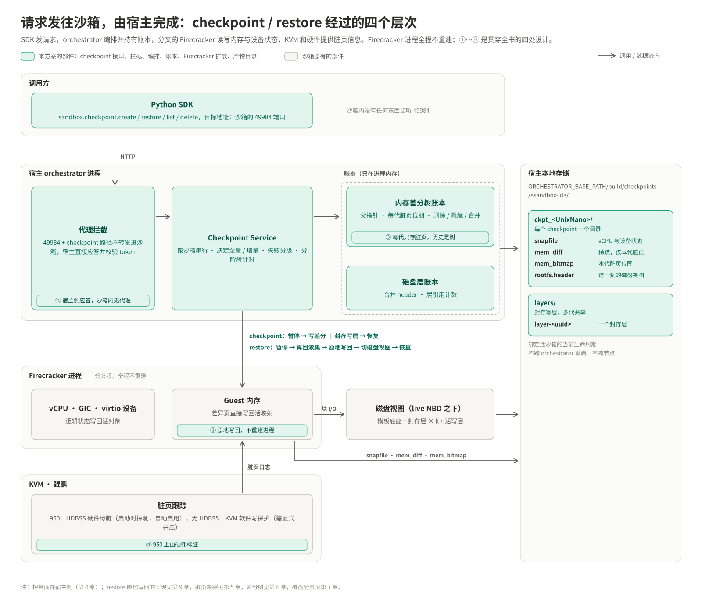
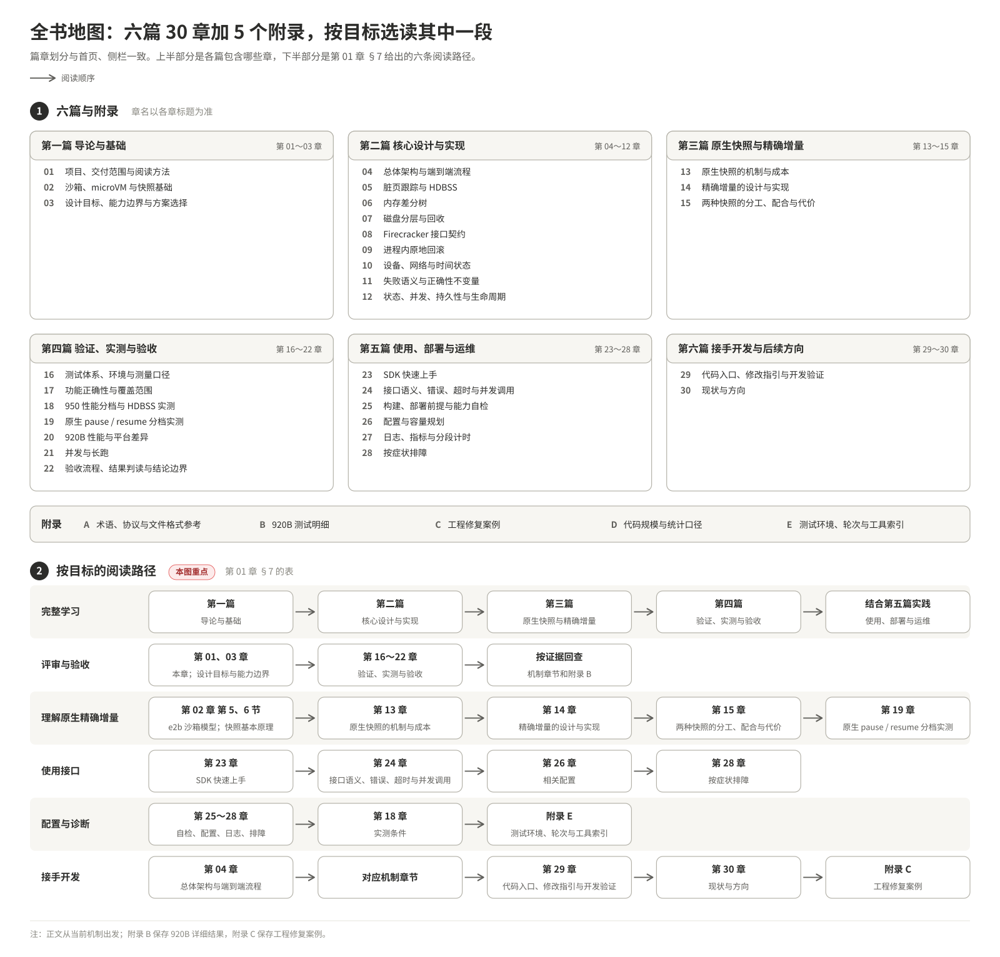

# 01 · 项目、交付范围与阅读方法

## 本章目标

读完本章，应当能回答五个问题：这个特性解决什么问题，交付物是什么，全书的主要结论是什么，每条结论在什么条件下成立，哪些范围测过、哪些没有测过。本章同时给出不同读者的阅读路径。本章的数字全部摘自后面的章节，条件和样本量随数字一起写出，完整数据在所链接的章节里。

## 1. 这个特性解决什么问题

AI Agent 在 E2B 沙箱里执行任意命令，中途经常需要退回到之前某一步的状态重试。扔掉沙箱重做一遍有三个问题：耗时长，会重复调用外部 API，重做的环境也不保证和原来逐字节相同。这个需求有三个特征：一个任务里要退十几次（高频）；回退发生在 Agent 的决策循环里（低延迟）；沙箱的 IP、端口映射和连接不能中断（[第 2 章](02-background.md)）。

E2B 原生的 pause / resume 要停掉沙箱，resume 时新建 Firecracker 进程，代价由固定开销和工作集决定，不随回退量变小（[第 3 章](03-goals-and-boundaries.md)）。本特性增加了另一条路径：**在同一个活沙箱里保存和恢复虚拟机状态**。

- `sandbox.checkpoint` 提供四个接口：`create`（执行 checkpoint）、`restore`、`list`、`delete`。
- 保存的状态包括 guest 内存、vCPU、中断控制器、设备逻辑状态和根盘。restore 保留当前的 Firecracker 进程、宿主资源和沙箱标识。
- 历史是一棵树，可以分支，也可以在保留的 checkpoint 之间前滚和回退。
- checkpoint 绑定所属活沙箱的当前生命周期，不跨 orchestrator 重启、不跨节点，也不跨原生 pause / resume。长期保存和重建用原生快照（[第 15 章](15-native-cooperation-and-cost.md)）。
- 外部数据库、已发出的 API 请求和跨 restore 的 TCP 连接不随 guest 回退，使用方按[接口语义](24-api-semantics.md)处理。

客户参考线是**增量 checkpoint ≤ 200 ms、原地 restore ≤ 100 ms**，按客户端墙钟 p50 判定，p99 并列给出，首次全量 checkpoint 单列不判定（[第 3 章](03-goals-and-boundaries.md)）。

## 2. 交付物与代码基准

| 内容 | 位置 | 属于交付物吗 |
|---|---|---|
| 功能代码 | KASandbox 同仓的 `packages/`、`firecracker/` 和 `py-sdk/` | 是 |
| 单元测试 | 同仓的 Go、Rust 和 SDK 测试 | 随代码保留 |
| 本手册 | 单文件 HTML，包含理解机制、使用接口和审阅结果所需的内容 | 是 |
| e2b-infra 与 RPM | 950 测试部署方式，包括上机测试工具和手册源文件 | 否 |

客户已有 E2B 和配套 SDK，采用自己的部署方式。本书说明本特性的前提、组件配对、配置和能力自检（[第 25 章](25-build-and-self-check.md)），不讲完整的 E2B 部署。

代码讲解基准是 `KASandbox_0904` 的 `deltabox-dev@57a30632cb9cb8eb67a35dd226d9ef4b40458af4`。已合入 openEuler KASandbox `deltabox` 的首次 MR 基线是 `0f9b58f`，此后的开发改动合入交付分支尚未完成，所以本书讲的是这个固定开发版本，不表示所有分支内容一致。各轮测试的被测版本分别记录，不从讲解基准推定。

## 3. 总体结构

图中有四个层次：SDK 发请求，orchestrator 编排并持有账本，分叉的 Firecracker 读写内存与设备状态，KVM 和硬件提供脏页信息。全书反复用到两个设计选择：

- **控制面在宿主侧。** 做 checkpoint 要暂停虚机，沙箱里的程序无法暂停自己，所以请求虽然发往沙箱的 49984 端口，却在 orchestrator 的代理处被截下，由宿主应答。沙箱内因此不需要任何代理程序（[第 4 章](04-architecture-and-flow.md)）。
- **restore 是原地写回，不是重建。** restore 不新建 Firecracker 进程，而是向活进程写回发生变化的页和设备状态，代价随回退跨度变化，不随虚机规格变化（原理在[第 2 章](02-background.md)，实现在[第 9 章](09-in-place-rollback.md)）。

## 4. 关键结论

### 4.1 读数规则

- **平台不混用。** 950 的脏页后端是 HDBSS（`hdbss`），是客户平台和实测主线。920B 没有 HDBSS，脏页后端是 KVM 软件写保护（`kvm-wp`），是开发和长跑平台。920B 的数字不是 950 指标，两边的差值也不能算作 HDBSS 收益。
- **口径不混用。** 客户端墙钟包含网络往返和服务端全部工作，用于达标判定；服务端 `total` 是服务端总耗时；`frozen` 是虚机被暂停的时长（[第 16 章](16-test-methodology.md)）。
- **流程、断言和性能分开判断。** 脚本 PASS 表示流程和断言通过，不表示每档性能都在线内。

### 4.2 性能：950 上哪些档位达标

条件：950，2026-10-13，`hdbss`，产物盘 ext4，模板 `base`（内存产物 2048 MiB），单沙箱串行，内存与文件按 3:1 混合，270 次增量迭代全部为增量模式。下表是客户端墙钟，单位 ms。每档 n 为 10～30，所以 p99 等于本轮最大值，不代表长期尾延迟。这一轮的二进制身份和原始 JSON / JSONL 仍待补（[第 18 章](18-950-performance.md)）。

| 混合档（名义改动） | n | checkpoint p50 / p99 | restore p50 / p99 | 判定 checkpoint / restore |
|---|---|---|---|---|
| 0 MiB | 30 | 17.2 / 23.0 | 22.4 / 30.9 | 达标 / 达标 |
| 64 MiB | 20 | 41.4 / 49.1 | 46.0 / 56.0 | 达标 / 达标 |
| 128 MiB | 20 | 73.0 / 88.7 | 67.8 / 74.1 | 达标 / 达标 |
| 256 MiB | 20 | 125.5 / 143.3 | **105.6 / 123.9** | 达标 / 超线 |
| 512 MiB（极限档） | 10 | **235.2 / 259.0** | **196.2 / 218.7** | 超线 / 超线 |

- 混合 0～128 MiB 共七档两项全部达标，这个结论只覆盖已测档位，不是连续区间的保证。纯内存和纯文件各只测了 16 MiB，只读触碰只测了 192 MiB，这三档也达标。
- 首次全量 checkpoint 单列：两次墙钟为 0.47 s 和 0.50 s，内存产物 2048 MiB。
- 同一 checkpoint 连续 restore 100 次，墙钟 p50 / p99 / 最大为 13.2 / 21.4 / 25.2 ms。这个负载没有每次制造新改动，不能代替分档结果。
- 920B 的单沙箱分档（`kvm-wp`，页缓存全热，1040 次迭代）里，512 MiB 档 checkpoint p50 / p99 为 176.7 / 183.9 ms，restore 为 108.2 / 113.0 ms，restore 超线（[第 20 章](20-920b-performance.md)、[附录 B](B-920b-results.md)）。

与原生路径并列。原生 pause / resume 的数据来自 950 上 2026-11-06 的另一轮（`hdbss`，每档 n = 15，每档独立沙箱），宿主内核和负载构造都与上表不同，所以只说明量级，不是同条件的精确对比（[第 19 章](19-native-pause-resume.md)）。

| 总改动 | checkpoint 墙钟 p50 | 原生 pause p50 | restore 墙钟 p50 | 原生 resume p50 |
|---|---|---|---|---|
| 0 MiB | 17.2 | 251.9 | 22.4 | 109.3 |
| 16 MiB | 23.8 | 262.7 | 30.4 | 107.2 |
| 64 MiB | 41.4 | 308.8 | 46.0 | 106.1 |
| 128 MiB | 73.0 | 346.8 | 67.8 | 108.9 |
| 256 MiB | 125.5 | 429.9 | 105.6 | 120.7 |

resume 这一列不能只看数字：resume 返回时内存页还没有加载，256 MiB 档恢复后读完内存负载要从 590.9 ms 变成 702.6 ms；restore 返回时内存已经写回。resume 还换了一代 Firecracker 进程，这一代之前的 checkpoint 全部失效（[第 24 章](24-api-semantics.md)）。

### 4.3 正确性

| 平台与日期 | 项 | 结果 |
|---|---|---|
| 950，2026-10-15 | `smoke` | 5 PASS / 0 FAIL / 0 SKIP；宿主预检 19 PASS；`checkpoint_verify.py` 59 / 59 |
| 950，2026-10-13 | 默认 `func` | 17 PASS / 0 FAIL / 4 SKIP：16 个 crtest 用例加 SDK 异常语义 |
| 950，2026-10-13 | HDBSS 专项 | 69 次增量迭代，MD5 不一致 0，非增量 0 |
| 920B，2026-09-29 | RPM 部署件上的两次回归 | `smoke` 均为 5 / 5，`func` 均为 PASS 17 / FAIL 0 / SKIP 4 |
| 920B | 重启、配额与故障注入（`3539c45df`） | 10 项全过，这些项在 950 上跳过 |
| 开发代码 | Firecracker Rust 单测 | 1554 passed / 0 failed |

详情见[第 17 章](17-functional-verification.md)和[附录 B](B-920b-results.md)。正确性检查的核心是让被 `kill -9` 的进程带着原来的 PID 和启动时刻回来，这个结果证明恢复的是完整内存现场（[第 2 章](02-background.md#65-一个判断快照是否正确的强判据)）。

### 4.4 并发与长跑

| 平台与负载 | 条件 | 结果 |
|---|---|---|
| 950 跨沙箱突发 | 2026-10-13，`hdbss`，ext4，N = 1～16，每代改 48 MiB 内存加 16 MiB 文件；每步只有 N 个样本，客户端墙钟 | N = 16 时 cp1、cp2 的 p50 / max 为 103 / 116、100 / 111 ms；三次 restore 为 75 / 87、71 / 92、60 / 76 ms；93 次 restore 现场 93 / 93 一致 |
| 950 同沙箱四调用方 | 同一轮，4 线程各 5 轮 | checkpoint、restore 各 20 / 20 成功，结束后 21 / 21 个 checkpoint 可 restore。另有 18 条 guest `mark` 命令异常，发生在命令与 restore 重叠时：10 条明确提示沙箱被回滚，8 条是流截断，后者不能逐条归因。它们不是 RPC 失败，也不是现场不一致 |
| 950 混合短稳态 T36 | 4 沙箱 × 120 s | 1322 次操作 0 失败；restore 272 次，墙钟 p50 / p99 为 42 / 59 ms，不一致 0 |
| 950 恢复后立即请求 T40 | 4 沙箱各 50 轮 | restore 200 / 200；紧接着发出的 400 条命令失败 0；发出时间距 restore 返回最多 3.06 ms |
| 920B 累计 | 2026-09-28、09-29，9 个二进制，三种负载加串口段，链深 10～2352 | **731877 次 restore 逐项一致，0 不一致**。逐项指内存代号、磁盘代号、内存内容、磁盘内容、心跳进程五项 |
| 920B 2 h 滚动长测 long11 | 2026-09-29，部署件 `93ccb02`，16 沙箱，滚动保留 10，7200 s，不计入上面的累计 | 147557 / 147557 一致；服务端 restore `total` p50 从 73.1 升到 94.3 ms，p99 从 131.5 升到 160.5 ms；末段 checkpoint `total` p50 / p99 为 34.3 / 54.9 ms；df 增量 41.1 → 45.2 GiB；结束时 16 / 16 可用 |
| 920B 最终长测 | `8ea5322bf`，16 沙箱，每沙箱上限 60，1800 s。驱动收到 429 不主动删除，checkpoint 发起 139934 次、成功 43117 次 | 服务端 restore `total` p50 / p99 为 87.67 / 171.28 ms，checkpoint 为 30.39 / 70.79 ms；df 峰值 90.3 GiB 后走平；97858 次 restore 0 不一致 |
| 920B 全规模 T36 | 16 沙箱 × 1800 s | 78695 次操作 0 失败、0 不一致；restore 客户端 p50 / p99 / max 为 43 / 62 / 287 ms |
| 920B 无上限极限负载 | RPM 部署件，16 沙箱 × 300 s，每沙箱 checkpoint 最多 586 个 | 8594 / 8594 一致；服务端 restore `total` p50 / p99 为 81.4 / 958.0 ms，p99 接近 1 s |

920B 的长跑数字是服务端、多沙箱口径，不和客户端墙钟的分档表比较。950 的结果是短时证据，不能换算成持续 QPS，也不能证明小时级稳定。详情见[第 21 章](21-concurrency-and-longrun.md)和[附录 B](B-920b-results.md)。

### 4.5 原生精确增量

ARM 适配基线上，原生 pause 用驻留判据决定导出哪些页：被换入过的页都算脏，读也算脏，粒度是 2 MiB。本书交付的代码在脏页跟踪开启时改用 Firecracker 的写跟踪位图，并把差分存储粒度从 2 MiB 降到 4 KiB，恢复时缺页单位仍是 2 MiB，内容从 4 KiB 映射拼接（[第 13 章](13-native-snapshot.md)、[第 14 章](14-native-precise-increment.md)）。

| 平台与日期 | 场景 | 修复前 | 修复后 |
|---|---|---|---|
| 920B，`kvm-wp`，2026-09-10 / 09-11，`pb2.py` | 只读 192 MiB，导出内存 | 358 MiB | **12.7 MiB** |
| 同上 | 只改 12 MiB，导出内存 | 176 MiB | **20.3 MiB** |
| 950，`hdbss`，修复前 2026-09-09～10，修复后 2026-11-06 | 改动 0～256 MiB 六档，导出内存 | 约 400 MiB，不随改动量变化（负载构造不同） | 15.9～294.3 MiB，随改动量增长 |

- 950 修复后这一轮 108 个样本失败 0，内容校验和常驻进程校验全部通过。pause p50 为 251.9～429.9 ms，主要是固定开销；resume p50 在 0～128 MiB 档为 106.1～109.3 ms，256 MiB 档为 120.7 ms，这一点的原因未查。
- 只换判据、不改 2 MiB 粒度不够：920B 上每代有约 130 MiB 的归并地板（[第 14 章](14-native-precise-increment.md)）。
- 兼容是单向的：新 orchestrator 能读旧快照，旧 orchestrator 读新快照会拒绝启动（[第 15 章](15-native-cooperation-and-cost.md)）。
- 没有 HDBSS 的机器默认不开跟踪，原生 pause 走驻留判据。要精确增量需要显式设置 `FC_TRACK_DIRTY_PAGES=true`，并让所有沙箱承担写保护的运行期代价（[附录 B](B-920b-results.md)）。

### 4.6 HDBSS

条件：950，2026-10-13，默认 order 1，Kunpeng 950 7592C，guest 2 vCPU，arena 256 MiB 和 1024 MiB，每组合 n = 3（[第 18 章](18-950-performance.md)）。

- **已启用的证据有三级。** KVM cap 502 可用；Firecracker 自报 `hdbss`，dmesg 与 Firecracker 日志的 buffer order 都是 1；常驻写者的冷写每页 KVM 退出数为 0.0072（arena 256 MiB）和 0.0023（arena 1024 MiB），远小于每页首写退出一次，恢复后 MD5 一致。
- **首写仍有代价。** 冷写和热写耗时比约 2.2，额外耗时约 46 ns/页。这是这个负载上的估计，不是隔离测出的纯硬件成本。
- **页分布影响很大。** 连续页 16 / 64 / 256 MiB 两项都在参考线内，512 / 1024 MiB 的 restore 超线。随机散页从 64 MiB 起 restore 超线（单写者 125.2 ms），512 MiB 的 checkpoint 也超线（单写者 281.8 ms）。这张表主要写内存，不能和第 4.2 节的混合档拼成一条曲线。
- **没有净收益结论。** 没有同机软件写保护对照，所以不给 HDBSS 相对软件后端的加速倍数；也没有其他 order 的数据，所以不比较 order。

## 5. 已测、跳过与待验证

| 范围 | 已测 | 跳过 | 待验证 |
|---|---|---|---|
| 功能 | 950 `smoke`、默认 `func`；920B 同样两档 | 无 | 跨树回滚只有单元测试，没有端到端用例 |
| 重启、注入、配额 | 920B 上 T18、T21、T37、T38 共 10 项全过 | 950 上跳过这四类，它们要重启服务或换带注入特性的 Firecracker | 字节配额没有 crtest 用例，默认关闭 |
| 单沙箱性能 | 950 十二档、串行 restore 100 次；920B 全表分档 | 无 | 950 perf 轮的二进制身份、原始 JSON / JSONL 和存储介质待补；每档样本少，不评价长期尾延迟 |
| 并发与长跑 | 950 最多 16 沙箱的短时突发、4 沙箱 × 120 s；920B 小时级长跑 | 无 | 950 的小时级长跑、滚动保留、资源走平、串口段和全规模 T36 都没有结果；920B 上视图块数在 2 h 末仍未饱和 |
| HDBSS | 950 默认 order 1 的启用证据和写密集基准 | 不做 950 上的软件写保护对照 | 其他 order 的比较 |
| 原生路径 | 950 pause / resume 六档；920B 体积、恢复开销和两条原生路径的分档 | 无 | 950 上 `create_snapshot()` 路径、`pb2.py`、T39、T41 待复跑；950 没有逐段拆分，也没有不开跟踪的对照 |
| 已知现象 | 920B 上空闲后直接 restore p50 80.9 ms；16 路并发的首个增量 checkpoint 有约 450 ms 和约 100～130 ms 两簇；`conntrack_bg` 贴近关键路径 | 无 | 前两项的根因或触发条件未定位，第三项有方案未实施 |

完整列表见[第 22 章](22-acceptance.md)和[第 30 章](30-status-and-directions.md)。[950 测试结果摘要](../evidence/950/README.md)逐轮记录了结论和验证边界。各轮身份分别记录，后一轮的哈希不追认前一轮。

## 6. 代码规模

<!-- code-stats:summary:start -->

按固定源码版本统计，MR 版净增 **3,788 行有效生产代码**，MR 后修改优化净增 **5,950 行**；当前版相对开发前基线合计净增 **9,738 行**。当前测试与验证代码去重后净增 **28,390 行有效代码**，包含测试框架与诊断工具。以上均排除空行、纯注释与 Python docstring；生产主合计排除自动生成代码。完整口径、分类、版本与物理行复核见 [附录 D](D-code-size.md)。

<!-- code-stats:summary:end -->

代码演进和工程修复案例见[附录 C](C-evolution-and-cases.md)，统计范围和固定 SHA 见[附录 D](D-code-size.md)。

## 7. 阅读路径

| 目标 | 阅读顺序 |
|---|---|
| 完整学习 | 第一篇 → 第二篇 → 第三篇 → 第四篇，结合第五篇实践 |
| 评审与验收 | 本章和[第 3 章](03-goals-and-boundaries.md) → [第 16～22 章](16-test-methodology.md) → 按证据回查机制章节和附录 B |
| 理解原生精确增量 | [第 2 章](02-background.md)第 5、6 节 → [第 13 章](13-native-snapshot.md) → [第 14 章](14-native-precise-increment.md) → [第 15 章](15-native-cooperation-and-cost.md) → [第 19 章](19-native-pause-resume.md) |
| 使用接口 | [第 23 章](23-sdk-quickstart.md) → [第 24 章](24-api-semantics.md) → [第 26 章](26-configuration-and-capacity.md)相关配置 → [第 28 章](28-troubleshooting.md) |
| 配置与诊断 | [第 25～28 章](25-build-and-self-check.md) → [第 18 章](18-950-performance.md)的实测条件 → [附录 E](E-environment-and-tools.md) |
| 接手开发 | [第 4 章](04-architecture-and-flow.md) → 对应机制章节 → [第 29 章](29-development.md) → [第 30 章](30-status-and-directions.md) → [附录 C](C-evolution-and-cases.md) |

全书六篇在首页和侧栏按同一顺序组织。正文从当前机制出发，附录 B 保存 920B 详细结果，附录 C 保存工程修复案例。

## 本章要点

- 本特性在同一个活沙箱里做 checkpoint 和 restore，不重建 Firecracker 进程；长期保存和跨节点仍用原生快照。
- 950 单沙箱：混合 0～128 MiB 档两项达标，256 MiB 的 restore 超线，512 MiB 两项超线；样本少，身份待补。
- 920B 上 731877 次 restore 逐项一致，另有 long11 的 147557 次；950 目前只有短时并发证据。
- 原生精确增量让导出量随写入量变化；950 的 pause / resume 六档已测，`create_snapshot()` 路径未测。
- HDBSS 在 950 默认 order 1 上已启用并通过内容校验；没有同机软件对照，也没有其他 order 的比较。
- 读数字时要同时看平台、口径、样本量和负载。
