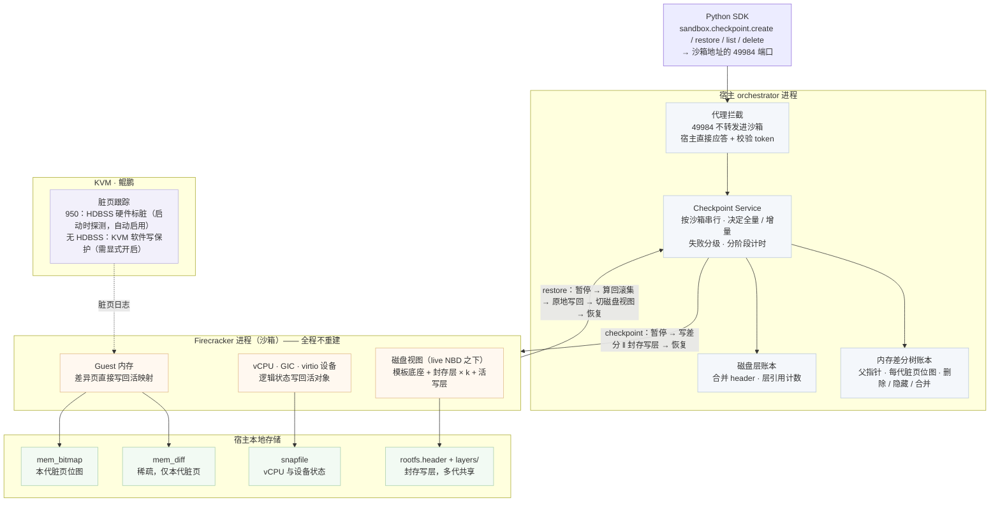

# 01 · 项目、交付范围与阅读方法

交付范围、固定版本和阅读路径在本章集中说明。先了解当前能力及证据范围，再按需要选择完整学习、接口使用、评审验收或接手开发的路径。

## 1. 交付组成与源码基准

正式交付为本单文件 HTML 与 KASandbox 的功能代码。当前源码讲解基准是 `KASandbox_0904/deltabox-dev@57a30632cb9cb8eb67a35dd226d9ef4b40458af4`；代码按以下路径流转：

```text
KASandbox_0904/deltabox-dev → KASandbox_0904/deltabox → openEuler KASandbox/deltabox
```

`deltabox` 的首次 MR 基线为 `0f9b58f`；后续开发改动合入交付分支仍待整理。本手册讲解当前固定开发版本，不宣称所有分支已经一致。

| 内容 | 所在位置与用途 |
|---|---|
| 功能代码 | KASandbox 同仓的 `packages/`、`firecracker/` 和 `py-sdk/` |
| 单元测试 | `deltabox-dev` 中的 Go、Rust 和 SDK 测试，按当前分支管理策略保留 |
| 文档源文件、完整上机测试与部署工具 | `e2b-infra` 内部辅助仓库；不属于正式代码交付件，客户访问安排可另行确定 |
| 交付手册 | 本 HTML，包含理解机制、接口使用与审阅结果所需的主要内容 |

客户已有 E2B 和配套 SDK，采用自己的部署方式。完整内部安装与 RPM 流程继续在辅助仓库维护。本书保留本特性的必要前提、组件配对、配置和能力自检。

## 2. 功能与使用范围

在同一活沙箱中，`sandbox.checkpoint` 提供 create、restore、list、delete：保存 guest 内存、vCPU、中断控制器、设备逻辑状态和根盘，恢复时保留当前宿主资源与沙箱标识。历史可以分支，也可以在保留的目标间前滚和回退。

checkpoint 绑定所属活沙箱当前生命周期。外部数据库、已发出的 API 请求、跨回滚的连接等必须按[使用契约](22-api-semantics.md)处理；长期保存与重建使用[原生快照](15-native-cooperation-and-cost.md)。

## 3. 总体结构一图



四个层次：SDK 发请求 → orchestrator 编排并持有账本 → 分叉的 Firecracker 读写内存与设备状态 → KVM / 硬件提供脏页信息。
两个关键选择先记住，全书反复用到：

- **控制面在宿主侧**。做 checkpoint 要暂停虚机，沙箱里的程序没法暂停自己，所以请求虽然发往沙箱的 49984 端口，
  却在 orchestrator 的代理处被截下、由宿主应答。收益是沙箱内不需要任何代理程序（[第 4 章](04-architecture-and-flow.md)）。
- **恢复是原地写回，不是重建**。restore 不新建 Firecracker 进程，而是往活着的进程里写回"变了的那些页"和设备状态，
  代价因此正比于回退跨度而不是虚机规格（这一分野在 [第 2 章](02-background.md) 讲清，实现在 [第 9 章](09-in-place-rollback.md)）。

## 4. 950 验证结论入口

| 主题 | 已有证据与范围 |
|---|---|
| smoke | 2026-10-15：5 PASS / 0 FAIL / 0 SKIP，宿主预检 19 PASS，正确性 59/59；见[功能结果](17-functional-verification.md) |
| 默认 func | 2026-10-13：17 PASS / 0 FAIL / 4 SKIP，16 个 crtest 用例及 SDK 异常语义通过；重启、注入和配额专项分别标注 |
| 单沙箱性能 | 已测混合 0～128 MiB 档两项墙钟 p50/p99 达标；256 MiB 的 restore p50 为 105.6 ms，超过 100 ms；512 MiB 极限档两项超线；见[完整条件与逐档表](18-950-performance.md) |
| HDBSS | 默认 order 1 的启用证据和写密集测量已归档；其他 order 和软件写保护对照未在本轮执行 |
| 并发与持续运行 | 有短时 A/B、4 沙箱 ×120 s 混合短稳态和恢复后立即请求证据；小时级与资源收敛范围见[第 19 章](19-950-concurrency.md) |

本阶段的[测试结果摘要](../evidence/950/README.md)和[收尾记录](../milestones/2026-10-17-sandbox.md)已归档。交付分支合入明确留待后续处理。

每轮身份与样本分别记录，smoke 或 HDBSS 专项的身份不追认更早 perf/func。完整平台条件和证据不足之处随对应结果保留。

## 5. 代码规模与阶段关系

<!-- code-stats:summary:start -->

按固定源码版本统计，MR 版净增 **3,788 行有效生产代码**，MR 后修改优化净增 **5,950 行**；当前版相对开发前基线合计净增 **9,738 行**。当前测试与验证代码去重后净增 **28,390 行有效代码**，包含测试框架与诊断工具。以上均排除空行、纯注释与 Python docstring；生产主合计排除自动生成代码。完整口径、分类、版本与物理行复核见 [附录 D](D-code-size.md)。

<!-- code-stats:summary:end -->

MR 后面向并发、持续运行、回收和长尾继续优化。完整演进见[附录 C](C-evolution-and-cases.md)，统计范围与固定 SHA 见[附录 D](D-code-size.md)。

## 6. 阅读路径

| 目标 | 阅读顺序 |
|---|---|
| 完整学习 | 第一篇 → 第二篇 → 第三篇 → 第四篇，结合第五篇实践 |
| 评审与验收 | 本章和第 3 章 → 第 16～20 章 → 按证据回查机制和附录 |
| 接口使用 | 第 21、22 章 → 第 24 章相关配置 → 第 26 章 |
| 配置与诊断 | 第 23～26 章 → 950 结果与附录 E 的实际条件 |
| 接手开发 | 第 4 章 → 对应机制 → 第 27、28 章 |

全书六篇在首页和侧栏按同一顺序组织。附录 B 保存 920B 详细结果，附录 C 保存历史修复过程；正文从当前机制出发。
