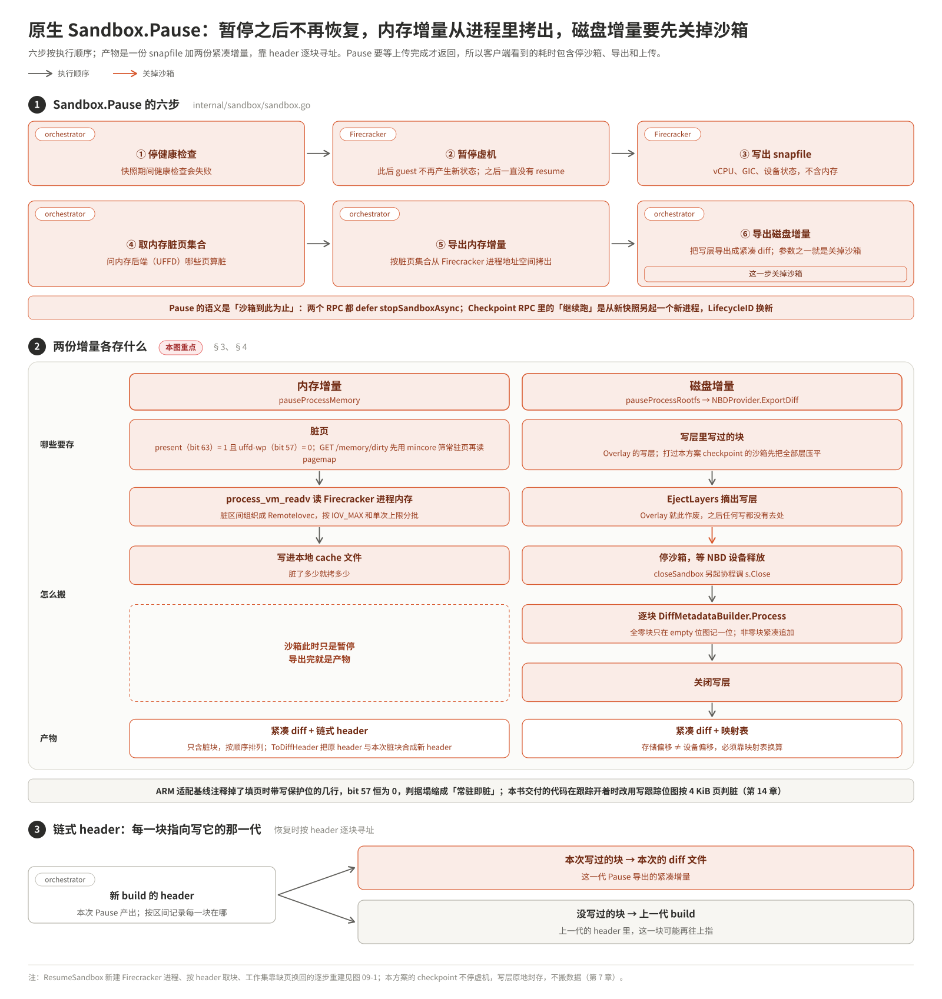
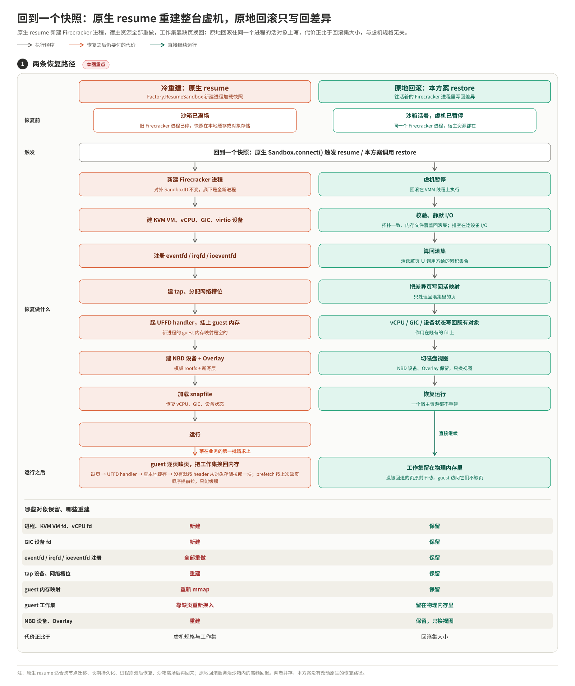

# 13 · 原生快照的机制与成本

## 本章目标

原生 pause / resume 服务于保存和重建沙箱，与活沙箱原地回滚承担不同任务。本章完整解释原生路径的两个 RPC、打快照与恢复的步骤、成本结构和它适合的场景，为 [第 14 章](14-native-precise-increment.md) 的精确增量改造和 [第 15 章](15-native-cooperation-and-cost.md) 的配合关系建立基础。

## 1. 两个 RPC

| RPC | 做什么 | SDK 里对应 |
|---|---|---|
| `Pause` | 打快照 + **停掉沙箱** | `sb.pause()` |
| `Checkpoint` | 打快照 + 停掉沙箱 + **从新快照重新拉起一个** | `create_snapshot()` |

两者共用 `snapshotAndCacheSandbox`（`internal/server/sandboxes.go:581`；`Server.Pause` 在 :380，`Server.Checkpoint` 在 :444），
区别只在之后要不要再拉起一个。两者都在函数开头 `defer s.stopSandboxAsync(...)`（:400、:469）：旧沙箱一定会被停掉。
`Pause` 打完快照就结束，产物上传进存储，这是"沙箱离场"的语义。`Pause` 会等 `waitForUpload` 完成才返回（:411）：快照元数据不能先于数据标记为就绪。所以客户端看到的 `pause` 耗时包含停沙箱、导出和上传，不只是冻结虚机。

上游 2026.09 的 `Pause` 不等上传：`snapshotAndCacheSandbox` 返回就结束（上游 `sandboxes.go:395` 的注释是 “Fire and forget - don't wait for upload to complete”），上传在后台的 goroutine 里做。等上传是 openEuler 基线提交 `01665a0c9` 改的，本方案沿用，进程级那套的 orchestrator 也一样。两种做法的差别只在最后一段：

- 不等上传也已经包含停虚机、等 Firecracker 退出、断开 NBD、导出根盘差分。`sbx.Pause` 导出根盘差分时把 `s.Close` 作为关闭钩子传进去（`RootfsDiffCreator.closeHook`），固定开销基本都在这一段（§6 时间线 232 ms 之前）。
- 这一段结束时，内存差分在本节点缓存目录（`DEFAULT_CACHE_DIR`，默认 `/orchestrator/build`）里一个 `mmap` 的文件中，由 `process_vm_readv` 从 Firecracker 进程读出写入（`block/cache.go`），这条路径上没有刷盘；`snapfile` 由 Firecracker 写出，也不刷盘；根盘差分写完会 `fsync`（`build/local_diff.go` 的 `CloseToDiff`）。所以上游返回时，内存差分很可能还在页缓存里。
- 上传在 `STORAGE_PROVIDER=Local` 时只是把这几个文件用 `io.Copy` 复制到 `LOCAL_TEMPLATE_STORAGE_BASE_PATH`（默认 `/tmp/templates`），同样不 `fsync`（`shared/pkg/storage/storage_fs.go` 的 `StoreFile`）。920B 上模板目录是 tmpfs，这一段的长短取决于要复制多少：精确增量构建一次导出约 16 MiB 时约 3 ms（§6）；进程级那套导出全部驻留内存，2026-11-20 的 920B smoke 里约 68～90 ms，同日 950 compare 里 55.2～182.5 ms（随导出量增长）。进程级那套的 orchestrator 从 `7e0a6a462` 起每次 pause 打一行 `Pause timing` 日志（`pause.snapshot_ms`、`pause.upload_ms`；`6a60dec6f` 起另有 `pause.phases` 分段），把两段分开记，只加日志、不改行为。等上传保证的是快照被标成就绪时文件已经在模板存储里，在 `Local` 存储上并不保证已经落盘；换成对象存储，等上传才意味着数据已经写到远端。

`Checkpoint` 拉起新沙箱时，三个 id 的变化是：

| id | 语义 | `Checkpoint` 之后 |
|---|---|---|
| `SandboxID` | 对外的沙箱标识 | **不变** |
| `ExecutionID` | 一次"执行"的标识，给 API、路由目录、分析用 | **不变** |
| `LifecycleID` | 一个 Firecracker 进程实例的标识 | **换新** |

`LifecycleID` 换新的理由写在代码注释里（`sandboxes.go:489-492`）：老沙箱的清理协程用自己的 `LifecycleID`
调 `RemoveByLifecycleID` 删表项，新沙箱若沿用同一个 id 就会被误删。

> 所以"snapshot 之后沙箱 id 不变"成立，但**底下已经是一个全新的 Firecracker 进程**：
> 新进程要重建 KVM VM、vCPU、GIC、设备、tap、UFFD，然后靠缺页把工作集换回内存。
> 这也是原生成本与虚机规格挂钩的根源 —— 它每次都在"重建"（[第 2 章](02-background.md) 的第一种形态）。

## 2. 打快照：`Sandbox.Pause` 的步骤

`Sandbox.Pause`（`internal/sandbox/sandbox.go:912`）的主干，按执行顺序：

```go
s.Checks.Stop()                                                     // ① 停掉健康检查
s.process.Pause(ctx)                                                // ② 暂停虚机
s.process.CreateSnapshot(ctx, snapfile.Path())                      // ③ 让 Firecracker 写出 vmstate
memfileDiffMetadata, _ := s.Resources.memory.DiffMetadata(ctx, s.process) // ④ 取内存脏页集合
memfileDiff, memfileDiffHeader, _ := pauseProcessMemory(...)        // ⑤ 导出内存增量
rootfsDiff, rootfsDiffHeader, _ := pauseProcessRootfs(...)          // ⑥ 导出磁盘增量
m.ToFile(metadataFileLink.Path())                                   //   写元数据
```

| 步 | 说明 |
|---|---|
| ① | 快照期间健康检查会失败，先停掉 |
| ② | 暂停虚机，此后 guest 不再产生新状态 |
| ③ | Firecracker 写出 `snapfile`：vCPU、GIC、设备状态。**不含内存** |
| ④ | 问内存后端（UFFD）"哪些页算脏"（[§3.1](#31-判据uffd-的写保护位)、[§3.2](#32-arm-适配基线上的退化)） |
| ⑤ | 按脏页集合把内存从 Firecracker 进程地址空间**拷出来**（[§3.3](#33-搬运从进程地址空间拷出)） |
| ⑥ | 把磁盘写层导出成紧凑 diff —— **这一步会关掉沙箱**（[§4](#4-磁盘增量)） |

**注意 ② 之后一直没有 resume。** 原生路径的语义就是"沙箱到此为止"；`Checkpoint` 里的"继续跑"是另起一个新沙箱实现的。



## 3. 内存增量

### 3.1 判据：UFFD 的写保护位

内存由 UFFD 托管（[第 2 章](02-background.md)）。上游 x86 的做法是在填页时区分读和写：

- 因**读**缺页而填的页 → 带 `UFFDIO_COPY_MODE_WP`，页仍是写保护的；
- 因**写**缺页而填的页 → 不带，页可写；
- 之后 guest 写一个"因读而填"的页 → 再触发一次写保护故障 → handler 清掉 WP 位。

于是 `/proc/self/pagemap` 里那一页的 **bit 57（uffd 写保护）** 就是一个准确的脏页信号：

```
脏  ⟺  present（bit 63）= 1  且  uffd-wp（bit 57）= 0
```

Firecracker 的 `GET /memory/dirty`（`firecracker/src/vmm/src/lib.rs:882` `get_dirty_memory`）就是按这条判据出位图的：
先用 `mincore` 筛出常驻页，再只对常驻页读 pagemap。代价是读缺页多走一次写保护故障（如果后来确实被写了），收益是判据**精确** ——
只读不写的页不算脏。

### 3.2 ARM 适配基线上的退化

ARM 适配版把填页时带写保护位的那几行注释掉了（`internal/sandbox/uffd/userfaultfd/userfaultfd.go:383-385`），于是每一次填页都清掉 WP 位，
无论触发它的是读还是写。bit 57 恒为 0，判据塌缩成"常驻即脏"——**读也算脏**。

叠加 [§1](#1-两个-rpc) 的"每次 `Checkpoint` 都重建沙箱、新进程的工作集要重新缺页换入"，得到一个反直觉的结果：
**即使两次 snapshot 之间什么都没做，增量的下限也约等于常驻工作集。**

必须说清：这是 ARM 适配引入的退化，不是 e2b 的设计问题 —— x86 上 e2b 的增量是精确的。
这个判据差异（"读也算脏"）的完整定义与推导在 [第 5 章](05-dirty-tracking-and-hdbss.md)，全书只在那里定义。

**本书交付的代码里，原生 pause 的这条判据已经修复**：跟踪开着时，`Uffd.DiffMetadata`（`internal/sandbox/uffd/uffd.go`）
改用 Firecracker 的写跟踪位图按 4 KiB 页判脏（做过 checkpoint 的沙箱还要并入"自启动以来脏页集"），跟踪关着、集合不可信或 Firecracker 没有导出端点时，才退回按常驻页判（[第 14 章 §10](14-native-precise-increment.md#10-退路什么时候回到驻留判据)）。为什么"只换判据"还不够、
存储和缺页填充两层还要怎么改、代价与验证，由 [第 14 章](14-native-precise-increment.md)、[第 15 章](15-native-cooperation-and-cost.md) 专门讲。
本章讲的是修复前的机制，它仍是理解原生成本模型的基础。

### 3.3 搬运：从进程地址空间拷出

拿到脏页集合后，`pauseProcessMemory`（`sandbox.go:1056`）经 `fc.Process.ExportMemory`（`internal/sandbox/fc/memory.go:116`）
**直接读 Firecracker 进程的内存**：`block.NewCacheFromProcessMemory`（`internal/sandbox/block/cache.go:756`）把脏区间组织成
`unix.RemoteIovec` 数组，批量调 `process_vm_readv`（:848），按 `IOV_MAX` 和单次读写上限分批，读进本地的 cache 文件。

这是一次真实的数据搬运：脏了多少就拷多少，从一个进程的地址空间到另一个进程的文件。

### 3.4 产物：diff + 链式 header

内存增量的产物是**紧凑**的：只含脏块，按顺序排列。要定位某个块，靠一张映射表。

`DiffMetadata.ToDiffHeader`（`packages/shared/pkg/storage/header/metadata.go:52`）把"原 header + 本次脏块集合"合成新 header：

```
新 build 的 header
  ├── 本次写过的块  →  指向本次的 diff 文件
  └── 没写过的块    →  指向上一代 build（可能再往上指）
```

所以 header 是**链式**的：一个 build 的 header 里，不同区间可能指向不同代的 build。恢复时按 header 逐块寻址。

## 4. 磁盘增量

### 4.1 `ExportDiff` 的步骤

原生导出磁盘增量走 `NBDProvider.ExportDiff`（`internal/sandbox/rootfs/nbd.go:72`）：

1. **摘出写层**：`Overlay.EjectLayers`，Overlay 就此作废；
2. **停沙箱**：另起一个协程调传进来的 `closeSandbox`，然后等 NBD 设备释放；
3. **逐块导出**：对写层里每个写过的块调 `DiffMetadataBuilder.Process`（`header/metadata.go:135`）——
   全零块只在 `empty` 位图里记一位、不写数据；非零块紧凑追加进输出流；
4. **关闭写层**。

所以产物很小，但"存储偏移 ≠ 设备偏移"，必须靠映射表换算。

（沙箱如果打过本方案的 checkpoint，写层已经被封存过若干次，当前写层只含最近一次之后的写，这时 `ExportDiff` 会把全部层压平后导出；
这是本方案为兼容原生 pause 做的处理，见 [第 7 章](07-disk-layering.md)。）

### 4.2 "必须停沙箱"的硬证据

这不是设计取向，是代码结构决定的。`Sandbox.Pause` 传给 `pauseProcessRootfs` 的 `DiffCreator` 是
（`sandbox.go:1015-1018`、`internal/sandbox/diffcreator.go:15-22`）：

```go
&RootfsDiffCreator{
    rootfs:    s.Rootfs(),
    closeHook: s.Close,        // ← 沙箱自己的 Close
}

func (r *RootfsDiffCreator) process(ctx context.Context, out io.Writer) (*header.DiffMetadata, error) {
    return r.rootfs.ExportDiff(ctx, out, r.closeHook)
}
```

**导出磁盘增量这个动作，参数之一就是"关掉沙箱"。** 为什么必须这样：

- 摘出写层之后 Overlay 作废，**之后任何写都没有去处**；
- 在写层的 mmap 上遍历必须没有并发写，否则导出的是一个"一半新一半旧"的镜像；
- NBD 设备要释放，写层文件才能关闭。

对"沙箱离场"这个场景，这完全合适 —— 反正沙箱也要停。**对高频回退则完全不能接受**，这是本方案要另辟蹊径的直接原因
（本方案的做法：写层原地封存，不搬数据、不停沙箱，见 [第 7 章](07-disk-layering.md)）。

## 5. 恢复：`ResumeSandbox`

客户端对已暂停的沙箱调用 `Sandbox.connect()` 即触发 resume，服务端走 `Factory.ResumeSandbox`（`sandbox.go:424`）：



成本落在两处：

| 成本 | 说明 |
|---|---|
| 建一台虚机的固定开销 | 进程、KVM、设备、网络、NBD —— 与虚机规格弱相关 |
| **把工作集换回内存** | 与虚机规格**强相关**，与"回退了多少"**完全无关** |

第二项是大头。一个刚恢复的沙箱在头几秒里，几乎每次访问新页都可能是一次缺页，要经用户态 handler 从文件或对象存储取回。

e2b 为此做了 **prefetch**：记录上一次运行时的缺页顺序，下次恢复时按这个顺序提前拉（`ResumeSandbox` 里读 `meta.Prefetch`）。
这能缓解，但改变不了成本模型 —— 要换回的量仍然取决于工作集有多大。

## 6. 成本模型

| 阶段 | 成本正比于 |
|---|---|
| 打快照 · vmstate | 常数（几十 KB） |
| 打快照 · 内存 | 脏页量（x86）/ **常驻工作集**（ARM 适配基线，修复前） |
| 打快照 · 磁盘 | 脏块量，**且必须停沙箱** |
| 恢复 · 构建 | 虚机规格（弱） |
| 恢复 · 换页 | **虚机工作集**（强） |
| 上传 / 下载 | 增量大小 + 网络 |

一句话：**原生方案的主要代价来自销毁和重建虚机，改动量只决定其上的增量部分。** 即使内存判据修成精确的（[第 14 章](14-native-precise-increment.md)），
"每次打快照都停掉沙箱、每次恢复都重建进程并换回工作集"这两项不变 —— 它们来自"沙箱离场"这个语义本身。

修复后的分档实测见 [第 19 章](19-native-pause-resume.md)：pause 由一段与改动量无关的固定开销主导，resume 与档位基本无关。分档数字与判定都以该章为准。

下面两节按阶段说明这些时间花在哪里。数字来自 950（2026-11-20，结果目录 `test950/results/20261120-122146-compare/`）：进程级那套 orchestrator（KASandbox `237b9ac62`，原生快照路径与上游相同，只加了分段日志）在 pause、resume 的每一步打点，测试脚本从 `Pause timing`、`Resume phases` 两类日志读出各段，每档 n = 20，取 p50。Firecracker 退出那一段另用内核 ftrace 拆到函数（`bash test950.sh fcexit`，每档 n = 5）。开测前清理过宿主上积累的网络命名空间，原因见 §6.3。

### 6.1 pause：改动量为 0 也要约 230 ms

各段按时间先后（orchestrator 日志，p50，ms）：

| 段 | 做什么 | 0 MiB 档 | 256 MiB 档 |
|---|---|---:|---:|
| 暂停 vCPU | 调 Firecracker API 暂停虚机 | 0.5 | 0.5 |
| 写 `snapfile` | Firecracker 写虚机状态；它同时把根盘设备上还没写回的数据经 NBD 刷出去，所以随写文件量增长 | 3.9 | 69.0 |
| 取脏页集合 | 确定要导出哪些页 | 3.2 | 3.5 |
| 导出内存 | 按驻留页导出（ARM 适配基线的判据，[§3.2](#32-arm-适配基线上的退化)），0 档也要导出 162 MiB，256 档 431 MiB | 19.6 | 84.2 |
| `ps` 查 Firecracker 进程状态 | 发 SIGTERM 之前执行一次 `ps -o stat= -p PID` | 106.0 | 114.1 |
| 发 SIGTERM | 通知 Firecracker 退出 | 0.0 | 0.0 |
| 等 Firecracker 进程退出 | 内核拆除虚机，见下表 | 71.6 | 72.1 |
| 断开 NBD | `NBDProvider.Close` 刷盘并断开 NBD 设备 | 19.4 | 20.1 |
| 导出根盘差分 | 根盘差分要等 NBD 设备释放后才能导出（[§4.1](#41-exportdiff-的步骤)） | 0.8 | 78.9 |
| 写元数据、进缓存 | 放进本节点的快照缓存 | 0.3 | 0.5 |
| **orchestrator 合计** | | **226.2** | **450.5** |

客户端看到的 pause（只计第一步，不含上传）是 230.5 / 457.2 ms，比 orchestrator 合计多出的 4～6 ms 是 API 与网络。之后把快照上传到模板存储另花 55.1 / 182.4 ms。

**真正保存状态的步骤（暂停到导出内存）在 0 档只有约 27 ms。每次都要付、与改动量无关的是三段：`ps` 约 106 ms、等 Firecracker 退出约 72 ms、断开 NBD 约 20 ms，合计约 197 ms。** 改动量从 0 增加到 256 MiB 时，增长的 224 ms 全部来自搬数据：写 `snapfile` 时刷根盘 +65 ms，导出内存 +65 ms，导出根盘差分 +78 ms；进程退出和断开 NBD 不变。

**`ps` 那 106 ms。** 上游 `fc/process.go` 的 `Process.Stop` 在发 SIGTERM 之前调用 `getProcessState`，它执行 `ps -o stat= -p PID`，代码注释写明用途是检查进程是否处于 D 状态（gopsutil 看不到），结果只用来打一行日志，不影响后续步骤。耗时在 `ps` 自身：920B 上宿主约 4000 个进程时单独执行它约 85 ms，直接读 `/proc/PID/stat` 只要 0.07 ms。本项目没有改这一步：原生路径作为对照要与上游保持一致。早先在 920B 上对 Firecracker 做内核栈采样时，有约 114 ms 一直看不到栈、没能归因，就是这一段：那时 Firecracker 还没收到信号。

**Firecracker 退出那 72 ms。** ftrace 只跟踪这个 Firecracker 的线程，950 上 0 档 5 次的 p50（跟踪本身有开销，看比例和归属）：

| 段 | ms |
|---|---:|
| 开始停沙箱 → Firecracker 退出（orchestrator 计） | 185.2 |
| 　`ps` 查进程状态（`ps` 进程 exec 到退出） | 104.7 |
| 　SIGTERM → 主线程退出完（`exit_notify`） | 79.1 |
| 　　关闭 KVM 虚机的 fd（`kvm_vm_release`） | 74.4 |
| 　　　其中销毁 KVM 虚机（`kvm_destroy_vm`） | 53.2 |
| 　　释放 mount 命名空间（`put_mnt_ns`） | 1.9 |
| 　　释放地址空间（`exit_mm`） | 0.3 |
| 　其余（起 `ps` 之前、Go 收到退出之后） | 1.4 |

SIGTERM 发出后，第一个线程立刻进入 `do_exit`；时间几乎都花在关闭 KVM 虚机的 fd 上。920B 的原始跟踪里，`kvm_destroy_vm` 的时间主要在 `synchronize_rcu` 等 RCU 宽限期，`kvm_vm_release` 里另有 irqfd 清理（`kvm_irqfd_release`）约 11 ms。guest 内存走 hugetlb，释放地址空间只要 0.3 ms。192 MiB 档这一段是 63.7 ms，与 0 档同一量级。920B 上同样的测量是 `ps` 104.3 ms、退出 86.1 ms（其中 `kvm_vm_release` 75.5 ms），两台机器结构相同。

### 6.2 resume：各档 70～85 ms

各段按时间先后（orchestrator 日志，p50，ms）：

| 段 | 0 MiB 档 | 256 MiB 档 |
|---|---:|---:|
| 排队、取模板 | 0.2 | 0.2 |
| 网络槽位、NBD、uffd | 0.2 | 0.3 |
| 起 Firecracker 进程到 API 可用 | 35.0 | 45.0 |
| 加载 `snapfile` | 6.0 | 4.2 |
| 恢复 vCPU、写 MMDS | 0.9 | 1.0 |
| 等 envd 就绪 | 15.3 | 18.5 |
| 收尾返回 | 0.7 | 0.7 |
| **orchestrator 合计** | **60.2** | **67.3** |
| API 与网络 | 3.9 | 4.3 |
| 第一条命令 | 7.7 | 9.1 |
| **客户端 resume**（`connect` 返回 + 第一条命令） | **71.4** | **83.7** |

最大的一段是起一个新的 Firecracker。它包括：

- 建沙箱 cgroup。950 是 cgroup v2，orchestrator 启动时在 `/sys/fs/cgroup/e2b` 上打开 `cpu`、`memory` 两个控制器（`cgroup/manager.go` 的 `Initialize`），每个沙箱在它下面 `mkdir` 一个子目录，内核要为两个控制器建好接口文件，测试脚本单独 `mkdir` / `rmdir` 一个这样的目录约 12.6～13.6 ms。920B 是 cgroup v1，`Initialize` 直接跳过，同一步约 0.1 ms。这是 950 的 resume 比 920B 多出的主要部分。
- 启动命令 `unshare -m -- bash -c '…'`：先新建 mount 命名空间，内核要复制宿主的整张挂载表，再 `mount --make-rprivate /`，再 `ip netns exec` 进入沙箱的网络命名空间，最后启动 Firecracker，等它的 API socket 可用。新建 mount 命名空间的耗时与宿主挂载点数成正比，920B 上约每个挂载点 10 µs（2915 个挂载点时 `unshare -m` 29.3 ms，1486 个时 14.4 ms）。

256 档这一段多出约 9 ms，其他档都是 35～37 ms；等 envd 就绪 15～19 ms。这两处这一轮都没有再拆。

这些步骤都不搬运内存，也不拷根盘：内存由 uffd 按缺页加载，根盘由 Overlay 按需读差分，所以 resume 耗时**基本不随档位变化**。

成本只是推迟了。950 上（2026-11-06，256 MiB 档，`hdbss`，存储 `Local`，见 [第 19 章](19-native-pause-resume.md)）恢复后第一次读 192 MiB 内存负载需要 702.6 ms，快照前同一读法 590.9 ms，多出约 112 ms 不计入 resume 耗时，而由 guest 里第一个访问这些页的程序承担。

### 6.3 测试环境对这两组数字的影响

两项环境因素会改变上面的固定开销，与 ARM 适配代码无关：

- **宿主挂载点数。** 每个 e2b 网络命名空间在 `/run/netns` 下留一到两个 nsfs 挂载点。orchestrator 重启时不回收上一次留下的网络槽位，本项目测试中频繁切换栈、重启 orchestrator，950 上曾积累到 1421 个网络命名空间。每起一个 Firecracker 都要复制一遍挂载表，resume 随之变慢：950 上同一天，开测时有 666 个网络命名空间的一轮，起 Firecracker 一段 45.2 ms；清理到约 450 个挂载点后这一段 35.0 ms。有 1421 个网络命名空间的一轮没有分段日志，0 档 resume 93.0 ms，清理后 71.4 ms。pause 里释放 mount 命名空间一段（`put_mnt_ns`）也随挂载点数增长，在约 430 个挂载点时是 1.9 ms。`bash test950.sh` 现在在每个测量步骤开测前先回收网络命名空间。
- **cgroup 版本。** cgroup v2 上每次 resume 多约 13 ms 建沙箱 cgroup（§6.2）。

上游在 x86 上的数字取决于同样的因素：宿主进程数（`ps`）、KVM 销毁虚机的耗时、挂载点数和 cgroup 版本。本项目没有在 x86 上测，不给出对比。

### 6.4 与 checkpoint / restore 的差别

本方案 checkpoint 不停虚机，也不销毁任何资源；restore 把内存写回活着的 Firecracker 进程（[第 9 章](09-in-place-rollback.md)）。§6.1、§6.2 里 `ps`、进程退出、KVM 销毁、NBD 断开、建 cgroup、进程启动、加载 `snapfile` 这些固定步骤都不会发生，所以这部分固定开销不计入 checkpoint / restore。举一个量级：950 上（2026-11-17，混合负载 0 MiB 档，墙钟 p50，见 [第 18 章](18-950-performance.md)）checkpoint / restore 是 22.1 / 21.3 ms。

这不是"原生实现得慢"：原生要产出能离开这个进程、这台宿主的自足快照，停掉并重建进程是这个目标的一部分（[§7](#7-它擅长什么)）。

## 7. 它擅长什么

这套设计对它的目标场景是**合适**的：

| 场景 | 为什么合适 |
|---|---|
| **跨节点迁移** | 产物自足、进对象存储，任何节点都能加载 |
| **长期持久化** | 同上，且不依赖任何活体资源 |
| **进程崩溃后恢复** | 恢复本来就是"新建进程加载"，进程死不死无所谓 |
| **沙箱离场后再回来** | 停掉沙箱本来就是这个场景的一部分 |
| 低频使用 | 一个沙箱一两次，固定开销摊得开 |

它**不擅长**的恰好是本方案的目标场景：高频、低延迟、沙箱不能中断。这不是实现缺陷，是**成本模型和场景不匹配**。

## 8. 代码位置

| 关注点 | 位置（`packages/orchestrator/` 下，另注明者除外） |
|---|---|
| 两个 RPC | `internal/server/sandboxes.go` — `Server.Pause`、`Server.Checkpoint`、`snapshotAndCacheSandbox` |
| 打快照主体 | `internal/sandbox/sandbox.go` — `Sandbox.Pause` |
| 内存脏页判据 | `internal/sandbox/uffd/uffd.go` — `DiffMetadata`；`internal/sandbox/uffd/userfaultfd/userfaultfd.go` — 被注释的 `UFFDIO_COPY_MODE_WP` |
| 内存导出与进程内存拷贝 | `internal/sandbox/sandbox.go` — `pauseProcessMemory`；`internal/sandbox/fc/memory.go` — `ExportMemory`；`internal/sandbox/block/cache.go` — `NewCacheFromProcessMemory`、`copyProcessMemory` |
| 磁盘增量 | `internal/sandbox/diffcreator.go` — `RootfsDiffCreator`；`internal/sandbox/rootfs/nbd.go` — `ExportDiff` |
| 空块剔除、header 与映射 | `packages/shared/pkg/storage/header/metadata.go` — `DiffMetadataBuilder.Process`、`ToDiffHeader` |
| 恢复 | `internal/sandbox/sandbox.go` — `Factory.ResumeSandbox` |
| Firecracker 的驻留判据 | `firecracker/src/vmm/src/lib.rs` — `get_dirty_memory` |

## 本章要点

- `Pause` 打快照后停掉沙箱，`Checkpoint` RPC 打快照后再从新快照拉起一个新进程；`SandboxID` 与 `ExecutionID` 不变，`LifecycleID` 换新。
- 内存增量由内存后端判脏、用 `process_vm_readv` 拷出，存成紧凑差分加链式 header。
- ARM 适配基线上判据塌缩成"常驻即脏"，基准代码已在跟踪开着时改用写跟踪位图，细节在 [第 14 章](14-native-precise-increment.md)。
- 导出磁盘增量的参数之一就是关掉沙箱：写层摘出后 Overlay 作废，所以必须停沙箱。
- 恢复新建 Firecracker 进程，工作集靠缺页换回；这部分成本不进 resume 耗时，由 guest 里第一个访问这些页的程序承担。
- 原生方案的主要代价来自销毁和重建虚机，改动量只决定其上的增量部分。分档数字见 [第 19 章](19-native-pause-resume.md)。
- 950 上 0 档 pause 约 226 ms 里，发 SIGTERM 前的一次 `ps` 约 106 ms、内核销毁 KVM 虚机约 72 ms、断开 NBD 约 20 ms，保存状态只有约 27 ms；resume 约 60 ms 里，起新 Firecracker 约 35 ms（含 cgroup v2 建 cgroup 约 13 ms）、等 envd 约 15 ms。宿主挂载点数和 cgroup 版本会改变这些数字（§6.3）。
- 这套设计适合跨节点迁移、长期持久化、崩溃恢复和沙箱离场，不适合高频、低延迟、不能中断的回退。
