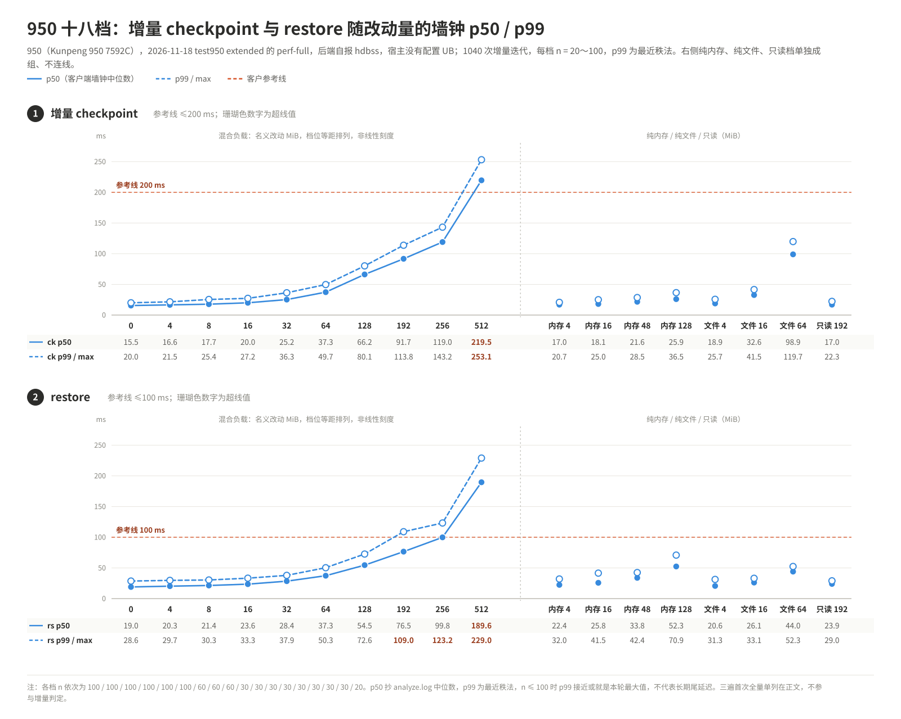
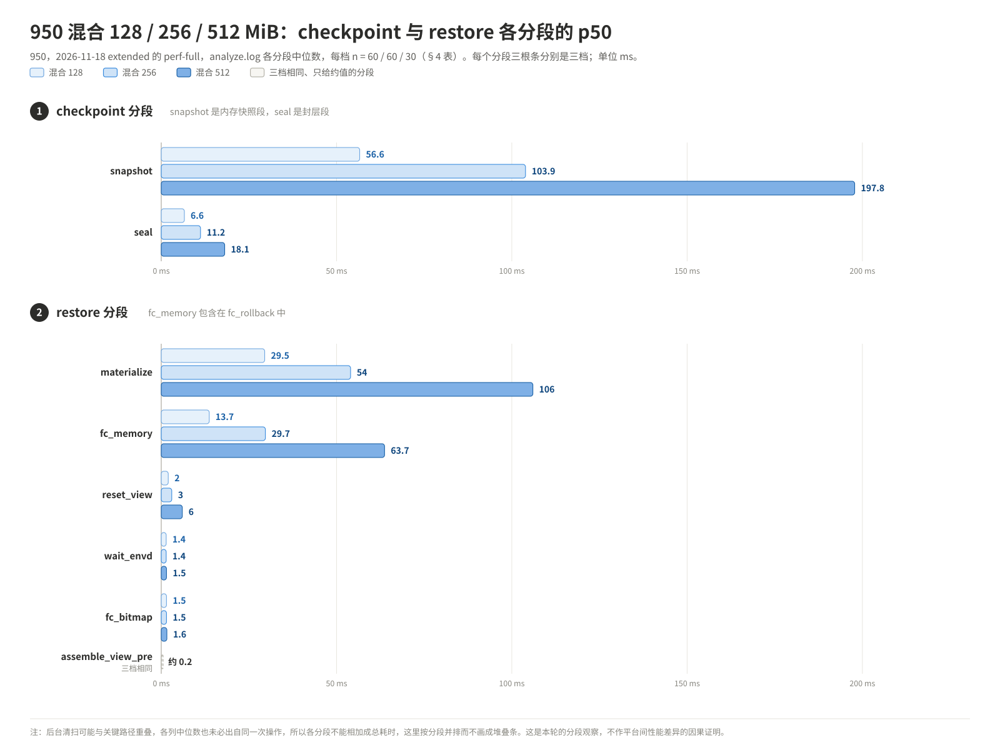
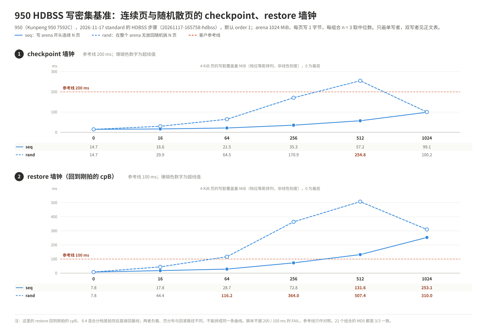

# 18 · 950 性能分档与 HDBSS 实测

## 本章目标

- 给出 950 上 checkpoint / restore 按改动量分档的墙钟结果，并按客户参考线判定。
- 说明这些结果的条件、样本、计时口径和仍未闭合的验证边界。
- 给出默认 order 1 的 HDBSS 启用证据和写密集实测。
- 给出 2026-11-18 第二轮的 18 档结果、order 1 与 order 9 的对比和空闲后 restore（§9）。

§1～§8 的数据来自 2026-11-17 在 950（141.61.11.24）上跑的 `bash test950.sh standard`，结果目录 `test950/results/20261117-161710-standard/`。§9 是 2026-11-18 重新部署之后 `test950.sh extended` 的第二轮（结果目录 `test950/results/20261118-111424-extended/`），含 18 档 perf-full、order 1 与 order 9 的对比和空闲后 restore。[950 测试结果摘要](../evidence/950/README.md)记录各轮结论与验证边界。原始 JSON / JSONL 只保留在被测机上，不提交或分发；本章统计值取自终端回传的 `analyze.log`、`compliance.log`、`serial-restore.log` 和 HDBSS 汇总表。达标判断按客户端墙钟，功能 PASS 与性能达标分别判断。

2026-10 曾在另一台 950（主机名 `slot6`，宿主内核 `6.6.0-159.4.12.166`）上测过一轮。那台机器已改用其他地址，与本章的被测机不是同一台；那一轮的数字已由本章取代，不再列出。

本章只讲增量性能和 HDBSS。原生 pause / resume 的分档结果在 [第 19 章](19-native-pause-resume.md)，那一路径不适用 checkpoint / restore 的客户参考线。

## 1. 性能模型与判定摘要

增量 checkpoint 的工作量主要取决于本代脏页和封存层，restore 的工作量主要取决于当前状态与目标之间的回滚集。固定开销包括暂停与恢复、API 往返、位图、换层和连接清理；空间布局、缓存与共享资源也会影响成本。

```text
增量 checkpoint ≈ 固定开销 + 本代改动的数据处理成本
restore ≈ 固定开销 + 回滚集写回成本 + 磁盘视图装配成本
```

客户参考线为增量 checkpoint ≤200 ms、restore ≤100 ms，按客户端墙钟 p50 判定，p99 并列。首次全量根单列，其工作量包含完整 guest 内存，不混入增量判定。

| 950 已测负载 | 本轮结论 |
|---|---|
| 混合 0 / 4 / 8 / 16 / 32 / 64 / 128 MiB | checkpoint、restore 的墙钟 p50 和本轮 p99 全部达标 |
| 混合 256 MiB | 两项 p50 达标（checkpoint 107.0 ms、restore 93.2 ms）；restore p99 128.2 ms 超线 |
| 混合 512 MiB 极限档 | restore p50 157.9 ms 超线；checkpoint p50 落在参考线附近（两种取法分别为 208.0 / 182 ms，见 [§4](#4-十二档性能与判定)），p99 252.7 ms 超线 |
| 纯内存 16 MiB、纯文件 16 MiB、只读 192 MiB | 两项达标 |
| 同 checkpoint 串行恢复 100 次 | 墙钟 p50 / p99 / max 为 10.6 / 17.7 / 17.8 ms |

这些结论受下面的条件、样本量和回传范围约束。

上表是 2026-11-17 的第一轮，当时宿主配置了 UB（灵衢远端内存）。2026-11-18 第二轮（没有配置 UB）的 perf-full 测了 18 档、样本更多：混合档 p50 与 p99 全部达标的最高已测档仍是 128 MiB；192 MiB 档两项 p50 达标，restore 60 个样本里只有 1 个超线；256 MiB 档 restore p50 99.8 ms、p99 123.2 ms；512 MiB 档两项超线，见 [§9](#9-第二轮2026-11-18-extended)。

## 2. 条件与来源

[§2](#2-条件与来源)～[§7](#7-同-checkpoint-串行-restore-100-次) 来自 standard 的 `sandbox/perf` 步骤（子目录 `sandbox-perf/20261117-164848-perf/`）；HDBSS 专项在 [§8](#8-hdbss-专项默认-order-1-的启用证据与写密集实测) 单列。
`sandbox/perf` 汇总为 **PASS 3 · FAIL 1**：分档基准、达标判定、串行长尾通过；并发 A/B 一条 restore 超时，判 FAIL，数据与分析见 [第 21 章](21-concurrency-and-longrun.md)，本章只列非并发部分。
脚本 PASS 表示流程与它检查的正确性通过，**不表示每档性能都在线内**；`compliance.py` 在有超线档时仍返回成功。

| 条件 | 本轮证据 |
|---|---|
| 机器 | Kunpeng 950 7592C，2.3 GHz；2 路 × 96 核 × 2 线程 = 384 CPU，4 个 NUMA 节点；内存 2261 GB；openEuler 24.03 (LTS-SP4) |
| 宿主内核 | `6.6.0-159.4.3.154.oe2403sp4.aarch64` |
| 时间 | standard 2026-11-17 16:17:10 开始、17:14:18 结束（+08:00）；`sandbox/perf` 16:48:48～16:57:57，用时 9 分 10 秒。本轮机器预约独占；16:21 曾因他人使用而中断，16:30 续跑，中断只影响 `sandbox/func` |
| orchestrator | `/usr/bin/template-manager`，sha256 `a5d03902afd56e84c4cd956bf73b3bb9d40c4049d736a51985d4d5c7927289a8`；能力文件自报 commit `4853232`、启动于 15:52:20 |
| Firecracker | `/fc-versions/v1.13.1/firecracker`，自报 `1.12.1`，sha256 `18f3faa7f47c173a5f47bfc7f578f5073cfbde2ac9bdb50bf88c434341d6d4c9` |
| 脏页后端 | `hdbss`，由能力文件 `track_dirty_pages_reason=hardware dirty state tracking present (KVM capability 502)` 自动选中；`FC_TRACK_DIRTY_PAGES`、`FC_HDBSS_ORDER` 均未设 |
| 客户端 | conda 环境 `jll-e2b`，Python 3.14，e2b SDK 2.20.0，httpx 0.28.1；在被测宿主上运行 |
| 测试入口 | e2b-infra `c27b6f8` 的 `test950.sh standard`；分档为 `bench_tiers.py` short 档组、两遍 |
| 模板 | `base`、私有沙箱；guest 2 vCPU、可见内存 1990 MiB；两遍全量内存产物均为 2048.00 MiB |
| 产物位置 | `/orchestrator/build/checkpoints`，ext4，块设备 `/dev/mapper/openeuler-root`（1.1 TB，开跑时 798 GB 可用）；缓存盘与产物盘同源 |
| 起跑状态 | standard 开始时 netns 1236、活 FC 0、MemAvailable 约 2141 GB |
| UB（灵衢远端内存） | 已配置（据机器负责人）；当时没有记录进程内存落在哪些 NUMA 节点上，也没有记录 `kernel.numa_balancing`。2026-11-18 起的数据（§9）是在没有配置 UB 时跑的 |

| 内容 | 依据文件 |
|---|---|
| 分档表、分段、产物、拟合、漂移 | `analyze.log` |
| 客户达标线与超线档交叉核对 | `compliance.log` |
| 同 checkpoint 连续恢复 100 次 | `serial-restore.log` |
| 部署身份 | `test950.sh report` 的身份段、smoke 的 `preflight.log` 与 `capabilities.log` |

**回传边界。** `raw-20261117-164852.jsonl` 等原始记录没有回传，本章是文本结果的归档与脚本口径核对，**没有用原始样本独立重算**。同一轮 smoke 的预检 19 项 PASS、正确性 59 项通过（[第 17 章 §4](17-functional-verification.md#4-部署预检与正确性验收)），身份与本章同一部署。

## 3. 负载、样本与统计口径

每遍新建一个沙箱，先预热 `/dev/shm/sweep` 512 MiB、随机源 32 MiB 和根文件系统上的 `/bench-root/fsblob` 192 MiB，再建全量基点。
每个增量样本为：**从基点造规定量改动 → checkpoint 子节点 → restore 基点 → 校验现场 → 删除子节点**。
内存以 tmpfs 文件原地覆写模拟，根盘文件写后 `sync`；两遍按档位分摊样本，并非把下面的 n 再乘二。
这与连续建长链、再跨代恢复的 `checkpoint_bench_v2.py` 不同：这里的 restore 撤销本样本的改动，不能用目标 checkpoint 的标签混淆回滚量。

`analyze.log` 记录 **270 次迭代全部 `mem_mode=incremental`、异常记录 0**；另有两遍首次全量，合计 272 条操作记录。
“异常 0”只表示迭代记录中 checkpoint / restore / delete 没有报失败、没有记录到现场不一致，不证明全部功能用例已覆盖。

下表 p50 统一抄 `analyze.log` 的中位数；p99 为最近秩法。每档 n 为 10、20 或 30，故**本轮 p99 就是最大值**，合用一列，不能解释为长期尾延迟已充分采样。
`compliance.py` 用 `round(q × (n−1))` 选排序项，偶数 n 的 p50 不取中间两项平均，因此与 `analyze.log` 有差异，不混抄。
两者在多数档只差零点几毫秒；混合 512 MiB 的 checkpoint 例外：n=10 时 `analyze.log` 取第 5、6 个排序值的平均 208.0 ms，`compliance.py` 取第 5 个 182 ms，由此推出第 6 个约 234 ms。中间两个样本跨在 200 ms 参考线两侧，所以这一档的 p50 结论取决于取法。
所有大小沿用脚本标签，计算按 1 MiB = 1048576 字节；耗时单位 ms。校验和造负载耗时不含在 SDK 调用墙钟内。

## 4. 十二档性能与判定

`ck` 为增量 checkpoint，`rs` 为 restore；判定列按 **ck ≤ 200 / rs ≤ 100 ms**，依次给出 p50、p99 的结果。
冻结窗口列作服务端解释，客户达标判断仍用墙钟。

| 档（名义改动 MiB） | n | ck 墙钟 p50 | ck p99 / max | rs 墙钟 p50 | rs p99 / max | ck frozen p50 | rs frozen p50 | 判定 ck（p50、p99） | 判定 rs（p50、p99） |
|---|---|---|---|---|---|---|---|---|---|
| 混合 0 | 30 | 22.1 | 31.1 | 21.3 | 32.2 | 20.4 | 15.5 | ✓ ✓ | ✓ ✓ |
| 混合 4 | 30 | 21.9 | 31.2 | 22.0 | 29.8 | 20.2 | 16.5 | ✓ ✓ | ✓ ✓ |
| 混合 8 | 30 | 24.7 | 33.0 | 25.0 | 32.0 | 23.0 | 18.5 | ✓ ✓ | ✓ ✓ |
| 混合 16 | 30 | 26.2 | 40.1 | 26.4 | 36.7 | 24.4 | 19.8 | ✓ ✓ | ✓ ✓ |
| 混合 32 | 30 | 32.3 | 45.1 | 29.7 | 38.7 | 30.5 | 23.5 | ✓ ✓ | ✓ ✓ |
| 混合 64 | 20 | 42.2 | 58.0 | 38.3 | 56.9 | 40.5 | 31.9 | ✓ ✓ | ✓ ✓ |
| 混合 128 | 20 | 60.1 | 89.6 | 68.5 | 94.1 | 57.9 | 60.1 | ✓ ✓ | ✓ ✓ |
| 混合 256 | 20 | 107.0 | 151.5 | 93.2 | **128.2** | 104.9 | 84.1 | ✓ ✓ | ✓ **✗** |
| 混合 512（极限） | 10 | **208.0** | **252.7** | **157.9** | **202.5** | 205.7 | 149.0 | **✗**（按第 5 个取 182，✓） **✗** | **✗ ✗** |
| 纯内存 16 | 20 | 24.0 | 32.5 | 25.3 | 36.5 | 22.1 | 19.6 | ✓ ✓ | ✓ ✓ |
| 纯文件 16 | 20 | 35.4 | 50.4 | 27.4 | 31.6 | 33.5 | 21.0 | ✓ ✓ | ✓ ✓ |
| 只读触碰 192（名义写入 0） | 10 | 23.6 | 33.2 | 24.1 | 28.4 | 21.9 | 17.7 | ✓ ✓ | ✓ ✓ |

**实测边界是已测的档位，不是连续区间的保证**：混合档 p50 与 p99 全部达标的最高已测档为 128 MiB；256 MiB 档两项 p50 达标，restore p99 已超线；
512 MiB 档 restore p50 超线，checkpoint p50 在参考线上下。纯内存和纯文件只测了各 16 MiB，不能外推成所有纯负载均达标。

`analyze.log` 还给出 p90：混合 256 MiB 的 restore p90 为 119.4 ms，即 20 个样本里至少 2 个超过 100 ms；混合 128 MiB 的 restore p90 为 85.8 ms。



两次首次全量均为 `full`，内存产物 2048.00 MiB，单列不参与增量判定：

| 遍 | 墙钟 s（日志精度） | frozen ms | snapshot ms | seal ms | total ms |
|---|---|---|---|---|---|
| 1 | 0.46 | 458.1 | 428.7 | 22.0 | 459.3 |
| 2 | 0.38 | 373.7 | 344.7 | 22.0 | 374.8 |

`compliance.log` 的“全量 p50 376 ms，最大 461 ms”是按排序项选取的，n=2 时就是较小那次，这里保留两次原值。

## 5. 分段、产物与尚不能归因的差异

**分段。** 下表为 `analyze.log` 各分段的 p50（ms）。checkpoint 侧，混合 128 / 256 / 512 MiB 的 `snapshot` 为 51.2 / 91.7 / 184.5，`seal` 为 6.2 / 11.6 / 18.7，增大改动量后的主要增长在内存快照段；`total` 之外的墙钟开销稳定在 1.0～1.3 ms。

| 档 | ck snapshot | ck seal | rs materialize | rs fc_memory | rs fc_rollback | rs reset_view | rs fc_bitmap | rs wait_envd | rs total | rs 墙钟 |
|---|---|---|---|---|---|---|---|---|---|---|
| 混合 0 | 16.8 | 1.6 | 7.3 | 3.3 | 5.9 | 0.6 | 1.5 | 2.0 | 20.1 | 21.3 |
| 混合 16 | 21.3 | 1.9 | 10.2 | 4.9 | 7.4 | 0.6 | 1.6 | 2.2 | 25.2 | 26.4 |
| 混合 64 | 33.9 | 4.4 | 17.5 | 8.7 | 11.3 | 1.4 | 1.5 | 2.3 | 37.1 | 38.3 |
| 混合 128 | 51.2 | 6.2 | 26.3 | 13.9 | 23.0 | 4.9 | 1.5 | 3.0 | 67.1 | 68.5 |
| 混合 256 | 91.7 | 11.6 | 47.2 | 25.0 | 32.4 | 4.6 | 1.5 | 2.7 | 91.6 | 93.2 |
| 混合 512 | 184.5 | 18.7 | 83.1 | 47.5 | 56.1 | 7.3 | 1.6 | 2.2 | 156.5 | 157.9 |

restore 侧的 `materialize` 和 `fc_memory` 都随回滚量增长；`fc_bitmap` 恒为 1.5～1.6 ms，`assemble_view_pre` 恒为 0.2 ms，`conntrack` 同步段为 0.0 ms，后台的 `conntrack_bg` 约 8～9 ms 不在关键路径上。
`fc_memory` 包含在 `fc_rollback` 中，后台清扫可能与关键路径重叠，各列中位数也未必出自同一次操作，不能直接相加。



**产物。** 下表为磁盘实占的中位数，按 `st_blocks` 计算，不是逻辑文件长度：

| 档 | 内存差分 MiB | 根盘层 MiB |
|---|---|---|
| 混合 0 | 22.09 | 8.570 |
| 混合 128（96 内存 + 32 文件） | 154.15 | 40.654 |
| 混合 256（192 + 64） | 284.04 | 72.746 |
| 混合 512（384 + 128） | 546.55 | 144.814 |
| 纯内存 16 | 39.25 | 8.600 |
| 纯文件 16 | 38.69 | 24.607 |
| 只读触碰 192 | 26.59 | 8.607 |

文件写入经过 guest 页缓存，因此也出现在内存差分里；混合档不能只用名义内存那一份作分母。
相对 0 档 22.09 MiB 基底，128 / 256 / 512 MiB 档的内存差分增量分别约为名义总改动的 1.03 / 1.02 / 1.02 倍；拟合 `内存差分 ≈ 22.08 + 1.0255 × MiB`（R² 0.9993）。
根盘层在没有文件改动的档也有约 8.6 MiB 本底，拟合 `盘层 ≈ 8.40 + 0.2586 × MiB`，斜率与文件占名义改动的 1/4 一致。本底的来源（guest 日志、元数据或封层格式）本轮没有分项记录，不作归因。
只读档比 0 档多出的 4.50 MiB 仍混有后台写与命令执行成本，不能据此认定 HDBSS 把读页判脏。

**纯文件 16 MiB 的 checkpoint 较慢。** 它的 checkpoint 墙钟 35.4 ms、`snapshot` 28.2 ms、`seal` 4.2 ms，高于同为名义总改动 16 MiB 的混合档（26.2 / 21.3 / 1.9 ms）和纯内存档（24.0 / 19.1 / 1.9 ms）。
两遍的纯文件冻结窗口 p50 为 33.3 / 35.4 ms，差异两遍都在。本轮没有等条件交错实验和原始样本，尚不能将差异归因于 HDBSS、文件系统、`sync` 后的回写或代码缺陷。

**缓存、漂移与离群的边界。** `analyze.log` 报两个磁盘读键非零次数都为 0 / 270；但脚本将缺失值与零一起计为“不非零”，
原始记录未回传，尚不能核实键覆盖率，**不能把这轮条件写成“页缓存全热已证”**。
两遍 checkpoint 冻结窗口 p50 的第 2 遍 / 第 1 遍比值在 0.92～1.41 之间；≤128 MiB 各档在 0.92～1.09，混合 256 MiB 为 1.18，混合 512 MiB 为 1.41（171.2 → 240.9 ms），纯内存 16 MiB 为 1.22。
只比较了两个新沙箱、固定档位顺序，大档第 2 遍变慢可能与产物盘累计写入、页缓存状态有关，本轮无法区分。
日志“离群零命中”只指没有单次 `frozen` 大于该档中位数两倍，不代表没有墙钟长尾或其他形式的波动。

## 6. 拟合是趋势，不是 p50 保证

`analyze.log` 在混合名义改动 ≤ 256 MiB 的 **210 条逐次迭代**上作普通最小二乘；小档样本多，拟合按迭代数加权，不是各档中位数拟合：

- checkpoint 墙钟 ≈ **22.74 + 0.3346 × MiB** ms（R² 0.9230）；
- restore 墙钟 ≈ **22.46 + 0.3162 × MiB** ms（R² 0.9270）。

反推 200 / 100 ms 得到的 529.7 / 245.2 MiB 只是**平均趋势线的交点**，不是实测 p50 达标上限，也没有置信区间；
529.7 MiB 已超出拟合范围。用该直线预测 512 MiB 档：checkpoint 194.1 ms，实测 p50 208.0 ms，高 7.2%；restore 184.3 ms，实测 p50 157.9 ms，低 14.3%。
这是平均趋势预测与中位数的描述性对照，不能作为尾延迟误差界。判定仍以 [§4](#4-十二档性能与判定) 的已测档位为准。
把 512 MiB 档也纳入的拟合（n=220）为 checkpoint ≈ 21.98 + 0.3541 × MiB、restore ≈ 23.39 + 0.2921 × MiB，斜率随纳入范围变化，说明在大档并非严格线性。
“实际产物 MB”拟合的自变量是内存差分与盘层实占之和，与名义改动量定义不同，不混用其斜率。

日志还给出纯内存 / 纯文件各 n=50 的拟合，但各自只有 0 和 16 MiB 两个改动量位置（0 档 30 次、纯负载 20 次），
不足以验证跨改动量的线性关系；纯内存 checkpoint 冻结窗口的 R² 仅 0.1053，不采用它作为一般代价模型。
本节系数与 [第 20 章 §2](20-920b-performance.md#2-分档基准与判定) 的 920B 系数属于不同机器、脏页后端与样本，不能直接相减作为 HDBSS 收益。

## 7. 同 checkpoint 串行 restore 100 次

`serial-restore.log` 记录一个新沙箱、一个调用方，对同一个全量基准 checkpoint 连续 restore 100 次。
命令为 `serial_restore.py --template base -n 100`；按脚本默认值，基准现场为内存 16 MiB + 文件 4 MiB，每 10 次抽验现场。
这个负载**没有每次再制造一档新改动**，不能把它的低延迟代替 [§4](#4-十二档性能与判定) 的分档回滚成本，也不能与 [第 20 章 §3](20-920b-performance.md#3-单沙箱串行与空闲后-restore) 的 5000 次试验合并样本。

| 指标 | 本轮结果 |
|---|---|
| 实际次数 | 100 |
| 客户端墙钟 p50 / p99 / 最大 / 最小 | 10.6 / 17.7 / 17.8 / 8.33 ms |
| 每 20 次的累计 p50 | 10.4 / 9.82 / 10.1 / 10.1 / 10.6 ms，没有随次数上升 |
| 服务端 frozen p50 / p99 | 6.95 / 12.2 ms |
| 服务端 total p50 / p99 | 9.29 / 16.6 ms |
| 结果 | 100 次全部成功、抽验一致，记录异常 0；本轮墙钟 p50、p99 均在 100 ms 线内 |

以上串行统计按 `serial-restore.log` 原值归档；没有逐次 JSONL，尚未独立重算，也不作小时级稳定性或冷缓存保证。

## 8. HDBSS 专项：默认 order 1 的启用证据与写密集实测

### 8.1 条件、来源与完成情况

本节来自 standard 的 `sandbox/hdbss` 步骤（子目录 `sandbox-hdbss/20261117-165758-hdbss/`），2026-11-17 16:57:58～17:01:56（+08:00），**PASS 3 · FAIL 0 · SKIP 0**：证据项、当前 order 基准、汇总表生成都成功。
**没有 `--orders`**，本轮没有改 job、没有重启服务，环境变量未设，实际使用默认 order 1。

| 条件 | 本轮日志记录 |
|---|---|
| 机器 | HiSilicon / Kunpeng 950 7592C、2.3 GHz、aarch64（与 [§2](#2-条件与来源) 同一台） |
| 宿主内核 / 客户端 | `6.6.0-159.4.3.154.oe2403sp4.aarch64`；Python 3.14（`jll-e2b`） |
| guest / 模板 | `base`，私有沙箱，guest 检出 2 vCPU、可见内存 1990 MiB；全量内存产物 2048 MiB |
| Firecracker | `/fc-versions/v1.13.1/firecracker`，自报 `1.12.1`；sha256 `18f3faa7…` |
| orchestrator | `/usr/bin/template-manager`；sha256 `a5d03902…`，与 [§2](#2-条件与来源) 的 perf 步骤是同一个进程，期间没有重启 |
| 存储 | `/orchestrator/build/checkpoints`，ext4 |
| order | orchestrator 与 FC 的 `FC_HDBSS_ORDER` 均未设置；dmesg `Enable HDBSS success, HDBSS buffer size: 1`，FC 日志 `HDBSS enabled (buffer order 1)` |
| 证据项 | 独立沙箱，arena 256 MiB；0 基底、256 MiB 连续单写者两个组合，各 3 次，共 6 次迭代；基线 checkpoint 全量 0.33 s、2048.0 MiB |
| 写密集基准 | 另一个沙箱，arena 1024 MiB；5 档脏页量 × 2 种写法 × 1 / 2 写者，加 0 基底，共 21 组合，各 3 次，共 63 次迭代 |
| 正确性与增量 | 两项共 69 次增量迭代，均完成；日志报告 MD5 不一致 0、非增量 0。另各有一次全量基点，不计入 69 次 |

来源按用途区分：`hdbss-evidence.log` 为启用与 256 MiB L3 证据，`hdbss-table.md` 为正式基准汇总。
JSON / JSONL 未回传：按日志统计归档，未从精确原始记录独立重算。

### 8.2 HDBSS 是否生效：三级证据与 order

| 证据 | 本轮结果 | 能说明什么 |
|---|---|---|
| L1 能力 | `KVM_CHECK_EXTENSION` 查询 cap 502 = True；预检 `KVM_ENABLE_CAP` 成功；`CONFIG_ARM64_HDBSS=y` | 宿主内核支持并能启用该能力 |
| L2 后端 / 启用日志 | 两个沙箱 FC 均自报 `hdbss`；dmesg buffer size = 1、FC 日志 buffer order = 1；两进程环境均未设该变量；能力文件 `track_dirty_pages=true` | 默认 order 1 实际启用，环境继承与运行日志一致 |
| L3 数据面 / 内容 | 常驻写者的冷、热写与 debugfs KVM 退出计数；恢复后 arena 的 MD5 一致 | 支持本轮确实通过硬件标脏完成增量与恢复，结合下表判断代价；不凭一个比值单独判定 |

下表都是连续单写者、n=3。证据项三次的冷写为 5.94 / 5.16 / 5.99 ms，热写为 2.19 / 2.02 / 2.60 ms；冷/热比按逐次计算后取中位数（2.71 / 2.55 / 2.30 → 2.56），不能用两列中位数直接相除（5.94 / 2.19 = 2.71）代替。

| 来源 / arena | 写脏覆盖 MiB | 冷写 ms | 热写 ms | 冷/热比 | 冷写 KVM 退出/页 | 热写退出/页 | 首写额外 ns/页 |
|---|---|---|---|---|---|---|---|
| 证据项 / 256 MiB | 256 | 5.94 | 2.19 | 2.56 | 0.0054 | 0.0026 | 52 |
| 正式基准 / 1024 MiB | 1024 | 20.41 | 7.98 | 未单列 | 0.0017 | 未回传 | 47 |

**冷/热明显大于 1，不等于 HDBSS 未生效。** 本轮约 2.6 倍，仍有冷写额外成本；同时 KVM 退出/页远小于每页首写一次退出，
且能力、自报、两侧启用日志和内容校验一致。冷/热耗时还受 cache、TLB、调度及后台活动影响；“冷 − 热”是本负载的额外首写耗时估计，
不能称为隔离测出的纯硬件成本。debugfs 计数覆盖该虚机在采集窗口中的全部 KVM 退出，不能全部归为 HDBSS buffer 溢出。
本轮未做同机软件写保护对照，因此不宣称实测减少了多少倍退出或获得了多少倍加速；也没有 order 之间的优劣结论。

### 8.3 正式基准：连续页与随机散页

“脏页量”是 **4 KiB 页的覆盖量**，每页仅写 1 字节；不是连续复制这么多 MiB，也不是内存或磁盘写带宽。
`seq` 写 arena 开头连续 N 页；`rand` 在整个 1024 MiB arena 中无放回挑 N 页，再按随机顺序写。
表中的 1 / 2 写者是 guest 内常驻工作进程，分别尝试绑 vCPU，两个写者共同分摊总页数；宿主的 checkpoint / restore RPC 仍逐个执行。

每个样本为：回到基线 → 冷写 → 同页热写 → 记 MD5 → 拍增量 cpB → 将这些页改成另一值 → restore cpB → 校验 MD5 → restore 基线 → 删除 cpB。
表中的 restore 计的是**回到刚拍的 cpB**，随后回基线的耗时另记、不混入此列；[§4](#4-十二档性能与判定) 的混合分档则是拍 cpB 后直接回基线。
本专项主要写内存，二者的负载范围、页分布与回滚路径不同，不能拼成同一条按 MiB 的曲线。

以下全部为 n=3 的中位数，单位 ms；差分为 MiB，按文件实占计算。21 个组合的 MD5 都是 3/3 一致。

| 脏页量 MiB | 写法 | 写者 | 冷写 | 热写 | checkpoint 墙钟 | ck frozen | restore 墙钟 | 差分 MiB |
|---|---|---|---|---|---|---|---|---|
| 0 | 基底 | 0 | — | — | 14.7 | 12.9 | 7.8 | 18.3 |
| 16 | seq | 1 | 0.32 | 0.12 | 16.6 | 14.3 | 17.8 | 33.0 |
| 16 | seq | 2 | 0.17 | 0.07 | 15.8 | 13.7 | 19.8 | 34.3 |
| 16 | rand | 1 | 1.21 | 0.59 | 29.9 | 27.8 | 44.4 | 35.4 |
| 16 | rand | 2 | 0.70 | 0.34 | 28.9 | 26.7 | 46.8 | 37.0 |
| 64 | seq | 1 | 1.27 | 0.49 | 21.5 | 19.2 | 28.7 | 81.3 |
| 64 | seq | 2 | 0.64 | 0.24 | 20.6 | 18.3 | 29.4 | 82.3 |
| 64 | rand | 1 | 4.24 | 2.59 | 64.5 | 62.4 | 116.2 | 85.7 |
| 64 | rand | 2 | 2.57 | 1.66 | 62.3 | 60.2 | 119.0 | 88.5 |
| 256 | seq | 1 | 5.11 | 2.02 | 35.3 | 33.4 | 72.8 | 273.1 |
| 256 | seq | 2 | 2.53 | 1.03 | 36.8 | 34.8 | 71.1 | 274.6 |
| 256 | rand | 1 | 13.69 | 8.70 | 170.9 | 168.7 | 364.0 | 287.7 |
| 256 | rand | 2 | 9.55 | 5.29 | 171.7 | 169.5 | 343.4 | 298.7 |
| 512 | seq | 1 | 10.10 | 4.07 | 57.2 | 55.0 | 131.6 | 529.7 |
| 512 | seq | 2 | 5.43 | 2.02 | 56.8 | 54.7 | 134.3 | 530.2 |
| 512 | rand | 1 | 24.26 | 17.85 | 254.8 | 252.9 | 507.4 | 548.5 |
| 512 | rand | 2 | 18.88 | 10.18 | 258.1 | 255.9 | 543.2 | 560.8 |
| 1024 | seq | 1 | 20.41 | 7.98 | 99.1 | 97.2 | 253.1 | 1042.4 |
| 1024 | seq | 2 | 10.66 | 4.47 | 96.4 | 94.1 | 251.1 | 1041.6 |
| 1024 | rand | 1 | 40.18 | 30.45 | 100.2 | 97.8 | 310.0 | 1076.3 |
| 1024 | rand | 2 | 35.55 | 18.11 | 105.5 | 103.6 | 269.1 | 1087.5 |

各项性能只记录，脚本不据客户的 200 / 100 ms 指标判 FAIL；与该参考线对照时，连续页的 16 / 64 / 256 MiB 组合中位数两项在线内，512 / 1024 MiB 的 restore 超线；
随机散页从已测 64 MiB 档起 restore 就超线，512 MiB 档的 checkpoint 也超线。它们不能替代 [§4](#4-十二档性能与判定) 的标准混合分档判定。



### 8.4 对性能和容量的含义

- **改动量还要结合页分布看。** 单写者 256 MiB 的 seq / rand，checkpoint 为 35.3 / 170.9 ms，restore 为 72.8 / 364.0 ms；
  512 MiB 时为 57.2 / 254.8 ms、131.6 / 507.4 ms。随机散页影响的不止 guest 写入，也影响后续快照与恢复。
  这与散页导致更多分散区间处理的机制相符，但本批没有内部区间数、I/O 调用或缓存分段记录，尚不能将全部差额归因到某一个阶段。
- **更大的档未必更慢。** rand 单写者从 512 到 1024 MiB，checkpoint 中位数从 254.8 降为 100.2 ms，restore 从 507.4 降为 310.0 ms。
  当写满整个 arena 时，rand 和 seq 都覆盖所有页，只是顺序不同，已不再是相同稀疏程度；1024 MiB 档 rand 与 seq 的 checkpoint 只差 1 ms 即是这个原因。样本只有 3 次，
  因而不作统一单调拟合，不据此认定越大越快或存在确定的代码缺陷。
- **双写者主要缩短 guest 写负载，不保证快照或恢复加速。** 例如连续写 256 MiB，冷写从 5.11 降到 2.53 ms，
  checkpoint 为 35.3 / 36.8 ms，restore 为 72.8 / 71.1 ms；它不是两个 checkpoint RPC 的并发能力测试。
- **增量体积接近写脏覆盖量加本底。** 正式基准 0 档差分 18.3 MiB；连续单写者 16 / 64 / 256 / 512 / 1024 MiB 的差分为
  33.0 / 81.3 / 273.1 / 529.7 / 1042.4 MiB。随机单写者 1024 MiB 为 1076.3 MiB，其中可能含选页列表等程序活动带来的额外脏页；
  与连续方式的差额不是 HDBSS 误记的直接证明。该表只列内存产物，没有测根盘封层容量。

这轮可以作为默认 order 1 的启用、内容一致性与写密集性能证据；这一轮没有 order 扫描（2026-11-18 的 order 1 与 9 对比见 [§9.4](#94-hdbssorder-1-与-order-9-的对比)）、同机软件写保护对照、长期运行或大样本尾延迟。
日志中的原始 JSON / JSONL 仍保留在被测机上，以便后续追查精确分位数、内部阶段与异常。

## 9. 第二轮：2026-11-18 extended

### 9.1 条件与来源

2026-11-18 用 e2b-infra `1dd8525` 重新构建 RPM 并重新部署之后，`bash test950.sh extended` 又跑了一遍分档、串行、并发、HDBSS 和空闲后 restore。结果目录 `test950/results/20261118-111424-extended/`，统计值取自 `bash test950.sh report <步骤> --run 20261118-111424-extended` 和 perf-full 的 `analyze.log` 的终端回传（工作区归档 `rollback-reports/950-test950-20261118/`，不入库）。

| 条件 | 本轮记录 |
|---|---|
| 机器、宿主内核 | 与 [§2](#2-条件与来源) 同一台、同一内核。extended 在 11:22 因宿主宕机中断，12:39 起从中断的步骤续跑；下面各步都在续跑之后。续跑时宿主没有配置 UB（灵衢远端内存）；§2～§8 的 2026-11-17 一轮跑的时候配置了 UB，当时没有记录进程内存落在哪些 NUMA 节点上 |
| orchestrator | `/usr/bin/template-manager`，sha256 `e54489e4…`（RPM `2026.09-3`）；与 §2～§8 的 `a5d03902…` 不是同一份二进制 |
| Firecracker、脏页后端 | 与 §2 相同（自报 `1.12.1`，`hdbss`）；`FC_HDBSS_ORDER` 只在 §9.4 的两段里设置，其余未设 |
| 产物位置 | `/orchestrator/build/checkpoints`，ext4，`openeuler-root` |
| `sandbox/perf` | 12:57:46 起；`bench_tiers.py` short 档组两遍，272 条操作记录；PASS 4 · FAIL 0 |
| `sandbox/perf-full` | 13:30:37 起；full 档组三遍，18 档，1040 次迭代全部 `incremental`、异常记录 0，另有 3 次首次全量；PASS 4 · FAIL 0 |
| `sandbox/hdbss-orders` | 13:19:53 起；先跑默认 order 的证据项，再把 job 环境改成 order 1、order 9 各跑一遍写密集基准，最后恢复原 job；PASS 7 · FAIL 0 |
| `sandbox/idle` | 13:38:32 起；七臂 200 次操作；PASS 1 · FAIL 0 |

**两种取法。** §9.2 的表取自 `analyze.log`，与 §4 相同：p50 是中位数（偶数 n 取中间两个的平均），p99 是最近秩法，n ≤ 100 时 p99 就是第 ⌈0.99 n⌉ 个排序值，n = 60 时就是最大值。`compliance.py` 按 `round(q × (n−1))` 选排序值，两者的 p50 在各档相差不超过 0.7 ms，但在线附近会给出不同的判定：混合 256 MiB 的 restore p50，`analyze.log` 是 99.8 ms（达标），`compliance.py` 是 100 ms（判超线）；混合 192 MiB 的 restore p99，`analyze.log` 是 109.0 ms（最大值，超线），`compliance.py` 是 94.6 ms（第 59 个）。本书按 `analyze.log` 判定，两种结果都写出来。perf（short 档组）只回传了 `compliance.log`。

### 9.2 分档：perf-full 十八档

perf-full 在 short 档组之外加了混合 192 MiB、纯内存 4 / 48 / 128 MiB 和纯文件 4 / 64 MiB，样本也多：混合 ≤ 64 MiB 每档 100 次，128 / 192 / 256 MiB 每档 60 次。客户端墙钟，单位 ms；判定按 ck ≤ 200、rs ≤ 100 ms，依次是 p50、p99。

| 档（名义改动 MiB） | n | ck p50 | ck p90 | ck p99 | ck frozen p50 | rs p50 | rs p90 | rs p99 | rs frozen p50 | 判定 ck | 判定 rs |
|---|---|---|---|---|---|---|---|---|---|---|---|
| 混合 0 | 100 | 15.5 | 17.6 | 20.0 | 13.8 | 19.0 | 23.9 | 28.6 | 14.6 | ✓ ✓ | ✓ ✓ |
| 混合 4 | 100 | 16.6 | 19.3 | 21.5 | 15.0 | 20.3 | 24.6 | 29.7 | 15.7 | ✓ ✓ | ✓ ✓ |
| 混合 8 | 100 | 17.7 | 21.1 | 25.4 | 16.0 | 21.4 | 27.2 | 30.3 | 16.8 | ✓ ✓ | ✓ ✓ |
| 混合 16 | 100 | 20.0 | 23.9 | 27.2 | 18.0 | 23.6 | 29.4 | 33.3 | 18.8 | ✓ ✓ | ✓ ✓ |
| 混合 32 | 100 | 25.2 | 30.2 | 36.3 | 23.5 | 28.4 | 35.2 | 37.9 | 23.3 | ✓ ✓ | ✓ ✓ |
| 混合 64 | 100 | 37.3 | 45.3 | 49.7 | 35.5 | 37.3 | 48.2 | 50.3 | 32.3 | ✓ ✓ | ✓ ✓ |
| 混合 128 | 60 | 66.2 | 74.2 | 80.1 | 64.2 | 54.5 | 71.8 | 72.6 | 48.8 | ✓ ✓ | ✓ ✓ |
| 混合 192 | 60 | 91.7 | 106.7 | 113.8 | 89.7 | 76.5 | 92.5 | **109.0** | 70.6 | ✓ ✓ | ✓ **✗** |
| 混合 256 | 60 | 119.0 | 132.1 | 143.2 | 116.7 | 99.8 | 118.1 | **123.2** | 93.2 | ✓ ✓ | ✓ **✗** |
| 混合 512（极限） | 30 | **219.5** | 242.0 | **253.1** | 217.3 | **189.6** | 206.3 | **229.0** | 181.5 | **✗ ✗** | **✗ ✗** |
| 纯内存 4 | 30 | 17.0 | 19.3 | 20.7 | 15.1 | 22.4 | 27.0 | 32.0 | 17.4 | ✓ ✓ | ✓ ✓ |
| 纯内存 16 | 30 | 18.1 | 21.7 | 25.0 | 16.5 | 25.8 | 31.8 | 41.5 | 20.1 | ✓ ✓ | ✓ ✓ |
| 纯内存 48 | 30 | 21.6 | 25.2 | 28.5 | 19.9 | 33.8 | 40.1 | 42.4 | 28.8 | ✓ ✓ | ✓ ✓ |
| 纯内存 128 | 30 | 25.9 | 28.0 | 36.5 | 24.1 | 52.3 | 57.7 | 70.9 | 47.2 | ✓ ✓ | ✓ ✓ |
| 纯文件 4 | 30 | 18.9 | 23.8 | 25.7 | 17.3 | 20.6 | 24.4 | 31.3 | 15.9 | ✓ ✓ | ✓ ✓ |
| 纯文件 16 | 30 | 32.6 | 38.1 | 41.5 | 30.7 | 26.1 | 30.3 | 33.1 | 21.0 | ✓ ✓ | ✓ ✓ |
| 纯文件 64 | 30 | 98.9 | 116.6 | 119.7 | 96.9 | 44.0 | 50.1 | 52.3 | 38.5 | ✓ ✓ | ✓ ✓ |
| 只读触碰 192（名义写入 0） | 20 | 17.0 | 19.9 | 22.3 | 15.1 | 23.9 | 28.5 | 29.0 | 18.6 | ✓ ✓ | ✓ ✓ |

**达标边界。** 混合档 p50 与 p99 全部达标的最高已测档仍是 128 MiB。192 MiB 档两项 p50 达标，restore 60 个样本里只有最大的一个超线（109.0 ms，第二大的是 94.6 ms），p90 92.5 ms；256 MiB 档 restore p50 99.8 ms，正好在线上，p99 123.2 ms；512 MiB 档两项都超线。仍是已测档位的结论，不是连续区间的保证。

**首次全量**（每遍一次，单列不判定）：`frozen` 501.0 / 522.8 / 411.6 ms，其中 `snapshot` 470.6 / 491.9 / 380.5 ms、`seal` 23.5～24.3 ms，产物都是 2048.00 MiB。11-17 两遍是 458.1 / 373.7 ms。

**checkpoint 分段（p50，ms）：**

| 档 | frozen | snapshot | seal | 其余 | 墙钟 − total |
|---|---|---|---|---|---|
| 混合 0 | 13.8 | 11.9 | 0.4 | 2.2 | 0.9 |
| 混合 64 | 35.5 | 31.2 | 3.2 | 1.8 | 1.2 |
| 混合 256 | 116.7 | 103.9 | 11.2 | 2.4 | 1.3 |
| 混合 512 | 217.3 | 197.8 | 18.1 | 2.3 | 1.4 |
| 纯内存 128 | 24.1 | 22.8 | 0.6 | 1.4 | 1.0 |
| 纯文件 16 | 30.7 | 26.0 | 3.2 | 2.2 | 1.1 |
| 纯文件 64 | 96.9 | 84.4 | 11.1 | 2.1 | 1.3 |
| 只读 192 | 15.1 | 13.0 | 0.9 | 2.0 | 1.1 |

**restore 分段（p50，ms）：**

| 档 | frozen | materialize | fc_memory | fc_rollback | reset_view | fc_bitmap | wait_envd | total | 墙钟 |
|---|---|---|---|---|---|---|---|---|---|
| 混合 0 | 14.6 | 7.4 | 3.1 | 5.5 | 0.2 | 1.5 | 1.3 | 17.9 | 19.0 |
| 混合 64 | 32.3 | 19.1 | 8.7 | 11.2 | 1.2 | 1.5 | 1.3 | 36.0 | 37.3 |
| 混合 256 | 93.2 | 54.0 | 29.7 | 32.2 | 3.0 | 1.5 | 1.4 | 97.9 | 99.8 |
| 混合 512 | 181.5 | 106.0 | 63.7 | 66.4 | 6.0 | 1.6 | 1.5 | 187.9 | 189.6 |
| 纯内存 128 | 47.2 | 30.3 | 12.7 | 15.1 | 0.2 | 1.5 | 1.4 | 51.2 | 52.3 |
| 纯文件 64 | 38.5 | 20.3 | 8.7 | 11.2 | 3.2 | 1.5 | 1.4 | 42.7 | 44.0 |

`conntrack` 同步段各档都是 0.0 ms，后台的 `conntrack_bg` 4.9～6.3 ms，`assemble_view_pre` 恒为 0.2 ms。`fc_memory` 的尾部较宽：混合 192 / 256 MiB 的 p50 为 19.4 / 29.7 ms，p90 为 36.6 / 46.6 ms。

**文件改动是 checkpoint 的大头。** 纯内存和纯文件各自拟合（逐次迭代，最小二乘）：

| 拟合 | 截距 ms | 每 MiB ms | R² | n |
|---|---|---|---|---|
| 纯内存 ck frozen ~ 内存 MiB | 14.50 | 0.0874 | 0.7511 | 220 |
| 纯文件 ck frozen ~ 文件 MiB | 13.06 | 1.2943 | 0.9656 | 190 |
| 纯内存 rs frozen ~ 内存 MiB | 16.03 | 0.2491 | 0.9173 | 220 |
| 纯文件 rs frozen ~ 文件 MiB | 15.35 | 0.3606 | 0.9053 | 190 |
| 混合 ck frozen ~ 名义总改动（≤ 256） | 12.58 | 0.3960 | 0.9628 | 780 |
| 混合 rs frozen ~ 名义总改动（≤ 256） | 15.03 | 0.3014 | 0.9435 | 780 |

checkpoint 每 MiB 文件写入约 1.29 ms，是每 MiB 内存改动（约 0.09 ms）的 15 倍。按混合档的 3 : 1 合成：0.75 × 0.0874 + 0.25 × 1.2943 = 0.389 ms/MiB，与混合档直接拟合的 0.396 只差 2%，混合档 checkpoint 的增长有 83% 来自那 1/4 的文件。restore 两边差得没有这么多：每 MiB 文件 0.36 ms，每 MiB 内存 0.25 ms。

从分段看，文件多出来的时间在 `snapshot` 段，不在写内存差分上：纯文件 64 MiB 的 `snapshot` 84.4 ms、内存差分 89.1 MB，纯内存 128 MiB 的 `snapshot` 只有 22.8 ms、内存差分 152.4 MB。按代码，`snapshot` 段里 Firecracker 要先把根盘块设备在宿主页缓存里的脏页经 NBD 推进 orchestrator 的写层，再写内存差分；guest 里 `sync` 过的文件数据要到这一步才离开宿主页缓存（推断过程与代码位置见进程级手册第 24 章 §5.5）。`seal` 段也随文件量增长（64 MiB 文件 11.1 ms，128 MiB 内存 0.6 ms）。分档测试是写完立刻 checkpoint，所以这是文件代价的最坏情况；文件写完过了几十秒宿主自行写回之后再 checkpoint，这部分时间多半不在暂停窗口里。这一点没有实测。

restore 侧文件的代价主要是 guest 页缓存里那些页按内存回滚，磁盘视图换层（`reset_view`）在 64 MiB 文件时只有 3.2 ms。

**产物。** 内存差分 ≈ 21.01 + 1.0273 × 名义总改动 MiB（R² 0.9994），盘层 ≈ 0.53 + 0.2505 × 名义总改动 MiB（R² 1.0000）。文件写入算两次：纯文件 64 MiB 的内存差分比 0 档多 68.2 MB（页缓存），盘层又是 64.73 MB。纯内存档的盘层只有 0.42～0.61 MB，只读 192 MiB 档的内存差分比 0 档多 4.89 MB。

**与 §4（2026-11-17）的对照，混合 0 / 256 MiB 档：**

| 项 | 11-17 混合 0 | 11-18 混合 0 | 11-17 混合 256 | 11-18 混合 256 |
|---|---|---|---|---|
| ck 墙钟 p50 | 22.1 | 15.5 | 107.0 | 119.0 |
| ck `snapshot` / `seal` | 16.8 / 1.6 | 11.9 / 0.4 | 91.7 / 11.6 | 103.9 / 11.2 |
| rs 墙钟 p50 | 21.3 | 19.0 | 93.2 | 99.8 |
| rs `materialize` / `fc_memory` | 7.3 / 3.3 | 7.4 / 3.1 | 47.2 / 25.0 | 54.0 / 29.7 |
| 内存差分 / 盘层 MiB | 22.09 / 8.570 | 20.90 / 0.598 | 284.04 / 72.746 | 284.51 / 64.713 |

- **固定开销降了，斜率升了。** 混合档 checkpoint 墙钟拟合从 22.74 + 0.3346 × MiB 变成 14.30 + 0.3983 × MiB，restore 从 22.46 + 0.3162 × MiB 变成 19.94 + 0.3078 × MiB。实测 p50 上，混合 0 档 checkpoint 低了 6.6 ms，256 档高了 12.0 ms。
- **盘层本底没有了。** §5 记下的约 8.6 MiB 盘层本底，这一轮是 0.60 MiB；`seal` 的固定部分从 1.6 降到 0.4 ms。
- 两轮之间换了 orchestrator 二进制、宿主重启过一次，11-17 那一轮还配置了 UB，这些差值只记录，不归因。

**拟合外推。** 用 ≤ 256 MiB 的混合档拟合预测 512 MiB 档：checkpoint 218.2 ms（实测 p50 219.5，+0.6%），restore 177.5 ms（实测 189.6，+6.8%）。反推到 200 / 100 ms 的名义改动量是 466.2 / 260.1 MiB，是平均趋势线的交点，不是 p50 达标上限。

**缓存与漂移。** `materialize_disk_read_mb`、`fc_rollback_disk_read_mb` 在 1040 次迭代里都没有非零值。三遍 checkpoint 冻结窗口 p50 的末遍 / 首遍比值在 0.91～1.12 之间，没有 §5 那样随遍数变慢的大档；混合 128 MiB 第 2 遍偏低（51.5 ms，另两遍 64.4 / 65.0 ms）。单次 `frozen` 超过本档中位数两倍的离群点为零。

**short 档组（`sandbox/perf`，两遍）与 §4 的对照**，`compliance.log` 的 p50：

| 档 | ck p50（11-18） | ck p50（11-17，§4） | rs p50（11-18） | rs p50（11-17，§4） |
|---|---|---|---|---|
| 混合 0 | 15.1 | 22.1 | 20.9 | 21.3 |
| 混合 16 | 19.7 | 26.2 | 24.9 | 26.4 |
| 混合 64 | 33.3 | 42.2 | 37.9 | 38.3 |
| 混合 128 | 58.3 | 60.1 | 56.8 | 68.5 |
| 混合 256 | 109 | 107.0 | 97.8 | 93.2 |
| 混合 512 | 206 | 208.0 | 166 | 157.9 |
| 纯内存 16 | 17.6 | 24.0 | 27.1 | 25.3 |
| 纯文件 16 | 30.1 | 35.4 | 26.6 | 27.4 |
| 只读触碰 192 | 15.0 | 23.6 | 19.6 | 24.1 |

short 档组的混合 256 MiB restore p99 是 120 ms（n = 20），512 MiB 档两项 p50 超线（206 / 166 ms）；首次全量 n = 2，498 / 504 ms。

### 9.3 同 checkpoint 串行 restore 与并发

| 指标 | perf | perf-full | 11-17（§7） |
|---|---|---|---|
| 客户端墙钟 p50 / p99 / 最大 / 最小 | 9.62 / 16.2 / 17.6 / 8.41 | 12.7 / 19.8 / 23.9 / 9.76 | 10.6 / 17.7 / 17.8 / 8.33 |
| 服务端 frozen p50 / p99 | 6.31 / 12.5 | 8.33 / 15.0 | 6.95 / 12.2 |
| 服务端 total p50 / p99 | 8.50 / 15.1 | 11.4 / 18.3 | 9.29 / 16.6 |
| 累计 p50 是否随次数上升 | 否（9.95 → 9.62） | 否（13.6 → 12.7） | 否 |

两次都是 100 次全部成功、抽验一致。perf-full 那次比 perf 高约 3 ms，它跑在 perf-full 的分档之后，宿主上残留的 netns 已到 1069 个（perf 收尾时 307 个）；本轮没有拆开这两件事，只记录。

两步各跑一次并发 A/B（`checkpoint_concurrent.py`），A / D 段的失败或不一致都是 0；B 段（同一沙箱四个调用方）各有 19 条 `mark` 命令被并发的 restore 打断，属于已声明的使用边界。详见 [第 21 章 §2.6](21-concurrency-and-longrun.md#26-2026-11-18-两次复跑)。

### 9.4 HDBSS：order 1 与 order 9 的对比

**做法。** 先在默认环境（`FC_HDBSS_ORDER` 未设）下跑证据项，再把 orchestrator 的 job 环境改成 `FC_HDBSS_ORDER=1` 重启、跑写密集基准，改成 `9` 再跑一遍，最后恢复原 job。每次重启后核对了新进程的环境变量；每一段都由 dmesg 的 `HDBSS buffer size` 和 FC 日志的 `buffer order` 两处核实实际生效的 order（1 / 1、9 / 9）。恢复后进程环境里该变量未设，启动命令与 Env 与扫描前完全相同。

**证据项**（默认 order 1，256 MiB 连续单写者，n = 3）：冷写 5.12 ms、热写 2.36 ms，冷/热 2.17；冷写每页 0.0063 次 KVM 退出，热写 0.0049 次；checkpoint 34.6 ms，restore 73.6 ms，差分 271.3 MiB，MD5 3/3 一致。与 §8.2 的 11-17 证据项（5.94 / 2.19 ms，0.0054 次/页）同一量级。

**写密集基准。** 两个 order 各 21 个组合、63 次迭代，MD5 不一致 0、非增量 0。下表是回传里有的 256 / 512 / 1024 MiB 档（0 / 16 / 64 MiB 档在汇总表前半段，没有回传）；n = 3 的中位数，单位 ms，差分为 MiB。

| 脏页量 | 写法 | 写者 | 冷写 o1 / o9 | 热写 o1 / o9 | 退出/页 o1 / o9 | checkpoint o1 / o9 | restore o1 / o9 | 差分 o1 / o9 |
|---|---|---|---|---|---|---|---|---|
| 256 | seq | 1 | 5.51 / 5.24 | 2.45 / 2.06 | 0.0063 / 0.0042 | 35.5 / 38.9 | 76.8 / 73.9 | 275.1 / 274.7 |
| 256 | seq | 2 | 2.81 / 2.54 | 1.25 / 1.03 | 0.0065 / 0.0038 | 35.9 / 36.1 | 75.8 / 72.6 | 276.6 / 275.5 |
| 256 | rand | 1 | 13.49 / 13.13 | 9.30 / 8.16 | 0.0064 / 0.0042 | 164.4 / 164.2 | 324.8 / 326.9 | 289.1 / 288.2 |
| 256 | rand | 2 | 10.33 / 9.54 | 5.56 / 5.04 | 0.0062 / 0.0046 | 164.5 / 166.8 | 324.7 / 345.8 | 301.0 / 300.4 |
| 512 | seq | 1 | 11.16 / 10.09 | 4.98 / 4.19 | 0.0035 / 0.0018 | 56.4 / 56.6 | 127.0 / 128.0 | 531.2 / 530.5 |
| 512 | seq | 2 | 6.01 / 5.48 | 2.58 / 2.08 | 0.0037 / 0.0021 | 56.8 / 55.6 | 130.4 / 127.9 | 532.5 / 531.0 |
| 512 | rand | 1 | 24.09 / 23.32 | 17.96 / 16.30 | 0.0036 / 0.0021 | 251.1 / 251.8 | 496.8 / 499.4 | 550.2 / 549.2 |
| 512 | rand | 2 | 34.34 / 18.08 | 15.49 / 9.05 | 0.0034 / 0.0019 | 250.3 / 250.6 | 509.9 / 502.9 | 562.2 / 561.3 |
| 1024 | seq | 1 | 22.23 / 20.32 | 9.85 / 8.12 | 0.0020 / 0.0007 | 96.7 / 96.3 | 241.8 / 240.3 | 1044.3 / 1043.0 |
| 1024 | seq | 2 | 11.60 / 10.25 | 5.55 / 4.06 | 0.0022 / 0.0009 | 100.6 / 99.3 | 279.5 / 247.6 | 1043.5 / 1043.0 |
| 1024 | rand | 1 | 40.76 / 40.25 | 31.39 / 28.33 | 0.0025 / 0.0013 | 99.5 / 102.3 | 256.3 / 251.1 | 1077.9 / 1077.4 |
| 1024 | rand | 2 | 65.84 / 34.62 | 25.25 / 15.28 | 0.0026 / 0.0013 | 104.0 / 101.1 | 265.7 / 258.0 | 1089.3 / 1088.6 |

怎么读：

- **order 9 减少的是 KVM 退出。** 每页退出数降到 order 1 的 0.35～0.74 倍，脏页量越大降得越多（1024 MiB 连续单写者 0.0020 → 0.0007）。两者都远小于每页 1 次，所以 HDBSS 在两个 order 下都生效。
- **checkpoint、restore 和差分体积看不出差别。** 12 对 checkpoint 中位数相差都在 10% 以内，方向不一致；restore 只有两处差到 6%～11%（256 rand 2 写者 324.7 / 345.8，1024 seq 2 写者 279.5 / 247.6），方向相反；差分体积差不到 0.3%。n = 3，这些差别在本轮的波动范围内。
- **双写者随机写的冷写差一倍，但不能算作 order 的效果。** 512、1024 MiB 随机双写者，order 1 的冷写是 34.34、65.84 ms，order 9 是 18.08、34.62 ms。但 11-17 同样是 order 1，这两组是 18.88、35.55 ms（§8.3），与本轮 order 9 相同；本轮 order 1 这两组偏高，没有在 11-17 出现，只能记为本轮的波动。其余组合 order 9 的冷写低 1%～12%。
- **冷/热比没有因 order 9 接近 1。** 1024 MiB 连续单写者，order 1 为 2.23、order 9 为 2.47。冷写多出来的时间主要不在 KVM 退出上（§8.2 已说明冷/热还受缓存、TLB 等影响）。

结论：在这组负载上，把 order 从 1 调到 9 只减少了 KVM 退出，checkpoint、restore 的耗时和产物体积没有可分辨的变化；默认值保持 1。没有测 order 9 对宿主内存的占用，也没有测 1、9 之外的取值。

### 9.5 空闲之后的 restore

测法见 [第 16 章 §7](16-test-methodology.md#7-空闲后-restore-与串口的专项测法)：同一沙箱串行，循环“空闲 T 秒 → checkpoint cpB → restore cpA → 删 cpB”，另加“空闲 2 s 后不拍 cpB 直接 restore”（nockpt）和“guest 内常驻忙循环”（busy）两组对照。客户端墙钟 ms；右三列是新 920B 2026-09-29 的结果（[第 20 章 §3.2](20-920b-performance.md#32-空闲后-restore)，`kvm-wp`），跨机只看趋势。

| 臂 | n | restore p50 | > 100 ms | cpB p50 | 920B restore p50 | 920B cpB p50 |
|---|---|---|---|---|---|---|
| 空闲 0 s | 30 | 16.1 | 0 / 30 | 11.0 | 15.4 | 10.6 |
| 空闲 0.5 s | 30 | 17.8 | 0 / 30 | 12.5 | 19.0 | 12.8 |
| 空闲 2 s | 30 | 19.7 | 0 / 30 | 13.7 | 23.2 | 75.9 |
| 空闲 5 s | 30 | 22.1 | 0 / 30 | 22.5 | 25.1 | 77.9 |
| 空闲 10 s | 20 | 22.4 | 0 / 20 | 17.9 | 29.1 | 66.8 |
| 空闲 2 s 后不拍 cpB（nockpt） | 30 | 20.9 | 0 / 30 | —— | 80.9 | —— |
| guest 内常驻忙循环（busy） | 30 | 19.3 | 0 / 30 | 13.5 | 27.1 | 76.3 |

200 次操作全部成功、现场一致，没有一次 restore 超过 100 ms。restore p50 随空闲时长从 16.1 ms 升到 22.4 ms，幅度比 920B 小。

920B 上的两种变慢在 950 上都没有出现：空闲 ≥ 2 s 之后的那次 checkpoint，920B 是 66.8～77.9 ms，950 是 13.7～22.5 ms；nockpt 那一臂，920B 是 80.9 ms（其中 FC 的 `fc_quiesce` 47.1 ms），950 是 20.9 ms。两台机器的 CPU、脏页后端（`kvm-wp` 与 `hdbss`）和 orchestrator 构建都不同，本轮也没有回传服务端分段，所以不据此判断 920B 那两种变慢的原因。

### 9.6 这一轮补上了什么

- 18 档 perf-full 及其分段、产物与拟合：纯内存测到 128 MiB、纯文件测到 64 MiB，checkpoint 的增长主要来自文件改动。
- order 1 与 order 9 在同一台机器、同一部署上的对比。
- 950 上的空闲后 restore 七臂。

仍然没有：short 档组的 `analyze.log`、文件写完等一段时间再 checkpoint 的对照、同机软件写保护对照、长期运行与大样本尾延迟。

## 本章要点

- 混合负载下，checkpoint、restore 的 p50 与 p99 全部达标的最高已测档是 128 MiB。256 MiB 档两项 p50 达标（107.0 / 93.2 ms），restore p99 128.2 ms 超线；512 MiB 档 restore p50 157.9 ms 超线，checkpoint p50 落在参考线上下。这是已测档位的结论，不是连续区间的保证。
- 拟合直线描述平均趋势，交点 529.7 / 245.2 MiB 不是实测上限。
- 同一 checkpoint 串行 restore 100 次的墙钟 p50 / p99 / max 为 10.6 / 17.7 / 17.8 ms，这个负载不含新改动，不能代替分档回滚成本。
- 默认 order 1 的 HDBSS 启用已有能力、自报、启用日志、数据面和内容一致性证据。69 次增量迭代 MD5 不一致 0。
- 冷/热写比约 2.6，不代表 HDBSS 未生效，需要与 KVM 退出数和启用日志一起判断。
- 改动量相同时，页分布影响很大：单写者 256 MiB 的 seq / rand，checkpoint 为 35.3 / 170.9 ms，restore 为 72.8 / 364.0 ms。
- 部署身份（orchestrator、FC、宿主内核、机器型号）已在同一轮记录齐全；仍缺原始样本的独立重算、同机软件写保护对照和长期或大样本尾延迟。不据跨机器差值判断 HDBSS 的净收益。
- 2026-11-18 第二轮（§9，没有配置 UB）：perf-full 18 档里，混合档 p50 与 p99 全部达标的最高已测档仍是 128 MiB；192 MiB 档 restore 60 个样本里只有 1 个超线（109.0 ms）；256 MiB 档 restore p50 99.8 ms，正好在线上；512 MiB 档两项超线。p99 的取法不同，线附近的判定会变（§9.1）。
- checkpoint 随改动量的增长主要来自文件改动：拟合得每 MiB 内存 0.087 ms、每 MiB 文件 1.29 ms，混合档的增长有 83% 来自那 1/4 的文件。多出来的时间在 `snapshot` 段里把根盘脏页经 NBD 推进写层；写完立刻 checkpoint 是最坏情况。
- order 9 把每页 KVM 退出降到 order 1 的 0.35～0.74 倍，checkpoint、restore 耗时与差分体积没有可分辨的变化，默认保持 order 1。
- 950 上空闲后 restore 七臂 p50 16.1～22.4 ms，没有一次超过 100 ms；920B 上的空闲后 checkpoint 变慢、不拍 cpB 直接 restore 变慢（80.9 ms）在 950 上都没有出现。
