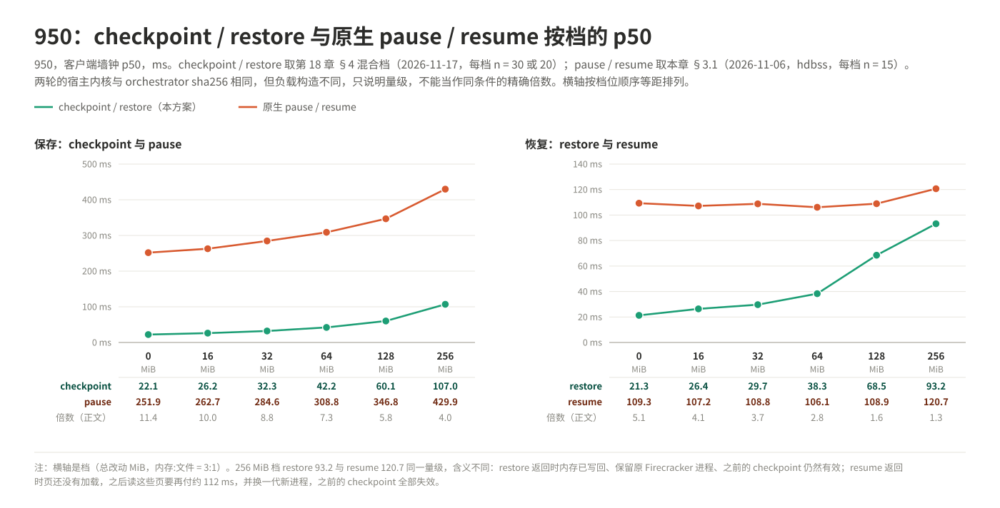
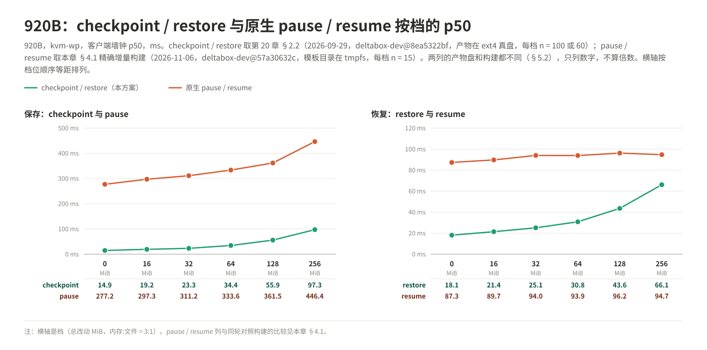

# 19 · 原生 pause / resume 分档实测

## 本章目标

- 给出精确增量落地之后，原生 pause / resume 在 950 和 920B 上按改动量分档的耗时与导出体积。
- 把原生路径与 checkpoint / restore 放在同一张表里，说明两者差在哪里，以及哪些差距不能按倍数读。
- 解释改动量为 0 时 pause 仍要两百多毫秒的原因，并列出已经拆开和尚未拆开的时间段。
- 写清这组数据的边界：测了什么，没测什么，哪些现象原因未查。

原生路径的机制和耗时结构见 [第 13 章](13-native-snapshot.md)，精确增量的实现见 [第 14 章](14-native-precise-increment.md)，两种快照的分工见 [第 15 章](15-native-cooperation-and-cost.md)。本章只讲实测。客户参考线（checkpoint ≤ 200 ms、restore ≤ 100 ms）约束的是 checkpoint / restore，不适用于原生路径。

## 1. 测量对象与方法

### 1.1 为什么每档用独立沙箱

两份脚本量的东西不同：

| 脚本 | 负载构造 | 适合回答 |
|---|---|---|
| `native_snapshot_bench.py` | 同一沙箱预热到最大档，再逐档覆写 | 修复前后的导出体积对比（[第 20 章 §6.3](20-920b-performance.md#63-native_snapshot_benchpy六档)）。原生内存差分相对模板，预热量会进入第一次导出，耗时列不适合按档比较 |
| `benchmark/native_snapshot_tiers.py` | 每档新建沙箱，只放本档负载 | 按档比较 pause、resume 耗时和导出体积。本章全部数据来自这份脚本 |

### 1.2 一个样本怎么走

每档新建 3 个沙箱。内存负载放 `/dev/shm/tier`，文件负载放根文件系统的 `/bench-root/tier`，内存与文件按 3:1 拆分，例如 16 MiB 档是内存 12 MiB、文件 4 MiB。负载用 `dd if=/dev/urandom ... conv=notrunc` 原地覆写，第二次起落在同一批页和块上。

每个沙箱循环 6 次：

- 第 0 次是 `first`，导出自启动以来的全部写入，相当于全量基点。
- 之后 5 次是 `repeat`，在上一次快照之上只改写本档负载一次，对应增量快照。

所以每档 `repeat` 有 15 个样本，`first` 有 3 个样本。pause 模式的一个样本是：改写本档负载 → `sb.pause()` → `Sandbox.connect(id)` → 校验。snapshot 模式的一个样本是：改写本档负载 → `sb.create_snapshot()` → `Sandbox.create(template=id)` → 在新沙箱里校验 → 杀掉新沙箱、删除快照。

### 1.3 列的含义

原生路径没有服务端分段计时，下面的耗时全部是客户端墙钟，单位 ms。

| 列 | 含义 |
|---|---|
| pause | `sb.pause()` 的墙钟，含停沙箱、导出和上传。结果 JSON 里字段名为 `snapshot_ms` |
| resume | `Sandbox.connect()` 返回耗时（`resume_call_ms`）加上第一条命令执行完成的耗时（`ready_ms`），结果 JSON 里字段名为 `resume_ms` |
| 导出内存、导出根盘 | 本次快照导出的内存差分与根盘差分，单位 MiB |
| 内存读 前 → 后 | 快照前、恢复后用同一读法读完内存负载的耗时，差值是推迟到缺页阶段的成本 |
| 根盘读 前 → 后 | 快照前、恢复后用 `dd iflag=direct` 读完文件负载的耗时。这一读法绕开 guest 页缓存，所以能发现磁盘差分丢数据 |

校验读取不计入 pause、resume。每档 n = 15，样本不足以给 p99，所以表里只列 p50、min、max。

## 2. 条件与来源

| 条件 | 950 | 920B 精确增量构建 | 920B 对照构建 |
|---|---|---|---|
| 时间（+08:00） | 2026-11-06 16:53:52～16:56:20 | 2026-11-06 15:21:06～15:26:43 | 2026-11-06 16:03:58～16:08:59 |
| 宿主内核 | `6.6.0-159.4.3.154.oe2403sp4.aarch64` | 同左 | 同左 |
| orchestrator | `/usr/bin/template-manager`，sha256 `a5d03902afd56e84c4cd956bf73b3bb9d40c4049d736a51985d4d5c7927289a8` | `deltabox-dev@57a30632c` 构建，sha256 `10d1d5f8270e4c98e777f82f1f7e3f7fc238de31df9b94959104d662ba68cf98` | 不含本方案的另一份构建，不是纯上游：不含 checkpoint / restore，也不含 4 KiB 写跟踪差分。sha256 `818fa667640e0cbf9cbd064532d285f874def101ed9e4661b0d2c6136c4a837e` |
| Firecracker | 1.12.1 | 1.12.1 | 1.12.1 |
| 脏页后端 | `hdbss`（默认自动，未设 `FC_TRACK_DIRTY_PAGES`、`FC_HDBSS`、`FC_HDBSS_ORDER`） | `kvm-wp`（`FC_TRACK_DIRTY_PAGES=true`） | `off`（驻留判据） |
| 模板 | `base` | `base-native`（2 vCPU / 2048 MB） | `base-native`（2 vCPU / 2048 MB） |
| 存储 | `STORAGE_PROVIDER=Local`，介质未回传 | `STORAGE_PROVIDER=Local`，模板目录 `/tmp/templates` 是 tmpfs | 同左 |
| 模式 | 只跑 `--mode pause` | pause、snapshot 两种 | pause、snapshot 两种 |
| 客户端 | Python 3.14.10，部署宿主上运行 | Python 3.12.14，部署宿主上运行 | 同左 |
| 样本与判定 | 108 个，失败 0，PASS | 216 个，失败 0，PASS | 216 个，失败 0，PASS |

三轮用同一份脚本，sha256 `bff97e938c792427e3eec4c2d133a3712ea9254877b3d0235bde10e7bd04643d`。950 的参数是 `--mode pause --tiers 0,16,32,64,128,256 --passes 3 --iters 5`，920B 两轮档位、沙箱数和循环数相同。三轮的内容校验和常驻进程校验全部通过。

这里的 920B 与 [第 20 章 §1.1](20-920b-performance.md#11-两台-920b) 的分档基准都是新 920B，但代码版本不同；耗时不能与[第 20 章 §6.3](20-920b-performance.md#63-native_snapshot_benchpy六档) 直接比较。

## 3. 950 分档结果

### 3.1 pause 与 resume

下表取 `repeat`，每档 n = 15。

| 档（总改动 MiB） | 内存 / 文件 MiB | pause p50 | pause min / max | resume p50 | resume min / max | 导出内存 p50 MiB | 导出根盘 MiB |
|---|---|---|---|---|---|---|---|
| 0 | 0 / 0 | 251.9 | 233.5 / 277.3 | 109.3 | 92.0 / 146.2 | 15.9 | 0.3 |
| 16 | 12 / 4 | 262.7 | 243.8 / 286.7 | 107.2 | 95.1 / 138.7 | 40.8 | 4.5 |
| 32 | 24 / 8 | 284.6 | 272.1 / 319.8 | 108.8 | 97.3 / 139.7 | 59.6 | 8.5 |
| 64 | 48 / 16 | 308.8 | 280.7 / 408.1 | 106.1 | 96.8 / 172.4 | 94.0 | 16.5 |
| 128 | 96 / 32 | 346.8 | 327.6 / 439.3 | 108.9 | 100.6 / 163.8 | 161.8 | 32.5 |
| 256 | 192 / 64 | 429.9 | 413.6 / 533.6 | 120.7 | 101.0 / 215.6 | 294.3 | 64.5 |

结果说明：

- **精确增量在 950 上生效。** 导出内存随写入量增长，比本档内存写入量多约 16～102 MiB，0 MiB 档只有 15.9 MiB。修复前 950 上导出恒在 400 MiB 上下（[第 20 章 §6.3](20-920b-performance.md#63-native_snapshot_benchpy六档)，那一轮用的是预热脚本，负载构造不同）。
- **pause 由固定开销主导。** 按六档 p50 对“导出内存 + 导出根盘”做最小二乘，约为 245.5 ms + 0.52 ms/MiB。这是这六档的趋势，不是 p50 保证。
- **resume 与档位基本无关。** 0～128 MiB 档 p50 在 106.1～109.3 ms，256 MiB 档升到 120.7 ms，max 也明显变大。按沙箱分组看，256 MiB 档 3 个沙箱的 resume p50 为 193.3 / 120.7 / 114.2 ms，第一个沙箱明显偏高；其余档也有第一个沙箱偏高的情况。每组只有 5 个样本，原因未查。

### 3.2 resume 的两段

resume 由 `connect` 调用和第一条命令组成。下面两行是各自的 p50，p50 不可加，所以两行相加不等于 §3.1 的 resume p50。

| 档（总改动 MiB） | 0 | 16 | 32 | 64 | 128 | 256 |
|---|---|---|---|---|---|---|
| `resume_call_ms` p50 | 97.3 | 94.1 | 97.9 | 94.4 | 97.0 | 107.8 |
| `ready_ms` p50 | 10.8 | 11.4 | 11.4 | 11.4 | 12.3 | 12.4 |

第一条命令各档都在 10.8～12.4 ms。256 MiB 档的上升出现在 `connect` 调用里。

### 3.3 推迟到恢复之后的成本

| 档（总改动 MiB） | 内存读 前 → 后 ms | 根盘读 前 → 后 ms |
|---|---|---|
| 16 | 44.5 → 51.4 | 23.2 → 26.5 |
| 32 | 81.2 → 94.8 | 38.3 → 42.9 |
| 64 | 153.8 → 180.5 | 69.0 → 76.9 |
| 128 | 299.4 → 353.2 | 127.6 → 137.2 |
| 256 | 590.9 → 702.6 | 269.6 → 265.7 |

resume 返回时页还没有加载。内存读恢复后比快照前慢 6.9～111.7 ms，随负载增长，这部分时间由 guest 里第一个访问这些页的程序承担。根盘读在 16～128 MiB 档恢复后也变慢，256 MiB 档两次读数接近，这组数据的读法用于校验，没有单独设计成根盘懒加载的测量。

### 3.4 first

`first`（n = 3）与 `repeat` 处于同一量级：

| 档（总改动 MiB） | 0 | 16 | 32 | 64 | 128 | 256 |
|---|---|---|---|---|---|---|
| pause p50 | 266.2 | 254.0 | 296.4 | 305.2 | 339.7 | 452.3 |
| resume p50 | 115.3 | 116.5 | 108.2 | 103.2 | 104.4 | 110.3 |
| 导出内存 p50 MiB | 15.6 | 36.0 | 57.3 | 91.1 | 161.0 | 295.8 |

### 3.5 两套代码上各跑一遍（2026-11-18）

2026-11-18 在同一台 950 上用 `bash test950.sh native` 把 §4.3 的做法重复了一遍：先在沙箱级那套上跑，再切到进程级那套上跑，前后约 17 分钟。结果目录 `test950/results/20261118-142626-native/`，统计值取自 `bash test950.sh report` 的终端回传。

| 条件 | 沙箱级 | 进程级 |
|---|---|---|
| orchestrator | `/usr/bin/template-manager`，sha256 `e54489e4…`（RPM `2026.09-3`，由 e2b-infra `1dd8525` 重新构建） | `/fc-criu/orchestrator`，sha256 `063e580e…`。不含精确增量；pause 要等快照上传完才返回，模板注入了 gsd、guest 内核打了补丁（同 §4.3） |
| 脏页后端 | `hdbss`（默认 order 1） | `off` |
| 模板 | `base` | `base-criu` |
| 参数与样本 | `--mode both --passes 3 --iters 8`，每档每种模式 `repeat` n = 24、`first` n = 3；样本 324，失败 0 | 相同 |

两套用同一份 Firecracker。客户端墙钟 p50，单位 ms。

**pause 模式（`repeat`）：**

| 档（总改动 MiB） | pause 沙箱级 | pause 进程级 | resume 沙箱级 | resume 进程级 | 导出内存 MiB 沙箱级 | 导出内存 MiB 进程级 |
|---|---|---|---|---|---|---|
| 0 | 247.2 | 302.9 | 99.2 | 78.0 | 16.4 | 162.0 |
| 16 | 267.9 | 324.8 | 102.4 | 80.2 | 40.8 | 182.0 |
| 32 | 282.3 | 365.0 | 101.8 | 81.4 | 59.9 | 202.0 |
| 64 | 301.0 | 396.8 | 104.7 | 81.4 | 94.8 | 232.0 |
| 128 | 351.5 | 451.6 | 105.7 | 80.7 | 160.8 | 300.0 |
| 256 | 427.1 | 582.4 | 115.8 | 81.3 | 292.8 | 432.0 |

resume 里 `connect` 一段的 p50：沙箱级 89.6～104.4 ms，进程级 69.1～72.5 ms；第一条命令两套都在 8.6～11.0 ms。恢复后第一次读完内存负载，比快照前慢多少：

| 档（总改动 MiB） | 16 | 32 | 64 | 128 | 256 |
|---|---|---|---|---|---|
| 沙箱级 | 6.8 | 12.2 | 23.6 | 44.8 | 92.8 |
| 进程级 | 1.6 | 3.4 | 7.1 | 13.9 | 27.5 |

**snapshot 模式（`create_snapshot()` → `Sandbox.create(template=...)`，`repeat`）：** 这条路径第一次在 950 上测。

| 档（总改动 MiB） | 0 | 16 | 32 | 64 | 128 | 256 |
|---|---|---|---|---|---|---|
| `create_snapshot()` 沙箱级 | 432.3 | 391.5 | 398.8 | 435.4 | 513.7 | 653.4 |
| `create_snapshot()` 进程级 | 321.4 | 338.5 | 421.7 | 459.2 | 544.7 | 744.5 |
| 恢复 沙箱级 | 78.9 | 77.7 | 82.0 | 84.4 | 95.7 | 95.5 |
| 恢复 进程级 | 72.0 | 72.6 | 76.6 | 78.7 | 73.5 | 81.0 |

结果说明：

- **与 11-06 那一轮一致。** 沙箱级这套的 pause 从 247.2 到 427.1 ms，§3.1 是 251.9 到 429.9 ms；resume 99.2～115.8 ms，§3.1 是 106.1～120.7 ms。两轮的 orchestrator 不是同一份构建（`a5d03902…` 与 `e54489e4…`）。
- **pause：沙箱级的代码每档都更快、导出更小**，差 55.7～155.3 ms。进程级那套没有精确增量，一页不改也导出 162 MiB。与新 920B（§4.3）相同。
- **resume：沙箱级的代码每档慢 20.4～34.5 ms，差在 `connect` 一段**；恢复后第一次读内存，沙箱级也多付更多（256 MiB 档 92.8 对 27.5 ms）。两处与 920B 上的方向相同（§4.1、§4.3），原因仍未查。
- **snapshot 模式：** `create_snapshot()` 在 0、16 MiB 档进程级更快，32 MiB 起沙箱级更快；恢复是新建沙箱，沙箱级每档慢 5.1～22.2 ms。沙箱级 128 MiB 档 `create_snapshot()` 的 p90 是 870.3 ms、max 1568 ms，进程级 256 MiB 档 pause 的 max 是 2806 ms，各只出现在一个档，原因没有查。

## 4. 920B 分档结果与对照

### 4.1 pause 模式

对照轮是不含本方案的另一份构建，不是纯上游。两轮的 `repeat` 每档 n = 15，全部是客户端墙钟 ms。

| 档（总改动 MiB） | pause 精确增量 | pause 对照 | resume 精确增量 | resume 对照 | 导出内存 MiB 精确增量 | 导出内存 MiB 对照 | 导出根盘 MiB 两轮 |
|---|---|---|---|---|---|---|---|
| 0 | 277.2 | 308.0 | 87.3 | 62.2 | 16.1 | 144.0 | 0.3 |
| 16 | 297.3 | 335.3 | 89.7 | 58.1 | 39.3 | 168.0 | 4.5 |
| 32 | 311.2 | 365.0 | 94.0 | 60.9 | 58.8 | 186.0 | 8.5 |
| 64 | 333.6 | 411.0 | 93.9 | 63.0 | 93.0 | 218.0 | 16.5 |
| 128 | 361.5 | 464.2 | 96.2 | 60.2 | 159.6 | 282.0 | 32.5 |
| 256 | 446.4 | 604.2 | 94.7 | 62.5 | 292.2 | 418.0 | 64.5 |

恢复前后的读取耗时：

| 档（总改动 MiB） | 内存读 前 → 后 精确增量 | 内存读 前 → 后 对照 | 根盘读 前 → 后 精确增量 | 根盘读 前 → 后 对照 |
|---|---|---|---|---|
| 16 | 44.1 → 49.9 | 43.4 → 45.6 | 23.1 → 26.8 | 21.7 → 25.7 |
| 32 | 80.1 → 90.7 | 79.4 → 83.0 | 36.9 → 41.5 | 36.2 → 40.5 |
| 64 | 152.0 → 173.6 | 151.1 → 159.4 | 64.2 → 71.1 | 65.0 → 71.5 |
| 128 | 295.7 → 337.8 | 295.6 → 310.0 | 121.8 → 134.1 | 121.6 → 133.9 |
| 256 | 583.5 → 667.1 | 581.6 → 613.9 | 236.4 → 252.6 | 225.9 → 251.5 |

结果说明：

- **pause 的固定开销不是本方案或精确增量引入的。** 对照版本 0 MiB 档同样要 308.0 ms。精确增量构建各档都比对照快 30.8～157.8 ms。导出内存各档都少约 122～129 MiB，这个差值基本恒定，解释不了 pause 差距随档位增大，后者的原因未查。
- **resume 精确增量构建比对照慢 25.1～36.0 ms，原因未查。** 两轮差别不止一处：精确增量构建开了 `kvm-wp` 写保护跟踪、用 4 KiB header，代码也不同，这里没有拆开。
- **恢复后内存读的差别同样没有拆开。** 256 MiB 档对照为 581.6 → 613.9 ms，精确增量构建为 583.5 → 667.1 ms，慢约 84 ms。根盘读两轮接近。
- **pause 趋势。** 精确增量构建按六档 p50 拟合，pause ≈ 275.2 ms + 0.48 ms/MiB（导出内存 + 导出根盘），与 950 的 245.5 ms + 0.52 ms/MiB 斜率接近。两台机器的脏页后端和存储都不同，截距不做差。

`first`（n = 3）的 p50：

| 档（总改动 MiB） | 0 | 16 | 32 | 64 | 128 | 256 |
|---|---|---|---|---|---|---|
| pause 精确增量 | 273.6 | 299.8 | 293.9 | 332.1 | 371.0 | 429.9 |
| pause 对照 | 301.7 | 332.1 | 350.7 | 389.5 | 442.0 | 576.4 |
| resume 精确增量 | 85.4 | 81.8 | 86.5 | 84.3 | 86.0 | 89.7 |
| resume 对照 | 58.7 | 58.3 | 57.1 | 56.9 | 62.5 | 58.7 |

### 4.2 snapshot 模式

`create_snapshot()` + `Sandbox.create(template=...)` 这条路径只有 920B 数据。下表取 `repeat`，每档 n = 15。

| 档（总改动 MiB） | 0 | 16 | 32 | 64 | 128 | 256 |
|---|---|---|---|---|---|---|
| `create_snapshot()` p50，精确增量 | 411.8 | 381.4 | 384.4 | 410.5 | 456.0 | 562.6 |
| `create_snapshot()` p50，对照 | 317.3 | 344.0 | 367.2 | 400.7 | 468.4 | 599.5 |
| 恢复 p50，精确增量 | 203.8 | 173.1 | 194.9 | 202.5 | 215.5 | 177.6 |
| 恢复 p50，对照 | 156.3 | 149.8 | 169.9 | 155.3 | 186.9 | 146.9 |

`create_snapshot()` 比 pause 多一次重新拉起沙箱，所以更慢。这里的恢复是另起新沙箱：`Sandbox.create()` 约 50 ms 返回，第一条命令要等 guest 就绪，恢复耗时主要在这一段。

精确增量构建这一轮的 216 个样本里，有 4 次恢复超过 1 s，都在 snapshot 模式：64 MiB 档 `first` 的 5068.5 ms，以及 128 MiB 档 `repeat` 的 5150.5、5060.2、1267.7 ms。128 MiB 档这 3 次都在上表的 15 个样本内，max 为 5150.5 ms，p50 仍是 215.5 ms。对照轮 216 个样本没有超过 1 s 的恢复。原因未查。

### 4.3 两套代码上各跑一遍（2026-11-18）

为回答"我们对原生路径的改动有没有让它变慢"，2026-11-18 用 `bash test950.sh native` 在新 920B 上把同一脚本在两套代码上各跑了一遍：沙箱级是交付的 RPM `2026.09-3`（2026-11-17 修复版；`/usr/bin/template-manager` sha256 `b125e518…`，`kvm-wp`，模板 `base`）；进程级是 `/fc-criu/orchestrator`（sha256 `063e580e…`，不开脏页跟踪，模板 `base-criu`）。进程级的 orchestrator 不含精确增量，但也不是纯上游：pause 要等快照上传完才返回（KASandbox 提交 `01665a0c9`，上游不等），模板注入了 gsd、guest 内核打了补丁。两套用同一份 Firecracker。每档每种模式 `repeat` n = 24，客户端墙钟 p50，单位 ms。

| 档（总改动 MiB） | pause 沙箱级 | pause 进程级 | resume 沙箱级 | resume 进程级 | 导出内存 MiB 沙箱级 | 导出内存 MiB 进程级 |
|---|---|---|---|---|---|---|
| 0 | 270.9 | 325.6 | 93.8 | 64.1 | 16.8 | 164.0 |
| 16 | 293.2 | 348.8 | 98.1 | 67.2 | 40.4 | 184.0 |
| 32 | 305.5 | 371.8 | 92.5 | 66.4 | 60.9 | 200.0 |
| 64 | 327.9 | 393.3 | 94.2 | 65.8 | 94.6 | 234.0 |
| 128 | 359.2 | 457.8 | 96.0 | 67.7 | 161.2 | 302.0 |
| 256 | 430.4 | 600.2 | 99.2 | 67.1 | 292.8 | 434.0 |

snapshot 模式（`create_snapshot()` → `Sandbox.create(template=...)`）：

| 档（总改动 MiB） | 0 | 16 | 32 | 64 | 128 | 256 |
|---|---|---|---|---|---|---|
| `create_snapshot()` 沙箱级 | 421.9 | 384.2 | 395.2 | 415.3 | 481.3 | 657.0 |
| `create_snapshot()` 进程级 | 333.9 | 348.0 | 384.4 | 426.7 | 513.3 | 635.5 |
| 恢复 沙箱级 | 67.5 | 70.1 | 71.0 | 70.8 | 78.7 | 80.8 |
| 恢复 进程级 | 53.8 | 58.5 | 61.2 | 62.5 | 64.5 | 64.4 |

结果说明：

- **pause：沙箱级的代码每档都更快、导出更小。** 进程级那套没有精确增量，一页不改也要导出约 160 MiB；数字与 §4.1 的对照构建（11-06）基本一致。所以对外说"原生 pause"的数字时，用沙箱级这套测出的反而偏乐观：e2b 原生（不含精确增量）的 pause 更接近进程级那一列。
- **resume：沙箱级的代码每档慢约 30 ms**，与 §4.1 的 25～36 ms 一致，原因仍未查。
- **snapshot 模式两套接近**，`create_snapshot()` 在 32 MiB 以下进程级略快，以上互有高低。这一轮的恢复耗时（54～81 ms）明显低于 §4.2 的 11-06 那一轮（147～216 ms），两轮之间 SDK 连接池的缺陷已修（第 21 章 §2.3），测试脚本也改为每个沙箱结束后删掉它产生的快照 build，没有逐项拆开原因。
- 不管哪套代码，原生 pause 都在 270～600 ms，同一台机器上 checkpoint 在 10～100 ms（第 20 章），差一个数量级以上；差别来自原生路径要停掉并重建 Firecracker、导出能离开这台宿主的自足快照（§6）。

## 5. 与 checkpoint / restore 并列

### 5.1 950

把 [第 18 章 §10.2](18-950-performance.md#102-十二档性能与判定) 的混合档（2026-11-17 第一轮）并到一起。两组负载构造不同：checkpoint / restore 在预热过的沙箱上撤销本样本改动，原生这组每档独立沙箱、每个样本都换一代进程。第 18 章的混合档来自 2026-11-17 那一轮，宿主内核与 orchestrator sha256（`a5d03902…`）都和本章相同，但两轮相隔 11 天、负载构造不同。所以下表只说明量级，不能当作同条件的精确倍数。

| 档（总改动 MiB） | checkpoint 墙钟 p50 | pause p50 | 倍数 | restore 墙钟 p50 | resume p50 | 倍数 |
|---|---|---|---|---|---|---|
| 0 | 22.1 | 251.9 | 11.4 | 21.3 | 109.3 | 5.1 |
| 16 | 26.2 | 262.7 | 10.0 | 26.4 | 107.2 | 4.1 |
| 32 | 32.3 | 284.6 | 8.8 | 29.7 | 108.8 | 3.7 |
| 64 | 42.2 | 308.8 | 7.3 | 38.3 | 106.1 | 2.8 |
| 128 | 60.1 | 346.8 | 5.8 | 68.5 | 108.9 | 1.6 |
| 256 | 107.0 | 429.9 | 4.0 | 93.2 | 120.7 | 1.3 |

256 MiB 档 restore 与 resume 在同一量级（93.2 / 120.7 ms），含义不同：

| | restore | resume |
|---|---|---|
| 返回时内存状态 | 已写回 | 页还没有加载，之后读这些页要再付约 112 ms |
| Firecracker 进程 | 保留原进程 | 换一代新进程 |
| 之前的 checkpoint | 仍然有效 | 全部失效（[第 24 章 §3.1](24-api-semantics.md#31-原生-pause--resume-与-checkpoint-的代际边界)） |

### 5.2 920B

920B 的并列跨两台机器。checkpoint / restore 列取自 [第 20 章 §2.2](20-920b-performance.md#22-混合档内存文件--31) 的 920B（`kvm-wp`，产物在 ext4 真盘，`deltabox-dev@8ea5322bf`），pause / resume 列取自本章 §4.1 的 920B（`kvm-wp`，模板目录在 tmpfs，`deltabox-dev@57a30632c`）。两列机器、产物盘和构建都不同，所以只列数字，不算倍数。

| 档（总改动 MiB） | checkpoint 墙钟 p50 | pause p50 | restore 墙钟 p50 | resume p50 |
|---|---|---|---|---|
| 0 | 14.9 | 277.2 | 18.1 | 87.3 |
| 16 | 19.2 | 297.3 | 21.4 | 89.7 |
| 32 | 23.3 | 311.2 | 25.1 | 94.0 |
| 64 | 34.4 | 333.6 | 30.8 | 93.9 |
| 128 | 55.9 | 361.5 | 43.6 | 96.2 |
| 256 | 97.3 | 446.4 | 66.1 | 94.7 |

### 5.3 950 同一轮（2026-11-19）

§5.1 的两组数来自不同轮次、不同负载。2026-11-19 用 `bash test950.sh compare` 的 mix 组在同一台 950、同一时段、同一种负载上把 checkpoint / restore 和 pause / resume 一起测了：沙箱里一个常驻进程写满 256 MiB 匿名内存，每档改写其中一部分并写根盘文件后 `fsync`，内存与文件按 3 : 1 拆分；pause / resume 在同一负载上另起沙箱测。每格 n = 20，客户端墙钟 p50，单位 ms。条件：e2b-infra `1525eea`，沙箱级 orchestrator `3a1b4c51…`（RPM `2026.09-3`，`hdbss`，模板 `base`）；进程级那套的 orchestrator `daa44b22…`（脏页跟踪关闭，模板 `base-criu`），它的原生路径与上游相同。

| 总改动 MiB | checkpoint | pause（本方案代码） | 倍数 | restore | resume（本方案代码） | 倍数 | pause（进程级那套） | resume（进程级那套） |
|---:|---:|---:|---:|---:|---:|---:|---:|---:|
| 0 | 6.3 | 264.5 | 42.0 | 16.7 | 111.6 | 6.7 | 431.4 | 93.8 |
| 16 | 19.3 | 277.2 | 14.4 | 27.4 | 112.4 | 4.1 | 440.6 | 84.7 |
| 32 | 23.7 | 292.1 | 12.3 | 30.1 | 111.7 | 3.7 | 470.1 | 85.1 |
| 64 | 34.2 | 311.5 | 9.1 | 40.8 | 109.4 | 2.7 | 515.0 | 87.8 |
| 128 | 49.4 | 349.8 | 7.1 | 51.7 | 113.2 | 2.2 | 575.7 | 91.2 |
| 256 | 96.8 | 415.9 | 4.3 | 81.9 | 115.5 | 1.4 | 671.8 | 93.4 |
| 70.001（只改内存 70） | 22.4 | 282.7 | 12.6 | 36.3 | 111.2 | 3.1 | 471.3 | 92.5 |

- 同一负载、同一轮，倍数可以直接读：checkpoint 比 pause 快 4.3～42 倍，restore 比 resume 快 1.4～6.7 倍。量级与 §5.1 相同。
- 本方案代码的 pause 每档比进程级那套快 163～256 ms，因为精确增量只导出写过的页；resume 每档慢 18～28 ms，差在 `connect` 一段，与 §3.5 一致，原因未查。
- pause 一列包含把快照复制进模板存储这一步，上游不等这一步就返回，见 §7 与[第 13 章 §1](13-native-snapshot.md)。
- 两套快照回滚的完整对外表（含进程级 checkpoint / restore 与 p99）和逐档解释在进程级手册[第 24 章 §4.3](../../criu-rollback/docs/24-vs-sandbox-level.md#43-对外分档表9502026-11-19)。原始终端输出存于工作区 `rollback-reports/950-compare-20261119/compare.txt`。

## 6. 固定开销从哪里来

本节的时间拆分来自 920B（`kvm-wp`，产物在 tmpfs）的单样本跟踪，完整表格见 [第 13 章 §6](13-native-snapshot.md#6-成本模型)。950 没有做同样的逐段测量，各段数值不能直接套到 950。

**pause。** 一次 0 MiB 档的 pause 总耗时 234.9 ms：

| 时间点 ms | 发生的事 |
|---|---|
| 0～约 10 | 暂停虚机、写 `snapfile`、取脏页位图、建好内存差分文件 |
| 约 12～169 | 开始停沙箱，Firecracker 收到 SIGTERM 后退出，168.8 ms 时进程结束 |
| 169～232 | `doStop` 收尾，`NBDProvider.Close` 刷盘并断开 NBD，`ExportDiff` 导出根盘差分 |
| 232～235 | 上传到本地存储并返回 |

真正保存内存状态的只有前约 10 ms，其余约 225 ms 都在销毁虚机环境并等它结束。根盘差分要等 NBD 设备释放后才能导出，`Pause` 又要等上传完成，所以这段等待全部计入 pause。另一次运行对 Firecracker 进程做内核栈采样，看到退出过程里有等 RCU 宽限期、卸载挂载、关闭 KVM 虚机 fd 这些步骤，但约 9～123 ms 这段约 114 ms 没有归因。

**改动量增大时。** 256 MiB 档一次总耗时 443 ms 的跟踪里，增长不全是拷数据：开始停沙箱之前增长约 76 ms，Firecracker 退出增长约 35 ms，退出之后到根盘差分导出完成增长约 97 ms。这是单样本比较，只说明方向。

**resume。** 一次 `Sandbox.connect()` 耗时 92.6 ms、第一条命令 97.9 ms 完成的 resume：

| 时间点 ms | 发生的事 |
|---|---|
| 0～35 | 请求到节点，建网络槽位、NBD、uffd，启动 Firecracker 进程 |
| 35～57 | 加载 `snapfile` |
| 57～58 | 恢复 vCPU |
| 58～93 | 等 envd 就绪和 API 返回，这段未细拆 |
| 93～98 | 第一条命令执行 |

这些步骤都不搬运内存，也不拷根盘：内存由 uffd 按缺页加载，根盘由 Overlay 按需读差分，所以 resume 不随档位变化，内存读取的成本落在恢复之后（§3.3）。

**checkpoint / restore 没有这些步骤。** checkpoint 不停虚机，也不销毁任何资源；restore 把内存写回活着的 Firecracker 进程（[第 9 章](09-in-place-rollback.md)）。进程退出、KVM 销毁、NBD 断开、进程启动、加载 `snapfile` 都不会发生。这不表示原生实现有缺陷：原生要产出能离开这个进程、这台宿主的自足快照，停掉并重建进程是这个目标的一部分（[第 13 章 §7](13-native-snapshot.md#7-它擅长什么)）。

## 7. 边界

**已测：**

- 950：2026-11-06 pause 模式六档，108 个样本；2026-11-18 两套代码各跑 pause、snapshot 两种模式，各 324 个样本（§3.5）；2026-11-19 在同一负载上与 checkpoint / restore 同轮测量，两套代码各 140 次 pause / resume（§5.3）。内容与进程校验全过。
- 920B：精确增量构建与对照构建各 216 个样本，含 pause、snapshot 两种模式。

**没有测，或不能从这组数据得出：**

- 950 的 `--mode snapshot` 只有 2026-11-18 一轮（§3.5），每档 n = 24。
- 950 没有逐段拆分，也没有做“不开脏页跟踪”的对照，所以不能据此给出 HDBSS 对原生路径的净影响。
- 功能用例 T39、T41 已在同一份二进制 `a5d03902…` 上通过（2026-11-17 func，[第 17 章 §3](17-functional-verification.md#3-功能回归结果)）；`pb2.py` 在 950 上待复跑（[第 15 章 §10.2](15-native-cooperation-and-cost.md#102-缺口)）。
- 每档 n = 15，是短时单沙箱串行测量，不表示并发或长期尾延迟。
- 存储是 `Local`，pause 含把快照复制进模板存储这一步。上游的 `Pause` 不等这一步就返回，两套代码都等（[第 13 章 §1](13-native-snapshot.md)），所以 pause 列比上游多算了这一步。这一步的长短取决于复制多少：920B 上模板目录是 tmpfs，精确增量构建导出约 16 MiB 时约 3 ms（§6），进程级那套导出全部驻留内存时约 68～90 ms（2026-11-20 smoke）。本章各表的 pause 都含这一步；进程级那套的 orchestrator 从 `7e0a6a462` 起把两段分开记（第 13 章 §1）。换成对象存储后上传耗时要另测，resume 后的按需加载也要走网络。
- 950 与 920B 的脏页后端、存储和模板都不同，表中数字不互相相减，差值不能归因于 HDBSS。
- 对照构建不是纯上游，它只说明“不含本方案时”的一份实测，不能当作上游基线。

**原因未查的现象：**

- pause 约 110 ms 的 Firecracker 退出前段和 resume 末尾约 35 ms 未拆开（[第 30 章](30-status-and-directions.md)）。
- 920B 上 resume 比对照慢 25.1～36.0 ms，pause 比对照快的幅度随档位增大。
- 950 上 resume 第一个沙箱偏高，256 MiB 档 p50 与 max 上升。
- 950 上沙箱级这套的 resume 比进程级那套慢 20.4～34.5 ms，差在 `connect` 一段；恢复后读内存也多付更多（§3.5）。
- 920B snapshot 模式的 4 次慢恢复（§4.2）。

## 本章要点

- 精确增量在 950 和 920B 上都生效：导出内存随写入量增长，0 MiB 档约 16 MiB。
- pause 由固定开销主导。950 按六档 p50 拟合约为 245.5 ms + 0.52 ms/MiB，920B 约为 275.2 ms + 0.48 ms/MiB。固定开销来自销毁虚机环境，不含本方案的对照构建同样存在。
- resume 基本不随档位变化，950 上 0～128 MiB 档 p50 在 106.1～109.3 ms。成本推迟到恢复之后，950 上第一次读 192 MiB 内存负载比快照前慢约 112 ms。
- 950 上 checkpoint / restore 与 pause / resume 的差距在小档最大，但两组负载和部署条件不同，倍数只说明量级。
- 数字接近不代表语义接近：restore 保留进程和 checkpoint，resume 换一代进程，之前的 checkpoint 全部失效。
- 950 同一轮、同一负载（§5.3）：checkpoint 比 pause 快 4.3～42 倍，restore 比 resume 快 1.4～6.7 倍；pause 列含复制进模板存储这一步，上游不等这一步。
- 950 两套代码上各跑一遍（§3.5）的结论与 920B 相同：沙箱级这套的 pause 每档更快、导出更小，resume 每档慢 20～35 ms。
- 950 的逐段拆分、不开跟踪的对照仍待补。
