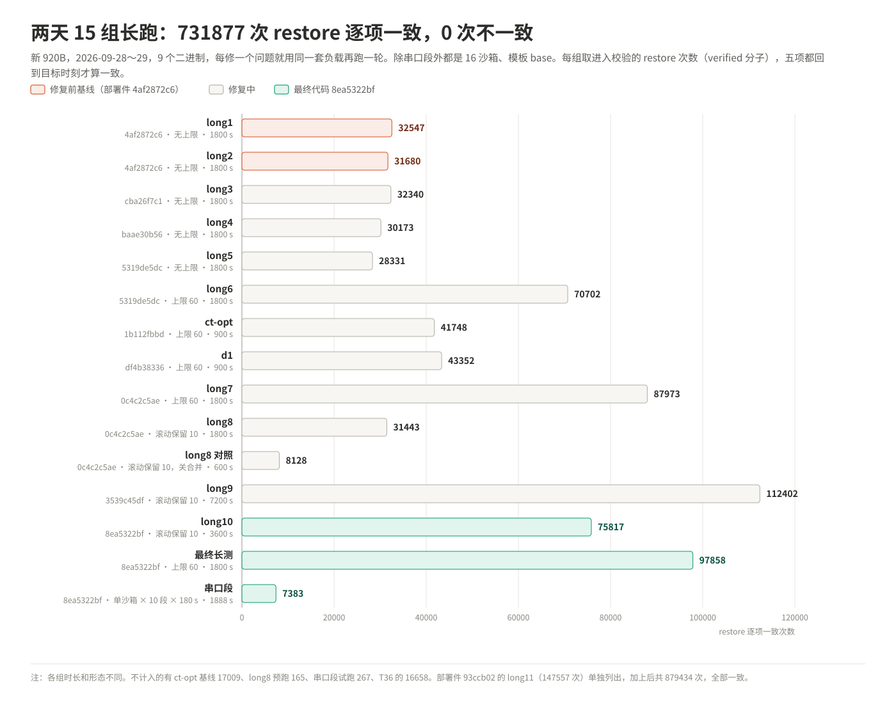
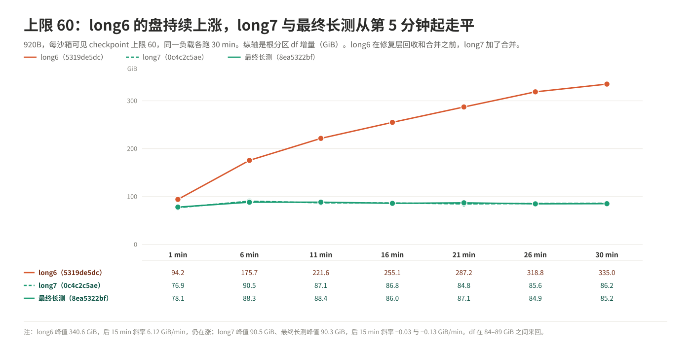
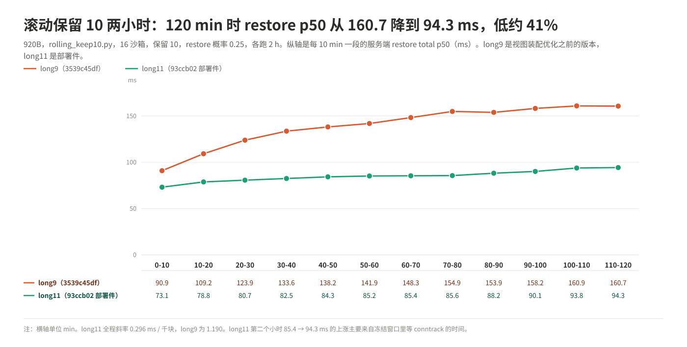

# 21 · 并发与长跑

## 本章目标

单沙箱基准回答“一次多快”，本章回答另一类问题：很多沙箱同时用、连续用很久，数据还对不对，延迟和占盘会不会失控。读完本章应当能说清：

1. 并发和长跑测试为什么存在，A、B、D 段和三种长跑负载各测什么；
2. 950 上已有哪些短时并发证据，缺哪些；
3. 920B 上从 2026-09-15 到 2026-09-29 的并发轮次分别跑在什么版本和机器上；
4. 731877 次 restore 逐项一致这个数怎么来的，它证明什么；
5. 每沙箱上限 60 的常规负载下，最终版的耗时和资源走势；
6. 产物盘为什么能走平，还有什么没有饱和；
7. restore 后沙箱报废问题最后的结论；
8. 这些结果能说明什么，不能说明什么。

修复的原理和排查过程在[附录 C §3](C-evolution-and-cases.md#3-并发与长跑暴露的问题)。本章只讲每一轮测到的事实。轮次总表、逐段表和数据出处在[附录 B](B-920b-results.md)。

## 1. 测试目的和负载

### 1.1 单沙箱基准看不到什么

[第 18 章](18-950-performance.md)和[第 20 章](20-920b-performance.md)的分档基准都是一个沙箱、一个调用方、串行执行。真实部署有两件事它覆盖不到。

第一，一台宿主机上有很多沙箱各自在拍。每个沙箱有自己的 Firecracker 进程、KVM 脏页位图、NBD 设备和按沙箱加的操作锁，这些部分互不竞争。但下面这些东西是节点共享的（[第 12 章 §8](12-state-and-lifecycle.md#8-节点级效应)）：

| 共享对象 | 竞争的形式 |
|---|---|
| checkpoint 账本的全局锁 | 一个沙箱在锁内做的慢操作，会让别的沙箱的 checkpoint 和 restore 排队 |
| 产物盘 | 同一文件系统上的日志提交、页缓存回写和空间占用 |
| 宿主连接跟踪表 | 每次 restore 都要清掉本沙箱地址的条目，清扫要走宿主表 |
| memory cgroup | orchestrator 与它拉起的 FC 在同一个 cgroup 里，页缓存记在这个账上 |
| orchestrator 的 Go 运行时 | 一个 goroutine 卡在缺页回收里，GC 的 stop-the-world 要等它，暂停落进别的沙箱的冻结窗口 |

第二，有些问题要累积很多次才显形。隐藏 checkpoint 和 rootfs 层每次只多一点，单次无害；流式截断、GC 长暂停在短测里的期望次数小于 1；视图块数随运行时间增长，restore 跟着变慢。这几类问题的定义和例子见[第 16 章 §10](16-test-methodology.md#10-为什么要长跑)。

### 1.2 同沙箱与跨沙箱

服务端对同一个沙箱的 checkpoint、restore、delete 按沙箱串行，list 不走这条排队路径。跨沙箱没有这个串行关系。测试因此分成两类：跨沙箱看并发扩展和互相干扰，同沙箱看排队会不会出错。

D 段让每个沙箱内部串行、沙箱之间并发。沙箱内部串行时，“拍那一刻的现场”有明确定义，可以逐项校验；沙箱之间并发时，能看出互相踩没踩。

B 段是同沙箱多线程，并发下“拍那一刻的现场”没有定义：A 线程写完标记、还没拿到沙箱锁，B 线程一次 restore 就把标记退回去了，A 之后拍下的是被退回的现场。这是语义正确的结果，不是缺陷。所以 B 段不断言现场，只断言操作收敛、计数对得上、风暴后沙箱可用、每个 checkpoint 都能回。

### 1.3 测试段与负载

`checkpoint_concurrent.py` 的四段定义在[第 16 章 §9](16-test-methodology.md#9-checkpoint_concurrentpy并发四段)，长跑的测量方法在[第 16 章 §8](16-test-methodology.md#8-并发与长跑的测量)。本章用到的负载如下。

| 负载 | 怎么造 | 回答什么 | 主口径 |
|---|---|---|---|
| A 段 | N ∈ {1, 2, 4, 8, 16} 个沙箱用 barrier 对齐，同时做同一步。每沙箱走 cp0 全量 → 改一代 → cp1 → 改一代 → cp2 → 回 cp1 → 回 cp2 → 回 cp0，每代改内存 48 MB + 文件 16 MB | 跨沙箱共享点贵不贵，耗时涨在哪一段 | 客户端墙钟，服务端分段解释 |
| B 段 | 1 个沙箱，4 个线程各 5 轮 checkpoint → restore → list | 排队会不会出错、撞超时、留幽灵 checkpoint | 客户端墙钟、计数 |
| D 段 | S 个沙箱各一个线程随机循环：50% 写脏后 checkpoint，35% restore 到随机一个现存 checkpoint，15% delete | 长时间混合操作下是否互相踩 | 服务端 `timings_ms`，逐项校验 |
| T36 | crtest 的混合稳态，场景含 checkpoint、restore、delete、写文件、list、长命令，判据和驱动独立于 D 段 | 交叉验证 | 客户端墙钟 |
| T40 | restore 返回后立即发命令 | 恢复后请求是否可用 | 客户端墙钟、失败分桶 |

D 段的细节是这样的。每个沙箱先起一个心跳进程（每 0.2 s 往 `/dev/shm/hb.log` 写一行，pid 记在 `/dev/shm/hb.pid`），再预热：内存那份 `/dev/shm/sweep` 写满 96 MB 随机数，文件那份 `/bench-root/fsblob` 写满 32 MB 随机数并 `sync`。写脏一步原地覆写 `sweep` 前 8 MB、`fsblob` 前 4 MB，把本代代号写进 `/dev/shm/gen` 和 `/bench-root/gen`，`sync`，然后 checkpoint。现存 checkpoint 不足 2 个时一律走写脏这一支。每次 checkpoint 之前，驱动先在 guest 里读一次现场并记下来，作为这个 checkpoint 的期望值。

长跑在 D 段之上组合出三种负载，另加一组串口段：

| 形态 | 怎么造 | 模拟什么 | 用在哪些轮 |
|---|---|---|---|
| **无上限** | 服务端不设个数上限；驱动随机删，不主动收敛 | 极限压测：链深会长到两千以上，页缓存和回收压力远超常规。只用来找问题，数字不代表常规负载 | long1–long5；部署后回归 |
| **上限 60** | 服务端 `CHECKPOINT_MAX_PER_SANDBOX=60`；驱动收到 429 不删旧的，只记失败继续随机循环 | “把数量卡住”的常规用法。可见数 20 s 左右顶到 60，之后约七成的 checkpoint 被 429 拒（服务端在准备阶段就拒绝，不暂停虚机），restore 占比随之升高，restore 频率约为无上限时的 2.5 倍 | long6、ct-opt、d1、long7、最终长测 |
| **滚动保留 10** | 驱动换成 [`rolling_keep10.py`](../scripts/acceptance/rolling_keep10.py)：每个沙箱循环“写脏 → checkpoint → 可见数超过 10 就删最旧的 → 以 0.25 的概率 restore 到保留集合里随机一个并校验，之后从那里继续” | “保留最新 N 个、删最旧”的用法。每次删的都是下一个的父节点，正是隐藏节点积累、合并起作用的场景 | long8、long8 对照、long9、long10、long11 |
| **串口段** | 每段新建一个沙箱，单沙箱随机负载 180 s，旁路抓 tap/eth 报文、采样 vCPU、盯串口输出 | 长时间反复 restore 之后 guest 串口会不会卡死 | 最终版的 10 段 |

滚动保留负载出现任何一次不一致，全体停手、出问题的沙箱不删，留现场。这一条从未触发。

### 1.4 逐项校验

每次 restore 之后，驱动在 guest 里执行一段脚本读出 5 个字段，与目标 checkpoint 拍下时记录的值逐项比较，必须完全相同。

| 字段 | 读什么 | 能抓住什么 |
|---|---|---|
| `mem_gen` | `/dev/shm/gen` | 内存没回到目标那一代 |
| `file_gen` | `/bench-root/gen` | 磁盘视图没回到目标那一代 |
| `mem_md5` | `/dev/shm/sweep` 前 4 MiB 的 md5 前 12 位 | 内存内容里有页没回滚或回滚错 |
| `file_md5` | `/bench-root/fsblob` 前 4 MiB 的 md5 前 12 位 | 磁盘块里有块取错层 |
| `hb_pid` | 心跳进程的 pid | 虚机被重启过（内存“对”但不是原地回来的） |

判据是不一致数为 0，不是成功率很高。一轮结束时，`D.json` 的 `verified` 字段记“逐项一致数 / 进入校验的 restore 数”。restore 请求本身成功、但紧接着的校验命令被截断的，不进入校验，也不算不一致（修复前 long2 有 3 次、long3 有 2 次）。这类截断是可用性问题，单独计数。

校验也有范围：md5 只覆盖两个 blob 的前 4 MiB，代号和心跳 pid 是抽样式的现场。它不是对整份 guest 内存的逐字节比较。逐字节比较由属性测试在账本层完成（[附录 C §3.8](C-evolution-and-cases.md#38-隐藏-checkpoint-无上界积累磁盘随时间线性增长)）。

### 1.5 口径、版本与机器

本章的数字来自三个平台，读之前先分清。

| 平台 | 日期 | 脏页后端 | 产物盘 | 代码 |
|---|---|---|---|---|
| 950 | 2026-11-17 | `hdbss` | ext4 | orchestrator `a5d03902…`，见 [§2.1](#21-条件与证据) |
| 旧 920B（128 核 / 2 TB） | 2026-09-15～21 | `kvm-wp` | ext4，循环设备 | [§4.1](#41-修复前2026-09-15-四轮) 起逐节标明 |
| 新 920B（320 线程 / 约 1 TiB） | 2026-09-28～29 | `kvm-wp` | ext4 真盘 | 每轮一个二进制，见 [§4.5](#45-两天-15-组的轮次) |

三条读法：

- **“修复前”是相对的。** 2026-09-15 的基线是 orchestrator `c9a92a5ab` + FC `3863c76`。09-28 的“修复前”基线是部署件 `4af2872c6`，它已经包含 09-17 那几轮修复和 74 条 MR 后提交，指的是这一组长跑修复之前。两个基线不能混用，也不能换算成相对 MR 版的加速比（[附录 C §1.1](C-evolution-and-cases.md#11-条件)）。
- **计时口径不同就不比。** 950 的 A/B、T36、T40 和 920B 的 A 段、T36 用客户端墙钟。920B 的 D 段长跑用服务端 `timings_ms`，分位数线性插值。两个钟在最终长测上的差别可以对一下：服务端 restore `total` p50 / p99 = 87.67 / 171.28 ms，客户端墙钟 90.2 / 178.2 ms；checkpoint 30.39 / 70.79 对 32.7 / 75.1 ms。
- **不同负载不比。** 长跑数字是多沙箱并发的服务端数字，分档判定表是单沙箱串行的客户端数字。无上限和上限 60 也不比。

## 2. 950 短时并发：2026-11-17 A/B

### 2.1 条件与证据

[950 测试结果摘要](../evidence/950/README.md)记录轮次与验证边界。本节来自 2026-11-17 `test950.sh standard` 的 `sandbox/perf` 步骤（950 上 `test950/results/20261117-161710-standard/sandbox-perf/20261117-164848-perf/`）的 `concurrent-ab.log`，以及终端回传的 `concurrent-ab.json` 中 A 段 N=16 全部 96 个操作的起止时间。其余 N 的数字按日志表抄录，没有逐条重算。

| 条件 | 日志记录 |
|---|---|
| 时间 / 机器 | 并发段 2026-11-17 16:52:30 开始；Kunpeng 950 7592C、384 CPU、2261 GB |
| 宿主内核 / 客户端 | `6.6.0-159.4.3.154.oe2403sp4.aarch64`；Python 3.14（`jll-e2b`），e2b SDK 2.20.0 |
| 被测二进制 | orchestrator `/usr/bin/template-manager` sha256 `a5d03902…`；FC `18f3faa7…`，自报 **`hdbss`**、版本字符串 `1.12.1` |
| 模板 | `base`，guest 2 vCPU / 可见内存 1990 MiB |
| 产物目录 / 文件系统 | `/orchestrator/build/checkpoints`；**ext4**，块设备 `dm-0`（`/dev/mapper/openeuler-root`） |
| 并发参数 | `--stages A,B --fanout 1,2,4,8,16 --same-threads 4 --same-rounds 5`；每代改内存 48 MiB + 文件 16 MiB |
| 各 N 的 A 段墙钟 | N=1 / 2 / 4 / 8 / 16 为 1.0 / 1.1 / 1.3 / 3.3 / 307.0 s；N=16 含一次 300 s 超时 |
| 判定 | **FAIL**：A 段 N=16 有 1 条 restore 客户端超时，见 [§2.3](#23-n16-的一次-restore-应答丢失) |

这是一轮短时并发，使用**客户端墙钟 p50 / max**；服务端 `frozen` 只解释业务停顿。日志墙钟以秒输出到小数点后三位，下面乘 1000 写成 ms，不增加精度。每个 N、每个步骤仅有 N 个样本，N=1 就是一次操作，不提供稳定的 p99 或长期服务能力结论。

### 2.2 A：跨沙箱突发扩展性

每个沙箱先预热，再拍全量根 cp0；每代改内存 48 MiB（`/dev/shm`）和根文件系统文件 16 MiB 并 `sync`，拍 cp1、cp2 两个增量，随后依次 restore 到 cp1、cp2、cp0。各沙箱在每步用 barrier 对齐；checkpoint 前还要取现场，所以这是突发并发，不能假定所有 RPC 在完全相同的时刻到达服务端。造负载与现场校验不计入下面的 RPC 墙钟。

| 并发沙箱 N | cp1 墙钟 p50 / max ms | cp2 墙钟 p50 / max ms | 回 cp1 墙钟 p50 / max ms | 回 cp2 墙钟 p50 / max ms | 回 cp0 墙钟 p50 / max ms |
|---|---|---|---|---|---|
| 1 | 31 / 31 | 31 / 31 | 42 / 42 | 40 / 40 | 50 / 50 |
| 2 | 34 / 35 | 42 / 45 | 42 / 48 | 38 / 38 | 37 / 37 |
| 4 | 55 / 57 | 55 / 59 | 49 / 54 | 52 / 56 | 53 / 58 |
| 8 | 44 / 119 | 63 / 104 | 81 / 89 | 59 / 81 | 55 / 75 |
| 16 | 43 / 151 | 33 / 38 | 202 / 281 | 142 / 183（15 / 16 成功） | 365 / 410 |

全量 cp0 单列，不混入增量数字：

| N | cp0 墙钟 p50 / max ms | cp0 frozen p50 / max ms | 宿主产物盘写入 |
|---|---|---|---|
| 1 | 284 / 284 | 281 / 281 | 0 MB |
| 2 | 318 / 321 | 315 / 319 | 2 MB |
| 4 | 444 / 473 | 442 / 470 | 0 MB |
| 8 | 674 / 2180 | 669 / 2176 | 11518 MB |
| 16 | 5137 / 5420 | 5132 / 5412 | 37501 MB |

**增量 checkpoint 在 N=16 时没有放大。** cp1 / cp2 的 p50 为 43 / 33 ms，相对 N=1 为 1.4 / 1.1 倍；max 151 ms 出现在 cp1。

**restore 和全量 cp0 在 N=16 时明显变慢。** 相对 N=1，三次 restore 的 p50 为 4.8 / 3.5 / 7.2 倍，cp0 为 18.1 倍。restore 的服务端分段里，`materialize` p50 从 N=8 的 23 / 23 / 27 ms 升到 N=16 的 168 / 106 / 322 ms，frozen 中的增长大部分在这一段。
同一时段宿主产物盘写入 37501 MB，与 16 个沙箱各一份 2048 MiB 全量内存产物（共 32 GiB）的量级一致；N=8 的 11518 MB 也对应部分全量产物落盘。全量产物先进页缓存、随后回写，回写与 cp0、restore 的读写落在同一块盘上。
本轮没有做“cp0 后等回写完成再继续”的分离实验，所以只能说 restore 变慢与这次大量回写同时出现，不能断定是唯一原因。

| N=16 步骤 | 客户端墙钟 p50 / max ms | 服务端 frozen p50 / max ms | materialize p50 / max ms |
|---|---|---|---|
| cp1 | 43 / 151 | 38 / 147 | — |
| cp2 | 33 / 38 | 25 / 31 | — |
| 回 cp1 | 202 / 281 | 193 / 271 | 168 / 251 |
| 回 cp2 | 142 / 183 | 128 / 169 | 106 / 152 |
| 回 cp0 | 365 / 410 | 351 / 396 | 322 / 374 |

除下一节的那 1 次超时，A 段所有 checkpoint 成功；完成的 restore 全部现场逐项一致。各列分位数不是同一条请求，不能把各列 p50 或 max 直接相加。这是本轮固定负载下突发到 16 个沙箱时的延迟与成功情况，不是 [第 18 章](18-950-performance.md) 的单沙箱分档判定，也不是持续 QPS 测试。

### 2.3 N=16 的一次 restore 应答丢失

本轮唯一的失败是 A 段 N=16 第二次 restore（回 cp2）中，沙箱 `a16-6` 的请求客户端等满 300 s 后报 `[restore_rpc] ReadTimeout: timed out`。按客户端时间戳与服务端日志排出的时间线如下（+08:00）：

| 时刻 | 位置 | 事件 |
|---|---|---|
| 16:52:51.529–.562 | 客户端 / orchestrator | `a16-6` 拍 cp2 成功（33.7 ms） |
| 16:52:51.563–.778 | 客户端 | 回 cp1 成功并校验一致（215 ms） |
| 16:52:51.882 | 客户端 | 16 个沙箱同时发出回 cp2 |
| 16:52:51.885 | orchestrator | `a16-6` 开始处理：保存脏页位图 |
| 16:52:51.996 | orchestrator | 调 FC 回滚接口 |
| 16:52:52.022 | orchestrator | 日志 `restored checkpoint`，随后写回成功应答 |
| 16:52:52.00～.07 | 客户端 | 另外 15 个沙箱的回 cp2 在 123～183 ms 内全部返回并校验一致 |
| 16:57:51.934 | 客户端 | `a16-6` 超时（300.05 s）；同一时刻 16 个沙箱一起发出回 cp0 |
| 16:57:52.30 | 客户端 | `a16-6` 回 cp0 成功并校验一致（365 ms） |
| 16:57:52.417 | api | 脚本收尾删除 `a16-6` 的沙箱 |

从这张时间线可以确定三件事：

1. **服务端没有卡住。** orchestrator 在请求发出后约 140 ms 就完成了 restore 并写回应答，和同一轮其他 15 个沙箱的耗时一致。
2. **数据没有出错。** 下一步回 cp0 成功并通过逐项校验，沙箱可用。超时之后 cp2 那一次 restore 的现场没有被校验，但它已被随后的回 cp0 覆盖。
3. **应答在返回途中丢失。** 失败位置在 orchestrator 写回应答之后、SDK 收到之前，经过 orchestrator 的代理、client-proxy、SDK 的 HTTP 连接三段。checkpoint 类请求在 orchestrator 的代理里由 `checkpoints.ServeCheckpoint` 直接应答，不经过沙箱的 slot HostIP；restore 结束时的宿主 conntrack 清理按 slot HostIP 删除条目，删不到这条连接。client-proxy 不记逐请求日志，本轮无法确定丢在哪一段。

客户端等满 300 s，是因为 SDK 对 restore 的默认读超时不短于 300 s。超时之前客户端没有任何信号能区分“服务端还在做”和“应答已丢”。这个问题记为已知问题，复现与定位计划见 [§9.3](#93-尚未解决的项)。

### 2.4 B：同一沙箱的四调用方争用

一个沙箱，4 个线程各自连接，各做 5 轮 checkpoint → restore → list。每轮先在 guest 中写各自的小标记；**没有每轮再覆写 A 段的 48 + 16 MiB**。同一沙箱的 checkpoint / restore 在服务端串行，因此这一段看排队、超时与操作收敛，不用于证明多调用方能并行改写同一虚机，也不逐项断言并发写标记的现场属于哪一代。

| 项 | 本轮记录 |
|---|---|
| checkpoint | 20 / 20 成功；客户端 p50 / max **41 / 58 ms** |
| restore | 20 / 20 成功；客户端 p50 / max **34 / 49 ms** |
| list | 20 次；客户端 p50 **1 ms** |
| 客户端超时 / 幽灵 checkpoint | **0 / 0** |
| 风暴后状态 | 沙箱可用；**21 / 21** 个 checkpoint 都能 restore，且心跳 pid 不变 |

**B 并非整轮零异常。** 日志另列 **18 条 `mark` 命令异常**，是同一沙箱的一路 guest 命令与另一路 restore 并发时被打断，错误为 `409 sandbox_restored` 或 `incomplete chunked read`。它们不是上述 20 次 checkpoint / 20 次 restore RPC 失败，也不是 18 次现场不一致。跨 restore 的流连接失效属于已声明的使用边界（[第 24 章 §11.3](24-api-semantics.md#113-两类流式截断要分清)），不计入判定；脚本只把 A / D 段的失败或不一致汇总到退出码。

### 2.5 这轮能说明的范围

本轮给出了 950、`hdbss`、ext4 下最多 16 沙箱的短时突发延迟与现场一致性，以及同沙箱四调用方的 RPC 收敛与连接边界；部署身份在同一轮记录。另有 func 的 120 s 混合短稳态（[§3](#3-950-func-中的短稳态与恢复后请求)）。
本轮发现一次 restore 应答丢失，它是功能问题，不是数据问题；在定位之前，调用方只能靠超时发现它。
950 尚没有持续混合 D 段、小时级滚动保留、资源走平与长期尾延迟证据，也没有据本轮计算持续 QPS。950 的长期结论按 [§10](#10-到-950-上要重测什么) 另行安排；短时 A/B 不并入 [附录 B §10.1](B-920b-results.md#101-731877-次-restore0-不一致) 的 920B restore 累计数。

## 3. 950 func 中的短稳态与恢复后请求

来源为 2026-11-17 standard 的 `sandbox/func` 步骤（`sandbox-func/20261117-163014-func/`）的 `crtest-T36.log`、`crtest-T40.log`，
整步 16:30:14–16:48:47（+08:00）。机器与身份同 [§2.1](#21-条件与证据)；模板 `base`、私有沙箱，FC 自报 `hdbss` / 1.12.1，产物盘 ext4。完整功能结果见 [第 17 章 §3](17-functional-verification.md#3-功能回归结果)。
用例 JSON 没有回传，下列分位数为日志原值，不独立重算；墙钟由秒换算成 ms，保留日志精度。
crtest 的 p50 为中位数，p99 使用排序后下标 `round(0.99 × (n−1))`，与 perf 分档的最近秩法不同，不合并样本。

### 3.1 T36：4 沙箱 × 120 s 混合短稳态

每个沙箱一个工作线程，随机交替 checkpoint、restore、delete、list、命令和文件写入；**跨沙箱并发，同沙箱顺序执行**。
场景权重为 checkpoint（脚本场景名 `create`）/ restore / exec 各 3、list / write 各 2、delete 1。4 个沙箱并行建出用时 0.2 s；四线程全部跑到收尾（各 120～121 s，313～342 拍），循环体异常 0。
这不是每轮固定几十 MiB 改动的性能分档，也不是同沙箱多线程与 restore 重叠的 B 段。

| 操作 | 次数 | 失败 | 客户端墙钟 p50 ms | p99 ms | 最大 ms |
|---|---|---|---|---|---|
| checkpoint（场景名 `create`） | 253 | 0 | 21 | 349 | 408 |
| restore | 272 | 0 | 38 | 63 | 64 |
| delete | 162 | 0 | 7 | 29 | 41 |
| list | 184 | 0 | 1 | 2 | 4 |
| exec | 280 | 0 | 1511 | 1516 | 1517 |
| write | 172 | 0 | 71 | 85 | 91 |
| **合计** | **1323** | **0** | — | — | — |

跑动中每 30 s 的累计操作数为 334 / 695 / 1042 / 1319，失败始终为 0。

**正确性与收尾：**272 次 restore 的现场检查报告不一致 0，跑动中 list 与账本差异 0；四个沙箱收尾时账本分别有 22 / 23 / 22 / 24 条，与 list 完全一致，
逐个删除后 list 均为空，命令、文件读写与心跳全部可用。销毁后本用例的 FC 进程归零；netns 槽位开跑 / 收尾均为 1245。
这支持本轮短时混合操作及收尾没有观测到对应异常，不是小时级资源走平的证明。

表内 **1323 是混合循环的操作数**，不含后续收尾对账、删除等；JSON 的 1422 条操作记录包含这些工作。
checkpoint 一行包含各沙箱首次全量，未按 `mem_mode` 拆开，p99 / max 不作为增量达标判据；exec 是带活体观察的测试场景时长，不是单条简单命令的服务延迟。
120 s 不足以估计长期 p99 或持续服务容量。

### 3.2 T40：恢复完成后立即发起命令

4 个沙箱各做 50 轮：restore 返回后不主动等待，同时发起一条约 2 s、20 行输出的流式命令与一条 unary 命令，
**等本轮命令结束，再进行下一次 restore**。本轮没有 `--overlap`，不测试长流在途时再次回滚。

| 项 | 本轮结果 |
|---|---|
| restore | **200 / 200 成功**；客户端墙钟 p50 / p99 / max **88 / 131 / 139 ms**；服务端 total p50 / p99 / max **85.9 / 129 / 137 ms** |
| 流式命令 | **200 / 200 成功**；墙钟 p50 / p99 / max **2025 / 2035 / 2041 ms**（含约 2 s 的脚本执行） |
| unary 命令 | **200 / 200 成功**；墙钟 p50 / p99 / max **9 / 14 / 16 ms** |
| 400 条请求的失败分桶 | 截断 **0**、`409 sandbox_restored` **0**、其他失败 **0** |
| 请求发出距 restore 返回 | 394 条在 0～1 ms，6 条在 1～2 ms；间隔 p50 / p99 / max **0.490 / 1.11 / 1.35 ms** |
| restore 中的 conntrack 段 | p50 / p99 / max 0.000 / 0.001 / 3.95 ms |
| 收尾 | 四线程各完成 50 轮（102～106 s）；账本一致、沙箱可用；销毁后本用例 FC 进程归零 |

**面向业务的结论：本轮验证了 restore 返回成功后即可继续发起命令，没有要求额外等待固定时间。**
它支持恢复后立即请求的可用性，不承诺所有请求零失败，也没有覆盖历史排障中的 13～20 ms 全时序窗口（本轮请求均在 1.35 ms 内发出）。

T40 的 restore 每次回到基线 checkpoint，4 个沙箱同时进行，服务端 total p50 85.9 ms，高于 T36 的 restore（38 ms）。两者的回滚量与并发方式不同，不能互相换算；T40 只判可用性，不按 100 ms 线判定。

这与 [§2.4](#24-b同一沙箱的四调用方争用) 的并发 `mark` 被打断并不矛盾：后者命令与同一沙箱的另一路 restore 重叠，本轮命令只在恢复完成后执行。
**同一沙箱执行 restore 时，应暂停其他命令和文件操作，恢复完成后再继续。** 原生 pause / resume 的回环连接检查也不能外推为外部 TCP 跨回滚保持有效。

## 4. 920B 16 沙箱并发的轮次

920B 的并发测试分三个阶段：2026-09-15～16 在旧 920B 上首次跑并发，发现功能和性能问题；2026-09-17～20 在旧 920B 上验证修复；2026-09-28～29 在新 920B 上连续两天长跑。本节按这个顺序列事实。

### 4.1 修复前：2026-09-15 四轮

条件：旧 920B，`kvm-wp`，产物盘 `/mnt/ext4dev`（ext4，循环设备），模板 `base`（2 vCPU / 2 GiB），orchestrator `c9a92a5ab`，FC `3863c76`。**以下全部是修复前结果。** 四轮是 1 轮 A + B + D（D 段 8 沙箱 × 180 s），加 3 轮复现（8 沙箱 × 420 s、12 沙箱 × 420 s、12 沙箱 × 420 s）。

**A 段：跨沙箱扩展性。** 五个 N 共 75 次 checkpoint、45 次 restore，全部成功，restore 全部逐项一致。下表是客户端墙钟 p50，单位秒，括号里是相对 N=1 的倍数。

| 步骤 | N=1 | N=2 | N=4 | N=8 | N=16 |
|---|---|---|---|---|---|
| cp0（全量根，2 GiB） | 1.884 | 2.447（×1.3） | 3.250（×1.7） | 5.223（×2.8） | 9.074（×4.8） |
| cp1（增量） | 0.123 | 0.171（×1.4） | 0.261（×2.1） | 0.457（×3.7） | **0.904（×7.4）** |
| cp2（增量） | 0.129 | 0.170（×1.3） | 0.258（×2.0） | 0.434（×3.4） | 0.857（×6.6） |
| restore → cp1 | 0.069 | 0.075（×1.1） | 0.076（×1.1） | 0.094（×1.4） | 0.137（×2.0） |
| restore → cp2 | 0.064 | 0.070（×1.1） | 0.088（×1.4） | 0.096（×1.5） | 0.114（×1.8） |
| restore → cp0 | 0.070 | 0.060（×0.9） | 0.072（×1.0） | 0.088（×1.2） | 0.121（×1.7） |

增量 checkpoint 涨的几乎全部在 FC 的 `snapshot` 段（cp1 从 112 ms 涨到 870 ms，占 `frozen` 的 99%）。`seal` 从头到尾约 4–13 ms，不随 N 涨。为了把 fsync 单独隔离出来，在同一块盘上做了对照：N 个线程各写一个 64 MB 新文件再各自 fsync。

| N | write ms | fsync ms |
|---|---|---|
| 1 | 3 | 31 |
| 2 | 3 | 35 |
| 4 | 3 | 79 |
| 8 | 5 | 126 |
| 16 | 10 | 293 |

去掉 fsync 之后，N=16 的总耗时只有 13 ms。N=16 时 35.5 GB 在 12.1 s 内写完，约 2.9 GB/s，盘带宽没有打满。这组数据把瓶颈定位到 ext4 日志提交对并发 fsync 的串行化。

restore 涨在 `materialize` 和 `conntrack`，`materialize_disk_read_mb` 与 `fc_rollback_disk_read_mb` 全部为 0，没有真实盘读。

**B 段：同沙箱争用。** 第一次 B 段因 SDK `Sandbox.connect()` 缺路由头，20 个 checkpoint 全部失败，这一次无效。此后两次有效结果：

| 项 | 09-15（共用 `Sandbox.create()` 对象） | 09-16（各线程各自 `connect()`） |
|---|---|---|
| 风暴总墙钟 | 22.3 s | 23.3 s |
| checkpoint | 20 / 20 成功 | 20 / 20 成功 |
| restore（含风暴后逐个回） | 41 / 41 成功 | 41 / 41 成功 |
| list | 20 / 20，p50 1 ms | 20 / 20，p50 1 ms |
| 幽灵 checkpoint | 0（服务端 21 = 客户端 20 + cp0） | 0（同） |
| 风暴后逐个回 | 21 / 21，心跳 pid 不变 | 21 / 21，心跳 pid 不变 |
| 同沙箱 guest 命令被 restore 打断 | 12 次 | 11 次 |
| 客户端超时 | 0 | 0 |

09-15 那轮的 checkpoint 客户端 p50 / max 为 0.028 / 0.130 s，`frozen` p50 / max 为 23.0 / 106 ms；restore 客户端 p50 / max 为 0.035 / 0.114 s。被打断的命令拿到的是 `incomplete chunked read`、`port is not open` 这类底层传输错误。之后 unary 路径改成 409 `sandbox_restored`，流式路径响应头已发出，无法改判，记为使用边界（[第 24 章 §11.3](24-api-semantics.md#113-两类流式截断要分清)）。

**D 段：混合稳态。** 四轮的 restore 结果：

| 轮 | 规模 | restore 请求 | 沙箱报废 | 现场一致 | `wait_envd` p50 / p99 / max ms | `conntrack` max ms | 最大链深 |
|---|---|---|---|---|---|---|---|
| D 段 | 8 × 180 s | 2122 | 1 | 2121 / 2121 | 2.0 / 11.1 / 237 | 452 | 322 |
| 复现 1 | 8 × 420 s | 4548 | 0 | 4548 / 4548 | 2.0 / 10.2 / 819 | 36 | 795 |
| 复现 2 | 12 × 420 s | 5207 | 2 | 4968 / 4968 | 2.1 / 13.9 / 2199 | 29 | 713 |
| 复现 3 | 12 × 420 s | 4969 | 0 | 4969 / 4969 | 2.1 / 14.6 / 3949 | 68 | 537 |

这里的链深是 D 段打印的值，即每沙箱同时存在的可见 checkpoint 数。计数口径要写全：四轮合计发出 16981 次 restore 请求（含 A 段 93 次、B 段 42 次），其中 233 次是复现 2 里两个沙箱失联之后脚本继续发的无效重试，服务端答 `sandbox not found`。去掉之后**有效 16748 次、成功 16741 次、3 次独立的沙箱报废**。做了逐项验证的 16699 次全部一致，B 段 42 次按设计不验现场。没有幽灵 checkpoint，没有跨沙箱污染。

首轮 D 段 8 沙箱 × 180 s 的分段（服务端，p50 / p99 / max，ms）：

| 操作 | 分段 | p50 | p99 | max |
|---|---|---|---|---|
| checkpoint | `frozen` | 127.6 | 499.9 | 4583.7 |
| | `total` | 155.2 | 559.1 | 4588.0 |
| restore | `frozen` | 70.9 | 191.4 | 507.2 |
| | `conntrack` | 10.8 | 20.7 | 451.7 |
| | `total` | 81.0 | 228.5 | 515.2 |

checkpoint `frozen` 的 max 4583.7 ms 来自起跑时 8 个沙箱同时拍 2 GiB 全量根，稳态增量最坏 770 ms。按操作时的链深分 40 一档，checkpoint 和 restore 的 `frozen` p50 都没有随深度上行的趋势。这轮负载不读冷块，所以只说明 checkpoint 操作本身不随链深变慢，运行期冷读的代价当时没有覆盖。

这一轮的三层结论是：数据正确性没出错；功能上有沙箱报废、同沙箱调用被打断两件事；性能上跨沙箱增量 checkpoint ×7.4。

### 4.2 单沙箱串行对照

2026-09-16 为判断沙箱报废是否由并发引起，跑了负载与 D 段相同、只把沙箱数改成 1 的串行长跑，每段 420 s，每段新建一个沙箱。同样是修复前的代码。

| | 清理网络泄漏前 | 清理后 | 合计 |
|---|---|---|---|
| 段数 | 6 | 13 | 19 |
| 有效 restore | 3901 | 13867 | **17768** |
| 现场逐项一致 / 不一致 | 3901 / 0 | 13867 / 0 | 17768 / 0 |
| restore 后沙箱报废 | 0 | 0 | **0** |
| 慢段（段内 restore < 700） | 3 | 1 | 4 |
| 最大链深 | 1140 | 1232 | 1232 |

每段 restore 客户端墙钟 p50 在 63–80 ms，冻结 p50 在 56–72 ms。这组对照的后续含义见 [§8](#8-restore-后沙箱报废问题的结论)。

### 4.3 跨沙箱扩展的三轮变化

下表是旧 920B 上 A 段的增量 checkpoint，负载相同（每代内存 48 MB + 文件 16 MB），客户端墙钟 p50，单位秒。

| 组合 | N=1 | N=16 | 放大 | restore N=16 |
|---|---|---|---|---|
| 修复前基线 orchestrator `c9a92a5ab` + FC `3863c76` | 0.123 | **0.904** | ×7.4 | 0.114–0.137 |
| 第 2 轮 orchestrator `ed03fe57c`（去 fsync、锁外写索引） | 0.126 | **0.489** | ×3.9 | 0.11–0.13 |
| 第 3 轮 orchestrator `2f236f407` + FC `59885ab` | —— | **0.132** | ×1.5 | 0.114 |
| 第 4 轮 orchestrator `510c6fac1` + FC `0aedb2f` 复核 | —— | 0.131 | —— | 0.115–0.134 |

×3.9 是修复途中的中间值，不是结论。2026-09-18 总验收 N=16 的 cp1 / cp2 是 0.123 / 0.116 s，`append_lock_wait` 0 / 0.1 ms，`seal` 4.3 / 7.5 ms。这些变化的原因见[附录 C §4.1](C-evolution-and-cases.md#41-跨沙箱互相等待)。

2026-09-20 在 `702279c98` 上又量过一次冻结窗口，n=1 / 4 / 16 时 cp1 与 cp2 合并为 76.9 / 88.7 / 112.6 ms，×1.46。这是冻结窗口，不是客户端墙钟，与上表的 ×1.5 不是同一个量。

新 920B 上 A 段 N=16 的首个增量 cp1 出现过两种形态：约 450 ms 一簇（部署件 09-22 p50 435 ms，`3539c45df` 第一次 487 ms）和约 100–130 ms 一簇（部署件 93–116 ms，`3539c45df` 第二次 133 ms）。同一个二进制前后两次能分属两簇，修复前就有，N ≤ 8 时没有出现，未找到稳定触发条件（[附录 C §3.11](C-evolution-and-cases.md#311-16-路并发的首个增量-checkpoint-有两种形态)）。所以单次 A 段不足以代表 16 路 cp1 的分布。

### 4.4 2026-09-18 总验收

这一轮第一次把 D 段放大到 16 沙箱 × 1800 s，都在旧 920B 上。

| 次序 | 版本 | 结果 |
|---|---|---|
| 第一次 | orchestrator `30bce8ff9` + FC `8ff3f0d` | 跑到 412 s 崩溃：产物盘被链深 438、累计 175 GB 写满，orchestrator 整进程退出，16 个沙箱全部失联。崩前 5680 次 restore 逐项验证 0 不一致。这是可用性事故，不是正确性事故 |
| 第二次 | orchestrator `55a542846` + FC `8ff3f0d` | 加了水位和个数上限。跑到 1303 s，35751 次 restore 现场验证 0 不一致，盘被水位拦在 3.9 GiB 空闲，pid 不变。未跑满 1800 s 是测试脚本的原因 |
| 第三次 | orchestrator `83b12e53e` + FC `8ff3f0d` + SDK `ea343110` | **跑满 1800 s，restore 53029 / 53029 成功，现场逐项验证 0 不一致，失联 0**，orchestrator pid 全程不变；上限 60 触发 53039 次，属预期；产物盘峰值 257 / 295 G。串口 10 段 0 卡死、0 慢段、restore 7033 / 7033 |

水位和个数上限的配置见[第 26 章](26-configuration-and-capacity.md)。这一轮的 restore 不计入下文 731877，那是新 920B 上另一组轮次的累计。

### 4.5 两天 15 组的轮次

2026-09-28 与 09-29 在新 920B 上跑长跑，每修一个问题就用同一套负载再跑一轮。除注明外都是 16 沙箱、模板 `base`，restore 和 checkpoint 为服务端 `total` 的 p50 / p99（ms）。时间、开关和每轮要回答的问题见[附录 B §9](B-920b-results.md#9-轮次总表)。

| 轮 | 二进制 | 相对修复的位置 | 形态 | 时长 | restore 逐项一致 | restore p50 / p99 | checkpoint p50 / p99 |
|---|---|---|---|---|---|---|---|
| long1 | 部署件 `4af2872c6` | **修复前基线** | 无上限 | 1800 s | 32547 | 250.1 / 1148.7 | 115.6 / 738.8 |
| long2 | 部署件 `4af2872c6` | **修复前基线** | 无上限 | 1800 s | 31680 | 309.3 / 1289.4 | 126.1 / 773.5 |
| long3 | `cba26f7c1` | 修复中 | 无上限 | 1800 s | 32340 | 362.7 / 1535.7 | 70.2 / 680.5 |
| long4 | `baae30b56` | 修复中 | 无上限 | 1800 s | 30173 | 382.3 / 1705.5 | 76.8 / 800.1 |
| long5 | `5319de5dc` | 修复中 | 无上限 | 1800 s | 28331 | 450.8 / 1698.2 | 91.1 / 759.6 |
| long6 | `5319de5dc` | 修复中，常规负载的前值 | 上限 60 | 1800 s | 70702 | 193.1 / 337.8 | 34.0 / 128.1 |
| ct-opt | `1b112fbbd` | 修复中 | 上限 60 | 900 s | 41748 | 113.5 / 333.3 | 33.7 / 253.1 |
| d1 | `df4b38336` | 修复中 | 上限 60 | 900 s | 43352 | 107.3 / 192.8 | 32.1 / 93.5 |
| long7 | `0c4c2c5ae` | 修复中 | 上限 60 | 1800 s | 87973 | 105.2 / 191.7 | 31.6 / 80.7 |
| long8 | `0c4c2c5ae` | 修复中 | 滚动保留 10 | 1800 s | 31443 | 106.4 / 202.8 | 36.0 / 81.9 |
| long8 对照 | `0c4c2c5ae` | 关合并的对照 | 滚动保留 10，`CHECKPOINT_COMPACT=false` | 600 s | 8128 | 405.2 / 930.5 | 41.5 / 167.5 |
| long9 | `3539c45df` | 视图装配优化之前 | 滚动保留 10 | 7200 s | 112402 | 首段 90.9 / 162.7 → 末段 160.7 / 274.5 | 35.0 / 67.5 → 39.4 / 107.7 |
| long10 | `8ea5322bf` | 最终代码 | 滚动保留 10 | 3600 s | 75817 | 首段 71.0 / 128.3 → 末段 84.1 / 136.3 | 31.8 / 47.0 → 34.0 / 51.5 |
| 最终长测 | `8ea5322bf` | 最终代码 | 上限 60 | 1800 s | 97858 | 87.7 / 171.3 | 30.4 / 70.8 |
| 串口段 | `8ea5322bf` | 最终代码 | 单沙箱 × 10 段 × 180 s | 1888 s | 7383 | —— | —— |

还有两轮不进这张表的合计：ct-opt 基线（`5319de5dc` 加 conntrack 子计时，上限 60，420 s，17009 / 17009 一致，restore 182.7 / 313.1 ms，checkpoint 32.3 / 114.0 ms）是改算法前的对照；long11 是之后加跑的部署件验证，见 [§7.4](#74-滚动保留-10一小时与两小时)。

读这张表要注意：

- **无上限各轮的数字大，主要不是代码慢。** 链深长到 1926–2352，页缓存把 256 GiB 的 memory cgroup 填满（long4、long5 起跑 57 s 就顶满），之后全程在回收里。这些轮只用来暴露问题。long3 到 long5 的 restore p50 一轮比一轮高，与各自的修复无直接关系，是轮间波动与起跑条件（netns 数 1125 → 1700 → 301）共同作用，没有做交替对照，不能归因。
- **上限 60 各轮的 checkpoint 大部分被 429 拒。** 客户端发起 / 成功分别是 long6 100585 / 31355、ct-opt 59722 / 18492、d1 62247 / 19718、long7 125841 / 38484、最终长测 139934 / 43117。这是驱动“收到 429 不主动删”的结果，不是失败。
- **long9、long10 给首尾两段**，因为这几轮要看的正是随时间的变化。
- **一轮作废没有计入。** long9 第一次跑到约 1 h 时沙箱被默认 timeout 回收，客户端对着死沙箱空转，没有结果文件，不计入（[附录 C §3.12](C-evolution-and-cases.md#312-测试侧的教训)）。

这几轮里跑出来的问题和验证结果，下表只列事实，原理见附录 C 的对应小节。

| 指标 | 修复前 | 修复后 | 负载 | 修复说明 |
|---|---|---|---|---|
| 流式截断（客户端，每 30 min） | long1 / long2 / long3 为 5 / 6 / 10 次 | long4 起 orchestrator 侧 0 次；ct-opt 与 long9 各 1 次在 client-proxy 一跳，推断是它当时未带修复 | 无上限起 | [附录 C §3.1](C-evolution-and-cases.md#31-流式命令偶发截断) |
| `commit_index` p50 | long1 / long2 整段 51.63 / 49.79 ms，链深 2250–2499 时 132.0 ms | 各深度 0.002 ms，整段最大 1.2 ms（long3） | 无上限 | [附录 C §3.2](C-evolution-and-cases.md#32-每次-checkpoint-整份重写-indexjson) |
| 锁等待 p99 | long1 / long2：`commit_lock_wait` 8.48 / 12.96 ms，`append_lock_wait` 18.53 / 21.99 ms | long3：0.07、0.11 ms，`materialize_lock_wait` 0.00 ms | 无上限 | [附录 C §3.3](C-evolution-and-cases.md#33-在全局锁里删文件) |
| GC STW 最大 | long1 609.45 ms；long2 ≥ 100 ms 的 180 次 | 最终长测 2.8 ms，≥ 100 ms 0 次 | 前者无上限，后者上限 60，计数不同负载 | [附录 C §3.4](C-evolution-and-cases.md#34-gc-长暂停落进别的沙箱的冻结窗口) |
| 冻结内等 conntrack p50 | long6 前 15 min 88.6 ms | ct-opt 2.2 ms | 上限 60 | [附录 C §3.6](C-evolution-and-cases.md#36-conntrack-清理占了冻结窗口) |
| 层文件 / 累计 checkpoint | long6 结束时 31355 / 31355 | d1 900 s 时 3493 / 19639 | 上限 60 | [附录 C §3.7](C-evolution-and-cases.md#37-rootfs-层文件从不回收) |
| `assemble_view_pre` p50 / p99 | long7 8.98 / 39.26 ms | 最终长测 0.31 / 2.97 ms | 上限 60 | [附录 C §3.9](C-evolution-and-cases.md#39-视图块数增长restore-随时间变慢) |

### 4.6 T36 全规模与部署后回归

**T36 全规模**是另一套混合稳态，16 沙箱 × 1800 s，判据和驱动独立于 D 段。最终版 78695 次操作 0 失败、0 不一致，426 条断言通过。分场景（客户端，p50 / p99 / max，ms）：

| 场景 | 修复前（部署件 `4af2872c6`，long2 之后，76992 次操作 0 失败） | 最终版（`8ea5322bf`） |
|---|---|---|
| restore | 60 / 221 / 1122（16298 次） | **43 / 62 / 287**（16658 次） |
| checkpoint（脚本场景名 `create`） | 26 / 138 / 1706 | 22 / 31 / 741 |
| delete | 4 / 57 / 209 | 11 / 37 / 422 |
| write | 75 / 112 / 706 | 73 / 88 / 653 |

delete 变慢是因为合并在 delete 里同步执行，见 [§7.3](#73-合并的代价)。T36 的 restore 次数不计入 731877。

**部署后回归。** 同一代码出的部署件按部署方式重装之后，orchestrator、Firecracker、SDK 覆盖层都换成部署件，跑了一轮 16 沙箱 × 300 s 的 D 段，不设上限。

| 项 | 结果 |
|---|---|
| restore | 8594 / 8594 逐项一致 |
| checkpoint / delete | 12183 / 3632 次，全部成功 |
| 结束时可用沙箱 | 16 / 16 |
| 每沙箱同时存在的 checkpoint 数最大 | 586 |
| 服务端 restore `total` p50 / p99 | 81.4 / 958.0 ms（`frozen` p50 72.6 ms） |
| 服务端 checkpoint `total` p50 / p99 | 40.3 / 780.0 ms |

这是无上限负载，p99 近 1 s 与修复前同类负载同一档（long1–long5 的 p99 1.1–1.7 s）。它只说明极限负载下部署件的正确性不受影响，不是常规负载的耗时。

## 5. 两天 15 组长跑：731877 次 restore 逐项一致

### 5.1 这个数怎么来的

731877 是 [§4.5](#45-两天-15-组的轮次) 那张表“restore 逐项一致”一列的合计：14 组并发长跑加 1 组串口段，共 15 组，每一组都取 `verified` 分子。串口段的 7383 是 10 段的累加：764 + 755 + 704 + 790 + 728 + 759 + 710 + 724 + 739 + 710。逐轮明细在[附录 B §10.1](B-920b-results.md#101-731877-次-restore0-不一致)。

口径的边界：

| 项 | 处理 |
|---|---|
| ct-opt 基线 17009 | 不计入，它是改算法前的对照 |
| long8 预跑 165、串口段试跑 267 | 不计入 |
| T36 的 16658、功能档与分档基准里的 restore | 不计入，另计 |
| d1 的 43352 | 是驱动全程数；按 900 s 日志窗口统计是 43313，口径不同 |
| restore 成功但校验命令被截断 | 不进入校验（long2 3 次、long3 2 次），不算不一致 |
| long11 的 147557 | 部署件 `93ccb02` 的 2 h 滚动长测，单独列出，不并进 731877 |

加上 long11，restore 逐项校验总数为 731877 + 147557 = **879434 次，全部一致**。

### 5.2 它证明什么

这个累计覆盖修复前后的 9 个二进制、三种负载加串口段、链深从 10 到 2352、宿主内存回收从无到持续顶满。在这些条件下，每一次进入校验的 restore 之后，内存代号、磁盘代号、内存内容、磁盘内容、心跳进程五项都回到了目标时刻。

性能问题和资源问题在这两天里接连出现，数据正确性从头到尾没有出过一次错。正因为如此，这个累计说明的是“这段开发过程中，回滚的正确性没有依赖某一轮的修复”。

它**不是**最终版本的单轮结果。最终代码 `8ea5322bf` 自身是 long10 的 75817、最终长测的 97858、串口段的 7383；部署件 `93ccb02` 是 long11 的 147557。长跑修复之前的部署件 `4af2872c6` 是 long1、long2 的 32547 和 31680。

### 5.3 相关的计数

| 项 | 版本与平台 | 结果 |
|---|---|---|
| 旧 920B 修复前并发四轮 | `c9a92a5ab`，2026-09-15 | 16699 次逐项验证，0 不一致 |
| 旧 920B 单沙箱串行对照 | 同上，2026-09-16 | 17768 次逐项验证，0 不一致 |
| 旧 920B 总验收 D 段 | `83b12e53e`，2026-09-18 | 53029 次，0 不一致 |
| 新 920B 15 组 | 9 个二进制，2026-09-28～29 | 731877 次，0 不一致 |
| 新 920B long11 | 部署件 `93ccb02`，2026-09-29 | 147557 次，0 不一致 |
| 新 920B 宿主 conntrack 复现 | 45 min | 55777 次，0 不一致 |
| 950 A 段、T36 | 2026-11-17，`hdbss` | A 段完成的 restore 全部一致（1 次应答丢失未校验），T36 272 次 0 不一致，短时 |

这些计数平台和代码各不相同，上表只并列，不加总。950 的计数不计入 920B 累计。

## 6. 每沙箱上限 60 的 30 分钟常规负载

### 6.1 条件

最终长测：新 920B，`8ea5322bf`，16 沙箱，服务端 `CHECKPOINT_MAX_PER_SANDBOX=60`、`CHECKPOINT_RUNTIME_METRICS=1`、`gctrace`，1800 s，2026-09-29 04:59–05:29，起跑 netns 564。

这是本章用来回答“常规用法下表现如何”的一轮。下面的数字只属于这一种负载，不与别的负载比。

| 全程指标 | 结果 |
|---|---|
| restore 逐项一致 | 97858 / 97858，0 不一致 |
| 服务端 restore `total` p50 / p99 | **87.67 / 171.28 ms** |
| 服务端 restore `frozen` p50 / p99 | 78.56 / 161.41 ms |
| 服务端 checkpoint `total` p50 / p99 / max | **30.39 / 70.79** / 783.5 ms |
| 客户端 checkpoint 发起 / 成功 | 139934 / 43117（其余 96816 次是 429） |
| delete 发起 / 成功 | 42163 / 42163，服务端 p50 9.51 ms |
| 结束时存活 | 16 / 16 |
| 截断 | 0 |
| 非 429 的客户端失败 | 1 次（客户端连接层 `Bad file descriptor`，服务端没收到这个请求） |

### 6.2 30 分钟时间序列

每 5 min 一段，耗时单位 ms，df 取段内最后一次 60 s 采样。目录、可见、隐藏和链深的逐段值在[附录 B §10.2](B-920b-results.md#102-上限-60-的最终长测30-min-时间序列)。

| 段 | restore n | restore `total` p50 / p99 | `frozen` p50 | checkpoint n | checkpoint `total` p50 / p99 / max | `conntrack_bg` p50 | `materialize_read_mb` p50 | df 增量 GiB |
|---|---|---|---|---|---|---|---|---|
| 0–5 min | 16241 | 80.5 / 164.6 | 71.9 | 7962 | 30.6 / 95.3 / 783.5 | 66.8 | 49.9 | 89.2 |
| 5–10 min | 16308 | 86.2 / 170.2 | 77.6 | 7014 | 30.4 / 67.6 / 121.5 | 75.3 | 53.0 | 87.0 |
| 10–15 min | 16330 | 86.9 / 166.7 | 77.9 | 6918 | 30.0 / 44.0 / 88.1 | 75.1 | 55.9 | 86.5 |
| 15–20 min | 16384 | 90.3 / 171.4 | 81.0 | 7115 | 30.3 / 42.8 / 77.3 | 77.4 | 63.3 | 86.1 |
| 20–25 min | 16286 | 90.1 / 175.1 | 80.5 | 7093 | 30.7 / 43.3 / 81.6 | 76.2 | 62.9 | 84.3 |
| 25–30 min | 16265 | 91.2 / 177.5 | 81.7 | 6991 | 30.4 / 42.7 / 71.4 | 78.8 | 56.4 | 85.2 |

表里每段的 n 是服务端按起止标记窗口统计的日志行，全程 restore 97814、checkpoint 43093，比驱动的 97858、43117 略少，窗口口径不同。

三点解读：

- **checkpoint 第一段的 p99 和 max 偏高。** 全程 > 400 ms 的 16 次 checkpoint，恰好是起跑时 16 个沙箱各自的首次全量 checkpoint（669–784 ms），是写 2 GiB guest 内存的正常代价。此后各段 max 都在 122 ms 以内。restore 全程没有 > 400 ms 的。
- **restore p50 前 15 min 从 80 升到 87–91 ms 后稳定。** 它与 `conntrack_bg`（66.8 → 约 77 ms）和回滚量（`materialize_read_mb` 49.9 → 约 56–63 MB）同步。这些量在前几分钟随宿主表与视图变大而爬升，然后停住。
- **`conntrack_bg` 已贴近关键路径。** 全程 p50 74.9 ms，冻结窗口 p50 约 78 ms，两者是可比的量级，这是下一个优化候选（[附录 B §11](B-920b-results.md#11-已知未解决)）。

其他旁路指标：

| 项 | 结果 |
|---|---|
| GC | 5994 次，STW p50 / p99 / max 0.73 / 1.1 / 2.8 ms，≥ 10 ms 0 次 |
| memory cgroup | 用量最大 130.5 GiB，`failcnt` 增量 0 |
| `assemble_view_pre` p50 / p99 | 0.31 / 2.97 ms |
| 目录数 | 约 1240，后 15 min −1.02 / min |
| 真实链深 | 13–19 |

### 6.3 同负载前后对照

long6 与最终长测都是上限 60、30 min、同一台机器，只换二进制。long6 是 `5319de5dc`，已含前几轮修复，不是 MR 版，也不是部署件基线。

| 指标 | long6（`5319de5dc`） | 最终长测（`8ea5322bf`） |
|---|---|---|
| restore `total` p50 / p99 | 193.08 / 337.76 ms | **87.67 / 171.28 ms** |
| restore `frozen` p50 / p99 | 163.19 / 303.57 ms | 78.56 / 161.41 ms |
| checkpoint `total` p50 / p99 | 33.99 / 128.12 ms | **30.39 / 70.79 ms** |
| 冻结内等 conntrack p50 | 73.8 ms | 约 0（`conntrack_bg` 被回滚遮住的部分） |
| df 增长 | 峰值 340.6 GiB，仍在涨 | 峰值 90.3 GiB，走平 |
| 目录数 | 1562 → 3943，仍在涨 | 约 1240，走平 |
| GC STW 最大 | 67.4 ms | 2.8 ms |
| cgroup `failcnt` 增量 | 2041 万 | 0 |
| restore 逐项一致 | 70702 / 0 不一致 | 97858 / 0 不一致 |

中间几轮的结果在 [§4.5](#45-两天-15-组的轮次)：ct-opt 把 restore p50 降到 113.5 ms，d1 到 107.3 ms，long7 到 105.2 ms。这些差值对应各自的修复，但轮与轮之间起跑条件有差别，不把差值逐项归给单个提交。

同一负载下，long7 的 restore 是 105.2 / 191.7 ms，最终长测是 87.67 / 171.28 ms。两轮之间 restore 路径上的改动是视图装配改位图（`assemble_view_pre` 从 8.98 / 39.26 降到 0.31 / 2.97 ms），这个差值没有覆盖全部差距，其余部分没有逐项归因。

## 7. 产物盘走平

### 7.1 怎么判走平

长跑要证明的是“再跑下去也不会出事”，不是“跑完了”。判法定义在[第 16 章 §8.3](16-test-methodology.md#83-资源判据走平怎么判)：产物盘 `df` 每 10 s 采一次，树监视每 60 s 采一次目录、可见、隐藏、层文件和真实链深，对采样序列在最后 15 min 做最小二乘，与最前 15 min 的斜率并列。后段斜率接近 0 或为负判走平。走平还要有一组不走平的对照才有说服力。

下文的 df 都是**根分区增量**。真实链深是沿 `parent_id` 走到根的最大深度，含隐藏条目，与 D 段打印的可见数不是一个量。

### 7.2 上限 60：341 GiB 未收敛到约 90 GiB 走平

这一组的对照来自同一负载下的四个版本。

| 项 | long6（`5319de5dc`，修复层回收和合并之前） | d1（`df4b38336`，层回收） | long7（`0c4c2c5ae`，合并） | 最终长测（`8ea5322bf`） |
|---|---|---|---|---|
| 时长 | 1800 s | 900 s | 1800 s | 1800 s |
| df 增量 | 峰值 340.6 GiB | 900 s 时 162.5 GiB（long6 同时刻 250.2） | 峰值 90.5 GiB | 峰值 90.3 GiB |
| df 斜率 前 15 min / 后 15 min（GiB / min） | 10.48 / 6.12 | 4.43（只跑 15 min） | 0.16 / −0.03 | 0.17 / −0.13 |
| 目录数 | 1562 → 3943 | 900 s 时 3493 个层文件，目录数仍在涨 | 约 1240 | 约 1240 |
| 目录数斜率 前 15 min / 后 15 min（/ min） | 119.84 / 42.19 | 124.67（只跑 15 min） | 4.89 / 1.60 | 5.59 / −1.02 |
| 真实链深 | 未采 | 未采 | 13–19 | 13–19 |

long6 的层文件数在 1800 s 采样时是 30472，结束时 31355 个层对应 31355 个 checkpoint，其中约 87% 属于早已物理删除的 checkpoint。可见 checkpoint 被上限卡在 60，隐藏节点没有上界，这就是可见数不涨、目录数和盘继续涨的原因。按 long6 后 15 min 的斜率 6.12 GiB/min、可用 4.1T 推算，约 11 h 写满节点，这个值是推算，没有实跑。

long7 与最终长测两条几乎重合。盘和树从第 5 分钟起走平，df 在 84–89 GiB 之间来回，树的规模由“可见 ≤ 60 × 16”和合并的上界共同决定。条目上界的证明在[第 6 章 §10](06-memory-diff-tree.md#10-删除隐藏与合并)。

### 7.3 合并的代价

走平是合并换来的，代价落在 delete 上。合并在 delete 末尾同步执行。

| 项 | long6（无合并） | long7 | 最终长测 | long8（滚动 10） |
|---|---|---|---|---|
| 服务端 delete `total` p50 | 2.30 ms | 10.37 ms | 9.51 ms | 25.50 ms |
| 客户端 delete p50 | 4.3 ms | 12.4 ms | 11.6 ms | 27.0 ms |
| 合并次数 / 连层合并比例 | —— | 17773 / 100.0% | 20121 / 100.0% | 103547 / 100.0% |
| 合并拷贝总量 | —— | 149.6 GiB | 168.1 GiB | 2343.2 GiB |

p99 基本不变。当前不改，需要时改后台异步合并（[附录 C §3.10](C-evolution-and-cases.md#310-删除同步合并delete-变慢)）。

### 7.4 滚动保留 10：一小时与两小时

滚动保留 10 专门制造“删的都是下一个的父节点”，是合并起作用的场景。先看关合并的对照：

| 项 | long8（`CHECKPOINT_COMPACT` 默认开，1800 s） | long8 对照（关合并，600 s） |
|---|---|---|
| 目录数 | 约 185 | 360 s 采样时 10586 |
| 真实链深 | 10–11 | 5–10 min 段 1024 |
| df 增量峰值 | 42.9 GiB | 574.3 GiB |
| df 斜率 | 后 15 min 0.08 GiB / min | 50.89 GiB / min |
| restore p50 / p99 | 106.4 / 202.8 ms | 405.2 / 930.5 ms |

然后是三轮同负载的长跑，都是 `rolling_keep10.py`、16 沙箱、保留 10、restore 概率 0.25，服务端开 `gctrace` 与 `CHECKPOINT_RUNTIME_METRICS=1`。

| 项 | long9（2 h，`3539c45df`，视图装配优化之前） | long10（1 h，`8ea5322bf`） | long11（2 h，部署件 `93ccb02`） |
|---|---|---|---|
| checkpoint / restore / delete 次数 | 450302 / 112402 / 450142 | 301295 / 75817 / 301135 | 591185 / 147557 / 591025 |
| restore 逐项一致 | 112402 / 0 不一致 | 75817 / 0 不一致 | 147557 / 0 不一致 |
| 目录 / 真实链深 | 175–188 / 10–11 | 176–183 / 9–11 | 173–188 / 10–11 |
| df 增量 | 40.5 → 44.3 GiB | 41.0 → 43.9 GiB | 41.1 → 45.2 GiB |
| restore `total` p50 首段 → 末段 | 90.9 → 160.7 ms | 71.0 → 84.1 ms | 73.1 → 94.3 ms |
| restore `total` p99 首段 → 末段 | 162.7 → 274.5 ms | 128.3 → 136.3 ms | 131.5 → 160.5 ms |
| checkpoint `total` p50 / p99 末段 | 39.4 / 107.7 ms | 34.0 / 51.5 ms | 34.3 / 54.9 ms |
| 存活堆 p50 | 421 → 578 MB | 323 → 325 MB | 324 → 325 MB |
| GC 次数 / STW ≥ 100 ms / STW 最大 | 18708 / 0 / 6.77 ms | 14396 / 0 / 3.90 ms | 29077 / 0 / 3.32 ms |
| 截断 / 非 429 失败 | 1 / 1 | 0 / 0 | 0 / 0，结束时 16 / 16 可用 |

`93ccb02` 相对 `8ea5322bf` 只改了 delete 的错误码映射、启动时写的能力文件和注释，restore / checkpoint 热路径相同，long11 前 60 min 与 long10 逐段重合，可以当作 long10 延长到 2 h。long11 的时间是 2026-09-29 17:10:58 → 19:11:55。

每 10 min 一段的完整对照和回归系数在[附录 B §10.3](B-920b-results.md#103-滚动保留-10一小时与两小时)。从那两张表读出的事实：

- **树与盘走平。** 目录数 173–188 来回、无趋势，真实链深始终 10–11。df 头 10 min 涨到 41.1 GiB，此后 110 min 只再涨约 4 GiB，后 60 min 线性拟合约 +1.3 GiB / h。这个斜率不是 0，长期占盘还要看 [§7.5](#75-还没有饱和的量)。
- **restore 不再随块数明显变慢。** long11 全程斜率 0.296 ms / 千块，与 long10 的 0.268 同量级，约为 long9（1.190）的 1/4。装配只剩 `assemble_view_pre` p50 0.3 → 0.5 ms、`disk_view_read` p50 0.2–0.3 ms（p99 不超过 1.2 ms）。120 min 时 restore p50 / p99 为 94.3 / 160.5 ms，long9 同段 160.7 / 274.5 ms，都低约 41%。
- **后 60 min 的斜率 0.744 不是块数的代价。** 这一段 `assemble_view_pre`、`disk_view_read` 的斜率不变，materialize + fc_rollback 在 55 ms 附近走平（斜率 −0.117），上涨的是冻结窗口里等 conntrack 的时间（最后 20 min p50 6.0–7.4 ms）。块数和宿主表都随时间上涨，单变量回归分不开两者，逐条扣掉 `conntrack` 后全程斜率 0.283 ms / 千块。
- **回滚量稳定。** `materialize_read_mb` p50 前 30 min 从 45.1 涨到 54.4 MB，之后稳定在 56.6–57.9 MB，所以 materialize + fc_rollback 在第二个小时走平。
- **GC 无趋势。** 存活堆 p50 324–326 MB，不随时间涨。

### 7.5 还没有饱和的量

走平结论有明确的范围，下面三个量到 2 h 时还没有停。

| 量 | 现状 | 不能下的结论 |
|---|---|---|
| 视图块数 | 每沙箱所有可见视图总块均值 2 h 末 107016 块（最新视图底层块占设备 42.9%），最后 30 min 仍以约 2.1 万块 / h 增长（long9 同段约 1.1 万块 / h）。饱和拟合的饱和值约 10.5 万块，结束时已经超过，拟合不可信。上界约 16 万块 | 上界是推导值，没有实跑到。按 0.283 ms / 千块外推，涨到上界 restore 约再 +15 ms，待更长的实测确认 |
| 宿主 conntrack 表 | long11 段中位数前 80 min 约 1.9 万条，最后 20 min 约 2.38 万条，峰值 26645；`conntrack_bg` p50 52.6 → 69.4 ms；restore p50 第二个小时 85.4 → 94.3 ms 主要来自这里 | 宿主表约 95% 是非沙箱条目，沙箱条目没有积压；上涨来自本机 DNS 条目堆积的机制是推断，未抓包。其他部署的宿主表走势要另测 |
| df | long11 后 60 min 约 +1.3 GiB / h | 2 h 的斜率不足以估算几十小时的占盘 |

这些都是 2 h 以内、这一种负载下的观察。[附录 B §11](B-920b-results.md#11-已知未解决) 列了每一项的处理方式。

## 8. restore 后沙箱报废问题的结论

### 8.1 现象

2026-09-15 四轮有效 restore 16748 次，3 次之后沙箱报废：服务端回滚做完，`frozen` 正常（首例 75.5 ms），`resume` 和设备 kick 都成功，但 guest 里的 `envd` 45 s 不应答。客户端收到 `sandbox restored but envd did not come back after 45s`，沙箱此后连不上。比例约万分之 1.8。

3 次分别出在 8 沙箱和 12 沙箱的 D 段，链深约 252、约 18、约 80，与链深无关。其中一例 FC 进程随后退出。当时缺 guest 串口输出，根因未定。

这条路径还有一个连带风险：客户端报错时服务端跳过了更新 base 指针。如果 guest 之后自己恢复，下一次 checkpoint 会拍出一个混合两个时刻的 checkpoint，且不报错。这次没有触发，因为出事的沙箱随后被杀。这个风险后来用 T21 `envd_timeout` 注入正面复现并修复（[第 11 章](11-failures-and-invariants.md)）。

### 8.2 当时的判断被后来的证据推翻

2026-09-16 的单沙箱串行对照 17768 次 0 报废（[§4.2](#42-单沙箱串行对照)）。并发组 3 / 16748、串行组 0 / 17768，“3 次全落在并发组”的条件概率约 0.11，不显著，且两组还隔了一天、中途清理过宿主网络。当时的判断是“倾向与并发有关，证据不够硬”。

这个判断是错的，它只是样本太少时的倾向。2026-09-17 串口问题修好后，单沙箱的串口段第 12 段抓到了现场，证明单沙箱串行即可触发。

### 8.3 根因

现场是 guest 内核 Oops，发生在 restore 的 `resume` 返回后不到 1 ms。寄存器组内部自相矛盾：x0～x3 是“正在往 UART 写一个字符”那一瞬的值，PC 却在 `mem16_serial_out+0x8`。guest 靠执行指令到不了这个组合。

根因是 KVM 挂起的 MMIO 回填。guest 做 MMIO 退出到用户态后，FC 的 pause 可能落在回填完成之前；KVM 此时记着“下次 `KVM_RUN` 时写 rt 寄存器并让 PC 前进”，`KVM_ARM_VCPU_INIT` 和 `SET_ONE_REG` 都不清这个挂起状态。回滚写好寄存器之后，下一次 `KVM_RUN` 把旧时间线的回填套到了新寄存器上。窗口大小等于 guest 在 MMIO 模拟上的时间占比，与有没有别的沙箱无关。

修法是 pause 和回滚两侧都先做一次 `immediate_exit` 的 `KVM_RUN` 排干挂起回填，恢复后读回 PC、PSTATE、x0–x4、x30 校验。机制讲解在[第 9 章 §3.6](09-in-place-rollback.md#36-阶段-5vcpu)。

### 8.4 验证

正常负载下的事件率约 1e-4 / restore，做不了 A/B。实验用 guest 常驻进程持续写 `/dev/ttyS0` 来撑大窗口，这是人为抬高的复现条件。

| 臂 | FC | 段数 | restore | 事件 |
|---|---|---|---|---|
| A | `0aedb2f`（未排干） | 10 | 3697 | **4 次 guest 崩溃** |
| B | `27347ce`（两侧排干） | 10 | 5723 | **0** |

按 A 臂的比率，B 臂期望 6.2 次，P = 0.002，Fisher p = 0.024。

三个比率口径不同，不能互相比较：

| 比率 | 条件 |
|---|---|
| 3 / 16748 | 2026-09-15 并发 D 段，正常负载 |
| 1 / 34543 | 2026-09-17 串口段累计，正常负载，含 seg012 |
| 4 / 3697 | A 臂，人为抬高 guest 串口占空比 |

只有 A 臂和 B 臂在同一条件下，是可比的一对。

### 8.5 修复后的观察

带排干修复的 FC 之后，各轮没有再出现这个现象。

| 轮 | 版本 | restore | 结果 |
|---|---|---|---|
| 2026-09-18 总验收 D 段 | FC `8ff3f0d` | 53029 | 失联 0 |
| 2026-09-18 总验收串口 10 段 | 同上 | 7033 | 0 卡死、0 panic |
| 2026-09-28～29 15 组 | 部署件 FC，sha256 `18f3faa7…` | 731877 | 进入校验的全部一致 |
| 串口段（含在上一行） | 同上 | 7383 | 0 卡死，段日志无 panic 字样 |
| long11 | 部署件 | 147557 | 结束时 16 / 16 可用 |

long4～long11 里记录了结束存活数的各轮都是 16 / 16。long1 结束时 12 / 16 个线程存活，推断是截断异常没被驱动接住导致线程退出，不是沙箱报废，这一点没有逐条核对日志。

0 次不等于概率为 0。事件率约 1e-4 时，这些样本足以看出修复前后的差别，但不证明 restore 永远不会失联。`envd` 超时的路径保留，报错时账本状态已正确（[第 28 章 §4](28-troubleshooting.md#4-guest-失联guest_unresponsive)）。

### 8.6 同期发现的另外两件事

这两件事不是沙箱报废，但都在并发和串行对照里暴露，机制都在中断控制器。

| 问题 | 修复前 | 修复后 | 说明 |
|---|---|---|---|
| 慢段：发往 guest 的命令卡 3–24 s，同时 guest CPU0 定时器中断风暴（每秒 5000–6600 次）。restore 和逐项校验照样全部通过 | 6 / 28 段（约 21%） | 41 段 24735 次 restore 慢段 0 | 09-16 对照 19 段 4 段，09-17 复测 9 段 2 段 |
| 串口发送卡死：写 `/dev/ttyS0` 只出约 16 字节就永久阻塞，restore 到更早 checkpoint 也不恢复 | 诊断 8 段里 3 段；第一版修复仍 6 / 8 | 17 段 9808 次 restore 全部未卡死；最终版 10 段 7383 次未卡死 | 见[第 9 章 §3.7](09-in-place-rollback.md#37-阶段-6中断控制器) |

两者同一个根因：回滚恢复 GIC 时 enable / pending / active 不是绝对写回，留下残留位。

## 9. 能说明和不能说明什么

### 9.1 能说明什么

| 结论 | 依据 | 范围 |
|---|---|---|
| 新 920B 上 restore 的数据正确性经受住了两天的长跑 | 731877 次逐项一致，long11 再 147557 次 | 5 字段校验；9 + 1 个二进制；三种负载 |
| 最终代码在上限 60 的常规负载下，服务端 restore p50 / p99 为 87.67 / 171.28 ms，checkpoint 为 30.39 / 70.79 ms | 最终长测 | 新 920B，`kvm-wp`，16 沙箱，每次写脏 12 MB，30 min |
| 合并让占盘和树在该负载下走平 | 上限 60 和滚动保留 10 都有不走平的对照 | 30 min 到 2 h |
| restore 不再随视图块数明显变慢 | long9 对 long10、long11 的斜率 | 滚动保留 10，2 h，块数约 10.7 万以内 |
| 跨沙箱增量 checkpoint 的放大已收敛 | 旧 920B A 段 ×7.4 → ×1.5 | 客户端墙钟，每代 48 + 16 MB，N ≤ 16 |
| restore 后沙箱报废的根因已定位并修复 | seg012 现场，A/B 实验 4 / 3697 对 0 / 5723 | FC 排干修复 |
| 950 上最多 16 沙箱的短时突发延迟和现场一致 | [§2](#2-950-短时并发2026-11-17-ab)、[§3](#3-950-func-中的短稳态与恢复后请求) | 短时；N=16 有 1 次 restore 应答丢失 |

### 9.2 不能说明什么

| 不能说的话 | 原因 |
|---|---|
| “950 上跑过 731877 次” | 这是 920B 的累计。950 没有小时级长跑 |
| “最终版跑过 731877 次” | 累计跨 9 个二进制，最终代码自身见 [§5.2](#52-它证明什么) |
| “相对 MR 版加速多少倍” | 轮次基线已含 MR 后提交，不能换算 |
| “920B 与 950 的差值是 HDBSS 的收益” | 脏页后端、CPU、盘都不同，也没有同机对照 |
| “长跑的 p99 就是客户端 p99” | 长跑是服务端计时；客户端 p99 在最终长测上更大（178.2 对 171.28 ms） |
| “16 沙箱是容量上限” | 只测了 16 沙箱，没有更高的并发度，也没有持续 QPS 结论 |
| “restore 永远不会失联” | 0 次只说明这些样本里没有出现 |
| “restore 请求一定能收到应答” | 950 N=16 有 1 次服务端已完成、客户端没收到应答，原因未定位 |
| “占盘永远走平” | 只跑到 2 h，块数未饱和，df 仍有约 +1.3 GiB / h |
| “页缓存不热时也是这个数” | 冷缓存路径没有专门测。长跑看的 `materialize_read_mb` 含页缓存命中，不区分真实盘读 |
| “任何负载都不超 100 ms” | 最终长测 restore p50 87.67 ms，但 p99 171.28 ms 已超过单沙箱判定线；两者口径不同，也不适用同一判定 |

### 9.3 尚未解决的项

| 项 | 现状 |
|---|---|
| `conntrack_bg` 贴近关键路径 | p50 74.9 ms（上限 60），52–55 ms（滚动 10 第一个小时）；下一个优化候选，当前不实施 |
| delete 同步合并 | delete p50 约 10 ms（上限 60）、约 26 ms（滚动 10） |
| 16 路首个增量两种形态 | 未找到触发条件，暂缓 |
| 视图块数未饱和 | 待更长的长跑确认 |
| 并发时 GC 偶发长暂停 | ct-opt 出现过 5 次 ≥ 100 ms（最大 197.6 ms），此后各轮未再出现，未归因 |
| `Bad file descriptor` | 客户端每轮 0–2 次，服务端未收到这些请求 |
| restore 应答丢失（950，2026-11-17） | 服务端约 140 ms 完成并写回应答，客户端等满 300 s 超时；丢在 orchestrator 代理 → client-proxy → SDK 之间，client-proxy 无逐请求日志。计划在 920B 循环跑 A 段 N=16，客户端记每个请求的发送与接收时刻并打开 client-proxy 调试日志，定位丢失位置，见 [§2.3](#23-n16-的一次-restore-应答丢失) |

完整列表在[附录 B §11](B-920b-results.md#11-已知未解决)和[第 30 章](30-status-and-directions.md)。

## 10. 到 950 上要重测什么

950 与 920B 的脏页后端、CPU、盘都不同，不能把[附录 B](B-920b-results.md)的920B历史数字当作950指标。2026-11-17 已有 950 短时 A/B 并发（[§2](#2-950-短时并发2026-11-17-ab)）、func 的 4 沙箱 × 120 s 混合短稳态与恢复后请求（[§3](#3-950-func-中的短稳态与恢复后请求)），尚未覆盖长期资源走势。以下是按所需结论安排的补测方向，不是要求交付时逐一重演全部 920B 调试过程：

1. **最终长测原样复跑**（上限 60，16 沙箱，30 min）：逐项一致、restore / checkpoint 时间序列、df 与目录是否走平、GC、cgroup；
2. **滚动保留 10，至少 2 h**：看块数增长与 restore 的斜率，与 920B 上部署件的 2 h 结果（long11，[附录 B §10.3](B-920b-results.md#103-滚动保留-10一小时与两小时)）对照；
3. **conntrack 分解**：`conntrack_bg` 与宿主表规模，决定下一步优化的优先级；特别看滚动负载第二个小时宿主表是否也上涨、涨的是哪一类条目（920B 上的现象与根因见 [附录 C §3.6](C-evolution-and-cases.md#36-conntrack-清理占了冻结窗口) 末）；
4. **串口段**与 **T36 全规模**；
5. **16 路并发 A 段**已有一轮：cp1 墙钟 p50 / max 为 43 / 151 ms，restore p50 升到 142～365 ms，并有 1 次应答丢失（[§2](#2-950-短时并发2026-11-17-ab)）。要重复测量，看应答丢失的频率，并做 cp0 后等回写完成的分离实验，判断 restore 变慢是否来自全量产物回写；
6. 每轮按 [附录 B §18.5](B-920b-results.md#185-一轮怎么跑) 记全条件标签。当前安排只量 HDBSS 自身，不做软件写保护对照（[第 22 章 §7](22-acceptance.md#7-已知项与缺口)、[第 22 章 §5.1](22-acceptance.md#51-hdbss-档hdbss-专项)）；不能拿 920B 与 950 的差值归因于 HDBSS。

## 本章要点

- 单沙箱基准看不到共享点竞争和累积问题，所以要测 A、B、D 段和三种长跑负载。D 段每个沙箱内部串行、沙箱之间并发，才能逐项校验。
- 950 有 2026-11-17 的短时 A/B、4 沙箱 × 120 s 的 T36 和 T40。N=16 时增量 checkpoint 没有放大（p50 43 / 33 ms），restore p50 升到 142～365 ms，与 37.5 GB 全量产物回写同时出现；有 1 次 restore 服务端已完成、客户端没收到应答，等满 300 s 超时。950 没有小时级长跑。
- 旧 920B 上修复前的并发四轮 16748 次有效 restore，16699 次逐项验证全部一致，但有 3 次沙箱报废，跨沙箱增量 checkpoint ×7.4。修复后 ×1.5。
- 新 920B 两天 15 组（14 组并发长跑加串口段）731877 次 restore 逐项一致，跨 9 个二进制；部署件 long11 另有 147557 次，合计 879434 次。
- 上限 60 的最终长测：服务端 restore p50 / p99 为 87.67 / 171.28 ms，checkpoint 为 30.39 / 70.79 ms，根分区约 90 GiB 走平。这些数字只属于这一种负载。
- 走平有对照：long6 峰值 340.6 GiB 且仍在涨，关合并的 long8 对照 600 s 涨到 574.3 GiB。代价是 delete 变慢。
- 滚动保留 10 跑到 2 h，restore 对块数的斜率约为修复前的 1/4。视图块数和宿主 conntrack 表还没有停。
- restore 后沙箱报废的根因是 KVM 挂起的 MMIO 回填被套进回滚后的寄存器，与并发无关。当时“倾向与并发有关”的判断被单沙箱现场推翻。A/B 实验 4 / 3697 对 0 / 5723。
- 累计次数说明回滚正确性经受住了这段开发过程，不是最终版本单轮结果，也不是 950 指标。
