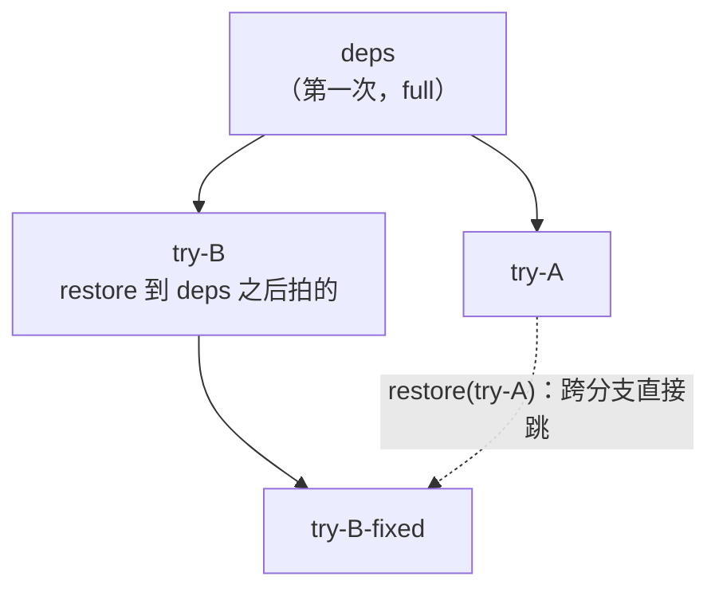

# 21 · SDK 快速上手

默认 E2B 服务、本特性及配套 SDK 已按客户方式准备好。本章直接使用接口示例解释创建、回滚、列出和删除，不展开服务部署和 SDK 安装流程。

## 1. 运行示例的前提

确认现有服务包含本特性，业务解释器可导入配套 SDK，且已具备创建沙箱和访问沙箱地址的连接配置。示例默认模板别名 `base`；客户可替换为自己的可用模板。

```python
from e2b import Sandbox, CheckpointInfo
```

沿用客户现有的 API 地址、沙箱域名、鉴权和 TLS 设置。环境变量 `E2B_API_KEY`、`E2B_API_URL`、`E2B_DOMAIN` 与 `E2B_HTTP_SSL` 应与实际部署一致；本章不要求采用内部测试机的 localhost、明文连接或 `/root/.e2b/config.json`。

服务端能力检查见[第 23 章](23-build-and-self-check.md)，错误处理见[第 22 章](22-api-semantics.md)。

## 2. 第一个例子：checkpoint → 改动 → restore → list → delete

把下面的内容存成 `cr_quickstart.py`，确认已有连接配置后 `python3 cr_quickstart.py`。
它同时改一处磁盘文件和一处内存（`/dev/shm` 是 tmpfs，纯内存），用来证明两者一起回到了 checkpoint 那一刻。

```python
import os
from e2b import Sandbox

TEMPLATE = os.environ.get("CR_TEMPLATE", "base")


def sh(sbx, cmd):
    return sbx.commands.run(cmd, user="root").stdout.strip()


sbx = Sandbox.create(template=TEMPLATE, timeout=600)
try:
    # 现场 v1：磁盘文件 + 内存（tmpfs）+ / 下的一个标记文件
    sh(sbx, "echo v1 > /home/user/state.txt && echo v1 > /dev/shm/mem.txt && touch /etc/cr-marker")

    ck1 = sbx.checkpoint.create(name="v1")
    print("checkpoint:", ck1.checkpoint_id, "mem_mode =", ck1.mem_mode)   # 沙箱的第一次：full

    # 改动：磁盘和内存都改成 v2，再删掉 / 下的一个文件
    sh(sbx, "echo v2 > /home/user/state.txt && echo v2 > /dev/shm/mem.txt && rm -f /etc/cr-marker")
    print("改动后:", sh(sbx, "cat /home/user/state.txt /dev/shm/mem.txt"))

    ck2 = sbx.checkpoint.create(name="v2")
    print("checkpoint:", ck2.checkpoint_id, "mem_mode =", ck2.mem_mode)   # 之后：incremental

    # 回到 v1：磁盘、内存、被删的文件一起回来
    sbx.checkpoint.restore(ck1.checkpoint_id)
    print("restore 后:", sh(sbx, "cat /home/user/state.txt /dev/shm/mem.txt"))
    print("/etc/cr-marker 回来了:", sh(sbx, "test -f /etc/cr-marker && echo yes || echo no"))

    # 列出本沙箱的 checkpoint（从旧到新）；比目标新的 ck2 仍然在，可以再前滚过去
    for info in sbx.checkpoint.list():
        print("list:", info.checkpoint_id, info.name, info.created_at, info.mem_mode)

    sbx.checkpoint.restore(ck2.checkpoint_id)
    print("前滚到 v2:", sh(sbx, "cat /home/user/state.txt /dev/shm/mem.txt"))

    # 不再需要的 checkpoint 显式删除
    sbx.checkpoint.delete(ck1.checkpoint_id)
    print("剩下:", [i.name for i in sbx.checkpoint.list()])
finally:
    sbx.kill()   # 沙箱销毁时，它的全部 checkpoint 一起删除
```

预期输出的要点：

- 第一次 checkpoint 的 `mem_mode` 是 `full`，第二次是 `incremental`（见 [§4](#4-mem_mode这次是全量还是增量)）；
- restore 之后两处都读回 `v1`，被删的 `/etc/cr-marker` 也回来了；
- `list()` 里仍有 `v2`，restore 到它就"前滚"回去 —— restore 不会删掉比目标更新的 checkpoint；
- 删掉 `v1` 之后 `list()` 只剩 `v2`。

### 2.1 接口一览

全部挂在 `sandbox.checkpoint` 下（异步版 `AsyncSandbox` 的同名方法签名相同，前面加 `await`）。

| 方法 | 返回 | 说明 |
|---|---|---|
| `create(name=None, request_timeout=None)` | `CheckpointInfo` | 做一次 checkpoint。`name` 只是给人看的标签，不要求唯一；ID 由服务端生成 |
| `restore(checkpoint_id, request_timeout=None)` | `bool` | 把沙箱原地回滚到该 checkpoint。**只会返回 `True`**，失败一律抛异常，不要拿返回值做分支 |
| `list(request_timeout=None)` | `List[CheckpointInfo]` | 本沙箱当前这一代的全部可见 checkpoint，按创建时间从旧到新 |
| `delete(checkpoint_id, request_timeout=None)` | `bool` | 从接口上删除一个 checkpoint（空间何时释放见 [第 22 章](22-api-semantics.md)）。同样只会返回 `True` |
| `is_available(request_timeout=None)` | `bool` | checkpoint 接口是否应答（探的是宿主侧服务，不是 guest） |
| `is_running(request_timeout=None)` | `bool` | `is_available` 的旧名，为兼容保留 |

各方法的默认超时和"不自动重发"的约定见 [第 22 章](22-api-semantics.md)。

### 2.2 `CheckpointInfo`

| 字段 | 类型 | 说明 |
|---|---|---|
| `checkpoint_id` | `str` | 唯一 ID，`restore` / `delete` 用它 |
| `name` | `Optional[str]` | 做 checkpoint 时给的名字；没给为 `None` |
| `created_at` | `Optional[int]` | 创建时刻，Unix 秒。**只有 `list()` 返回的对象带这个值**；`create()` 返回的对象里是 `None` |
| `mem_mode` | `Optional[str]` | `"full"` 或 `"incremental"`，见 [§4](#4-mem_mode这次是全量还是增量)；服务端不上报时为 `None` |

`CheckpointInfo` 里**没有父节点字段**：接口上看到的是一张按时间排序的平表。需要按树来管理历史时，由调用方自己记下
"哪个 checkpoint 是在 restore 到哪个之后做的"（[§5](#5-树形历史)）。

## 3. 异步用法

```python
import asyncio
from e2b import AsyncSandbox


async def main():
    sbx = await AsyncSandbox.create(template="base", timeout=600)
    try:
        await sbx.commands.run("echo v1 > /home/user/state.txt", user="root")
        ck = await sbx.checkpoint.create(name="v1")
        await sbx.commands.run("echo v2 > /home/user/state.txt", user="root")
        await sbx.checkpoint.restore(ck.checkpoint_id)
        print((await sbx.commands.run("cat /home/user/state.txt", user="root")).stdout)   # v1
    finally:
        await sbx.kill()


asyncio.run(main())
```

## 4. `mem_mode`：这次是全量还是增量

| 值 | 含义 | 什么时候出现 |
|---|---|---|
| `"full"` | 把整份 guest 内存都写了一遍，耗时和占盘都与虚机内存大小成正比 | 默认配置下沙箱（当前这一代）的**第一次** checkpoint，这是它的树根；以及宿主没开脏页跟踪时的**每一次** |
| `"incremental"` | 只写了自上一个 checkpoint（或上一次 restore 的目标）以来被改过的内存页 | 其余情况 |

对调用方意味着：

- **第一次 checkpoint 必然是 `full`，这是正常的**。每个沙箱只付一次；经原生 pause / resume 换代之后，新一代的第一次也是 `full`（[第 22 章](22-api-semantics.md)）。
- **之后仍是 `full`，说明宿主没在跟踪脏页**。功能完全正确、不报错，只是每次都按全量付时间和空间 ——
  所以这种退化只能从这个字段看出来。鲲鹏 950 上 orchestrator 探测到 HDBSS 会自动打开跟踪；
  没有 HDBSS 的机器默认不跟踪，需要运维显式打开（开关见 [第 24 章](24-configuration-and-capacity.md)）。
- 极少数失败之后（服务端丢了一段脏页记录，见 [第 22 章](22-api-semantics.md) 的 `chain_broken`），
  下一次 checkpoint 也会是 `full`，它会起一棵新的树根。
- `list()` 里报的 `mem_mode` 是这个 checkpoint **被拍下时**的模式；之后服务端整理存储（[第 22 章 §4](22-api-semantics.md#4-删除与空间回收用户视角)）不会改变它。

业务依赖增量耗时的话，可以在自己的代码里加一道断言：

```python
def checkpoint_expect_incremental(sbx, name=None, first=False):
    ck = sbx.checkpoint.create(name=name)
    if ck.mem_mode == "full" and not first:
        raise RuntimeError("这次 checkpoint 是全量：宿主没在跟踪脏页，或刚刚断过链")
    return ck
```

`mem_mode` 为 `None` 时说明服务端版本太老、不上报这个字段，此时不要据此判断。
耗时量级见 [第 18 章](18-950-performance.md)。

## 5. 树形历史

一个沙箱的 checkpoint 构成一棵树：

- 每个 checkpoint 的父节点是"它被拍下时沙箱所处的那个点"—— 上一个 checkpoint，或者上一次 restore 的目标；
- **restore 不剪枝**：比目标更新的 checkpoint 原样保留，仍然可以 restore 过去（前滚）；
- restore 之后再做 checkpoint，新节点挂在 restore 目标下面，树长出一条新分支；
- 任意两个 checkpoint 之间都可以直接跳，不管它们在不在同一条分支上。



对 Agent 类负载的典型用法：每完成一步打一个点；某一步走坏了就 restore 到上一步、换个做法；
后来发现原先的做法其实是对的，再 restore 回那条分支。

下面的例子从同一个起点分出两条分支，再在两条分支之间来回跳：

```python
import os
from e2b import Sandbox

TEMPLATE = os.environ.get("CR_TEMPLATE", "base")


def sh(sbx, cmd):
    return sbx.commands.run(cmd, user="root").stdout.strip()


sbx = Sandbox.create(template=TEMPLATE, timeout=600)
try:
    sh(sbx, "echo deps-installed > /home/user/step.txt")
    deps = sbx.checkpoint.create(name="deps")

    # 分支 A
    sh(sbx, "echo plan-A > /home/user/step.txt")
    try_a = sbx.checkpoint.create(name="try-A")

    # 回到 deps，走分支 B：新 checkpoint 的父节点是 deps
    sbx.checkpoint.restore(deps.checkpoint_id)
    sh(sbx, "echo plan-B > /home/user/step.txt")
    try_b = sbx.checkpoint.create(name="try-B")
    print("try-B mem_mode =", try_b.mem_mode)      # incremental：相对 deps 的增量

    # 跨分支跳回 A，再跳回 B
    sbx.checkpoint.restore(try_a.checkpoint_id)
    print("在 A:", sh(sbx, "cat /home/user/step.txt"))    # plan-A
    sbx.checkpoint.restore(try_b.checkpoint_id)
    print("在 B:", sh(sbx, "cat /home/user/step.txt"))    # plan-B

    # 调用方自己维护的父子关系（接口不返回父节点）
    parent = {try_a.checkpoint_id: deps.checkpoint_id, try_b.checkpoint_id: deps.checkpoint_id}
    print("全部:", [(i.name, i.mem_mode) for i in sbx.checkpoint.list()])
finally:
    sbx.kill()
```

几条用户视角的规则：

- **跨分支跳转的代价**主要取决于两个点之间被改过的页有多少（沿树路径经最近公共祖先汇总），而不是树有多少分支。
- **删除**一个还有后代依赖的 checkpoint，它只是从 `list()` 里消失，数据由服务端按需保留或合并（compact / fold）；
  怎样删才能真正释放空间见 [第 22 章](22-api-semantics.md)。
- 树只属于**这一个沙箱的这一代**：沙箱销毁、orchestrator 重启、经原生 pause / resume 换代，树都随之作废（[第 22 章](22-api-semantics.md)）。

## 6. 出错时

checkpoint 接口的错误按"调用方下一步该做什么"分类，每一种有自己的异常类；
完整的表、异常类层次、超时与重试约定在 [第 22 章](22-api-semantics.md)。上手阶段最常见的几种：

| 现象 | 多半是 |
|---|---|
| `AuthenticationException` | `E2B_API_KEY` 没设或不对（[第 21 章](21-sdk-quickstart.md)） |
| 连接到了预期之外的服务 | 核对客户现有API地址、沙箱域名解析与TLS配置；不统一要求localhost或明文连接 |
| `import e2b` 报 `duplicate file name checkpoint/checkpoint.proto` | 检查SDK协议桩是否被不同版本重复安装；内部覆盖层环境的自检见[附录 E §4](E-environment-and-tools.md#4-sdk-覆盖层) |
| `AttributeError: 'Sandbox' object has no attribute 'checkpoint'` | 当前业务解释器使用的SDK不包含配套checkpoint实现；核对实际导入位置与版本 |
| `mem_mode` 一直是 `full` | 宿主没开脏页跟踪（[§4](#4-mem_mode这次是全量还是增量)） |
| restore 之后别的调用抛 `CheckpointInterruptedException` | 那次调用跨越了 restore，被回滚掐断；重连重试即可（[第 22 章](22-api-semantics.md)） |
