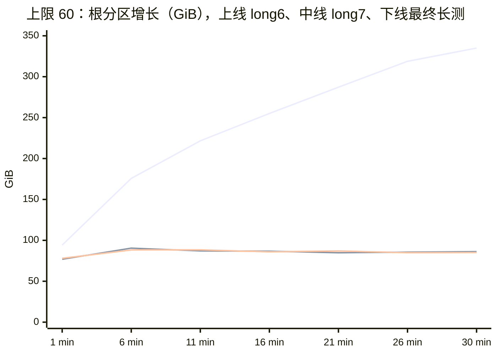
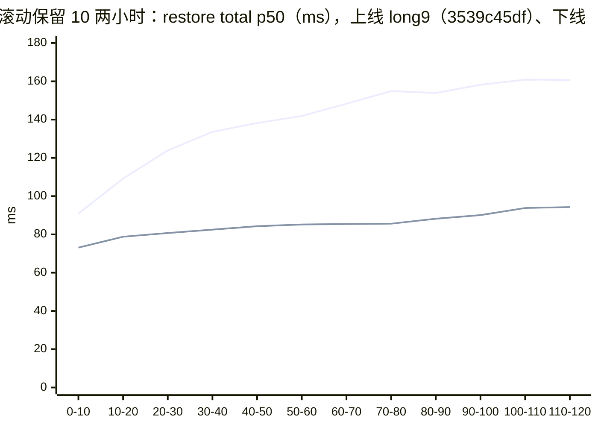

# 附录 B · 920B 详细测试结果

本附录保存开发与历史验证平台的条件、功能、分档、原生增量、并发和长跑证据。下列结果各自适用其原始条件，不能作为 950 性能指标或跨平台净收益。

## 1. 条件标签

本节条件仅对应 920B；950 本轮条件在 [第 18 章 §2](18-950-performance.md#2-条件与来源) 单列。

| 项 | 值 |
|---|---|
| 机型 | 鲲鹏 920（Kunpeng 920 7280Z），2 路，160 物理核 / 320 线程，4 个 NUMA 节点 |
| 内存 | MemTotal 1055027476 kB（约 1 TiB） |
| OS / 内核 | openEuler 24.03 LTS-SP4，`6.6.0-159.4.3.154.oe2403sp4.aarch64` |
| 产物盘 | 根分区 `/dev/mapper/openeuler-root`，**ext4 真盘**，4.3T；产物目录 `/orchestrator/build/checkpoints` 在根分区上 |
| 脏页后端 | **`kvm-wp`**（KVM 软件写保护；920B 没有 HDBSS，orchestrator 显式设 `FC_TRACK_DIRTY_PAGES=true`）。每个干净页的第一次写都要陷出一次虚机，这笔开销含在下面每个数字里 |
| orchestrator | `deltabox-dev@8ea5322bf` 构建，与它拉起的 FC 同在一个上限 256 GiB 的 memory cgroup 里（cgroup v1；页缓存记在这个账上，guest 内存走 2 MiB 大页、不记账，[第 12 章 §8](12-state-and-lifecycle.md#8-节点级效应)） |
| Firecracker | 部署件自带，sha256 `18f3faa7f47c173a5f47bfc7f578f5073cfbde2ac9bdb50bf88c434341d6d4c9`（核对身份以它为准）。放在 `/fc-versions/v1.13.1/` 下，目录名取自模板记录的版本；二进制自报 `Firecracker v1.12.1`，即分叉所基于的上游版本（[第 23 章 §4](23-build-and-self-check.md#4-版本配对)） |
| guest 内核 | 6.1.158 |
| 模板 | `base`：2 vCPU / 2048 MB，rootfs 940 MiB（[附录 E §2](E-environment-and-tools.md#2-测试环境与沙箱规格)） |

机型、内存、内核、产物盘用 `lscpu`、`/proc/meminfo`、`uname -r`、`df -hT /`、`findmnt -T /orchestrator/build/checkpoints` 核对。
**这些数字不能当作 950 的指标**：950 用 HDBSS，脏页后端、机型、盘都不同（[第 16 章 §4](16-test-methodology.md#4-条件标签)）。

## 2. 总表

| 项 | 结果 |
|---|---|
| `run.sh smoke` | 开发态部署上 4 / 5：`checkpoint_verify.py` **59 / 59**；宿主预检 FAIL 0；capabilities 行在；FC sha256 与上表一致。未过的一项是 SDK 覆盖层自检：当时的判据要求"恰好 8 个异常子类"，而本期新增了第 9 个（`CheckpointBytesLimitException`）。判据改为"原有 8 个都在、映射表全是子类"之后，在 RPM 部署件上两次重跑都是 **5 / 5**（[§5](#5-部署后回归)） |
| `run.sh func` | **PASS 17 · FAIL 0 · SKIP 4**（SKIP 的 T18 / T21 / T37 / T38 需要重启或注入，单独跑，见 [§4](#4-重启与注入类)）；RPM 部署件上两次重跑结果相同（[§5](#5-部署后回归)） |
| crtest T36 全规模（16 沙箱 × 1800 s） | 78695 次操作 0 失败、0 不一致，426 条断言通过 |
| 重启与注入类（`3539c45df`） | 10 项全过 |
| FC Rust 单测 | **1554 passed / 0 failed**（三遍：`--all` 835、`--all --examples` 3、带 `rollback-fault-inject` 特性 716） |
| Go 单测与属性测试 | `internal/checkpoint` 等包 `-race` 通过；本机固有的几项环境性失败（cgroup 只读、UFFD API、需拉容器的包）与改动前基线完全相同 |

FC 单测那次跑的源码早于 `8ea5322bf`；此后 FC 目录只多了测试内核文件和一条新单测（`vm.rs` 的
`test_full_snapshot_sidecar_is_all_ones`，单独跑过、通过），FC 产品代码没有变化。

## 3. func 档逐项

| 用例 | 断言数 | 用例 | 断言数 |
|---|---|---|---|
| T11 生命周期竞争 | 44 | T25 时间与 CPU | 81 |
| T12 同沙箱多客户端 | 9 | T26 串口 | 63 |
| T13 冻结窗口干扰 | 78 | T32 restore 随脏集 | 18 |
| T14 写密集并发 | 92 | T34 运行期读链深 | 70 |
| T15 树形分支并发 | 84 | T36 混合稳态（4 沙箱 × 120 s） | 111 |
| T22 深链随机回滚 | 77 | T39 checkpoint 后原生 pause | 26 |
| T23 文件系统边界 | 19 | T40 restore 紧跟请求 | 17 |
| T24 网络状态 | 12 | T41 干净沙箱原生 pause | 60 |
| SDK 异常语义 pytest | 60 passed | | |

## 4. 重启与注入类

每项带对应开关重启 orchestrator 后跑（`3539c45df`）：

| 用例 | 开关 | 通过断言 |
|---|---|---|
| T18 重启后账本不跨重启 | —— | 16 |
| T37 `disk_full` | `CHECKPOINT_MIN_FREE_BYTES` 设为大于盘容量 | 16 |
| T37 `too_many` | `CHECKPOINT_MAX_PER_SANDBOX=2` | 24 |
| T21 `envd_timeout` / `torn_assemble` / `seal_move` / `commit_late` | `CHECKPOINT_FAULT_INJECT=<名字>` | 9 / 9 / 7 / 8 |
| T21 `seal_move:once` / `commit_late:once` | 同上，只炸一次 | 8 / 11 |
| T38 FC 过提交点后失败 | 带 `rollback-fault-inject` 特性的 FC + `FC_ROLLBACK_FAULT_INJECT=post_commit` | 13 |

以上 10 项跑在 `3539c45df` 上；它与 `8ea5322bf` 的差别见篇首，不涉及这些用例测的重启、配额与故障注入路径。

## 5. 部署后回归

前面几节跑在开发态部署上（只替换 orchestrator 二进制）。内部验证采用 RPM 部署方式，因此又用同一台 920B、按内部部署文档完整重装了两次
（orchestrator、Firecracker、SDK 覆盖层都换成部署件），各跑一遍回归：

- **第一次（2026-09-29 上午）**：部署件由 `8ea5322bf` 构建，即本章其余各节的代码；
- **第二次（2026-09-29 下午）**：部署件由 `93ccb02` 构建。它在 `8ea5322bf` 之上多四个提交：delete 按实际情况回答
  （不再把所有错误都答成 404：条目不存在仍是 404 `not_found`；删除已生效、只是之后清理文件失败时照常返回成功并打 WARN；其他错误回 500 `internal`，
  错误码见 [第 22 章](22-api-semantics.md)）；orchestrator 启动时除了打能力行，还把同样的内容写进能力文件
  `/orchestrator/build/checkpoint-capabilities.json`（能力行在高负载下会很快被日志轮转冲掉，smoke 改读这个文件，[第 24 章 §3.1](24-configuration-and-capacity.md#31-能力文件)）；
  另两个提交只改注释（SDK 超时说明、conntrack 与全量根的代码注释）。

| 项 | 第一次（`8ea5322bf` 部署件） | 第二次（`93ccb02` 部署件） |
|---|---|---|
| `run.sh smoke` | **PASS 5 · FAIL 0 · SKIP 0** | **PASS 5 · FAIL 0 · SKIP 0** |
| 　宿主预检 | PASS 15 / WARN 4 / FAIL 0 | PASS 15 / WARN 4 / FAIL 0 |
| 　SDK 覆盖层自检 | 通过（新判据：原有 8 个子类都在、映射表全是子类） | 通过（同左；21 个文件在位） |
| 　能力 | 能力行在：`compact=true`、`compact_max_per_op=8`、`max_checkpoint_bytes_per_sandbox=0`、`debug_index=false` | 能力文件在：`track_dirty_pages=true`（来源 `FC_TRACK_DIRTY_PAGES="true"`）、`compact=true`、`compact_max_per_op=8`、`max_checkpoints_per_sandbox=0`、`max_checkpoint_bytes_per_sandbox=0`、`min_free_bytes=4294967296`、`debug_index=false`、`fault_inject=[]`，各项来源均为 `default` |
| 　Firecracker sha256 | 两处都是 `18f3faa7…` | 两处都是 `18f3faa7…` |
| 　`checkpoint_verify.py` | 59 / 59 | 59 / 59 |
| `run.sh func` | **PASS 17 · FAIL 0 · SKIP 4** | **PASS 17 · FAIL 0 · SKIP 4** |
| 　T36（4 沙箱 × 120 s） | 112 条断言 | 110 条断言 |
| 　SDK 异常语义 pytest | 60 passed | **67 passed**（新增的是 delete 按实际情况回答的用例） |
| 　跳过项 | T18 / T21 / T37 / T38（需要重启或注入） | 同左 |
| 开发态 `correctness.py`（断言已按合并语义更新） | **ALL PASS** | **ALL PASS** |

`correctness.py` 两次都验证了同样几件事：线性链上逐级回退与跨链前滚、分叉后跨分支 restore（路径经最近公共祖先）后内存、磁盘、blob 三项都回到目标时刻；
删除一个只有一个子节点的 checkpoint 时它被合并进子节点、子节点的父指针改指向它原来的父节点，跨过它的 restore 照常正确；
人为移走一份位图侧车时 restore 被拒、沙箱状态不变且照常运行，放回后又能恢复。

第一次部署后还跑了一轮 16 沙箱 × 300 s、不设个数上限的混合并发，只用来确认极限负载下部署件的正确性不受影响；它的数据只在 [附录 B §10.6](#106-部署后无上限并发)。

## 6. 分档基准与判定

**条件**：[§1](#1-条件标签) · 单沙箱串行 · 页缓存全热（1040 次 restore 的 `materialize_disk_read_mb` 与 `fc_rollback_disk_read_mb` 全为 0）·
`bench_tiers.py` 全表 3 遍、1040 次迭代全部 `mem_mode=incremental`、现场不一致 0、离群 0、三遍之间冻结窗口 p50 比值 0.95–1.05。
数字是**客户端墙钟**（ms），p99 取 `analyze.py` 的最近秩法；本表 n < 100 的档取最大值，n = 100 的档取排序后第 99 项（[第 16 章 §3.3](16-test-methodology.md#33-分位数怎么算)）。

### 6.1 混合档（内存:文件 = 3:1）

| 名义改动 | n | checkpoint p50 | p99 | restore p50 | p99 | 内存差分 MB | 盘层 MB | 判定（p50 / p99） |
|---|---|---|---|---|---|---|---|---|
| 0 MB | 100 | 14.9 | 19.5 | 18.1 | 23.8 | 19.38 | 0.71 | ✓ / ✓ |
| 4 MB | 100 | 16.2 | 23.2 | 19.0 | 24.8 | 24.54 | 1.71 | ✓ / ✓ |
| 8 MB | 100 | 17.1 | 22.7 | 19.7 | 25.2 | 28.27 | 2.70 | ✓ / ✓ |
| 16 MB | 100 | 19.2 | 23.5 | 21.4 | 27.2 | 38.72 | 4.72 | ✓ / ✓ |
| 32 MB | 100 | 23.3 | 29.1 | 25.1 | 31.1 | 54.80 | 8.73 | ✓ / ✓ |
| 64 MB | 100 | 34.4 | 40.4 | 30.8 | 36.3 | 85.85 | 16.74 | ✓ / ✓ |
| 128 MB | 60 | 55.9 | 63.3 | 43.6 | 49.5 | 153.32 | 32.78 | ✓ / ✓ |
| 192 MB | 60 | 77.1 | 83.0 | 55.1 | 63.0 | 220.42 | 48.81 | ✓ / ✓ |
| 256 MB | 60 | 97.3 | 118.7 | 66.1 | 71.8 | 285.24 | 64.82 | ✓ / ✓ |
| 512 MB（极限档） | 30 | 176.7 | 183.9 | **108.2** | **113.0** | 548.68 | 128.96 | checkpoint ✓ / ✓；**restore ✗ / ✗** |
| 全量（每遍首次，单列不判定） | 3 | 服务端 total 433–445，墙钟 630–670 | —— | —— | —— | 2048 | —— | 不参与判定 |

"内存差分"大于名义内存份，是因为文件那份经过 guest 页缓存，同时进了内存差分（[第 16 章 §5](16-test-methodology.md#5-负载构造三种失真)）。

### 6.2 附表：纯内存 / 纯文件 / 只读

| 档 | n | checkpoint p50 / p99 | restore p50 / p99 |
|---|---|---|---|
| 纯内存 4 / 16 / 48 / 128 MB | 各 30 | 15.4 / 21.2、16.1 / 21.5、18.3 / 20.8、23.6 / 24.3 | 19.6 / 25.7、20.8 / 26.5、26.6 / 31.7、40.3 / 49.4 |
| 纯文件 4 / 16 / 64 MB（写后 `sync`） | 各 30 | 18.8 / 24.7、32.2 / 38.1、82.2 / 91.1 | 20.1 / 24.7、23.4 / 28.2、33.1 / 41.6 |
| 只读触碰 192 MB | 20 | 15.4 / 19.7 | 19.2 / 24.1 |

只读 192 MB 与 0 MB 档几乎相同：读不算脏（[第 5 章](05-dirty-tracking-and-hdbss.md)）。

### 6.3 拟合与碰线点

混合档名义改动 ≤ 256 MB，以单次迭代为样本最小二乘（n = 780，客户端墙钟）：

- checkpoint ≈ **14.72 + 0.3228 × MB** ms（R² 0.9919）
- restore ≈ **19.12 + 0.1876 × MB** ms（R² 0.9810）

反推碰线：checkpoint 到 200 ms 约在 **573.9 MB**，restore 到 100 ms 约在 **431.0 MB**。
用这两条线外推 512 MB 档，与实测 p50 相差 −1.8% / −6.1%。

### 6.4 判定

| 操作 | 结论（920B · kvm-wp · 单沙箱 · 热缓存） |
|---|---|
| 增量 checkpoint ≤ 200 ms | 全部 18 档 p50 与 p99 都达标，含 512 MB 极限档 |
| 原地 restore ≤ 100 ms | 除 512 MB 极限档外 17 档 p50 与 p99 都达标；512 MB 档 p50 108.2 ms 超线。按拟合，改动量约 430 MB 以内达标 |

## 7. 单沙箱串行与空闲后 restore

以下是 920B 的专项结果，950 串行 100 次的记录见 [第 18 章 §7](18-950-performance.md#7-同-checkpoint-串行-restore-100-次)。

### 7.1 串行 restore 5000 次

一个沙箱、一个调用方、同一个 checkpoint 连回 5000 次（现场内存 16 MB + 文件 4 MB，每 10 次抽验一次）：

| 指标 | 值 |
|---|---|
| 客户端墙钟 p50 / p99 / 最大 / 最小 | 9.58 / 18.2 / 21.7 / 8.35 ms |
| 服务端 `frozen` p50 / p99 | 6.03 / 13.6 ms |
| 服务端 `total` p50 / p99 | 8.75 / 17.3 ms |
| 每 1000 次分段 p50 | 9.57 / 9.62 / 9.52 / 9.57 / 9.63 ms，无漂移 |
| 异常 | 0 |

### 7.2 空闲后 restore

同一沙箱串行，循环"空闲 T 秒 → checkpoint cpB → restore cpA → 删 cpB"（测法见 [第 16 章 §7](16-test-methodology.md#7-空闲后-restore-与串口的专项测法)），客户端墙钟 ms：

| 臂 | n | restore p50 | > 100 ms | cpB checkpoint p50 |
|---|---|---|---|---|
| 空闲 0 s | 30 | 15.4 | 0 / 30 | 10.6 |
| 空闲 0.5 s | 30 | 19.0 | 0 / 30 | 12.8 |
| 空闲 2 s | 30 | 23.2 | 0 / 30 | 75.9 |
| 空闲 5 s | 30 | 25.1 | 0 / 30 | 77.9 |
| 空闲 10 s | 20 | 29.1 | 0 / 20 | 66.8 |
| 空闲 2 s 后**不拍** cpB 直接 restore | 30 | 80.9 | 0 / 30 | —— |
| guest 内常驻忙循环 | 30 | 27.1 | 0 / 30 | 76.3 |

"不拍 cpB 直接 restore"那一臂的服务端分段：`total` 77.8、`frozen` 73.7、其中 FC 的 `fc_quiesce` 47.1 ms（其他臂 `fc_quiesce` 为 0）。

### 7.3 串口

10 段 × 180 s 单沙箱负载，restore 7383 / 7383 成功且逐项一致；每段串口未卡死、无停顿、无 > 2 s 的串口行缺口，
串口行间隔最大 1.595 s。

## 8. 长跑与并发（摘要）

16沙箱并发的历史轮次与最终结果见[本附录§9](#9-轮次总表)、[§10](#10-最终版的结果)，问题定位和前后对比见[附录 C §8](C-evolution-and-cases.md#8-问题逐个讲)。一句话结论：两天 15 组长跑与串口段合计 **731877 次 restore 逐项一致、0 不一致**（三种负载加串口段累加的计数，各轮负载见 [附录 B §9](B-920b-results.md#9-轮次总表)；另有部署件 `93ccb02` 的 2 h 滚动长测 long11 147557 次，同样 0 不一致，见 [附录 B §10.1](B-920b-results.md#101-731877-次-restore0-不一致)）；
每沙箱上限 60 的 30 min 常规负载下，服务端 restore p50 / p99 为 88 / 171 ms、checkpoint 为 30 / 71 ms，产物盘约 90 GiB 后走平（都是这一种负载下的数，不与别的负载比）。
这些是服务端、多沙箱并发的数字，与 [§6](#6-分档基准与判定) 按客户端墙钟、单沙箱串行的判定表不能直接比较。

## 9. 轮次总表

本章记录 MR 后开发过程中的并发与长跑修复。MR 版已在当时验证的单沙箱场景下满足客户性能要求并合入 openEuler；两阶段的关系与完整修改主题见 [00a · 演进总览](C-evolution-and-cases.md)。
下表的 `4af2872c6` 已包含 74 条 MR 后提交，称为“修复前”是指本组长跑修复之前；MR 基线为 `0f9b58f92`。各轮前后对比用于评估对应改动，不直接代表相对 MR 版的加速比。

先把二进制与修复的对应关系列出来（都在 `deltabox-dev` 上，依次叠加；每项修复的原理见右列链接）：

| 二进制 | 在上一个基础上新增 | 原理 |
|---|---|---|
| RPM 部署版 `4af2872c6` | 本组长跑修复前基线，已包含 74 条 MR 后提交 | [附录 C §5.1](C-evolution-and-cases.md#51-mr-基线与并发优化基线要分别阅读) |
| `cba26f7c1` | index.json 不再每次重写（[附录 C §8.2](C-evolution-and-cases.md#82-每次-checkpoint-整份重写-indexjson)）；锁外删文件（[附录 C §8.3](C-evolution-and-cases.md#83-在全局锁里删文件)）；GC 直方图取证开关 | [第 12 章](12-state-and-lifecycle.md) |
| `baae30b56` | 代理开 full duplex（[附录 C §8.1](C-evolution-and-cases.md#81-流式命令偶发截断)） | [第 22 章 §11.3](22-api-semantics.md#113-两类流式截断要分清) |
| `5319de5dc` | 拷贝前 `MADV_POPULATE`（[附录 C §8.4](C-evolution-and-cases.md#84-gc-长暂停落进别的沙箱的冻结窗口)）；restore 自计读量（[附录 C §8.5](C-evolution-and-cases.md#85-restore-读盘量指标在并发时虚高)） | [第 12 章 §8](12-state-and-lifecycle.md#8-节点级效应) |
| `1b112fbbd` | conntrack 整表扫描与选路（[附录 C §8.6](C-evolution-and-cases.md#86-conntrack-清理占了冻结窗口)） | [第 10 章 §4](10-device-network-time.md#4-连接跟踪) |
| `df4b38336` | 层按视图引用计数回收、子节点计数表（[附录 C §8.7](C-evolution-and-cases.md#87-rootfs-层文件从不回收)） | [第 7 章 §9](07-disk-layering.md#9-层回收按视图引用计数) |
| `0c4c2c5ae` | 隐藏 checkpoint 合并（内存与层，[附录 C §8.8](C-evolution-and-cases.md#88-隐藏-checkpoint-无上界积累磁盘随时间线性增长)）；字节配额 | [第 6 章 §10](06-memory-diff-tree.md#10-删除隐藏与合并)、[第 7 章 §10](07-disk-layering.md#10-层合并) |
| `3539c45df` | 全量根回滚因子恒为全 1（加固，长跑不涉及） | [第 6 章](06-memory-diff-tree.md) |
| `8ea5322bf` | 视图装配改位图（[附录 C §8.9](C-evolution-and-cases.md#89-视图块数增长restore-随时间变慢)）；`disk_view_read` 计时 | [第 7 章 §6](07-disk-layering.md#6-读路径与视图装配) |
| `93ccb02`（部署件，`/usr/bin/template-manager` sha256 `782d6a2a…`） | delete 按实际结果回错误码（id 不存在才回 404，已生效但清文件失败按成功答，其余回 500）；启动时写 checkpoint 能力文件；注释与 Python SDK 的说明文字。restore / checkpoint 热路径与 `8ea5322bf` 相同（`conntrack_flush.go` 只改了注释） | —— |

然后是全部轮次。除注明外都是 16 沙箱、模板 `base`、服务端开 `gctrace`；restore / checkpoint 为服务端 `total` 的 p50 / p99（ms）。
两天的日期是 2026-09-28 与 09-29，时间为北京时间。

| 轮 | 时间 | 二进制 | 形态与开关 | 时长 | restore 逐项一致 | restore p50 / p99 | checkpoint p50 / p99 | 这一轮要回答的问题 |
|---|---|---|---|---|---|---|---|---|
| long1 | 09-28 05:50–06:20 | RPM | 无上限 | 1800 s | 32547 / 32547 | 250.1 / 1148.7 | 115.6 / 738.8 | 修复前的基线长什么样 |
| long2 | 06:55–07:25 | RPM | 无上限；`PROXY_TRACE` 开 | 1800 s | 31680 / 31680 | 309.3 / 1289.4 | 126.1 / 773.5 | 流截断发生在哪一跳、在请求的哪个阶段 |
| long3 | 08:23–08:53 | `cba26f7c1` | 无上限；`CHECKPOINT_RUNTIME_METRICS=1` | 1800 s | 32340 / 32340 | 362.7 / 1535.7 | 70.2 / 680.5 | 去掉 index 热写和锁内删文件后，锁等待与 GC 怎样；长 STW 卡在哪一半 |
| long4 | 09:17–09:47 | `baae30b56` | 同 long3 | 1800 s | 30173 / 30173 | 382.3 / 1705.5 | 76.8 / 800.1 | full duplex 能否让截断归零 |
| long5 | 10:19–10:49 | `5319de5dc` | 同 long3 | 1800 s | 28331 / 28331 | 450.8 / 1698.2 | 91.1 / 759.6 | `MADV_POPULATE` 能否消掉 GC 长暂停；新读量键是否可信 |
| long6 | 10:58–11:28 | `5319de5dc` | **上限 60** | 1800 s | 70702 / 70702 | 193.1 / 337.8 | 34.0 / 128.1 | 常规用法下的基线；有没有常规负载才出现的问题 |
| ct-opt 基线 | 12:12–12:19 | `5319de5dc` + conntrack 子计时 | 上限 60 | 420 s | 17009 / 17009 | 182.7 / 313.1 | 32.3 / 114.0 | conntrack 的时间花在哪一半（不计入总数） |
| ct-opt | 12:30–12:46 | `1b112fbbd` | 上限 60 | 900 s | 41748 / 41748 | 113.5 / 333.3 | 33.7 / 253.1 | 新清扫算法能否把 conntrack 移出冻结窗口 |
| d1 | 13:33–13:48 | `df4b38336` | 上限 60（未开 gctrace） | 900 s | 43352 / 43352 | 107.3 / 192.8 | 32.1 / 93.5 | 层文件是否按视图回收、层数是否等于视图并集 |
| long7 | 16:26–16:56 | `0c4c2c5ae` | 上限 60 | 1800 s | 87973 / 87973 | 105.2 / 191.7 | 31.6 / 80.7 | 合并之后目录、磁盘、链深是否走平 |
| long8 | 17:00–17:30 | `0c4c2c5ae` | **滚动保留 10** | 1800 s | 31443 / 31443 | 106.4 / 202.8 | 36.0 / 81.9 | "保留最新 N 个"用法下是否收敛 |
| long8 对照 | 17:38–17:48 | `0c4c2c5ae` | 滚动保留 10，**`CHECKPOINT_COMPACT=false`** | 600 s | 8128 / 8128 | 405.2 / 930.5 | 41.5 / 167.5 | 不合并时同一负载会怎样 |
| long9 | 09-28 23:26 – 09-29 01:26 | `3539c45df` | 滚动保留 10，沙箱寿命 3 h | 7200 s | 112402 / 112402 | 0–10 min 90.9 / 162.7 → 110–120 min 160.7 / 274.5 | 35.0 / 67.5 → 39.4 / 107.7 | 两小时里有没有随时间劣化的量 |
| long10 | 09-29 02:42–03:43 | `8ea5322bf` | 同 long9 | 3600 s | 75817 / 75817 | 0–10 min 71.0 / 128.3 → 50–60 min 84.1 / 136.3 | 31.8 / 47.0 → 34.0 / 51.5 | 视图装配改位图后，restore 还随块数涨吗 |
| 最终长测 | 04:59–05:29 | `8ea5322bf` | 上限 60；`CHECKPOINT_RUNTIME_METRICS=1` | 1800 s | 97858 / 97858 | 87.7 / 171.3 | 30.4 / 70.8 | 最终版在常规用法下的全貌 |
| 串口段 | 05:43–06:14 | `8ea5322bf` | 单沙箱 × 10 段 × 180 s | 1888 s | 7383 / 7383 | —— | —— | 长时间反复 restore 后串口是否卡死 |
| long11 | 09-29 17:10–19:11 | `93ccb02`（部署件） | 同 long9；`CHECKPOINT_RUNTIME_METRICS=1` | 7200 s | 147557 / 147557 | 0–10 min 73.1 / 131.5 → 110–120 min 94.3 / 160.5 | 32.8 / 47.5 → 34.3 / 54.9 | 部署件跑满 2 h 滚动负载：restore 还随块数涨吗，树与盘是否走平 |

读这张表要注意三点：

- **无上限各轮的数字大，主要不是代码慢**：链深长到 1926–2352，页缓存把 256 GiB 的 memory cgroup 填满（long4、long5 起跑 57 s 就顶满；long3 的 cgroup 采样是中途才开的，起跑后 828 s 的第一个样本已经是满的），之后全程在回收里；
  这些轮只用来暴露问题。long3 到 long5 的 restore p50 一轮比一轮高，与各自的修复无直接关系（修复都不在 restore 的内存回滚路径上），
  而是轮间波动与起跑条件（netns 数 1125 → 1700 → 301）共同作用，long5 的分析里专门说明了没有做交替对照、不能归因。
- **上限 60 各轮的 checkpoint 大部分被 429 拒**：客户端发起 / 成功分别是 long6 100585 / 31355、ct-opt 59722 / 18492、d1 62247 / 19718、
  long7 125841 / 38484、最终长测 139934 / 43117。这是驱动"收到 429 不主动删"的结果，不是失败。
- long9、long10、long11 按段给出首尾两段，因为这几轮要看的正是随时间的变化；逐段数字见 [附录 C §8.9](C-evolution-and-cases.md#89-视图块数增长restore-随时间变慢) 与 [§10.3](#103-滚动保留-10一小时与两小时)。
- long11 是在前 15 组与串口段之后加跑的一轮，用部署件验证 2 h 滚动负载；它的 restore 数单独列出，不并进 [§10.1](#101-731877-次-restore0-不一致) 的 731877 合计。

## 10. 最终版的结果

### 10.1 731877 次 restore，0 不一致

两天里所有长跑与串口段的 restore 逐项校验数：

| 轮 | 二进制 | restore 逐项一致 |
|---|---|---|
| long1 | RPM | 32547 |
| long2 | RPM | 31680 |
| long3 | `cba26f7c1` | 32340 |
| long4 | `baae30b56` | 30173 |
| long5 | `5319de5dc` | 28331 |
| long6 | `5319de5dc` | 70702 |
| ct-opt | `1b112fbbd` | 41748 |
| d1 | `df4b38336` | 43352 |
| long7 | `0c4c2c5ae` | 87973 |
| long8 | `0c4c2c5ae` | 31443 |
| long8 对照（不合并） | `0c4c2c5ae` | 8128 |
| long9 | `3539c45df` | 112402 |
| long10 | `8ea5322bf` | 75817 |
| 最终长测 | `8ea5322bf` | 97858 |
| 串口段 10 段 | `8ea5322bf` | 7383 |
| **合计** | | **731877，0 不一致** |

不计入的：ct-opt 基线 17009（它是改算法前的对照）、各功能档与分档基准里的 restore、T36（另计，[§10.5](#105-t36-全规模)）。
d1 的 43352 是驱动全程数，按 900 s 日志窗口统计是 43313，口径不同。

上表的口径是"两天 15 组长跑 + 串口段"。此后另跑了一轮部署件 `93ccb02` 的 2 h 滚动长测 long11（[§10.3](#103-滚动保留-10一小时与两小时)），单独列出，不并进上表合计：

| 轮 | 二进制 | restore 逐项一致 |
|---|---|---|
| long11 | `93ccb02`（部署件） | 147557 / 147557，0 不一致 |

加上它，restore 逐项校验总数为 731877 + 147557 = **879434 次，全部一致**。

这个数字的含义是：在修复前后的 9 个二进制、三种负载加串口段、链深从 10 到 2352、宿主内存回收从无到持续顶满的全部条件下，
每一次 restore 之后内存代号、磁盘代号、内存内容、磁盘内容、心跳进程五项都回到了目标时刻。
**性能问题一个接一个，数据正确性从头到尾没有出过一次错**。

### 10.2 上限 60 的最终长测：30 min 时间序列

条件：`8ea5322bf`，16 沙箱，上限 60，1800 s，起跑 netns 564。每 5 min 一段；树与盘取段内最后一次 60 s 采样。

| 段 | restore n | restore `total` p50 / p99 | restore `frozen` p50 | checkpoint n | checkpoint `total` p50 / p99 / max | `conntrack_bg` p50 | `materialize_read_mb` p50 | 目录 / 可见 / 隐藏 | 真实链深（段内最大） | df 增量 GiB |
|---|---|---|---|---|---|---|---|---|---|---|
| 0–5 min | 16241 | 80.5 / 164.6 | 71.9 | 7962 | 30.6 / 95.3 / 783.5 | 66.8 | 49.9 | 1229 / 944 / 285 | 17 | 89.2 |
| 5–10 min | 16308 | 86.2 / 170.2 | 77.6 | 7014 | 30.4 / 67.6 / 121.5 | 75.3 | 53.0 | 1232 / 954 / 278 | 18 | 87.0 |
| 10–15 min | 16330 | 86.9 / 166.7 | 77.9 | 6918 | 30.0 / 44.0 / 88.1 | 75.1 | 55.9 | 1245 / 951 / 294 | 14 | 86.5 |
| 15–20 min | 16384 | 90.3 / 171.4 | 81.0 | 7115 | 30.3 / 42.8 / 77.3 | 77.4 | 63.3 | 1225 / 950 / 275 | 17 | 86.1 |
| 20–25 min | 16286 | 90.1 / 175.1 | 80.5 | 7093 | 30.7 / 43.3 / 81.6 | 76.2 | 62.9 | 1223 / 953 / 270 | 19 | 84.3 |
| 25–30 min | 16265 | 91.2 / 177.5 | 81.7 | 6991 | 30.4 / 42.7 / 71.4 | 78.8 | 56.4 | 1240 / 947 / 293 | 17 | 85.2 |
| **全程** | 97814 | **87.67 / 171.28** | 78.56 | 43093 | **30.39 / 70.79** / 783.5 | 74.9 | 54.5 | 约 1240，后 15 min −1.02 / min | 13–19 | 峰值 90.3，后 15 min −0.13 / min |

几点解读：

- **checkpoint 第一段的 p99 和 max 偏高**：全程 > 400 ms 的 16 次 checkpoint，恰好是起跑时 16 个沙箱各自的首次全量 checkpoint（669–784 ms），
  写 2 GiB guest 内存的正常代价；此后各段 max 都在 122 ms 以内。restore 全程没有 > 400 ms 的。
- **restore p50 前 15 min 从 80 升到 87–91 ms 后稳定**：与 `conntrack_bg`（66.8 → 约 77 ms）和回滚量（`materialize_read_mb` 49.9 → 约 56–63 MB）同步，
  它们在前几分钟随宿主表与视图变大而爬升，然后停住。冻结窗口 p50 约 78 ms 里，`conntrack_bg` 已占到可比的量级（[§11](#11-已知未解决)）。
- **盘和树从第 5 分钟起走平**，df 在 84–89 GiB 之间来回，树的规模由"可见 ≤ 60 × 16"和合并的上界共同决定。
- 其他：GC 5994 次，STW p50 / p99 / max 0.73 / 1.1 / 2.8 ms，≥ 10 ms 0 次；cgroup 用量最大 130.5 GiB、`failcnt` 增量 0；
  `assemble_view_pre` p50 / p99 0.31 / 2.97 ms（long7 为 8.98 / 39.26）；delete p50 9.51 ms；截断 0；非 429 的客户端失败 1 次（客户端连接层的 `Bad file descriptor`，服务端没收到这个请求）。

修复前后在同一负载下的对照（long6 → 最终长测，都是上限 60、30 min）：

| 指标 | long6（`5319de5dc`） | 最终长测（`8ea5322bf`） |
|---|---|---|
| restore `total` p50 / p99 | 193.08 / 337.76 ms | **87.67 / 171.28 ms** |
| restore `frozen` p50 / p99 | 163.19 / 303.57 ms | 78.56 / 161.41 ms |
| checkpoint `total` p50 / p99 | 33.99 / 128.12 ms | **30.39 / 70.79 ms** |
| 冻结内等 conntrack p50 | 73.8 ms | 约 0（`conntrack_bg` 被回滚遮住的部分） |
| df 增长 | 峰值 340.6 GiB，仍在涨 | 峰值 90.3 GiB，走平 |
| 目录数 | 1562 → 3943，仍在涨 | 约 1240，走平 |
| GC STW 最大 | 67.4 ms | 2.8 ms |
| cgroup `failcnt` 增量 | 2041 万 | 0 |
| restore 逐项一致 | 70702 / 0 不一致 | 97858 / 0 不一致 |

（long7 与最终长测两条几乎重合。）

### 10.3 滚动保留 10：一小时与两小时

滚动负载跑了三轮，负载完全相同（`rolling_keep10.py`，16 沙箱，保留 10，每次 checkpoint 后以 0.25 的概率 restore 并逐项校验），
服务端都开 `gctrace` 与 `CHECKPOINT_RUNTIME_METRICS=1`：

- **long9**：`3539c45df`，视图装配优化之前，2 h；
- **long10**：`8ea5322bf`，视图装配改位图之后，1 h；
- **long11**：`93ccb02`，RPM 部署件（`template-manager` sha256 `782d6a2a…`），2 h，2026-09-29 17:10:58 → 19:11:55。

`93ccb02` 相对 `8ea5322bf` 只改了 delete 的错误码映射、启动时写的能力文件和注释（含 Python SDK 的说明文字），restore / checkpoint 热路径相同（[§9](#9-轮次总表)）；
long11 前 60 min 与 long10 逐段重合（下表），可以当作 long10 延长到 2 h。

| 项 | long9（2 h，`3539c45df`） | long10（1 h，`8ea5322bf`） | long11（2 h，`93ccb02`） |
|---|---|---|---|
| checkpoint / restore / delete 次数 | 450302 / 112402 / 450142 | 301295 / 75817 / 301135 | 591185 / 147557 / 591025 |
| restore 逐项一致 | 112402 / 0 不一致 | 75817 / 0 不一致 | 147557 / 0 不一致 |
| 目录 / 真实链深 | 175–188 / 10–11 | 176–183 / 9–11 | 173–188 / 10–11 |
| df 增量 | 40.5 → 44.3 GiB | 41.0 → 43.9 GiB | 41.1 → 45.2 GiB |
| restore `total` p50 首段 → 末段 | 90.9 → 160.7 ms | 71.0 → 84.1 ms | 73.1 → 94.3 ms |
| restore `total` p99 首段 → 末段 | 162.7 → 274.5 ms | 128.3 → 136.3 ms | 131.5 → 160.5 ms |
| checkpoint `total` p50 / p99 末段 | 39.4 / 107.7 ms | 34.0 / 51.5 ms | 34.3 / 54.9 ms |
| 存活堆 p50 | 421 → 578 MB | 323 → 325 MB | 324 → 325 MB |
| GC 次数 / STW ≥ 100 ms / STW 最大 | 18708 / 0 / 6.77 ms | 14396 / 0 / 3.90 ms | 29077 / 0 / 3.32 ms |
| 截断 / 非 429 失败 | 1 / 1（client-proxy 未修，[附录 C §8.1](C-evolution-and-cases.md#81-流式命令偶发截断)） | 0 / 0 | 0 / 0（结束时 16 / 16 可用） |

逐段对照（每 10 min 一段；p50 / p99，ms；块数为每沙箱"所有可见视图总块"均值，目录、链深、df 取段内最后一次采样；long10 只有前 60 min）：

| 段 | 块数 long11 / long9 | restore `total` long11 | long9 | long10 | `assemble_view_pre` p50 long11 / long9 | materialize + fc_rollback p50 long11 / long9 | 冻结内等 conntrack p50 long11 | 目录 / 链深 long11 | df 增量 GiB long11 |
|---|---|---|---|---|---|---|---|---|---|
| 0–10 min | 46742 / 44437 | 73.1 / 131.5 | 90.9 / 162.7 | 71.0 / 128.3 | 0.3 / 12.8 | 42.7 / 46.2 | 2.2 | 178 / 11 | 41.1 |
| 10–20 min | 65756 / 59697 | 78.8 / 131.9 | 109.2 / 194.7 | 78.6 / 130.3 | 0.3 / 21.3 | 48.6 / 54.6 | 1.1 | 187 / 11 | 42.2 |
| 20–30 min | 75494 / 73077 | 80.7 / 131.6 | 123.9 / 213.0 | 81.7 / 132.0 | 0.4 / 31.0 | 51.7 / 59.2 | 0.0 | 182 / 10 | 43.1 |
| 30–40 min | 79819 / 76312 | 82.5 / 131.2 | 133.6 / 225.6 | 82.1 / 133.9 | 0.4 / 36.5 | 53.8 / 61.2 | 0.0 | 183 / 11 | 43.7 |
| 40–50 min | 84289 / 79778 | 84.3 / 134.5 | 138.2 / 232.8 | 83.2 / 134.1 | 0.4 / 38.7 | 55.7 / 61.8 | 0.0 | 179 / 10 | 43.7 |
| 50–60 min | 89841 / 83251 | 85.2 / 136.8 | 141.9 / 240.8 | 84.1 / 136.3 | 0.4 / 41.7 | 56.8 / 62.5 | 0.0 | 177 / 11 | 44.1 |
| 60–70 min | 93305 / 87227 | 85.4 / 140.9 | 148.3 / 252.7 | —— | 0.4 / 44.6 | 56.7 / 63.9 | 0.0 | 173 / 11 | 44.7 |
| 70–80 min | 96516 / 89534 | 85.6 / 144.1 | 154.9 / 260.9 | —— | 0.4 / 48.2 | 54.9 / 63.6 | 0.0 | 177 / 11 | 44.3 |
| 80–90 min | 97076 / 92437 | 88.2 / 146.1 | 153.9 / 260.8 | —— | 0.4 / 48.7 | 54.5 / 63.3 | 0.0 | 181 / 10 | 44.8 |
| 90–100 min | 99629 / 94976 | 90.1 / 153.8 | 158.2 / 262.5 | —— | 0.4 / 50.9 | 55.2 / 64.8 | 0.3 | 188 / 11 | 44.8 |
| 100–110 min | 103379 / 97297 | 93.8 / 157.5 | 160.9 / 269.5 | —— | 0.5 / 52.3 | 55.0 / 63.4 | 6.0 | 176 / 10 | 45.2 |
| 110–120 min | 107016 / 98072 | 94.3 / 160.5 | 160.7 / 274.5 | —— | 0.5 / 53.3 | 54.2 / 63.8 | 7.4 | 178 / 11 | 45.2 |

各项 p50 对块数的回归（60 s 粒度，ms / 千块，括号内为 r）：

| 指标 | long11 全程 | long11 前 60 min | long11 后 60 min | long10（60 min） | long9 全程 |
|---|---|---|---|---|---|
| restore `total` | 0.296（0.90） | 0.255（0.84） | 0.744（0.87） | 0.268（0.86） | 1.190（0.99） |
| restore `total` − `conntrack`（逐条相减） | 0.283（0.92） | —— | —— | —— | 1.190（0.99） |
| `assemble_view_pre` | 0.003（0.99） | 0.003（0.99） | 0.003（0.95） | 0.003（1.00） | 0.686（0.99） |
| `disk_view_read` | 0.002（0.99） | 0.002（0.99） | 0.002（0.96） | 0.002（1.00） | —— |
| materialize + fc_rollback | 0.183（0.85） | 0.286（0.97） | −0.117（−0.39） | 0.290（0.96） | 0.278（0.93） |

怎么读：

- **restore 不再随块数明显变慢**。long11 全程斜率 0.296 ms / 千块，与 long10 的 0.268 同量级，约为 long9 的 1/4；装配只剩 `assemble_view_pre` p50 0.3 → 0.5 ms、
  `disk_view_read` p50 0.2–0.3 ms（p99 不超过 1.2 ms）。120 min 时 restore p50 / p99 94.3 / 160.5 ms，long9 同段 160.7 / 274.5 ms，都低约 41%；
  checkpoint 末段 34.3 / 54.9 ms，long9 39.4 / 107.7 ms。
- **后 60 min 的 0.744 不是块数的代价**。这一段 `assemble_view_pre`、`disk_view_read` 的斜率不变，materialize + fc_rollback 在 55 ms 附近走平（斜率 −0.117），
  上涨的是冻结窗口里等 conntrack 的时间（最后 20 min p50 6.0–7.4 ms）。块数和宿主表都随时间上涨，单变量回归分不开两者；逐条扣掉 `conntrack` 后全程斜率 0.283 ms / 千块。
  当时的回归尚未区分宿主表上涨的来源；后续已定位为非沙箱条目占主导，DNS累积的具体机制仍为推断。后续分析见 [附录 C §8.6](C-evolution-and-cases.md#86-conntrack-清理占了冻结窗口) 末。
- **块数没有饱和**。每沙箱所有可见视图总块均值 2 h 末 107016 块（最新视图底层块占设备 42.9%），最后 30 min 仍以约 2.1 万块 / h 增长（long9 同段约 1.1 万块 / h）；
  饱和拟合的饱和值约 10.5 万块，结束时已经超过，拟合不可信。上界约 16 万块（[附录 C §8.9](C-evolution-and-cases.md#89-视图块数增长restore-随时间变慢)），按 0.283 ms / 千块外推，涨到上界 restore 约再 +15 ms，仍待更长的实测确认。
- **树与盘走平**。目录数 173–188 来回、无趋势，真实链深始终 10–11；df 头 10 min 涨到 41.1 GiB，此后 110 min 只再涨约 4 GiB，后 60 min 线性拟合约 +1.3 GiB / h。
- **回滚量**：`materialize_read_mb` p50 前 30 min 从 45.1 涨到 54.4 MB，之后稳定在 56.6–57.9 MB，所以 materialize + fc_rollback 在第二个小时走平。
- **GC**：29077 次，STW ≥ 100 ms 0 次，最大 3.32 ms；存活堆 p50 324–326 MB，不随时间涨。

### 10.4 串口段

最终二进制，单沙箱 × 10 段 × 约 189 s，共 1888 s：

| 项 | 结果 |
|---|---|
| restore 逐项一致 | 764 + 755 + 704 + 790 + 728 + 759 + 710 + 724 + 739 + 710 = 7383，0 不一致 |
| 串口卡死 | 10 段全部没有 |
| 慢段、停顿 | 0 |
| 串口行间隔中位 / 最大 | 0.29–0.33 s / 1.595 s，没有 > 2 s 的缺口 |
| guest 命令最长一次 | 1.52 s（负载本身的命令时长） |

旧版本 Firecracker 曾出现"restore 之后 guest 串口卡死"（根因是中断控制器的 active 位残留，已在 Firecracker 侧修复，机制见 [第 9 章 §3.7](09-in-place-rollback.md#37-阶段-6中断控制器)）。
这 10 段确认部署件里的 Firecracker 在本期 orchestrator 下没有回退。

### 10.5 T36 全规模

crtest 的 T36 是另一套混合稳态（16 沙箱 × 1800 s，场景含 checkpoint、restore、delete、写文件、list、长命令），
判据与驱动都独立于 D 段，用来交叉验证。最终版：78695 次操作 0 失败、0 不一致，426 条断言通过。分场景（客户端，p50 / p99 / max，ms）：

| 场景 | 修复前（RPM，long2 时段） | 最终版 |
|---|---|---|
| restore | 60 / 221 / 1122（16298 次） | **43 / 62 / 287**（16658 次） |
| checkpoint（脚本场景名 `create`） | 26 / 138 / 1706 | 22 / 31 / 741 |
| delete | 4 / 57 / 209 | 11 / 37 / 422 |
| write | 75 / 112 / 706 | 73 / 88 / 653 |

T36 的 restore 次数（16658）不计入 [§10.1](#101-731877-次-restore0-不一致) 的 731877。

### 10.6 部署后无上限并发

用同一代码出的 RPM 按部署文档重装之后（orchestrator、Firecracker、SDK 覆盖层都换成部署件），跑了一轮 16 沙箱 × 300 s 的 D 段，**不设上限**：

| 项 | 结果 |
|---|---|
| restore | 8594 / 8594 逐项一致 |
| checkpoint / delete | 12183 / 3632 次，全部成功 |
| 结束时可用沙箱 | 16 / 16 |
| 每沙箱同时存在的 checkpoint 数最大 | 586 |
| 服务端 restore `total` p50 / p99 | 81.4 / 958.0 ms（`frozen` p50 72.6 ms） |
| 服务端 checkpoint `total` p50 / p99 | 40.3 / 780.0 ms |

这是无上限负载：链深涨到几百、页缓存压力远大于常规用法，p99 近 1 s 与修复前同类负载同一档（long1–long5 的 p99 1.1–1.7 s）。
它只说明**极限负载下部署件的正确性不受影响**；常规负载的耗时看 [§10.2](#102-上限-60-的最终长测30-min-时间序列)。部署后的功能回归见 [附录 B §5](#5-部署后回归)。

## 11. 已知、未解决

| 项 | 现状 | 处理 |
|---|---|---|
| delete 同步合并 | delete p50 约 10 ms（上限 60）/ 约 26 ms（滚动 10），p99 基本不变 | 先不改；需要时改后台异步合并 |
| `conntrack_bg` 贴近关键路径 | p50 74.9 ms（上限 60）/ 52–55 ms（滚动 10 第一个小时），宿主表约 1.9 万条；冻结窗口 p50 60–80 ms | 下一个优化候选；可先按生产数据上调单地址阈值 |
| 第二个小时宿主 conntrack 表上涨，推高 restore（long11） | 宿主表段中位数前 80 min 约 1.9 万条，最后 20 min 约 2.38 万条，峰值 26645；`conntrack_bg` p50 52.6 → 69.4 ms，冻结内等待 p50 第 100 min 前不超过 0.3 ms、之后 6.0–7.4 ms；restore p50 第二个小时 85.4 → 94.3 ms，主要来自这里。**根因已查明**：宿主表约 95% 是非沙箱条目（lo:80 的 `TIME_WAIT`、本机 DNS），沙箱条目没有积压；宿主侧清扫每批整表 dump，代价跟着整张表走；上涨来自本机 DNS 的 `ASSURED` 条目堆积（机制为推断，未抓包）。45 min 复现 55777 次 restore 0 不一致 | 方案 A（沙箱连接打 ct mark、dump 时让内核按 mark 过滤，预期清扫约 9–10 ms、`conntrack_bg` 约 20 ms）已设计，**用户 09-30 决定暂不实施**（[附录 C §8.6](C-evolution-and-cases.md#86-conntrack-清理占了冻结窗口) 末） |
| restore 随回滚量增长 | 滚动负载 60 min 内 `materialize_read_mb` 45 → 58 MB，写回滚内存约 0.65 ms/MB；2 h 的 long11 里 30 min 后稳定在约 57 MB | 真实工作量，不是缺陷 |
| 视图块数仍在增长 | 上界约 16 万块；long11 2 h 末约 10.7 万块，最后 30 min 仍约 2.1 万块 / h，未饱和 | 按 0.283 ms / 千块外推到上界约再 +15 ms，待更长的长跑确认；根治需改侧车为区间编码（改盘上格式） |
| 脏页跟踪关闭时不合并 | 每个 checkpoint 都是全量根，层累积 | 设计边界；950 用 HDBSS、920B 显式开跟踪，都不走这条路 |
| 16 路首个增量 checkpoint 两种形态 | 约 450 ms 与约 100–130 ms 两簇，修复前就有 | 未找到触发条件，暂缓 |
| netns 泄漏 | 每重启一次 orchestrator 漏约 290 个 | 上游问题，靠运维清理（[第 26 章 §9](26-troubleshooting.md#9-网络槽位netns泄漏)） |
| 客户端偶发 `Bad file descriptor` | 每轮 0–2 次，服务端未收到这些请求 | 客户端连接层，只记录 |
| 并发时 GC 偶发长暂停 | ct-opt 出现过 5 次 ≥ 100 ms，此后各轮未再出现 | 未归因，只记录 |

## 12. 数据的来源与条件

原生精确增量的数据分三批，条件不同，读的时候要带着条件标签：

| 批次 | 平台与脏页后端 | 日期 | 代码 | 用途 |
|---|---|---|---|---|
| 修复前对照 | 950（HDBSS）；920B（KVM 写保护） | 2026-09-09～10 | ARM 适配基线（驻留判据） | 现象与"只换判据"的预测 |
| 修复后体积与恢复开销 | 920B（KVM 写保护，显式 `FC_TRACK_DIRTY_PAGES=true`） | 2026-09-11、09-14 | 4 KiB 写跟踪差分的首个实现，与现在 `deltabox-dev` 上的同一改动逻辑相同 | 体积、`touch1`、拼接正确性 |
| 与 checkpoint 叠加 | 920B（KVM 写保护） | 2026-09-18（修复验证）、2026-09-29（最终回归） | 09-29 为 `deltabox-dev@8ea5322`，与 `93ccb02` 在原生路径上代码相同 | 累积位图的正确性与开销 |

几点说明：

- 修复后的体积和恢复开销测于该改动迁入当前代码库之前。迁入之后与这条路径有关的变化只有两处：拼接缓冲池取缓冲时少了一次无用分配（[附录 C §11.3](C-evolution-and-cases.md#113-池本身的一次无用分配)），
  以及累积位图（只在做过 checkpoint 的沙箱上起作用，[§15](#15-与-checkpoint-叠加的代价)）。两者都不改变体积，前者只会让 `touch1` 更好。
- 950 上**只有修复前**的数据。修复后的原生路径在 950 上尚未复跑（[第 15 章 §10](15-native-cooperation-and-cost.md#10-影响面与缺口)）。两台机器代码路径相同，差别只在位图由谁供数（[§14](#14-写保护的运行期代价平台差异)）。
- 920B 上修复后的数据全部是显式 `FC_TRACK_DIRTY_PAGES=true` 下测的；不设这个变量时 920B 默认不开跟踪，原生 pause 走驻留判据（[§14](#14-写保护的运行期代价平台差异)）。

用到的脚本都在 `rollback/scripts/` 下：

| 脚本 | 测什么 |
|---|---|
| `probes/pb2.py` | 同一沙箱上三列并排：`GET /memory/dirty`、写跟踪位图、实际导出的 memfile |
| `probes/pb4.py` | 把 4 KiB 写跟踪位图按 2 MiB 归并，预测"只换判据"的导出量 |
| `probes/pb3.py` | 原生 pause 先做的那次快照是否擦掉写跟踪位图 |
| `probes/pb5.py` | 三代快照改同一个 2 MiB 块里的不同 4 KiB 页，外加一页清零，逐代另起沙箱验 md5 |
| `acceptance/native_snapshot_bench.py` | 与本方案同一张档位表跑原生路径：pause 模式（同一沙箱反复 pause → resume）与 snapshot 模式（每代持久快照、另起新沙箱恢复） |
| crtest T39 | 做过 checkpoint / restore 的沙箱原生 pause → resume，逐项核对现场与页级自校验 |
| crtest T41 | 从不 checkpoint 的沙箱原生 pause → resume，含多轮 |

## 13. 体积：修复前后

### 13.1 `pb2.py` 三列并排

模板 `base`，guest 内存 2 GiB，2 MiB 大页。每一步都真做一次快照，步与步之间沙箱经历 pause + resume。左列是修复前原生 pause 用的判据（2 MiB 粒度），
中列是 Firecracker 写跟踪位图（4 KiB 粒度），右列是实际导出的 memfile。单位 MiB。

| 步骤 | 950 HDBSS，修复前（09-10） `/memory/dirty` / 位图 / 导出 | 920B KVM 写保护，修复前（09-10） `/memory/dirty` / 位图 / 导出 | 920B KVM 写保护，修复后（09-11） 位图 / 导出 |
|---|---|---|---|
| A 刚建好 | 118.0 / 4.6 / 118.0 | 154 / 4.1 / 154 | 5.5 / 5.5 |
| B 写 192 MiB | 324.0 / 205.2 / 324.0 | 370 / 219.8 / 370 | 209.5 / 209.5 |
| C 空转 | 122.0 / 3.9 / 122.0 | 162 / 4.1 / 162 | 4.5 / 4.5 |
| D 只读 192 MiB | 324.0 / 15.0 / 324.0 | 358 / 14.6 / 358 | **12.7 / 12.7** |
| E 空转 | 134.0 / 3.8 / 134.0 | 152 / 4.1 / 152 | 4.1 / 4.1 |
| F 只改 12 MiB | 148.0 / 19.7 / 148.0 | 176 / 20.5 / 176 | **20.3 / 20.3** |

读法：

- 修复前左列与右列逐行相等：原生 pause 就是按它导出的。D 行"只读"比 C 行多了约 200 MiB，说明读被算成了脏（[附录 C §10](C-evolution-and-cases.md#10-现象改-12-mib导出-148-mib)）。
- 中列在两台机器、两种后端下形状一致，都是"写入量加几 MiB 本底"，说明写跟踪位图本身是精确的，与后端无关。
- 修复后右列等于中列，逐行相等：只读 192 MiB 从 358 降到 12.7 MiB，只改 12 MiB 从 176 降到 20.3 MiB。

### 13.2 `pb4.py`："只换判据"的预测

920B，修复前（09-10 前后）。把 4 KiB 写跟踪位图按 2 MiB 归并，得到"① 换成写跟踪位图、② ③ 不动"时的导出量：

| 场景 | 修复前导出 | 只换判据（2 MiB 归并） | 降幅 | 4 KiB 真值 |
|---|---|---|---|---|
| 空转 | 162 MiB | 134 MiB | 17% | 4.1 MiB |
| 只读 192 MiB | 366 MiB | 148 MiB | 60% | 14.6 MiB |
| 只改 12 MiB | 184 MiB | 156 MiB | 15% | 20.5 MiB |
| 只改 48 MiB | — | 192 MiB | 13% | — |
| 写 192 MiB | 382 MiB | 358 MiB | 6% | 219.8 MiB |

每代约 130 MiB 是归并地板。这张表是 [第 14 章 §4](14-native-precise-increment.md#4-只换判据够不够2-mib-归并的地板) 结论"只换判据修不到底"的依据，
也是选择改动 ② ③ 的依据。（"修复前导出"一列与 [§13.1](#131-pb2py-三列并排) 的 920B 列不是同一次运行，数值有几 MiB 到几十 MiB 的差别，这是工作集本身的波动。）

### 13.3 `native_snapshot_bench.py`：六档

920B，同一份脚本、同一张档位表（名义脏内存 / 名义脏文件，单位 MB）。"修复前"列是同机同 Firecracker 的前一轮（09-11），"修复后"列是 09-14 那一轮。
cp0 含预热写入的 192 + 64 MB，是本底。pause 模式下每一档都是一次 pause → resume，也就是一代新进程。

| 档 | 名义内存 / 文件 | memfile 修复前 | memfile 修复后 | pause ms（修复后） | resume ms（修复后） |
|---|---|---|---|---|---|
| cp0 | 0 / 0 | 442 | 281.7 | 519 | 271 |
| cp1 | 12 / 4 | 432 | **38.4** | 260 | 226 |
| cp2 | 24 / 8 | 434 | **54.2** | 289 | 211 |
| cp3 | 48 / 16 | 440 | **87.5** | 309 | 203 |
| cp4 | 96 / 32 | 442 | **153.1** | 496 | 289 |
| cp5 | 192 / 64 | 450 | **287.6** | 684 | 301 |

- 修复前 memfile 恒在 440 MB 上下：每档恢复后脚本都把 192 MB 负载读一遍验证内容，这些页每代都被换入、被判脏（[第 14 章 §3.2](14-native-precise-increment.md#32-两个放大叠在一起每代新进程换入即脏)）。
  950（HDBSS）上同一脚本修复前的一轮（2026-09-09～10，负载同样按"预热 + 原地覆写"构造、档位相同）形状一样：cp0–cp5 的 memfile 为 406 / 394 / 402 / 398 / 404 / 410 MB，恒在 400 MB 上下；同一轮 resume 端到端约 90 ms，恢复后第一次把负载整读一遍另需约 165 ms（懒加载推迟付的账）。950 上修复后的数据待补（[第 15 章 §10.2](15-native-cooperation-and-cost.md#102-缺口)）。
- 修复后 memfile = 该档写入量 + 二三十 MB 本底，随写入量线性。
- snapshot 模式（每代持久快照、另起新沙箱恢复）的 memfile 与 pause 模式一致（38.6 / 56.2 / 87.5 / 152.9 / 286.1 MB），本地存储里的实占与导出缓存相等，说明上传路径没有改变布局。
- 上传时间（pause 返回到存储目录文件落齐）从修复前的约 200 ms 降到 50~150 ms（09-14 那一轮为 50~100 ms），这是导出量变小的直接收益。
- pause、resume 两列修复前后都在同一噪声带（pause 数百 ms，resume 200~300 ms，snapshot 模式恢复端到端 0.2~1.3 s），看不出系统性差别。
  这两列的抖动主要来自另起沙箱时的网络槽位配置，与快照无关。

## 14. 写保护的运行期代价：平台差异

新判据不选后端，只读位图；位图由谁供数，是 Firecracker 启动时 `setup_dirty_tracking` 决定的（[第 5 章 §4](05-dirty-tracking-and-hdbss.md#4-hdbss-怎么被启用)）：

| | 950（HDBSS） | 920B（无 HDBSS） |
|---|---|---|
| 位图怎么来 | CPU 硬件记脏，guest 写页不陷出 | KVM 写保护，每个干净页第一次被写陷出一次 |
| 谁付这笔账 | 几乎没有 | **所有开了跟踪的沙箱**，不管做不做快照 |
| 默认是否开跟踪 | 开（探到 KVM 能力 502） | 关 |
| 原生快照口径 | 精确增量 | 默认驻留判据（修复前口径）；`FC_TRACK_DIRTY_PAGES=true` 才精确 |

这条策略与本方案 checkpoint 的完全一致，用的是同一个开关（[第 5 章 §4.7](05-dirty-tracking-and-hdbss.md#47-默认值为什么跟着硬件走)）：
**有 HDBSS 时精确增量几乎零副作用；没有 HDBSS 的机器上，"精确增量"与"不让所有沙箱付写保护代价"二选一，默认选后者。**
920B 上 `FC_TRACK_DIRTY_PAGES=false` 的实测（09-11）：pause 日志命中 `dirty tracking is off`，memfile 回到 172 / 178 MB 的工作集口径，内存与文件校验全过。

两台机器代码路径逐行相同，写跟踪位图的内容也一致：[§13.1](#131-pb2py-三列并排) 中列"只读 192 MiB"一步，950 上 15.0 MiB、920B 上 14.6 MiB，差的是模板本底。
差别只在写保护这笔运行期代价，以及 950 上修复后的数据还没有测（[第 15 章 §10](15-native-cooperation-and-cost.md#10-影响面与缺口)）。

## 15. 与 checkpoint 叠加的代价

[第 14 章 §9](14-native-precise-increment.md#9-与-checkpoint-叠加累积位图) 的累积位图在 checkpoint / restore 路径上加了记账，在原生 pause 路径上加了一次并集。代价如下：

| 位置 | 多做了什么 | 实测（920B，2026-09-18） |
|---|---|---|
| 全量 checkpoint 的冻结窗口内 | 拍之前多导出一次活跃脏图（每 GiB guest 内存 32 KiB 的位图文件） | 计时键 `save_live_bitmap`：21 次全量 checkpoint 全都出现，2.01~4.95 ms，p50 约 2.2 ms；另一次单独测量 0.918 ms。增量 checkpoint 42 次都没有这一步 |
| 增量 checkpoint 之后、restore 期间 | 读一个位图文件，与集合做一次按位并 | 内存里的位运算，未单独计时；restore 本来就要导出活跃脏图（这一步不是新增的） |
| 原生 pause 时 | 集合并进写跟踪位图 | 同上 |

`save_live_bitmap` 这个计时键在 restore 路径上一直都有；全量 checkpoint 上是新增的。计时键的全表见 [第 25 章](25-observability.md)。

还有一个"代价"不是开销，而是正确结果本来的样子：做过 checkpoint 的沙箱，原生 pause 导出的是**这一代启动以来**写过的全部页，而不只是最近一段。
T39 的服务端日志（[第 16 章 §12.4](16-test-methodology.md#124-与-checkpoint-叠加后导出完整证明累积位图)）里，写跟踪位图本身只有 2.6k~5.1k 页，导出却有 31k~34k 页，差出来的约 28k 页（约 110 MiB）正是 checkpoint 清掉、由集合补回的部分。
这个量与"从不 checkpoint、同样负载"的沙箱导出量同一量级，不是额外负担。

## 16. 数据出处

| 数据 | 平台与日期 | 产生它的脚本或测试 |
|---|---|---|
| [§13.1](#131-pb2py-三列并排) 三列并排 | 950 2026-09-10（修复前）；920B 2026-09-10（修复前）、09-11（修复后） | `probes/pb2.py` |
| [§13.2](#132-pb4py只换判据的预测) 只换判据的预测 | 920B，修复前（09-10 前后） | `probes/pb4.py` |
| [§13.3](#133-native_snapshot_benchpy六档) 六档体积、pause、resume | 920B，修复前 09-11、修复后 09-14；950 修复前 2026-09-09～10 | `acceptance/native_snapshot_bench.py --mode both`（950 那一轮为修复前代码） |
| [附录 C §11.1](C-evolution-and-cases.md#111-第一版为什么贵) `touch1` 演进 | 920B 2026-09-11，同机同 Firecracker 四轮 | 同上，pause 模式 |
| [附录 C §11.3](C-evolution-and-cases.md#113-池本身的一次无用分配) 取缓冲的分配 | 920B 2026-09-17 | `block/page_test.go` 的 `BenchmarkGetPageBuffer` |
| [附录 C §12](C-evolution-and-cases.md#12-量过之后决定不做的) header 与零页、perf 采样 | 920B 2026-09-11 | 修复后 `native_snapshot_bench.py` 各代 header 与导出内容；pause 模式全档位期间的 perf |
| [§14](#14-写保护的运行期代价平台差异) 关闭跟踪 | 920B 2026-09-11 | `native_snapshot_bench.py`，`FC_TRACK_DIRTY_PAGES=false` |
| [§15](#15-与-checkpoint-叠加的代价) `save_live_bitmap` | 920B 2026-09-18 | 并发四段脚本 `checkpoint_concurrent.py` 的 A 段计时（**推断**：原始记录没有注明由哪个脚本产生，按全量与增量次数 21 : 42 = 1 : 2、与 A 段每个沙箱 cp0 全量、cp1 / cp2 增量的结构对得上推定） |
| [第 16 章 §12.2](16-test-methodology.md#122-跨代拼接正确证明-②-③-生效) `pb5.py` | 920B 2026-09-11 | `probes/pb5.py` |
| [第 16 章 §12.2](16-test-methodology.md#122-跨代拼接正确证明-②-③-生效) T41、[第 16 章 §12.4](16-test-methodology.md#124-与-checkpoint-叠加后导出完整证明累积位图) T39 | 920B 2026-09-29，`deltabox-dev@8ea5322` | 最终回归 func 档（`run.sh func`）的 crtest T41、T39 |
| [第 16 章 §12.4](16-test-methodology.md#124-与-checkpoint-叠加后导出完整证明累积位图) 必败对照 | 920B 2026-09-18，没有累积位图的版本 | crtest T39 场景 a |
| [第 16 章 §12.5](16-test-methodology.md#125-与本方案共存) 共存 | 920B 2026-09-14 | `acceptance/checkpoint_verify.py`、`acceptance/checkpoint_bench_v2.py` |

## 17. 首次全量的历史成本

树根必须自包含，否则一条链没有可解析的底（[第 6 章 §8](06-memory-diff-tree.md#8-全量与增量怎么选)）。它的代价是写出整份 guest 内存：
920B 上 2 GB 模板服务端 433–445 ms、客户端墙钟 0.63–0.67 s，比 0 MB 档的增量（p50 14.9 ms）高一个数量级以上。

但它**每个沙箱只发生一次**：一个沙箱做 100 次 checkpoint，这约 0.65 s 摊下来每次约 6.5 ms，而且不在"回退到上一步"这个动作的路径上。
把它算进判定，得到的数字既不反映客户体验，也不反映实现质量。单列的另一个作用是当**分母**：没有这一行，"增量比全量快多少"这句话没法说。

## 18. 历史长测的负载、采集与执行细则

### 18.1 驱动：D 段混合稳态

所有长跑都基于 `acceptance/checkpoint_concurrent.py` 的 D 段（四段的分工见 [第 16 章 §9](16-test-methodology.md#9-checkpoint_concurrentpy并发四段)，
负载的口径定义见 [第 16 章 §8](16-test-methodology.md#8-并发与长跑的测量)）。构造如下：

- **建沙箱**：16 个沙箱，模板 `base`（2 vCPU / 2048 MB，rootfs 940 MiB）。每个沙箱先起一个心跳进程
  （每 0.2 s 往 `/dev/shm/hb.log` 写一行，pid 记在 `/dev/shm/hb.pid`），再预热：内存那份 `/dev/shm/sweep` 写满 96 MB 随机数，
  文件那份 `/bench-root/fsblob` 写满 32 MB 随机数并 `sync`。预热的目的见 [第 16 章 §5](16-test-methodology.md#5-负载构造三种失真)。
- **每个沙箱一个线程**，随机循环，每一步掷一次骰子：
  - 50%：**写脏后 checkpoint**。原地覆写 `sweep` 前 8 MB、`fsblob` 前 4 MB（`dd ... conv=notrunc`，随机数据），
    把本代代号写进 `/dev/shm/gen` 和 `/bench-root/gen`，`sync`，然后 checkpoint；
  - 35%：**restore** 到本沙箱现存 checkpoint 中随机一个；
  - 15%：**delete** 随机一个现存 checkpoint。
  - 现存 checkpoint 不足 2 个时一律走第一种。
- 每次 checkpoint 之前，驱动先在 guest 里读一次"现场"并记下来，作为这个 checkpoint 的期望值。

**每次 restore 之后逐项校验**。驱动在 guest 里执行一段脚本读出 5 个字段，与目标 checkpoint 拍下时记录的值逐项比较，必须完全相同：

| 字段 | 读什么 | 能抓住什么 |
|---|---|---|
| `mem_gen` | `/dev/shm/gen` | 内存没回到目标那一代 |
| `file_gen` | `/bench-root/gen` | 磁盘视图没回到目标那一代 |
| `mem_md5` | `/dev/shm/sweep` 前 4 MiB 的 md5 前 12 位 | 内存内容里有页没回滚或回滚错 |
| `file_md5` | `/bench-root/fsblob` 前 4 MiB 的 md5 前 12 位 | 磁盘块里有块取错层 |
| `hb_pid` | 心跳进程的 pid | 虚机被重启过（内存"对"但不是原地回来的） |

一轮结束时，`D.json` 的 `verified` 字段记"逐项一致数 / 进入校验的 restore 数"。restore 请求本身成功、但紧接着的校验命令被截断的，
不进入校验，也不算不一致（修复前 long2 有 3 次、long3 有 2 次）。

### 18.2 三种负载 + 串口段

同一个驱动，通过服务端开关和驱动参数组合出三种负载，另加一组串口段，各模拟一种使用方式（负载的口径定义见 [第 16 章 §8.1](16-test-methodology.md#81-驱动与负载)）：

| 形态 | 怎么造 | 模拟什么 | 用在哪些轮 |
|---|---|---|---|
| **无上限** | 服务端不设个数上限；驱动随机删，不主动收敛 | 极限压测：链深会长到两千以上，页缓存、回收压力都远超常规。只用来找问题，数字不代表常规负载 | long1–long5；部署后回归 |
| **上限 60** | 服务端 `CHECKPOINT_MAX_PER_SANDBOX=60`；驱动收到 429 不删旧的，只记失败继续随机循环 | 客户"把数量卡住"的常规用法。可见数 20 s 左右就顶到 60，之后约七成的 checkpoint 被 429 拒（服务端在准备阶段就拒绝，不暂停虚机），restore 占比随之升高，restore 频率约为无上限时的 2.5 倍 | long6、ct-opt、d1、long7、最终长测 |
| **滚动保留 10** | 驱动换成 [`rolling_keep10.py`](../scripts/acceptance/rolling_keep10.py)：每个沙箱循环"写脏 → checkpoint → 可见数超过 10 就删最旧的 → 以 0.25 的概率 restore 到保留集合里随机一个并校验，之后从那里继续" | 客户"保留最新 N 个、删最旧"的用法。每次删的都是下一个的父节点，正是隐藏节点积累、合并起作用的场景 | long8、long8 对照、long9、long10、long11 |
| **串口段** | 每段新建一个沙箱，单沙箱随机负载 180 s，旁路抓 tap/eth 报文、采样 vCPU、盯串口输出 | 长时间反复 restore 之后，guest 串口会不会卡死（旧版本出现过，[第 9 章 §3.7](09-in-place-rollback.md#37-阶段-6中断控制器)） | 最终版的 10 段 |

滚动保留负载出现任何一次不一致，全体停手、出问题的沙箱不删，留现场（本次从未触发）。
超过 1 h 的长跑必须把建沙箱的寿命显式设大：驱动默认的沙箱 timeout 是 3600 s，到点沙箱被回收，客户端会对着死沙箱空转
（long9 第一次就因此作废，见 [附录 C §8.12](C-evolution-and-cases.md#812-测试侧的教训)）。

### 18.3 计时口径

长跑的主口径是**服务端 `timings_ms`**：只取驱动起止标记之间的日志行，按 300 s（30 min 的轮）或 600 s（1–2 h 的轮）分段看漂移，分位数用线性插值。为什么不用分档判定用的客户端墙钟、为什么要分段，定义与理由只在 [第 16 章 §8.5](16-test-methodology.md#85-计时口径)。

两个钟在本期差多少，可以用最终长测对一下：服务端 restore `total` p50 / p99 = 87.67 / 171.28 ms，客户端墙钟 90.2 / 178.2 ms；
checkpoint 30.39 / 70.79 对 32.7 / 75.1 ms。p50 差 2–3 ms，是网络往返和代理；p99 差得多一些，是客户端调度。
所以**长跑数字与分档判定表不能直接比**：前者是服务端、多沙箱并发；后者是客户端、单沙箱串行。

### 18.4 旁路采什么

每轮除了驱动自己的 `D.json`，还按 [第 16 章 §8.3](16-test-methodology.md#83-资源判据走平怎么判) 与 [第 16 章 §8.6](16-test-methodology.md#86-旁路取证) 采旁路数据（各路回答什么问题见那两节）。本期各轮实际的频率：产物盘 `df` 10 s；树监视（treemon，只读 manifest，含真实链深与每沙箱视图块数）60 s；GC 每次 GC 一行（`gctrace`，需要细分时加 `CHECKPOINT_RUNTIME_METRICS=1`）；memory cgroup 用量、`failcnt` 与 D 态线程的内核栈 5 s；宿主 `nf_conntrack_count` 5 s；截断全程计数（客户端异常类与两侧 `ReverseProxy read error`）。
此外还采集的一路是**进程资源**：10 Hz 采 orchestrator 的 RSS、线程数、`nbd_inflight`、`procs_blocked`，用来看块设备层是否积压。

并发下看 restore 读了多少，用 `materialize_read_mb`，不用进程级的 `materialize_disk_read_mb`（原因见 [附录 C §8.5](C-evolution-and-cases.md#85-restore-读盘量指标在并发时虚高) 和 [第 16 章 §8.4](16-test-methodology.md#84-读盘量用哪个键)）。

### 18.5 一轮怎么跑

1. 记录起跑状态：二进制 sha256、orchestrator 进程的环境变量、宿主 netns 数与 nat 规则数；
2. 需要时先清理泄漏的网络槽位（每重启一次 orchestrator 会漏约 290 个，[第 26 章 §9](26-troubleshooting.md#9-网络槽位netns泄漏)），
   再带本轮开关重启 orchestrator，跑一遍 smoke 确认栈正常；
3. 起旁路采样，再起驱动；
4. 结束后停旁路，按固定脚本出本轮分析，与上一轮并排；
5. 收尾恢复原栈，再跑一遍 smoke。

起跑条件（尤其 netns 数、cgroup 起始用量）会影响尾延迟，所以每轮的起跑 netns / nat 数都记在分析里；
跨轮对比时，起跑条件不同的只看量级和趋势。
