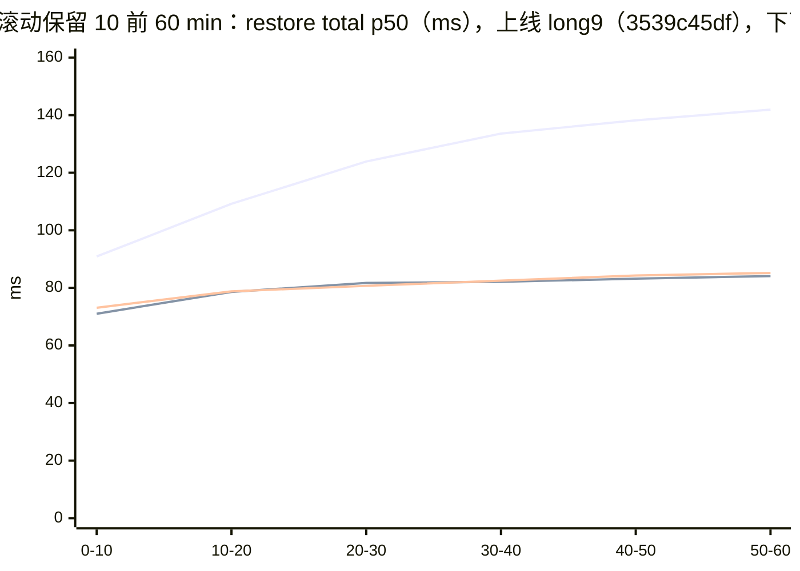

# 附录 C · 版本演进与工程修复案例

本附录按版本演进和问题案例保留现象、定位、修改与验证过程。当前机制以正文为准；案例中的版本、路径和时序属于对应历史轮次。

## 1. 起点：MR 版已在单沙箱场景下满足客户要求

**这套沙箱级快照在 MR 阶段，已在当时验证的单沙箱快照、回滚场景下满足客户性能要求，随后合入 openEuler 官方仓库。**
后续开发将重点扩展到多沙箱同时操作，以及长时间反复 checkpoint / restore 的场景：先考虑并发可能带来的性能问题，再通过专项验证与长跑定位问题、逐项修复并复测。

这两个阶段回答的问题不同：单沙箱验证一次操作的正确性与延迟；并发与持续运行还要验证多个沙箱是否互相干扰、尾延迟是否放大，以及历史和产物增长后性能与资源能否稳定。
因此，阅读后面的并发问题和优化记录时，应以已达标的 MR 版为开发起点，按各轮实际测试条件理解结论。

后续工作涉及共享锁、冻结窗口、存储读写、宿主网络、GC、历史合并与回收，也配套完善了失败处理、SDK 和诊断验证。
按附录 C 的有效代码口径，**MR 后手写生产代码的净增量已经超过 MR 版引入的净增量**，体现了后续改动的规模。
数字、生产与测试拆分及统计边界统一见 [附录 D §3](D-code-size.md#3-生产代码mr-版与-mr-后修改优化)；这里不另行维护统计。

## 2. 两个分支与三个版本口径

本章固定比较以下源码端点，与附录 C 一致。分支后续移动时，应以完整 SHA 判断比较范围。

| 对象 | 固定版本 | 在本文中的含义 |
|---|---|---|
| MR 交付基线 `deltabox` | `0f9b58f9281ad9e20411333e9a619b691808fc5a` | 首次合入 openEuler KASandbox 的 MR !119 所包含的功能版本 |
| 手册讲解基准 `deltabox-dev` | `57a30632cb9cb8eb67a35dd226d9ef4b40458af4` | MR 后继续开发、包含本章所述后续修改的源码版本 |
| 实测二进制 / RPM | 各轮分别记录 | 性能、正确性结论对应当轮构建与环境，不能仅由分支名推定；见 [第 18 章](18-950-performance.md)、[第 19 章](19-950-concurrency.md) |

MR 版已经具备宿主侧 checkpoint / restore 编排、内存差分树、磁盘分层、Firecracker 进程内原地回滚、脏页跟踪与 Python SDK 入口。
本手册后面的实现章节描述的是开发版的完整机制；这些基础能力与后续加固、优化共同构成当前实现。
若要识别“MR 后改了什么”，应结合本章的提交对应关系阅读。[第 15 章](15-native-cooperation-and-cost.md) 的优化点表比较的是本方案与原生快照等实现选择，比较基准与本章不同。

上述两个源码端点之间共有 **97 条提交**。其中既有生产修改，也有测试恢复、测试补充和说明修正；部分提交由此前的开发仓库迁入，不能把提交日期直接当作独立开发阶段，也不能将全部提交计作新增生产能力。
客户阅读下面的主题说明即可；需要源码复核时可在 KASandbox 仓库中使用固定端点：

```bash
git log --reverse --oneline 0f9b58f9281ad9e20411333e9a619b691808fc5a..57a30632cb9cb8eb67a35dd226d9ef4b40458af4
git diff --stat 0f9b58f9281ad9e20411333e9a619b691808fc5a 57a30632cb9cb8eb67a35dd226d9ef4b40458af4
```

## 3. 并发与持续运行增加了什么要求

需要区分三种情况：

| 场景 | 额外需要解决的问题 | 当前处理原则 |
|---|---|---|
| 不同沙箱同时快照、回滚 | 多个操作共享 orchestrator、CPU、产物盘、页缓存和宿主网络；全局锁、重复扫描与 GC 暂停可能影响其他沙箱 | 允许跨沙箱操作并发，缩短共享锁占用，减少重复工作与节点级干扰 |
| 多个调用方操作同一个沙箱 | checkpoint、restore、delete 相互改变同一份状态；restore 还会中断命令或文件请求 | 修改操作按沙箱串行，限定等待时间，明确回滚中断与失败语义 |
| 长时间反复操作、保留历史 | 内存树、磁盘层、块集合与产物数量增长，会增加读写、装配和回收成本 | 在不改变可见 checkpoint 恢复语义的前提下回收、合并，并提供容量限制 |

**“并发优化”包含减少跨沙箱互相影响，也包含持续负载下的性能与资源管理。** 同一个沙箱的修改操作仍然串行执行，具体契约见 [第 22 章 §11](22-api-semantics.md#11-多个调用方与并发)。
下面按问题说明修改；各组给出代表提交，部分改动同时服务多个目标。

## 4. 后续修改与优化总览

### 4.1 减少跨沙箱互相等待

**问题。** 账本由全局锁保护。若持锁期间读写文件、删除目录，或每次提交都重写整份索引，一个沙箱的存储慢操作就可能延迟其他沙箱的账本操作；历史越长，这种影响越明显。

**修改。** 将物化、层文件和 header 的 I/O 移出全局锁；回收先更新账本，再在锁外删除文件；热路径不再整份重写 `index.json`，调试索引按需后台生成；用子节点计数代替锁内扫描。
这些改动减少共享锁内的工作量，使耗时文件操作对其他沙箱的影响减小。同沙箱操作仍由独立操作锁串行保护。

| 代表 commit | 修改 | 机制与验证入口 |
|---|---|---|
| `3dd4d828a`、`cbb554564` | 文件 I/O 移出 store 全局锁 | [第 12 章 §2.1](12-state-and-lifecycle.md#21-storemu保护账本持锁不做-io) |
| `8f259e6f4` | 不在每次 checkpoint 时重写整份索引 | [附录 C §8.2](#82-每次-checkpoint-整份重写-indexjson) |
| `64d3b31c4`、`df4b38336` | 锁外回收；维护子节点计数 | [第 12 章 §2.1](12-state-and-lifecycle.md#21-storemu保护账本持锁不做-io)、[附录 C §8.3](#83-在全局锁里删文件) |

### 4.2 缩短冻结窗口，降低每次操作的开销

**问题。** 虚机暂停期间的同步落盘、层移动和目标视图装配都会延长业务停顿。多沙箱一起操作时，这些工作还会竞争存储与 CPU；逐页、逐块的重复处理会进一步放大成本。

**修改。** 按 checkpoint 仅在当前生命周期有效的契约，减少其产物的 `fsync`；将目标磁盘视图装配提前到 pause 前，将封层移动放到 guest resume 后；位图按字跳零并批量解析，连续回写用 `pread` 减少系统调用。
客户收益是减少冻结窗口内的工作和每次操作的固定成本。这里的免 `fsync` 有明确范围，原生 pause 保留其原有落盘行为；checkpoint 也不因此成为故障恢复备份。

| 代表 commit | 修改 | 机制与验证入口 |
|---|---|---|
| `04ef67baa`、`0a2592d45`、`02491e116` | 减少 checkpoint 同步落盘，并限定与原生 pause 的边界 | [第 7 章 §5](07-disk-layering.md#5-封存不等待落盘)、[第 12 章](12-state-and-lifecycle.md) |
| `c1a6123ba`、`9b1f24a2d` | 将层移动、目标视图装配移出冻结窗口 | [第 7 章](07-disk-layering.md)、[第 4 章](04-architecture-and-flow.md) |
| `588fb5587`、`9c7239b4d`、`b3c62fd21` | 位图批处理、跳零与连续内存回写优化 | [第 6 章](06-memory-diff-tree.md)、[第 9 章 §3.5](09-in-place-rollback.md#35-阶段-4内存) |

### 4.3 优化并发网络清理，明确回滚期间的请求行为

**问题。** 回滚需要清理已不再匹配 guest 状态的连接跟踪项。串行执行或为每个沙箱重复扫描宿主表，会增加冻结时间和并发成本；命令流截断还需要区分代理缺陷与回滚主动中断。

**修改。** conntrack 清理与回滚并行执行，在 resume 前等待完成；复用 netlink 连接，多个沙箱的宿主清扫合批，结合表规模选择扫描方式。
代理启用 full duplex，修复普通请求的偶发流式截断；对真正跨越 restore 的连接主动关闭，并通过可用的 HTTP 状态与 SDK 异常说明回滚中断。
由此减少重复网络清理，并让调用方能区分应重连、应处理错误的情况。已发出响应头的流式请求仍只能表现为连接截断，见第 22 章。

| 代表 commit | 修改 | 机制与验证入口 |
|---|---|---|
| `68c547f1b`、`579f75d68`、`702279c98`、`1b112fbbd` | 清理与回滚并行、连接复用、多沙箱合批与扫描优化 | [第 10 章 §4](10-device-network-time.md#4-连接跟踪)、[附录 C §8.6](#86-conntrack-清理占了冻结窗口) |
| `baae30b56` | 修复代理普通流式请求的偶发截断 | [附录 C §8.1](#81-流式命令偶发截断) |
| `35240dae9`、`6c0137002`、`b6c6db83b` | 回滚中断连接，并在命令、文件等调用路径传递含义 | [第 22 章 §11](22-api-semantics.md#11-多个调用方与并发) |

### 4.4 控制历史增长后的读取、装配与空间成本

**问题。** 逐层查找磁盘块会让运行期读取受历史层深影响；逐块装配目标视图会随块数增加而变慢。删除可见 checkpoint 后，其依赖仍可能保留，若缺少安全回收与合并，长跑中的磁盘和隐藏历史会持续增长。

**修改。** 用块归属索引替代运行期逐层查询；目标视图装配改用原子位图与连续块区间；磁盘层按所有视图的真实引用计数回收；对符合条件的隐藏内存节点及磁盘层做合并，并增加空闲空间、数量和字节限制。
这些改动使“持续创建、删除并保留最近一段历史”的用法具有可管理的资源成本，同时保留可见 checkpoint 的恢复语义。

| 代表 commit | 修改 | 机制与验证入口 |
|---|---|---|
| `a6c391014`、`e57649885`、`f996ab076` | 复用 page pool、降低 miss 成本、建立块归属索引 | [第 7 章 §6](07-disk-layering.md#6-读路径与视图装配) |
| `1cec056fc`、`8ea5322bf` | 位图装配及视图读取计时 | [附录 C §8.9](#89-视图块数增长restore-随时间变慢) |
| `eef657be7` | 按视图引用回收不再使用的磁盘层 | [第 7 章 §9](07-disk-layering.md#9-层回收按视图引用计数)、[附录 C §8.7](#87-rootfs-层文件从不回收) |
| `27661f444`、`359e7cbb0` | 隐藏内存节点与磁盘层的安全合并 | [第 6 章 §10](06-memory-diff-tree.md#10-删除隐藏与合并)、[第 7 章 §10](07-disk-layering.md#10-层合并)、[附录 C §8.8](#88-隐藏-checkpoint-无上界积累磁盘随时间线性增长) |
| `4d0f3ecfe`、`0c4c2c5ae`、`e8cf55cb5` | 容量限制及按实际结果返回 delete 错误 | [第 24 章](24-configuration-and-capacity.md)、[第 22 章](22-api-semantics.md) |

收敛依赖具体用法：持续删除、合并启用且候选处理跟得上，才有相应保证。数量和字节限制默认关闭；字节限制检查当前占用，不是严格空间预留。
删除 base 或分叉依赖也不一定立即释放空间。容量与合并边界统一见 [第 24 章 §4](24-configuration-and-capacity.md#4-容量规划)。

### 4.5 减少节点级长尾，限制故障影响范围

**问题。** 一个沙箱的 mmap 缺页或页缓存回收，可能使 Go 运行时等待暂停的时间变长，影响同进程内其他沙箱；产物文件故障、移除与操作竞争、回滚中途失败，也需要避免影响扩大或留下可继续使用的错误状态。

**修改。** 拷贝 mmap 前尝试 `MADV_POPULATE`，将缺页工作放进系统调用，减轻 GC 等待；将可恢复的映射访问故障转成 I/O 错误；沙箱移除与操作协调，加固恢复提交点、失败状态和等待上限。
这些改动兼顾并发尾延迟与故障隔离。`MADV_POPULATE` 不可用时保留回退路径；最终长跑中 GC 的改善还叠加了回收与合并降低内存压力的效果，不能全部归于一个提交。

| 代表 commit | 修改 | 机制与验证入口 |
|---|---|---|
| `d3c770927`、`6f014db5c` | 缺页预处理、映射故障转错误 | [第 12 章 §8](12-state-and-lifecycle.md#8-节点级效应)、[附录 C §8.4](#84-gc-长暂停落进别的沙箱的冻结窗口) |
| `b568e5f69`、`d17a047fe`、`4af2872c6` | 移除与操作协调、等待上限、同 ID 不同生命周期隔离 | [第 12 章](12-state-and-lifecycle.md)、[第 22 章](22-api-semantics.md) |
| `c59aa71c6`、`b2dded20f`、`49643fe23`、`ff7b066d7` | 恢复结果记账、磁盘账本污染处理及提交点后 Faulted 门控 | [第 11 章](11-failures-and-invariants.md)、[第 9 章 §5](09-in-place-rollback.md#5-失败模型) |

### 4.6 同期完成的正确性、兼容性与诊断完善

下面这些改动同属 MR 后开发范围，服务于完整实现的可靠性和可用性；其触发条件并不限于并发。

| 问题与代表 commit | 后续修改及客户影响 | 机制与验证入口 |
|---|---|---|
| ARM vCPU / 中断与设备状态：`6b3dbf44e`、`2deade706`、`8bd222604`、`f61648bfc`、`3d45eec88`、`63bf62c93` | 保存与恢复前排干挂起 MMIO；GIC 绝对清除再设置；修正串口状态、恢复 tap offload 并补 seccomp，避免旧运行状态残留影响恢复 | [09 §3.6–3.8](09-in-place-rollback.md#36-阶段-5vcpu)、[附录 B §10.4](B-920b-results.md#104-串口段) |
| 内存回写完整性：`1f3f48da2`、`865bf68e4`、`eb09d5455`、`3539c45df` | 拒绝截断 diff 与覆盖不足的内存文件；全量根的回滚因子独立于侧车位图，避免错误恢复或遗漏回写 | [第 6 章](06-memory-diff-tree.md)、[第 9 章 §3.3](09-in-place-rollback.md#33-阶段-3取活跃脏图与覆盖校验)、[第 16 章](16-test-methodology.md) |
| 原生 pause 精确增量与配合：`c42d23e73`、`bc19b45dc` | 原生内存增量改用 4 KiB 写跟踪；累积 checkpoint 清位图前的写页，防止两条路径叠加时漏页，条件不满足时保留回退 | [第 14 章](14-native-precise-increment.md)–[第 15 章](15-native-cooperation-and-cost.md) |
| SDK 与调用契约：`3f41488fd`、`26ac31121`、`b2ececd3e`、`211c796b5`、`7017b2517` | 补流量 token、独立超时、关闭自动重放并细化错误，使调用方能采取对应处理 | [第 22 章](22-api-semantics.md) |
| 可观测性与验证：`5319de5dc`、`cba26f7c1`、`93ccb02e8`、`372ed6c03` | 读盘量按本次 restore 自计，补 GC 取证与能力文件，并提供测试专用故障注入，支持定位并发干扰和验证失败路径 | [第 25 章](25-observability.md)、[第 16 章](16-test-methodology.md)、[附录 C §8.5](#85-restore-读盘量指标在并发时虚高) |

## 5. 如何理解后续优化的验证结果

### 5.1 MR 基线与并发优化基线要分别阅读

[附录B的轮次表](B-920b-results.md#9-轮次总表)和[本附录的修复案例](#8-问题逐个讲)记录“发现问题 → 修复 → 复测”的开发轮次。
其中标为“修复前基线”的 `4af2872c6`，**已经包含 74 条 MR 后提交**；它到本章讲解基准之间还有 23 条提交。
因此，那里的“修复前”指该组长跑修复之前，MR 版是更早的源码基线。
不同子项还使用各自的前后轮次，例如 `long6` 与最终长测对比的是两份后续开发版本。

**这些数据用于评估对应修改在并发和长跑中的效果，不能直接换算为相对 MR 版的加速比，也不能用后续并发测试中的超线反推 MR 阶段单沙箱未达标。**
具体轮次、条件和构建对应见 [附录 B §9](B-920b-results.md#9-轮次总表)。

### 5.2 按所需结论查证据

| 想确认的结论 | 看哪里 | 如何理解 |
|---|---|---|
| 950已归档轮次在给定改动量下的单沙箱性能 | [第 18 章](18-950-performance.md) | 按实际负载、计时和身份范围判断；全量首点与增量分开，保留超线档位，不将讲解SHA追认为被测版本 |
| 锁、网络、GC、索引等具体优化是否有效 | [附录 C §8](#8-问题逐个讲)、[附录 C §9](#9-已解决) | 阅读对应问题的轮次与指标；综合效果不全部归于单个 commit |
| 多沙箱持续运行的一致性、延迟和资源走势 | [附录 B §10](B-920b-results.md#10-最终版的结果) | 920B 长跑包含多个版本；逐项一致性、时间序列和空间走势分别判断，累计次数不视为最终版本单轮结果 |
| 950 当前已有的并发与部署证据 | [第 19 章 §1](19-950-concurrency.md#1-950-短时并发2026-10-13-ab)、[第 19 章 §2](19-950-concurrency.md#2-950-func-中的短稳态与恢复后请求)、[第 17 章 §4](17-functional-verification.md#4-950-smoke部署预检与正确性验收) | 区分短时并发、混合短稳态与 smoke；各轮二进制身份与覆盖范围独立核对 |
| 原生精确增量与 checkpoint 混用是否正确 | [第 15 章](15-native-cooperation-and-cost.md) | 查原生路径专门的体积、恢复与叠加验证 |

判定性数字仍在第17～19章及附录B统一维护。920B 软件写保护与 950 HDBSS 的结果按各自条件阅读，跨平台差值不能直接归于某项软件优化或 HDBSS。

## 6. 客户阅读与部署时应确认什么

本章说明的是从 MR 基线到 `deltabox-dev@57a30632c` 的源码演进。取得 MR 基线代码时，不能据此认为已经包含全部后续改动；取得 RPM 时，也应核对其中 orchestrator、Firecracker 与 SDK 的版本和配对关系。
源码、部署补丁和被测二进制的身份边界见 [README](README.md)、[第 23 章](23-build-and-self-check.md)；能力核对方法见 [第 24 章 §3](24-configuration-and-capacity.md#3-启动能力行)。

后续优化已有并发和长跑验证，也保留明确边界：同沙箱修改操作串行；跨回滚连接需要重连；checkpoint 随当前生命周期失效；空间收敛依赖删除与合并条件；并发尾延迟和宿主 conntrack 表规模仍需按实际负载评估。
当前限制、已知问题、验证缺口与候选开发方向统一从 [第 28 章](28-status-and-directions.md) 查阅；长尾分析及 950 后续验证安排分别见[附录 B](B-920b-results.md)和[第 19 章 §3](19-950-concurrency.md#3-到-950-上要重测什么)，使用契约见 [第22章](22-api-semantics.md)。

## 7. 为什么测试要多问一句

普通的功能测试只问一句"结果对不对"。这套方案的麻烦在于：它有四种失效，其中三种**不改变结果**。
回滚回来的内容一个字节都没错，断言全部通过，坏掉的是成本、是覆盖范围、或者是判据本身。
剩下的一种会改变结果，但它改得"自洽"，同样没有任何断言会变红。

所以本部分所有测试的出发点是：除了问"做对了没有"，还要多问一句"**是怎么做到的**"。
下面四节各讲一种失效，每一种都配一个在本项目里真实出现过的例子。

### 7.1 增量静默退化成全量

**是什么。** 增量 checkpoint 的前提是 Firecracker 在虚机启动时就武装了脏页跟踪（[第 5 章](05-dirty-tracking-and-hdbss.md)）。
机器上没有 HDBSS、orchestrator 又没有显式设 `FC_TRACK_DIRTY_PAGES=true` 时，跟踪默认关闭（为什么默认关见 [第 23 章 §2](23-build-and-self-check.md#2-先分清两层要不要记脏页用什么方式记)），
这时每一次 checkpoint 都只能整份拷走 guest 内存。

**真实例子。** 920B 开发机没有 HDBSS，靠 nomad job 里显式写的 `FC_TRACK_DIRTY_PAGES=true` 得到增量。
这一行不在交付件里（950 不需要它），所以只要在 920B 上按交付件原样部署、忘了补这一行，就会进入这种状态：
沙箱照常建、checkpoint 照常成功、restore 照常回到那一刻，一次 checkpoint 却从几十毫秒变成全量的耗时，
每一代产物从几十 MB 变成整份 guest 内存（全量与增量的实测对比见 [第 18 章](18-950-performance.md) 的分档表）。

**为什么静默。** 全量捕获当然能精确地恢复到那一刻：内存标记、blob 的 md5、根文件系统上的文件，一项都不会错。
普通测试只看得见"回来的内容对不对"，看不见"用什么方式回来的"。性能测试倒是会变慢，
但"变慢"没有对照时看不出是退化——你不知道它本来应该多快。

**靠什么看得见。** 只能加一条报告"**怎么做的**"而不是"做对没有"的通道：服务端每次 checkpoint 都回报 `mem_mode`
（`full` 或 `incremental`，[第 25 章 §2](25-observability.md#2-能力行与-memmode)）。
判据一句话：**除了沙箱的第一个 checkpoint（以及断链后的那一个），出现 `full` 就是有问题。**
所有正确性脚本和性能脚本都把它当硬断言，性能脚本更进一步：一轮里出现一个 `full`，整轮作废。

### 7.2 checkpoint 之后原生 pause，封层丢了

这是四种里唯一**真的丢数据**的一种，而且丢得自洽。

**是什么。** checkpoint 会把当前写层原地封存成只读层、另开一个新写层（[第 7 章](07-disk-layering.md)）。
所以从第一次 checkpoint 起，当前写层里只有那之后的写，更早的写在下面的封存层里。
e2b 原生 pause 导出磁盘差分时，如果只取当前写层，做过 checkpoint 的沙箱一 pause 就会丢掉最后一次 checkpoint 之前的所有写。
本项目的早期实现里真的出现过这个缺陷（现已修复：原生 pause 导出时把整个层栈压平再导出）。

**为什么静默。** 三道本应抓住它的防线全都失效了：

| 本应抓住它的 | 为什么没抓住 |
|---|---|
| 导出产物自己的一致性 | 差分的 header 是**从导出内容推出来的**：导出多少，header 就描述多少。块数对得上、校验对得上，只是内容少了一截。没有独立的第二方来源可以打脸 |
| 已有的正确性脚本 | 一个都不做原生 pause。它们测的是 checkpoint / restore 自己那条链，pause 是 e2b 原有的生命周期操作，两者的**组合**没人走过 |
| 修复后补的第一版验证 | 写一个小文件、pause / resume、读回比对——**假通过**。pause / resume 不清 guest 的页缓存，刚写过的文件从缓存里读一定是对的，根本没碰到磁盘 |

最后一行才是真正的教训：**guest 的页缓存能把磁盘层的错误完全盖住。**

**靠什么看得见。** 在 checkpoint 两侧各写一份足够大的随机数据（大到不可能全留在缓存里），pause / resume 之后用
`O_DIRECT` 绕开页缓存读回、比哈希。抓缺陷的是 checkpoint **之前**写的那份：它落在被封存的层里，是唯一会丢的；
之后写的那份是对照，证明脚本本身在正常工作（[第 17 章 §1.4](17-functional-verification.md#14-pause_verifypy一个自洽的静默损坏)）。另外，兼容矩阵把"checkpoint 与原生操作的组合"系统地过一遍（[第 17 章 §1.5](17-functional-verification.md#15-compat_matrixpy与原生生命周期的组合)），
补上"没人走过组合"这个盲区。

### 7.3 把读过的页当成脏页

第三种发生在**对照的那一边**：原生快照路径上，而不是本方案的 checkpoint 上。但它教的东西一样重要。

**是什么。** 增量快照应该只导出"写过"的页。如果判据把"读过"也算成"写过"，脏页集就塌缩成了**工作集**：
guest 碰过的页全部导出，与改了多少无关。

**真实例子。** 在 950 上用同一张档位表跑 e2b 原生快照的基准时，最值得看的一列不是时间，而是产物大小：
名义改动量从 0 一路加到 192 MB，导出的内存差分一直停在 400 MB 上下不动（950，2026-09-09～10，修复前的代码，`native_snapshot_bench.py`；六档数字见 [附录 B §13.3](B-920b-results.md#133-native_snapshot_benchpy六档)）。追下去，原因是 ARM 适配版的原生路径用
"页驻留且 uffd 写保护位未置"当脏页判据，而 arm64 内核没有 uffd 写保护，这个判据塌缩成了"**驻留即脏**"
（完整推导见 [第 14 章](14-native-precise-increment.md)，修法见 [第 14 章](14-native-precise-increment.md)）。

**为什么静默。** 快照本身没有错：它多带了一些没必要带的页，恢复出来的状态完全正确。
每个正确性断言都过，只是每一代都按工作集导出，时间和空间都白花了。

**靠什么看得见。** **把"名义改动量"和"实测产物大小"并排放**，这一列才会说话：名义档位加倍、产物不动，就是判据坏了。
本方案的判据来自 KVM 写保护或 HDBSS 的写跟踪，读不算脏（[第 5 章](05-dirty-tracking-and-hdbss.md)）；
分档基准里专门有一个"只读触碰 192 MB"的档，它的产物应当与 0 MB 档几乎相同——这一档就是为防这种失效而设的哨兵（[第 16 章 §5](16-test-methodology.md#5-负载构造三种失真)）。

### 7.4 判据本身静默消失

第四种是前三种的"元问题"：**防静默退化的那道判据，自己也可能静默地不在了。**

**是什么。** `checkpoint_verify.py` 读 `mem_mode` 的写法是 `getattr(ck, "mem_mode", None) or "?"`。
这个字段要经过三段才能到脚本手里：服务端在响应里带上它、SDK 把它填进 `CheckpointInfo`、`CheckpointInfo` 有这个属性。
任何一段缺失，取到的都是 `?`，而脚本对 `?` 的处理是**跳过**"第一代全量、后两代增量"这两条断言，打印一行说明，继续跑完其余各项。

**真实例子。** 同一个脚本、同一套服务端二进制，只换了客户端的 SDK：装了交付的 SDK 覆盖层那次是 **59 项全过**；
换成一版 `CheckpointInfo` 里没有 `mem_mode` 字段的 SDK，三代都报 `mem_mode=?`，末行是 **57 项全过**。
两次都打印"全部通过"，差别只有把两份日志并排、去数项数才看得出来。

**为什么静默。** 跳过而不是报错，本意是让脚本在老服务端上也能跑完；代价是"增量有没有生效"这条最关键的判据消失时，
没有任何东西提醒你。

**靠什么看得见。** 两条：装 SDK 覆盖层是这条判据有效的前提，所以覆盖层的 `install.py --check` 会专门自检
`CheckpointInfo` 与 proto 两侧都有 `mem_mode`，验收流程把它列为第一步（[第 20 章](20-acceptance.md)）；
报告里必须**记项数与 SDK 版本**，59 和 57 的差不是噪声，是两条判据的生死。

### 7.5 共同点与三条纪律

| # | 失效 | 结果对吗 | 靠什么才看得见 |
|---|---|---|---|
| 1 | 增量退化成全量 | 对 | 服务端每次回报的 `mem_mode` |
| 2 | checkpoint 之后 pause 丢封层 | **错，且自洽** | checkpoint 两侧各写一份，pause / resume 后 `O_DIRECT` 读回 |
| 3 | 读过的页被算成脏页 | 对 | 名义改动量与实测产物大小并排 |
| 4 | 判据本身消失 | 对 | 报告记项数与 SDK 版本 |

一句话：**测试通过不等于测的是那个东西。** 由此得到三条纪律，贯穿本部分：

- **先自证"这个检查会失败"。** 一个永远返回真的断言比没有断言更糟，它让人以为测过了。
  比对恢复结果之前，先确认各代现场确实彼此不同（[第 17 章 §1.2](17-functional-verification.md#12-checkpoint_verifypy一条直链上的-59-项)）；判定"弄坏了原生能力"之前，先测原生能力本来是好的（[第 17 章 §1.5](17-functional-verification.md#15-compat_matrixpy与原生生命周期的组合)）；
  HDBSS 的数据面判据先在没有 HDBSS 的机器上取到负样本（[第 17 章 §1.6](17-functional-verification.md#16-hdbss_evidencepy能力不等于数据面)）。
- **验磁盘内容一律 `O_DIRECT` 读回。** guest 页缓存会把磁盘层的错误完全盖住。
- **报告记项数。** 同一个脚本少了两项仍然打印"全部通过"。

## 8. 问题逐个讲

每个问题按同一个顺序写：在哪一轮暴露、现象和数据 → 怎么定位 → 怎么修（一两句，机制链接到原理章）→ 修后在哪一轮验证、前后对比。

### 8.1 流式命令偶发截断

**暴露**：long1–long3（修复前，无上限）。客户端偶发 `RemoteProtocolError: peer closed connection without sending complete message body (incomplete chunked read)`，
同时 orchestrator 日志出现 `httputil: ReverseProxy read error during body copy: ... use of closed network connection`。

| 轮 | 客户端截断 | orchestrator ReverseProxy 行 |
|---|---|---|
| long1 | 5 | 9 |
| long2 | 6 | 6 |
| long3 | 10 | 10 |

long1 结束时只剩 12 / 16 个线程还活着，推断是驱动原件没有接住这类异常、线程直接退出（没有逐条对日志核实）。long2 起驱动给循环体加了兜底，此后各轮都是 16 / 16。

**定位**：long2 全程打开代理的逐请求追踪（`PROXY_TRACE`）。这一轮代理共转发 123156 个请求，以中断结束的恰好 6 个，
与客户端的 6 次截断一一对应，约每万次 0.5 次。这 6 次的共同点：

- 全部是 `POST /process.Process/Start`（在 guest 里起一个流式命令），请求体 459 或 341 字节；
- 都已经写出 `200` 和第一个事件（36–37 字节），3.8–10.4 ms 后以"响应头之后被中止"结束；
- 连接池没有主动重置这条上游连接；其中一次前后 3 s 内同一沙箱没有任何 restore。

也就是说，上游连接是被**本进程自己**关掉的，与 restore 无关。顺着 Go 标准库往下查：HTTP/1 请求如果没有开 full duplex，
handler 一写响应头，`net/http` 就把请求体剩下的部分读掉并关闭；而反向代理此刻还在用这个请求体做上游往返，
上游的写循环写完最后一个字节后还要再读一次确认 EOF，这次读失败，它就认为连接已死、把它关掉，正在流式转发的响应随之被切断。
窗口只有"写完最后一字节"到"那次 EOF 读"之间的几微秒，节点越忙越容易撞上 —— 这就是它只在长跑里出现的原因。

**修法**：代理 handler 在转发前为请求开启 full duplex（`baae30b`）。orchestrator 的沙箱代理和 client-proxy 共用这段代码，两边都要带上。
两类截断的区分见 [第 22 章 §11.3](22-api-semantics.md#113-两类流式截断要分清)。单元测试让上游在读完请求体之前就应答，确定性复现：旧代码 10 / 10 失败，新代码 20 / 20 通过。

**验证**：long4 客户端截断 0、orchestrator 0 行、client-proxy 0 行，也是三轮里唯一一轮客户端失败为 0 的。
按 long2 / long3 平均每轮 8 次、再按 long4 的操作量缩放（λ ≈ 7.5），泊松分布下出现 0 次的概率约 5 × 10⁻⁴。
此后 long5 到最终长测，orchestrator 侧 `ReverseProxy` 行全部为 0。

**遗留**：ct-opt 和 long9 各有 1 次客户端截断，client-proxy 同一时刻记了 `ReverseProxy read error`，orchestrator 侧 0 行。
这两轮用的 client-proxy 是未带修复的原版（long4–long6 期间换过带修复的版本，long6 收尾时换回了原版），
推断是 client-proxy 未修所致，没有做对照验证。部署件里两者都已带修复（[附录 B §5](B-920b-results.md#5-部署后回归)）。
另外，**流式调用撞上同一沙箱的 restore 被截断，是既定限制**，与这个缺陷无关。

### 8.2 每次 checkpoint 整份重写 index.json

**暴露**：long1 / long2（无上限，链深到 2352 / 2222）。checkpoint 的 `commit_index` 随链深线性增长：

| 链深 | long1 `commit_index` p50 / p99 / max（ms） | long3 同段 |
|---|---|---|
| 0–249 | 4.0 / 21.9 / 44.8 | 0.002 / 0.014 / 0.1 |
| 1000–1249 | 55.5 / 369.0 / 788.1 | 0.002 / 0.007 / 0.2 |
| 2000–2249 | 127.9 / 502.4 / 1207.0 | 0.002 / 0.009 / 0.2 |
| 2250–2499 | 132.0 / 566.4 / 832.3 | —— |

整段 p50 为 51.63 / 49.79 ms（long1 / long2），最大 1407.7 / 1836.6 ms。旁路记录的 index.json 最大到 12929656 字节（2542 条）。

**定位**：每次提交在全局锁下复制并排序本沙箱全部条目，锁后把整份 JSON 重写一遍。深度 2000 时一次提交分配约 4 MB，
是 GC 最大的垃圾来源。而代码里**没有任何地方读回它**：启动时 store 根目录整个清空，提交的原子性来自文件 rename 与锁内发布。

**修法**：热路径不再写 index；调试开关 `CHECKPOINT_DEBUG_INDEX` 打开时由后台每沙箱最多每 5 s 写一次（[第 24 章 §2](24-configuration-and-capacity.md#2-开关总表)）。
计时键名 `commit_index` 保留，只计锁内那段，前后可比。

**验证**（long3）：`commit_index` 各深度 p50 都是 0.002 ms、全程最大 1.2 ms；不再随链深变化。连带效果：

| 项 | long2 | long3 |
|---|---|---|
| GC 次数 | 4461 | 2348 |
| GC 累计 CPU | 15828 s | 8107 s |
| orchestrator 总 CPU | 45936 s | 26057 s |
| 存活堆末值 | 832 MB | 298 MB |

### 8.3 在全局锁里删文件

**暴露**：long1 / long2。账本的全局锁覆盖了所有删除：删 checkpoint 目录、剪枝、隐藏节点重写 manifest、删整个沙箱目录树。
一个沙箱的磁盘代价被算到全节点头上，restore 在冻结窗口里等同一把锁：

| 锁等待 p99（ms） | long1 | long2 | long3 |
|---|---|---|---|
| `commit_lock_wait` | 8.48 | 12.96 | 0.07 |
| `append_lock_wait` | 18.53 | 21.99 | 0.11 |
| `materialize_lock_wait` | 8.42（max 252.5） | 8.37 | 0.00 |

**修法**：锁内只改账本，把要删的文件收进一个回收列表，放锁之后、返回之前再删；整个沙箱的目录树先在锁内改名成临时名再在锁外删
（机制见 [第 12 章 §2.1](12-state-and-lifecycle.md#21-storemu保护账本持锁不做-io)）。

**验证**：long3 三个锁等待的 p99 降到上表最右列；客户端 delete p50 也从 54.8 / 53.9 ms（long1 / long2）降到 2.3 ms —— 这里同时去掉了 [§8.2](#82-每次-checkpoint-整份重写-indexjson) 的 index 重写。

### 8.4 GC 长暂停落进别的沙箱的冻结窗口

**暴露**：long1 / long2。Go GC 的 stop-the-world 暂停 p99 205.6 / 226.3 ms，最长 609.45 / 574.5 ms。
这些暂停发生时，别的沙箱正在做的 restore 冻结窗口被原样拉长。

**定位**分三步：

1. **先减垃圾**。[§8.2](#82-每次-checkpoint-整份重写-indexjson)、[§8.3](#83-在全局锁里删文件) 修完的 long3，GC 次数减半、存活堆从 832 降到 298 MB，但 ≥ 100 ms 的暂停仍有 148 次，p99 268.5 ms，最长 533 ms。
   说明长暂停不是"垃圾太多"。
2. **拆开暂停**。long3 起打开 `CHECKPOINT_RUNTIME_METRICS`，每 10 s 取一次 runtime/metrics 里"等所有 P 停下"（stopping）与"总暂停"（total）两个直方图。
   long3 / long4 里窗口最大值 ≥ 50 ms 的窗，stopping 占 total 的比例中位数和按和都是 **100%**：长暂停全部花在"等所有 P 停下"，收集器本身不慢。
3. **看谁不肯停**。orchestrator 与全部 Firecracker 共用一个 256 GiB 的 memory cgroup，页缓存很快把它填满（long4 起跑 57 s；long3 中途才开始采样，828 s 的第一个样本已是满的），之后一直在 cgroup 内回收
   （long3 `failcnt` 增量 2349 万，只含 828 s 之后的采样段；long4 5354 万）。任一时刻约 10 个 orchestrator 线程处于 D 态，其中 86% 睡在 `reclaim_throttle`。
   把 10 s 窗按窗内 `reclaim_throttle` 线程数三等分，stopping 最大值与之的相关系数 r = 0.02：不是"回收越重越长"，而是"只要有一个 goroutine 在回收里睡着就会卡"。

结论：块设备层的 goroutine 在 `MAP_SHARED` 文件映射上拷贝时，缺页发生在用户态，分配页 → 记账到 memcg → 触发回收 → 在回收里睡；
这期间它的 P 一直处于运行态，异步抢占够不着睡在内核缺页里的线程，STW 只能等它醒来。

**修法**：拷贝前先对页对齐的范围调用 `madvise(MADV_POPULATE_READ / MADV_POPULATE_WRITE)`，把缺页、记账和回收挪进系统调用里做；
在系统调用里的 goroutine 其 P 处于系统调用态，STW 不等它（机制与四个调用点见 [第 12 章 §8](12-state-and-lifecycle.md#8-节点级效应)）。

**验证**：

| 轮 | 形态 | GC 次数 | STW p50 / p99 / max（ms） | ≥ 10 / ≥ 50 / ≥ 100 / ≥ 200 ms 次数 | 累计 STW |
|---|---|---|---|---|---|
| long1 | 无上限，修复前 | 4895 | 1.08 / 205.6 / 609.5 | 未统计 | 51.7 s |
| long2 | 无上限，修复前 | 4461 | 1.11 / 226.3 / 574.5 | 704 / 384 / 180 / 61 | 63.6 s（墙钟的 3.52%） |
| long3 | 无上限，减垃圾后 | 2348 | 1.24 / 268.5 / 533.0 | 524 / 280 / 148 / 51 | 47.0 s |
| long4 | 无上限 | 2165 | 1.31 / 277.0 / 678.5 | 512 / 305 / 161 / 38 | 47.2 s |
| long5 | 无上限，加 `MADV_POPULATE` | 1990 | 0.84 / 97.6 / 318.3 | 85 / 51 / 19 / 3 | 7.9 s（0.44%） |
| long6 | 上限 60 | 5095 | 0.80 / 1.2 / 67.4 | 6 / 1 / 0 / 0 | 4.4 s |
| long7 | 上限 60，合并后 | 5641 | 0.94 / 1.3 / 7.2 | 0 / 0 / 0 / 0 | 5.4 s |
| 最终长测 | 上限 60 | 5994 | 0.73 / 1.1 / 2.8 | 0 / 0 / 0 / 0 | 4.5 s（0.25%） |

long5 里剩下的长暂停仍然 100% 在"等 P 停下"。它们在后续轮里消失，是因为合并（[§8.8](#88-隐藏-checkpoint-无上界积累磁盘随时间线性增长)）与层回收（[§8.7](#87-rootfs-层文件从不回收)）让写盘量大幅下降，
cgroup 不再顶满：long7 与最终长测 cgroup 用量最大 131.6 / 130.5 GiB、`failcnt` 增量 0，而 long6 是 256 GiB 顶满、增量 2041 万。

**代价与未归因项**：long5 相对 long4 吞吐下降 5.6%–6.1%、restore p50 高 18%，但 p99 持平、最大值下降，而且与 `MADV_POPULATE` 无关的 Firecracker 侧 `fc_memory` 同样变慢，
没做交替对照，不能归因。ct-opt 那一轮出现过 5 次 ≥ 100 ms 的暂停（最长 197.6 ms，全是清扫终止阶段），同期 cgroup 更早顶满、吞吐高 15%，未归因；此后各轮再没出现。

### 8.5 restore 读盘量指标在并发时虚高

**暴露**：long1–long3。旧键 `materialize_disk_read_mb` 取的是 orchestrator **进程级**的读盘字节差，并发 restore 时别的沙箱的读全混进来：
long3 整段 p50 210.8 MB、最后 5 min 段 p50 352.2 MB，而 D 段一次 restore 实际要读的只有几十 MB。

**修法**：物化过程自己边读边计，新增 `materialize_read_mb`（读了多少 checkpoint 文件）和 `materialize_base_read_mb`（从模板内存源读了多少），
都只计本沙箱、含页缓存命中（[第 16 章 §8.4](16-test-methodology.md#84-读盘量用哪个键)，键定义见 [第 25 章 §3.3](25-observability.md#33-restore)）。

**验证**（long5）：`materialize_read_mb` p50 / p99 / max = 55.1 / 71.1 / 82.9 MB，`materialize_base_read_mb` 全为 0；
同一条 restore 上旧键是新键的 4.3 倍（中位数）。本章之后凡是说"restore 读了多少"，都用新键。

### 8.6 conntrack 清理占了冻结窗口

**暴露**：long6（第一次上限 60）。上限让 restore 的占比升高，restore 频率从 long5 的 15.7 次/s 升到 39.3 次/s。
restore 冻结窗口里有一段要等宿主 conntrack 清理完成才能 resume（[第 10 章 §4](10-device-network-time.md#4-连接跟踪)）。频率一高，它藏不住了：

| 项（p50 / p99，ms） | long5（无上限） | long6（上限 60） |
|---|---|---|
| `conntrack_bg`（后台清理自己的时长） | 26.6 / 174.8 | 155.7 / 286.8 |
| `conntrack`（冻结窗口内等它的时间） | 0.0 / 107.5 | 73.8 / 221.2 |
| restore `frozen` | 427.1 / 1665.5 | 163.2 / 303.6 |

long6 前 15 min 里，`conntrack` p50 88.6 ms，占 restore 冻结窗口总和的 54%。

**定位**：ct-opt 先加子计时、不改算法跑了一轮基线（420 s，38.8 次 restore/s，稳态段）：

| 子项 | p50 | p99 |
|---|---|---|
| `conntrack_bg` | 175.6 | 293.6 |
| 冻结内等待 | 112.9 | 234.5 |
| 沙箱 netns 表 flush | 12.7 | 43.9 |
| 宿主侧排队（等在途那次清扫） | 52.7 | 156.8 |
| 宿主侧覆盖本次的清扫 | 117.9 | 190.4 |
| 每批槽位数 | 5 | 10 |
| 宿主表条目 | 15.6 k | 16.6 k |

11843 次 restore 里，宿主那一半全都比 netns 那一半长。清扫时长随批大小线性增长：批 1 / 3 / 5 / 7 = 40.8 / 76.3 / 123.9 / 155.5 ms。
再看选路：旧代价模型把一次过滤 dump 定价为固定 5 ms，于是 1.5 万条目时批 ≤ 7 全走过滤路径 —— 每个地址两次过滤 dump，每次内核仍遍历全表，
负载下一次 11–20 ms。频率高 → 批大 → 清扫长 → 清扫期间到的请求更多 → 批更大，形成正反馈，而每个请求最坏要等"在途的一次 + 自己那一次"。

微基准（测试自有 netns，Kunpeng 920，6.6 内核，262144 桶，每次 ms）给出了改法的依据：

| 宿主表条目 | 库函数全表 | 原始报文全表 | 一次过滤 dump |
|---|---|---|---|
| 5000 | 23.22 | 9.23 | 5.19 |
| 20000 | 83.69 | 25.15 | 7.12 |
| 40000 | 154.68 | 44.38 | 11.34 |

原始报文全表扫描对 8 个地址和 1 个地址耗时相同，一次扫描就能服务整批。

**修法**：每批一次原始报文整表扫描，按实测重新定价选路（单地址约 7000 条以上才走过滤，两地址约 43000 条以上，三个及以上永不），
netns 表的 flush 与宿主侧等待并行（[第 10 章 §4.4](10-device-network-time.md#44-宿主表怎么删每批一次整表扫描按代价模型选路)）。

**验证**（服务端，long6 取前 900 s 对齐）：

| 项 | long6 前 15 min | ct-opt 基线 | ct-opt 新算法（900 s） |
|---|---|---|---|
| restore 吞吐（次/s） | 40.1 | 40.0 | 45.9 |
| 宿主表条目 p50 | 未采 | 15519 | 18411 |
| `conntrack_bg` p50 / p99 | 160.0 / 286.4 | 160.1 / 289.1 | 69.0 / 155.9 |
| `conntrack` p50 / p99 | 88.6 / 226.3 | 98.7 / 230.5 | **2.2** / 98.8 |
| restore `frozen` p50 / p99 | 164.8 / 301.4 | 161.7 / 290.9 | 83.5 / 294.5 |
| restore `total` p50 / p99 | 188.9 / 327.9 | 182.7 / 313.1 | 113.5 / 333.3 |
| 宿主侧清扫 p50 / p99 | —— | 108.7 / 188.2 | 34.5 / 104.8 |
| restore 逐项一致 | 36092 / 0 不一致 | 17009 / 0 | 41748 / 0 |

新算法下批 2–14 的清扫都约 34 ms，与批大小无关；批 1 仍走过滤约 44 ms。p99 没降下来，是因为同期宿主表更大、吞吐更高，另有 [§8.4](#84-gc-长暂停落进别的沙箱的冻结窗口) 提到的那几次 GC 暂停。

**遗留**：`conntrack_bg` 在最终长测里 p50 74.9 ms、滚动负载（long10）下每 10 min 段 p50 52.3–55.3 ms，宿主表约 1.9 万条，
已贴近冻结窗口的关键路径（最终长测冻结窗口 p50 78.6 ms）；是下一个优化候选（[附录 B §11](B-920b-results.md#11-已知未解决)）。滚动负载跑到第二个小时时它还会继续上涨，见下文。单地址时两次过滤约 44 ms、比整表约 34 ms 贵，
单地址阈值还可以按生产数据上调，预计只影响占 22% 的单槽位批、约 10 ms，没有再迭代。

**第二个小时宿主表上涨，把 restore 推高（已查明：涨的是宿主上与沙箱无关的条目）**。部署件的 2 h 滚动长测 long11（[附录 B §10.3](B-920b-results.md#103-滚动保留-10一小时与两小时)）里，宿主 `nf_conntrack_count`（旁路 5 s 采样）前 80 min 各 10 min 段的中位数稳定在 1.87 万–1.93 万条，与 long10 同量级；从第 80 min 起逐段上涨，最后 20 min 中位数约 2.38 万条，峰值 26645 条（约第 108 min），离表上限 262144 还很远。restore 一侧的 conntrack 子计时同步变化（p50，ms；宿主表为段内中位数）：

| 段 | 宿主表条目（旁路） | `conntrack_host_entries_count` | `conntrack_bg` | `conntrack`（冻结内等待） | restore `total` |
|---|---|---|---|---|---|
| 60–70 min | 18662 | 18609 | 52.6 | 0.0 | 85.4 |
| 70–80 min | 19265 | 19228 | 54.4 | 0.0 | 85.6 |
| 80–90 min | 20933 | 20929 | 60.2 | 0.0 | 88.2 |
| 90–100 min | 21820 | 21836 | 62.7 | 0.3 | 90.1 |
| 100–110 min | 23725 | 23750 | 68.5 | 6.0 | 93.8 |
| 110–120 min | 23822 | 23892 | 69.4 | 7.4 | 94.3 |

`conntrack_bg` 长到 60 ms 以上之后，冻结窗口里开始真正等它：`conntrack` p50 在第 100 min 之前不超过 0.3 ms，最后 20 min 变成 6.0–7.4 ms。restore p50 第二个小时从 85.4 升到 94.3 ms，同一时段 `assemble_view_pre`、`disk_view_read` 不变、materialize + fc_rollback 走平（[附录 B §10.3](B-920b-results.md#103-滚动保留-10一小时与两小时)），多出的这约 9 ms 主要来自 conntrack，不是块数；把 `conntrack` 从 total 里逐条扣掉后，全程对块数的斜率是 0.283 ms / 千块。

long9 同负载 2 h 里没有这一段：restore 记下的宿主表条目 p50 反而从 17490 降到 14544 条，`conntrack_bg` p50 从 48.2 降到 38.7 ms；long10 只跑了 60 min，看不到这一段。

**根因**。之后用同一负载（滚动保留 10，16 个沙箱，部署件 `93ccb02`）另跑了一轮 45 min 的复现（ct-probe，09-29 20:06–20:52）。
旁路每 60 s 读一次 `/proc/net/nf_conntrack`（只读，不删任何条目），按协议、连接状态、两端地址类别和目的端口给整张宿主表分类；
每 5 s 另记一次条目总数与粗分类。结论有三条。

**① 宿主表里约 95% 不是沙箱的条目。** 以第 32 min 的一次分类为例，整表 23190 条：

| 类别 | 条目 | 是什么 |
|---|---|---|
| `127.0.0.1 → 127.0.0.1:80`，TCP `TIME_WAIT` | 11736 | 宿主本机访问 lo:80 的短连接，部署时的 `OUTPUT -o lo --dport 80` 规则把它转给 client-proxy（3002）；这一轮里主要是测试驱动经 client-proxy 发往沙箱的请求（按端口推断） |
| `127.0.0.1 → 127.0.0.1:53`，UDP | 9902（其中 `ASSURED` 5456） | 宿主本机的 DNS 查询（`/etc/resolv.conf` 第一项是 `127.0.0.1`） |
| 沙箱相关（任一端是槽位地址或 veth 地址） | 1219 | restore 要清的就是这一类 |
| 其余（docker、nomad、ssh 等） | 315 | |

非沙箱条目占 94.7%。全程按 5 min 平均（条目数；分类读 `/proc` 时表还在变，总数与 `nf_conntrack_count` 差几个百分点）：

| 段 | 整表 | lo:80 `TIME_WAIT` | DNS `ASSURED` | DNS 其余 | 沙箱相关 |
|---|---|---|---|---|---|
| 5–10 min | 21020 | 11977 | 3928 | 3833 | 909 |
| 15–20 min | 21244 | 11685 | 4255 | 3849 | 1084 |
| 25–30 min | 19826 | 10924 | 4260 | 3792 | 471 |
| 30–35 min | 22312 | 11385 | 5444 | 4244 | 880 |
| 35–40 min | 22907 | 11489 | 6207 | 4106 | 755 |
| 40–45 min | 23690 | 11686 | 6498 | 4180 | 941 |

**② 沙箱条目清得很干净。** 沙箱相关的条目 45 min 里在 470–1080 条（5 min 平均）之间来回，没有上升趋势，大部分是 `TIME_WAIT`（内核超时 120 s），没有积压。

**③ 宿主侧清扫的代价跟着整张表走，不跟沙箱条目走。** 宿主那一半每批做一次不带过滤的整表 dump：`deleteHostConntrackByRawScan`
（`conntrack_scan.go:32`）在 `:44` 建 `NLM_F_DUMP` 请求，`:54` 逐条回调比对地址；攒批在 `loop`（`conntrack_sweeper.go:121`），
选路在 `sweepUsesFilter`（`:280`）。内核每次都要走完全部表项，代码里的代价模型是每次约 4.6 ms + 1 µs / 条
（[第 10 章 §4.4](10-device-network-time.md#44-宿主表怎么删每批一次整表扫描按代价模型选路)）。long11 实测 `conntrack_host_sweep` p50 在表约 1.9 万条时 35–37 ms、约 2.4 万条时 42–43 ms，
比模型高，但随表同向增长；`conntrack_bg` 约等于宿主侧排队加这次清扫，所以它跟着**整张宿主表**长，而表里九成以上与沙箱无关。

**第二个小时为什么涨。** ct-probe 里 lo:80 与沙箱条目全程持平，涨的全是 DNS：`ASSURED` 的 DNS 条目 25–30 min 平均 4260 条，
之后三个 5 min 段升到 5444 / 6207 / 6498 条，整表从约 2.0 万涨到约 2.4 万条；同期 `conntrack_host_sweep` p50 从 39.8 升到 43.8 ms，
`conntrack_bg` p50 从 62.2 升到 71.6 ms，restore `total` p50 从 86.4 升到 92.2 ms。long11 当时只采了总数、没有分类，
上涨的形态相同（第 80 min 起约 +5000 条），按同一负载推断是同一原因。

推断的机制（**没有抓包验证**）：UDP 条目只见过一问一答时超时 30 s（`nf_conntrack_udp_timeout`），同一五元组再有往返就被标成
`ASSURED`，超时变成 120 s（`nf_conntrack_udp_timeout_stream`）。查询速率高时，解析器随机选的源端口（`ip_local_port_range`
32768–60999）撞上一条尚未过期的同五元组条目的机会随表中条目数上升；撞上的查询记到旧条目上并把它升成 120 s 的 `ASSURED`，
条目活得更久、表更大、再撞上的机会更大 —— 正反馈。long9 同负载反而下降，两轮之间宿主 DNS 负载的差别没有记录，没有再追。

**正确性不受影响。** ct-probe 45 min 里 55777 次 restore 逐项一致、0 不一致；宿主表变大只让 restore 变慢。

**方案 A：已设计，用户 09-30 决定暂不实施。** 给沙箱连接打 conntrack mark（在槽位 veth 入口按接口打 `CONNMARK`），
宿主侧清扫改成带 mark 条件的 dump：内核仍走全表，但只把打了标记的条目交回用户态。按 [第 10 章 §4.4](10-device-network-time.md#44-宿主表怎么删每批一次整表扫描按代价模型选路) 的代价模型，
一次过滤 dump 约 4.6 ms + 0.17 µs / 条；宿主表 2.0 万–2.66 万条时，清扫从模型下的 25–31 ms 预期降到约 9–10 ms，`conntrack_bg` 预期降到约 20 ms。
这些是估算，没有实现和实测；实测清扫本来就高于模型（上文 ③），实际收益以实现后的测量为准。

[附录 B §11](B-920b-results.md#11-已知未解决) 按"根因已查明、方案暂不实施"记这一项。

### 8.7 rootfs 层文件从不回收

**暴露**：long6。每次 checkpoint 都在 `layers/` 下封一层（几 MiB），修复前除了随沙箱销毁，从不删除。
long6 里层文件数就等于累计成功的 checkpoint 数，层文件与目录之比从 60 s 时 1.38 涨到 900 s 时 4.81；
结束时 31355 个层文件，约 87% 属于早已物理删除的 checkpoint。

**定位**：直观的想法是"checkpoint 删了，它封的层就删"，即按 checkpoint 树回收。但这只在"脏页跟踪开、链没断"时成立：
层是往活栈上一路叠的，不看 checkpoint 的父子关系。两个反例（都用临时单测证实）：

- **跟踪关闭**：每个 checkpoint 都是全量根、没有父节点，但层照样叠加，checkpoint B 的视图里列着 A 封的层；删 A（叶子，物理删除）时若按树回收 A 的层，
  B 就永远无法 restore；
- **断链之后**：下一次是新的全量根，但视图仍含旧树的层。

所以回收的依据只能是"还有没有视图在读它"（[第 7 章 §9](07-disk-layering.md#9-层回收按视图引用计数)）。

**修法**：每个沙箱按层路径维护引用计数，来源恰好是会读层的两类：每个已发布 checkpoint 的视图、活账本；计数归零的层在锁外删除。

**验证**：d1（上限 60，900 s）与 long6 同时刻对比：

| t | d1 目录 / 层文件 / df 增量 GiB | long6 目录 / 累计 checkpoint（= 修复前的层文件数）/ df 增量 GiB |
|---|---|---|
| 60 s | 1585 / 1582 / 90.0 | 1562 / 2160 / 94.2 |
| 300 s | 2677 / 2677 / 137.8 | 2545 / 6194 / 165.8 |
| 600 s | 3222 / 3220 / 154.1 | 3151 / 11328 / 215.6 |
| 900 s | 3495 / 3493 / 162.5 | 3420 / 16463 / 250.2 |

- 运行中 3 次抽查：每沙箱的层文件恰好等于所有视图引用层的并集，多余 0、缺失 0；
- 900 s 时层文件 3493，而累计 checkpoint 19639，少 82%；df 增量少 35%；
- 写盘少了，页缓存和回收压力随之下降：cgroup `failcnt` 增量 32911，long6 前 15 min 是 942 万；restore p50 / p99 107.3 / 192.8 ms（long6 前 15 min 188.9 / 327.9，其中一部分来自 [§8.6](#86-conntrack-清理占了冻结窗口)）；
- 代价：delete 要在锁外删层文件，客户端 delete p50 / p99 慢约 1.7 / 18 ms；锁内一次视图引用加减，链深 60 约 3.1 µs、链深 2000 约 125 µs。

**遗留**：d1 的**目录数**仍在线性涨（1585 → 3495），df 也还在涨 —— 那是下一个问题。

### 8.8 隐藏 checkpoint 无上界积累，磁盘随时间线性增长

**暴露**：long6。可见 checkpoint 被上限卡在 60，但：

| t | 目录数 | 层文件 | df 增量 GiB |
|---|---|---|---|
| 60 s | 1562 | 2098 | 94.2 |
| 660 s | 3136 | 12374 | 221.6 |
| 1260 s | 3646 | 22420 | 287.2 |
| 1800 s | 3943 | 30472 | 335.0 |

df 增长峰值 340.6 GiB，后 15 min 的斜率仍有 6.12 GiB/min；按起跑时可用约 4.1 TiB 推算，约 11 h 写满节点。
写满之后产物盘水位闸会对**同一节点所有沙箱**回 507 `disk_full`，客户自己删可见 checkpoint 也释放不了这些隐藏条目。
同期 restore 的内存物化也在单调变慢：`materialize` p50 25.9 → 51.9 ms，`materialize_read_mb` p50 51.9 → 70.8 MB。

**定位**：个数上限只数可见条目；删除一个有子节点（或是基准）的 checkpoint，只把它标为隐藏、删掉 snapfile 和 rootfs header，
内存差分和位图侧车保留（后代要靠它解析页）；隐藏条目只有变成"无子、非基准的叶子"才会被剪掉。
而在"删最旧"的模式下，每次删的都是下一个的父节点，永远产生不了隐藏叶子，隐藏条目于是没有上界；链深随之增长，restore 物化要走的链也越来越长。

**修法**：合并（compact / fold）。一个隐藏、非基准、恰有一个子节点的条目，把它并进唯一的子节点：子节点接管它的父节点，回滚集取并集，内容以子节点为准，
rootfs 层在"永远成对出现"时成对合并。它不改变任何 restore 的结果，合并追平时条目数 ≤ 2V + 1（V 为可见数）。证明与细节见
[第 6 章 §10](06-memory-diff-tree.md#10-删除隐藏与合并) 与 [第 7 章 §10](07-disk-layering.md#10-层合并)。合并在 delete 的末尾同步做，每次最多 8 个（`CHECKPOINT_COMPACT_MAX_PER_OP`）。

**验证 ①：上限 60**（long7 对 long6）。

| t | long6 目录 / df GiB | long7 目录 / 可见 / 隐藏 / 层 / 真实链深 / df GiB |
|---|---|---|
| 60 s | 1562 / 94.2 | 1115 / 955 / 160 / 1113 / 18 / 76.9 |
| 360 s | 2609 / 175.7 | 1256 / 959 / 297 / 1254 / 16 / 90.5 |
| 960 s | 3388 / 255.1 | 1242 / 953 / 289 / 1242 / 15 / 86.8 |
| 1800 s | 3943 / 335.0 | 1252 / 954 / 297 / 1251 / 14 / 86.2 |

long7 的目录约 1240 走平，隐藏约 260–300，真实链深 13–19，df 峰值 90.5 GiB；30 min 合并 17773 次，全部连同层一起合并，拷贝 149.6 GiB。
写盘少了，cgroup 不再顶满（最大 131.6 GiB、`failcnt` 增量 0），restore p50 / p99 105.2 / 191.7 ms，`materialize` p50 稳定在 25.8–33.7 ms。

**验证 ②：滚动保留 10，开与不开合并**（long8 与它的对照，同一个二进制）：

| 项 | long8（合并开，1800 s） | 对照（`CHECKPOINT_COMPACT=false`，600 s） |
|---|---|---|
| 目录数 | 约 185，全程走平 | 60 s 2023 → 360 s 10586，每分钟 +1460 |
| 真实链深 | 10–11 | 60 s 164 → 360 s 722；5–10 min 段最大 1024 |
| df 增长峰值 | 42.9 GiB | 574.3 GiB（10 min 内） |
| restore `total` p50 / p99 | 106.4 / 202.8 ms | 405.2 / 930.5 ms |
| `assemble_view_pre` p50 | 21.8 ms | 262.0 ms |
| `materialize_read_mb` p50 | 49.0 MB | 72.7 MB |
| cgroup `failcnt` 增量 | 0 | 1025 万 |

对照组 10 min 就把链深推到上千、盘写掉半个多 TiB，restore 慢了约 4 倍；合并开时一切走平。
这说明"保留最新 N 个、删最旧"这个最常见的用法，没有合并是不可用的。

**验证 ③：最终版**（上限 60，[附录 B §10.2](B-920b-results.md#102-上限-60-的最终长测30-min-时间序列)）：目录约 1240、后 15 min 斜率 −1.02 个/min，真实链深 13–19，df 峰值 90.3 GiB、后 15 min 斜率 −0.13 GiB/min，合并 20121 次。

**遗留**：见 [§8.10](#810-删除同步合并delete-变慢)（delete 变慢）；脏页跟踪关闭时每个 checkpoint 都是全量根，没有"隐藏且只有一个子节点"的条目，不会合并，层照样累积 ——
950 用 HDBSS、920B 显式打开跟踪，都不走这条路。

### 8.9 视图块数增长，restore 随时间变慢

**暴露**：long9（`3539c45df`，滚动保留 10，2 h）。合并让目录、层、磁盘都走平了，但 restore 仍在随时间变慢：

| 段 | restore n | restore `total` p50 / p99 | `assemble_view_pre` p50 / p99 | `materialize` p50 | 每沙箱底层块均值 | 占设备 | 存活堆 p50 MB |
|---|---|---|---|---|---|---|---|
| 0–10 min | 11268 | 90.9 / 162.7 | 12.8 / 53.9 | 28.2 | 40735 | 16.9% | 421 |
| 20–30 min | 9873 | 123.9 / 213.0 | 31.0 / 103.0 | 34.9 | 69262 | 28.8% | 498 |
| 40–50 min | 9185 | 138.2 / 232.8 | 38.7 / 115.0 | 36.2 | 75875 | 31.5% | 527 |
| 60–70 min | 9102 | 148.3 / 252.7 | 44.6 / 127.2 | 37.4 | 82823 | 34.4% | 547 |
| 80–90 min | 8955 | 153.9 / 260.8 | 48.7 / 138.0 | 36.7 | 88640 | 36.8% | 560 |
| 110–120 min | 8752 | 160.7 / 274.5 | 53.3 / 147.3 | 36.7 | 94491 | 39.3% | 578 |

同期目录数 175–188、链深 10–11、df 增量 40.5 → 44.3 GiB，都已走平。变的只有块数。以 60 s 为粒度回归（n = 119）：

| 指标 p50 | 对"所有可见视图总块均值"的 r | 斜率（ms / 千块） |
|---|---|---|
| `assemble_view_pre` | 0.995 | 0.686 |
| restore `total` | 0.990 | 1.190 |
| restore `frozen` | 0.919 | 0.276 |
| `materialize` | 0.887 | 0.132 |

**定位 ①：块数为什么涨**。另起一个沙箱，照负载的写法做 30 轮，在 guest 里查物理块：rootfs 是 ext4，240640 块 × 4 KiB，
日志 128 MiB，起始空闲 128894 块。每轮截断重写的小文件 `/bench-root/gen` 30 轮落在 30 个**不同**的物理块上（两段交替推进）；
32 MiB 的 `fsblob` 是原地覆写，首个 extent 不变。所以 guest 的 ext4 每次截断重写都分配新块，视图最底层（合并后的大层）
约等于"guest 写过的块的并集"，只增不减（[第 7 章 §6.3](07-disk-layering.md#63-视图块数为什么会增长)）。
它有上界：不会超过 guest 能写到的块，大致是起始空闲块加上循环写的日志区，约 16 万块，即设备的约 67%。long9 两小时停在 39.3%，
按饱和曲线拟合的"饱和值"约 9.4 万块，但最后 30 min 仍以约 1.1 万块/h 增长，拟合值不可信。
另一个旁证：long10 与 long9 按"累计 checkpoint 次数"对齐时块数几乎重合（5 万次时 47558 对 47923 块，20 万次时 80070 对 80015 块），
块数跟着写的次数走，不跟着时间走。

**定位 ②：为什么块数让 restore 变慢**。restore 要为目标视图重新打开每个封层：对层侧车列出的每个块，在缓存的脏集合里写一次、
在栈的块归属索引里认领一次。旧实现的脏集合是一个按偏移为键的并发 map，每项约 120 字节，而且视图存活期间一直占着，
所以装配时间和存活堆都与块数成正比。

**修法**：脏集合改成按块号的位图，侧车列表按连续区间批量置位、批量认领（[第 7 章 §6.2](07-disk-layering.md#62-restore装配视图)）。
读路径语义不变。另外给装配之前读各层块清单这一步加了计时键 `disk_view_read`。基准：10 万块单层零散 33.9 → 1.77 ms，聚簇 33.8 → 0.39 ms，内存 12.3 MB → 517 KB。

**验证**（long10，`8ea5322bf`，与 long9 同负载，对照 long9 前 60 min 同窗）：

| 段 | 所有视图总块均值 long10 / long9 | restore `total` p50 long10 / long9 | `assemble_view_pre` p50 | `disk_view_read` p50 | 存活堆 p50 MB |
|---|---|---|---|---|---|
| 0–10 min | 47558 / 44437 | 71.0 / 90.9 | 0.3 / 12.8 | 0.2 | 323 / 421 |
| 10–20 min | 65544 / 59697 | 78.6 / 109.2 | 0.3 / 21.3 | 0.2 | 325 / 460 |
| 20–30 min | 75254 / 73077 | 81.7 / 123.9 | 0.4 / 31.0 | 0.2 | 326 / 498 |
| 30–40 min | 80070 / 76312 | 82.1 / 133.6 | 0.4 / 36.5 | 0.2 | 325 / 519 |
| 40–50 min | 84075 / 79778 | 83.2 / 138.2 | 0.4 / 38.7 | 0.3 | 325 / 527 |
| 50–60 min | 88963 / 83251 | 84.1 / 141.9 | 0.4 / 41.7 | 0.3 | 325 / 536 |

long10 的块数比 long9 同窗还略多，restore 却一直更快，第 50–60 min 的 p50 从 141.9 降到 84.1 ms。热路径相同的部署件 long11（`93ccb02`）前 60 min 与 long10 逐段只差 0.2–2.1 ms（下图两条下线几乎重合；它的 2 h 全程见 [附录 B §10.3](B-920b-results.md#103-滚动保留-10一小时与两小时)）。



对块数回归：restore `total` 的斜率从 1.190（long9 全程）/ 1.138（long9 前 60 min）降到 **0.268 ms / 千块**；
`assemble_view_pre` 从 0.686 降到 0.003 ms / 千块；`disk_view_read` 0.002 ms / 千块，基准里 1 万块 56 µs、10 万块 462 µs、20 万块 950 µs，到块数上界也在 1 ms 量级。

**剩下的 0.27 ms / 千块从哪来**：同期 restore 的回滚量也在真实变大。long10 里 `materialize_read_mb` p50 从 45.0 涨到 57.8 MB，
`revert_mem_write` 对它的斜率 0.648 ms/MB（r = 0.957），`fc_rollback` 0.415 ms/MB。guest 后台持续写内存让回滚集变大，
restore p50 71 → 84 ms 主要是这部分工作量，不是缺陷。

### 8.10 删除同步合并，delete 变慢

合并在 delete 的末尾同步执行，所以 delete 变慢了（服务端 `delete.total` 与客户端墙钟，ms）：

| 轮 | 形态 | 带合并的 delete 占比 | `compact` p50 / p99 | 服务端 delete p50 / p99 | 客户端 delete p50 / p99 |
|---|---|---|---|---|---|
| long6 | 上限 60，无合并 | 0 | —— | 2.30 / 50.47 | 4.3 / 52.9 |
| long7 | 上限 60 | 47% | 17.0 / 49.7 | 10.37 / 50.35 | 12.4 / 53.8 |
| 最终长测 | 上限 60 | 47% | 15.9 / 38.8 | 9.51 / 40.56 | 11.6 / 43.3 |
| long8 | 滚动保留 10 | 82% | 27.4 / 77.2 | 25.50 / 81.33 | 27.0 / 84.7 |
| long10 | 滚动保留 10 | 约 82% | 22.1–27.9（各段） | —— | —— |

p50 从几毫秒升到十几到二十几毫秒，p99 基本不变。滚动负载更慢，是因为那里几乎每次 delete 都触发一次合并，
每次拷贝的量也更大（`compact_mb` p50 23.0 对 7.3 MB）。这是有意的取舍：先保证空间收敛；需要时可以改成后台异步合并，本期不改。

### 8.11 16 路并发的首个增量 checkpoint 有两种形态

这一项不是在长跑里发现的，而是在并发 A 段（1 / 2 / 4 / 8 / 16 个沙箱同时做 cp0 全量、cp1、cp2 两次增量）里。它是概率类问题的另一个例子，放在这里一起讲。
N = 16 时 cp1 的客户端墙钟 p50 / p90（ms）：

| 运行 | 二进制 | cp0（全量） | cp1 | cp2 |
|---|---|---|---|---|
| 09-22 | RPM | 779 / 839 | **435 / 468** | 159 / 184 |
| E1 三次 | RPM | 806–895 | 93–111 | 101–115 |
| E1c 两次 | RPM | 806–816 | 96–116 | 104–111 |
| final | `3539c45df` | 877 / 914 | **487 / 522** | 112 / 121 |
| final-r2 | `3539c45df` | 912 / 936 | 133 / 144 | 133 / 139 |

"约 450 ms 一簇"与"约 100–130 ms 一簇"两种形态都出现过：修复前的 RPM 版就有，同一个二进制前后两次也能分属两簇；
慢的那簇在服务端表现为 `snapshot` 和 `seal` 同时变长（final 的 cp1 `seal` p50 23 ms，final-r2 7 ms）。
没有找到稳定的触发条件，暂缓。N ≤ 8 时没有出现。

### 8.12 测试侧的教训

长跑本身也会出问题，下面几条是这两天付过学费的：

- **驱动线程要兜底**：long1 结束时 16 个线程只剩 12 个（推断是截断异常没被接住），那一轮后段的负载实际不足 16 个沙箱。
- **沙箱寿命要设够**：long9 第一次（1 h 档）到点时沙箱被默认的 3600 s 寿命回收，客户端对着死沙箱空转、把 client-proxy 日志以约 5 MB/s 冲刷，只能停掉作废。
  之后滚动驱动加了沙箱寿命参数（环境变量 `SPAWN_TIMEOUT`，默认 10800 s），并在沙箱不存在时让线程退出。
- **netns 泄漏会改变起跑条件**：每重启一次 orchestrator 漏约 290 个网络槽位（上游问题）。起跑 netns 从 301 到 1700 不等，
  宿主 nat 规则相应从 2126 到 11907，会影响 conntrack 与尾延迟。能清就先清，不能清就记下来，对比时只看趋势。
- **日志体量**：最终长测的 orchestrator 日志 30 min 2.76 GB、742 万行，分析完才删；分析脚本要能流式读。

本期另有几项修复不是由长跑暴露的，也不在本章展开：全量根回滚因子恒为全 1（正确性加固，单元测试覆盖，[第 6 章](06-memory-diff-tree.md)）、
每沙箱字节配额（新功能，默认关，[第 22 章 §4.4](22-api-semantics.md#44-在字节上限下删哪个才能释放空间)、[第 24 章 §4.4](24-configuration-and-capacity.md#44-字节上限怎么选)）、
仓库补齐 Firecracker 单元测试所需的测试内核（[附录 B §2](B-920b-results.md#2-总表)）。

## 9. 已解决

| 问题 | 类别 | 修复前（轮） | 修复后（轮） |
|---|---|---|---|
| 流式命令偶发截断 | 概率 | 每 30 min 5–10 次（long1–3） | 0（long4 起 orchestrator 侧） |
| index.json 热写 | 劣化 | `commit_index` p50 链深 2000+ 时 132 ms（long1） | 0.002 ms，不随链深（long3） |
| 锁内删文件 | 干扰 | `append_lock_wait` p99 22 ms（long2） | 0.11 ms（long3） |
| GC 长暂停 | 概率 / 干扰 | 最长 609 ms，≥ 100 ms 180 次（long1 / long2） | 最长 2.8 ms，≥ 10 ms 0 次（最终） |
| 读盘量指标虚高 | 可观测性 | 旧键是实际的 4.3 倍（long5） | 新键按沙箱自计 |
| conntrack 占冻结窗口 | 干扰 | 冻结内等待 p50 88.6 ms（long6 前 15 min） | 2.2 ms（ct-opt） |
| 层文件泄漏 | 积累 | 层数 = 累计 checkpoint 数（long6） | 层数 = 视图并集（d1） |
| 隐藏 checkpoint 积累 | 积累 | 30 min df 340.6 GiB 仍在涨（long6）；不合并 10 min 574.3 GiB、链深 1024（long8 对照） | 约 90 GiB 走平（上限 60），约 43 GiB 走平（滚动 10） |
| 视图块数拖慢 restore | 劣化 | 1.19 ms / 千块，60 min 时 p50 141.9 ms、120 min 时 160.7 ms（long9） | 0.27–0.30 ms / 千块；60 min 时 84.1 ms（long10），120 min 时 94.3 ms（long11） |

## 10. 现象：改 12 MiB，导出 148 MiB

`rollback/scripts/probes/pb2.py` 在同一个沙箱上把三样东西并排量出来：

- **左列**：修复前原生 pause 用的判据，Firecracker 的 `GET /memory/dirty`；
- **中列**：Firecracker 的写跟踪位图，`PUT /snapshot/save-dirty-bitmap`（本方案 checkpoint 用的就是它，见 [第 8 章 §4](08-firecracker-contract.md#4-扩展三put-snapshotsave-dirty-bitmap)）；
- **右列**：真做一次快照时实际导出的 memfile 大小。

每一步之间沙箱都经历一次 pause + resume，也就是每一步都是一个新的 Firecracker 进程。
下面是 950（HDBSS）上修复前的三行摘录（2026-09-10），完整表（含 920B 与修复后）见 [附录 B §13](B-920b-results.md#13-体积修复前后)：

| 步骤 | `/memory/dirty` | 写跟踪位图 | 实际导出 |
|---|---|---|---|
| 刚建好 | 118.0 MiB | 4.6 MiB | 118.0 MiB |
| 只读 192 MiB，一字节没改 | 324.0 MiB | 15.0 MiB | 324.0 MiB |
| 只改 12 MiB | 148.0 MiB | 19.7 MiB | 148.0 MiB |

从这三行能读出三件事：

- **左列等于右列**，逐行相等。原生 pause 就是按左列那份位图导出的，中间没有别的放大环节。所以要找原因，只需要看判据。
- **只读那一行左列涨到 324 MiB。** 读了 192 MiB、一个字节没改，导出量却比上一步多了约 200 MiB。判据把"读"算成了"脏"。
- **中列是对的。** 刚建好 4.6、只读 15、只改 12 MiB 得 19.7，都是"写入量加上几 MiB 的系统本底"（guest 内核自己的记账、日志、页表更新）。

920B（KVM 写保护）上三行的形状完全一样，只是本底大几十 MiB。所以这不是某一台机器的问题，是 ARM 适配基线原生路径的问题。
而且**正确的位图就在旁边**：Firecracker 一直在算它，只是原生路径没有用。

问题于是变成两个：为什么原生路径不用那份位图？用了它就够了吗？回答这两个问题，需要把原生的内存增量拆开看。

## 11. 恢复开销：一个设计取舍的来龙去脉

体积是"拍"这一侧的收益；代价落在"填"这一侧，也就是恢复后 uffd 懒加载的热路径上。本节用恢复后第一次把负载整个读一遍的耗时 `touch1` 来衡量它。
`touch1` 比 resume 一列更接近用户真正等到的时间：resume 很快返回，搬内存的活推迟到了每一次缺页上。

### 11.1 第一版为什么贵

第一版的 ③ 很直接：每次 2 MiB 缺页都 `make` 一块 2 MiB 缓冲，经 `File.ReadAt` 沿映射链读满，再交给 `UFFDIO_COPY`。
一个 400 MB 的工作集约 200 次缺页，就是 400 MB 的分配、清零、拷贝和随后的 GC。920B 上 pause 模式六档的 `touch1`：

| | cp0 | cp1 | cp2 | cp3 | cp4 | cp5 | 均值 |
|---|---|---|---|---|---|---|---|
| 修复前 | 210 | 258 | 217 | 248 | 303 | 223 | 243 |
| 第一版 | 327 | 325 | 328 | 357 | 502 | 363 | 367 |
| 只加零拷贝快路径 | 402 | 374 | 278 | 285 | 266 | 290 | 316 |
| 最终（两轮） | 202 / 268 | 235 / 267 | 205 / 233 | 209 / 235 | 274 / 228 | 333 / 205 | 241 |

（ms，920B，2026-09-11，同机同 Firecracker。）第一版每档多了 100~200 ms。

### 11.2 两步收回

1. **零拷贝快路径**（[第 14 章 §8.3](14-native-precise-increment.md#83-③-填一次-2-mib-缺页三级取源) 的第二级）：先查一次映射，如果一条映射覆盖了整个 2 MiB，
   直接把那一代 mmap 缓存里的切片交给 `UFFDIO_COPY`，与修复前完全相同。guest 物理页在 2 MiB 块里虽然混着，但整块同代的仍占多数。均值从 367 回到 316。
2. **缓冲池**（第三级）：跨代的块才拼，缓冲从 `sync.Pool` 取、拷完即还；`ReadAt` 自己清零空洞，调用方不必预清零。均值回到 241，与修复前的 243 持平。

snapshot 模式（另起新沙箱恢复）最终两轮 `touch1` 为 237~287 / 203~245 ms，修复前 206~427 ms，同样回到噪声内。
09-14 那一轮（[附录 B §13.3](B-920b-results.md#133-native_snapshot_benchpy六档) 的修复后数据）pause 模式 `touch1` 为 202~264 ms，snapshot 模式 241~266 ms。

**这一步的教训是一条设计原则**：懒加载路径上**每一次缺页都是热路径**，多一次 2 MiB 分配就是多一次可测的延迟。所以现在的 ③ 按"能不拷就不拷、要拷就不分配"来设计：
块等于页走原路，整块同代零拷贝，只有跨代的块才拼，而且拼接用池里的缓冲。

### 11.3 池本身的一次无用分配

缓冲池的取法后来又收紧了一次。最初取缓冲时无条件调 `sync.Map.LoadOrStore(size, &sync.Pool{New: ...})`；Go 先求值参数，所以**每次缺页**都构造一个 `sync.Pool`
和一个闭包、逃逸到堆上，然后因为池已存在而丢掉。现在先 `Load`，只有第一次才 `LoadOrStore`（`block/page.go:28-45` 的注释）。
920B 上 `BenchmarkGetPageBuffer`（池已热）：每次 207.2 ns、4 次分配 → 82.7 ns、1 次分配（2026-09-17）。
在一次 2 MiB 拷贝面前这只是零头，但它说明同一条原则：热路径上连"看不见"的分配也要数。

## 12. 量过之后决定不做的

| 候选优化 | 量到了什么 | 决定 | 理由 |
|---|---|---|---|
| 限制 header 膨胀：同一 2 MiB 内脏页占比超过阈值就整块导出 | 4 KiB 碎片化后映射条目增多，六代 header 从 141 KiB 长到 232 KiB，每代约 +18 KiB（920B，09-11） | 不做 | `NormalizeMappings` 已合并相邻区间；这个规模相对 memfile 可以忽略，折中会重新引入"陪绑导出" |
| 零页走 `Empty` 映射，不导出 | 导出的页里 0.8%~8.4% 是全零页 | 不做 | 要在导出前多扫一遍全部脏页，省下的量不值这次扫描 |
| 路线 A（关大页）作为交付形态 | 未实测 | 不做 | 缺页次数 ×512、所有沙箱失去大页（[第 14 章 §7](14-native-precise-increment.md#7-两条路线)），不需要实测就能排除 |

还有一个观察：修复后 pause 模式全档位期间对 orchestrator 进程树做 perf 采样（920B，09-11），CPU 大头是每次另起沙箱时逐条 exec 的 `iptables`（约 55%），
orchestrator 本体约 37%（其中 Go GC 约四分之一），Firecracker 与 vCPU 约 6%；内存导出与缓存相关的函数合计不到 1%。
所以原生路径上剩下的端到端抖动主要来自网络配置，与本改动无关，不在本改动的范围内处理。

## 13. 已知项

### 13.1 80 端口的转发规则劫持 hyperloop 请求

**现象**：guest 发往 hyperloop（`192.0.2.1:80`，orchestrator 在宿主上给每个沙箱提供的 HTTP 服务）的请求拿不到 hyperloop 的应答；
与此同时 client-proxy 的日志里是成片的 WARN `invalid host … "host": "192.0.2.1"`，每条带多行调用栈。
部署件的 2 h 滚动长测 long11（16 个沙箱）里这类行每秒约 900 条，两小时共 653 万条，client-proxy 日志写到约 9.1 GB。

**原因**：部署时 `build.sh` 在 `deploy.sh` 之后装了一条**不限入口网卡**的 REDIRECT
（`e2b-deploy/build.sh:662-663`；KASandbox_0904 的 `deploy/build.sh:1275` 是同一条）：

```bash
iptables -w -t nat -A PREROUTING -p tcp --dport 80 -j REDIRECT --to-port 3002
```

它本意是把外部打到本机 80 端口的请求交给 client-proxy（3002）。orchestrator 给每个槽位装的 hyperloop 规则
（`-d 192.0.2.1 -i veth-<n> -p tcp --dport 80 -j REDIRECT --to-ports 5010`，`packages/orchestrator/internal/sandbox/network/network.go:226-234`）
是槽位建网时才追加的，所以永远排在上面这条后面。nat 表对一条新连接只取第一条匹配的 REDIRECT，guest 从 veth 进来、发往 80 端口的连接先匹配到
3002，被转给了 client-proxy；client-proxy 不认识 `192.0.2.1` 这个 Host，回 `invalid host`。用只读命令可以看到这个顺序：

```bash
iptables -t nat -S PREROUTING | head -5
# -A PREROUTING -p tcp -m tcp --dport 80 -j REDIRECT --to-ports 3002          ← 不限网卡，排在所有槽位规则前面
# -A PREROUTING -d 192.0.2.1/32 -i veth-2 -p tcp -m tcp --dport 80 -j REDIRECT --to-ports 5010
```

同一个顺序也挡在每个槽位的 `-i veth-<n> --dport 80 -j REDIRECT --to-ports 5016`（出网 HTTP 的 TCP 防火墙代理）前面，
guest 访问外部 80 端口的连接按规则顺序同样会被转到 client-proxy；这一点是从规则顺序推出来的，没有单独验证。

**影响**：checkpoint / restore 不经过这条链路，本手册的功能与性能结果不受影响（长跑全部 0 不一致）。受影响的是依赖 hyperloop 的 guest 功能，
以及 client-proxy 的日志量与宿主 conntrack 表（被劫持的连接也留下条目，见 [附录 C §8.6](#86-conntrack-清理占了冻结窗口)）。

**处置**：**用户 09-30 决定暂不改。** 将来要改时，给这条规则加 `! -i veth+`，只接住不是从槽位 veth 进来的流量，两个 `build.sh` 都要改：

```bash
iptables -w -t nat -C PREROUTING ! -i veth+ -p tcp --dport 80 -j REDIRECT --to-port 3002 2>/dev/null \
|| iptables -w -t nat -A PREROUTING ! -i veth+ -p tcp --dport 80 -j REDIRECT --to-port 3002
```

已经装好的节点还要删掉旧的那条（`iptables -w -t nat -D PREROUTING -p tcp --dport 80 -j REDIRECT --to-port 3002`）。
`OUTPUT -o lo --dport 80` 那条只管本机发起的连接，不用动。排障条目见 [第 26 章 §15](26-troubleshooting.md#15-client-proxy-日志暴涨guest-访问-hyperloop-不通)。
